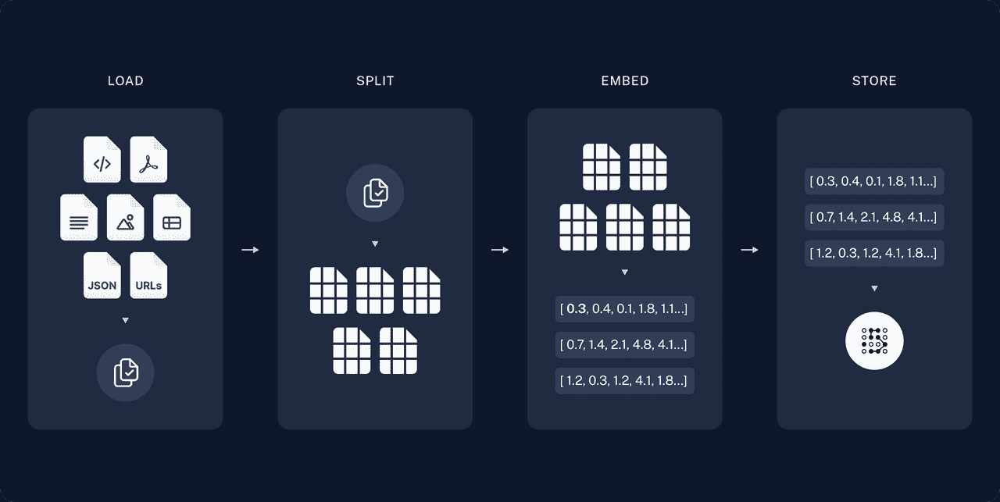
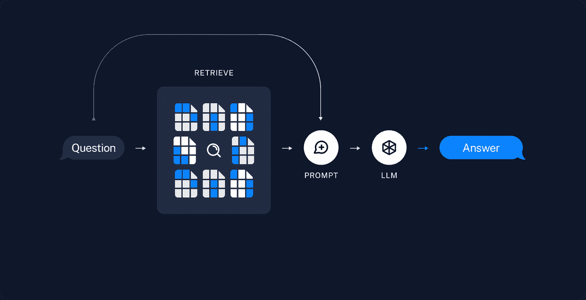

# Langchain —— RAG问答

> 来源：[https://v11enp9ok1h.feishu.cn/docx/MYXedFKyNouL5gxEJX1cICUunhc](https://v11enp9ok1h.feishu.cn/docx/MYXedFKyNouL5gxEJX1cICUunhc)

# 目录

+   [**快速入门**](https://python.langchain.com/v0.1/docs/use_cases/question_answering/quickstart/)**：**建议从此处开始。以下许多指南假定你完全了解快速入门中显示的体系结构。

+   [**返回源：**](https://python.langchain.com/v0.1/docs/use_cases/question_answering/sources/)如何返回特定一代中使用的源文档。

+   [**流式传输**](https://python.langchain.com/v0.1/docs/use_cases/question_answering/streaming/)**：**如何流式传输最终答案以及中间步骤。

+   [**添加聊天记录：**](https://python.langchain.com/v0.1/docs/use_cases/question_answering/chat_history/)如何将聊天记录添加到 Q&A 应用。

+   [**混合搜索**](https://python.langchain.com/v0.1/docs/use_cases/question_answering/hybrid/)**：**如何进行混合搜索。

+   [**每用户检索**](https://python.langchain.com/v0.1/docs/use_cases/question_answering/per_user/)**：**当每个用户都有自己的私有数据时，如何进行检索。

+   [**使用代理**](https://python.langchain.com/v0.1/docs/use_cases/question_answering/conversational_retrieval_agents/)**：**如何使用代理进行 Q&A。

+   [**使用本地模型**](https://python.langchain.com/v0.1/docs/use_cases/question_answering/local_retrieval_qa/)**：**如何使用本地模型进行问答。

#### 索引

1.  [加载：首先我们需要加载我们的数](https://python.langchain.com/v0.1/docs/modules/data_connection/document_loaders/)据。这是通过 DocumentLoaders 完成的。

1.  拆分：[文本拆分器将较大的文本拆分](https://python.langchain.com/v0.1/docs/modules/data_connection/document_transformers/)成较小的块。这对于索引数据和将其传递给模型都很有用，因为大块更难搜索，并且不适合模型的有限上下文窗口。Documents

1.  存储：我们需要一个地方来存储和索引我们的[拆分，以便以后可以搜索](https://python.langchain.com/v0.1/docs/modules/data_connection/vectorstores/)它们。[这通常使用 Vect](https://python.langchain.com/v0.1/docs/modules/data_connection/text_embedding/)orStore 和 Embeddings 模型来完成。

#### 检索和生成

1.  检索：给定用户输入，使用 [Retriever](https://python.langchain.com/v0.1/docs/modules/data_connection/retrievers/) 从存储中检索相关拆分。

1.  生成：[ChatModel](https://python.langchain.com/v0.1/docs/modules/model_io/chat/) / [LLM](https://python.langchain.com/v0.1/docs/modules/model_io/llms/) 使用包含问题和检索到的数据的提示生成答案

