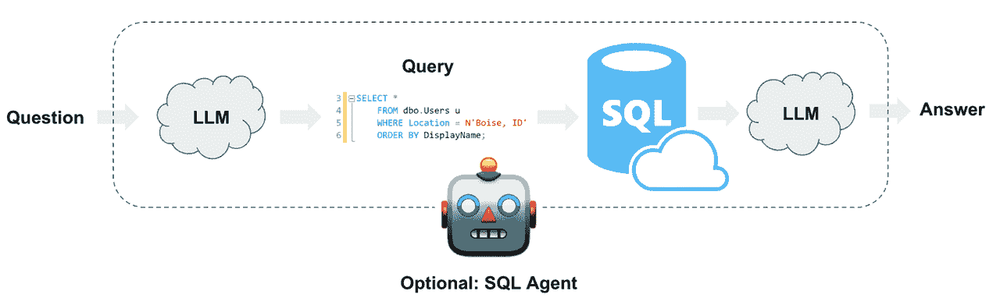

# Langchain ——通过SQL+CSV进行问答

> 来源：[https://v11enp9ok1h.feishu.cn/docx/UqPldQlp2oPpMCx1AdwcQzcknhd](https://v11enp9ok1h.feishu.cn/docx/UqPldQlp2oPpMCx1AdwcQzcknhd)

## 目录

+   [代理](https://python.langchain.com/v0.1/docs/use_cases/sql/agents/)：生成可以与 SQL DB 交互的代理。

+   [提示策略](https://python.langchain.com/v0.1/docs/use_cases/sql/prompting/)：改进 SQL 查询生成的策略。

+   [查询验证](https://python.langchain.com/v0.1/docs/use_cases/sql/query_checking/)：如何验证 SQL 查询。

+   [大型数据库](https://python.langchain.com/v0.1/docs/use_cases/sql/large_db/)：如何与具有许多表和高基数列的数据库进行交互。

## 快速入门

简而言之，任何 SQL 链和代理的步骤都是：

1.  将问题转换为 SQL 查询：模型将用户输入转换为 SQL 查询。

1.  执行 SQL 查询：执行 SQL 查询。

1.  回答问题：模型使用查询结果响应用户输入。



## 设置

首先，获取所需的包并设置环境变量：

```
%pip install --upgrade --quiet  langchain langchain-community langchain-openai
```

我们将在本指南中使用 OpenAI 模型。

```
import getpass
import os

os.environ[&quot;OPENAI_API_KEY&quot;] = getpass.getpass()

# Uncomment the below to use LangSmith. Not required.
# os.environ[&quot;LANGCHAIN_API_KEY&quot;] = getpass.getpass()
# os.environ[&quot;LANGCHAIN_TRACING_V2&quot;] = &quot;true&quot;
```

[下面的示例将](https://database.guide/2-sample-databases-sqlite/)使用与 Chinook 数据库的 SQLite 连接。按照以下安装步骤在与此笔记本相同的目录中创建：Chinook.db

+   将[此文件](https://raw.githubusercontent.com/lerocha/chinook-database/master/ChinookDatabase/DataSources/Chinook_Sqlite.sql)另存为Chinook_Sqlite.sql

+   跑sqlite3 Chinook.db

+   跑.read Chinook_Sqlite.sql

+   测试SELECT * FROM Artist LIMIT 10;

现在，在我们的目录中，我们可以使用 SQLAlchemy 驱动的类与它交互：Chinhook.dbSQLDatabase