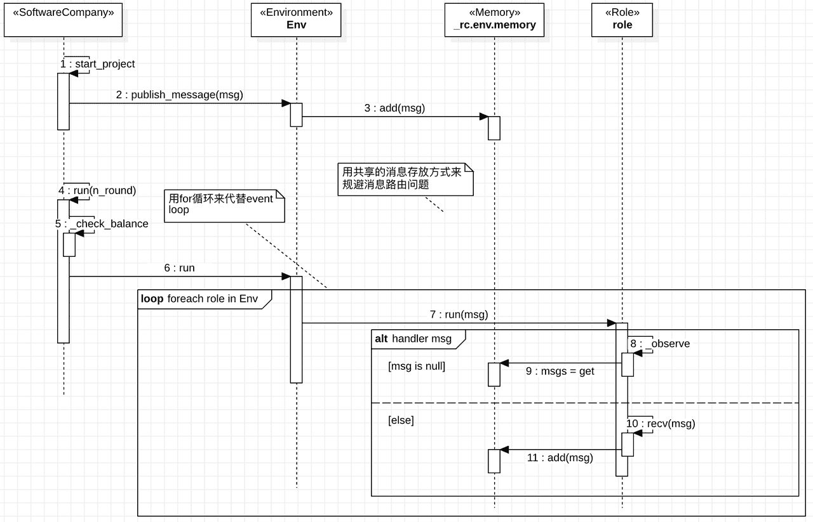
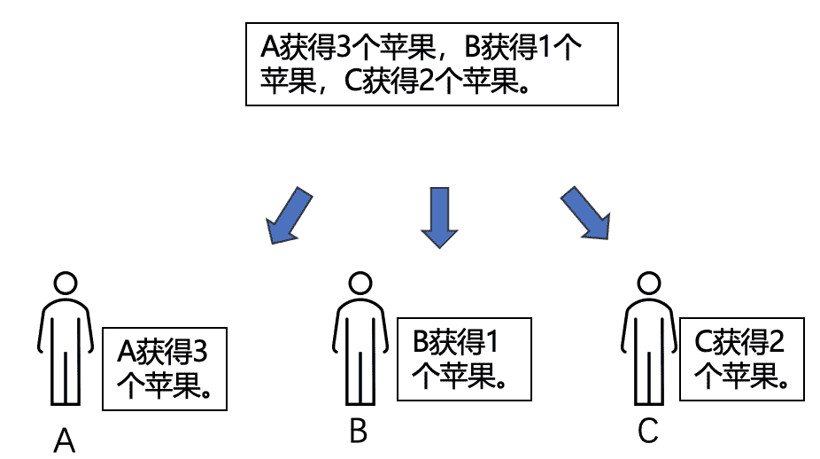
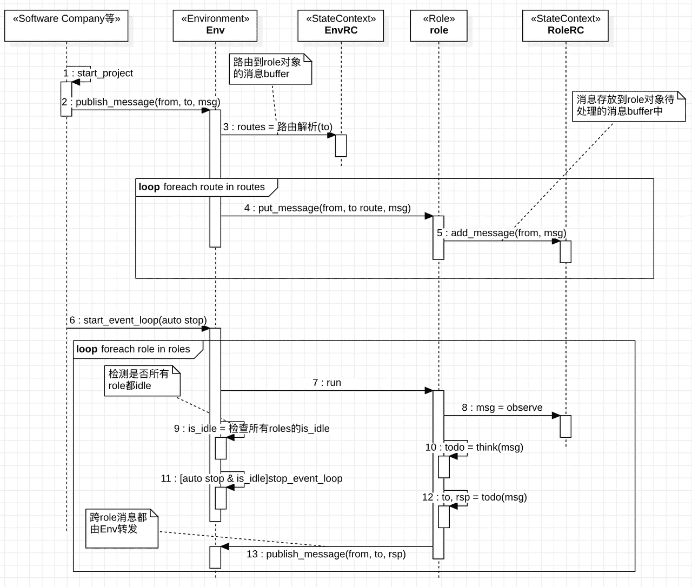
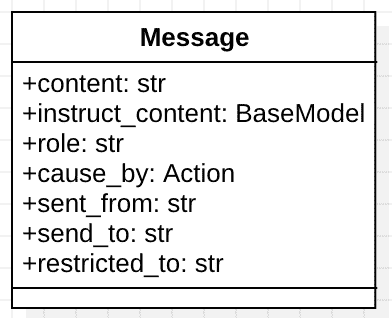
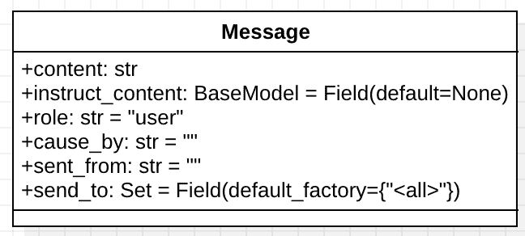
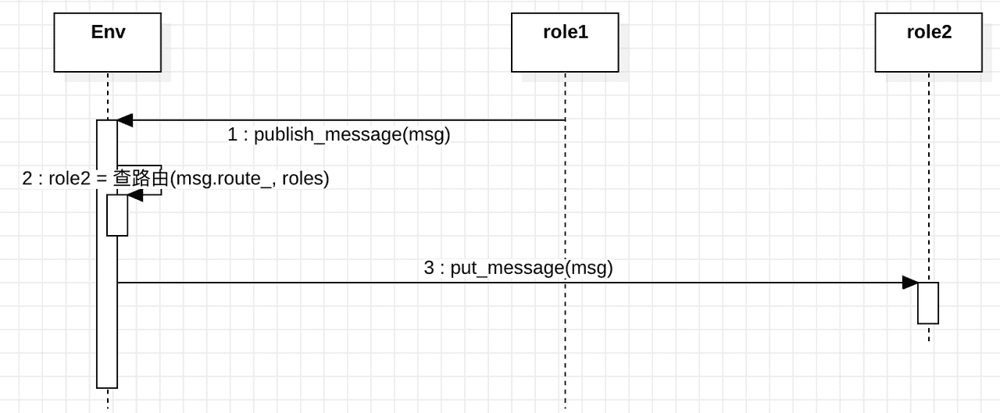

# MetaAgent：多智能体自动生成系统 (PRD)

> 来源：[https://v11enp9ok1h.feishu.cn/docx/HfN2dsO4QoDH4Sx6eGwcxBCpn7d](https://v11enp9ok1h.feishu.cn/docx/HfN2dsO4QoDH4Sx6eGwcxBCpn7d)

# 多Agent 角色对象间消息机制优化方案

# 文档修改记录

| ##### **日期** | ##### **版本** | ##### **作者** | ##### **修改内容** |
| --- | --- | --- | --- |
|  | ####### **v1** | #######   | ####### 创造 |
|  | ####### **v2** | #######   | ####### 删掉无用的设计 |

## 1.引言

###  背景

鉴于MetaGPT框架已经在软件公司、狼人杀等场景中得到应用，希望通过总结现有已有流程中发现的问题，来优化MetaGPT框架设计，以简化后续算法同学、第三方同学的开发工作，简化MetaGPT向Agent的迁移工作。

### 目标

明确下一步的 MetaGPT 框架优化方向，以：

1.  简化后续算法同学的开发工作

1.  简化第三方的开发工作

1.  简化MetaGPT向Agent的迁移工作

## 系统设计

###  系统架构

#### MetaGPT内部的消息处理

##### 现状



现有设计适合简单、轻量的智能体应用。

在处理持续交互、跨网交互方面存在以下问题：

1.  对于多轮场景，超参“n_round”的值难统一、难推荐。比如挖矿场景、软件开发场景。

1.  共享式的消息消费不支持跨网的消息消费；

1.  共享式的消息支架不支持个性化角色对象的记忆压缩和信息隔离，如下图所示：



##### 新的架构方案

###### 自驾车事件循环

新架构中，Env对象的事件循环终止的方式为：

1.  Env对外提供is_idle状态；

1.  外部可通过调节Env的stop函数来终止事件循环；

1.  外部通过调节start函数来启动事件循环。start参数中可指定事件循环是否在空闲时自动终止。



**新架构中：**

1.  所有消息均通过Environment对象提供的路由功能，将消息存放到各个Role对象内部的消息缓冲区中；

1.  所有状态数据都存放到一个支持序列化和反序列化的StateContext对象中；

1.  Env对象通过检查内部各个角色是否都空闲来判断是否需要结束事件循环；

1.  跨角色对象的消息转发统一由Environment对象负责。

#### 数据状态管理

地理位置，倾向规范数据状态的倾向。

> 新方案中，Role对象私用的状态数据统一在角色对象自己的StateContext对象中；跨Role对象的状态数据统一在Environment对象自己的StateContext对象中。

> Environment提供save和load函数，用于对Environment对象内部的状态数据归档和恢复。

#### 消息结构

##### 现状

良好的消息结构如图所示：



其中：

1.  content用来放置消息内容；

1.  instruct_content功能与content相同，区别在于存放和格式化的数据。

1.  role是OPENAI规范中定义的role值，是调LLM的参数的一部分。本质上是元信息的一部分。

1.  cause_by被同时使用分类（一种元信息）标签和路由标签：

```
async def _observe(self) -&gt; int:
    await super()._observe()
    # accept the very first human instruction (the debate topic) or messages sent (from opponent) to self,
    # disregard own messages from the last round
    self._rc.news = [msg for msg in self._rc.news if msg.cause_by == UserRequirement or msg.send_to == self.name]
    return len(self._rc.news)
```

1.  sent_from被用来显示展示时的发言者信息。本质上是元信息的一部分。

1.  send_to被用于路由参数，用于从共享消息队列中筛选发给自己的消息：

```
async def _observe(self) -&gt; int:
    await super()._observe()
    self._rc.news = [
        msg for msg in self._rc.news if msg.send_to == self.profile
    ]  # only relevant msgs count as observed news
    return len(self._rc.news)
```

1.  restricted_to被初始化群发（一发多）的路由参数，用于从共享消息队列中筛选发给自己的消息：

```
async def _think(self):
    news = self._rc.news[0]
    assert news.cause_by == InstructSpeak  # 消息为来自Moderator的指令时，才去做动作
    if not news.restricted_to:
        # 消息接收范围为全体角色的，做公开发言（发表投票观点也算发言）
        self._rc.todo = Speak()
    elif self.profile in news.restricted_to.split(&quot;,&quot;):
        # FIXME: hard code to split, restricted为&quot;Moderator&quot;或&quot;Moderator,角色profile&quot;
        # Moderator加密发给自己的，意味着要执行角色的特殊动作
        self._rc.todo = self.special_actions[0]()
```

#####

##### 新的消息结构

新消息的结构如图所示：



其中：

1.  为了支持Message类的JSON化，将cause_by类型替换成str，并封装了自动类型转换的功能；

1.  将原来send_to的str类型改为Set，以支持多标签“或关系”的消息订阅功能。如果Message对象在时未设置send_to的值，则默认是全员可创建接收（与现有公共内存的效果相同）。

1.  本次修改，MetaGPT 的消息处理遵循了消息队列的定义，明确了消息的生产和消费关系。

1.  一个。 新框架中，所有Role类及其子类都是消费者，它们默认订阅了发送给全员、自己对象的类名称、自己对象的name属性值的消息，参见相关的消息订阅标签章。

1.  b. 所有Message对象的创建者都是消息生产者，他们可以通过设置Message对象的send_to值来调整让谁来消费这条消息。

下面是一些新Message类的使用示例：

1.  设置cause_by属性：

```
m = Message(content=&quot;a&quot;, cause_by=Action)
assert m.cause_by == get_class_name(Action)
assert m.cause_by == any_to_str(Action)
```

1.  设置sent_from属性：

```
m = Message(content=&quot;a&quot;, sent_from=Action)
assert m.sent_from == get_class_name(Action)
assert m.sent_from == any_to_str(Action)
```

1.  设置sent_to属性：

```
m = Message(content=&quot;a&quot;， sent_to={&quot;b&quot;, Action})
assert m.send_to == {&quot;b&quot;, get_class_name(Action)}
assert m.send_to == any_to_str_set({&quot;b&quot;, Action})
```

######

###### 必须的消息订阅标签

为了简化业务开发工作，框架默认提供了3种消息订阅标签。其所有Role子类都已经订阅了这3种标签，开发者可在发消息时直接使用：

1.  Role对象的name属性：对应Role类及其子类对象的name属性的值。

1.  Role类的类名：对应任何Role类及其子类对象的类名。比如“Architect”类的类名为“metagpt.roles.architect.Architect”。

1.  全员：值为“<all>”。本地所有消费者，均收到此消息。

**示例如下：**

假设有如下几个Role类的子类对象：

1.  Moderator类对象r1, r1.name为a;

1.  Werewolf类对象r2, r2.name为b;

1.  Werewolf类对象r3, r3.name为c;

1.  Villager类对象r4, r4.name为d;

1.  Villager类对象r5, r5.name为e;

1.  Seer类对象r6, r6.name为f;

已知Environment类对象env：

1.  r1发消息给所有Werewolf类对象：

```
env.publish_message(Message(content=&quot;...&quot;, send_to=Werewolf))
```

这里Werewolf用的就是Role类的类名做标签。这个消息的接收者是所有的Werewolf类对象。

1.  r1发消息给c和所有Villager类对象：

```
env.publish_message(Message(content=&quot;...&quot;, send_to={Villager, &quot;c&quot;}))
```

这里类Villager是Role类名标签，c是Role对象r3的name属性。这个消息的接收者是所有Villager类对象，以及name属性c为Role对象r3。

1.  r1发消息给所有对象：

```
env.publish_message(Message(content=&quot;...&quot;, send_to=&quot;&lt;all&gt;&quot;))
```

该消息的接收者为所有群成员。

1.  r1发消息给c,, d:e

```
env.publish_message(Message(content=&quot;...&quot;, send_to={&quot;c&quot;, &quot;d&quot;, &quot;e&quot;}))
```

这个消息的接收者为r3、r4、r5。

###  MetaGPT需改造的模块

#### 消息结构

参考新的消息结构章节。

新的消息处理框架下，工件情况下Role类对象会收到所有消息（因为影响的Message.send_to是全员）。因此Role类的_observe里需要把自己关注的新增消息过滤出来，并判断是否有消息需要处理。

代码如下：

```
async def _observe(self) -&gt; int:
    &quot;&quot;&quot;Prepare new messages for processing from the message buffer and other sources.&quot;&quot;&quot;
    # Read unprocessed messages from the msg buffer.
    news = self._rc.msg_buffer.pop_all()
    # Store the read messages in your own memory to prevent duplicate processing.
    self._rc.memory.add_batch(news)
    # Filter out messages of interest.
    self._rc.news = [n for n in news if n.cause_by in self._rc.watch]

    # Design Rules:
    # If you need to further categorize Message objects, you can do so using the Message.set_meta function.
    # msg_buffer is a receiving buffer, avoid adding message data and operations to msg_buffer.
    news_text = [f&quot;{i.role}: {i.content[:20]}...&quot; for i in self._rc.news]
    if news_text:
        logger.debug(f&quot;{self._setting} observed: {news_text}&quot;)
    return len(self._rc.news)
```

####

#### 公共消息存储改变造成角色的消息存储

1.  取消公共消息存储，改为Role原生的消息存储。

```
class RoleContext(BaseModel):
    &quot;&quot;&quot;Role Runtime Context&quot;&quot;&quot;
    env: &#x27;Environment&#x27; = Field(default=None)
    memory: Memory = Field(default_factory=Memory)
    long_term_memory: LongTermMemory = Field(default_factory=LongTermMemory)
    state: int = Field(default=0)
    todo: Action = Field(default=None)
    watch: set[str] = Field(default_factory=set)
    news: list[Type[Message]] = Field(default=[])
```

Role中的所有self._rc.env.memory操作更改为self._rc.memory操作。

1.  所有消息转发都由Environment类的Env对象负责。禁止Role对象之间通过访问对方的内部消息存储来交换消息。



1.  所有Role对象增加一个接口的消息缓冲区，来接收异步put_message读取的消息。Role对象的观察操作(observe-think-act)需要同时看消息缓冲区和内存。

#### 取消超参k

目前流程的终止依赖Environment的run超参k和CostManager成本超支检查。

```
async def run(self, k=1):
    &quot;&quot;&quot;处理一次所有信息的运行
    Process all Role runs at once
    &quot;&quot;&quot;
    # while not self.message_queue.empty():
    # message = self.message_queue.get()
    # rsp = await self.manager.handle(message, self)
    # self.message_queue.put(rsp)
    for _ in range(k):
        futures = []
        for role in self.roles.values():
            future = role.run()
            futures.append(future)

        await asyncio.gather(*futures)
```

新的流程终止条件改为所有的self.roles对象的think都为空（Role对象内部的消息缓冲区为空，且无动作），或者成本超支。

#### 规范状态数据的存储

1.  新建一个支持序列化和反序列化save/load的StateContext类

1.  所有状态数据都需要加载这个类对象中。

1.  仅限Environment类和Role类拥有这个类的对象。