# AI产品经理（PRD文档模板）

> 来源：[https://v11enp9ok1h.feishu.cn/docx/GRazdNFbJo1uHMxYidAcsW17nRg](https://v11enp9ok1h.feishu.cn/docx/GRazdNFbJo1uHMxYidAcsW17nRg)

# MetaGPT软件公司增量需求开发方案设计 v1.0.1

## 文档负责人：

## 文档修改记录

| 日期 | 版本 | 作者 | 修改内容 |
| --- | --- | --- | --- |
| 2023年11月13日 | v1.0 | | 创造 |
| 2023年11月16日 | v1.1 | | 修改 2.2.3 架构章节章节 |
| 2023年11月17日 | v1.2 | | 增加 2.2.3.13 输出件和消息分离章节 |
| 2023年11月23日 | v1.3 | | 增加 2.2.3.5.1 `WriteCode` 和 `WriteCodeReview` 改造 |
| 2023年12月1日 | v1.4 | | 更新 2.2.3.5 流程变更章节的场景图 |
| 2023年12月5日 | v1.5 | | 更新 2.2.3.5.5 章节，工程师增加 `SummarizeCode` 阶段。 |
| 2023年12月13日 | v1.6 | | 1. 更新 2.2.3.4 章节的 `docs/bugfix.txt`  2. 更新 2.2.3.5.2 章节的 `WritePRD`，新增对 bug 反馈的处理  3. 更新 2.2.3.5.5 章节，新增修复 bug 相关流程。 |

## 引言

### 背景

现有的 MetaGPT 软件公司仅支持从头重新开发软件。此类软件开发方式：

1. 与实际的软件开发不符。软件开发过程是一个反复迭代的过程，通过迭代重新认识需求、调整目标和优化设计。
2. 用户提出希望软件公司支持增量开发的需求。

### 目标

MetaGPT 软件公司增加了在历史版本基础上的增量开发的功能，包括：

1. 多版本管理
2. 变更日志/差异输出
3. 版本切换

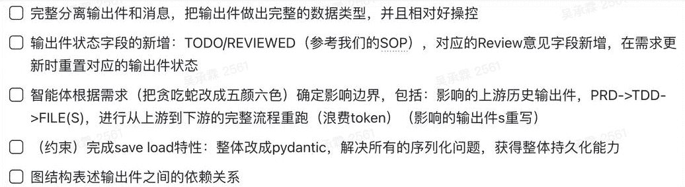

### 非目标

LLM 输出结果的优化非本设计的目标。

## 系统设计

### 设计介绍

#### 竞品分析

无

#### 现状

MetaGPT Software 公司软件开发现有流程如下：

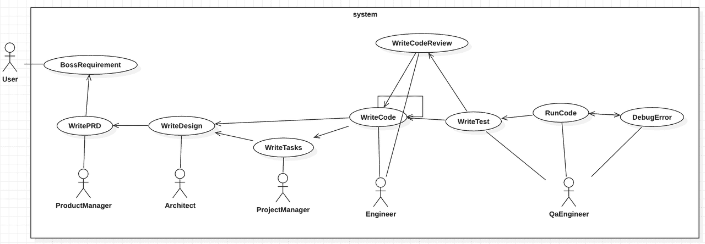

##### 行动

###### 写入 PRD

输入：原始用户需求，即“贪吃蛇游戏”

输出：

```json
{
  &quot;Original Requirements&quot;: &quot;Create a snake game&quot;,
  &quot;Search Information&quot;: &quot;&quot;,
  &quot;Requirements&quot;: &quot;&quot;,
  &quot;Product Goals&quot;: [
    &quot;Provide an enjoyable gaming experience&quot;,
    &quot;Ensure smooth and responsive controls&quot;,
    &quot;Include engaging visuals and sound effects&quot;
  ],
  &quot;User Stories&quot;: [
    &quot;As a player, I want to control the snake using arrow keys to navigate through the game board&quot;,
    &quot;As a player, I want the snake to grow longer and increase in speed as it consumes food&quot;,
    &quot;As a player, I want to see my high score and be able to compare it with other players&quot;,
    &quot;As a player, I want to have different levels of difficulty to challenge myself&quot;,
    &quot;As a player, I want to be able to pause and resume the game at any time&quot;
  ],
  &quot;Competitive Analysis&quot;: [
    &quot;Snake Game X has a simple and intuitive user interface&quot;,
    &quot;Snake Game Y offers multiple game modes and power-ups&quot;,
    &quot;Snake Game Z has a leaderboard feature to compare scores with friends&quot;,
    &quot;Snake Game A has smooth and responsive controls&quot;,
    &quot;Snake Game B has visually appealing graphics and animations&quot;,
    &quot;Snake Game C offers customizable snake skins&quot;,
    &quot;Snake Game D has challenging obstacles and mazes&quot;
  ],
  &quot;Competitive Quadrant Chart&quot;: &quot;quadrantChart\n title Reach and engagement of snake games\n x-axis Low Reach --&gt; High Reach\n y-axis Low Engagement --&gt; High Engagement\n quadrant-1 Snake Game X: [0.3, 0.6]\n quadrant-2 Snake Game Y: [0.45, 0.23]\n quadrant-3 Snake Game Z: [0.57, 0.69]\n quadrant-4 Snake Game A: [0.78, 0.34]\n Snake Game B: [0.40, 0.34]\n Snake Game C: [0.35, 0.78]\n Snake Game D: [0.5, 0.6]&quot;,
  &quot;Requirement Analysis&quot;: &quot;&quot;,
  &quot;Requirement Pool&quot;: [
    [
      &quot;P0&quot;,
      &quot;The snake should move smoothly and responsively when controlled by the player.&quot;
    ],
    [
      &quot;P1&quot;,
      &quot;The game should have different levels of difficulty to cater to players of different skill levels.&quot;
    ]
  ],
  &quot;UI Design draft&quot;: &quot;The game will have a simple and clean user interface. It will consist of a game board where the snake moves and food appears. The score and high score will be displayed at the top of the screen. There will be buttons to pause and resume the game. The snake and food will have visually appealing graphics.&quot;,
  &quot;Anything UNCLEAR&quot;: &quot;&quot;
}
```

###### 写作设计

输入：`WritePRD` 输出 输出：

```json
{
  &quot;Implementation approach&quot;: &quot;We will use the Pygame library to implement the snake game. Pygame is a popular open-source library for game development in Python. It provides a simple and intuitive API for handling graphics, sound, and user input. Pygame also has good documentation and a large community, making it easy to find resources and support. Additionally, we will follow the PEP8 coding style guidelines to ensure clean and readable code.&quot;,
  &quot;Python package name&quot;: &quot;snake_game&quot;,
  &quot;File list&quot;: [&quot;main.py&quot;],
  &quot;Data structures and interface definitions&quot;: ```

    classDiagram

    class Game{

      -int score

      -Snake snake

      -Food food

      +start_game() : void

      +end_game() : void

      +pause_game() : void

      +resume_game() : void

      +move_snake(direction: str) : void

      +eat_food() : void

      +update_score() : void

    }

    class Snake{

      -List[Tuple[int, int]] body

      -str direction

      +move() : void

      +change_direction(new_direction: str) : void

      +grow() : void

      +collides_with_self() : bool

      +collides_with_food(food_position: Tuple[int, int]) : bool

    }

    class Food{

      -Tuple[int, int] position

      +generate() : void

      +get_position() : Tuple[int, int]

    }

    Game &quot;1&quot; -- &quot;1&quot; Snake: has

    Game &quot;1&quot; -- &quot;1&quot; Food: has

    ```,
  &quot;Program call flow&quot;: ```

    sequenceDiagram

    participant M as Main

    participant G as Game

    participant S as Snake

    participant F as Food

    M-&gt;&gt;G: start_game()

    G-&gt;&gt;S: move_snake(direction)

    S-&gt;&gt;S: move()

    S--&gt;&gt;G: move_snake()

    G-&gt;&gt;S: eat_food()

    S-&gt;&gt;S: grow()

    S-&gt;&gt;S: [asdfsa]collides_with_self(asdf)

    S-&gt;&gt;F: collides_with_food()

    F-&gt;&gt;F: generate()

    G-&gt;&gt;G: update_score()

    G-&gt;&gt;M: end_game()

    G-&gt;&gt;M: pause_game()

    G-&gt;&gt;M: resume_game()

    ```,
  &quot;Anything UNCLEAR&quot;: &quot;The requirements are clear to me.&quot;
}
```

其中：

a. [`classDiagram`](https://github.com/mermaid-js/mermaid/blob/develop/README.zh-CN.md) 使用的是美人鱼图语法；

b. [`sequenceDiagram`](https://github.com/mermaid-js/mermaid/blob/develop/README.zh-CN.md) 使用的是美人鱼图语法；

c. `metagpt/actions/design_api.py` 的 `_save` 中，用 `recreate_workspace` 函数清空了文件夹。

输出文件：`workspace/snake_game/docs/prd.md`


# Snake Game Design Document

## Original Requirements

Design a snake game

## Product Goals

- Provide an engaging and addictive gameplay experience
- Offer intuitive controls for easy navigation
- Include various levels of difficulty to cater to different players

## User Stories

- As a player, I want to control the `snake`'s movement using arrow keys
- As a player, I want to see my score increase as I eat the food
- As a player, I want to challenge myself with different levels of difficulty
- As a player, I want to compete with my friends for the highest score
- As a player, I want to be able to pause and resume the game

## Competitive Analysis

- Snake Game X has a simple and intuitive user interface
- Snake Game Y offers multiple game modes and power-ups
- Snake Game Z has a leaderboard feature for competitive play
- Snake Game A has smooth and responsive controls
- Snake Game B provides customizable snake skins
- Snake Game C offers different themes and backgrounds
- Snake Game D has a tutorial mode for beginners

## Competitive Quadrant Chart

```
quadrantChart
 title Reach and engagement of snake games
 x-axis Low Reach --> High Reach
 y-axis Low Engagement --> High Engagement
 quadrant-1 Expand
 quadrant-2 Promote
 quadrant-3 Re-evaluate
 quadrant-4 Improve
 Snake Game X: [0.6, 0.7]
 Snake Game Y: [0.8, 0.5]
 Snake Game Z: [0.7, 0.8]
 Snake Game A: [0.6, 0.6]
 Snake Game B: [0.5, 0.6]
 Snake Game C: [0.4, 0.5]
 Snake Game D: [0.5, 0.4]
 Our Target Game: [0.7, 0.7]
```

## Requirement Analysis

## Requirement Pool

- `['P0', 'The snake should move smoothly and responsively']`
- `['P1', 'The game should have multiple levels of difficulty']`
- `['P2', 'The game should have a leaderboard feature for competitive play']`

## UI Design draft

The game will have a simple and clean user interface. It will consist of a game board where the `snake` and `food` will be displayed. The `score` will be shown at the top of the screen. The controls will be arrow keys for movement. The game board will have a grid layout to represent the `snake`'s movement. The colors used will be vibrant and visually appealing. The UI will be designed to be intuitive and easy to navigate.

## Anything UNCLEAR

`workspace/snake_game/resources/competitive_analysis.mmd`

```
quadrantChart
    title Reach and engagement of snake games
    x-axis Low Reach --> High Reach
    y-axis Low Engagement --> High Engagement
    quadrant-1 Expand
    quadrant-2 Promote
    quadrant-3 Re-evaluate
    quadrant-4 Improve
    Snake Game X: [0.6, 0.7]
    Snake Game Y: [0.8, 0.5]
    Snake Game Z: [0.7, 0.8]
    Snake Game A: [0.6, 0.6]
    Snake Game B: [0.5, 0.6]
    Snake Game C: [0.4, 0.5]
    Snake Game D: [0.5, 0.4]
    Our Target Game: [0.7, 0.7]
```

`workspace/snake_game/resources/data_api_design.mmd`

```
classDiagram
    class Game{
        -int score
        -Snake snake
        -Food food
        +start_game() : void
        +end_game() : void
        +pause_game() : void
        +resume_game() : void
        +move_snake(direction: str) : void
        +eat_food() : void
        +update_score() : void
    }

    class Snake{
        -List[Tuple[int, int]] body
        -str direction
        +move() : void
        +change_direction(new_direction: str) : void
        +grow() : void
        +collides_with_self() : bool
        +collides_with_food(food_position: Tuple[int, int]) : bool
    }

    class Food{
        -Tuple[int, int] position
        +generate() : void
        +get_position() : Tuple[int, int]
    }

    Game "1" -- "1" Snake: has
    Game "1" -- "1" Food: has
```

`workspace/snake_game/resources/seq_flow.mmd`

```
sequenceDiagram
    participant M as Main
    participant G as Game
    participant S as Snake
    participant F as Food

    M->>G: start_game()
    G->>S: move_snake(direction)
    S->>S: move()
    S-->>G: move_snake()
    G->>S: eat_food()
    S->>S: grow()
    S->>S: collides_with_self()
    S->>F: collides_with_food()
    F->>F: generate()
    G->>G: update_score()
    G->>M: end_game()
    G->>M: pause_game()
    G->>M: resume_game()
```

`workspace/snake_game/docs/system_design.md`

```
## Implementation approach

We will use the `Pygame` library to implement the snake game. `Pygame` is a popular open-source library for game development in Python. It provides a simple and intuitive API for handling graphics, sound, and user input. `Pygame` also has good documentation and a large community, making it easy to find resources and support. Additionally, we will follow the `PEP8` coding style guidelines to ensure clean and readable code.

## Python package name

`snake_game`

## File list

- `main.py`

## Data structures and interface definitions

    classDiagram
        class Game{
            -int score
            -Snake snake
            -Food food
            +start_game() : void
            +end_game() : void
            +pause_game() : void
            +resume_game() : void
            +move_snake(direction: str) : void
            +eat_food() : void
            +update_score() : void
        }

        class Snake{
            -List[Tuple[int, int]] body
            -str direction
            +move() : void
            +change_direction(new_direction: str) : void
            +grow() : void
            +collides_with_self() : bool
            +collides_with_food(food_position: Tuple[int, int]) : bool
        }

        class Food{
            -Tuple[int, int] position
            +generate() : void
            +get_position() : Tuple[int, int]
        }

        Game "1" -- "1" Snake: has
        Game "1" -- "1" Food: has

## Program call flow

    sequenceDiagram
        participant M as Main
        participant G as Game
        participant S as Snake
        participant F as Food

        M->>G: start_game()
        G->>S: move_snake(direction)
        S->>S: move()
        S-->>G: move_snake()
        G->>S: eat_food()
        S->>S: grow()
        S->>S: collides_with_self()
        S->>F: collides_with_food()
        F->>F: generate()
        G->>G: update_score()
        G->>M: end_game()
        G->>M: pause_game()
        G->>M: resume_game()

## Anything UNCLEAR

The requirements are clear to me.
```

`workspace/snake_game/docs/api_spec_and_tasks.md`

```
{
    "Required Python third-party packages": [
        "pygame==2.0.1"
    ],
    "Required Other language third-party packages": [
        "No third-party ..."
    ],
    "Full API spec": ```

        openapi: 3.0.0

        ...

        description: A JSON object ...

     ```,
    "Logic Analysis": [
        ["main.py", "Game"],
        ["main.py", "Snake"],
        ["main.py", "Food"]
    ],
    "Task list": [
        "main.py"
    ],
    "Shared Knowledge": """
        'main.py' contains the implementation of the Game class, Snake class, and Food class. The Game class is responsible for managing the game flow, including starting, ending, pausing, and resuming the game. The Snake class represents the snake in the game, handling its movement, growth, and collision detection. The Food class represents the food in the game, generating new positions and checking for collisions with the snake.
    """,
    "Anything UNCLEAR": "No unclear points."
}
```

`workspace/snake_game/requirements.txt`

```
pygame==2.0.1
```

## 写入任务

输入：`WriteDesign` 输出 输出：

1.  `workspace/snake_game/docs/api_spec_and_tasks.md`

```

{
    "Required Python third-party packages": [
        "pygame==2.0.1"
    ],
    "Required Other language third-party packages": [
        "No third-party ..."
    ],
    "Full API spec": ```

        openapi: 3.0.0

        ...

        description: A JSON object ...

     ```,
    "Logic Analysis": [
        ["main.py", "Game"],
        ["main.py", "Snake"],
        ["main.py", "Food"]
    ],
    "Task list": [
        "main.py"
    ],
    "Shared Knowledge": """
        'main.py' contains the implementation of the Game class, Snake class, and Food class. The Game class is responsible for managing the game flow, including starting, ending, pausing, and resuming the game. The Snake class represents the snake in the game, handling its movement, growth, and collision detection. The Food class represents the food in the game, generating new positions and checking for collisions with the snake.
    """,
    "Anything UNCLEAR": "No unclear points."
}
```

1.  `workspace/snake_game/requirements.txt`

```
pygame==2.0.1
```

## 写入代码

输入：`WriteTasks` 输出 + `WriteDesign` 输出+已有代码内存


# 项目配置与实现说明

## Required Python third-party packages

`pygame==2.0.1`

## Required Other language third-party packages

No third-party ...

## Full API spec

```
openapi: 3.0.0
...
description: A JSON object ...
```

## Logic Analysis

- [`main.py`, `Game`]
- [`main.py`, `Snake`]
- [`main.py`, `Food`]

## Task list

- `main.py`

## Shared Knowledge

`main.py` contains the implementation of the `Game` class, `Snake` class, and `Food` class. The `Game` class is responsible for managing the game flow, including starting, ending, pausing, and resuming the game. The `Snake` class represents the snake in the game, handling its movement, growth, and collision detection. The `Food` class represents the food in the game, generating new positions and checking for collisions with the snake.

## Anything UNCLEAR

No unclear points.

# 实现方案

## Implementation approach

We will use the `Pygame` library to implement the snake game. `Pygame` is a popular open-source library for game development in Python. It provides a simple and intuitive API for handling graphics, sound, and user input. `Pygame` also has good documentation and a large community, making it easy to find resources and support. Additionally, we will follow the PEP8 coding style guidelines to ensure clean and readable code.

## Python package name

`snake_game`

## File list

- `main.py`

## Data structures and interface definitions

```
classDiagram

    class Game{

        -int score

        -Snake snake

        -Food food

        +start_game() : void

        +end_game() : void

        +pause_game() : void

        +resume_game() : void

        +move_snake(direction: str) : void

        +eat_food() : void

        +update_score() : void

    }

    class Snake{

        -List[Tuple[int, int]] body

        -str direction

        +move() : void

        +change_direction(new_direction: str) : void

        +grow() : void

        +collides_with_self() : bool

        +collides_with_food(food_position: Tuple[int, int]) : bool

    }

    class Food{

        -Tuple[int, int] position

        +generate() : void

        +get_position() : Tuple[int, int]

    }

    Game "1" -- "1" Snake: has

    Game "1" -- "1" Food: has
```

## Program call flow

```
sequenceDiagram

    participant M as Main

    participant G as Game

    participant S as Snake

    participant F as Food

    M->>G: start_game()

    G->>S: move_snake(direction)

    S->>S: move()

    S-->>G: move_snake()

    G->>S: eat_food()

    S->>S: grow()

    S->>S: collides_with_self()

    S->>F: collides_with_food()

    F->>F: generate()

    G->>G: update_score()

    G->>M: end_game()

    G->>M: pause_game()

    G->>M: resume_game()
```

## Anything UNCLEAR

The requirements are clear to me.

# 文件结构

## `a.py`

....

## `b.py`

....

### 输出

`*.py`


## main.py

```python
"""
main.py
"""

import pygame
import random

class Game:
    def __init__(self):
        self.score = 0
        self.snake = Snake()
        self.food = Food()

    def start_game(self):
        pygame.init()
        self.screen = pygame.display.set_mode((800, 600))
        pygame.display.set_caption("Snake Game")
        self.clock = pygame.time.Clock()
        self.running = True

        while self.running:
            for event in pygame.event.get():
                if event.type == pygame.QUIT:
                    self.end_game()
                elif event.type == pygame.KEYDOWN:
                    if event.key == pygame.K_p:
                        self.pause_game()
                    elif event.key == pygame.K_r:
                        self.resume_game()
                    elif event.key == pygame.K_UP:
                        self.move_snake("UP")
                    elif event.key == pygame.K_DOWN:
                        self.move_snake("DOWN")
                    elif event.key == pygame.K_LEFT:
                        self.move_snake("LEFT")
                    elif event.key == pygame.K_RIGHT:
                        self.move_snake("RIGHT")

            self.screen.fill((0, 0, 0))
            self.snake.move()
            self.check_collision()
            self.draw_snake()
            self.draw_food()
            self.update_score()
            pygame.display.update()
            self.clock.tick(10)

    def end_game(self):
        pygame.quit()
        self.running = False

    def pause_game(self):
        self.running = False

    def resume_game(self):
        self.running = True

    def move_snake(self, direction):
        self.snake.change_direction(direction)

    def eat_food(self):
        self.snake.grow()
        self.food.generate()
        self.score += 1

    def update_score(self):
        font = pygame.font.Font(None, 36)
        text = font.render(f"Score: {self.score}", True, (255, 255, 255))
        self.screen.blit(text, (10, 10))

    def check_collision(self):
        if self.snake.collides_with_self():
            self.end_game()
        elif self.snake.collides_with_food(self.food.get_position()):
            self.eat_food()

    def draw_snake(self):
        for segment in self.snake.body:
            pygame.draw.rect(self.screen, (0, 255, 0), (segment[0], segment[1], 20, 20))

    def draw_food(self):
        pygame.draw.rect(self.screen, (255, 0, 0), (self.food.position[0], self.food.position[1], 20, 20))


class Snake:
    def __init__(self):
        self.body = [(100, 100), (80, 100), (60, 100)]
        self.direction = "RIGHT"

    def move(self):
        if self.direction == "UP":
            head = (self.body[0][0], self.body[0][1] - 20)
        elif self.direction == "DOWN":
            head = (self.body[0][0], self.body[0][1] + 20)
        elif self.direction == "LEFT":
            head = (self.body[0][0] - 20, self.body[0][1])
        elif self.direction == "RIGHT":
            head = (self.body[0][0] + 20, self.body[0][1])

        self.body.insert(0, head)
        self.body.pop()

    def change_direction(self, new_direction):
        if new_direction == "UP" and self.direction != "DOWN":
            self.direction = new_direction
        elif new_direction == "DOWN" and self.direction != "UP":
            self.direction = new_direction
        elif new_direction == "LEFT" and self.direction != "RIGHT":
            self.direction = new_direction
        elif new_direction == "RIGHT" and self.direction != "LEFT":
            self.direction = new_direction

    def grow(self):
        tail = self.body[-1]
        self.body.append(tail)

    def collides_with_self(self):
        head = self.body[0]
        return head in self.body[1:]

    def collides_with_food(self, food_position):
        head = self.body[0]
        return head == food_position


class Food:
    def __init__(self):
        self.position = (random.randint(1, 39) * 20, random.randint(1, 29) * 20)

    def generate(self):
        self.position = (random.randint(1, 39) * 20, random.randint(1, 29) * 20)

    def get_position(self):
        return self.position


if __name__ == "__main__":
    game = Game()
    game.start_game()
```

## 珠三角

PRD 是 `WritePRD` 动作输出的结果。

PRD 的内容包括以下几部分：

| 字段名 | 是否可修改增量 | 字段值示例 |
| --- | --- | --- |
| 原始要求 | 否 | “创造一个贪吃蛇游戏” |
| 搜索信息 | 否 | “” |
| 项目名称 | 否 | 如果想修改，请通过 CLI 命令参数 `--project-name` 进行 |
| 要求 | 否 | “” |
| 产品目标 | 是 | [  “提供愉快的游戏体验”、  “确保流畅且反应灵敏的控制”、  “包含引人入胜的视觉效果和音效”  ] |
| 用户故事 | 是 | [  “作为玩家，我希望使用方向键控制蛇在游戏上面移动”、  “玩家，我希望蛇在消耗食物的同时，能够提高长并速度”、  “作为玩家，我希望看到我的最高分，并与其他玩家进行比较”、  “作为玩家，我希望有不同的难度级别来挑战自己”、  “作为玩家，我希望能够随时暂停并继续游戏”  ] |
| 竞争分析 | 否 | [  “贪吃蛇游戏 X 拥有简洁直观的用户界面”、  “贪吃蛇游戏 Y 提供多种游戏模式和强化道具”、  “贪吃蛇游戏 Z 拥有排行榜功能，可以与好友一较高低”、  “贪吃蛇游戏 A 拥有流畅灵敏的控制”、  “贪吃蛇游戏 B 拥有极具视觉吸引力的图形和动画”、  “贪吃蛇游戏 C 提供可定制的蛇皮”、  “贪吃蛇游戏 D 拥有极具挑战性的障碍和迷宫”  ] |
| 竞争象限图 | 否 | “quadrantChart\n 标题 贪吃蛇游戏的覆盖率和参与度\n x 轴 低覆盖率 --> 高覆盖率\n y 轴 低参与度 --> 高参与度\n 象限-1 贪吃蛇游戏 X: [0.3, 0.6]\n 象限-2 贪吃蛇游戏 Y: [0.45, 0.23]\n 象限-3 贪吃蛇游戏 Z: [0.57, 0.69]\n 象限-4 贪吃蛇游戏 A: [0.78, 0.34]\n 贪吃蛇游戏 B: [0.40, 0.34]\n 贪吃蛇游戏 C: [0.35, 0.78]\n 贪吃蛇游戏 D: [0.5, 0.6]” |
| 需求分析 | 否 | “” |
| 需求池 | 是 | [  [  `P0`,  “当玩家控制蛇时，蛇应该移动流畅且反应灵敏。”  ],  [  `P1`,  “游戏应该有不同难度级别，以满足不同技能水平的玩家。”  ]  ] |
| UI 设计稿 | 是 | 游戏将拥有简洁明了的用户界面。它由一个游戏板组成，蛇会在游戏板上移动，食物也会随之出现。得分和最高分将显示在屏幕顶部。游戏还设有暂停和继续游戏的按钮。蛇和食物的图形都将非常美观。 |
| 任何不清楚的事情 | 否 | “” |

## 类视图和相关图

类视图和动画图都是 `WriteDesign` 的输出的一部分。

类视图与相关图都使用了基于 [Mermaid](https://mermaid.js.org/syntax/classDiagram.html) 的纯文本 UML，语法描述了某个用例下的控制流和数据流。因此，对类视图或同类图的修改，需要同时重写类视图和相关图。

类视图示例：

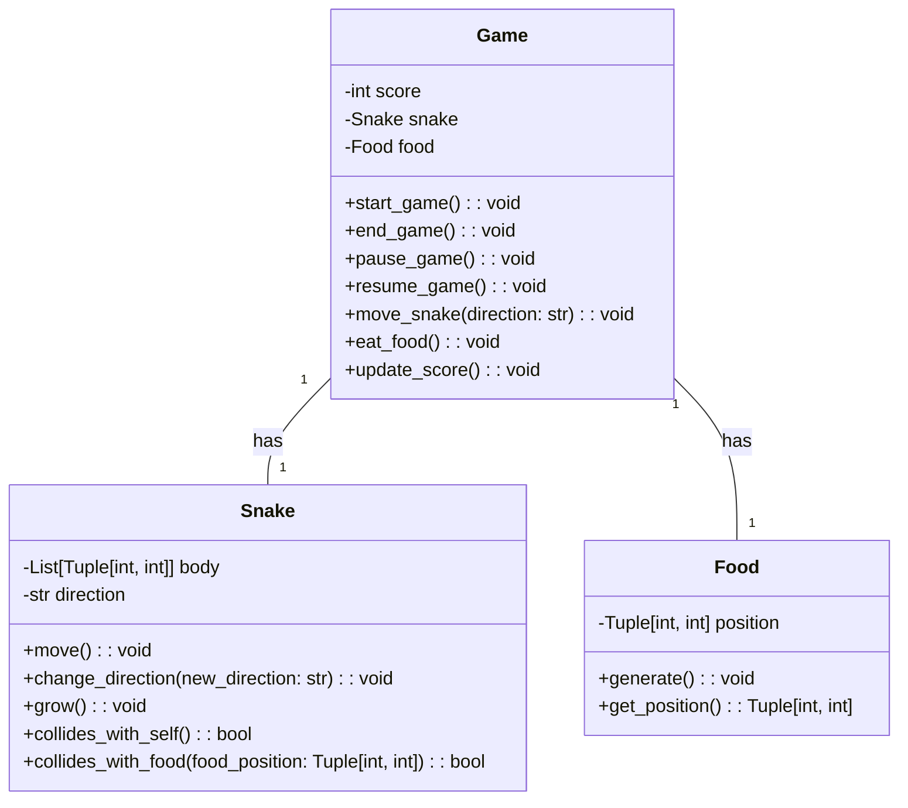

实例图示例：

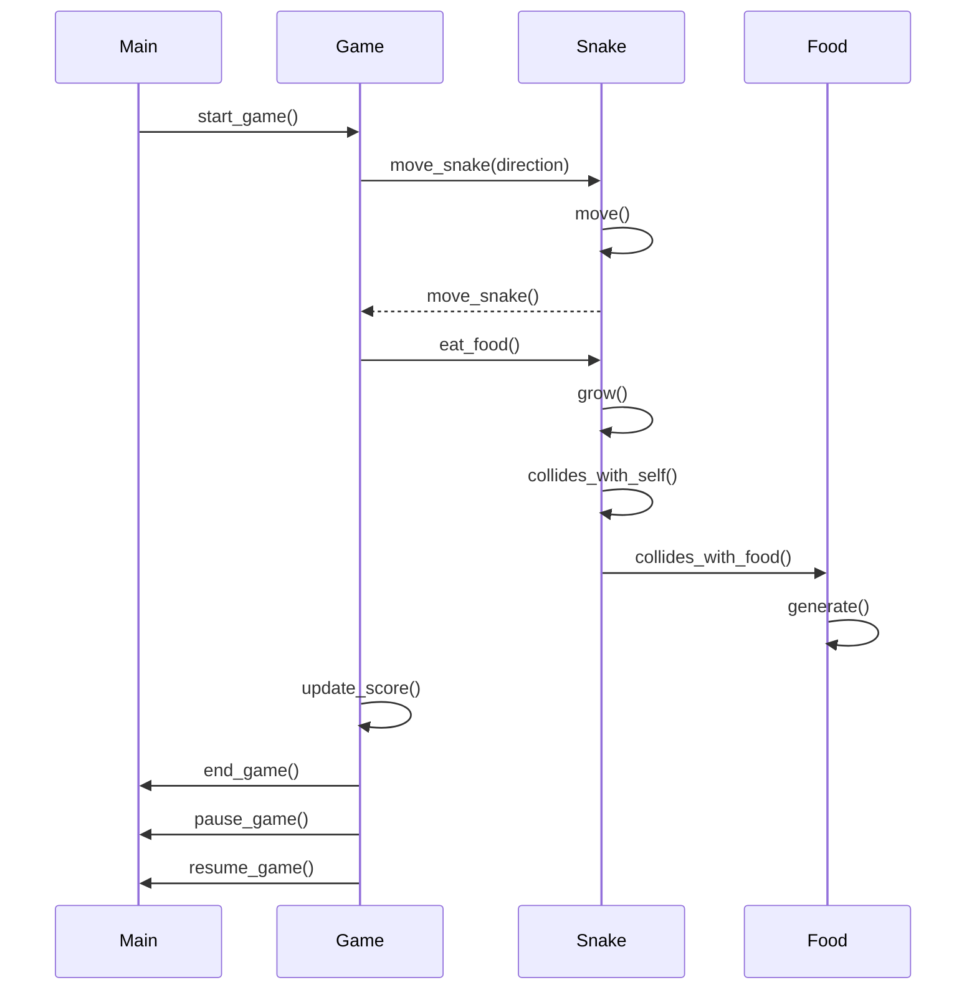

## 写入任务

`WriteTasks` 的输出定义了类视图中的类对应的文件名。其中，逻辑分析中的类名引用是 `WriteDesign` 类视图中的类名。

修改 `WriteTasks` 只能改变要生成那些代码文件的逻辑。

```json
"Logic Analysis": [
    ["main.py", "Game"],
    ["main.py", "Snake"],
    ["main.py", "Food"]
],
"Task list": [
    "main.py"
],
```

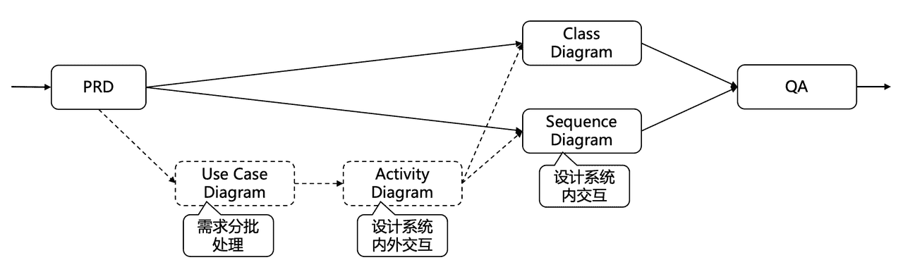

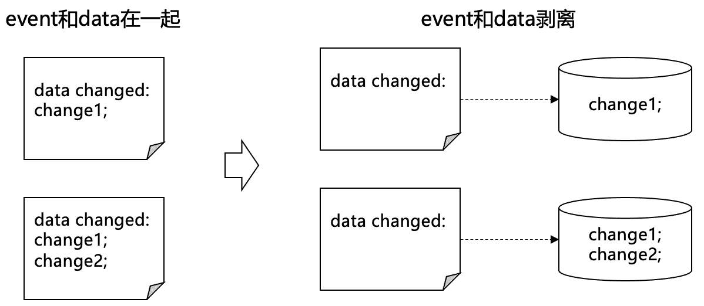

## 编写代码和 QA


# 系统架构

`WriteCode`依赖上游的类视图和相关图。人工如果修改`WriteCode`的输出代码，这种修改必须是基于类视图和相关图的。比如修改代码。QA阶段是对`WriteCode`的输出进行测试，这里增加人机实时交互，可以指导AI丰富的测试方式和方向测试要。对于但简单的代码方面，重跑QA重构人机交互方式的QA简单直接。

## 前提条件

1. `MetaGPT`的控制台交互方式决定了用户只能通过文本方式来发起增量变更；
2. `PRD`使用`Mermaid`语法缺少用例图和活动图描述能力，决定了所开发的软件复杂度不高；

## 可进行的变更

基于上面的框架前提约束，再结合现状章节中各个动作的输入输出关系，软件公司可支持的变更关系如下：

1. 在写`PRD`阶段，变更：
   a. `Requirement Pool`（p0）
   b. `Product Goals`
   c. `User Stories`
   d. `UI Design draft`

2. 在撰写设计阶段，变更：
   a. 类`View`中的类型、命名、返回值类型等
   b. 在突发变更流程的跳跃条件、交互步骤等

3. 在编写代码及其后期阶段
   a. 重新生成指定文件的代码、`QA`
   b. 修改指定文件的代码，并重新运行其`QA`

## 负载幅度

### 波动原则

1. 将旧框架中消息负责提交数据内容的方式，调整为用消息来提交参考文件名，由`action`从参考文件中加载数据内容的方式；
2. 所有增量信息，都先落地成文件，通过文件名来引用和使用。
3. 代币消耗最小化。

### 消息编号

将文件数据从消息内分割后，会出现消息内容相同但事件含义不同的情况，如下图所示：

为此，在`Message`中增加`id`属性，来区分是否是同一个`Message`。

```
class Message(BaseModel):
    """list[<role>: <content>]"""

    id: str
    content: str
    instruct_content: BaseModel = Field(default=None)
    role: str = "user"  # system / user / assistant
    cause_by: str = ""
    sent_from: str = ""
    send_to: Set = Field(default_factory={MESSAGE_ROUTE_TO_ALL})
```

### .dependencies.json文件

根据本次框架的波动原则，在当前的输出根目录下，新增`.dependencies.json`文件。`.dependencies.json`文件可通过`FileRepository`类访问。关于`FileRepository`类，参见项目文件夹结构章节。`.dependencies.json`文件中存放了文件显式依赖关系。其JSON格式如下：

```
{
    "<child file name>": ["<parent file name1>", "<parent file name2>", ...]
}
```

比如说`docs/system_design.md`是根据生成的`WriteDesign` action，所以有这样一条记录：`docs/prd.md`

```
{
  "docs/system_design.md": ["docs/prd.md"]
}
```

禁止使用隐性依赖来描述文件之间的依赖关系。假设“a”文件依赖“b”、“c”文件；“b”文件依赖“c”文件。正确的`.dependencies.json`文件内容如下：

```
{
  "a": ["b", "c"],
  "b": ["c"]
}
```

不支持隐性依赖，比如下面这种写法就是错误的：

```
{
  "a": ["b"],
  "b": ["c"]
}
```

这种写法将被解读为“a”文件依赖“b”文件；“b”文件依赖“c”文件。

### 项目文件的版本管理

用户想在某个项目版本上，继续迭代，那么这个被选中的项目版本就称为“核心版本”。用户对基线版本的变更可以通过两种方式进行：通过主参数思路，形成增量的需求内容。直接修改基线版本的本文项目的文件。设计采用`git`来管理项目版本（参见集成`git`功能章节时）：

1. 以解决用户在项目迭代过程中的版本管理需求；
2. 方便`MetaGPT`对用户在基线版本上的修改进行识别：

```
>>> from git import Repo
>>> repo_path = '/Users/iorishinier/github/MetaGPT'
>>> repo = Repo(repo_path)
>>> diff = repo.index.diff(None)
>>> for item in diff:
...   print(f"文件：{item.a_path}, 差异：{item.change_type}")
...   print(f"差异内容：\n{item.diff}\n")
...
文件：config/config.yaml, 差异：M
差异内容：


文件：requirements.txt, 差异：M
差异内容：


>>>
```

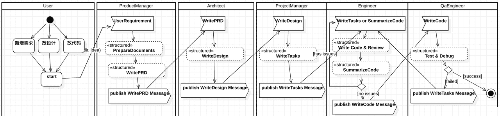

### 项目文件夹结构

| 路径 | 用户可编辑 | 说明 |
| --- | --- | --- |
| `.dependencies.json` | 否 | 存储文件间的显式依赖关系 |
| `docs/requirement.txt` | 是 | 项目本轮新增需求。处理过程中，里面的内容会被分割、合并到`docs/prds/`下 |
| `文档/bugfix.txt` | 否 | 搁置本轮bug反馈信息。迭代时将bug反馈作为需求输入，不要直接修改这个文件。 |
| `文档/prds` | 是 | 项目最终拆分完成需求 |
| `文档/系统设计` | 是 | 项目最终系统设计 |
| `文档/任务` | 是 | 项目的编码任务 |
| `docs/code_summaries` | 是 | 对全部代码的复盘结果 |
| `资源/竞争分析` | 否 | 竞品分析 |
| `资源/data_api_设计` | 否 | 类视图文档 |
| `资源/seq_flow` | 否 | 文档图文档 |
| `资源/系统设计` | 否 | 系统设计文档 |
| `资源/PRD` | 否 | 珠三角文档 |
| `资源/api_spec_and_tasks` | 否 | 任务的编码任务文档 |
| `临时文件` | 否 | 项目处理过程中生成的中间文件。这些文件不会被`git`存档。 |
| `<工作区>` | 是 | 项目源代码文件夹 |
| `测试` | 是 | 单元测试代码 |
| `测试输出` | 否 | 单测执行的结果 |

### 流程变更

整体流程调整：

1. `ProductManager`对象添加`PrepareDocumentsAction`类；
2. 所有输出文档（不包括代码）均采用可回溯的文件命名方式，为防止文件名冲突，采用（YYYYmmddHHMMSS）时间格式的文件名。比如：

```
docs/prds/202311161517.md
docs/system_designs/202311161517.md
tmp/class_diagrams/202311161517.mmd
tmp/sequence_diagrams/202311161517.mmd
```

对项目文件夹的访问操作将封装成类`FileRepository`。

#### 准备文件

此行动负责：

1. 如果主要参数没有确定`project_path`参数（参见新增`main`参数章节），那么需要创建并初始化`workspace`文件夹、初始化`git`环境；
2. 将主要参数`idea`中的新增需求写入`docs/requirement.txt`
3. 发送`Message`消息，通知`WritePRD`行动使用`docs/requirement.txt`和`docs/prds/`处理需求。
4. `WritePRD` action的下游`action`可以通过`git head diff`（封装在`FileRepository`里）来判断文件是否被修改过。参考下面的示例：

```
>>> file_path = 'config/config.yaml'
>>> head_commit = repo.head.commit
>>> file_content = head_commit.tree[file_path].data_stream.read().decode('utf-8')
>>> print(f"HEAD 版本的 {file_path} 内容:\n{file_content}")
HEAD 版本的 config/config.yaml 内容:
# DO NOT MODIFY THIS FILE, create a new key.yaml, define OPENAI_API_KEY.
# The configuration of key.yaml has a higher priority and will not enter git

#### if OpenAI
## The official OPENAI_API_BASE is https://api.openai.com/v1
## If the official OPENAI_API_BASE is not available, we recommend using the [openai-forward](https://github.com/beidongjiedeguang/openai-forward).
## Or, you can configure OPENAI_PROXY to access official OPENAI_API_BASE.
OPENAI_API_BASE: "https://api.openai.com/v1"
#OPENAI_PROXY: "http://127.0.0.1:8118"
#OPENAI_API_KEY: "YOUR_API_KEY"
OPENAI_API_MODEL: "gpt-4"
```

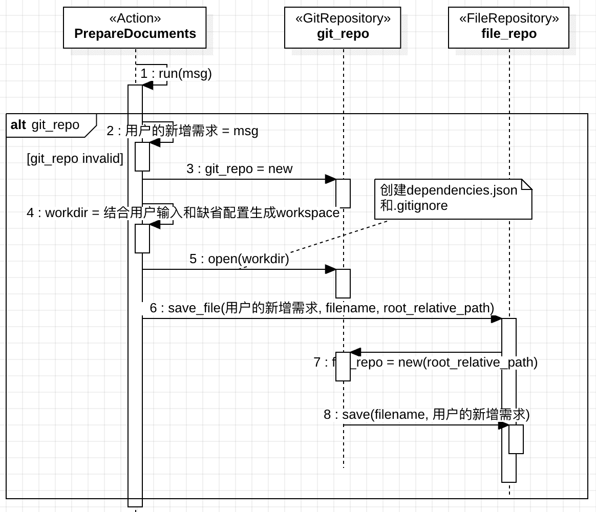


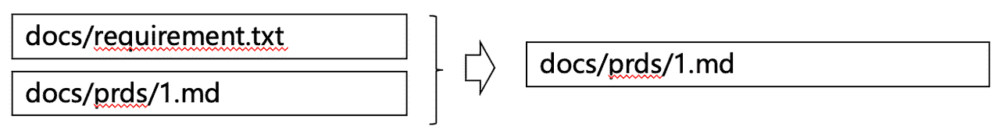


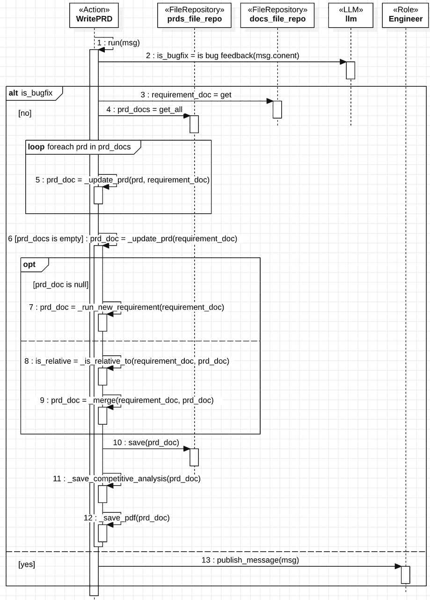


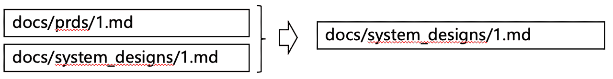


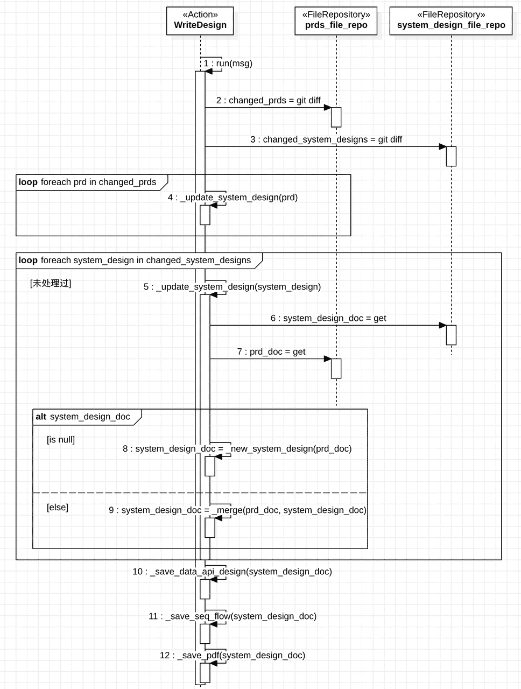


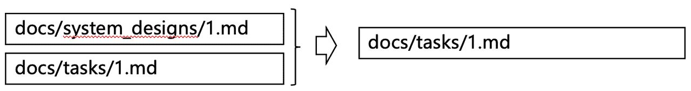


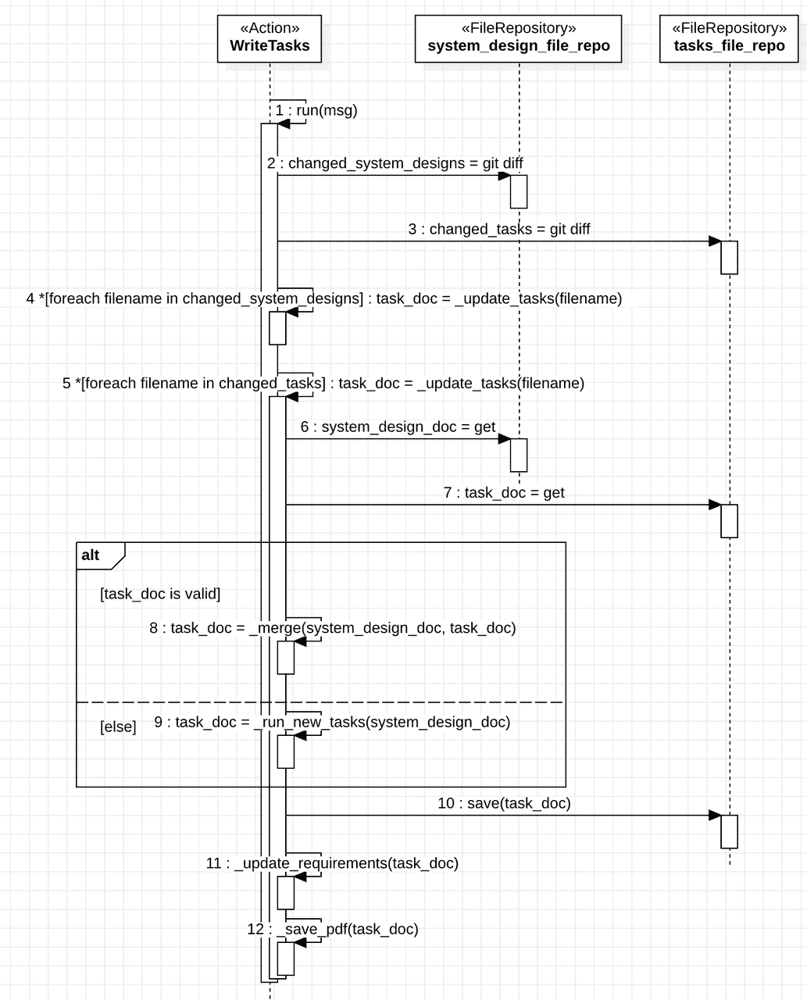


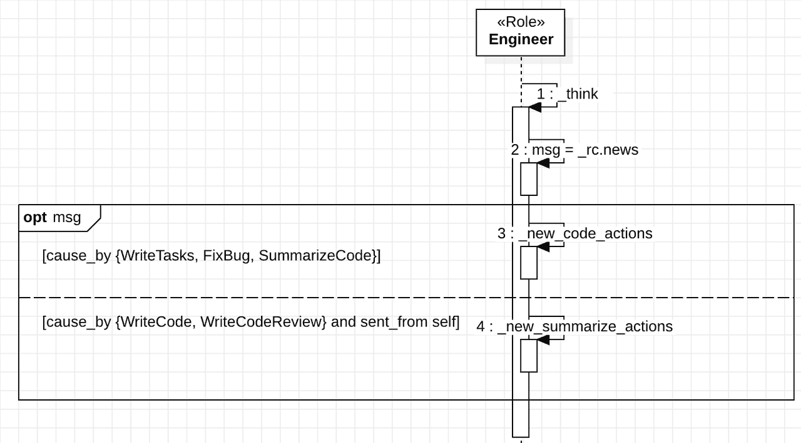


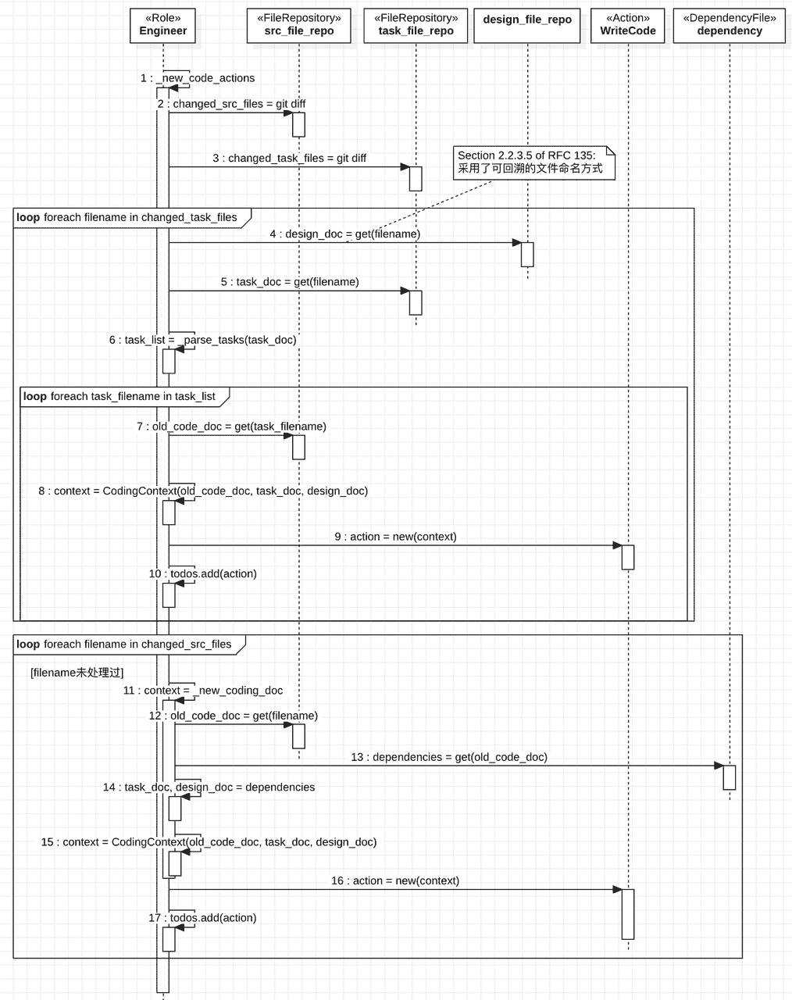


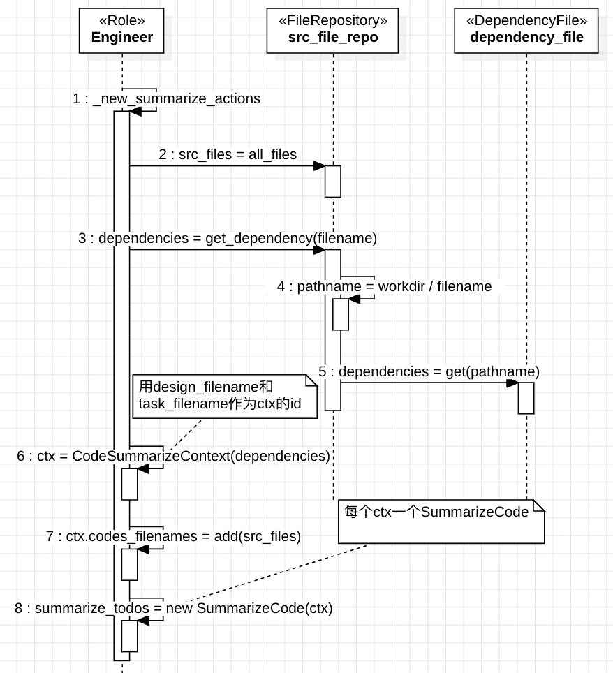

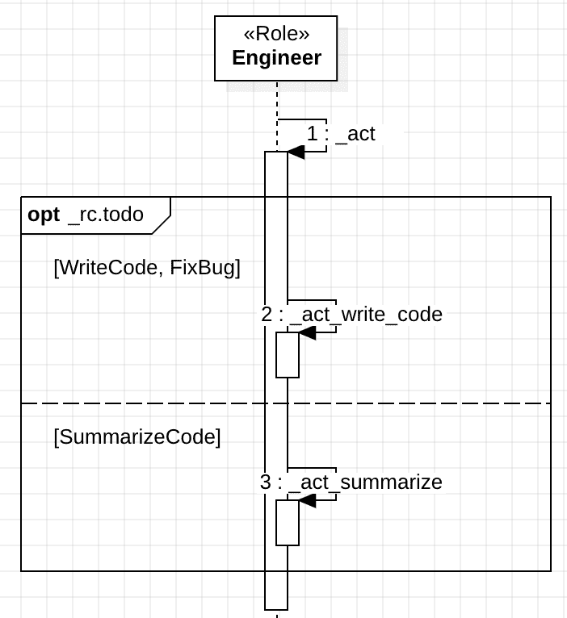


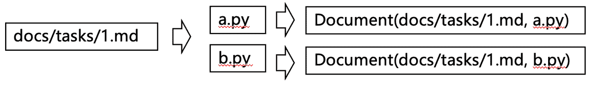


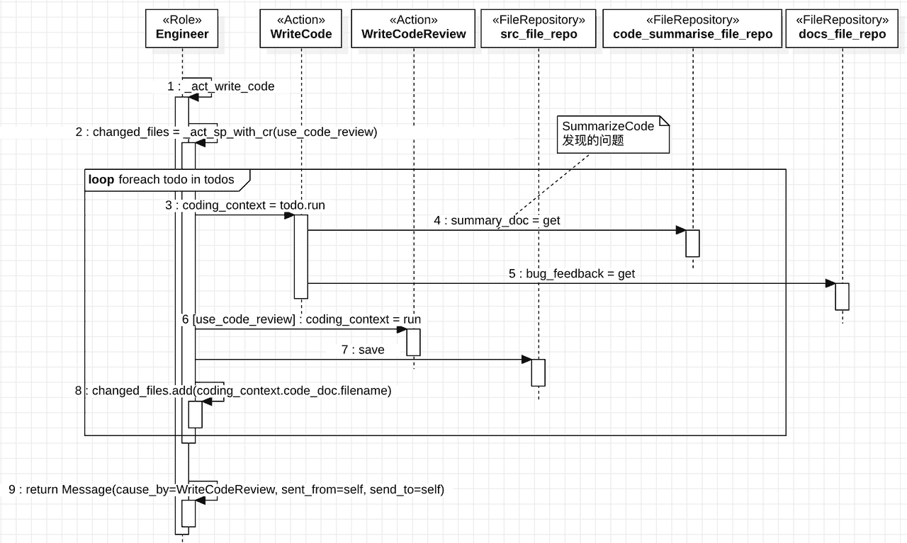


动作结束后，`docs/requirement.txt`可用、工作空间可用。

#### 写入PRD

此行动负责：

1. 判断当前的输入是bug反馈还是需求。如果是bug反馈，则发消息给`Engineer`角色处理。
2. 判断哪些需求文档需要重写：调LLM判断增加需求与`prd`是否相关，如果相关就重写`prd`。

其中：

a. 文件名优先使用旧文件名。如果没有的旧文件，新建时间格式的对应文件名。这条规则实际上是通过规则来表达依赖关系，效果等价于2.2.3.2 `.dependencies.json`文件。

旧方案中，`PRD`相关的文档保存被放到了`WriteDesign`中，新方案将功能移到`WritePRD`中。由于新方案允许需求分片处理，因此，原`resources`下的`competitive_analysis.mmd`，改为`resources/competitive_analysis/`下多个文件；供人阅读markdown格式的`PRD`文档放在`resources/prd/`下。

1. 如果没有任何`PRD`，就使用`docs/requirement.txt`生成一个`prd`。
2. 等`docs/prds/`下所有文件都与新增需求对比完成后，再点击发布消息让工作流截图到下一个阶段。如此设计是为了给后续做全局优化留空间。

行动结束后，`docs/prds/`可用。

#### WriteDesign

此行动负责：

1. 通过`git diff`来识别`docs/prds`下哪些`PRD`文档发生了震动；
2. 通过`git diff`来识别`docs/system_designs`下那些设计文档发生了震动；
3. 针对那些发起的`PRD`和设计文档，重新生成设计内容；

a. 由于新方案允许需求分片处理，因此：
   i. 原来`resources`下的`data_api_design.mmd`改为`resources/data_api_design/`下多个文件；
   ii. 原来`resources`下的`seq_flow.mmd`改为`resources/seq_flow/`下的多个文件；
   iii. 原来`docs`下的`system_design.md`改为`resources/system_design`下的多个文件

旧方案与`PRD`保存相关的操作移至`WritePRD`下。

4. 等`docs/system_designs/`下所有文件都处理完才发布消息，给后续做全局优化留空间。

行动结束后，`docs/system_designs/`可用。

#### WriteTasks

此行动负责：

1. 根据`docs/system_designs/`下的`git head diff`识别哪些任务文档需要重写；
2. 根据`docs/tasks/`下的`git head diff`识别哪些任务文件被用户修改了，需要重写；
3. 对于那些需要重写的任务文档，重新生成任务内容；

其中：

a. 用于`WriteCode`将原始数据文件保存在`docs/tasks/`。

原流程将任务的markdown文档内容保存到`docs/api_spec_and_tasks.md`中，由于新流程支持需求相应分片，将文档分片重新`resource/api_spec_and_tasks/`下放；

c. 原流程会生成`requirements.txt`文件。新流程需要将每个分片生成的`requirements.txt`追加合并到同一个`requirements.txt`中。
4. 等`docs/tasks/`下所有文件全部处理完成才发布消息，给后续做全局优化留空间。动作结束后，`docs/tasks/`可用。

#### 2.2.3.5.5 Engineer

Engineer的`_observe`需要改造，关于消息内容的处理逻辑转移到`_think`中：

其中，`_new_code_actions`流程如下：

`_new_summarize_actions`流程如下：

1. 原流程默认只有一个任务文件需要处理，现在默认有多个任务文件。因此原流程中到内存中搜`WriteDesign`消息的流程已不适用。
2. 新的流程将“任务文件”、“要写代码的文件”放在同一个`Document`类里，定位一个`WriteCode`动作对象去执行。其中，“与任务相关的`WriteDesign`设计文件”这个参数通过依赖关系由动作对象自行查找。
3. 与旧流程一样，`WriteCode` action需基于已有的代码，来写当前代码。
4. `WriteCode`在编写代码的时候，会参考历史`SummarizeCode`发现的问题和用户反馈的bug反馈。
5. `WriteCode`在保存代码的时候，需要更新文件依赖关系。
6. `WriteCode`在写代码的时候，如果`git diff`发现`code`有变更，需要让LLM参考代码文件内容进行重写。

#### 2.2.3.5.5.1 WriteCode和WriteCodeReview改造

现有代码中，`WriteCode`和`WriteCodeReview`的传参方式与基类`Action`差异增加：

1. `Action`类`context`是在创建对象时命名的，并且`WriteCode`是`WriteCodeReview`在`run`此时才传参；
2. 根据思考-行动原则，思考阶段就应该定义好的行动的内容和范围，而不是在行动执行过程中动态调整。从这个设计角度出发，用运行传递语境的方式是在运行时才决定工作内容和范围，这与框架的思考-行动设计原则相违背。

```
code = await WriteCode().run(context=context_str, filename=todo)
```


```
rewrite_code = await WriteCodeReview().run(context=context_str, code=code, filename=todo)
```

因此，本轮优化将`WriteCode`和`WriteCodeReview`的传递参入到创建对象时。

### 2.2.3.5.5.2 `SummarizeCode`

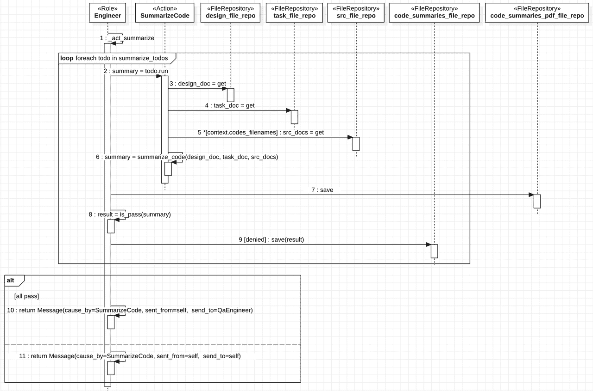

`SummarizeCode`会根据结果，判断论文到哪里：

1. 如果代码中仍然存在问题，则发消息给自己，重新进行`WriteCode`；
2. 如果代码没有发现问题，则发消息给`QaEngineer`，进入单测阶段；

### `WriteTest`

新的流程有单一的条件会触发`WriteTest`动作：

1. 上游依赖的代码文件发生变化；
2. 用户指定重写单测。这种情况下，触发`WriteTest`的消息由上游`Engineer`对象负责发送。

### `QaEngineer` & `WriteTest` & `RunCode` & `DebugCode`

QA 过程中伴随着大量的消息传文件内容的操作，已经统一改为传文件名方式。

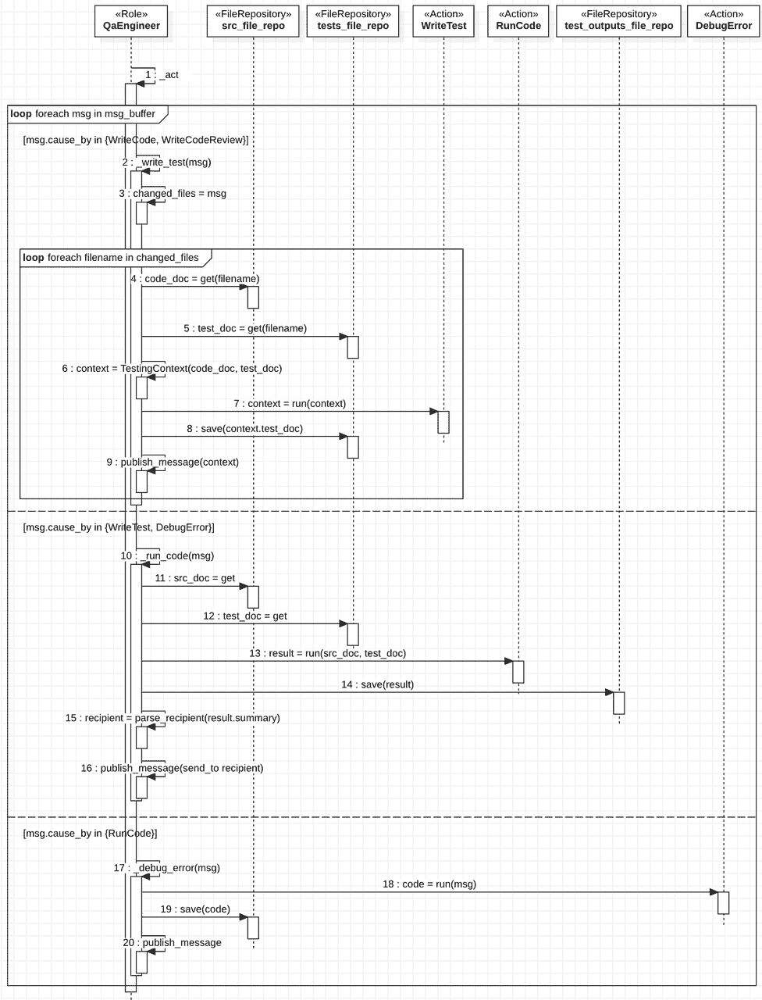

#### 新增主要参数

| 参数名 | 参数值类型 | 任选/必需 | 说明 |
| --- | --- | --- | --- |
| `--project-path` | 小路 | 任选 | 从哪里加载上个版本的项目文件 |
| `--reqa-file` | 文件名 | 任选 | 要重新生成单元测试的文件的名称。基于源代码文件夹的相对路径。例如，对于下图场景中的`main.py`，可以使用以下命令： `--reqa-file "main.py"` |
| `--project-name` | 字符串 | 任选 | 指定使用的项目名。项目名需同时遵守文件夹和代码变量命名规则。 |
| `--inc/--no-inc` | 布尔值 | 任选 | 是否支持增量现实需求。`--inc`: 基于`--project-path`增量现实需求更新；`--no-inc`: 如果`--project-path`不空，将清空`--project-path`。 |

#### 集成`git`功能

`git`功能作为技能集成到`MetaGPT`中，方便后续人机交互。参见：利用`python`代码操作`git` - tomjoy - 博客园

#### 集成changelog功能

`Changelog`功能作为技能集成到`MetaGPT`中，方便后续人机交互。基于`git`的`changelog`生成参见：`git`自动生成changelog及项目版本管理 - 掘金

#### 输出件和消息分离

##### 现状

使用消息来提交所有数据。

##### 新方案

新方案依托`FileRepository`类和工作空间，对消息内容进一步分类，以简化消息的处理逻辑：

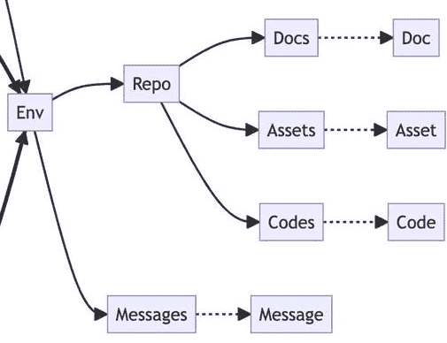

如此设计是为了解决以下问题：

简化同步逻辑旧方案依靠消息来负责各个数据副本之间的数据同步。这让数据的消费者被无端卷入不必要的数据同步的麻烦。新方案将数据类别分割出来，成为独立的数据文件。这样的同步问题就简化了。很多新方案使得消息传输能够实现多媒体文件。后续优化会持续将消息事件化、弱化作为其数据传输手段的设计。

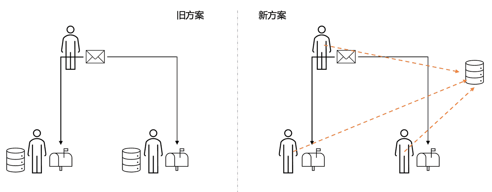

1. 简化数据版本管理和迁移的问题。

## 附录

### 术语及定义

| 术语 | 定义 |
| --- | --- |
| 基线版本 | 用户想在某个项目版本上，继续迭代，那么这个被选中的项目版本就称为“基线版本”。 |
