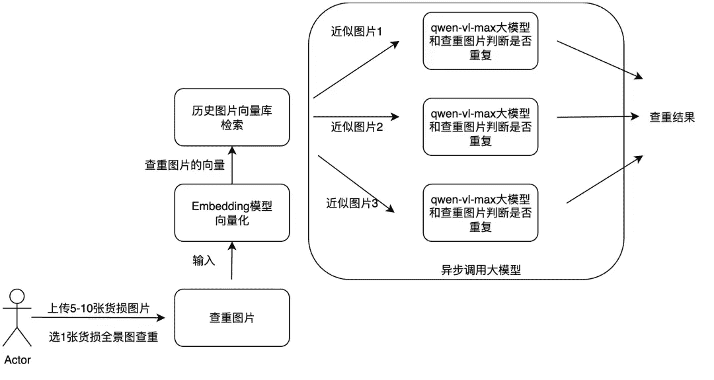
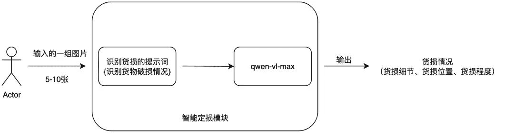
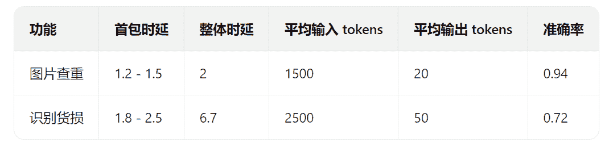
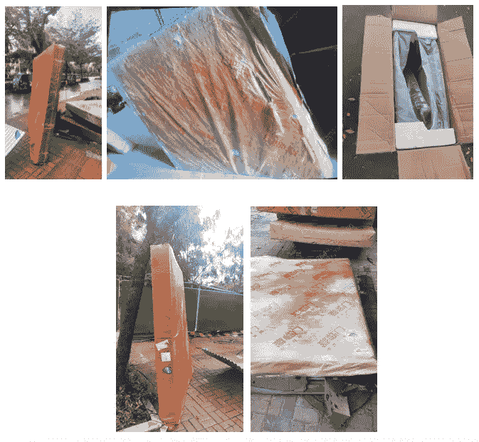
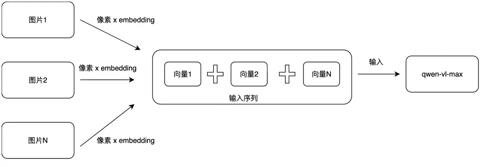
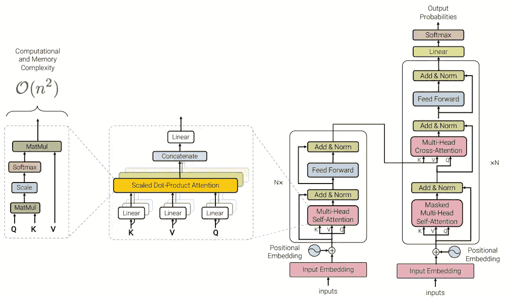
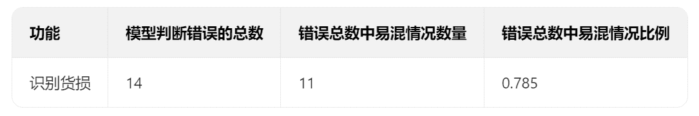
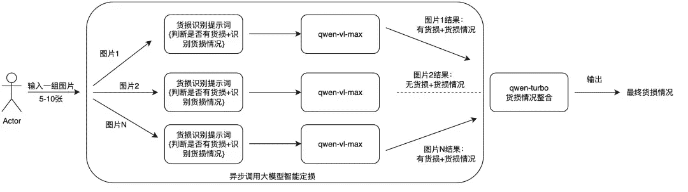

# 结合多模态RAG和异步调用方法实现AI智能质检

> 来源：[https://v11enp9ok1h.feishu.cn/docx/WCe8dxQFGoSv1SxYa81cAM9on7c](https://v11enp9ok1h.feishu.cn/docx/WCe8dxQFGoSv1SxYa81cAM9on7c)

> **简介：** 文章探讨了如何利用多模态大模型和工程优化手段提升物流理赔业务效率。核心方案包括：通过多模态RAG技术实现图片查重，结合异步调用方法优化货损识别功能。

## 方案架构

#### ** 功能1：图片查重**

**架构流程**

1.  搭建图片向量库，用embedding模型对历史库中的所有图片计算向量，把所有向量存储到数据库中；

1.  客户上传一组理赔货损图片，自己从中选取一张最有代表性的破损全景图，作为查重给定图片；

1.  用**embedding**计算给定图片的向量，根据给定图片的向量从向量库中检索出最近似的几张图片；

1.  设计判断是否重复的提示词，调用vl大模型判断给定图片和最近似的几张图片是否存在重复，如果存在重复，进入人工复核，如果没有重复，进入正常的理赔流程；


**向量库选择**

**milvus**是基于开源**milvus**的全托管云上版本，兼容性好、支持无缝迁移、水平扩展、安全告警、并且有可视化的管理数据库图形操作界面，简单易用，以下是调用milvus存储、查询、修改向量数据的方法示例：

```
from pymilvus import MilvusClient

client = MilvusClient(
    uri=&quot;&quot;, 
    token=&quot;&quot;, 
    db_name=&quot;default&quot; 
)

client.create_collection(
    collection_name=&quot;&lt;yourCollectionname&gt;&quot;,  # 指定待创建的集合的名称，milvus_collection。
    dimension=5,  # 指定集合中向量的维度，本文示例为5。
    metric_type=&quot;IP&quot;  # 指定用于计算向量相似度的度量方法
)
#样例数据
data=[{&quot;id&quot;: 0, &quot;vector&quot;: [], &quot;color&quot;: &quot;&quot;}]
#插入数据
res = client.insert(
    collection_name=&quot;milvus_collection&quot;,
    data=data
)
#检索向量库
query_vector = [[]]
res = client.search(
    collection_name=&quot;milvus_collection&quot;,     
    data=query_vector,#查询向量
    filter=&#x27;5&lt;id&lt;10&#x27;#过滤条件              
    limit=3,#返回3个最相似的向量
    output_fields=[&#x27;id&#x27;,&#x27;color&#x27;] #输出字段名
)
for hit in res[0]:
    print(hit[&#x27;entity&#x27;])
```

##

## 项目背景和方案架构

### 项目背景

> 理赔业务是物流行业经常需要处理的问题，客服需要审核客户上传的受损货物的图片资料，对受损情况做判定，然后给客户提供赔偿金额；整体的流程需要人工操作，效率很低，因此如何用大模型作为切入点为理赔业务提效成为重点关注问题。

>

> **理赔工作存在一个风险点**，客户如果上传虚假的理赔图片，会造成物流公司的业务损失，比如客户上传的图片是曾经上传过的货损图片，或者经过了小幅度的裁剪、旋转、ps的相似图片，用人工来查重的过程费时费力，图片查重也需要大模型来提效；

>

> **经过对大模型能力的评估**，我最终选择用多模态大模型qwen-vl-max的图片理解能力来做智能货物定损+智能图片查重的功能，先让大模型对上传的图片进行查重，如果重复流程终止，如果不重复，进入定损环节，让vl大模型对输入的受损货物的图片做识别，识别出货损情况，包括货损细节、货损位置、货损程度、受损情况；

### 需求分析

客户需要让大模型来实现智能定损+图片查重的功能，整体的要求如下：

1.  给定一组理赔货损图片，大模型先进行图片查重，如果上传的图片没有重复，则进入步骤2定损，如果存在重复，则终止流程；

1.  大模型识别这组图片中货物的破损情况、破损细节、破损位置、破损程度，返回定损结果；

> 大模型想要实现查重功能，需要把用户上传的图片和曾经的图片做比对来判断是否存在重复，首先因为一组上传的图片数量在5-10张，其中最能体现货物显著特点的就是货物的全景图，这个图片最有代表性，最合适作为查重的给定图片，其他图片是局部细节图、外包装、无关图等，所以从效果和时延上考虑，我推荐从一组图片中只选择一张破损货物的全景图作为查重图片；

> 当曾经的图片数量特别大时，大模型不可能和这么多图片去比对，这在技术上不可行，因此需要缩小比对的范围，让大模型只判断几张和这个上传图片最相似的图片，只要这几张图片没有重复，那么剩下的那些不太相似的图片就不可能重复，这样就把比对范围大大缩小了，因此我确定了技术策略，搭建一个图片库，从库中检索出和给定图片最相似的几张图片，作为后续的查重样本，大模型会判断给定图片和这些样本的相似性，如果判断重复，那么终止本次理赔，进入人工复核；

> 对RAG比较熟悉的同学已经发现，上述分析的逻辑，从库中检索出最相似的样本，这一步就是RAG做的工作，我们目前大量的RAG做的是文本领域的知识库，针对检索图像的这个需求，需要搭建的是多模态的向量库，因此多模态RAG将作为大模型的前置工作，为大模型检索出查重样本；图片的向量化需要用到向量大模型Embedding，multimodal-embedding-v1，能够把图片、文本、语言的多模态元素通过矩阵乘积计算出1024维度的向量，我用embedding模型对历史图片做向量化，并存储到库中，搭建多模态向量库；

相对应的从技术架构上也要搭建两个串联的功能：

1.  用户上传一组理赔图片，选择1张有代表性的货损全景图，先进行向量库检索出几张相似图片，然后调用大模型比对上传图片和检索出的图片的重复情况；

>

1.  上传的一组理赔图片输入qwen-vl-max，设计货损识别的提示词，大模型输出货损判定结果；

### 1.3 方案架构

#### **1.3.1 功能1：图片查重**

**架构流程**

1.  搭建图片向量库，用embedding模型对历史库中的所有图片计算向量，把所有向量存储到数据库中；

1.  客户上传一组理赔货损图片，自己从中选取一张最有代表性的破损全景图，作为查重给定图片；

1.  用**embedding**计算给定图片的向量，根据给定图片的向量从向量库中检索出最近似的几张图片；

1.  设计判断是否重复的提示词，调用vl大模型判断给定图片和最近似的几张图片是否存在重复，如果存在重复，进入人工复核，如果没有重复，进入正常的理赔流程；



**向量库选择**

**milvus**是基于开源**milvus**的全托管云上版本，兼容性好、支持无缝迁移、水平扩展、安全告警、并且有可视化的管理数据库图形操作界面，简单易用，以下是调用milvus存储、查询、修改向量数据的方法示例：

```
from pymilvus import MilvusClient

client = MilvusClient(
    uri=&quot;&quot;, 
    token=&quot;&quot;, 
    db_name=&quot;default&quot; 
)

client.create_collection(
    collection_name=&quot;&lt;yourCollectionname&gt;&quot;,  # 指定待创建的集合的名称，milvus_collection。
    dimension=5,  # 指定集合中向量的维度，本文示例为5。
    metric_type=&quot;IP&quot;  # 指定用于计算向量相似度的度量方法
)
#样例数据
data=[{&quot;id&quot;: 0, &quot;vector&quot;: [], &quot;color&quot;: &quot;&quot;}]
#插入数据
res = client.insert(
    collection_name=&quot;milvus_collection&quot;,
    data=data
)
#检索向量库
query_vector = [[]]
res = client.search(
    collection_name=&quot;milvus_collection&quot;,     
    data=query_vector,#查询向量
    filter=&#x27;5&lt;id&lt;10&#x27;#过滤条件              
    limit=3,#返回3个最相似的向量
    output_fields=[&#x27;id&#x27;,&#x27;color&#x27;] #输出字段名
)
for hit in res[0]:
    print(hit[&#x27;entity&#x27;])
```

**关键词筛选**

> 在存储向量数据的时候，不仅存储向量本身，还可以把图片相关的数据作为关键字段也存起来，比如图片的链接、图片上传的时间、图片的上传人等，方便后续做关键词的过滤；在理赔项目中，如果只需要把给定图片和同一上传人之前上传的历史图片做比对，那么在检索时设置过滤条件，图片上传人=xx，如果要和过去一个月的历史图片做比对，再加过滤条件xx<上传时间

**top_k设置**

> top_k是设置召回的样本数量，也就是检索出几张最相似的图片，topk需要根据检索效果和时延来选择，topk越小，检索速度越快，但容错率低；在理赔项目中，我设置的topk=3，3张图片一般是比较合理的值，既能保证容错率，同时时延略微升高；

**异步调用查重**

> 对检索出3张最相似的图片，接下来是调用大模型查重，查重逻辑是这三张图片和给定图片一对一的比较，如果3张全部不重复，那么上传的给定图片查重通过，如果存在任意一张重复，那么查重不通过；基于这个逻辑，架构方法就是用异步方法同时向大模型请求3次，每次上传1张相似图片和给定图片，让大模型判断是否存在重复情况，对返回的3个结果检查，存在重复的判断结果，则查重不通过，全部不重复则查重通过；异步调用的方法我会在后文详细介绍；

#### **1.3.2 功能2：识别货损**

**架构流程**

> （1）设计货物破损情况的识别提示词；

> （2）查重通过后，把一组货损图片输入给qwen-vl-max大模型，输出货损情况；



```
##任务，识别货物的损坏情况
仔细观察输入的图片，识别出其中货物的受损情况，包括受损细节、受损位置、受损程度，并给出你的判断理由；
```

##

## 效果测试和架构优化

### 2.1 货损识别存在问题

+   总共的测试数据在50组理赔图片，每组图片在5-10张；

+   在实际功能测试的过程中，基于多模态RAG的图片查重功能的准确率达到94%，时延在2s左右，效果达到预期；

+   基于vl-max的多模态大模型货物定损的功能的定损准确率在72%，时延在6.7s，整体的时延性和准确率不达标，针对发现的两个问题，重新对错误数据分析，定位导致模型判错的原因，并优化该功能的架构；

+   具体的测试数据对比如下，图片查重的数据是单张图片维度的测试结果，识别货损的数据是组维度（一组5-10张图片）的测试结果：



#### **2.1.1 问题1：准确率低**

> 问题一是对易混图片的识别准确率很低，这类易混图片的特点是数量一般在8张以上，其中大部分是商品完好的图片或者是外包装等和商品无关的图片，这样的图片是无价值的，对定损没有帮助，真正有价值的能暴露商品破损情况的图片只有1-2张，比如下面这个床垫的例子：前面4张图片几乎看不出床垫有任何损坏的地方，真正暴露问题的在最后一张图片（床垫内部破损），原因在于上传者在拍摄图片时没有着重拍破损部位的全景图，这种情况下大模型会给出商品无损的判定结果，不符合预期；



> 第一个问题的原因分析，根据视觉大模型的输入逻辑，每**张图片**会**先经过**一个kernel的切分，维度一般在3x3，5x5，它的像素矩阵会切成多个小块（token），每一个小块经过embedding矩阵相乘后成为一个统一维度向量，叫做语义向量，同时为了体现小块的空间序列信息，还会引入二维位置编码，把位置信息也计算成向量，叫做位置向量，语义向量+位置向量得到包含语义和位置信息的输入向量；多个token按照在原来图片中的位置，拼接起来成为一张图片的输入序列向量；

多张图片，把一组输入序列向量拼接起来成为整体的输入序列输入给大模型，如下图所示：



> 而模型的输出是基于输入序列往后的迭代式生成，基于Tran**sform**e**r d**e**coder**架构的注意力机制会参考前文的词来生成当前词，如下图所**示，注意力**机制是给每个输入序列中的词**分配一**组query、key、**value**向量（qkv通过每个词**的向量和预**设的矩阵**相乘得到）****，然后在计**算当前词**输出时，会**根据前一个词的query向量和前文序列中每一个词的key向量做点积得到一个分数score，这个就是相关性分数，score越大，该score对应的前文向量对当前词的输出影响越大，然后把前文序列中每一个词的score乘自己的value向量，再加权求和得到当前词向量，该词向量再通过前馈神经网络判断出当前的单词，以此类推，直到整个输出序列生成完毕；这就是基于注意力机制的大模型生成逻辑；

从中分析可以发现，通过计算相关性分数score，前文序列中的每一个向量都会对当前向量的生成产生影响，score越大的向量相关性越大，对当前输出产生的影响越大，所以后文的生成语义很大程度受到前文输入序列的主要特征的影响，理论上分析输出序列的特征会遵循输入序列的主要特征；



> 那么当输入序列中的多张图片都是对定损无帮助的无价值图片时，输出的结果会受到输入序列的主要特征影响，此时的主要特征是货物无损，那么输出大概率也是无损；如果输入的只有一张图片且图片中有损坏货物，那么输出会是受损情况；

>

> 比如上面例子中的5张床垫照片，当全部输入给大模型时，模型会输出“无损”；当只上传单张图片给大模型时，前面4张会输出无损，最后一张确实有损的图片会输出损坏情况；

>

> 在实际的50组测试用例中，有11组用例存在上述的易混情况，每组图片内多数是对定损无价值的图片（外包装、有遮挡物等），有价值图片（货物全景图）占少数；大模型对这11组理赔图片最终给出的定损意见都是“无损”，属于判断错误；而准确率是0.72，大模型总共判断错误14组数据，在判错数据中这种情况是绝大多数占11/14，因此如何让大模型解决这样的易混图片问题是架构优化的重点；



#### **2.1.2 问题2：时延高**

问题二是时延较高，5张输入图片的平均的输出需要6s左右，每增加一张图片，时延要上升0.5s左右，这对实际业务来说等待体验不好，比如上述的5张床垫图片的定损需要6.2s；

+   第二个问题的原因分析，很好理解，大模型的输入序列越长，所需要的推理时间也会增加，导致耗时变长；

### 2.2 针对上述问题的思考

为了解决上述两个问题，我尝试了一些优化方法：

**PE**

优化提示词，定损的结果会产生偏差，那么我在提示词中强化大模型对这些无价值的图片的处理规则，比如在提示词中加入

```
##限制
有部分图片和商品无关，有部分图片中商品未损坏，过滤这些图片，你只识别有破损商品的图片；
```

尝试五种不同的写法，大模型仍然会输出“无损”；说明大量的输入特征对结果的影响无法用提示词来扭转；

**换基础模型**

把**qwen-vl-max**换成了更快的**vl-plus**，但经过测试时延能够比**vl-max**平均快2s左右，但识别的准确率降低了20%，这样的结果无法接受；

**加前置模型做过滤**

再加一个大模型来对输入的一组图片做前置处理，先判断每张图片是否和破损商品有关，把无关的图片、商品完好无损的图片过滤掉，把真正有价值的图片传给vl-max做定损判断，这个方法确实解决了大模型输出“无损”的问题，但引入的前置大模型导致时延和推理成本都增加了近一倍；

> 是否存在一种优化方法能够完美解决效果和时延的两方面问题呢，经过思考和讨论，一种在工程上的常用方法：异步，成功解决这个问题；异步方法就是把这一组图片拆分成单张，同时向大模型请求多次，每次请求只传一张图片，每次请求会得到一个识别结果，把结果中无价值的过滤掉，最后再把有价值的结果整合成最终定损结果，这样能够实现对无价值图片的过滤来保证识别准确率，同时整体的输入的图片数量没有增加（一次传多张和多次，每次一张）保证成本不会增加，并且异步调用的时延大约是调用单张图片的时延，能够很大程度上降低时延；

### 2.3 针对上述问题的架构优化

基于上述逻辑，我对货损识别功能的架构做了优化，新架构如下：



2.3.1 大模型提示词的重新设计

> 依据异步调用的逻辑，现在vl大模型要先判断输入的单张图片是否存在货损，也就是判断这张图片有无价值，如果存在货损，然后识别货损情况，如果没有货损或图片中没有货物，货损情况输出“无”，这样后续在提取整合大模型结果的时候，可以直接提取出图片本身有无货损，根据这一字段结果来过滤无价值的图片，最终只保留有价值的定损结果；

以下是原提示词和新提示词的前后对比：

**原提示词：**

```
##任务，识别货物的损坏情况
仔细观察输入的图片，识别出其中货物的受损情况，包括受损细节、受损位置、受损程度，并给出你的判断理由；
```

**新提示词：**

```
##任务一，判断图片是否相关
仔细观察输入的图片，如果图片中没有明显的货物或者图片中的货物没有明显的损坏，输出“不相关”，如果有明显货物并且货物存在损坏，输出“相关”；
##任务二，依据任务一的结果，识别货物的损坏情况
如果任务一的结果是“不相关”，受损情况直接输出“无”；
如果任务一的结果是“相关”，仔细观察输入的图片，识别出其中货物的受损情况，包括受损细节、受损位置、受损程度，并给出你的判断理由；
```

#### **2.3.2 异步调用的方法**

> 异步，在工程上常用的一种方法，指的是在同一时间节点执行不同的程序，来实现程序的并发能力；大模型的工程链路中也可以使用这一方法，异步调用大模型，就是在同一时间节点向大模型发出多个请

求，得到多个请求结果，最后把每个结果整合成为最终结果；

以下是我用多线程实现的异步调用方法：

```
import threading
import queue
import dashscope
##recognize是调用大模型的函数，q是队列存放调用结果
def recognize(path,q):
    cs=[]
    cu=[]
    #prompt是判断有无货损+识别货损情况的提示词
    prompt=&#x27;&#x27;
    cs.append({&#x27;text&#x27;:prompt})
    cu.append({&quot;image&quot;:path})
    messages = [{&quot;role&quot;: &quot;system&quot;,&quot;content&quot;: cs},{&quot;role&quot;: &quot;user&quot;,&quot;content&quot;: cu}]
    response = dashscope.MultiModalConversation.call(
        model=&#x27;qwen-vl-max&#x27;,
        messages=messages
    )
    if response.status_code!=200:
        q.put((response.message,response.request_id,response.status_code))
    q.put((response[&quot;output&quot;][&quot;choices&quot;][0][&quot;message&quot;].content[0][&#x27;text&#x27;],response.request_id,response.status_code))

#images是一组图片的链接列表
images=[]
num=len(images)
q = queue.Queue()
threads=[]
for img in images:
    #创建多线程，调用大模型
    t = threading.Thread(target=recognize, args=(img,q))
    threads.append(t)
    t.start()
        
for t in threads:
    #线程同时启动
    t.join()

#反向存储队列中的结果
res=[]
while not q.empty():
    res.insert(0,q.get())
  
#对结果的后续处理，遍历、信息整合等；
#、、、、、
```

核心思路是用多线程并发向大模型请求，每次请求上传单张图片，把每次的结果存到队列里（queue），最后从queue中反向提取结果，再进行后续处理；

#### 2.3.3 引入语言大模型整合结果

> 在得到多组异步调用的结果后，剩下的工作就是把这些具有相同字段的结果整合起来成为最终输出，由于大模型生成的随机性，单张图片识别出的货损情况会存在一些较小的差别，因此这一步我采用了语言大模型强大的文字信息处理能力来实现，能够提取多组结果中的货损情况的共性特点，舍弃相同的表达，最终整合成一个结果；

我引入了**qwen-turbo**语言大模型，turbo模型速度最快，同时处理文本信息整合的任务对大模型来说不复杂，turbo足够处理；我设计了信息整合的提示词，以下是turbo的提示词：

```
##任务，文字信息整合
输入多组货物损坏情况，这些描述的是同一件货物，请你整合这些货损情况，提取关键的共性信息，整合输出最终的货损情况
```

## 最终效果提升

整体的测试数据集有50组理赔图片，每一组里面有5-10张货物破损图片，总共321张图片；

定义了3种评价指标，

1.  查重准确率是判断这组图片的查重图片，大模型的结果和是否真正重复比对，查重准确率=大模型判对的理赔组数/50；

>

1.  识别准确率是组维度的指标，如果一组图片最后识别出来的货损情况和人工的标准答案几乎一致，那么是一次准确的识别，理赔准确率=准确的理赔组数/50；

>

1.  平均时延是组维度的指标，计算的是模型处理一组图片的平均耗时，平均耗时=（第1组耗时+第2组耗时+...+第50组耗时）/50；

图片查重功能的准确率基于初步架构已经达到94%，所以关键的效果提升在加入了异步调用的新货损识别功能，结果如下：

| **方案** | **查重准确率** | **识别准确率** | 平均时延（模型处理一组图片的耗时） |
| --- | --- | --- | --- |
| 原货损识别架构 | 0.94 | 0.72 | 6.7s（识别 6.7s） |
| 加异步调用的货损识别架构 |  | 0.88 | 2.5s + 2s = 4.5s（识别 2.5s，turbo 信息整合 2s） |