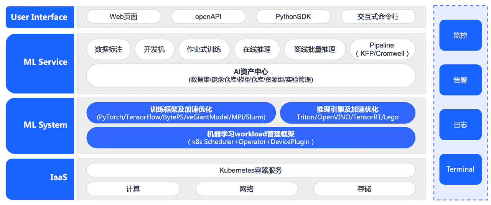
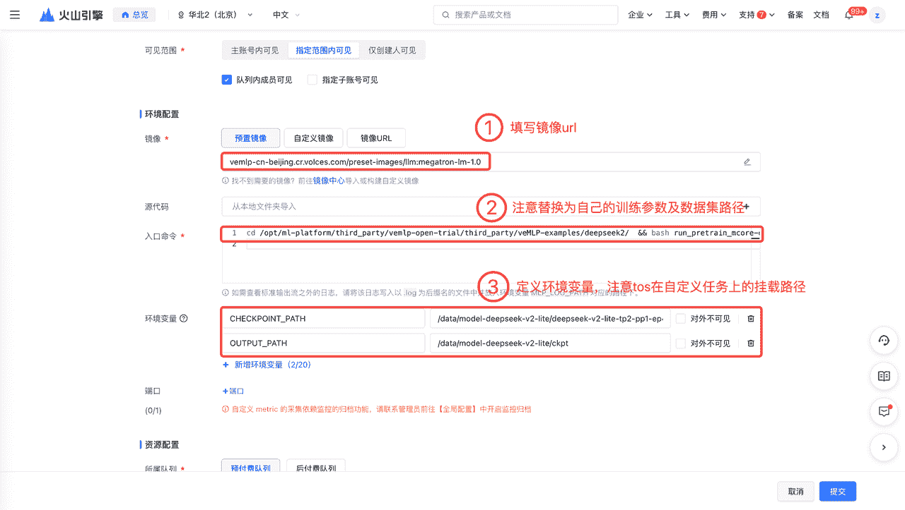
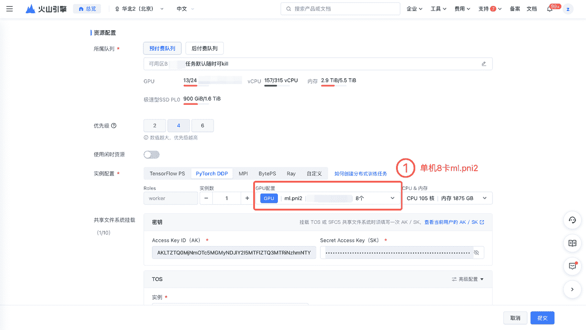
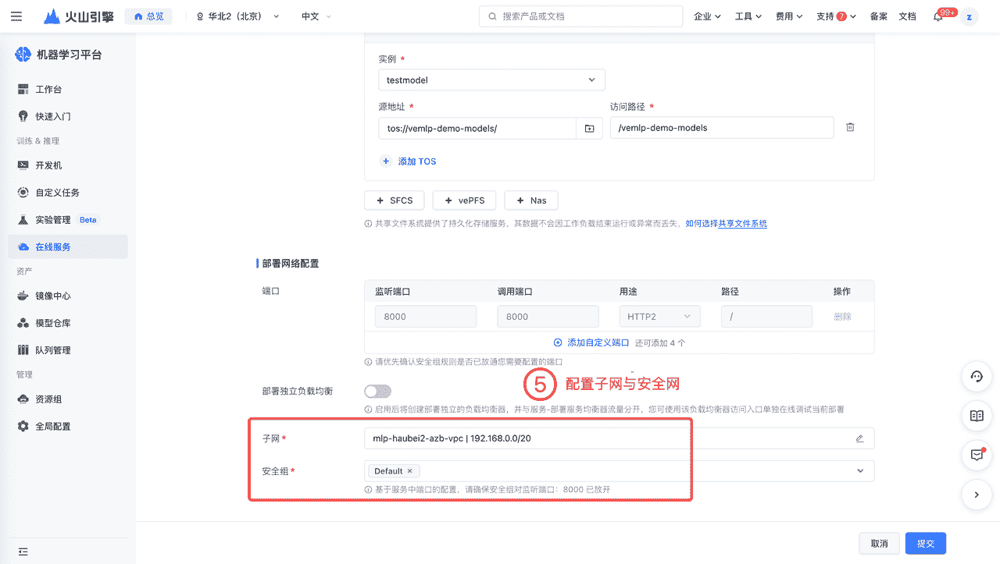

# DeepSeek-V2-Lite 模型在 MLP 的最佳实践

> 来源：[https://v11enp9ok1h.feishu.cn/docx/JaagdpAQWowzG3xwr1ccNMDBnyA](https://v11enp9ok1h.feishu.cn/docx/JaagdpAQWowzG3xwr1ccNMDBnyA)

# 一、什么是机器学习平台

**机器学习平**台**是面向机器学习**应**用开发者，提**供【开发机】、【自定义训练】和【在线服务】等丰富建模工具、多框架高性能模型推理服务的企业级全自研开发平台，支持从数据托管、代码开发、模型训练、模型部署的全生命周期工作流。



# 产品优势

**超大规模分布式训练**

支持运行超大规模的分布式任务，包含多种预置算法框架和自定义算法框架。提供稳定、灵活、高性能的机器学习训练环境。

**多框架高性能推理**

支持多种框架的模型在异构硬件上的一键部署，具有高吞吐、低延时、实时扩缩容等特点，使推理服务更具弹性和容错性。

**高性价比算力资源**

提供高性价比的预付费资源组，支持资源组内配额分配、任务管理、查看资源利用率等功能，提升整体资源利用率。

**高效率开发调试工具**

提供了云端机器学习开发环境 —— 开发机，内置了多种主流机器学习框架的镜像。结合弹性资源以及与分布式训练时相同的环境，可以极大提升开发和调试的效率。同时提供命令行工具支持端云协同开发环境，可以从本地环境一键发起并管理训练任务。

# 二、最佳实践

## DeepSeek-V2-Lite 模型在 MLP 的最佳实践

### 步骤一：准备 DeepSeek-V2-Lite 模型

1.  入开发机。

1.  配置 volc configure。具体操作详见使用文档--机器学习平台-火山引擎。

1.  在 Terminal 中执行以下命令，通过镜像源下载 deepseek-v2 模型，并打开挂载的存储桶路径。

```
cd /vemlp-demo-models
mkdir model-deepseek-v2-lite
cd model-deepseek-v2-lite
export HF_ENDPOINT=https://hf-mirror.com
pip3 install -U huggingface_hub
huggingface-cli download --token $HF_TOKEN --resume-download deepseek-ai/DeepSeek-V2-Lite --local-dir $ORIGINAL_MODEL_PATH
```

其中运行 **huggingface-cli** 命令行，需要传入的参数列表说明如下：

> 说明

1.  --token/--hf_username/--hf_token等参数非必须，仅为部分 Repo 有 license 限制，需登录申请许可。如果必要，请在 https://huggingface.co/settings/tokens 获取 token 后进行下载。

1.  推荐您将模型文件、训练数据集的下载、存放地址都设置在 TOS/VEPFS/SCFS 等共享存储内，之后在进行训练、推理等跨节点的任务时，可以更加轻松地挂载到不同的机器上。

1.  在实践过程中，如果因网络等问题导致模型、数据集或量化工具无法下载到TOS bucket，建议您可以先将其下载到开发机云盘中，再自行拷贝到TOS路径下。在这种情况下，请尽量选择更大的云盘容量（如100G）。

### 步骤二：准备数据集

在Terminal执行以下命令，可以直接下载火山在镜像中预置的训练与精调数据集。

```
cd /vemlp-demo-models
mkdir datasets-deepseek-v2-lite
cd datasets-deepseek-v2-lite
wget https://mlp-opentrail-demo.tos-cn-beijing.volces.com/dataset/oscar-en.tar.gz
tar -xzvf oscar-en.tar.gz
wget https://mlp-opentrail-demo.tos-cn-beijing.volces.com/dataset/finetune-dataset.tar.gz
tar -xzvf finetune-dataset.tar.gz
```

### 步骤三：模型训练

#### 3.1 模型格式转换（safetensor to ckpt）

在 Terminal 中执行以下命令，可将 safetensor 无损转换成出 checkpoint 格式，并输出到启动参数（MEGATRON_LM_MODEL_PATH）配置的目标 checkpoint 路径中。

```
cd /opt/ml-platform/third_party/vemlp-open-trial/third_party/veMLP-utils/deepseek_convertor
bash convertor.sh -m A2.4B -s $ORIGINAL_MODEL_PATH -t $MEGATRON_LM_MODEL_PATH -tp 2 -pp 1 -ep 4 -te true -hf $ORIGINAL_MODEL_PATH -pr bf16
```

其中运行 **convertor.sh** 脚本需要传入的参数说明如下：

## 3.2 自定义任务分布式训练（指令微调）

最佳实践文档提供控制台与命令行两种方式的操作说明。

### 方式一：控制台

1.  进入自定义任务[控制台](https://console.volcengine.com/ml-platform/region:ml-platform+cn-beijing/customTask/create)

1.  配置环境

1.  在预制镜像处选中 megatron-lm-1.0 或在镜像URL处配置如下镜像。

```
vemlp-cn-beijing.cr.volces.com/preset-images/llm:megatron-lm-1.0
```

1.  填写入口命令并定义环境变量。请注意tos在开发机上挂载的路径与自定义任务中挂载的路径不一致，在入口命令填写数据集路径环境变量中填写模型路径时，需确保为自定义任务中挂载的路径。

```
cd /opt/ml-platform/third_party/vemlp-open-trial/third_party/veMLP-examples/deepseek2/
bash run_pretrain_mcore-deepseek2.sh --model_size A2.4B --batch_size 1 --global_batch_size 8 --learning_rate 1e-5 --min_learning_rate 1e-6 --sequence_length 4096 --padding_length 4096 --precision bf16 --tensor_parallel 2 --pipeline_parallel 1 --context_parallel_size 1 --expert_parallel 4 --activation_checkpoint false --distributed_optimizer false --flash_attention true --sequence_parallel true --save_interval 10000 --dataset_path /data/datasets-deepseek-v2-lite/oscar-en/oscar-en-llama_text_document --pretrain_checkpoint_path $CHECKPOINT_PATH --train_tokens 10000000 --warmup_tokens 100 --output_basepath $OUTPUT_PATH --sft true --optimizer_offload false --train_iters 10000 --lr_warmup_iters 100
```



1.  配置资源

1.  选择合适的资源，最佳实践所用机器为单机 8 卡 ml.pni2。

1.  挂载 TOS 和 CFS。需要注意：tos在开发机上挂载的路径与自定义任务中挂载的路径不一致，在环境变量中填写模型路径时需确保为自定义任务中挂载的路径。




### 方式二：命令行

在 Terminal 中使用以下命令对 DeepSeek-V2-Lite 进行预训练，具体操作步骤如下。

1.  创建一个 **demo.yaml** 文件。

1.  编辑 yaml 文件，填写镜像、资源规格、环境变量以及入口命令。

1.  运行任务命令。如运行成果，在 Terminal 会出现 “创建任务成功，task_id=*****” 字样。完整训练时长预计为 5 小时左右。

```
volc ml_task submit --conf=/vemlp-demo-models/demo.yaml
```

**demo.yaml** 文件示例：

```
TaskName: &quot;deepseek-v2-lite&quot;
Description: &quot;&quot;

Tags: []
ImageUrl: &quot;vemlp-cn-beijing.cr.volces.com/preset-images/llm:megatron-lm-1.0&quot;

ResourceQueueID: &quot;q-**************&quot; #请替换为自己的队列ID

# DL framework, support: TensorFlow PS,PyTorch DDP,Horovod,BytePS
Framework: &quot;PyTorchDDP&quot;
# Flavor代表机型，去 https://www.volcengine.com/docs/6459/72363 查询
TaskRoleSpecs:
    - RoleName: &quot;worker&quot;
      RoleReplicas: 1                                                   
      Flavor: &quot;custom&quot;
      ResourceSpec:
          Family: &quot;ml.pni2&quot;
          CPU: 105.000
          Memory: 1875.000
          GPUNum: 8

Envs:
  - Name: &quot;CHECKPOINT_PATH&quot;
    Value: &quot;/data/model-deepseek-v2-lite/deepseek-v2-lite-tp2-pp1-ep4/&quot;
  - Name: &quot;OUTPUT_PATH&quot;
    Value: &quot;/data/model-deepseek-v2-lite/ckpt&quot;

AccessType: &quot;Queue&quot;

Storages:
    - Type: &quot;Tos&quot;                     
      MountPath: &quot;/data&quot;
      Bucket: &quot;vemlp-demo-models&quot;
      Prefix: &quot;/&quot;
      FsName: &quot;testmodel&quot;
      MetaCacheExpiryMinutes: &quot;-1&quot;

Entrypoint: |
  cd /opt/ml-platform/third_party/vemlp-open-trial/third_party/veMLP-examples/deepseek2/  &amp;&amp; bash run_pretrain_mcore-deepseek2.sh --model_size A2.4B --batch_size 1 --global_batch_size 8 --learning_rate 1e-5 --min_learning_rate 1e-6 --sequence_length 4096 --padding_length 4096 --precision bf16 --tensor_parallel 2 --pipeline_parallel 1 --context_parallel_size 1 --expert_parallel 4 --activation_checkpoint false --distributed_optimizer false --flash_attention true --sequence_parallel true --save_interval 10000 --dataset_path /data/datasets-deepseek-v2-lite/oscar-en/oscar-en-llama_text_document --pretrain_checkpoint_path $CHECKPOINT_PATH --train_tokens 10000000 --warmup_tokens 100 --output_basepath $OUTPUT_PATH --sft true --optimizer_offload false --train_iters 10000 --lr_warmup_iters 100
```

其中运行 run_finetune_megatron_llama.sh 脚本，需要传入的参数列表说明如下：

## 3.3 模型格式转换（ckpt to safetensor）

在 Terminal 中执行以下命令，可将 checkpoint 无损转换回 safetensor 格式，并输出到启动参数（ORIGINAL_MODEL_PATH）配置的目标 checkpoint 路径中。

1.  首先请确保 $MEGATRON_LM_MODEL_PATH 路径下存在 tokenizer.model 词表文件。如没有，则执行下面的命令行进行文件拷贝。

```
cp -f /vemlp-demo-models/model-deepseek-v2-lite/deepseek-v2-lite-tp2-pp1-ep4/tokenizer.json /vemlp-demo-models/model-deepseek-v2-lite/ckpt/checkpoint/finetune-mcore-deepseek-v2-A2.4B-lr-1e-5-minlr-1e-6-bs-1-gbs-8-seqlen-4096-pr-bf16-tp-2-pp-1-cp-1/iter_0010000/
```

1.  运行 **convertor.sh** 脚本，预计转换时间2min。

```
cd /opt/ml-platform/third_party/vemlp-open-trial/third_party/veMLP-utils/deepseek_convertor
bash convertor.sh -m A2.4B -s /vemlp-demo-models/model-deepseek-v2-lite/ckpt/checkpoint/finetune-mcore-deepseek-v2-A2.4B-lr-1e-5-minlr-1e-6-bs-1-gbs-8-seqlen-4096-pr-bf16-tp-2-pp-1-cp-1 -t /vemlp-demo-models/model-deepseek-v2-lite/deepseek-v2-lite-tp2-pp1-ep4-vllm -tp 2 -pp 1 -ep 4 -te true -hf /vemlp-demo-models/model-deepseek-v2-lite/deepseek-v2-lite -pr bf16 -M
```

### 步骤四：部署在线服务进行推理

#### 4.1 复制文件

模型转换为 vllm 推理格式模型后，在 Terminal 执行下面的命令行，将训练前模型路径下的所有json后缀格式文件复制到推理模型文件下路径，和 .bin 文件同级。

```
cp -f /vemlp-demo-models/model-deepseek-v2-lite/deepseek-v2-lite-tp2-pp1-ep4/*.json /vemlp-demo-models/model-deepseek-v2-lite/deepseek-v2-lite-tp2-pp1-ep4-vllm/
```

#### 4.2 创建推理服务

1.  进入在线服务[控制台](https://console.volcengine.com/ml-platform/region:ml-platform+cn-beijing/serviceNew/create)。

1.  创建推理服务并进行资源部署。

1.  服务网络配置。

1.  配置私有网络

1.  打开负载均衡并配置端口。


在【服务管理】-【部署】处，点击新增部署。

1.  填写镜像URL。

```
vemlp-cn-beijing.cr.volces.com/preset-images/llm:vllm-1.0
```

1.  输入入口命令。请注意 TOS 在在线服务上挂载的路径。

```
python  -m vllm.entrypoints.openai.api_server  --model /vemlp-demo-models/model-deepseek-v2-lite/deepseek-v2-lite-tp2-pp1-ep4-vllm  --served-model-name deepseek  --tensor-parallel-size 2   --max-num-seqs 64  --trust-remote-code
```

1.  配置资源。最佳实践使用 2 卡 ml.pni2。

1.  挂载 TOS 与 CFS。

1.  配置子网与安全组。




### 4.3 定义请求文件 request.py 并执行

1.  创建 request.py 文件。脚本内容示例如下。

```
import requests
import json

# 定义请求，更换具体的ip地址
url = &quot;http://192.168.0.49:8000/v1/completions&quot;
headers = {
    &quot;Content-Type&quot;: &quot;application/json&quot;
}
data = {
    &quot;model&quot;: &quot;deepseek&quot;,
    &quot;prompt&quot;: &quot;San Francisco is a&quot;,
    &quot;max_tokens&quot;: 100,
    &quot;temperature&quot;: 0
}

# 发送POST请求
response = requests.post(url, headers=headers, data=json.dumps(data))

# 打印响应内容
print(response.json())
```

1.  执行命令请求。

```
python request.py
```

结果如下。

```
{{&#x27;id&#x27;: &#x27;cmpl-c4f2849f328f4a96ab756036745ec8ad&#x27;, &#x27;object&#x27;: &#x27;text_completion&#x27;, &#x27;created&#x27;: 1733131866, &#x27;mmodel&#x27;: &#x27;deepseek&#x27;, &#x27;choices&#x27;: [{&#x27;index&#x27;: 0, &#x27;text&#x27;:&#x27; city of many neighborhoods, each with its own unique character and charm. From the bustling streets of Chinatown to the quiet streets of the Marina, there is something for everyone in this vibrant city.\nOne of the most popular neighborhoods in San Francisco is the Mission District. This neighborhood is known for its vibrant nightlife, eclectic restaurants, and unique shops. The Mission District is also home to many art galleries and museums, making it a great place to explore the city&#x27;s culture.\nAnother popular&#x27;, &#x27;logprobs&#x27;: None, &#x27;finish_reason&#x27;: &#x27;length&#x27;,&#x27;sstop_reason&#x27;: None, &#x27;prompt_logprobs&#x27;: None}],&#x27;usage&#x27;: {&#x27;prompt_tokens&#x27;: 5, &#x27;total_tokens&#x27;s:105,&#x27;completion_tokens&#x27;: 100}}
```