# 智能推荐平台

> 来源：[https://v11enp9ok1h.feishu.cn/docx/X6QKdCCKoowqaMxUsHJcZQv0nJh](https://v11enp9ok1h.feishu.cn/docx/X6QKdCCKoowqaMxUsHJcZQv0nJh)

## 智能推荐平台介绍

智能推荐平台依托字节跳动领先的大规模机器学习和个性化推荐技术，借助在信息资讯、视频直播、社交、电商等多个领域的能力积累，为客户提供端到端的一站式推荐服务能力搭建的平台，满足不同场景客户的推荐需求。

## 智能推荐平台功能架构

智能推荐平台通过API的方式接入客户各类业务数据，通过对数据进行清洗和质量校验后，进行特征工程、抽取特征构建样本，客户可自定义模型开发，并通过服务流串联起召回、排序、规则等模块实现线上服务。同时提供ab测试等工具验证推荐效果。

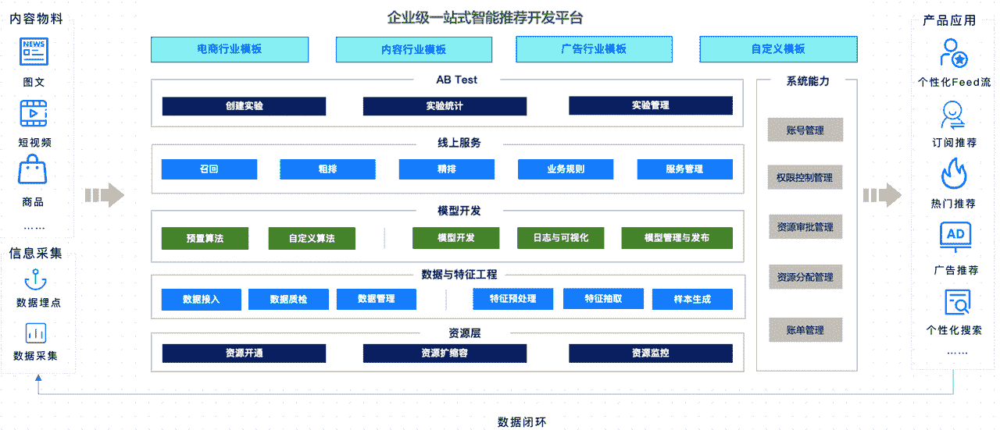

# 基本概念

**应用（新版）**

应用是在智能推荐平台完成推荐服务的一条完整线路。一个公司可能会有多个应用，应用主要用于管理一个推荐流程下的数据、特征、模型、在线服务，方便用户更简单地使用平台。一个应用只能绑定一个行业模版。

**栏位**

栏位指的是推荐的位置集合，可以包含一个或者多个spm，栏位下需要配置一套在线服务的策略（包括召回策略、排序策略和业务规则）。

**行业模版**

是平台预置的基于不同行业业务的推荐业务模板，也指客户应用推荐的实际行业领域。当前支持的行业类型为电商行业、内容行业（长视频、内容社区）。

**推荐类型**

电商行业和内容行业目前支持“猜你喜欢”推荐类型，即根据用户兴趣，推荐给用户感兴趣的物品，达到“千人千面”的效果。后续将逐步拓展相关推荐、热门推荐、沉浸式推荐等推荐类型。

**数据表**

包含用户表、商品表（或内容表，因行业而异）、行为表。

**场景**

场景用于标识行为发生的位置，在平台上使用SPM来区分。以电商行业为例，SPM位置编码由A/B/C/D四段构成， 各分段分别代表 A:业务， B:页面， C:页面区块， D:区块内点位。段之间用$##$分隔，即A$##$B$##$C$##$D，详细传输规范参考行业数据模版。场景标识非常重要，数据校验报告、AB实验报告中均需要查看分场景（通常取spm前三段）的指标。

**归因分析**

用于计算用户行为（例如电商行业的商品购买成功、长视频行业的视频播放等）的产生主要来源于前面哪些场景下的哪些行为。将整个时间线上的用户行为经过去重后，构建一个转化路径图。例如电商行业常见的归因路径：曝光-点击-加入购物车-下单-转化（购买成功）。

**特征工程**

特征工程可以基于行业模板自动化处理，也可以自主开发。启用行业模板后，可基于业务目标，自动化完成从数据到样本的生成，包含特征预处理、特征抽取、样本生成等阶段。自主开发则可以更灵活地定义数据表、数据处理任务，灵活扩展特征及样本的定义。

**策略管理**

包含召回策略及业务规则的管理。支持直接使用内置的召回策略/业务规则，也支持创建自定义召回策略/自定义业务规则。自定义召回策略，目前仅在私有化环境下支持“添加召回”；自定义业务规则目前支持 3 种，“自定义过滤”、“自定义重排”和“自定义返回字段”。

**在线服务**

是指构建推荐引擎的服务流程，平台以可视化的方式呈现，支持对召回、排序（精排）、规则模块进行配置。通过构建可视化、可配置的在线服务，让用户可以更清晰地明确流程及对应环节的交互配置。

**召回**

召回是推荐系统的关键问题之一，指从全量的商品集合中筛选出一定数量的符合用户需求的商品，并将商品提供给下游的“排序”环节。

**A/B测试**

为了验证一个新策略的效果，准备原策略A和新策略B两种方案。 随后在总体用户中取出一小部分，将这部分用户完全随机地分在两个组中，使两组用户在统计角度无差别。将原策略A和新策略B分别展示给不同的用户组，一段时间后，结合统计方法分析数据，得到两种策略生效后指标的变化结果，并以此判断新策略B是否符合预期。上述过程即A/B实验。

# 最佳实践

## 1、通过负反馈功能，提升用户体验

### 背景介绍

负反馈，是指客户在与推荐系统互动时，由于推荐结果不符合预期或者对推荐结果感到不适，在app侧标记对某个item或者某类item不感兴趣。

推荐系统需要根据客户标记的负反馈行为，将负反馈的物品在推荐结果中过滤掉，提升用户的体验。

### 应用场景

**场景1：对某个物品标记不感兴趣**

**场景2：对某类物品标记不感兴趣**

> 如下图，用户选择“不喜欢此作品”

> 如下图，用户选择“不看此作者”

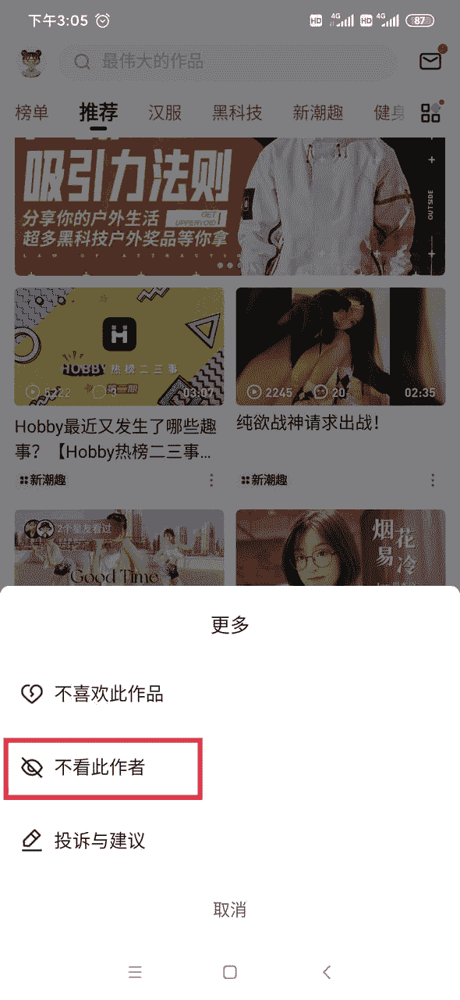

### 使用方法

#### 功能配置入口

在【策略管理】-【业务规则】-【内置规则】中，创建负反馈规则，并在 在线服务 中选用。

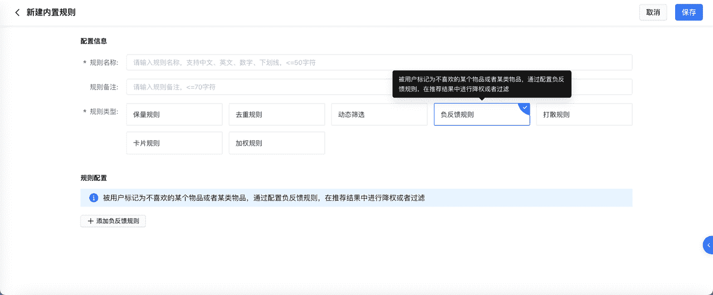

### 使用方法说明

#### **场景1：对某个物品标记不感兴趣**

+   **Step 1：**API 传输行为数据时，传输针对某个物品的 dislike 行为。
例如上图1，用户点击了“不喜欢此作品”，则需要传输一条针对该作品的 dislike 行为数据。

+   **Step 2：**根据业务需求，配置具体的负反馈过滤/降权规则。

此场景下，维度选择商品ID（或内容ID，因行业而异）。

+   **负反馈过滤：****在指定周期范围内，对**于标记了dislike的物品在推荐结果中不展示。

+   **负反馈降权：****在指定周****期**范围内，对于标记了dislike的物品降低权重。

#### **场景2：** **对某类物品标记不感兴趣**

+   **Step 1：**在行为表字段中勾选 dislike_type 和 dislike_value，并在 API 传输行为数据时，传输针对某个物品的 dislike 行为、以及对应的 dislike_type 和 dislike_value 值。
例如上图2，用户点击了“不看此作者”，则需要传输一条针对该作品的 dislike 行为数据，并在 dislike_type 中填充 author_id（作为负反馈的维度），dislike_value 中填充 author_id 的值（作为负反馈的维度值），即当前 item 作者的author_id（若此字段不传，则默认使用当前 item 对应的属性值）。

+   **Step 2：**根据业务需求，配置具体的负反馈过滤/降权规则。
对某一类物品的不感兴趣，建议使用权重打压方式，以防止过滤掉过多item

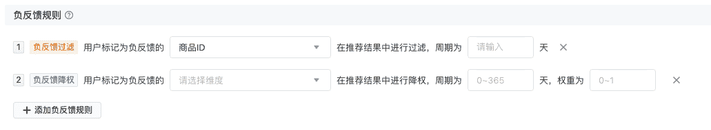

场景下，根据业务需求选择负反馈维度（上述例子中即为内容作者），目前平台各行业支持的维度如下：

+   **电商：**商品ID（goods_id）、商品类目（cate）、商品品牌（brand）、SPU（spu_id）、店铺ID（shop_id）、所有自定义字段（支持string、array类型）

+   **长视频：**内容ID（item_id）、视频类型（video_type）、视频分类（category）、视频标签（tags）、视频国家（pub_region）、所有自定义字段（支持string、array类型）

+   **内容社区：**内容ID（doc_id）、内容分类（cate）、内容类型（doc_type）、内容作者（author_id）、内容标签（tags）、所有自定义字段（支持string、array类型）

+   **金融：**物品ID（item_id）、物品类目（cate）、物品类型（item_type）、发行机构（organization）、物品来源（source_id）、物品标签（tags）、所有自定义字段（支持string、array类型）

---

## 2、通过保量功能，提高冷启动物品的推荐精准度

### **背景介绍**

1.  **什么是物品冷启动**

物品冷启动主要解决将新的物品推荐给可能感兴趣的用户的问题。

1.  为什么要解决物品冷启动问题，有哪些收益

+   挖掘更多有价值的新内容/商品，避免马太效应导致的推荐的内容越来越集中、推荐范围越来越窄的问题。

+   给中小型的创作者一定的支持，长尾的内容也能得到一定的曝光，更有利于平台内容生态的建设

### **应用场景**

**CASE1：**每天有大量新内容产生的客户（例如：短视频推荐/内容社区推荐/广告推荐）

为了让新内容有更多的曝光记录，也为了鼓励创作者更多的新内容，有一个健康运转的推荐生态，需要对中小创作者进行扶持，要单独对冷启动的物品进行处理，保证在前期缺少行为的情况下也能有一定的曝光，加速冷启动内容转化为成熟内容。

**CASE2：**对时效性要求非常高的客户（例如：新闻资讯类推荐/直播推荐）

时效性通常在1天内，时效性非常短，很难短时间积累用户行为，导致这类内容在推荐结果中不能被及时推荐出去。

### **使用方法**

#### Step 1：定义物品冷启动的口径

**配置模块：**【策略管理】-【召回管理】-【模型召回】

支持按照发布时间（pub_time）、累计曝光 pv 两个条件来定义冷启动的物品。

例如下图，配置发布时间（pub_time）在7天之内的物品为新物品。

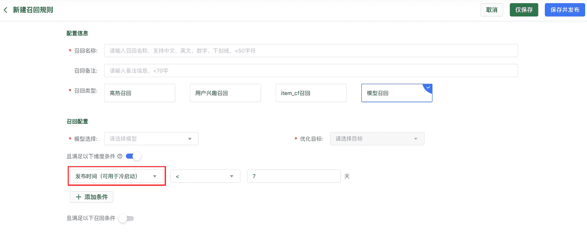

#### Step 2：对冷启动物品进行流量扶持

1.  **召回：勾选召回保送**

配置模块：【栏位管理】-【在线服务】-【召回策略】

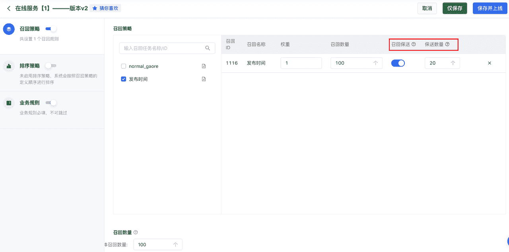

+   回保送：开启后对应召回规则的结果将直接进入精排，不再需要经过召回合并及粗排。例如：被保送的召回规则A，召回数量是100，保送数量50，全部召回数量400，那么50个物品会直接进入精排，剩余350个物品是非保送召回规则 merge 后的数量。

+   保送数量：指保送进精排的结果数量，保送数量不能超过召回数量。

+   整体召回数量：所有召回策略召回数量合并后最终召回的总数。若整体召回数量大于上述所选召回策略的召回数量总和，则返回所有召回结果；若整体召回数量小于上述所选召回策略的召回数量总和，则按照此处设置的整体召回数量返回召回结果。此处设置的数量不包含保送的数量。

1.  **排序：精排策略，添加排序参数**

配置模块：【栏位管理】-【在线服务】-【排序策略】

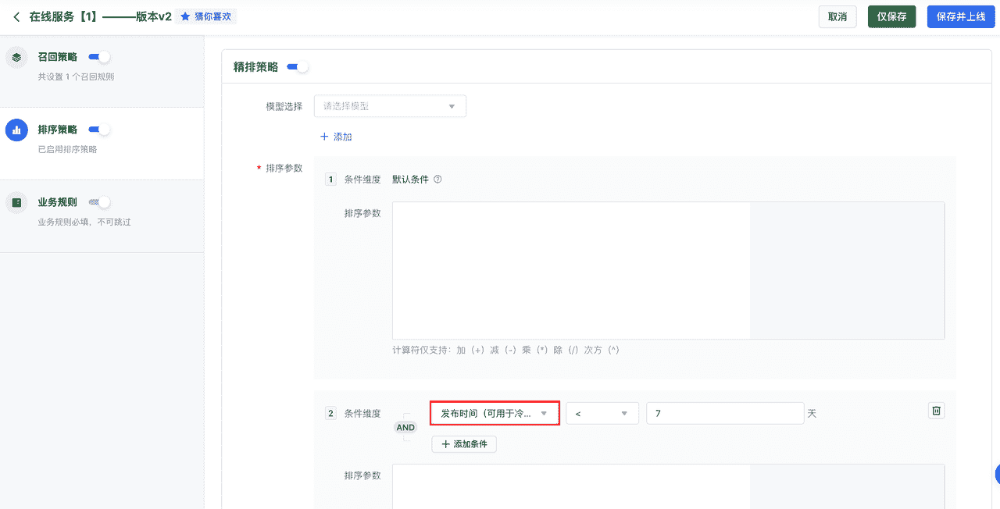

+   添加排序参数时，通过维度条件可以将物品进行分组，满足不同条件的物品可以采用不同的排序参数融合公式的得分，使得物品的得分公式更加灵活，通常适合冷启动等复杂业务场景。

+   在配置条件时要避免条件之间有交叉，如果一个物品被多个条件命中会导致计算结果不准确。

1.  业务规则：创建保量规则和打散规则

**保量规则**

配置模块**：【策略管理**】**-【业务规则**】**-【内置规则**】

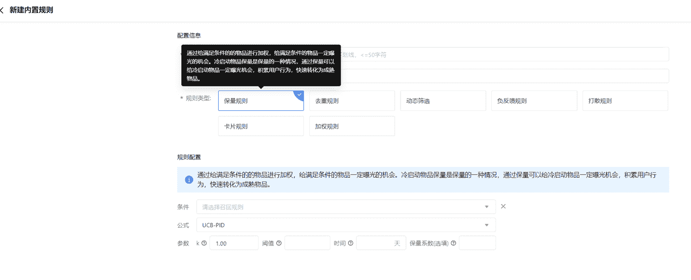

使用说明：通过给满足条件的的物品进行加权，给满足条件的物品一定曝光的机会。冷启动物品保量是保量的一种情况，通过保量可以给冷启动物品一定曝光机会，积累用户行为，快速转化为成熟商品。 配置说明：条件选择在召回策略中设置的召回规则，即需要配置保量规则的召回，然后选择保量公式及相关参数。

**保量公式说明：**

**UCB-PID：**

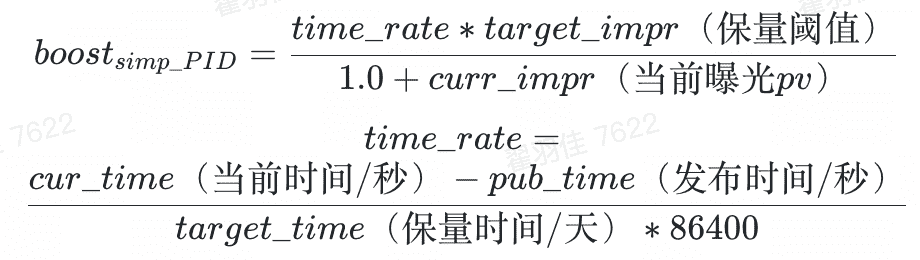

**UCB：**

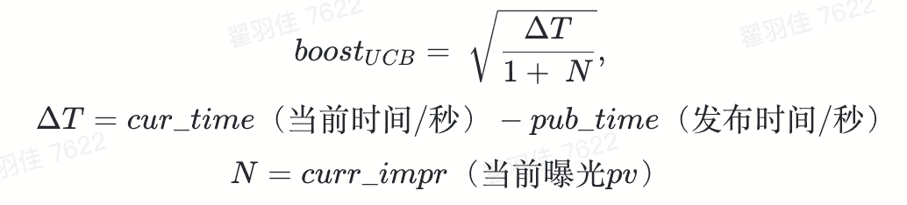

参数说明：

+   阈值：物品保量预期达到的曝光pv数。例如：平均ctr为a%，则冷启动曝光阈值可以设置为：[10/a% ~ 20/a%]。

+   时间：物品保量的时长。

+   保量系数：物品经过公式计算的 boost 系数上限，避免物品加权后得分过高，在排序结果中集中展示。

**打散规则**

配置模块：【策略管理】-【业务规则】-【内置规则】

通过配置不同展示窗口下展示的物品数，限制物品展示分布，保证推荐物品的丰富度。

+   维度打散：支持按照召回规则打散。

+   表达式打散：支持召回规则/保量规则打散。

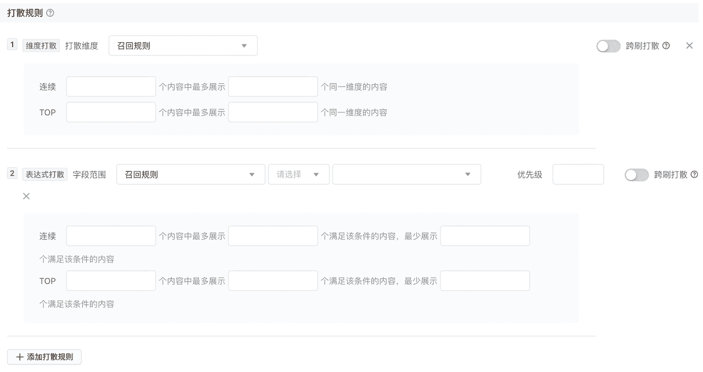

建议一般需要通过打散规则限制下一刷出的冷启内容的数量。例如冷启动的内容最多7个中展示1个。

1.  业务规则：选择保量规则，配置打散规则

配置模块：【栏位管理】-【在线服务】-【业务规则】

选择在【策略管理】中创建好的保量规则和打散规则即可。

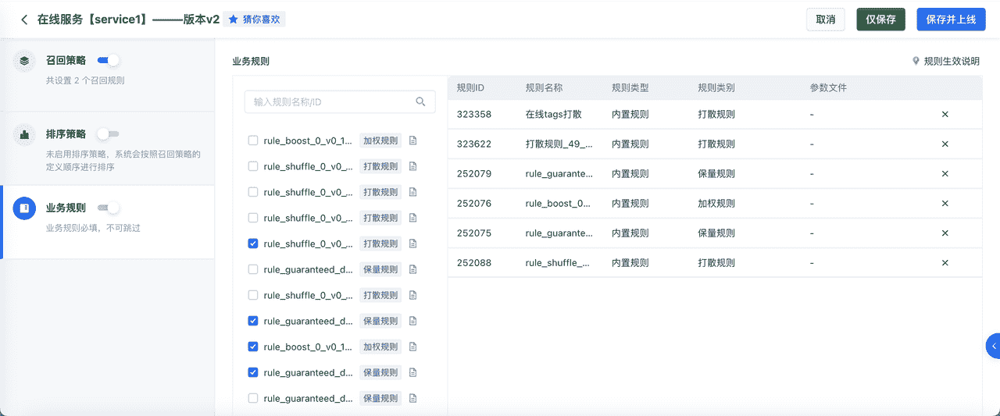

#### Step 3：创建AB实验，对冷启动的策略进行AB实验

1.  创建实验：创建实验版本中的配置操作与在线服务保持一致。

1.  查看AB实验报告。

> **注意**

+   必须接入**增量实时数据**，才可使用保量规则。

+   若在模型召回中使用曝光pv配置了维度条件，则对应的item会在召回生效时会开启累计pv数；若在召回中未使用，但在 精排的排序条件中使用累计曝光pv数配置维度条件，或在业务规则中配置保量规则，则对应的item会在在线服务上线时，开始累计pv数。

+   计算物品累计曝光pv数的任务为唯一的常驻任务，多个规则不会重复触发，且不会随着保量规则的下线而重置。

+   曝光pv统计基于归因去重后的行为数据。