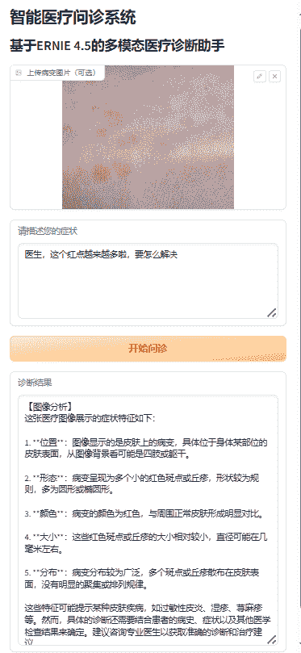
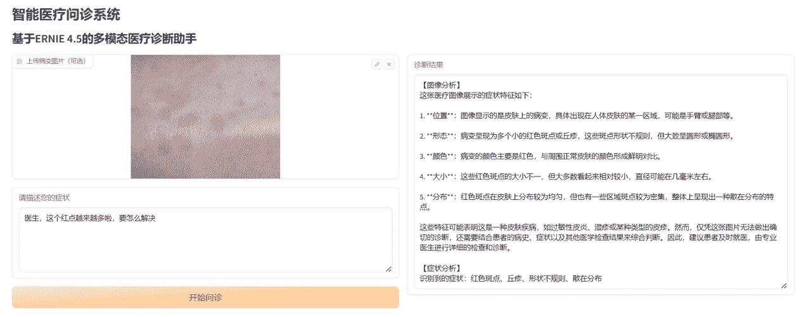
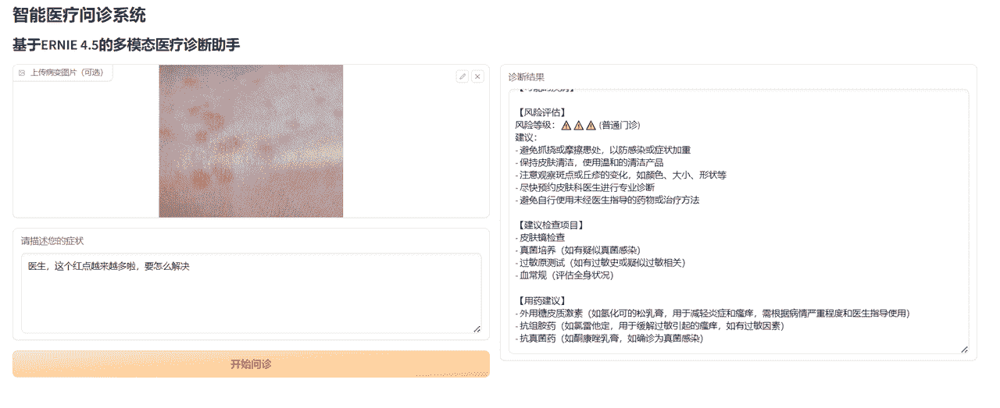

# 多Agent协同的多模态智能医疗问诊系统

> 来源：`https://v11enp9ok1h.feishu.cn/docx/BGoEd9z0eoHXfPx8uI1cy8i8nUf`

## 项目概述

> 本项目基于本地化部署的`ERNIE-4.5-VL-28B-A3B-Paddle`多模态大模型，构建了一个集成`RAG`知识库检索与多Agent协同机制的智能医疗问诊系统。通过`FastDeploy`框架实现模型的高效本地部署，结合`ChromaDB`知识库和多模态理解能力，为用户提供专业的医疗咨询服务。

### 🎯 项目亮点

+   **🏥 完整医疗场景：**从症状描述到治疗建议的全流程智能问诊

+   **🖼️ 多模态融合：**支持文本+图像的混合输入，可分析皮肤病变等医疗图像

+   **🧠 本地化部署：**基于`ERNIE-4.5-VL-28B-A3B-Paddle`的完全本地化方案，数据安全可控

+   **📚 知识库驱动：**`ChromaDB`构建的医学知识库，支持症状、疾病、治疗方案的智能检索

+   **🤖 多Agent协同：**症状解析、知识检索、诊断决策等专业Agent的协同工作

+   **⚡ 高性能推理**：`FastDeploy`加速框架，单机多卡部署，推理延迟优化

### 🏗️ 系统架构图

### 🏗️ 系统架构图-代码

```
graph TD
    A[用户问诊输入] --> B[Gradio前端界面]
    B --> C[MedicalConsultation]
    C --> D[AgentCoordinator协调器]
    
    D --> E[ERNIE-4.5-VL本地模型]
    E --> F[FastDeploy推理引擎]
    F --> G[多模态理解]
    
    D --> H[SymptomParserAgent]
    D --> I[KnowledgeRetrievalAgent]
    D --> J[DiagnosisAgent]
    
    I --> K[ChromaDB知识库]
    K --> L[症状库]
    K --> M[疾病库]
    K --> N[治疗库]
    
    H --> O[症状提取]
    I --> P[知识检索]
    J --> Q[风险评估]
    J --> R[治疗建议]
    
    O --> S[诊断结果整合]
    P --> S
    Q --> S
    R --> S
    
    S --> T[结构化医疗报告]
    T --> B
```

### 🏆 技术创新总结

本项目实现了从**大模型本地化部署**到**智能医疗应用**的完整技术链路：

1.  **🔥 核心突破：**28B参数`ERNIE-4.5-VL`多模态大模型的高效本地化部署

2.  **🧠 智能升级：**`RAG`知识库检索 + 多Agent协同的医疗专家系统

3.  **🛡️ 数据安全：**完全本地化方案，患者隐私零泄露

4.  **⚡ 性能优化**：`FastDeploy`推理加速，秒级响应医疗问诊

### 🛠️ 技术栈选择

## 🏥 智能医疗问诊系统实现

### 核心功能模块

1.  多模态输入处理

```
class ErnieClient:
    def medical_image_analysis(self, image_path: str) -> str:
        """医疗图像分析"""
        with open(image_path, "rb") as image_file:
            base64_image = base64.b64encode(image_file.read()).decode("utf-8")
        
        messages = [{
            "role": "user", 
            "content": [
                {"type": "image_url", "image_url": {"url": f"data:image/jpeg;base64,{base64_image}"}},
                {"type": "text", "text": "请分析这张医疗图像，描述可见的症状特征"}
            ]
        }]
        # 调用本地ERNIE-4.5-VL模型
        return self._call_local_model(messages)
```

1.  知识库检索系统

```
class KnowledgeBase:
    def __init__(self, persist_directory="medical_kb"):
        # 使用ChromaDB构建医学知识库
        self.client = chromadb.PersistentClient(path=persist_directory)
        
        # 创建专业医学集合
        self.symptoms_collection = self.client.get_or_create_collection("symptoms")
        self.diseases_collection = self.client.get_or_create_collection("diseases")  
        self.treatments_collection = self.client.get_or_create_collection("treatments")
```

1.  多Agent协同系统

```
class AgentCoordinator:
    def process_consultation(self, text_input: str, image_path: str = None):
        # 1. 图像分析（如果提供）
        image_analysis = self.ernie.medical_image_analysis(image_path) if image_path else None
        
        # 2. 症状解析Agent
        symptoms = self.symptom_parser.parse_symptoms(text_input, image_analysis)
        
        # 3. 知识检索Agent  
        medical_info = self.knowledge_retriever.retrieve_relevant_info(symptoms)
        
        # 4. 诊断决策Agent
        risk_assessment = self.diagnosis_agent.analyze_risk_level(symptoms, medical_info)
        treatment_plan = self.diagnosis_agent.generate_treatment_plan(symptoms, medical_info)
        
        return {
            "symptoms": symptoms,
            "risk_assessment": risk_assessment, 
            "treatment_plan": treatment_plan,
            "image_analysis": image_analysis
        }
```

### 🎯 应用场景与效果

#### 典型使用流程

1.  用户输入：描述症状 + 上传病变图片（可选）

1.  多模态分析：`ERNIE-4.5-VL`同时理解文本和图像

1.  症状提取：AI识别关键症状和医学术语

1.  知识检索：从专业医学库中检索相关疾病信息

1.  风险评估：评估病情严重程度和就医紧急性

1.  治疗建议：生成个性化的检查、用药和生活建议

#### 系统优势

+   数据安全：完全本地化部署，患者数据不出本地

+   专业准确：基于28B参数的专业医学模型

+   响应快速：本地推理，无网络延迟

+   持续学习：知识库可不断扩充和更新

## 🧠 ERNIE-4.5-VL-28B-A3B-Paddle模型选择

### ERNIE-4.5模型系列规格对比表

### 模型规格选择策略表

### 为什么选择`ERNIE-4.5-VL-28B-A3B-Paddle`模型？

#### 1. 性能与成本的最佳平衡

+   参数规模适中：28B总参数，3B激活参数，在保证推理能力的同时控制了计算成本

+   硬件要求合理：支持单机多卡部署（4×`V100`或2×`A100`），相比`A47B`系列降低了75%的硬件门槛

+   推理延迟适中：在保证输出质量的前提下，响应速度比大规模模型快3-5倍

#### 2. 多模态能力突出

+   文本+视觉融合：原生支持图文理解，无需额外的视觉编码器

+   长上下文支持：`128K` `token`上下文长度，可处理长文档和多张图片

+   应用场景丰富：适合文档分析、图像描述、多模态问答等任务

#### 3. 部署友好性

+   `AIStudio`平台优化：官方深度适配，提供一键下载和部署

+   `FastDeploy`集成：完整的推理加速和服务化支持

+   开源生态：`PaddlePaddle`生态系统，文档完善，社区活跃

#### 4. 实际应用价值

+   企业级可用：相比`0.3B`模型，理解能力和生成质量显著提升

+   成本可控：相比`A47B`系列，部署成本降低70%，运营成本降低60%

+   扩展性强：支持`LoRA`微调，可针对特定场景进行优化

#### 5. 技术先进性

+   `MoE`架构：专家混合模型，激活参数仅为总参数的1/9，推理效率高

+   多模态对齐：视觉和文本特征深度融合，理解能力接近`GPT-4V`

+   中文优化：针对中文场景深度优化，在中文多模态任务上表现优异

#### 选择建议

**推荐场景**：

+   中小企业多模态AI应用开发

+   教育科研项目的多模态实验

+   个人开发者的AI产品原型验证

+   需要图文理解能力的业务系统

**不推荐场景**：

+   对推理延迟要求极高的实时系统（选择`0.3B`）

+   预算充足且追求极致性能的场景（选择`A47B`）

+   纯文本应用且对多模态无需求（选择`21B-A3B`）

## 🚀 ERNIE-4.5-VL模型本地化部署方案

### 一、环境准备

#### 硬件要求

+   `GPU`：`NVIDIA` `A100` 80GB（支持单卡/多卡，推荐`CUDA` 11.8+）

+   内存：≥60GB `RAM`

+   存储：≥60GB（模型约28GB，需预留日志/缓存空间）

#### 软件依赖

```
%%capture
!python -m pip install fastdeploy-gpu -i https://www.paddlepaddle.org.cn/packages/stable/fastdeploy-gpu-80_90/ --extra-index-url https://mirrors.tuna.tsinghua.edu.cn/pypi/web/simple
```

#### 环境验证

#### ① 检查`CUDA`版本

```
!nvcc --version
# 预期输出示例：
nvcc: NVIDIA (R) Cuda compiler driver
Copyright (c) 2005-2024 NVIDIA Corporation
Built on Tue_Oct_29_23:50:19_PDT_2024
Cuda compilation tools, release 12.6, V12.6.85
Build cuda_12.6.r12.6/compiler.35059454_0
```

#### ② 检查`GPU`信息

```
 检查GPU状态和显存
!nvidia-smi
# 预期输出示例：
Tue Jul  8 01:25:28 2025       
+-----------------------------------------------------------------------------------------+
| NVIDIA-SMI 570.148.08             Driver Version: 570.148.08     CUDA Version: 12.8     |
|-----------------------------------------+------------------------+----------------------+
| GPU  Name                 Persistence-M | Bus-Id          Disp.A | Volatile Uncorr. ECC |
| Fan  Temp   Perf          Pwr:Usage/Cap |           Memory-Usage | GPU-Util  Compute M. |
|                                         |                        |               MIG M. |
|=========================================+========================+======================|
|   0  NVIDIA A800-SXM4-80GB          On  |   00000000:D3:00.0 Off |                    0 |
| N/A   41C    P0             66W /  400W |       0MiB /  81920MiB |      0%      Default |
|                                         |                        |             Disabled |
+-----------------------------------------+------------------------+----------------------+
                                                                                         
+-----------------------------------------------------------------------------------------+
| Processes:                                                                              |
|  GPU   GI   CI              PID   Type   Process name                        GPU Memory |
|        ID   ID                                                               Usage      |
|=========================================================================================|
|  No running processes found                                                             |
+-----------------------------------------------------------------------------------------+
```

#### ③ 常见环境问题排查


# 检查PaddlePaddle GPU支持

```python
!python -c "import paddle; print('GPU可用:', paddle.is_compiled_with_cuda()); print('GPU设备数:', paddle.device.cuda.device_count())"
```

# 检查FastDeploy安装

```python
!python -c "from fastdeploy import LLM, SamplingParams; print('FastDeploy安装成功！')"
```

# 检查OpenAI库版本

```python
!python -c "import openai; print('OpenAI库版本:', openai.__version__)"
```

## 二、模型下载与目录结构

### 下载模型文件

```python
%%capture
# 使用AIStudio命令下载模型
!aistudio download --model PaddlePaddle/ERNIE-4.5-VL-28B-A3B-Paddle --local_dir /home/aistudio/work/models
```

### 查看模型文件

```bash
!ls -l work/models
total 57441133
-rw-r--r-- 1 aistudio aistudio      11366 Jul  6 18:57 LICENSE
-rw-r--r-- 1 aistudio aistudio       9077 Jul  6 18:56 README.md
-rw-r--r-- 1 aistudio aistudio      86904 Jul  6 18:56 added_tokens.json
-rw-r--r-- 1 aistudio aistudio       1306 Jul  6 18:57 config.json
-rw-r--r-- 1 aistudio aistudio        134 Jul  6 18:57 generation_config.json
-rw-r--r-- 1 aistudio aistudio 4991326368 Jul  6 18:57 model-00001-of-00012.safetensors
-rw-r--r-- 1 aistudio aistudio 4988696384 Jul  6 18:56 model-00002-of-00012.safetensors
-rw-r--r-- 1 aistudio aistudio 4999185600 Jul  6 18:56 model-00003-of-00012.safetensors
-rw-r--r-- 1 aistudio aistudio 4995268296 Jul  6 18:57 model-00004-of-00012.safetensors
-rw-r--r-- 1 aistudio aistudio 4988696984 Jul  6 18:56 model-00005-of-00012.safetensors
-rw-r--r-- 1 aistudio aistudio 4999193256 Jul  6 18:57 model-00006-of-00012.safetensors
-rw-r--r-- 1 aistudio aistudio 4995261896 Jul  6 18:57 model-00007-of-00012.safetensors
-rw-r--r-- 1 aistudio aistudio 4999183248 Jul  6 18:56 model-00008-of-00012.safetensors
-rw-r--r-- 1 aistudio aistudio 4995271816 Jul  6 18:57 model-00009-of-00012.safetensors
-rw-r--r-- 1 aistudio aistudio 4988696992 Jul  6 18:57 model-00010-of-00012.safetensors
-rw-r--r-- 1 aistudio aistudio 4999190216 Jul  6 18:57 model-00011-of-00012.safetensors
-rw-r--r-- 1 aistudio aistudio 3877260800 Jul  6 18:57 model-00012-of-00012.safetensors
-rw-r--r-- 1 aistudio aistudio     691887 Jul  6 18:56 model.safetensors.index.json
-rw-r--r-- 1 aistudio aistudio        615 Jul  6 18:56 preprocessor_config.json
-rw-r--r-- 1 aistudio aistudio       3606 Jul  6 18:56 tokenizer_config.json
-rw-r--r-- 1 aistudio aistudio    1614362 Jul  6 18:56 tokenizer.model
-rw-r--r-- 1 aistudio aistudio      62694 Jul  6 18:56 special_tokens_map.json
```

### 目录结构

```text
work/
└── models/
    ├── LICENSE                           # 许可证文件
    ├── README.md                         # 模型说明文档
    ├── added_tokens.json                 # 新增token配置
    ├── config.json                       # 模型配置文件
    ├── generation_config.json            # 生成配置文件
    ├── model-00001-of-00012.safetensors  # 模型参数文件(分片1/12)
    ├── model-00002-of-00012.safetensors  # 模型参数文件(分片2/12)
    ├── model-00003-of-00012.safetensors  # 模型参数文件(分片3/12)
    ├── model-00004-of-00012.safetensors  # 模型参数文件(分片4/12)
    ├── model-00005-of-00012.safetensors  # 模型参数文件(分片5/12)
    ├── model-00006-of-00012.safetensors  # 模型参数文件(分片6/12)
    ├── model-00007-of-00012.safetensors  # 模型参数文件(分片7/12)
    ├── model-00008-of-00012.safetensors  # 模型参数文件(分片8/12)
    ├── model-00009-of-00012.safetensors  # 模型参数文件(分片9/12)
    ├── model-00010-of-00012.safetensors  # 模型参数文件(分片10/12)
    ├── model-00011-of-00012.safetensors  # 模型参数文件(分片11/12)
    ├── model-00012-of-00012.safetensors  # 模型参数文件(分片12/12)
    ├── model.safetensors.index.json      # 模型分片索引文件
    ├── preprocessor_config.json          # 预处理器配置
    ├── special_tokens_map.json           # 特殊token映射
    ├── tokenizer.model                   # 分词器模型文件
    └── tokenizer_config.json             # 分词器配置文件
```

### 文件说明

## 三、启动服务（关键命令）

```bash
python -m fastdeploy.entrypoints.openai.api_server \
       --model work/models \
       --port 8180 \
       --metrics-port 8181 \
       --engine-worker-queue-port 8182 \
       --max-model-len 32768 \
       --enable-mm \
       --reasoning-parser ernie-45-vl \
       --max-num-seqs 32
```

```
/opt/conda/envs/python35-paddle120-env/lib/python3.10/site-packages/paddle/utils/cpp_extension/extension_utils.py:715: UserWarning: No ccache found. Please be aware that recompiling all source files may be required. You can download and install ccache from: https://github.com/ccache/ccache/blob/master/doc/INSTALL.md
  warnings.warn(warning_message)
/home/aistudio/external-libraries/lib/python3.10/site-packages/_distutils_hack/__init__.py:30: UserWarning: Setuptools is replacing distutils. Support for replacing an already imported distutils is deprecated. In the future, this condition will fail. Register concerns at https://github.com/pypa/setuptools/issues/new?template=distutils-deprecation.yml
  warnings.warn(
[2025-07-06 18:57:55,035] [    INFO] - loading configuration file work/models/preprocessor_config.json
INFO     2025-07-06 18:57:58,188 5574  engine.py[line:206] Waitting worker processes ready...
Loading Weights: 100%|████████████████████████| 100/100 [01:17<00:00,  1.30it/s]
Loading Layers: 100%|█████████████████████████| 100/100 [00:07<00:00, 13.31it/s]
INFO     2025-07-06 18:59:35,857 5574  engine.py[line:276] Worker processes are launched with 119.6253821849823 seconds.
INFO     2025-07-06 18:59:35,857 5574  api_server.py[line:91] Launching metrics service at http://0.0.0.0:8181/metrics
INFO     2025-07-06 18:59:35,857 5574  api_server.py[line:94] Launching chat completion service at http://0.0.0.0:8180/v1/chat/completions
INFO     2025-07-06 18:59:35,857 5574  api_server.py[line:97] Launching completion service at http://0.0.0.0:8180/v1/completions
INFO:     Started server process [5574]
INFO:     Waiting for application startup.
[2025-07-06 18:59:54,481] [    INFO] - loading configuration file work/models/preprocessor_config.json
INFO:     Application startup complete.
INFO:     Uvicorn running on http://0.0.0.0:8180 (Press CTRL+C to quit)
```

### 服务启动参数详细说明

### 其他常用参数

### 服务验证

```bash
# 检查模型是否正常加载
curl http://localhost:8180/v1/models

# 预期输出（包含模型ID）
{"data":[{"id":"ernie-4.5-vl-28b-a3b-paddle","object":"model"}]}
```

## 功能展示与效果



### 📋 诊断报告示例



### 🔍 图像分析能力



### 💊 治疗建议输出格式

```
【症状分析】
识别到的症状：发热、咳嗽、乏力

【风险评估】  
风险等级：⚠️⚠️ (建议普通门诊就医)
建议：
- 症状持续时间较短，暂无严重并发症
- 建议及时就医排查感染性疾病

【建议检查项目】
- 血常规检查
- C反应蛋白检测
- 胸部X光片

【用药建议】
- 对症治疗：布洛芬退热
- 止咳化痰：复方甘草片
- 请遵医嘱用药，避免自行用药

【生活建议】  
- 充分休息，避免剧烈运动
- 多饮水，保持室内通风
- 注意保暖，避免再次受凉
```

## 应用价值与场景

### 🏥 医疗场景应用

#### 基层医疗机构

+   **初步问诊**：协助全科医生进行症状分析

+   **分诊辅助**：评估患者病情紧急程度

+   **知识支持**：为医生提供疾病诊疗参考

#### 远程医疗服务

+   **在线咨询**：24小时智能医疗咨询服务

+   **图像诊断**：皮肤病、外伤等可视化疾病分析

+   **健康教育**：提供专业的健康管理建议

#### 个人健康管理

+   **症状自查**：用户自主进行健康状况评估

+   **就医指导**：提供科学的就医建议和科室推荐

+   **用药咨询**：基于症状的安全用药指导

### 💡 技术价值

#### 行业推动

+   **AI医疗标准化**：多模态医疗AI的技术范式

+   **本地化部署**：为医疗数据安全提供解决方案

+   **开源生态**：基于PaddlePaddle的完整技术栈

#### 创新突破

+   **多模态融合**：图文一体化的医疗理解能力

+   **知识库驱动**：RAG技术在医疗领域的深度应用

+   **Agent协同**：专业化AI系统的协作机制

## 四、模型调用示例

### OpenAI库调用方式

#### ① 文本生成

```python
import openai

host = "0.0.0.0"
port = "8180"
client = openai.Client(base_url=f"http://{host}:{port}/v1", api_key="null")

response = client.chat.completions.create(
    model="null",
    messages=[
        {"role": "user", "content": "你是Aistudio和文心大模型开发的智能助手，请介绍一下你自己."}
    ],
    stream=True,
)

for chunk in response:
    if chunk.choices[0].delta:
```

#### ② 图像描述生成


# 大模型API调用指南

## OpenAI SDK 调用方式

```
import openai
import base64

def encode_image(image_path):
    with open(image_path, "rb") as image_file:
        return base64.b64encode(image_file.read()).decode('utf-8')

client = openai.Client(
    base_url="http://0.0.0.0:8180/v1",
    api_key="null"
)

response = client.chat.completions.create(
    model="null",
    messages=[
        {
            "role": "user",
            "content": [
                {
                    "type": "image_url",
                    "image_url": {
                        "url": f"data:image/jpeg;base64,{encode_image('1.jpg')}"
                    }
                },
                {
                    "type": "text",
                    "text": "生成这张图片的描述"
                }
            ]
        }
    ],
    stream=True,
)

print("图片描述：", end='', flush=True)
for chunk in response:
    if chunk.choices and chunk.choices[0].delta.content:
        print(chunk.choices[0].delta.content, end='', flush=True)
print()
```

## `requests` 库调用方式

```
import requests
import json

url = "http://localhost:8180/v1/chat/completions"
headers = {"Content-Type": "application/json"}
payload = {
    "model": "null",
    "messages": [
        {"role": "user", "content": "你是Aistudio和文心大模型开发的智能助手，请介绍一下你自己."}
    ],
    "stream": True
}

response = requests.post(url, headers=headers, json=payload, stream=True)

for line in response.iter_lines():
    if line:
        line = line.decode('utf-8').replace('data: ', '')
        
        if line.strip() == '[DONE]':
            continue
        try:
            data = json.loads(line)
            
            if 'choices' in data and len(data['choices']) > 0:
                delta = data['choices'][0].get('delta', {})
                content = delta.get('content', '')
                if content:
                    print(content, end='', flush=True)
        except json.JSONDecodeError as e:
            print(f"Error decoding line: {line}")
            print(f"Error: {e}")

print()
```

## 图像描述生成

```
import requests
import json
import base64

def encode_image(image_path):
    with open(image_path, "rb") as image_file:
        return base64.b64encode(image_file.read()).decode('utf-8')

url = "http://localhost:8180/v1/chat/completions"
headers = {"Content-Type": "application/json"}
payload = {
    "model": "null",
    "messages": [
        {
            "role": "user",
            "content": [
                {"type": "image_url", "image_url": {"url": f"data:image/jpeg;base64,{encode_image('1.jpg')}"}},
                {"type": "text", "text": "生成图片描述"}
            ]
        }
    ],
    "stream": True
}

response = requests.post(url, headers=headers, json=payload, stream=True)

for line in response.iter_lines():
    if line:
        line = line.decode('utf-8').replace('data: ', '')
        
        if line.strip() == '[DONE]':
            continue
        try:
            data = json.loads(line)
            
            if 'choices' in data and len(data['choices']) > 0:
                delta = data['choices'][0].get('delta', {})
                content = delta.get('content', '')
                if content:
                    print(content, end='', flush=True)
        except json.JSONDecodeError as e:
            print(f"Error decoding line: {line}")
            print(f"Error: {e}")

print()
```

## 调用参数说明

### 常用参数配置

```
# 完整的调用参数示例
response = client.chat.completions.create(
    model="null",                    # 模型名称（固定值）
    messages=[...],                  # 消息列表
    stream=True,                     # 是否启用流式响应
    max_tokens=2048,                 # 最大生成token数
    temperature=0.7,                 # 温度参数(0.0-2.0)
    top_p=0.9,                      # 核采样参数(0.0-1.0)
    frequency_penalty=0.0,           # 频率惩罚(-2.0-2.0)
    presence_penalty=0.0,            # 存在惩罚(-2.0-2.0)
    stop=["<|endoftext|>"],         # 停止词列表
)
```

### 参数详细说明
