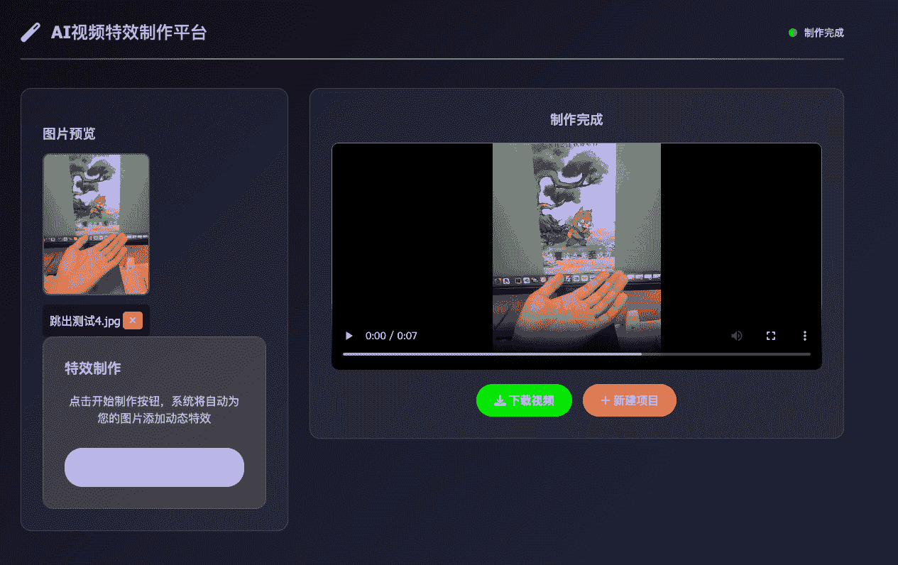
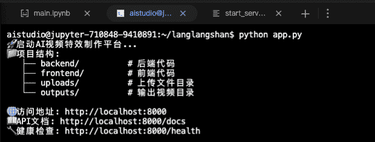

# 基于wan2.1构建掌心的浪浪山的小妖怪

> 来源：[https://v11enp9ok1h.feishu.cn/docx/WkG6dmK5zo3SqixUkWtc34bYnzd](https://v11enp9ok1h.feishu.cn/docx/WkG6dmK5zo3SqixUkWtc34bYnzd)

# 【PaddleMIX】基于wan2.1构建动漫角色跳出特效

> 本项目利用**wan2.1**模型处理图片，生成动漫角色从屏幕画面中跳出到现实手掌心的特效。通过PaddleMIX技术框架，项目整合了前后端服务，支持用户上传图片、提交特效处理任务，并展示及下载生成的视频结果

### **应用界面****：**



### **特效demo****：**


[63b6a92d346f2e057d9af9f9e4444551.mp4](https://internal-api-drive-stream.feishu.cn/space/api/box/stream/download/all/D462b23Tho1Ww8xkaZDcK3uSnGf)


[3aab0b13bb7f9e986f5f7ca40d3d72e3.mp4](https://internal-api-drive-stream.feishu.cn/space/api/box/stream/download/all/VjMNbCv4Rouc3bxU0ehcfL5LnNe)

## 一、项目整合包

```
%cd /home/aistudio/
!chmod +x start_server.bash
```

/home/aistudio

```
!unzip comfyui.zip
```

```
!unzip /home/aistudio/data/data352110/venv.zip
```

### 启动 start_server.bash后端服务脚本

```
**，优先在终端****执行bash**** start****_serve**r.bash
import subprocess
**imp**o**rt socket
im**port** tim**e
import sys
PORT = 8188
HOST =** &#x27;****127**.0.0.1&#x27;
TIMEOUT = **40  # **最多等待 30 **秒
BASH**_**SCRIPT** = &#x27;./star**t_ser**ver.bash&#x27;

def i**s_**port_open(host, port):
    with socket.socket(socket.AF_INET, socket.SOCK_STREAM) as sock:
        sock.settimeout(1)try:
            sock.connect((host, port))return True
        except:return False

# 启动 bash 脚本（后台运行服务）
subprocess.Popen([&#x27;bash&#x27;, BASH_SCRIPT])

# 检测端口是否打开
start_time = time.time()

while time.time() - start_time &lt; TIMEOUT:if is_port_open(HOST, PORT):print(&quot;0&quot;)  # 成功，端口已监听
        sys.exit(0)
    time.sleep(1)

# 超时未监听
print(&quot;启动超时&quot;)
sys.exit(1)
```

###

### 启动应用demo



```
# 优先在终端执行命令，执行后点击http://localhost:8000可以自动进入界面
%cd langlangshan
!python app.py
```

🚀 启动AI视频特效制作平台...

📁 项目结构:

```
   ├── backend/          # 后端代码
   ├── frontend/         # 前端代码
   ├── uploads/          # 上传文件目录
   └── outputs/          # 输出视频目录
```

🌐 访问地址: http://localhost:8000

📖 API文档: http://localhost:8000/docs

🔧 健康检查: http://localhost:8000/health

INFO:     Will watch for changes in these directories: ['/home/aistudio/langlangshan']

ERROR:    [Errno 98] Address already in use

# 二、项目架构分析：


# 三、wan2.2 核心代码解析

Wan2.1是阿里集团的开源视频生成模型，支持文本到视频（Text-to-Video）和图像到视频（Image-to-Video）两种模式。本仓库提供了Wan2.1的paddle实现，目前仅支持推理。 图生视频模型：Wan2.1-I2V-14B：480P、720P模型

#### 硬件要求：

+   1.3B模型请保证有 30G以上显存，14B模型请保证有 80G以上显存

```
**import** numpy **as**** np
im****port** paddle

from** ppdif****fuse****rs imp****ort ****Autoen**coderKLWan, WanImageToVideoPipeline
from ppdiffusers.transformers import CLIPVisionModel
from ppdiffusers.utils import export_to_video_2, load_image

# Available models: Wan-AI/Wan2.1-I2V-14B-480P-Diffusers, Wan-AI/Wan2.1-I2V-14B-720P-Diffusers
model_id = &quot;Wan-AI/Wan2.1-I2V-14B-480P-Diffusers&quot;
vae = AutoencoderKLWan.from_pretrained(model_id, subfolder=&quot;vae&quot;, paddle_dtype=paddle.float32)
image_encoder = CLIPVisionModel.from_pretrained(
    model_id, subfolder=&quot;image_encoder&quot;, paddle_dtype=paddle.float32, cache_dir=&quot;/root/.cache/paddlenlp/ppdiffusers/&quot;
)
pipe = WanImageToVideoPipeline.from_pretrained(
    model_id, vae=vae, image_encoder=image_encoder, paddle_dtype=paddle.bfloat16
)

image = load_image(
    &quot;https://ai-studio-static-online.cdn.bcebos.com/fc8ae786c2dd41c29a76f36fcabeefb9f98d4aa270e248bea11a56465ff361f5&quot;
)
max_area = 720 * 1280
aspect_ratio = image.height / image.width
mod_value = pipe.vae_scale_factor_spatial * pipe.transformer.config.patch_size[1]
height = round(np.sqrt(max_area * aspect_ratio)) // mod_value * mod_value
width = round(np.sqrt(max_area / aspect_ratio)) // mod_value * mod_value
image = image.resize((width, height))
prompt = (
    &quot;The anime character on the screen suddenly jumps from the screen into the palm of the hand. &quot;
    &quot;The action sequence is required. After jumping out, the character on the screen disappears. The character&#x27;s image and art style should remain unchanged, and the picture should be realistic.&quot;
)
negative_prompt = &quot;The colors are gaudy, overexposed, static, with blurry details, subtitles, style, works, paintings, images, still, overall grayish, of the worst quality, low - quality, JPEG compression artifacts, ugly,残缺的 (incomplete), extra fingers, poorly drawn hands, poorly drawn faces, deformed, disfigured, misshapen limbs, finger fusion, a motionless image, a messy background, three legs, a crowded background, walking backwards&quot;

output = pipe(
    image=image,
    prompt=prompt,
    negative_prompt=negative_prompt,
    height=height,
    width=width,
    num_frames=81,
    guidance_scale=5.0,
).frames[0]
export_to_video_2(output, &quot;output.mp4&quot;, fps=16)`
```

# 四、应用后端代码解析

#### 系统基础框架

+   FastAPI应用初始化：创建API服务实例，配置标题、描述和版本信息

+   静态资源服务：挂载前端静态文件（CSS/JS）和模板引擎

+   目录管理：自动创建输入/输出/上传目录

+   生命周期管理：启动/关闭事件处理

#### 核心业务功能

**图片上传模块**

+   提供/api/upload接口接收用户图片

+   验证文件类型（仅限图片）和大小（≤10MB）

+   双备份存储：

+   comfyui/input：供ComfyUI处理使用

+   uploads：用户上传备份

**特效处理模块**

+   通过/api/create-effect接口创建处理任务

工作流程：

1.  验证图片存在性

1.  生成唯一任务ID

1.  初始化任务状态

1.  调用ComfyUI服务：

+   使用工作流模板

+   注入随机种子（保证可复现性）

+   设置输入图片参数

+   指定输出文件名模式

**结果处理模块**

+   提供三种查询接口：

+   /api/result/{task_id}：获取处理状态和结果

+   /api/task-status/{task_id}：获取详细任务状态

+   /api/download/{task_id}：下载生成的视频

+   处理逻辑：

+   扫描输出目录匹配任务文件

+   处理超时机制（5分钟）

+   维护任务状态生命周期

```
**import**** ran**dom

from** fasta****pi i****mport ****Fast****API, R****eque****st, Up****load**File, Fil**e, HTT****PExcep****tion, ****Form
f****rom fa****stapi.****static****file**s import** Stati**c**Files
fr****om fas****tapi.t**emplating import Jinja2Templates
from fastapi.responses import HTM**LResponse, JSONRespons****e, Fi**l**eRe**s**ponse**
fro**m path**lib impo**rt Pa**t**h
i**m**port os
impo**rt u**uid
im**port time
i**mport** **asy**n**cio
import j**son
**imp**ort requests
from typing** i**m**por**t Optional
i**mport** time
import ran**do**m


# 创建Fast**API应用**
app = FastAPI(
    title=&quot;AI视频特效**制作平台****&quot;,****
    **description=&quot;基于C**omfy****UI**的图片转视频特效**制作系统&quot;,**
   ** versi**on=&quot;1.0.0&quot;
**)
**
# 配置静态文**件
sta**tic_path = Path**(__fi**l**e__**)**.parent.paren**t / **&quot;fr**ontend&quot; / &quot;static&quot;
app.mount**(&quot;**/**sta**tic&quot;, Static**Files**(directory=str(static_path)), name=&quot;static&quot;)

# 配置模板
te**mplat**es_path **= **Path(__file_**_).par**ent.pare**nt /** &quot;frontend&quot; **/ &quot;te**mpla**tes&quot;
t**emplates = **Ji**nja2Temp**lates****(di**rectory=str(templ**ates_p**ath))

# 配置目**录
COM**F**YUI**_INPU**T_D**IR = Path(&quot;comfyui/input&quot;)
C**OMFY**UI_OUTPUT_DIR = Path(&quot;com**fy**ui/output/video&quot;)
UPLOADS_DIR = Path(&quot;uploads&quot;)

# 确保目录**存在**
COMFYUI_INPUT_DIR.mkdir(parents=True, exist_ok=True)
COMFYUI_OUTPUT_DIR.mkdir(parents=True, e**xi**st_ok=True)
UPLOADS_DIR.mkdir(**pa**rents=Tru**e,** exist_ok=Tr**ue)

#** 任务状态存储
**task**s = {}

# ComfyUI配置
COMFYUI_UR**L **= &quot;http:/**/1**80.184.93.83**:8188&quot;**
WOR**KFLOW_**TEMPLATE_PA**TH** = Path(**&quot;w**orkflow_t**em**plate.js**on&quot;)

**# 主页路由
@app.g**et(&quot;/**&quot;**, r**espon**se_**class=HT**MLResp**onse**)
asyn**c def in**dex(re**quest: Requ**est):**
**   ** **&quot;&quot;&quot;渲染主页&quot;&quot;&quot;**
   ** re**turn tem**pl**a**tes**.TemplateRes**ponse**(&quot;index.html&quot;, {&quot;request&quot;: req**ue**st})

# 健康检查接口
@app.get(**&quot;/heal**th&quot;)
asy**nc d**ef health_check():
    &quot;&quot;&quot;健康检查接口&quot;&quot;&quot;
 **  ** return {&quot;statu**s&quot;****: &quot;hea****lthy&quot;,** &quot;message&quot;: **&quot;AI视****频特效制作平**台运行正**常&quot;}

#** 1. 上传图片接口
**@a**pp.post(**&quot;/api**/upload&quot;**)
asy**n**c d**e**f upload_image**(ima**ge:** UploadF**il**e** = **File(.**..**)):
    &quot;&quot;&quot;
**    上**传图片到comf**yu**i**/in**put文件夹，文件名保持**为用户原始**文件名
    **
    A**rgs:**
     **   image: 上**传的**图片文件
   **     **
    Retur**ns:
        JSON响应****，包含上传**结**果信息**
**    &quot;&quot;&quot;
    try**:
  **   **   # 验证文**件类**型**
  **      if not** imag**e.conten**t_type**.sta**rtswit**h(&#x27;image/&#x27;)**:
**        **    r**aise H**TTPEx**c**ept**i**on(status_cod**e=400,** deta**i**l=&quot;**只**支持图片文件&quot;)
     ****   
  **      # 验证文件大小（限制为10MB）
        if image.size &gt; 10 * 1024 * 1024:
            raise HTTPException(status_code=400, detail=&quot;文件大小不能超过10MB&quot;)
        
        # 使用原始文件名
        safe_filename = image.filename
        input_path = COMFYUI_INPUT_DIR / safe_filename
        upload_path = UPLOADS_DIR / safe_filename
        
        # 保存到comfyui/input目录
        with open(input_path, &quot;wb&quot;) as buffer:
            content = await image.read()
            buffer.write(content)
        # 同时保存到uploads目录作为备份
        with open(upload_path, &quot;wb&quot;) as buffer:
            buffer.write(content)
        
        return JSONResponse(content={
            &quot;success&quot;: True,
            &quot;message&quot;: &quot;图片上传成功&quot;,
            &quot;file_name&quot;: safe_filename,
            &quot;original_name&quot;: safe_filename
        })
        
    except Exception as e:
        raise HTTPException(status_code=500, detail=f&quot;上传失败: {str(e)}&quot;)

# 2. 核心特效处理函数接口
@app.post(&quot;/api/create-effect&quot;)
async def create_effect(image_name: str = Form(...)):
    &quot;&quot;&quot;
    核心特效处理函数接口 - 调用ComfyUI的prompt接口
    
    Args:
        image_name: 图片文件名（原始文件名）
        
    Returns:
        JSON响应，包含任务ID
    &quot;&quot;&quot;
    try:
        # 验证图片文件是否存在
        input_path = COMFYUI_INPUT_DIR / image_name
        if not input_path.exists():
            raise HTTPException(status_code=404, detail=&quot;图片文件不存在&quot;)
        
        # 生成任务ID
        task_id = str(uuid.uuid4())
        
        # 创建任务信息
        tasks[task_id] = {
            &quot;task_id&quot;: task_id,
            &quot;image_name&quot;: image_name,
            &quot;status&quot;: &quot;processing&quot;,
            &quot;created_at&quot;: time.time(),
            &quot;video_path&quot;: None
        }
        
        # 调用ComfyUI处理特效
        result = await call_comfyui_prompt_simple(task_id, image_name)
        
        if result:
            return JSONResponse(content={
                &quot;success&quot;: True,
                &quot;message&quot;: &quot;特效任务创建成功&quot;,
                &quot;task_id&quot;: task_id
            })
        else:
            raise HTTPException(status_code=500, detail=&quot;ComfyUI处理失败&quot;)
        
    except Exception as e:
        raise HTTPException(status_code=500, detail=f&quot;创建特效失败: {str(e)}&quot;)


def generate_unique_seed():
    now = int(time.time() * 1e6)  # 当前时间戳（微秒级）
    rand = random.randint(0, 99999)
    return int(f&quot;{now}{rand % 100:02d}&quot;)  # 保证纯数字且高唯一性

# 简化的ComfyUI prompt调用
async def call_comfyui_prompt_simple(task_id: str, image_name: str) -&gt; bool:
    &quot;&quot;&quot;
    简化的ComfyUI prompt调用
    
    Args:
        task_id: 任务ID
        image_name: 图片文件名
        
    Returns:
        bool: 是否成功
    &quot;&quot;&quot;
    try:
        # 读取JSON模板文件
        json_file_path = WORKFLOW_TEMPLATE_PATH
        with open(json_file_path, &#x27;r&#x27;, encoding=&#x27;utf-8&#x27;) as f:
            data = json.load(f)
        
        # 设置参数值

        noise_seed = generate_unique_seed()
        image = image_name
        
        # 设置 &#x27;text&#x27; 和 &#x27;widgets_values&#x27; 字段的新值
        data[&quot;prompt&quot;][&quot;27&quot;][&quot;inputs&quot;][&quot;seed&quot;] = noise_seed
        data[&quot;prompt&quot;][&quot;90&quot;][&quot;inputs&quot;][&quot;seed&quot;] = noise_seed
        data[&quot;prompt&quot;][&quot;67&quot;][&quot;inputs&quot;][&quot;image&quot;] = image
        data[&quot;prompt&quot;][&quot;139&quot;][&quot;inputs&quot;][&quot;filename_prefix&quot;] = f&quot;video/ComfyUI_{task_id}&quot;
        
        # 确保 widgets_values 列表至少有一个元素
        if len(data[&quot;extra_data&quot;][&quot;extra_pnginfo&quot;][&quot;workflow&quot;][&quot;nodes&quot;][0][&quot;widgets_values&quot;]) == 0:
            data[&quot;extra_data&quot;][&quot;extra_pnginfo&quot;][&quot;workflow&quot;][&quot;nodes&quot;][0][&quot;widgets_values&quot;].append(None)
        
        # # 现在可以安全地赋值
        # data[&quot;extra_data&quot;][&quot;extra_pnginfo&quot;][&quot;workflow&quot;][&quot;nodes&quot;][4][&quot;widgets_values&quot;][0] = text_value
        # # data[&quot;extra_data&quot;][&quot;extra_pnginfo&quot;][&quot;workflow&quot;][&quot;nodes&quot;][11][&quot;widgets_values&quot;][0] = noise_seed
        # data[&quot;extra_data&quot;][&quot;extra_pnginfo&quot;][&quot;workflow&quot;][&quot;nodes&quot;][6][&quot;widgets_values&quot;][0] = image
        
        # 使用默认请求头
        headers = {&#x27;Content-Type&#x27;: &#x27;application/json&#x27;}
        
        # 发送POST请求
        url = f&quot;{COMFYUI_URL}/prompt&quot;
        response = requests.post(url, headers=headers, json=data)
        
        if response.status_code == 200:
            # 请求成功
            result = response.json()
            if task_id in tasks:
                tasks[task_id][&quot;prompt_id&quot;] = result.get(&quot;prompt_id&quot;)
                tasks[task_id][&quot;status&quot;] = &quot;processing&quot;
                print(f&quot;任务 {task_id} 已提交到ComfyUI，prompt_id: {result.get(&#x27;prompt_id&#x27;)}&quot;)
            return True
        else:
            # 请求失败
            print(f&quot;ComfyUI请求失败: {response.status_code} - {response.text}&quot;)
            if task_id in tasks:
                tasks[task_id][&quot;status&quot;] = &quot;failed&quot;
                tasks[task_id][&quot;error_message&quot;] = f&quot;ComfyUI请求失败: {response.status_code}&quot;
            return False
            
    except Exception as e:
        print(f&quot;调用ComfyUI失败: {e}&quot;)
        if task_id in tasks:
            tasks[task_id][&quot;status&quot;] = &quot;failed&quot;
            tasks[task_id][&quot;error_message&quot;] = str(e)
        return False

# 检查ComfyUI状态
async def check_comfyui_status() -&gt; bool:
    &quot;&quot;&quot;
    检查ComfyUI服务是否运行
    
    Returns:
        bool: ComfyUI是否运行
    &quot;&quot;&quot;
    try:
        response = requests.get(f&quot;{COMFYUI_URL}/system_stats&quot;, timeout=5)
        return response.status_code == 200
    except:
        return False

# 3. 获取结果接口
@app.get(&quot;/api/result/{task_id}&quot;)
async def get_result(task_id: str):
    &quot;&quot;&quot;
    获取结果接口 - 检查comfyui/output/video文件夹是否有新文件生成
    
    Args:
        task_id: 任务ID
        
    Returns:
        JSON响应，包含结果状态
    &quot;&quot;&quot;
    try:
        task = tasks.get(task_id)
        if not task:
            raise HTTPException(status_code=404, detail=&quot;任务不存在&quot;)

        # 搜索匹配的 mp4 文件
        prefix = f&quot;ComfyUI_{task_id}&quot;
        matched_files = list((COMFYUI_OUTPUT_DIR / &quot;video&quot;).glob(f&quot;{prefix}*.mp4&quot;))

        if matched_files:
            # 默认取第一个匹配文件（如有多个）
            video_path = matched_files[0]
            task[&quot;status&quot;] = &quot;completed&quot;
            task[&quot;video_path&quot;] = str(video_path)

            return JSONResponse(content={
                &quot;success&quot;: True,
                &quot;status&quot;: &quot;completed&quot;,
                &quot;task_id&quot;: task_id,
                &quot;video_url&quot;: f&quot;/api/download/{task_id}&quot;,
                &quot;video_path&quot;: str(video_path)
            })
        else:
            # 检查任务是否还在处理中
            if task[&quot;status&quot;] == &quot;processing&quot;:
                # 检查任务是否超时（5分钟）
                if time.time() - task[&quot;created_at&quot;] &gt; 300:
                    task[&quot;status&quot;] = &quot;timeout&quot;
                    return JSONResponse(content={
                        &quot;success&quot;: False,
                        &quot;status&quot;: &quot;timeout&quot;,
                        &quot;message&quot;: &quot;任务处理超时&quot;
                    })
                
                return JSONResponse(content={
                    &quot;success&quot;: True,
                    &quot;status&quot;: &quot;processing&quot;,
                    &quot;message&quot;: &quot;任务正在处理中&quot;
                })
            else:
                return JSONResponse(content={
                    &quot;success&quot;: False,
                    &quot;status&quot;: task[&quot;status&quot;],
                    &quot;message&quot;: &quot;任务处理失败&quot;
                })
                
    except Exception as e:
        raise HTTPException(status_code=500, detail=f&quot;获取结果失败: {str(e)}&quot;)

# 下载视频接口
@app.get(&quot;/api/download/{task_id}&quot;)
async def download_video(task_id: str):
    &quot;&quot;&quot;
    下载生成的视频文件
    
    Args:
        task_id: 任务ID
        
    Returns:
        视频文件流
    &quot;&quot;&quot;
    try:
        task = tasks.get(task_id)
        if not task or task[&quot;status&quot;] != &quot;completed&quot;:
            raise HTTPException(status_code=404, detail=&quot;视频文件不存在&quot;)
        
        video_path = Path(task[&quot;video_path&quot;])
        if not video_path.exists():
            raise HTTPException(status_code=404, detail=&quot;视频文件不存在&quot;)
        
        return FileResponse(
            path=str(video_path),
            media_type=&quot;video/mp4&quot;,
            filename=f&quot;effect_{task_id}.mp4&quot;
        )
        
    except Exception as e:
        raise HTTPException(status_code=500, detail=f&quot;下载失败: {str(e)}&quot;)

# 获取任务状态接口
@app.get(&quot;/api/task-status/{task_id}&quot;)
async def get_task_status(task_id: str):
    &quot;&quot;&quot;
    获取任务状态
    
    Args:
        task_id: 任务ID
        
    Returns:
        JSON响应，包含任务状态
    &quot;&quot;&quot;
    try:
        task = tasks.get(task_id)
        if not task:
            raise HTTPException(status_code=404, detail=&quot;任务不存在&quot;)
        
        return JSONResponse(content={
            &quot;task_id&quot;: task_id,
            &quot;status&quot;: task[&quot;status&quot;],
            &quot;image_name&quot;: task[&quot;image_name&quot;],
            &quot;created_at&quot;: task[&quot;created_at&quot;],
            &quot;video_path&quot;: task.get(&quot;video_path&quot;),
            &quot;prompt_id&quot;: task.get(&quot;prompt_id&quot;)
        })
        
    except Exception as e:
        raise HTTPException(status_code=500, detail=f&quot;获取任务状态失败: {str(e)}&quot;)

# 启动事件
@app.on_event(&quot;startup&quot;)
async def startup_event():
    &quot;&quot;&quot;应用启动时的初始化操作&quot;&quot;&quot;
    print(&quot;🚀 AI视频特效制作平台已启动&quot;)
    print(f&quot;📁 ComfyUI输入目录: {COMFYUI_INPUT_DIR}&quot;)
    print(f&quot;📁 ComfyUI输出目录: {COMFYUI_OUTPUT_DIR}&quot;)
    print(f&quot;📁 上传目录: {UPLOADS_DIR}&quot;)
    print(f&quot;🔗 ComfyUI地址: {COMFYUI_URL}&quot;)
    print(f&quot;📄 工作流模板: {WORKFLOW_TEMPLATE_PATH}&quot;)

# 关闭事件
@app.on_event(&quot;shutdown&quot;)
async def shutdown_event():
    &quot;&quot;&quot;应用关闭时的清理操作&quot;&quot;&quot;
    print(&quot;🛑 AI视频特效制作平台已关闭&quot;)

import uvicorn
uvicorn.run(app, host=&quot;0.0.0.0&quot;, port=8000) 
```

# 五、应用前端代码解析

1.  **整体功能概述**
这是一个 AI 视频特效制作平台的前端实现，主要功能包括：

+   图片上传和预览

+   特效制作任务提交

+   任务进度跟踪

+   结果视频展示和下载

+   状态管理和通知提示

1.  **核心业务逻辑**

**图片上传流程**

+   index.html

+   提供拖拽上传区域和文件选择按钮

+   包含预览区域用于显示已上传图片

+   main.js

+   实现了三种上传方式：

+   点击上传按钮

+   拖拽文件到上传区域

+   直接选择文件

+   包含文件类型和大小验证

+   上传成功后显示预览并隐藏上传区域

```
// 上传相关函数示例**
functio**n** init**i**alizeUpl**oadAr**ea() **{
    imageI**npu**t.ad**dEven**tListener(&#x27;change&#x27;, handleFileSelect);
    uploadArea.addEventListener(&#x27;dragover&#x27;, handleDragOver);
    uploadArea.addEventListener(&#x27;drop&#x27;, handleDrop);
}

async function uploadImageToServer(file) {
    const formData = new FormData();
    formData.append(&#x27;image&#x27;, file);
    await fetch(&#x27;/api/upload&#x27;, { method: &#x27;POST&#x27;, body: formData });
}
```

**特效制作流程**

+   index.html

+   提供“开始制作”按钮

+   包含进度展示区域

+   main.js

+   提交制作任务到后端

+   实现轮询机制检查任务状态

+   根据任务状态更新 UI

```
// 特效制作相关函数**
asyn**c** functio**n** createEffec**t() **{
   ** const respo**nse =** await fe**tch(&#x27;/ap**i**/create-effe****ct&#x27;, **{ method**: &#x27;PO**ST&#x27; });
    **start**Polling(); // 开始轮询状态
}

function startPolling() {
    pollingInterval = setInterval(async () =&gt; {
        const response = await fetch(`/api/result/${currentTaskId}`);
        // 根据状态更新UI
    }, 2000);
}
```

**结果展示**

+   index.html

+   包含视频播放器组件

+   提供下载和新建项目按钮

+   main.js

+   处理视频结果展示

+   实现视频下载功能

+   重置项目状态

```
// 结果处理函数**
functio**n** showResul****t(videoU**r**l) {
    vide**oSource.src = videoUrl;
    resultVideo.load();
    resultSection.style.display = &#x27;block&#x27;;
}

function downloadVideo() {
    // 实现视频下载
}
```

1.  **UI 状态管理**

+   main.js

+   使用状态指示器显示当前系统状态

+   包含多种状态：就绪、上传中、处理中、完成等

+   使用通知系统向用户反馈操作结果

```
// 状态管理示例**
functio**n** updateStatu****s(text, **type) {
    statusText.textContent = text;
    statusDot.className = &#x27;status-dot &#x27; + type;
}

function showNotification(message, type) {
    // 显示通知消息
}
```

1.  **关键交互设计**

+   **上传交互**

+   支持多种上传方式增强用户体验

+   即时预览减少用户疑惑

+   **进度反馈**

+   明确的进度条显示

+   状态文本实时更新

+   处理中的动画效果

+   **结果处理**

+   自动播放生成的视频

+   一键下载功能

+   快速创建新项目

1.  **技术实现特点**

+   **模块化设计**

+   功能划分清晰

+   每个函数职责单一

+   **异步处理**

+   大量使用 async/await 处理异步操作

+   合理的错误处理机制

+   **DOM 操作**

+   事件监听器管理

+   动态样式更新

+   **用户体验**

+   拖拽上传视觉反馈

+   操作结果即时通知

+   平滑的滚动效果

1.  **代码结构**

```
fron**tend/
****├── stat****ic/
│ **  ├── js**/
│  ** │   └── main**.js    **   # 主要业务逻辑
│   └── css/
│       └── style.css     # 样式文件
└── templates/
    └── index.html        # 主页面结构
```

该前端实现提供了一个完整的用户界面，支持从图片上传到特效制作再到结果展示的全流程操作，并通过清晰的视觉反馈和状态管理来提升用户体验。