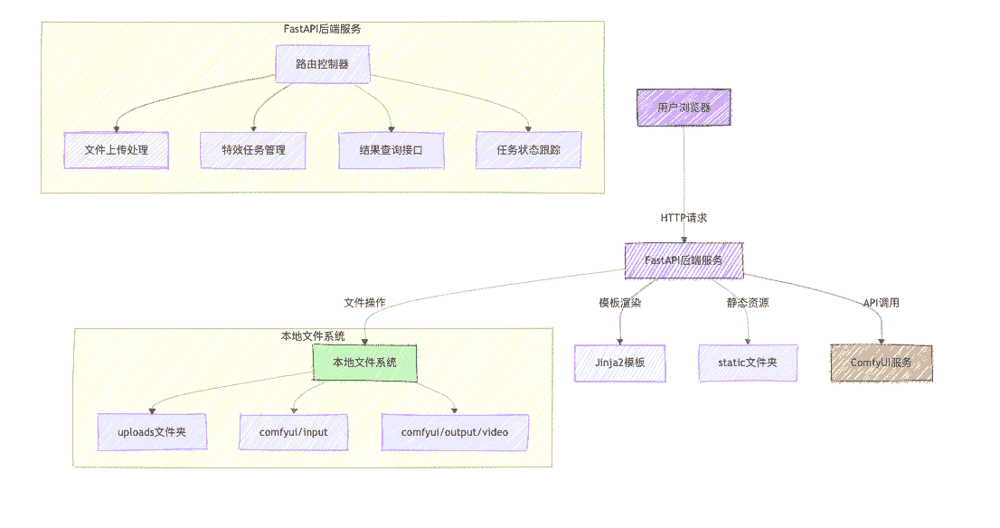

# 基于wan2.1构建掌心的浪浪山的小妖怪

> 来源：[https://v11enp9ok1h.feishu.cn/docx/WkG6dmK5zo3SqixUkWtc34bYnzd](https://v11enp9ok1h.feishu.cn/docx/WkG6dmK5zo3SqixUkWtc34bYnzd)

## 【PaddleMIX】基于wan2.1构建动漫角色跳出特效

> 本项目利用`wan2.1`模型处理图片，生成动漫角色从屏幕画面中跳出到现实手掌心的特效。通过`PaddleMIX`技术框架，项目整合了前后端服务，支持用户上传图片、提交特效处理任务，并展示及下载生成的视频结果

### 应用界面


### 特效demo

[63b6a92d346f2e057d9af9f9e4444551.mp4](https://internal-api-drive-stream.feishu.cn/space/api/box/stream/download/all/D462b23Tho1Ww8xkaZDcK3uSnGf)


[3aab0b13bb7f9e986f5f7ca40d3d72e3.mp4](https://internal-api-drive-stream.feishu.cn/space/api/box/stream/download/all/VjMNbCv4Rouc3bxU0ehcfL5LnNe)

## 一、项目整合包

```
%cd /home/aistudio/
!chmod +x start_server.bash
```

`/home/aistudio`

```
!unzip comfyui.zip
```

```
!unzip /home/aistudio/data/data352110/venv.zip
```

### 启动 start_server.bash 后端服务脚本

```
# 优先在终端执行 bash start_server.bash
import subprocess
import socket
import time
import sys

PORT = 8188
HOST = '127.0.0.1'
TIMEOUT = 40  # 最多等待 30 秒
BASH_SCRIPT = './start_server.bash'

def is_port_open(host, port):
    with socket.socket(socket.AF_INET, socket.SOCK_STREAM) as sock:
        sock.settimeout(1)
        try:
            sock.connect((host, port))
            return True
        except:
            return False

# 启动 bash 脚本（后台运行服务）
subprocess.Popen(['bash', BASH_SCRIPT])

# 检测端口是否打开
start_time = time.time()

while time.time() - start_time < TIMEOUT:
    if is_port_open(HOST, PORT):
        print("0")  # 成功，端口已监听
        sys.exit(0)
    time.sleep(1)

# 超时未监听
print("启动超时")
sys.exit(1)
```

### 启动应用demo


```
# 优先在终端执行命令，执行后点击 http://localhost:8000 可以自动进入界面
%cd langlangshan
!python app.py
```

🚀 启动AI视频特效制作平台...

📁 项目结构:

```
   ├── backend/          # 后端代码
   ├── frontend/         # 前端代码
   ├── uploads/          # 上传文件目录
   └── outputs/          # 输出视频目录
```

🌐 访问地址: http://localhost:8000

📖 API文档: http://localhost:8000/docs

🔧 健康检查: http://localhost:8000/health

INFO: Will watch for changes in these directories: [`/home/aistudio/langlangshan`]

ERROR: [Errno 98] Address already in use

## 二、项目架构分析



## 三、wan2.2 核心代码解析

`Wan2.1` 是阿里集团的开源视频生成模型，支持文本到视频（Text-to-Video）和图像到视频（Image-to-Video）两种模式。本仓库提供了 `Wan2.1` 的 `paddle` 实现，目前仅支持推理。图生视频模型：`Wan2.1-I2V-14B`：480P、720P 模型

### 硬件要求

+ 1.3B 模型请保证有 30G 以上显存，14B 模型请保证有 80G 以上显存

```
import numpy as np
import paddle

from ppdiffusers import AutoencoderKLWan, WanImageToVideoPipeline
from ppdiffusers.transformers import CLIPVisionModel
from ppdiffusers.utils import export_to_video_2, load_image

# Available models: Wan-AI/Wan2.1-I2V-14B-480P-Diffusers, Wan-AI/Wan2.1-I2V-14B-720P-Diffusers
model_id = "Wan-AI/Wan2.1-I2V-14B-480P-Diffusers"
vae = AutoencoderKLWan.from_pretrained(model_id, subfolder="vae", paddle_dtype=paddle.float32)
image_encoder = CLIPVisionModel.from_pretrained(
    model_id, subfolder="image_encoder", paddle_dtype=paddle.float32, cache_dir="/root/.cache/paddlenlp/ppdiffusers/"
)
pipe = WanImageToVideoPipeline.from_pretrained(
    model_id, vae=vae, image_encoder=image_encoder, paddle_dtype=paddle.bfloat16
)

image = load_image(
    "https://ai-studio-static-online.cdn.bcebos.com/fc8ae786c2dd41c29a76f36fcabeefb9f98d4aa270e248bea11a56465ff361f5"
)
max_area = 720 * 1280
aspect_ratio = image.height / image.width
mod_value = pipe.vae_scale_factor_spatial * pipe.transformer.config.patch_size[1]
height = round(np.sqrt(max_area * aspect_ratio)) // mod_value * mod_value
width = round(np.sqrt(max_area / aspect_ratio)) // mod_value * mod_value
image = image.resize((width, height))
prompt = (
    "The anime character on the screen suddenly jumps from the screen into the palm of the hand. "
    "The action sequence is required. After jumping out, the character on the screen disappears. The character's image and art style should remain unchanged, and the picture should be realistic."
)
negative_prompt = "The colors are gaudy, overexposed, static, with blurry details, subtitles, style, works, paintings, images, still, overall grayish, of the worst quality, low - quality, JPEG compression artifacts, ugly,残缺的 (incomplete), extra fingers, poorly drawn hands, poorly drawn faces, deformed, disfigured, misshapen limbs, finger fusion, a motionless image, a messy background, three legs, a crowded background, walking backwards"

output = pipe(
    image=image,
    prompt=prompt,
    negative_prompt=negative_prompt,
    height=height,
    width=width,
    num_frames=81,
    guidance_scale=5.0,
).frames[0]
export_to_video_2(output, "output.mp4", fps=16)
```

## 四、应用后端代码解析

### 系统基础框架

+ `FastAPI` 应用初始化：创建 API 服务实例，配置标题、描述和版本信息
+ 静态资源服务：挂载前端静态文件（`CSS/JS`）和模板引擎
+ 目录管理：自动创建输入/输出/上传目录
+ 生命周期管理：启动/关闭事件处理

### 核心业务功能

#### 图片上传模块

+ 提供 `/api/upload` 接口接收用户图片
+ 验证文件类型（仅限图片）和大小（≤10MB）
+ 双备份存储：
  + `comfyui/input`：供 `ComfyUI` 处理使用
  + `uploads`：用户上传备份

#### 特效处理模块

+ 通过 `/api/create-effect` 接口创建处理任务

工作流程：

1. 验证图片存在性
1. 生成唯一任务 ID
1. 初始化任务状态
1. 调用 `ComfyUI` 服务：
   + 使用工作流模板
   + 注入随机种子（保证可复现性）
   + 设置输入图片参数
   + 指定输出文件名模式

#### 结果处理模块

+ 提供三种查询接口：
  + `/api/result/{task_id}`：获取处理状态和结果
  + `/api/task-status/{task_id}`：获取详细任务状态
  + `/api/download/{task_id}`：下载生成的视频
+ 处理逻辑：
  + 扫描输出目录匹配任务文件
  + 处理超时机制（5 分钟）
  + 维护任务状态生命周期


```python
import random

from fastapi import FastAPI, Request, UploadFile, File, HTTPException, Form
from fastapi.staticfiles import StaticFiles
from fastapi.templating import Jinja2Templates
from fastapi.responses import HTMLResponse, JSONResponse, FileResponse
from pathlib import Path
import os
import uuid
import time
import asyncio
import json
import requests
from typing import Optional
import time
import random

# 创建 FastAPI 应用
app = FastAPI(
    title="AI视频特效制作平台",
    description="基于 ComfyUI 的图片转视频特效制作系统",
    version="1.0.0"
)

# 配置静态文件
static_path = Path(__file__).parent.parent / "frontend" / "static"
app.mount("/static", StaticFiles(directory=str(static_path)), name="static")

# 配置模板
templates_path = Path(__file__).parent.parent / "frontend" / "templates"
templates = Jinja2Templates(directory=str(templates_path))

# 配置目录
COMFYUI_INPUT_DIR = Path("comfyui/input")
COMFYUI_OUTPUT_DIR = Path("comfyui/output/video")
UPLOADS_DIR = Path("uploads")

# 确保目录存在
COMFYUI_INPUT_DIR.mkdir(parents=True, exist_ok=True)
COMFYUI_OUTPUT_DIR.mkdir(parents=True, exist_ok=True)
UPLOADS_DIR.mkdir(parents=True, exist_ok=True)

# 任务状态存储
tasks = {}

# ComfyUI 配置
COMFYUI_URL = "http://180.184.93.83:8188"
WORKFLOW_TEMPLATE_PATH = Path("workflow_template.json")

# 主页路由
@app.get("/", response_class=HTMLResponse)
async def index(request: Request):
    """渲染主页"""
    return templates.TemplateResponse("index.html", {"request": request})

# 健康检查接口
@app.get("/health")
async def health_check():
    """健康检查接口"""
    return {"status": "healthy", "message": "AI视频特效制作平台运行正常"}

# 1. 上传图片接口
@app.post("/api/upload")
async def upload_image(image: UploadFile = File(...)):
    """
    上传图片到 comfyui/input 文件夹，文件名保持为用户原始文件名

    Args:
        image: 上传的图片文件

    Returns:
        JSON响应，包含上传结果信息
    """
    try:
        # 验证文件类型
        if not image.content_type.startswith('image/'):
            raise HTTPException(status_code=400, detail="只支持图片文件")

        # 验证文件大小（限制为10MB）
        if image.size > 10 * 1024 * 1024:
            raise HTTPException(status_code=400, detail="文件大小不能超过10MB")

        # 使用原始文件名
        safe_filename = image.filename
        input_path = COMFYUI_INPUT_DIR / safe_filename
        upload_path = UPLOADS_DIR / safe_filename

        # 保存到 comfyui/input 目录
        with open(input_path, "wb") as buffer:
            content = await image.read()
            buffer.write(content)
        # 同时保存到 uploads 目录作为备份
        with open(upload_path, "wb") as buffer:
            buffer.write(content)

        return JSONResponse(content={
            "success": True,
            "message": "图片上传成功",
            "file_name": safe_filename,
            "original_name": safe_filename
        })

    except Exception as e:
        raise HTTPException(status_code=500, detail=f"上传失败: {str(e)}")

# 2. 核心特效处理函数接口
@app.post("/api/create-effect")
async def create_effect(image_name: str = Form(...)):
    """
    核心特效处理函数接口 - 调用 ComfyUI 的 prompt 接口

    Args:
        image_name: 图片文件名（原始文件名）

    Returns:
        JSON响应，包含任务 ID
    """
    try:
        # 验证图片文件是否存在
        input_path = COMFYUI_INPUT_DIR / image_name
        if not input_path.exists():
            raise HTTPException(status_code=404, detail="图片文件不存在")

        # 生成任务 ID
        task_id = str(uuid.uuid4())

        # 创建任务信息
        tasks[task_id] = {
            "task_id": task_id,
            "image_name": image_name,
            "status": "processing",
            "created_at": time.time(),
            "video_path": None
        }

        # 调用 ComfyUI 处理特效
        result = await call_comfyui_prompt_simple(task_id, image_name)

        if result:
            return JSONResponse(content={
                "success": True,
                "message": "特效任务创建成功",
                "task_id": task_id
            })
        else:
            raise HTTPException(status_code=500, detail="ComfyUI 处理失败")

    except Exception as e:
        raise HTTPException(status_code=500, detail=f"创建特效失败: {str(e)}")

def generate_unique_seed():
    now = int(time.time() * 1e6)  # 当前时间戳（微秒级）
    rand = random.randint(0, 99999)
    return int(f"{now}{rand % 100:02d}")  # 保证纯数字且高唯一性

# 简化的 ComfyUI prompt 调用
async def call_comfyui_prompt_simple(task_id: str, image_name: str) -> bool:
    """
    简化的 ComfyUI prompt 调用

    Args:
        task_id: 任务 ID
        image_name: 图片文件名

    Returns:
        bool: 是否成功
    """
    try:
        # 读取 JSON 模板文件
        json_file_path = WORKFLOW_TEMPLATE_PATH
        with open(json_file_path, 'r', encoding='utf-8') as f:
            data = json.load(f)

        # 设置参数值
        noise_seed = generate_unique_seed()
        image = image_name

        # 设置 'text' 和 'widgets_values' 字段的新值
        data["prompt"]["27"]["inputs"]["seed"] = noise_seed
        data["prompt"]["90"]["inputs"]["seed"] = noise_seed
        data["prompt"]["67"]["inputs"]["image"] = image
        data["prompt"]["139"]["inputs"]["filename_prefix"] = f"video/ComfyUI_{task_id}"

        # 确保 widgets_values 列表至少有一个元素
        if len(data["extra_data"]["extra_pnginfo"]["workflow"]["nodes"][0]["widgets_values"]) == 0:
            data["extra_data"]["extra_pnginfo"]["workflow"]["nodes"][0]["widgets_values"].append(None)

        # # 现在可以安全地赋值
        # data["extra_data"]["extra_pnginfo"]["workflow"]["nodes"][4]["widgets_values"][0] = text_value
        # # data["extra_data"]["extra_pnginfo"]["workflow"]["nodes"][11]["widgets_values"][0] = noise_seed
        # data["extra_data"]["extra_pnginfo"]["workflow"]["nodes"][6]["widgets_values"][0] = image

        # 使用默认请求头
        headers = {'Content-Type': 'application/json'}

        # 发送 POST 请求
        url = f"{COMFYUI_URL}/prompt"
        response = requests.post(url, headers=headers, json=data)

        if response.status_code == 200:
            # 请求成功
            result = response.json()
            if task_id in tasks:
                tasks[task_id]["prompt_id"] = result.get("prompt_id")
                tasks[task_id]["status"] = "processing"
                print(f"任务 {task_id} 已提交到 ComfyUI，prompt_id: {result.get('prompt_id')}")
            return True
        else:
            # 请求失败
            print(f"ComfyUI 请求失败: {response.status_code} - {response.text}")
            if task_id in tasks:
                tasks[task_id]["status"] = "failed"
                tasks[task_id]["error_message"] = f"ComfyUI 请求失败: {response.status_code}"
            return False

    except Exception as e:
        print(f"调用 ComfyUI 失败: {e}")
        if task_id in tasks:
            tasks[task_id]["status"] = "failed"
            tasks[task_id]["error_message"] = str(e)
        return False

# 检查 ComfyUI 状态
async def check_comfyui_status() -> bool:
    """
    检查 ComfyUI 服务是否运行

    Returns:
        bool: ComfyUI 是否运行
    """
    try:
        response = requests.get(f"{COMFYUI_URL}/system_stats", timeout=5)
        return response.status_code == 200
    except:
        return False

# 3. 获取结果接口
@app.get("/api/result/{task_id}")
async def get_result(task_id: str):
    """
    获取结果接口 - 检查 comfyui/output/video 文件夹是否有新文件生成

    Args:
        task_id: 任务 ID

    Returns:
        JSON响应，包含结果状态
    """
    try:
        task = tasks.get(task_id)
        if not task:
            raise HTTPException(status_code=404, detail="任务不存在")

        # 搜索匹配的 mp4 文件
        prefix = f"ComfyUI_{task_id}"
        matched_files = list((COMFYUI_OUTPUT_DIR / "video").glob(f"{prefix}*.mp4"))

        if matched_files:
            # 默认取第一个匹配文件（如有多个）
            video_path = matched_files[0]
            task["status"] = "completed"
            task["video_path"] = str(video_path)

            return JSONResponse(content={
                "success": True,
                "status": "completed",
                "task_id": task_id,
                "video_url": f"/api/download/{task_id}",
                "video_path": str(video_path)
            })
        else:
            # 检查任务是否还在处理中
            if task["status"] == "processing":
                # 检查任务是否超时（5分钟）
                if time.time() - task["created_at"] > 300:
                    task["status"] = "timeout"
                    return JSONResponse(content={
                        "success": False,
                        "status": "timeout",
                        "message": "任务处理超时"
                    })

                return JSONResponse(content={
                    "success": True,
                    "status": "processing",
                    "message": "任务正在处理中"
                })
            else:
                return JSONResponse(content={
                    "success": False,
                    "status": task["status"],
                    "message": "任务处理失败"
                })

    except Exception as e:
        raise HTTPException(status_code=500, detail=f"获取结果失败: {str(e)}")

# 下载视频接口
@app.get("/api/download/{task_id}")
async def download_video(task_id: str):
    """
    下载生成的视频文件

    Args:
        task_id: 任务 ID

    Returns:
        视频文件流
    """
    try:
        task = tasks.get(task_id)
        if not task or task["status"] != "completed":
            raise HTTPException(status_code=404, detail="视频文件不存在")

        video_path = Path(task["video_path"])
        if not video_path.exists():
            raise HTTPException(status_code=404, detail="视频文件不存在")

        return FileResponse(
            path=str(video_path),
            media_type="video/mp4",
            filename=f"effect_{task_id}.mp4"
        )

    except Exception as e:
        raise HTTPException(status_code=500, detail=f"下载失败: {str(e)}")

# 获取任务状态接口
@app.get("/api/task-status/{task_id}")
async def get_task_status(task_id: str):
    """
    获取任务状态

    Args:
        task_id: 任务 ID

    Returns:
        JSON响应，包含任务状态
    """
    try:
        task = tasks.get(task_id)
        if not task:
            raise HTTPException(status_code=404, detail="任务不存在")

        return JSONResponse(content={
            "task_id": task_id,
            "status": task["status"],
            "image_name": task["image_name"],
            "created_at": task["created_at"],
            "video_path": task.get("video_path"),
            "prompt_id": task.get("prompt_id")
        })

    except Exception as e:
        raise HTTPException(status_code=500, detail=f"获取任务状态失败: {str(e)}")

# 启动事件
@app.on_event("startup")
async def startup_event():
    """应用启动时的初始化操作"""
    print("🚀 AI视频特效制作平台已启动")
    print(f"📁 ComfyUI输入目录: {COMFYUI_INPUT_DIR}")
    print(f"📁 ComfyUI输出目录: {COMFYUI_OUTPUT_DIR}")
    print(f"📁 上传目录: {UPLOADS_DIR}")
    print(f"🔗 ComfyUI地址: {COMFYUI_URL}")
    print(f"📄 工作流模板: {WORKFLOW_TEMPLATE_PATH}")

# 关闭事件
@app.on_event("shutdown")
async def shutdown_event():
    """应用关闭时的清理操作"""
    print("🛑 AI视频特效制作平台已关闭")

import uvicorn
uvicorn.run(app, host="0.0.0.0", port=8000)
```


# 五、应用前端代码解析

## 一、整体功能概述

这是一个 AI 视频特效制作平台的前端实现，主要功能包括：

- 图片上传和预览
- 特效制作任务提交
- 任务进度跟踪
- 结果视频展示和下载
- 状态管理和通知提示

## 二、核心业务逻辑

### 图片上传流程

`index.html`

- 提供拖拽上传区域和文件选择按钮
- 包含预览区域用于显示已上传图片

`main.js`

- 实现了三种上传方式：
  - 点击上传按钮
  - 拖拽文件到上传区域
  - 直接选择文件
- 包含文件类型和大小验证
- 上传成功后显示预览并隐藏上传区域

```
function initializeUploadArea() {
    imageInput.addEventListener('change', handleFileSelect);
    uploadArea.addEventListener('dragover', handleDragOver);
    uploadArea.addEventListener('drop', handleDrop);
}

async function uploadImageToServer(file) {
    const formData = new FormData();
    formData.append('image', file);
    await fetch('/api/upload', { method: 'POST', body: formData });
}
```

### 特效制作流程

`index.html`

- 提供“开始制作”按钮
- 包含进度展示区域

`main.js`

- 提交制作任务到后端
- 实现轮询机制检查任务状态
- 根据任务状态更新 UI

```
async function createEffect() {
   const response = await fetch('/api/create-effect', { method: 'POST' });
    startPolling(); // 开始轮询状态
}

function startPolling() {
    pollingInterval = setInterval(async () => {
        const response = await fetch(`/api/result/${currentTaskId}`);
        // 根据状态更新UI
    }, 2000);
}
```

### 结果展示

`index.html`

- 包含视频播放器组件
- 提供下载和新建项目按钮

`main.js`

- 处理视频结果展示
- 实现视频下载功能
- 重置项目状态

```
function showResult(videoUrl) {
    videoSource.src = videoUrl;
    resultVideo.load();
    resultSection.style.display = 'block';
}

function downloadVideo() {
    // 实现视频下载
}
```

## 三、UI 状态管理

`main.js`

- 使用状态指示器显示当前系统状态
- 包含多种状态：就绪、上传中、处理中、完成等
- 使用通知系统向用户反馈操作结果

```
function updateStatus(text, type) {
    statusText.textContent = text;
    statusDot.className = 'status-dot ' + type;
}

function showNotification(message, type) {
    // 显示通知消息
}
```

## 四、关键交互设计

### 上传交互

- 支持多种上传方式增强用户体验
- 即时预览减少用户疑惑

### 进度反馈

- 明确的进度条显示
- 状态文本实时更新
- 处理中的动画效果

### 结果处理

- 自动播放生成的视频
- 一键下载功能
- 快速创建新项目

## 五、技术实现特点

### 模块化设计

- 功能划分清晰
- 每个函数职责单一

### 异步处理

- 大量使用 `async/await` 处理异步操作
- 合理的错误处理机制

### `DOM` 操作

- 事件监听器管理
- 动态样式更新

### 用户体验

- 拖拽上传视觉反馈
- 操作结果即时通知
- 平滑的滚动效果

## 六、代码结构

```
frontend/
├── static/
│   ├── js/
│   │   └── main.js    # 主要业务逻辑
│   └── css/
│       └── style.css     # 样式文件
└── templates/
    └── index.html        # 主页面结构
```

该前端实现提供了一个完整的用户界面，支持从图片上传到特效制作再到结果展示的全流程操作，并通过清晰的视觉反馈和状态管理来提升用户体验。
