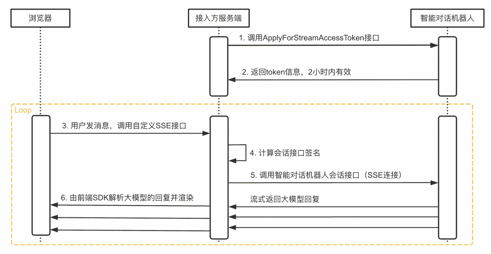
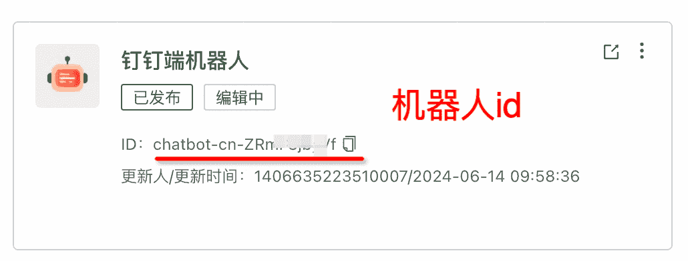
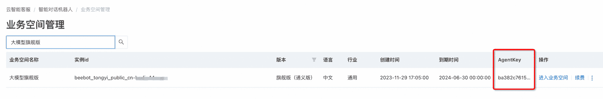
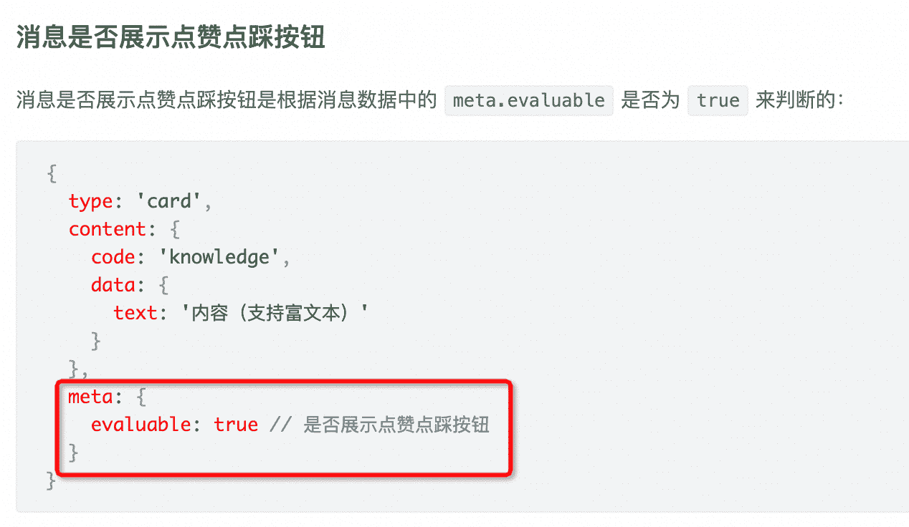

# 【集成示例】网页端

> 来源：[https://v11enp9ok1h.feishu.cn/docx/QevadCMy6o6NnLxF6M4c5l25ncg](https://v11enp9ok1h.feishu.cn/docx/QevadCMy6o6NnLxF6M4c5l25ncg)

## **一、概览**



1.  [调用ApplyForStreamAcc](https://help.aliyun.com/zh/beebot/intelligent-dialogue-robot-tongyi-version/api-chatbot-2022-04-08-applyforstreamaccesstoken-tongyi)essToken接口。参考文档：ApplyForStreamAccessToken - 获取流式调用的连接信息

1.  ApplyForStreamAccessToken接口，返回的连接签名信息有效期2小时，必须在到期前重新获取

1.  接收到用户发送的消息，并调用自定义的代理SSE接口

1.  计算会话接口签名。参考文档：[**会话接口签名**](https://help.aliyun.com/zh/beebot/intelligent-dialogue-robot-tongyi-version/chat-api-signature)

1.  [**调用会话接口**](https://help.aliyun.com/zh/beebot/intelligent-dialogue-robot-tongyi-version/stream-chat-api)，监听SSE事件，获取大模型流式输出。参考文档：流式会话接口

1.  [**大模型流式**](https://chatbot.console.aliyun.com/ChatSDK#/beebot/sse-sdk)接口会多次返回，由前端SDK解析并渲染大模型的回复。前端SDK

## **二、示例**

### **示例工程代码**

java-example.zip

### **如何运行**

1.  [本示例工程的运行环境要求为](https://help.aliyun.com/zh/sdk/developer-reference/jdk-installation)JDK 8，参考文档：在Windows安装JDK

1.  根据[智能对话机器人配置](https://help.aliyun.com/zh/beebot/intelligent-dialogue-robot-tongyi-version/chatsse-browser-side-sse-message-acquisition?spm=a2c4g.11186623.help-menu-59495.d_3_0.2d4c6bd1fAf9RC&scm=20140722.H_2713136._.OR_help-T_cn~zh-V_1#c255edd025wfh)操作完成后，获取[示例工程中的参数](https://help.aliyun.com/zh/beebot/intelligent-dialogue-robot-tongyi-version/chatsse-browser-side-sse-message-acquisition?spm=a2c4g.11186623.help-menu-59495.d_3_0.2d4c6bd1fAf9RC&scm=20140722.H_2713136._.OR_help-T_cn~zh-V_1#fb13a44fa8e7q)中的参数

1.  将上面提到的参数填写到示例工程的application.properties配置文件中

1.  运行com.aliyun.chatbot.channel.WebApplication

1.  浏览器打开 http://localhost:8080/ 即可进行对话问答

### **示例工程中的参数**

## **三、智能对话机器人配置**

1.  进入智能对话机器人控制台，https://chatbot.console.aliyun.com

1.  [创建机器人](https://help.aliyun.com/zh/beebot/intelligent-dialogue-robot-tongyi-version/chatbot-creation)，获取机器人id，发布机器人（如无发布按钮则跳过本步骤）



1.  [获取业务空间](https://alime.console.aliyun.com/?productCode=p_ics#/business_management/business_management)AgentKey，地址：业务空间管理



1.  阿里云账号AKSK获取，地址：[AccessKey](https://ram.console.aliyun.com/manage/ak)

## **四、前端SDK使用常见问题**

1.  如何支持Post请求

+   requests.send方法中写请求处理，返回Promise结果，Promise结果要求将对话机器人的返回结果原样返回，注意首字母要保持大写。

1.  对头像等样式不满意，如何自定义样式

+   通过css选择器对头像等进行样式覆盖

1.  头像没有展示

+   **ChatSDK**的config.avatarWhiteList参数需要配置下要展示头像的卡片列表

1.  点赞点踩没有展示

+   **ChatSDK**需要配置requests.evaluate请求方法，并且检查下答案经过isvParser转换后的数据的meta.evaluable是否为true



假如返回结果经过后端处理，将首字母改为了小写，则isvParser处理前需要先将首字母改为大写，处理代码参考

```
function upperCaseBotMsg(msg) {
  let newMsg = msg;
  if (msg instanceof Array) {
    newMsg = msg.map((item) =&gt; {
      return upperCaseBotMsg(item);
    });
  } else if (typeof msg == &#x27;object&#x27; &amp;&amp; msg) {
    newMsg = {};
    for (const key in msg) {
      newMsg[key.substring(0, 1).toUpperCase() + key.substring(1)] = upperCaseBotMsg(msg[key]);
    }
  }
  return newMsg;
}
```