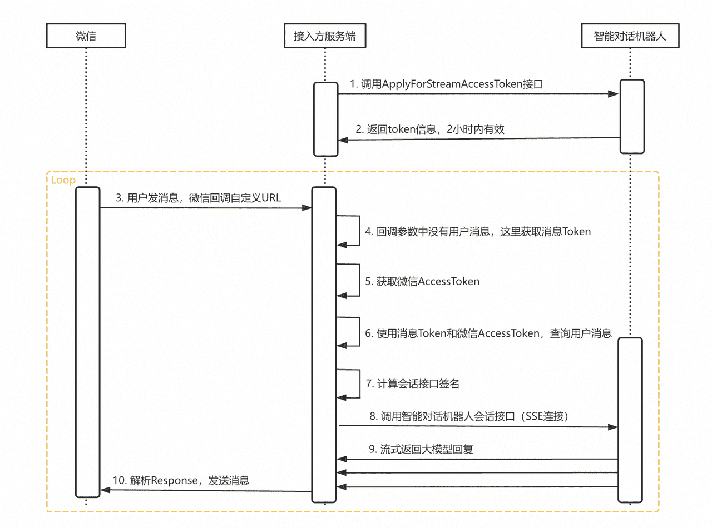
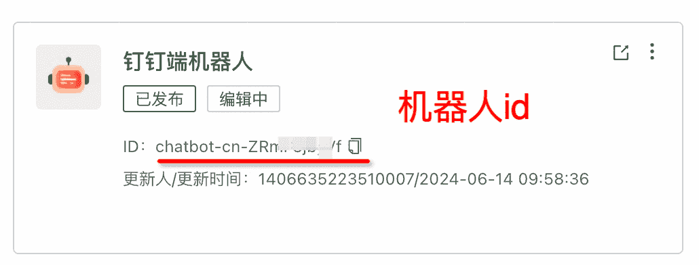
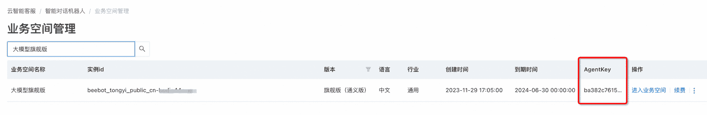
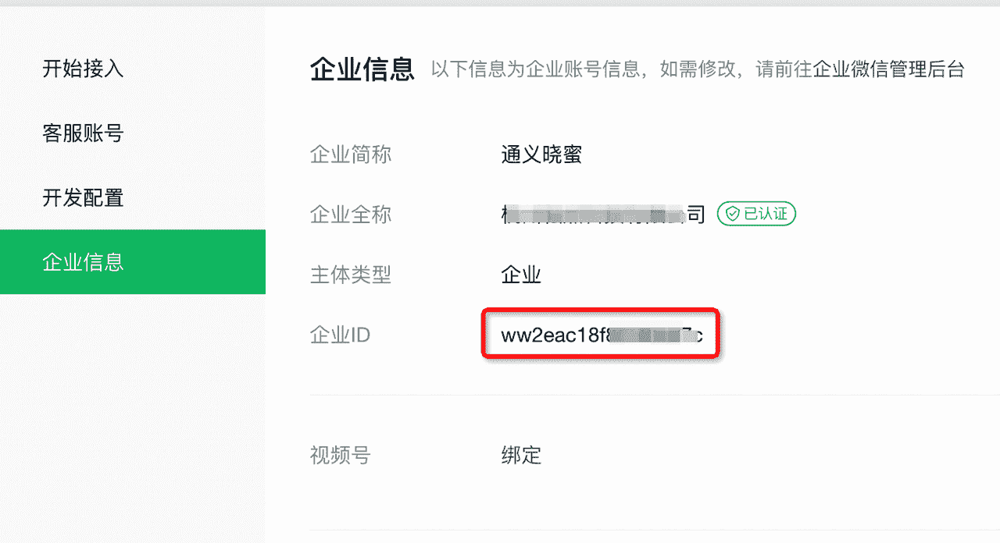
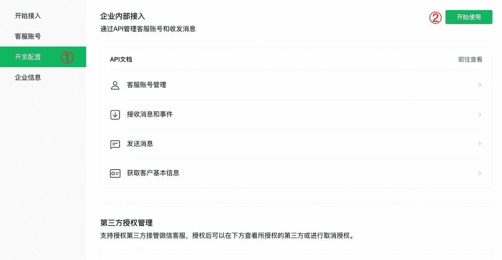
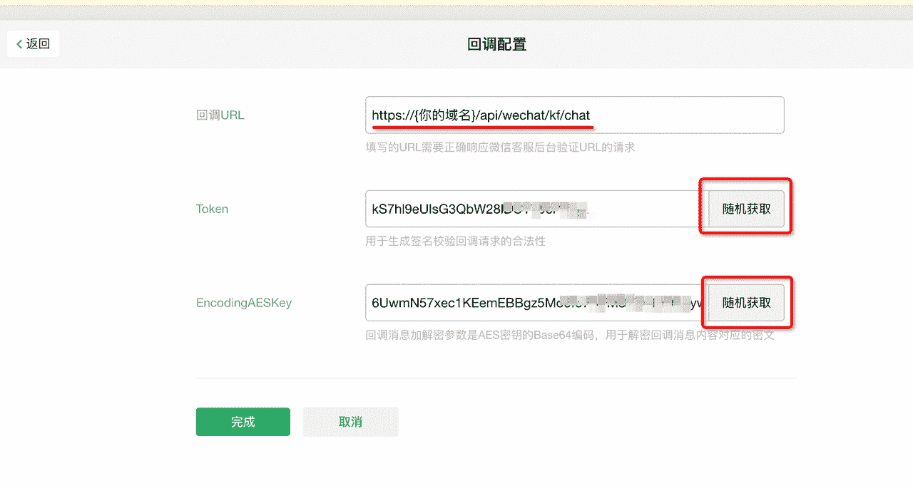
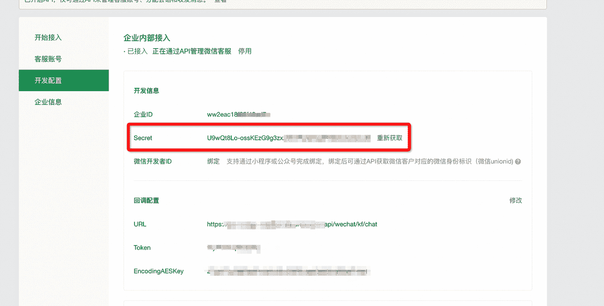
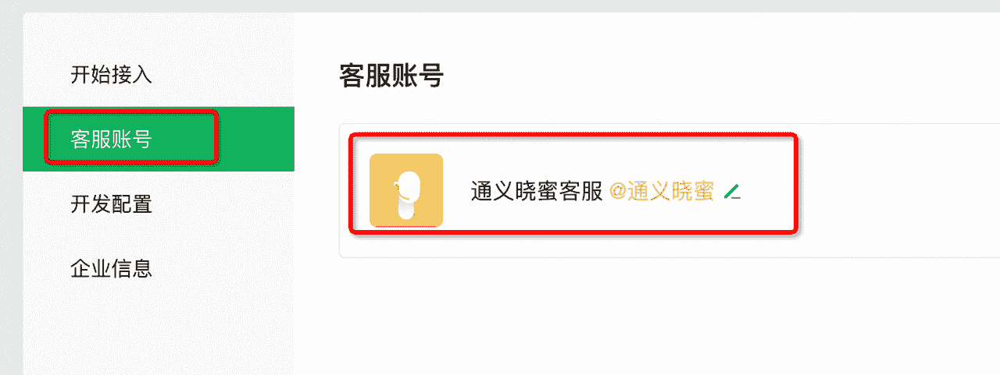
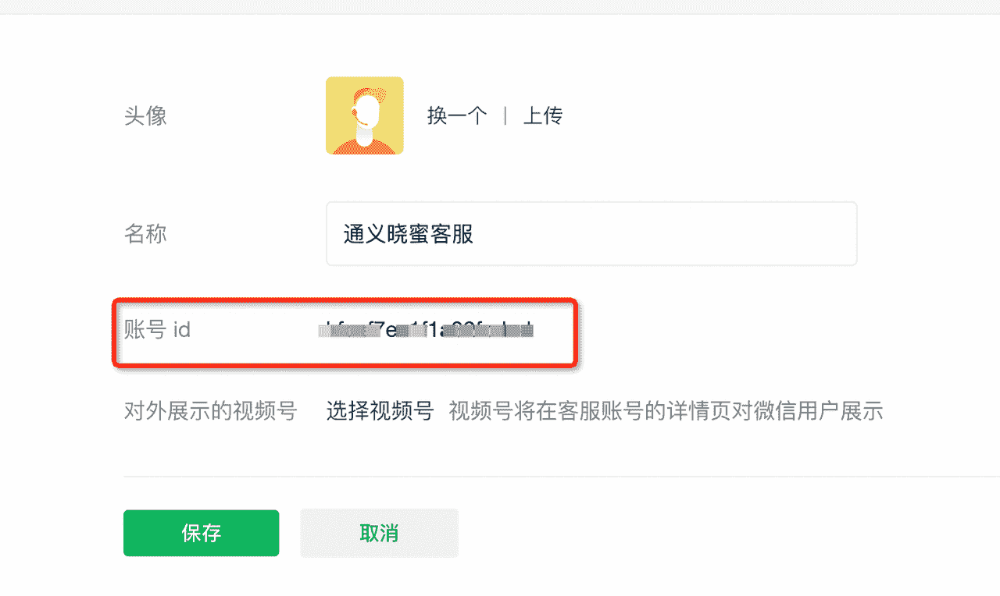

# 【集成示例】🛰️客服

> 来源：[https://v11enp9ok1h.feishu.cn/docx/QUopdds9Go08Dixo0EdcRiJZnbe](https://v11enp9ok1h.feishu.cn/docx/QUopdds9Go08Dixo0EdcRiJZnbe)

## 一、概览

1.  [调用ApplyForStreamAcc](https://help.aliyun.com/zh/beebot/intelligent-dialogue-robot-tongyi-version/api-chatbot-2022-04-08-applyforstreamaccesstoken-tongyi)essToken接口。参考文档：ApplyForStreamAccessToken - 获取流式调用的连接信息

1.  ApplyForStreamAccessToken接口，返回的连接签名信息有效期2小时，必须在到期前重新获取

1.  [监听并接收🛰️](https://kf.weixin.qq.com/api/doc/path/94745)客服的消息事件（用户问客服问题的这个动作）：接收消息和事件

1.  获取上一步的消息事件，从回调参数里获取查询消息明文的Token

1.  获取🛰️的AccessToken，每次调用🛰️的接口都会用到。获取调用凭证access_token

1.  [使用消息](https://kf.weixin.qq.com/api/doc/path/94745#%E8%8E%B7%E5%8F%96%E6%B6%88%E6%81%AF)Token和🛰️AccessToken，调用获取消息接口，得到用户提问的内容。

1.  计算会话接口签名。[会话接口签名](https://help.aliyun.com/zh/beebot/intelligent-dialogue-robot-tongyi-version/chat-api-signature)

1.  [SSE流式调](https://help.aliyun.com/zh/beebot/intelligent-dialogue-robot-tongyi-version/stream-chat-api)用会话接口，监听SSE事件，获取大模型流式输出。参考文档：流式会话接口

1.  大模型流式接口会多次返回，每次返回都是全量的回复，渲染[端应该考虑用新的](https://help.aliyun.com/zh/beebot/intelligent-dialogue-robot-tongyi-version/stream-chat-api#957179221c3l3)覆盖旧的。响应参数参考：3 响应参数说明

1.  等待大模型回复完成，一次性将消息回复给用户。

## 二、示例

### 示例工程代码

wx-kf-example.zip

### 如何运行

1.  [**本示例工程的运行环境要求为**](https://help.aliyun.com/zh/sdk/developer-reference/jdk-installation)JDK 8，参考文档：在Windows安装JDK

1.  根据[**智能对话机器人配置**](https://help.aliyun.com/zh/beebot/intelligent-dialogue-robot-tongyi-version/integration-example-wechat-customer-service?spm=a2c4g.11186623.help-menu-59495.d_3_2.2c277bcaLd7Puc&scm=20140722.H_2842687._.OR_help-T_cn~zh-V_1#a435a1d1adgw8)操作完成后，获取[**示例工程参数**](https://help.aliyun.com/zh/beebot/intelligent-dialogue-robot-tongyi-version/integration-example-wechat-customer-service?spm=a2c4g.11186623.help-menu-59495.d_3_2.2c277bcaLd7Puc&scm=20140722.H_2842687._.OR_help-T_cn~zh-V_1#4762430712auv)中智能对话机器人部分的参数

1.  根据[**🛰️客服配置**](https://help.aliyun.com/zh/beebot/intelligent-dialogue-robot-tongyi-version/integration-example-wechat-customer-service?spm=a2c4g.11186623.help-menu-59495.d_3_2.2c277bcaLd7Puc&scm=20140722.H_2842687._.OR_help-T_cn~zh-V_1#3d4fc8ad5deoc)操作完成后，获取[**示例工程参数**](https://help.aliyun.com/zh/beebot/intelligent-dialogue-robot-tongyi-version/integration-example-wechat-customer-service?spm=a2c4g.11186623.help-menu-59495.d_3_2.2c277bcaLd7Puc&scm=20140722.H_2842687._.OR_help-T_cn~zh-V_1#4762430712auv)中🛰️客服部分的参数

1.  将上面提到的参数填写到示例工程的application.properties配置文件中

1.  运行com.aliyun.chatbot.channel.WebApplication，也可打成jar包，通过java -jar命令运行

1.  浏览器打开 http://localhost:8091/ ，🛰️扫描二维码，即可进行大模型客服对话

### 示例工程参数

## 三、智能对话机器人配置

1.  进入智能对话机器人控制台，https://chatbot.console.aliyun.com

1.  [机器人创建](https://help.aliyun.com/zh/beebot/intelligent-dialogue-robot-tongyi-version/chatbot-creation)，获取机器人id，发布机器人（如无发布按钮则跳过）

> [获取业务空间](https://alime.console.aliyun.com/?productCode=p_ics#/business_management/business_management)AgentKey，地址：业务空间管理

> 阿里云账号AKSK获取，地址：[AccessKey](https://ram.console.aliyun.com/manage/ak)

## 四、🛰️客服配置

1.  登录[🛰️客服](https://kf.weixin.qq.com/)平台

1.  选择企业信息菜单，然后复制企业 ID

> 选择开发配置菜单，再点击开始使用

> 配置回调接口信息

1.  回调URL：https://{你的域名}/api/wechat/kf/chat

1.  Token和EncodingAESKey点击随机获取即可

1.  直接点击完成会提示“openapi回调地址请求不通过”。需要把企业 ID、Token 和 EncodingAESKey配置到代码中，并部署本示例，确保回调URL能被外网调用到

+   上一步点击完成后，再点击开发配置，获取Secret

+   **客服配置，**选择客服账号菜单后，选择对应的客服，获取客服 ID

## FAQ

Q：配置回调接口信息时，直接点击完成会提示“openapi回调地址请求不通过”

A：需要把企业 ID、Token 和 EncodingAESKey配置到代码中，并部署本示例，确保回调URL能被外网调用到

Q：机器人回复图片接收不到

[A：不支](https://kf.weixin.qq.com/api/doc/path/94744#%E5%9B%BE%E7%89%87%E6%B6%88%E6%81%AF)持回复图片或图文消息，如有需要，请自行开发接入。开发文档

Q：富文本答案展示效果不好

A：🛰️客服不支持富文本（Markdown、HTML）答案的渲染