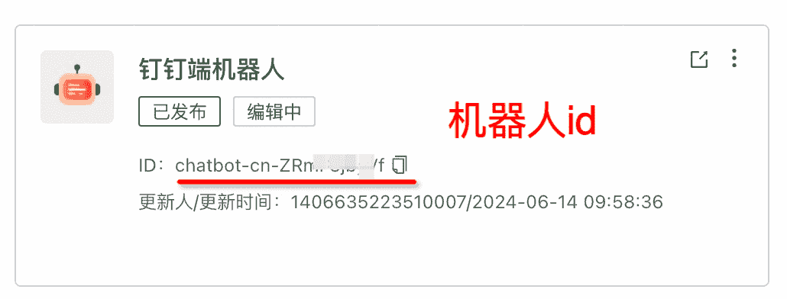
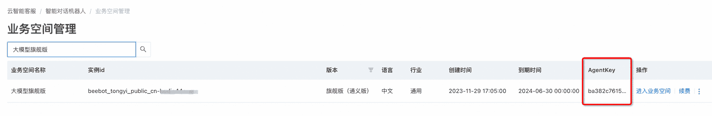
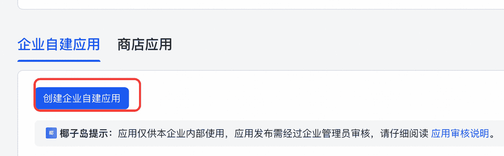
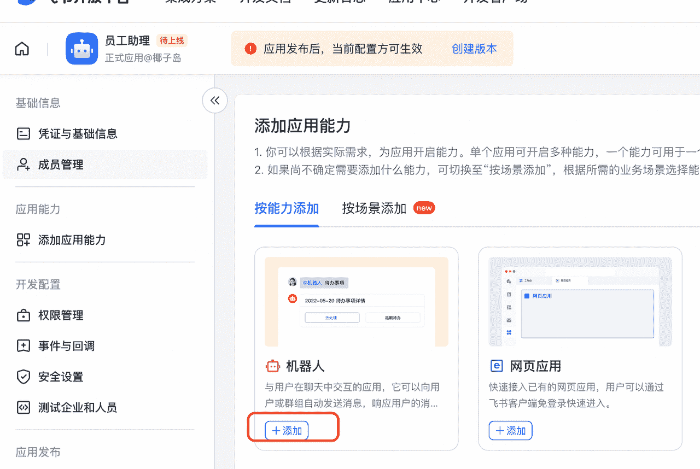
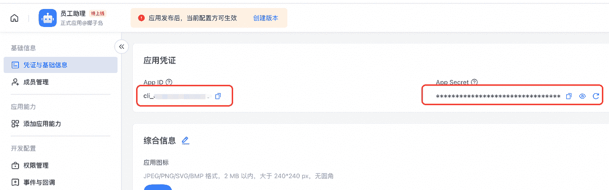
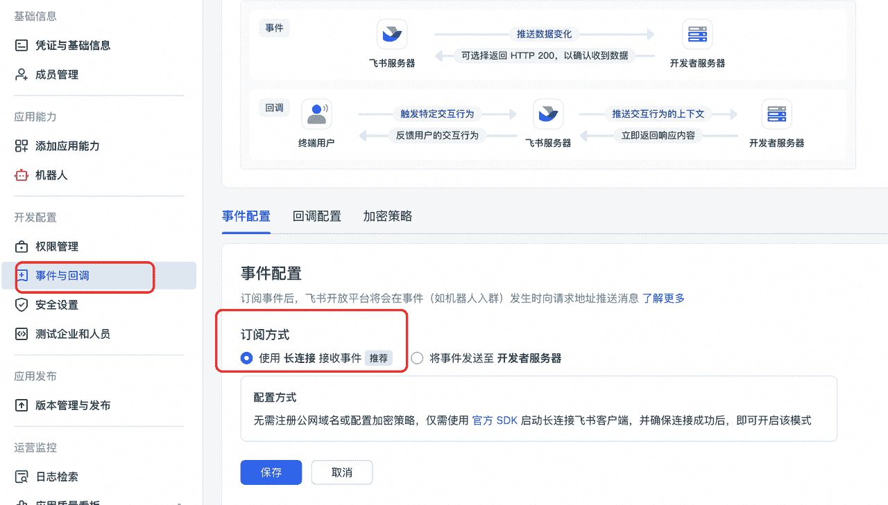
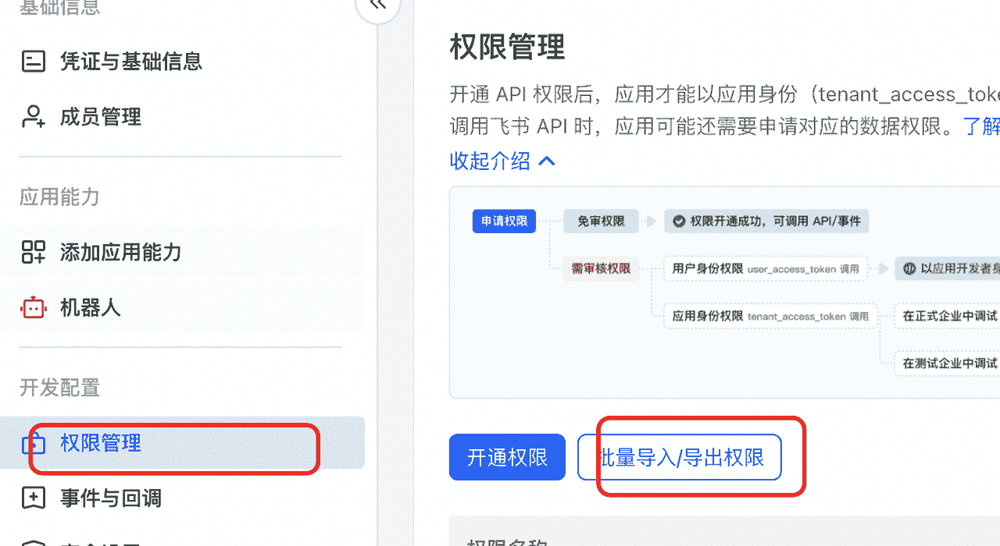
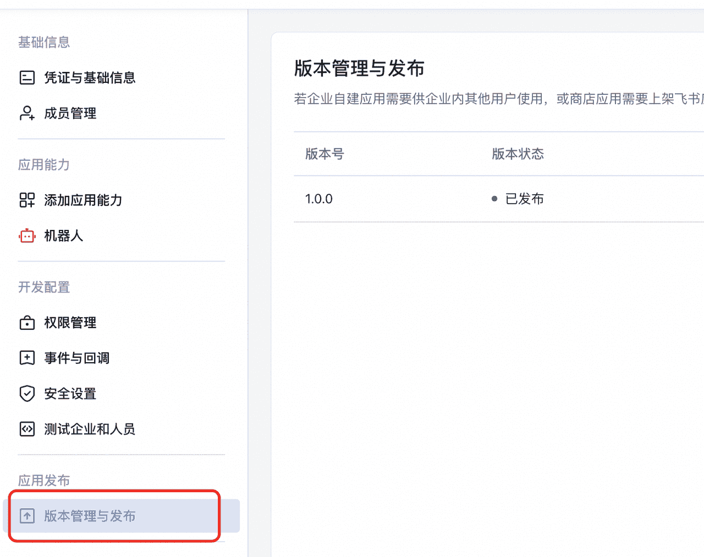
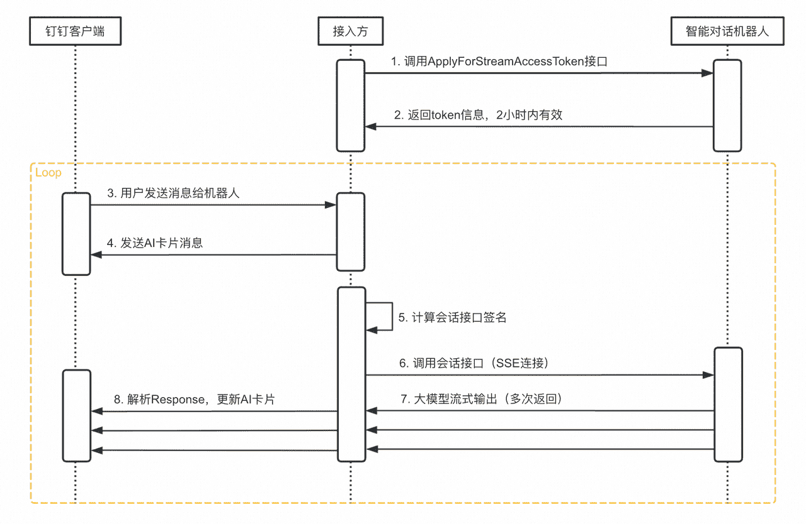

# 【集成示例】Lark机器人

> 来源：[https://v11enp9ok1h.feishu.cn/docx/MrTYdaxpSoOmDNxyp0wcDIsxnMb](https://v11enp9ok1h.feishu.cn/docx/MrTYdaxpSoOmDNxyp0wcDIsxnMb)

## **一、准备工作**

### **智能对话机器人配置**

1.  进入智能对话机器人[**控制台**](https://chatbot.console.aliyun.com/)，选择左侧导航栏的**应用管理**>**机器人**>**新建机器人**。

1.  获取机器人ID，发布机器人（如无发布按钮则跳过）。



> 访问智能对话机器人[**业务空间**](https://alime.console.aliyun.com/?productCode=p_ics#/business_management/business_management)，获取业务空间AgentKey。



1.  访问[**RAM控制台**](https://ram.console.aliyun.com/manage/ak)，获取阿里云账号的ACCESS_KEY和SECRET_KEY。

### Lark**应用配置**

+   访问Lark[后台](https://open.feishu.cn/app)，创建企业自建应用。



+   添加机器人应用能力



+   获取AppId和AppSecret。



+   下载[示例工程代码](https://help.aliyun.com/zh/beebot/intelligent-dialogue-robot-tongyi-version/integration-example-lark-robot?spm=a2c4g.11186623.help-menu-59495.d_3_3.2c311902SayVj7&scm=20140722.H_2867851._.OR_help-T_cn~zh-V_1#b4bc1e96245xl)，并按照说明填写参数。

+   选择**事件与回调**菜单，进行事件配置。



+   选择**权限管理**菜单，导入下面的权限配置。



```
{
    &quot;scopes&quot;: {
        &quot;tenant&quot;: [
            &quot;cardkit:card:write&quot;,
            &quot;im:message.group_at_msg:readonly&quot;,
            &quot;im:message.p2p_msg:readonly&quot;,
            &quot;im:message:readonly&quot;,
            &quot;im:message:send_as_bot&quot;
        ],
        &quot;user&quot;: []
    }
}
```

> 选择**版本管理与发布**菜单，创建版本并发布。注意，在这里可以配置机器人的可见范围。



## **操作步骤**



1.  [**调用ApplyForS**](https://help.aliyun.com/zh/beebot/intelligent-dialogue-robot-tongyi-version/api-chatbot-2022-04-08-applyforstreamaccesstoken-tongyi)treamAccessToken接口。参考文档：ApplyForStreamAccessToken - 获取流式调用的连接信息。

1.  ApplyForStreamAccessToken接口，返回的连接签名信息有效期2小时，必须在到期前重新获取。

1.  监听并接收机器人的消息（用户问机器人的消息）。

1.  创建卡片实体：[**创建卡片**](https://open.feishu.cn/document/uAjLw4CM/ukTMukTMukTM/cardkit-v1/card/create)；发送AI卡片消息：[**发送AI卡片**](https://open.feishu.cn/document/server-docs/im-v1/message/create)。

1.  计算会话接口签名。[**会话接口签名**](https://help.aliyun.com/zh/beebot/intelligent-dialogue-robot-tongyi-version/chat-api-signature)。

1.  [**SSE流式调**](https://help.aliyun.com/zh/beebot/intelligent-dialogue-robot-tongyi-version/stream-chat-api)用会话接口，监听SSE事件，获取大模型流式输出。参考文档：流式会话接口。

1.  大模型流式接口会多次返回，每次返回都是全量的回复，渲染[**端应该考虑用**](https://help.aliyun.com/zh/beebot/intelligent-dialogue-robot-tongyi-version/stream-chat-api#957179221c3l3)新的覆盖旧的。响应参数参考：流式会话接口。

1.  更新AI卡片：[**AI卡片流式更新**](https://open.feishu.cn/document/uAjLw4CM/ukTMukTMukTM/cardkit-v1/card-element/content?appId=cli_a7021c4144ee900e)。

## **二、示例工程代码**

### **源代码下载（JAVA）**

feishu-example.zip

### **示例运行配置**

1.  [本示例工程的运行环境要求为](https://help.aliyun.com/zh/sdk/developer-reference/jdk-installation)JDK 8，参考文档：在Windows安装JDK。

1.  根据本文的**准备工作**，获取**示例参数**。

1.  打开启动类FeishuRobotChatApp中填写相关参数。

1.  运行com.aliyun.chatbot.channel.FeishuRobotChatApp这个类的主方法。

1.  打开Lark，通过机器人名称搜索并打开对应的机器人，即可进行问答。

### **示例参数**

## **常见问题**

### **Q：无法收到消息。**

A：请检查需要配置的权限。