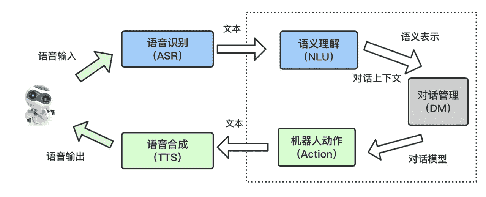
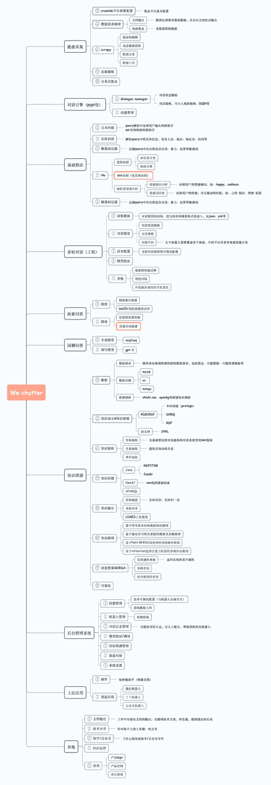
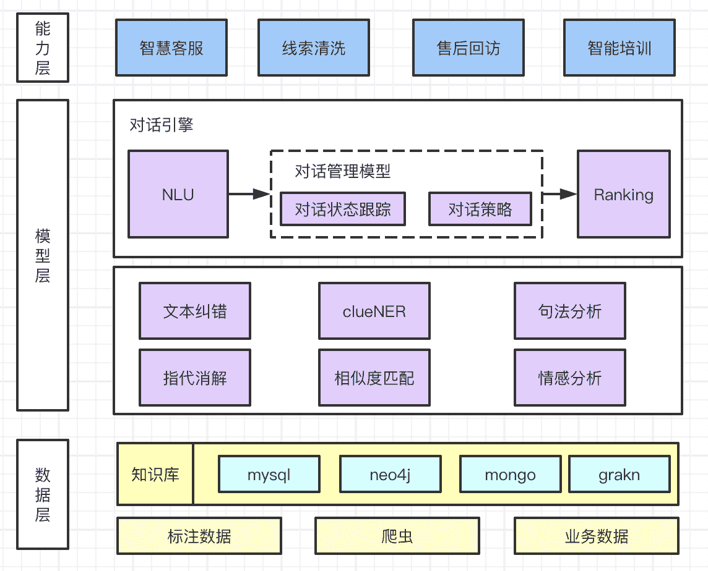
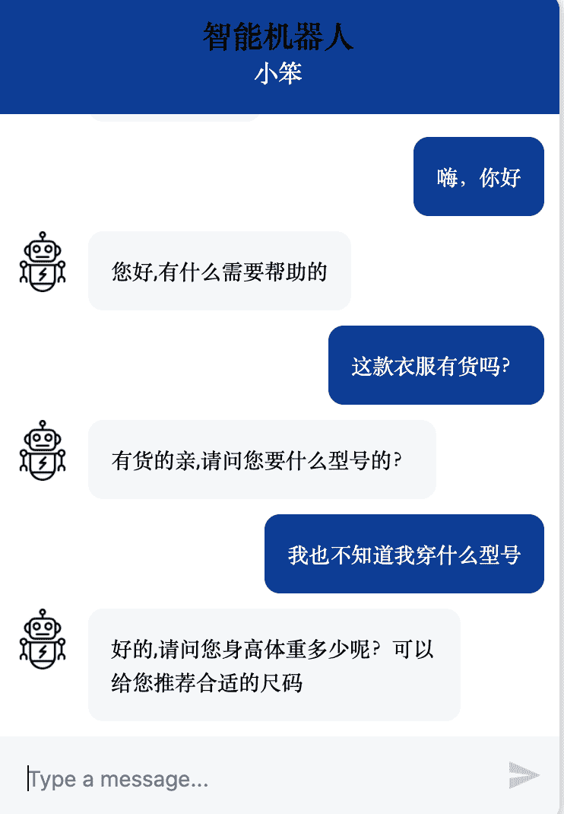
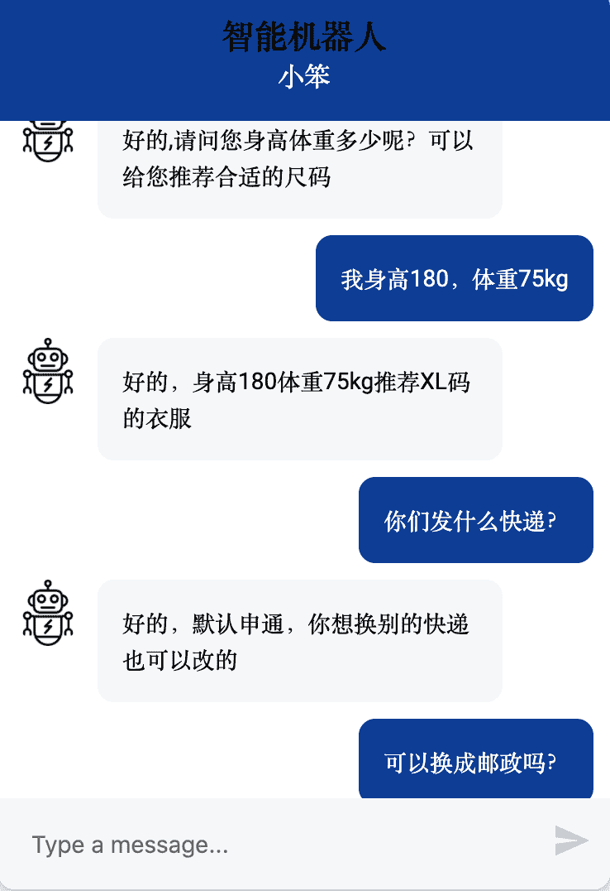
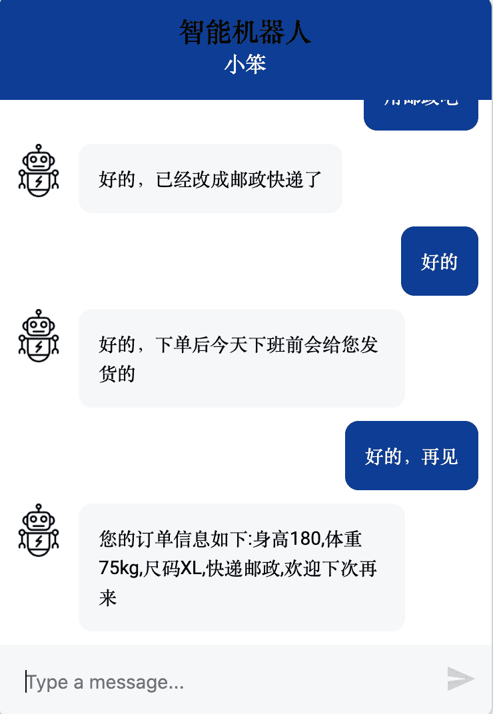
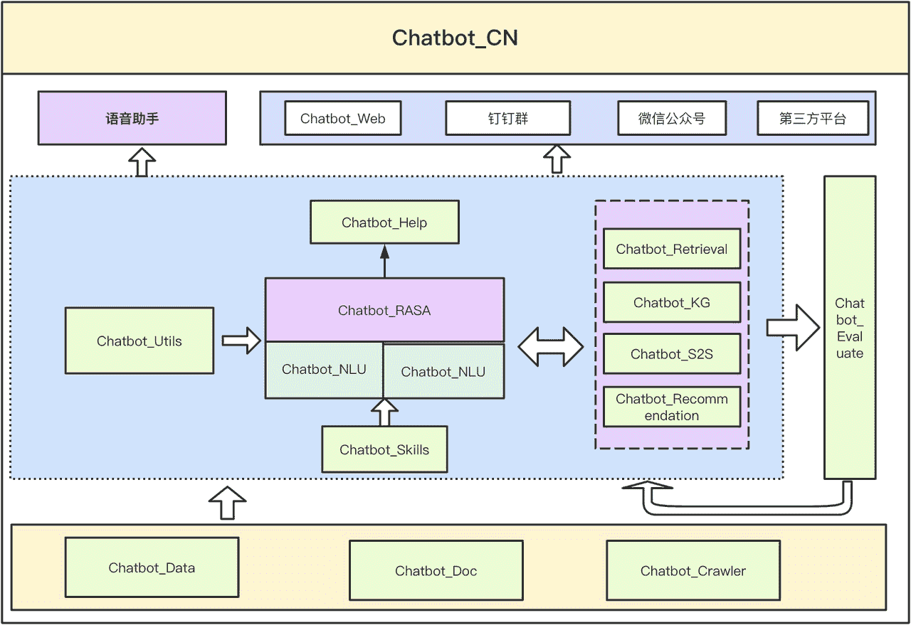

# Agent智能客服项目  （已交付）

> 来源：[https://v11enp9ok1h.feishu.cn/docx/VwRAdAWrPo7O8GxuBPAc5yXgnQd](https://v11enp9ok1h.feishu.cn/docx/VwRAdAWrPo7O8GxuBPAc5yXgnQd)

## 项目说明

**Chatbot_CN **不仅仅是一个对话系统，而是一套针对客服场景下的完整人工智能解决方案。对话是解决方案的核心和最重要一环，但不仅限于对话，还包括智能决策，智能调度，智能预测，智能推荐等

> 1、**数据层：**对话业务数据，开源多轮对话数据等

> 2、**算法层：**句法分析、细粒度情感分析、实体抽取、query纠错等

> 3、**能力层：**自然语言理解、对话管理、对话策略、策略优化、对话工厂

> 4、**应用层：**网页端、钉钉群机器人、🛰️👸号、第三方平台（如拼夕夕）等

> 5、**硬件接入：**可接入作为智能语音助手，目前已经加入语音助手模块，可接入树莓派、单片机等硬件

+   **项目的大致流程如下图：**



+   **项目思维导图**



## 项目结构

####  Chatbot_CN整体架构



#### 各子模块介绍

当你熟悉了项目的整体架构后，你还需要对其各个子模块进行详细的了解，这样你才能对机器人的机制有一个深刻的理解

| [**Chatbot_CN**](https://github.com/charlesXu86/Chatbot_CN) | 总体项目介绍，包含文档（这里不包含代码） |
| --- | --- |
| [**chatbot_kg**](https://github.com/we-chatter/chatbot_kg) | 知识图谱模块、关系网络、实体连接、知识推理等 |
| [**Chatbot_S2S**](https://github.com/charlesXu86/Chatbot_S2S) | 训练端到端的对话模型，目前这个模块只为了项目的完整，作用不大，不过这个是一个研究方向 |
| [**chatbot_utils**](https://github.com/we-chatter/chatbot_utils) | 机器人的基本算法组件，比如query纠错、实体识别等，他是机器人的基础 |
| [**Chatbot_RASA**](https://github.com/charlesXu86/Chatbot_RASA) | 机器人的核心对话引擎，基于RASA开源框架 |
| [**Chatbot_Doc**](https://github.com/charlesXu86/Chatbot_Doc) | NLP和对话系统的一些文献、收集的文章等等 |
| [**Chatbot_Data**](https://github.com/charlesXu86/Chatbot_Data) | 机器人的一些语料收集 |
| [**Chatbot_Crawler**](https://github.com/charlesXu86/Chatbot_Crawler) | 爬虫 |
| chatbot_retrieval | 基于检索的对话模型，他在机器人无法处理用户意图时发挥重要作用 |
| Chatbot_Evaluate | 对话质量评估、评价、对话诊断、数据回流模块，对话模型优化 |
| [**Chatbot_Help**](https://github.com/charlesXu86/Chatbot_Help) | 一个将机器人接入第三方平台的工具、如钉钉群、🛰️👸号等，可快速实现工程化 |
| Chatbot_Recommendation | 对话系统与推荐系统结合，目前正在规划中、暂未开始 |
| [**Chatbot_Web**](https://github.com/charlesXu86/Chatbot_Web) | 机器人的简单pc端页面交互，可以实现快速体验机器人效果 |
| [**Chatbot_Voice**](https://github.com/charlesXu86/Chatbot_Voice) | 聊天机器人的语音交互模块 |
| Chatbot_Analytics | 聊天机器人的数据分析模块 |

## 项目演示







## 各模块介绍

##### chatbot_utils

该模块为基本算法组件，同时也提供了restful API接口，其中包括的功能有：

> 1、**文本纠错**，可以纠正用户query的错别字等，同时还可以纠正部分由于ASR和OCR识别出的错误，用到的主要技术为：字音字形特征提取、微调bert mlm

> 2、**实体识别**，可以识别出用户query中提及的实体信息，如：人名、机构名、快递公司、时间、地址等等

> 3、**句法分析**，基于转移的句法分析

> 4、指代消解。

##### chatbot_retrieval

检索式单论对话问答（FAQ），主要用到的技术为词权重、倒排索引、bert finetune。实现原理为Q-Q相似度匹配。该模块主要可以解决两类问题：

```
1、FAQ
2、在多轮对话过程中，意图未匹配情况下检索出最佳答案
```

##### Chatbot_Skills

任务型多轮对话的技能管理模块，当我们的机器人"学习"到了多种技能的时候，在对话的过程中可能会出现技能的交叉，即在任务A还没完成的时候跳转到任务B。

Chatbot_Skills旨在完成多种任务的平滑切换和机器人的技能初始化配置。

##### Chatbot_Recommendation

将推荐系统和任务型对话结合

## 使用说明

在启动服务之前，你需要比较熟悉整个项目的架构，项目的各模块依赖关系如下图：



## chatbot PRD文档

### 【背景/为什么做】

目前公司的人工客服存在以下问题，导致用户的满意率低下：

+   **工作效率低**： 人工客服的工作时间有限，无法24小时全天候在线。

+   **人员成本高**： 雇佣和培训人工客服的成本较高。

+   **响应不及时**： 由于客服工作量较大，客户在高峰时段可能需要长时间等待才能得到回复，这种延迟降低了用户满意度。

+   **信息传递不一致**： 不同客服人员对公司产品和政策的理解可能不一致，导致信息传递出现偏差，影响客户服务质量。

+   **情绪问题**： 人工客服在长时间的工作中，可能因压力、疲劳等情绪问题影响工作质量，表现出不耐烦、情绪化等情况。

+   **服务个性化不足**： 由于客服的工作压力大，时间有限，他们往往难以针对每个客户的个性化需求提供深度服务，容易导致客户对服务满意度不高。

### 整体架构图

### 需求方案简述

大模型选型：

+   是否开源/ 能否商用/安全定制能力/ API/ 部署方式/大模型能力倾向等

+   由于生成SQL对模型能力要求高，首选GPT系列/千问系列/ChatGLM系列

+   GPT系列国内使用不便，价格较高，考虑国内模型，选的是ChatGLM系列（ChatGLM3-6B，需消耗GPU资源）

###### 产品方案设计

| 问题类别 | 解决方法 |
| --- | --- |
| **基础问题回答（95%）** | ** **利用大模型模型、产品信息文本和售后规章文本等原始数据，能够解决基本查询 |
| 数据统计分析和计算查询 （4.9%） | 在回答出基础问题的基础上，进行数据的统计分析和关联指标查询，能够进行复杂问题的查询 |
| **开放性问题（0.1%）** | （1）利用大模型的语言理解和生成能力，需显示数据来源和统计时间等 |

**功能清单**