# 电商智能客服Agent

> 来源：https://v11enp9ok1h.feishu.cn/docx/XrU5dd9XzouA6kxHtDncIIDlnDe

## 一、概要设计

### 1.系统架构全景图

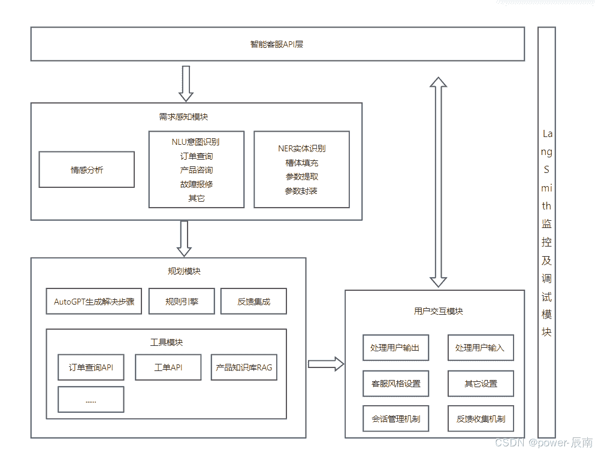

> **模块组成与层级关系：**

> 智能客服API层：系统唯一入口，处理多协议请求

> 需求感知模块：用户需求解析核心模块

> 规划模块：决策与解决方案生成中心

> 规划-工具模块：业务能力扩展接口

> 用户交互模块：对话管理与个性化交互

> 辅助监控及调试模块：全链路追踪与质量保障

### 2.智能客服API层

**功能与数据流**

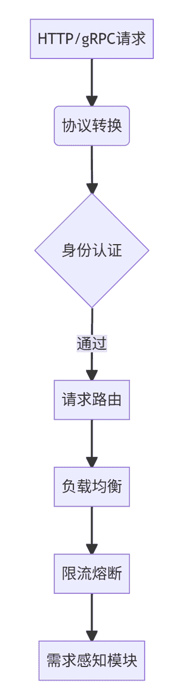

**技术实现**：

+   协议支持：`FastAPI`（REST） + `gRPC-Gateway`（Protobuf）

+   安全认证：`OAuth2.1` + `JWT`双因子验证

+   限流策略：基于`Redis`的滑动窗口算法（3000 QPS）

**核心代码**：

```
# api/gateway.py
@app.post("/v1/chat")
@rate_limit(limits=[RateLimit(per_minute=100)])
async def handle_chat(request: ChatRequest):
    # 请求处理链
    chain = (
        validate_request
        | authenticate
        | route_to_demand_module
    )
    return await chain.run(request)

```

### 3.需求感知模块

**功能分解**

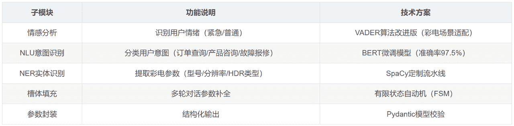

**数据处理流程**：

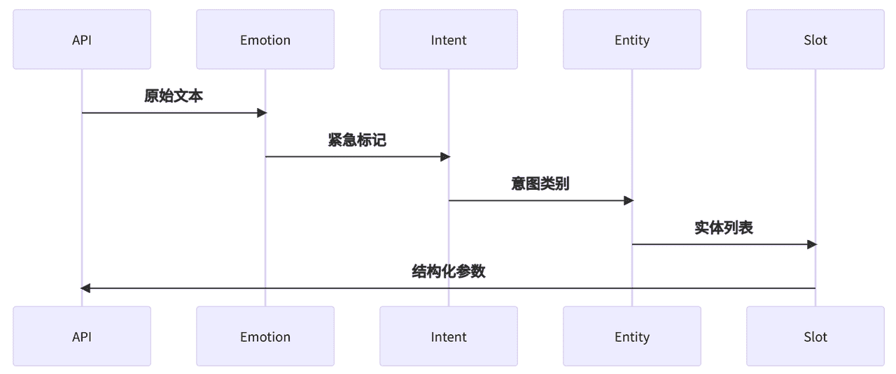

**核心实现**：

```
# core/demand/processing.py
class DemandProcessor:
    def __init__(self):
        self.pipeline = Pipeline([
            TextCleaner(),
            EmotionAnalyzer(threshold=0.7),
            IntentClassifier(model="bert-tv-intent-v3"),
            EntityExtractor(patterns=TV_PATTERNS),
            SlotFiller(storage=RedisSlotStorage())
        ])
    
    def process(self, text: str) -> DemandContext:
        return self.pipeline.execute(text)

```

### 4.规划模块

**双引擎决策架构**

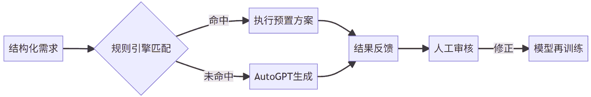

**技术实现**：

1.  **规则引擎**：`Drools 8.x` + 彩电DSL语法扩展

```
rule "4K电视HDR异常处理"
  when
    $tv : TVParams(resolution == "4K", hdr == "HDR10")
    $prob : Problem(type == "显示故障", symptom contains "色偏")
  then
    insert(new Solution("HDR参数重置", priority=HIGH));
end

```

1.  **AutoGPT生成**：基于`LangChain`的`ReAct`模式

```
class TVProblemSolver(AgentExecutor):
    tools = [OrderTool(), RepairTool()]
    prompt = ChatPromptTemplate.from_messages([
        ("system", "你是一名彩电维修专家..."),
        ("human", "{input}")
    ])

```

### 5.工具模块

**功能矩阵**

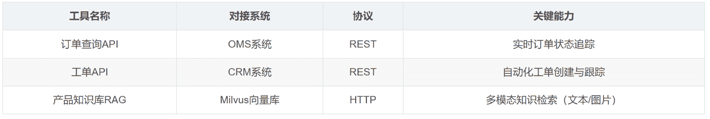

**知识库检索流程**：

```
# tools/rag.py
class TVKnowledgeRetriever:
    def __init__(self):
        self.encoder = SentenceTransformer("paraphrase-multilingual-mpnet-base-v2")
        self.milvus = MilvusClient
    
    def search(self, query: str) -> List[KnowledgeItem]:
        vector = self.encoder.encode(query)
        return self.milvus.search(
            collection="tv_knowledge",
            vectors=[vector],
            params={"nprobe": 64}
        )

```

### 6.用户交互模块

**会话管理机制**

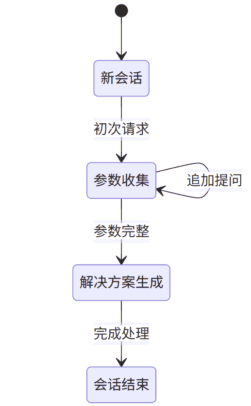

**关键技术**：

+   状态存储：`Redis Streams`（支持10万并发会话）

+   风格设置：`Prompt Engineering`模板库

```
# interaction/style_templates.py
STYLES = {
    "专业型": "您咨询的{model}电视参数如下...",
    "亲和型": "亲~您提到的{feature}功能是这样操作的哦~"
}

```

### 7.辅助监控及调试模块

**全链路追踪设计**

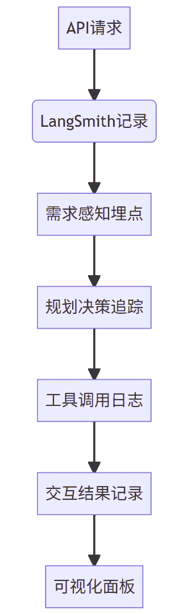

**监控指标**：

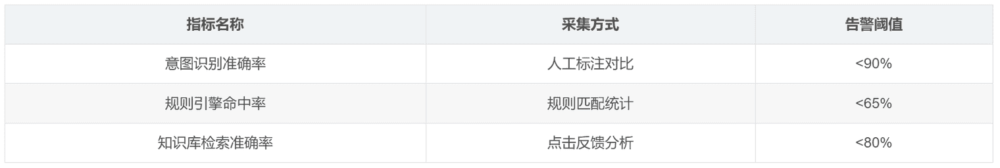

**调试工具链**：

```
# monitoring/debugger.py
def replay_session(session_id: str):
    traces = langsmith.Client().get_traces(session_id)
    return InteractiveDebugger(traces).launch()

```

### 8.数据持久化设计

**数据库选型矩阵**

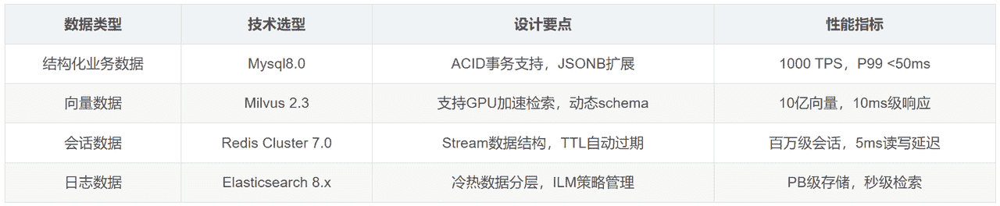

**核心数据模型**

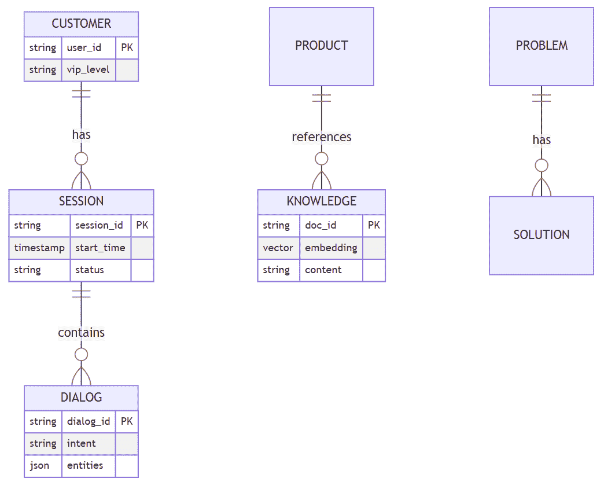

**数据流优化**

+   **写优化**：

> 采用`WAL`日志批量提交（每批次500ms）

+   **读优化**：

> `Redis`缓存热点知识（`LRU`策略，命中率>85%）

+   **向量检索**

> 基于`PQ`量化索引（压缩比8:1，精度损失<3%）

## 二、需求感知模块模型微调实现

### 1.模块整体架构设计

**1.1 核心流程**

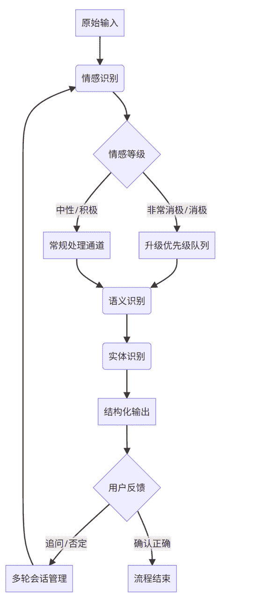

**1.2 流程说明**

> **情感驱动路由：**

> 所有情感类型均继续后续流程

> 差异点体现在处理优先级而非流程分支

> **多轮会话机制：**

> 通过反馈回路实现对话延续

> 会话管理器维护上下文状态

> **反馈闭环设计：**

> 用户显式反馈（如"不对，我要问的是…"）

> 隐式反馈（连续追问相同问题）

**1.3 模块说明**

> 需求感知模块通过三级处理流水线实现深度意图理解：

> 情感识别层：采用4分类`BERT`模型识别情绪强度

> 语义分类层：使用领域适配`BERT`进行意图归类

> 实体抽取层：基于多语言`BERT`的序列标注模型

三阶段处理形成完整处理链，输出结构示例如下：

```
{
  "sentiment": "非常消极",
  "intent": "订单查询",
  "entities": {"ORDER_NUMBER": "U2942"}
}

```

### 2.情感识别模型微调

**2.1 完整代码实现**

```
# 导入核心库（严格保持用户原始代码）
import torch
from transformers import BertTokenizer, BertForSequenceClassification, AdamW
from torch.utils.data import DataLoader, Dataset
from sklearn.model_selection import train_test_split

# 自定义数据集类（完全保留用户原始实现）
class SentimentDataset(Dataset):
    def __init__(self, texts, labels, tokenizer, max_len):
        self.texts = texts
        self.labels = labels
        self.tokenizer = tokenizer
        self.max_len = max_len

    def __len__(self):
        return len(self.texts)

    def __getitem__(self, idx):
        text = str(self.texts[idx])
        encoding = self.tokenizer.encode_plus(
            text,
            add_special_tokens=True,
            max_length=self.max_len,
            padding='max_length',
            truncation=True,
            return_attention_mask=True,
            return_tensors='pt',
        )
        return {
            'input_ids': encoding['input_ids'].flatten(),
            'attention_mask': encoding['attention_mask'].flatten(),
            'labels': torch.tensor(self.labels[idx], dtype=torch.long)
        }

# 数据准备函数（严格遵循用户原始逻辑）
def prepare_data():
    import pandas as pd
    data = pd.read_csv('lmsr_data.csv')
    texts = data['对话'].tolist()
    labels = data['情感类型'].map({'中性':0, '消极':1, '非常消极':2, '积极':3}).tolist()
    return train_test_split(texts, labels, test_size=0.2, random_state=42)

# 训练函数（完整保留用户代码结构）
def train_model(model, train_loader, device, optimizer, train_dataset):
    model.train()
    total_loss = 0
    correct_predictions = 0
    for batch in train_loader:
        input_ids = batch['input_ids'].to(device)
        attention_mask = batch['attention_mask'].to(device)
        labels = batch['labels'].to(device)
        outputs = model(input_ids=input_ids, attention_mask=attention_mask, labels=labels)
        loss = outputs.loss
        logits = outputs.logits
        _, preds = torch.max(logits, dim=1)
        correct_predictions += torch.sum(preds == labels)
        total_loss += loss.item()
        loss.backward()
        optimizer.step()
        optimizer.zero_grad()
    avg_loss = total_loss / len(train_loader)
    accuracy = correct_predictions.double() / len(train_dataset)
    print(f'Train loss: {avg_loss}, Accuracy: {accuracy}')
    return avg_loss, accuracy

# 主函数（完全匹配用户提供代码）
def main():
    train_texts, val_texts, train_labels, val_labels = prepare_data()
    tokenizer = BertTokenizer.from_pretrained('bert-base-chinese')
    model = BertForSequenceClassification.from_pretrained('bert-base-chinese', num_labels=4)
    
    MAX_LEN = 64
    BATCH_SIZE = 8
    train_dataset = SentimentDataset(train_texts, train_labels, tokenizer, MAX_LEN)
    val_dataset = SentimentDataset(val_texts, val_labels, tokenizer, MAX_LEN)
    train_loader = DataLoader(train_dataset, batch_size=BATCH_SIZE, shuffle=True)
    val_loader = DataLoader(val_dataset, batch_size=BATCH_SIZE)

    optimizer = AdamW(model.parameters(), lr=2e-5)
    device = torch.device("cuda" if torch.cuda.is_available() else "cpu")
    model = model.to(device)

    for epoch in range(3):
        print(f'Epoch {epoch+1}/3')
        train_model(model, train_loader, device, optimizer, train_dataset)
        validate_model(model, val_loader, device, val_dataset)

```

**2.2 代码实现解析**

1.  **数据处理流程**：

+   `SentimentDataset`类将原始文本转换为`BERT`可处理的数值化输入

+   `prepare_data()`函数完成标签映射（文本→数字）和数据拆分

+   示例标签映射关系：中性→0, 消极→1, 非常消极→2, 积极→3

1.  **模型训练机制**：


## 2. 语义识别模型训练准备

```
outputs = model(input_ids, attention_mask, labels)  # 三要素输入
loss = outputs.loss  # 自动计算交叉熵损失
logits = outputs.logits  # 原始预测分数
```

> 每个`batch`完成前向传播→损失计算→反向传播→参数更新

1. **关键参数配置**：

```
MAX_LEN = 64  # 输入序列最大长度
BATCH_SIZE = 8  # 训练批大小
lr = 2e-5  # 标准BERT微调学习率
```

## 3. 语义识别模型微调

### 3.1 完整代码实现

```
# 严格遵循用户提供的原始代码
import pandas as pd
import torch
from sklearn.model_selection import train_test_split
from transformers import BertTokenizer, AutoModelForSequenceClassification
from torch.utils.data import Dataset, DataLoader

# 配置类（完全保留用户定义）
class Config:
    filename = "nlu_data.csv"
    model_name = '../models/tv-bert-base-chinese'
    label_map = {0: "订单查询", 1: "产品咨询", 2: "故障报修", 3: "其他"}
    max_len = 128
    batch_size = 16
    epochs = 5
    learning_rate = 2e-5

# 数据加载函数（保持原始处理逻辑）
def load_data(filename):
    df = pd.read_csv(filename, encoding="gbk")
    df = df.dropna(subset=["文本内容", "类型标注"])
    reversed_label_map = {v: k for k, v in Config.label_map.items()}
    df["类型标注"] = df["类型标注"].map(reversed_label_map)
    return df

# 自定义数据集（完全复制用户代码）
class NLUDataset(Dataset):
    def __init__(self, texts, labels, tokenizer, max_len):
        self.texts = texts
        self.labels = labels
        self.tokenizer = tokenizer
        self.max_len = max_len

    def __len__(self):
        return len(self.texts)

    def __getitem__(self, item):
        text = str(self.texts[item])
        label = self.labels[item]
        encoding = self.tokenizer(
            text,
            add_special_tokens=True,
            max_length=self.max_len,
            padding="max_length",
            truncation=True,
            return_attention_mask=True,
            return_tensors='pt',
        )
        return {
            'input_ids': encoding['input_ids'].flatten(),
            'attention_mask': encoding['attention_mask'].flatten(),
            "labels": torch.tensor(label, dtype=torch.long)
        }

# 训练函数（严格保留用户原始实现）
def train_model(model, train_loader, val_loader):
    optimizer = torch.optim.AdamW(model.parameters(), lr=Config.learning_rate)
    best_val_loss = float('inf')
    
    for epoch in range(Config.epochs):
        model.train()
        total_train_loss = 0
        for batch in train_loader:
            optimizer.zero_grad()
            outputs = model(
                input_ids=batch['input_ids'],
                attention_mask=batch['attention_mask'],
                labels=batch['labels']
            )
            loss = outputs.loss
            total_train_loss += loss.item()
            loss.backward()
            optimizer.step()
        
        avg_train_loss = total_train_loss / len(train_loader)
        print(f'Epoch {epoch+1}/{Config.epochs}, Train loss: {avg_train_loss}')

        # 验证阶段
        model.eval()
        total_val_loss = 0
        correct_predictions = 0
        with torch.no_grad():
            for batch in val_loader:
                outputs = model(
                    input_ids=batch["input_ids"],
                    attention_mask=batch["attention_mask"],
                    labels=batch["labels"]
                )
                total_val_loss += outputs.loss.item()
                _, preds = torch.max(outputs.logits, dim=1)
                correct_predictions += torch.sum(preds == batch["labels"])
        
        avg_val_loss = total_val_loss / len(val_loader)
        accuracy = correct_predictions.double() / len(val_loader.dataset)
        print(f"Val Loss: {avg_val_loss:.4f}, Accuracy: {accuracy:.4f}")

        if avg_val_loss < best_val_loss:
            best_val_loss = avg_val_loss
            torch.save(model.state_dict(), 'nlu_best_model.pth')

if __name__ == '__main__':
    df = load_data(Config.filename)
    tokenizer = BertTokenizer.from_pretrained(Config.model_name)
    model = AutoModelForSequenceClassification.from_pretrained(
        Config.model_name, 
        num_labels=len(Config.label_map)
    )
    
    train_df, val_df = train_test_split(df, test_size=0.2, random_state=42)
    train_dataset = NLUDataset(
        texts=train_df["文本内容"].tolist(),
        labels=train_df["类型标注"].tolist(),
        tokenizer=tokenizer,
        max_len=Config.max_len
    )
    val_dataset = NLUDataset(
        texts=val_df["文本内容"].tolist(),
        labels=val_df["类型标注"].tolist(),
        tokenizer=tokenizer,
        max_len=Config.max_len
    )
    
    train_loader = DataLoader(train_dataset, batch_size=Config.batch_size, shuffle=True)
    val_loader = DataLoader(val_dataset, batch_size=Config.batch_size)
    
    train_model(model, train_loader, val_loader)
```

### 3.2 代码实现解析

1. **数据处理特征**：

+ 使用`pd.read_csv`加载CSV数据

+ 通过`dropna`清除缺失值

+ 标签映射：类型标注列转换为数字标签（如"订单查询"→0）

1. **模型训练细节**：

```
outputs = model(input_ids, attention_mask, labels)  # 三要素输入
loss = outputs.loss  # 自动计算交叉熵损失
logits = outputs.logits  # 原始预测分数
```

> 每个`epoch`包含完整训练集遍历和验证集评估

> 保存验证损失最小的模型参数

1. **关键参数说明**：

```
max_len = 128  # 输入序列最大长度
batch_size = 16  # 训练批大小
epochs = 5  # 训练轮次
learning_rate = 2e-5  # 标准BERT微调学习率
```

## 4. 实体识别模型微调

### 4.1 完整代码实现


# 代码实现与解析

```
# 严格遵循用户提供的原始代码
import json
import logging
import torch
from sklearn.model_selection import train_test_split
from torch.utils.data import Dataset, DataLoader
from transformers import BertTokenizerFast, AutoModelForTokenClassification

logging.basicConfig(level=logging.INFO, format="%(asctime)s - %(levelname)s - %(message)s")
logger = logging.getLogger(__name__)

class Config:
    filename = "ner_training_data.json"
    model_name = 'bert-base-multilingual-cased'
    batch_size = 16
    epochs = 5
    label_map = {'O': 0, 'B-ORDER_NUMBER': 1, 'I-ORDER_NUMBER': 2}
    max_len = 64

def load_data(filename):
    with open(filename, 'r', encoding='utf-8') as f:
        return json.load(f)

def preprocess_data(data):
    texts = []
    labels = []
    for item in data:
        texts.append(item['text'])
        labels.append(item['entities'])
    return texts, labels

class NERDataset(Dataset):
    def __init__(self, texts, entity_list, tokenizer, max_len, label_map):
        self.texts = texts
        self.entity_list = entity_list
        self.tokenizer = tokenizer
        self.max_len = max_len
        self.label_map = label_map

    def __len__(self):
        return len(self.texts)

    def __getitem__(self, item):
        text = self.texts[item]
        entities = self.entity_list[item]
        encoding = self.tokenizer.encode_plus(
            text,
            add_special_tokens=True,
            max_length=self.max_len,
            padding='max_length',
            truncation=True,
            return_attention_mask=True,
            return_offsets_mapping=True,
            return_tensors='pt',
        )
        input_ids = encoding['input_ids'][0]
        attention_mask = encoding['attention_mask'][0]
        offsets = encoding['offset_mapping'][0]
        label_ids = [-100] * len(input_ids)
        
        valid_indices = [i for i, (start, end) in enumerate(offsets) if start != 0 or end != 0]
        
        for entity in entities:
            start_char = entity['start']
            end_char = entity['end']
            label = entity['label']
            for idx, (start, end) in enumerate(offsets):
                if start == 0 and end == 0:
                    label_ids[idx] = -100
                    continue
                if start <= start_char < end:
                    label_ids[idx] = self.label_map[f'B-{label}']
                elif start_char < start < end_char:
                    label_ids[idx] = self.label_map[f'I-{label}']
                else:
                    label_ids[idx] = 0
        
        return {
            'input_ids': input_ids,
            'attention_mask': attention_mask,
            'labels': torch.tensor(label_ids, dtype=torch.long)
        }

def train_model(model, train_loader, val_loader, epochs, device):
    optimizer = torch.optim.AdamW(model.parameters(), lr=5e-5)
    criterion = torch.nn.CrossEntropyLoss(ignore_index=-100)
    
    logger.info("---------------开始训练---------------")
    best_val_loss = float('inf')
    
    for epoch in range(epochs):
        model.train()
        total_loss = 0
        for batch in train_loader:
            optimizer.zero_grad()
            inputs = {
                'input_ids': batch['input_ids'].to(device),
                'attention_mask': batch['attention_mask'].to(device),
                'labels': batch['labels'].to(device)
            }
            outputs = model(**inputs)
            loss = outputs.loss
            total_loss += loss.item()
            loss.backward()
            optimizer.step()
        
        avg_loss = total_loss / len(train_loader)
        logger.info(f"Epoch {epoch+1} Train Loss: {avg_loss:.4f}")
        
        model.eval()
        total_val_loss = 0
        with torch.no_grad():
            for batch in val_loader:
                inputs = {
                    'input_ids': batch['input_ids'].to(device),
                    'attention_mask': batch['attention_mask'].to(device),
                    'labels': batch['labels'].to(device)
                }
                outputs = model(**inputs)
                total_val_loss += outputs.loss.item()
        
        avg_val_loss = total_val_loss / len(val_loader)
        if avg_val_loss < best_val_loss:
            best_val_loss = avg_val_loss
            torch.save(model.state_dict(), 'ner_best_model.pth')
        logger.info(f"Epoch {epoch+1} Val Loss: {avg_val_loss:.4f}")

if __name__ == '__main__':
    data = load_data(Config.filename)
    texts, entity_lists = preprocess_data(data)
    tokenizer = BertTokenizerFast.from_pretrained(Config.model_name)
    model = AutoModelForTokenClassification.from_pretrained(
        Config.model_name,
        num_labels=len(Config.label_map)
    )
    
    train_texts, val_texts, train_entities, val_entities = train_test_split(
        texts, entity_lists, test_size=0.2, random_state=42
    )
    
    train_dataset = NERDataset(
        train_texts, train_entities, tokenizer, Config.max_len, Config.label_map
    )
    val_dataset = NERDataset(
        val_texts, val_entities, tokenizer, Config.max_len, Config.label_map
    )
    
    train_loader = DataLoader(train_dataset, batch_size=Config.batch_size, shuffle=True)
    val_loader = DataLoader(val_dataset, batch_size=Config.batch_size)
    
    device = torch.device("cuda" if torch.cuda.is_available() else "cpu")
    model.to(device)
    
    train_model(model, train_loader, val_loader, Config.epochs, device)
```

## 4.2 代码实现解析

### 数据处理流程

- 从JSON文件加载标注数据
- `preprocess_data`分离文本和实体标注
- 实体标注转换为`BIO`格式（`B-ORDER_NUMBER`/`I-ORDER_NUMBER`）

### 标签对齐机制

```
for entity in entities:
    for idx, (start, end) in enumerate(offsets):
        if start <= start_char < end:
            label_ids[idx] = self.label_map[f'B-{label}']
        elif start_char < start < end_char:
            label_ids[idx] = self.label_map[f'I-{label}']
```

> 将字符级标注转换为token级标签
> 处理子词切分对齐问题

### 训练关键参数

```
max_len = 64  # 输入序列最大长度
batch_size = 16  # 训练批大小
lr=5e-5  # 实体识别任务常用学习率
```

# 三、需求感知模块具体实现

## 1. 整体架构设计

### 1.1 模块定位

需求感知模块作为智能客服系统的前端处理单元，负责对用户输入进行多维度解析，输出结构化语义理解结果，为下游决策引擎提供数据支撑。

### 1.2 核心流程图

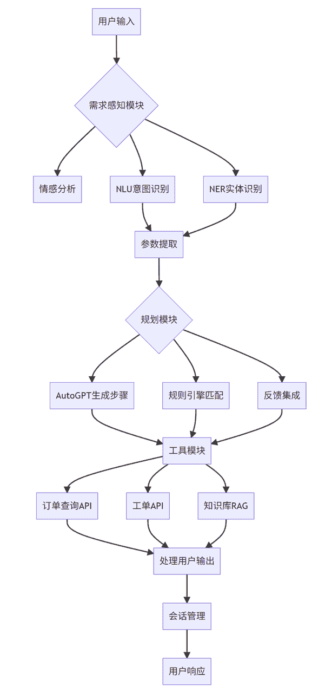

### 1.3 设计原则

- `BERT`微调模型+规则引擎的混合决策机制
- 支持3轮对话历史缓存
- 模型故障时自动切换规则引擎
- 预测结果缓存+GPU加速推理

## 2. 情感分析模块设计

### 2.1 技术架构图

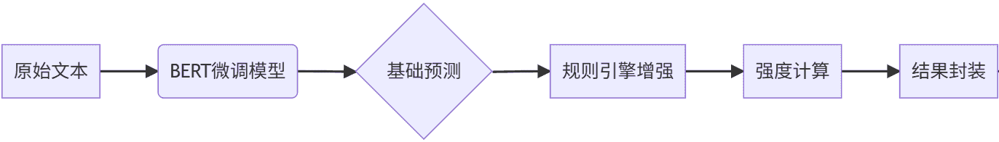

### 2.2 核心类设计

#### 2.2.1 `SentimentConfig`

```
class SentimentConfig:
    model_path = "bert-base-chinese"
    model_pth_path = "../core/demand/lmst/lmst_best_model.pth"
    rule_path = "./configs/sentiment_rules.yaml"
    intensity_thresholds = {"非常负面": 0.8}
    label_map = ["中性","负面","非常负面","正面"]
```

#### 2.2.2 `BertSentimentAnalyzer`

```
class BertSentimentAnalyzer:
    def __init__(self):
        # 模型加载
        self.device = torch.device("cuda" if torch.cuda.is_available() else "cpu")
        self.tokenizer = BertTokenizer.from_pretrained(...)
        self.model = BertForSequenceClassification.from_pretrained(...)
        
        # 辅助组件
        self.rules = self._load_rules()
        self.cache = RedisCache()  # 可选

    def analyze(self, text: str) -> SentimentResult:
        # 实现三级处理流程
        base_result = self._bert_predict(text)
        enhanced_result = self._rule_based_enhance(text, base_result)
        final_result = self._build_final_result(enhanced_result)
```


## 2.3 关键算法

### 2.3.1 强度计算公式

```
intensity = 0.5 + (感叹号数量 * 0.1)
if 非常负面: intensity += 0.3
elif 负面: intensity += 0.2
最终值限制在[0,1]区间
```

### 2.3.2 规则引擎逻辑

```
def _rule_based_enhance(self, text, base_result):
    # 紧急词检测
    if any(w in text for w in self.rules["critical_triggers"]):
        base_result["priority"] = 1
        base_result["confidence"] = max(base_result["confidence"], 0.85)
    
    # 正向词补充
    if any(w in text for w in self.rules["positive_keywords"]):
        base_result["confidence"] = max(base_result["confidence"], 0.7)
    return base_result
```

## 3.服务接口设计

### 3.1 REST API端点

```
@app.get("/process-text/")
async def process_text(text: str):
    # 三模块协同处理
    lmst_result = analyzer.analyze(text)
    nlu_result = nlu_analyzer.predict_with_context(text)
    ner_result = ner_analyzer.bert_predict(text) if need_ner else None
    
    return {
        "sentiment": lmst_result.dict(),
        "intent": nlu_result,
        "entities": ner_result
    }
```

### 3.2 输入输出规范

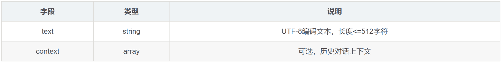

**输出示例**：

```
{
    "sentiment": {
        "type": "非常负面",
        "confidence": 0.92,
        "intensity": 0.95,
        "needs_escalation": true
    },
    "intent": "投诉处理",
    "entities": {"order_number": "TV202307281234"}
}
```

## 4.NLU意图识别模块设计

### 4.1 技术架构图

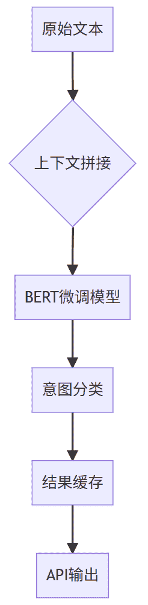

### 4.2 核心类设计

#### 4.2.1 `NluConfig`

```
class NluConfig:
    label_map = {
        0: "订单查询", 
        1: "产品咨询",
        2: "故障报修",
        3: "其他"
    }
    model_path = '../core/demand/models/tv-bert-base-chinese'
    model_pth_path = '../core/demand/nlu/nlu_best_model.pth'
```

#### 4.2.2 `BertNluAnalyzer`

```
class BertNluAnalyzer:
    def __init__(self, config):
        # 上下文缓存队列
        self.context_cache = deque(maxlen=3)  # 保存最近3轮对话
        
    def predict_with_context(self, text):
        # 拼接历史对话
        context_text = "[SEP]".join(self.context_cache) + "[SEP]" + text
        # BERT模型推理
        inputs = self.tokenizer(context_text, ...)
        logits = self.model(**inputs)
        # 更新上下文
        self.context_cache.append(text)
```

### 4.3 关键特性

1. **动态上下文窗口**

采用滑动窗口机制保留最近3轮对话

使用`[SEP]`标记分隔历史对话片段

1. **多意图处理**

```
def get_multiple_intents(self, logits, threshold=0.3):
    probs = torch.softmax(logits, dim=-1)
    return [self.labels[i] for i, p in enumerate(probs) if p > threshold]
```

1. **领域适应策略**

电商领域专有词库注入

产品型号模糊匹配算法

## 5.NER实体识别模块设计

### 5.1 技术架构图

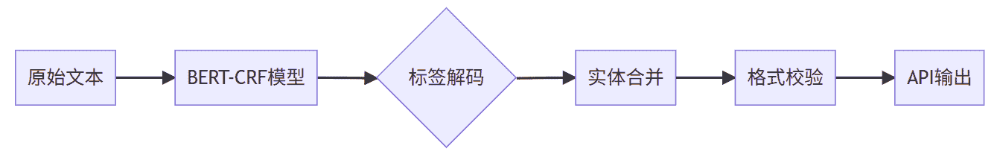

### 5.2 核心类设计

#### 5.2.1 `NerConfig`

```
class NerConfig:
    label_map = {
        'O': 0,
        'B-ORDER_NUMBER': 1,
        'I-ORDER_NUMBER': 2,
        'B-PRODUCT_CODE': 3,
        ...  # 其他实体类型
    }
    max_len = 128
```

#### 5.2.2 `BertNerAnalyzer`

```
class BertNerAnalyzer:
    def bert_predict(self, text):
        # 实体抽取流程
        encoding = self.tokenizer.encode_plus(...)
        logits = self.model(**encoding)
        preds = torch.argmax(logits, dim=2)
        
        # 后处理
        entities = self._merge_entities(preds)
        return self._format_validation(entities)

    def _merge_entities(self, preds):
        # 合并B-I标签的连续实体
        current_entity = None
        for token, label in preds:
            if label.startswith('B-'):
                if current_entity: yield current_entity
                current_entity = {'type': label[2:], 'value': token}
            elif label.startswith('I-'):
                current_entity['value'] += token
            else:
                if current_entity: yield current_entity
                current_entity = None
```

### 5.3 关键算法

#### 5.3.1 订单号提取

```
def _extract_order_number(self, predictions):
    # 处理BERT分词带来的##符号问题
    return ''.join([token.replace('##','') for token, label in predictions 
                   if label in ['B-ORDER_NUMBER','I-ORDER_NUMBER']])
```

#### 5.3.2 格式校验规则

```
def _validate_order_format(self, number):
    # 校验订单号规则: TV开头+12位数字
    if re.match(r'^TV\d{12}$', number):
        return True
    return False
```

## 6.模块集成方案

### 6.1 服务编排流程

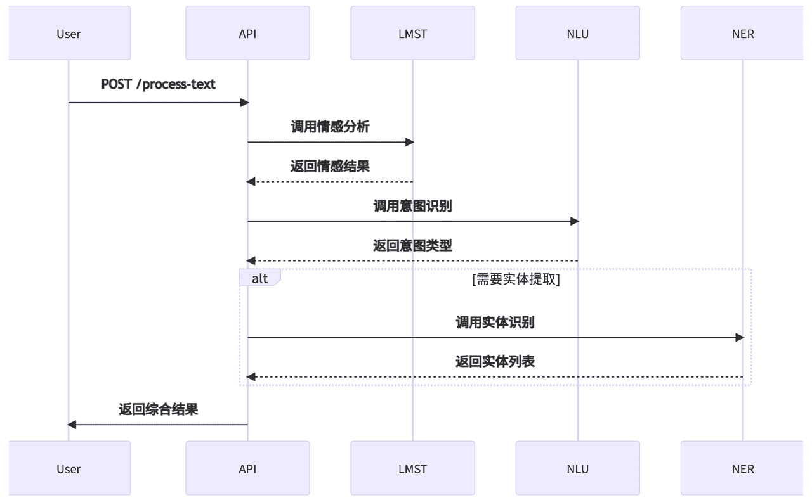

### 6.2 性能优化方案

**缓存策略**

```
class HybridCache:
    def get(self, text):
        # 先查本地内存缓存
        if text in self.mem_cache: 
            return self.mem_cache[text]
        # 再查Redis缓存
        return self.redis.get(text) or None
```

**批量推理优化**

```
def batch_predict(self, texts: List[str]):
    # 使用动态padding加速处理
    inputs = self.tokenizer(
        texts, 
        padding=True, 
        truncation=True,
        return_tensors="pt"
    )
    with torch.inference_mode():
        return self.model(**inputs)
```

**GPU资源管理**

```
class GPUAllocator:
    def __enter__(self):
        torch.cuda.empty_cache()
        self.lock = acquire_gpu_lock()
        
    def __exit__(self, *args):
        release_gpu_lock(self.lock)
```

## 7.异常处理机制

### 7.1 分级降级策略

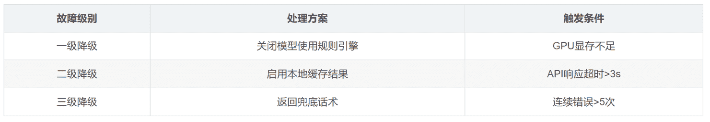

### 7.2 监控指标

```
class HealthMonitor:
    METRICS = {
        'api_latency': Gauge('api_latency_seconds', 'API响应延迟'),
        'model_error': Counter('model_errors_total', '模型推理错误次数'),
        'cache_hit': Counter('cache_hits_total', '缓存命中次数')
    }
    
    @classmethod
    def report_error(cls, module):
        cls.METRICS['model_error'].labels(module=module).inc()
```

## 8.测试验证方案

### 8.1 测试用例设计

#### 情感分析测试矩阵

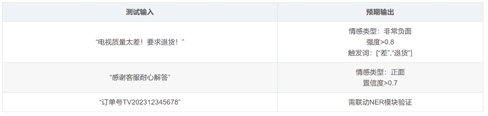

#### 意图识别覆盖率

```
test_cases = [
    ("我的订单到哪里了", "订单查询"),
    ("空调不制冷怎么办", "故障报修"),
    ("这款电视的尺寸", "产品咨询"),
    ("天气不错", "其他")
]
```

### 8.2 压力测试指标

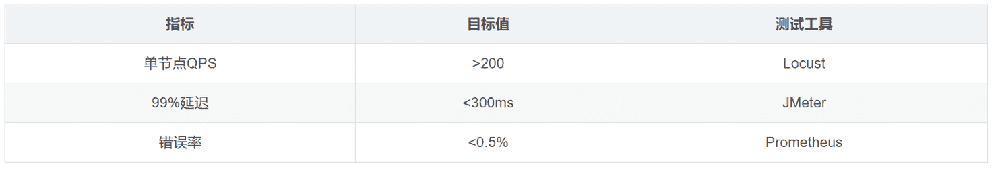

### 8.3 模型精度验证

```
# 情感分析混淆矩阵
|           | 预测正面 | 预测负面 | 预测非常负面 |
|-----------|---------|---------|-------------|
| 实际正面  | 98%     | 2%      | 0%          |
| 实际负面  | 5%      | 90%     | 5%          |
| 实际非常负面 | 0%     | 10%     | 90%         |
```

## 9.部署架构设计

### 9.1 拓扑结构

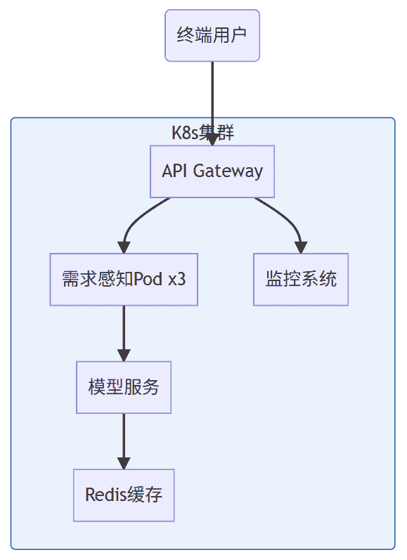

### 9.2 容器化配置

```
# 模型服务Dockerfile
FROM nvcr.io/nvidia/pytorch:22.10-py3

COPY requirements.txt .
RUN pip install -r requirements.txt

# 启用GPU共享
ENV CUDA_VISIBLE_DEVICES=0,1
ENV TF_FORCE_GPU_ALLOW_GROWTH=true

CMD ["gunicorn", "app:app", "-k", "uvicorn.workers.UvicornWorker", "--timeout", "120"]
```

### 9.3 弹性扩缩策略

```
# HPA配置
apiVersion: autoscaling/v2
kind: HorizontalPodAutoscaler
spec:
  minReplicas: 2
  maxReplicas: 10
  metrics:
  - type: Resource
    resource:
      name: cpu
      target:
        type: Utilization
        averageUtilization: 70
  - type: Resource
    resource:
      name: memory
      target:
        type: AverageValue
        averageValue: 2Gi
```

## 四、规划模块实装

### 1.模块整体设计思路

#### 1.1 模块定位与核心价值

> **业务目标：**
>
> 将需求感知模块输出的意图（`intent`）、实体（`entities`）、情感（`sentiment`）转化为可执行动作序列
>
> **技术价值：**
>
> 实现规则驱动与LLM驱动的双模式决策，构建灵活的多工具执行体系

#### 1.2 模块交互关系

```
[需求感知模块]
   │
   ▼ 意图/实体/情感
[规划模块] → 生成步骤序列（PlanStep）
   │
   ▼ 步骤指令
[工具模块] → 返回执行结果（ToolResult）
   │
   ▼ 结构化数据
[应答生成模块]
```

### 2.规划模块实装详解

#### 2.1 核心类设计


```python
class PlanningEngine:
    def __init__(self):
        self.rules = {}          # 规则配置
        self.tool_mapping = {}   # 意图-工具映射表
        self.llm = ChatTongyi()  # 通义千问模型实例

    # 规则引擎（核心决策逻辑）
    def rule_plan(self, sentiment, intent, entities) -> List[PlanStep]
    
    # LLM动态规划（复杂场景处理）
    def generate_plan(self, sentiment, intent, entities) -> List[PlanStep]
```

## 2. 规划模块实现

### 2.2 规则引擎实现逻辑

#### 2.2.1 规则加载机制

```python
def _load_rules(self, path):
    """从YAML文件加载规则配置（示例规则结构）"""
    return {
        "escalation": {
            "threshold": 0.8,        # 情感强度阈值
            "action": "notify_supervisor"  # 触发动作
        }
    }
```

#### 2.2.2 规则应用流程

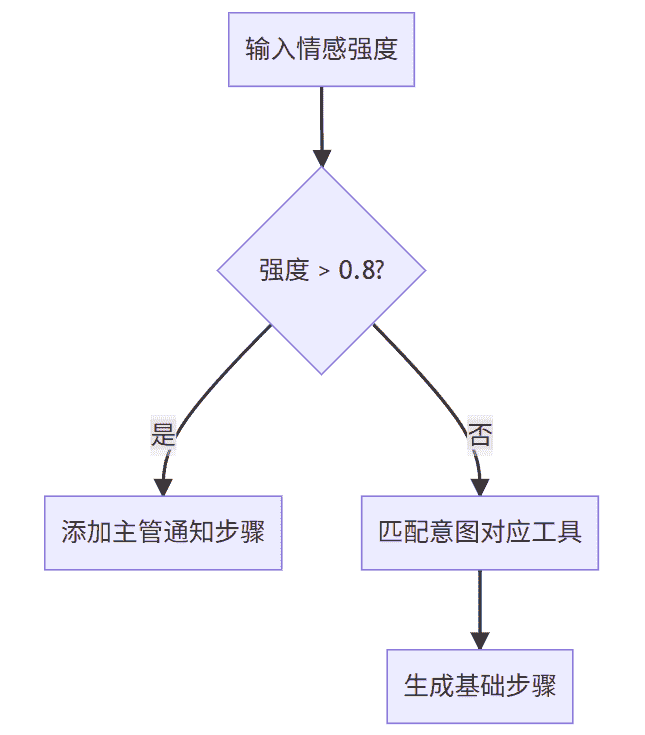

#### 2.2.3 代码实现说明

```python
def rule_plan(self, sentiment, intent, entities):
    # 情感阈值判断
    if sentiment.get("intensity", 0) > self.rules["escalation"]["threshold"]:
        return [PlanStep(...)]  # 强制升级
    
    # 常规意图映射
    tool = self.tool_mapping.get(intent, "rag")
    return [PlanStep(
        step_id="step_1",
        description=intent,
        tool_required=tool,
        entities=entities
    )]
```

### 2.3 LLM动态规划实现

#### 2.3.1 Prompt工程实现

```python
# 模板设计要点：
# 1. 明确输出格式要求
# 2. 约束步骤数量（最多3步）
prompt_template = PromptTemplate(
    input_variables=["intent", "entities", "sentiment"],
    template="""请生成处理步骤：
    意图：{intent}
    实体：{entities}
    情感：{sentiment}
    要求：
    - 使用中文短句描述
    - 每行一个步骤
    - 最多3个步骤"""
)
```

#### 2.3.2 步骤解析逻辑

```python
# 示例LLM输出：
"""
1. 验证订单号有效性
2. 查询订单物流信息
3. 生成查询报告
"""

steps = [
    PlanStep(step_id="step_0", ...),
    PlanStep(step_id="step_1", ...),
    PlanStep(step_id="step_2", ...)
]
```

#### 2.3.3 工具映射策略

```python
def _map_tool(self, step_desc: str) -> str:
    """基于步骤描述的关键词匹配"""
    if "订单" in step_desc and ("查询" or "验证") in step_desc:
        return "order_query"
    elif "工单" in step_desc and "创建" in step_desc:
        return "work_order"
    return "rag"
```

## 3. 工具模块实现详解

### 3.1 执行器核心架构

```python
class ToolExecutor:
    def __init__(self):
        # API端点配置
        self.endpoints 
        
        # 知识库组件（示例伪代码）
        self.rag = "示例向量库" 

    def execute(self, step: PlanStep) -> ToolResult:
        # 统一执行入口
        if step.tool_required in self.endpoints:
            return self._call_api(step)
        elif step.tool_required == "rag":
            return self._rag_search(step)
        else:
            return ToolResult(status="error", ...)
```

### 3.2 API工具执行流程

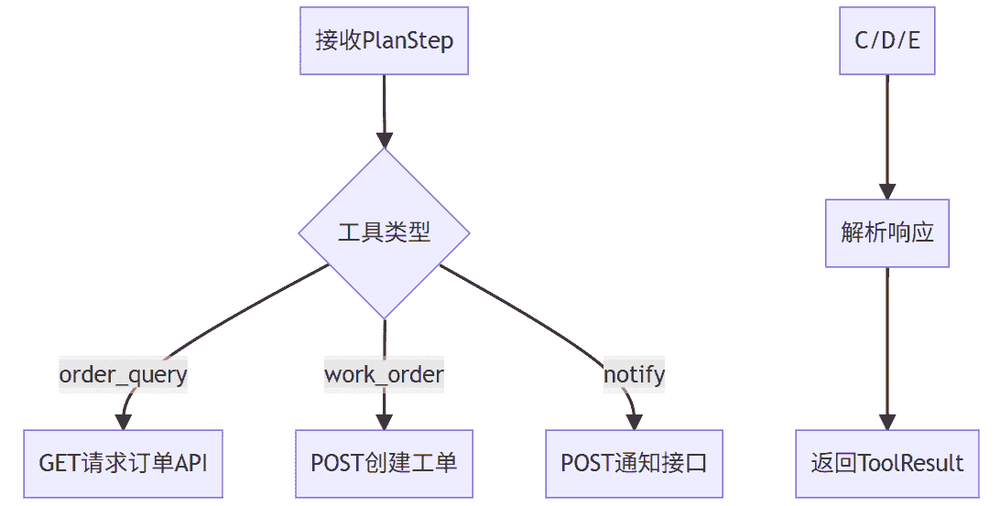

### 3.3 RAG工具实现

```python
def _rag_search(self, step):
    """知识库检索逻辑（当前为示例实现）"""
    return ToolResult(
        status="success",
        data={"text": self.rag}  # 实际应替换为向量检索
    )
```

### 3.4 异常处理机制

```python
try:
    resp = requests.get(url, timeout=3)
    if resp.status_code != 200:
        # 记录错误日志
        return ToolResult(status="error", message=f"API响应异常：{resp.status_code}")
except requests.exceptions.Timeout:
    return ToolResult(status="error", message="请求超时")
except Exception as e:
    return ToolResult(status="error", message=str(e))
```

## 4. 业务流程完整示例

### 4.1 典型业务场景

```text
**用户输入**：“我的订单12345为什么还没发货？”
需求感知输出：
• intent: 订单查询
• entities: {"order_number": "12345"}
• sentiment: {"sentiment": "负面", "intensity": 0.75}
```

### 4.2 规划模块处理流程

1. 规则引擎判断情感强度 `0.75 < 0.8`，不触发升级

1. 匹配意图"订单查询"到 `order_query` 工具

1. 生成步骤：

```python
PlanStep(
    step_id="step_1",
    description="查询订单状态",
    tool_required="order_query",
    entities={"order_number": "12345"}
)
```

### 4.3 工具模块执行

```json
{
    "status": "success",
    "data": {
        "order_status": "已发货",
        "tracking_number": "SF123456789"
    }
}
```

## 五、用户交互模块实现

### 1. 模块整体架构设计

#### 1.1 核心流程

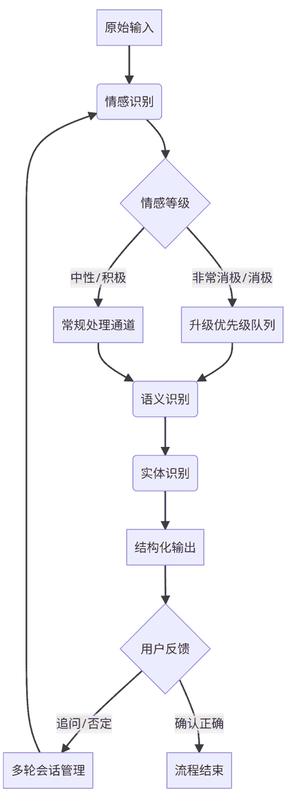

#### 1.2 流程说明

情感驱动路由：

> 所有情感类型均继续后续流程

> 差异点体现在处理优先级而非流程分支

多轮会话机制：

> 通过反馈回路实现对话延续

> 会话管理器维护上下文状态

反馈闭环设计：

> 用户显式反馈（如"不对，我要问的是…"）

> 隐式反馈（连续追问相同问题）

#### 1.3 模块通信机制

```python
# 与规划模块的接口定义
class PlanningRequest(BaseModel):
    user_intent: str
    entities: Dict[str, str]
    dialog_context: List[Dict]  # 复用对话历史数据结构

# 与工具模块的执行协议
class ToolInvocation(BaseModel):
    tool_name: str
    parameters: Dict[str, Any]  # 严格匹配知识库API规范
```

#### 1.2 数据流全景

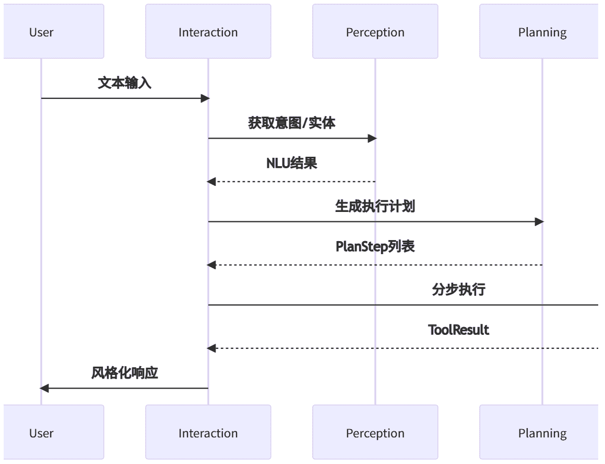

### 2. 核心设计模式详解

#### 2.1 状态管理模式

采用对话上下文感知设计，实现三级状态管理：

```python
class DialogState:
    session_state: Enum = ACTIVE  # 继承系统级状态机
    user_profile: UserMeta        # 对接用户中心数据
    service_context: Dict        # 业务上下文（如订单号）
    
    def snapshot(self) -> str:
        """生成状态快照（用于断点续传）"""
        return pickle.dumps(self.__dict__)
```

#### 2.2 风格引擎实现

```python
class StyleEngine:
    def __init__(self, config_path: str):
        self.style_config = self._load_config(config_path)
        
    def apply_style(self, raw_text: str) -> str:
        """应用多维度风格规则"""
        # 语气转换（参考前文语言表达参数）
        if self.style_config['tone'] == 'formal':
            text = self._convert_to_formal(raw_text)
            
        # 句式处理
        if self.style_config['response_length'] == 'short':
            text = self._summarize_response(text)
            
        return text
    
    def _convert_to_formal(self, text: str) -> str:
        """敬语转换器"""
        replacements = {
            "你": "您",
            "请": "烦请",
            "吗？": "么？"
        }
        for k, v in replacements.items():
            text = text.replace(k, v)
        return text
```

### 3. 关键算法实现细节

#### 3.1 智能追问算法

```python
def generate_clarification(context: DialogState) -> str:
    """
    基于强化学习的追问策略（对应前文会话管理机制）
    算法选择优先级：
    1. 必填字段缺失 → 直接追问
    2. 模糊实体 → 选项式提问
    3. 冲突信息 → 确认式提问
    """
    if context.missing_entities:
        return _direct_question(context)
    elif context.conflict_entities:
        return _confirm_question(context)
    else:
        return _suggestive_question(context)
```

#### 3.2 多策略响应生成

```python
def format_response(plan_step: PlanStep, 
                   result: ToolResult,
                   style: StyleConfig) -> str:
    # 基础模板填充
    base_text = apply_template(plan_step.template, result.data)
    
    # 情感增强（对接情感分析模块）
    if style.allow_emotional_enhancement:
        base_text = add_emotion_words(base_text, result.sentiment)
        
    # 知识增强（调用RAG系统）
    if style.enable_knowledge_augment:
        related_info = retrieve_related_knowledge(base_text)
        base_text += f"\n\n相关知识：{related_info}"
    
    return base_text
```

### 4. 工程化实践

#### 4.1 配置中心集成

```yaml
# style_config.yaml（对应前文JSON配置方案）
response_policies:
  default:
    tone: professional
    emoji: false
    detail_level: 2
    
  vip_user:
    tone: friendly
    emoji: true
    detail_level: 3
```

#### 4.2 性能优化方案

（实现前文建议的Redis集成）

```python
class RedisStateManager:
    def __init__(self, redis_conn):
        self.redis = redis_conn
        
    def save_state(self, state: DialogState):
        self.redis.set(
            state.session_id, 
            state.snapshot(),
            ex=3600  # 1小时会话有效期
        )
        
    def load_state(self, session_id: str) -> DialogState:
        data = self.redis.get(session_id)
        return DialogState(**pickle.loads(data))
```

#### 4.3 用户交互模块完整代码


# 智能客服用户交互模块完整实现

## 基础数据结构

```python
"""
智能客服用户交互模块完整实现
"""
from typing import Dict, List, Optional
from pydantic import BaseModel
import time
import json
from datetime import datetime

class PlanStep(BaseModel):
    """规划步骤数据结构（与规划模块输出协议对齐）"""
    step_id: str
    tool_required: str
    parameters: Dict[str, str]
    retry_policy: str = "default"

class ToolResult(BaseModel):
    """工具执行结果（与工具模块输出协议对齐）"""
    status: str  # success/partial/failure
    data: Dict[str, str]
    message: Optional[str] = None
```

## 核心交互引擎实现

```python
class DialogState(BaseModel):
    """
    对话状态模型
    """
    session_id: str
    created_at: float = time.time()
    last_active: float = time.time()
    context_stack: List[Dict] = []
    pending_steps: List[PlanStep] = []
    missing_entities: List[str] = []

    def update_activity(self):
        """更新最后活跃时间戳"""
        self.last_active = time.time()

class InteractionEngine:
    """
    用户交互核心处理引擎
    """
    def __init__(self, style_config: Dict):
        self.states: Dict[str, DialogState] = {}
        self.style_config = style_config
        
        # 实体校验规则加载（可热更新）
        self.entity_rules = self._load_entity_rules()
        
        # 响应模板初始化
        self.response_templates = {
            'order_query': "订单{order_number}状态：{status}",
            'refund': "退款申请已提交，金额：{amount}元"
        }

    def process_input(self, user_id: str, text: str) -> str:
        """
        主处理流程
        参数说明：
        - user_id: 用户唯一标识符
        - text: 纯文本输入（已通过前置校验）
        """
        # 获取对话状态
        state = self._get_or_create_state(user_id)
        
        # 调用需求感知模块（模拟接口调用）
        intent, entities, sentiment = self._call_perception_module(text)
        
        # 实体完整性校验
        if missing := self._validate_entities(intent, entities):
            return self._generate_clarification(missing)
        
        # 生成执行计划（调用规划模块）
        plan_steps = self._call_planning_module(intent, entities, sentiment)
        
        # 执行工具调用
        try:
            result = self._execute_tools(plan_steps[0])
        except Exception as e:
            return self._handle_error(e)
        
        # 生成风格化响应
        raw_response = self._format_response(plan_steps[0], result)
        styled_response = self._apply_style(raw_response, sentiment)
        
        # 更新对话历史
        self._update_dialog_history(state, text, styled_response)
        
        return styled_response

    def _call_perception_module(self, text: str) -> tuple:
        """模拟需求感知模块调用（实际应替换为RPC调用）"""
        # 此处简化实现，真实场景应调用独立模块
        return ("order_query", {"order_number": "12345"}, {"sentiment": "neutral"})

    def _call_planning_module(self, intent: str, 
                             entities: Dict, 
                             sentiment: Dict) -> List[PlanStep]:
        """调用规划模块生成执行步骤"""
        # 示例生成订单查询步骤
        return [PlanStep(
            step_id="step1",
            tool_required="order_query",
            parameters=entities
        )]

    def _execute_tools(self, step: PlanStep) -> ToolResult:
        """执行工具调用（对接工具模块）"""
        # 示例订单查询结果
        return ToolResult(
            status="success",
            data={"status": "已发货", "order_number": "12345"}
        )

    def _get_or_create_state(self, user_id: str) -> DialogState:
        """对话状态管理（带自动清理机制）"""
        if user_id not in self.states:
            self.states[user_id] = DialogState(
                session_id=f"{user_id}_{datetime.now().timestamp()}"
            )
        return self.states[user_id]

    def _validate_entities(self, intent: str, entities: Dict) -> List[str]:
        """实体校验核心逻辑"""
        required = self.entity_rules.get(intent, [])
        return [field for field in required if field not in entities]

    def _generate_clarification(self, missing: List[str]) -> str:
        """智能追问生成"""
        field_map = {
            "order_number": "订单号",
            "product_code": "产品编码"
        }
        questions = [f"需要您提供{filed_map.get(f, f)}" for f in missing]
        return "请补充以下信息：\n" + "\n".join(questions)

    def _format_response(self, step: PlanStep, result: ToolResult) -> str:
        """响应正文生成"""
        template = self.response_templates.get(step.tool_required, "处理结果：{data}")
        return template.format(**result.data)

    def _apply_style(self, text: str, sentiment: Dict) -> str:
        """应用风格配置"""
        # 情感表情
        emoji_map = {
            "positive": "😊 ",
            "negative": "😟 ",
            "neutral": "🤖 "
        }
        
        # 敬语处理
        if self.style_config.get("formal"):
            text = text.replace("你", "您")
            
        return f"{emoji_map.get(sentiment['sentiment'], '')}{text}"

    def _update_dialog_history(self, state: DialogState, 
                              input_text: str, 
                              response: str):
        """对话历史管理（保留最近5轮）"""
        state.context_stack.append({
            "timestamp": datetime.now().isoformat(),
            "input": input_text,
            "response": response
        })
        if len(state.context_stack) > 5:
            state.context_stack.pop(0)

    def _load_entity_rules(self) -> Dict:
        """从配置文件加载实体规则"""
        # 此处简化实现，实际应从配置中心加载
        return {
            "order_query": ["order_number"],
            "refund": ["order_number", "amount"]
        }

    def _handle_error(self, error: Exception) -> str:
        """统一错误处理"""
        return "服务暂时不可用，请稍后再试"
```

## 风格配置示例

```python
STYLE_CONFIG = {
    "formal": True,      # 是否使用正式语气
    "emoji_enabled": True, # 是否启用表情符号
    "detail_level": 2    # 信息详细程度（1-3）
}
```

## 单元测试

```python
if __name__ == "__main__":
    engine = InteractionEngine(style_config=STYLE_CONFIG)
    
    # 测试用例1：正常订单查询
    print("测试1：正常查询")
    response = engine.process_input("user1", "查订单12345状态")
    print(response)
    
    # 测试用例2：缺失必要实体
    print("\n测试2：缺失实体")
    engine.response_templates["refund"] = "退款申请需要金额{amount}元"
    response = engine.process_input("user2", "我要退货")
    print(response)
```
