# RAG智能客服「迪士尼案例」

> 来源：[https://v11enp9ok1h.feishu.cn/docx/H70ddb1fGo0zXWxxEv3cfhrSntf](https://v11enp9ok1h.feishu.cn/docx/H70ddb1fGo0zXWxxEv3cfhrSntf)

### 为什么要学RAG高阶技术？

### 🤔 你是否遇到过这些问题？

+   ❌ **AI回答不准确**：“迪士尼门票大概300-500元”

+   ❌ **无法回答实时问题**：“今天开放吗？”（AI不知道，因为知识库是静态的，无法理解今天是什么 ）

+   ❌ **无法理解上下文**：“还有其他项目吗？”（AI不知道”其他”指什么）

+   ❌ **检索结果不精准**：问门票价格，却返回交通信息

+   ❌ **知识库难维护**：手动更新，容易出错

传统的AI系统往往无法获取最新信息，只能依赖训练数据中的静态知识，这显然无法满足实际业务需求。学习RAG高级技术后，你可以：

+   ✅ **信息准确**：基于最新知识库，准确率90%+

+   ✅ **实时查询**：智能判断何时需要联网，获取实时信息

+   ✅ **理解上下文**：5种Query改写，处理复杂对话

+   ✅ **检索精准**：混合检索+Rerank，召回率提升35%

+   ✅ 自动维第一章：入门篇VS高级篇技术对比护：对话沉淀+健康检查，维护成本降低70%

## 第一章：RAG核心概念

### **什么是RAG？**

（大白话解释）RAG = Retrieval（检索） + Augmented（增强） + Generation（生成）【具体内容可以看上一篇：RAG技术深度解析与实战（入门篇）这一章只有相关代码没有解释。】

**场景模拟：迪士尼客服**

❌ 没有RAG的AI（传统方式）：

```
游客: &quot;迪士尼门票多少钱？&quot;

AI（靠&quot;记忆&quot;回答）: &quot;根据我的知识，迪士尼门票大概300-500元&quot;

问题：
1. ❌ 信息可能过时（训练数据是去年的）
2. ❌ 不够具体（哪个迪士尼？什么日期？）
3. ❌ 容易瞎编（AI幻觉问题）
4. ❌ 无法验证（没有信息来源）
5. ❌ 难以更新（需要重新训练模型，成本极高）
```

✅ 有RAG的AI（智能客服）：

```
游客: &quot;迪士尼门票多少钱？&quot;

【系统内部流程】：

步骤1 - 检索（Retrieval）:
   🔍 在知识库搜索&quot;迪士尼门票价格&quot;
   📄 找到文档：&quot;上海迪士尼乐园门票价格（2024-11-01更新）：
       平日成人票399元，周末499元，儿童票299-374元&quot;

步骤2 - 增强（Augmented）:
   📋 将检索到的文档作为参考资料
   🎯 提取关键信息：价格、日期类型、儿童政策

步骤3 - 生成（Generation）:
   🤖 AI基于参考文档生成答案：

AI: &quot;您好！根据最新的价格信息：

    🎫 成人票价格：
    • 平日：399元
    • 周末/节假日：499元

    👶 儿童票价格（身高1.0-1.4米）：
    • 平日：299元
    • 周末/节假日：374元

    🎁 免费政策：
    • 1.0米以下儿童免费入园

    💡 温馨提示：
    建议提前3-7天在官方渠道预订，高峰期可能售罄哦！

    📌 信息来源：官方价格文档（更新于2024-11-01）&quot;

优势：
✅ 信息准确（基于最新知识库）
✅ 有据可查（标注来源和更新时间）
✅ 不会瞎编（有什么说什么）
✅ 易于更新（只需更新知识库文档）
✅ 可追溯（可以查看原始文档）
```

### RAG三大步骤详解

1.    步骤1：Indexing（索引构建）- 只需做一次

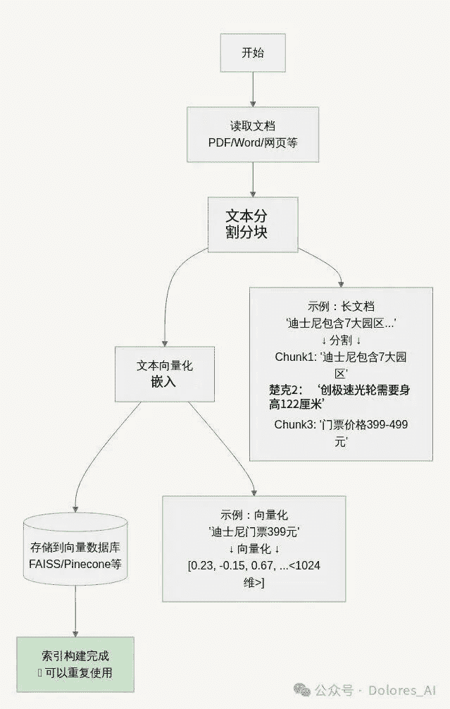

1.  步骤2：Retrieval（检索）- 每次查询都执行

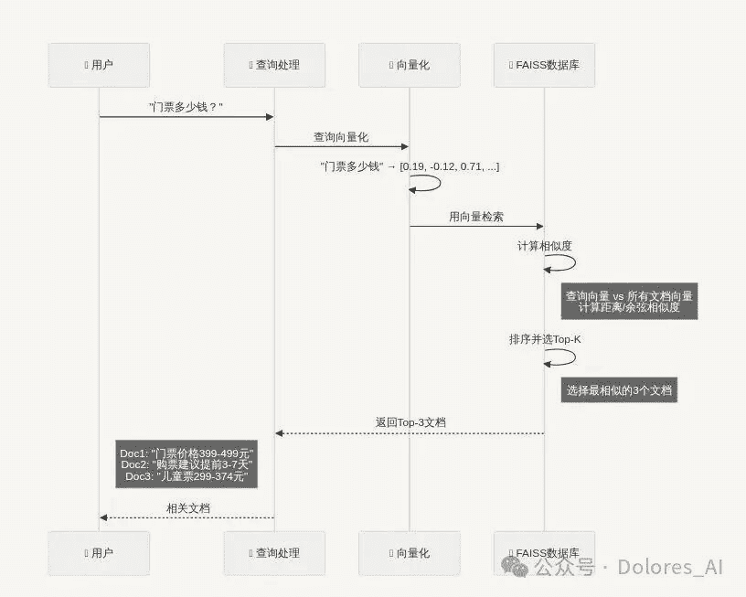

1.  步骤3：Generation（生成答案）- 每次查询都执行

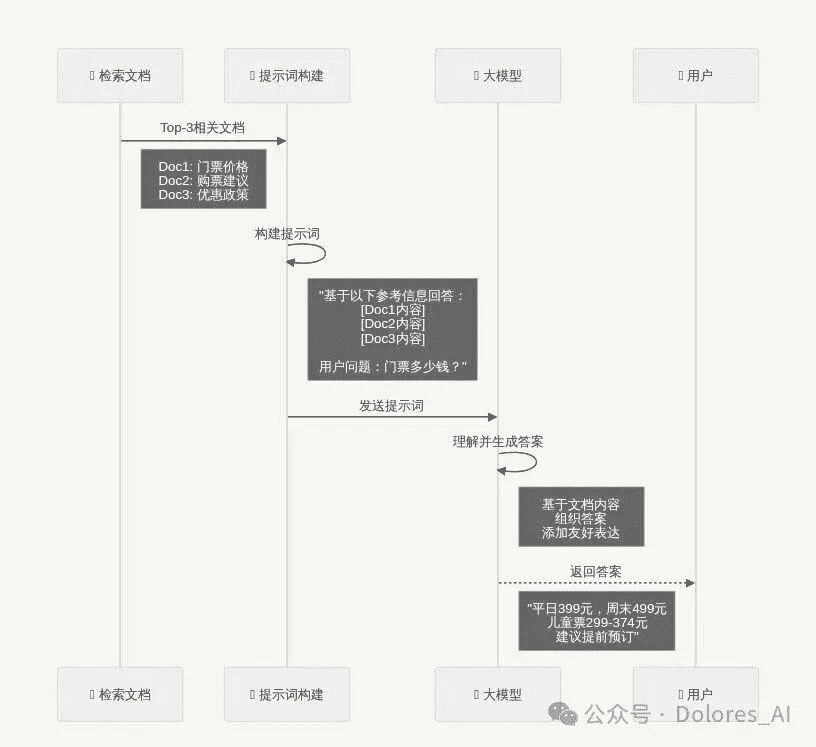

代码示例：

```
from langchain.chains.question_answering import load_qa_chain
from langchain_community.llms import Tongyi
# 初始化大模型llm = Tongyi(
    model_name=&quot;deepseek-v3&quot;,
    dashscope_api_key=API_KEY
)
# 加载问答链
chain = load_qa_chain(llm, chain_type=&quot;stuff&quot;)
# chain_type=&quot;stuff&quot;: 把所有文档一起给模型处理
# 准备输入
input_data = {
&quot;input_documents&quot;: docs,  # 检索到的3个文档    
&quot;question&quot;: user_query    # 用户问题}
# 生成答案
response = chain.invoke(input_data)
answer = response[&quot;output_text&quot;]
print(answer)
```

# 第二章：ChatPDF入门实战

### 完整系统架构

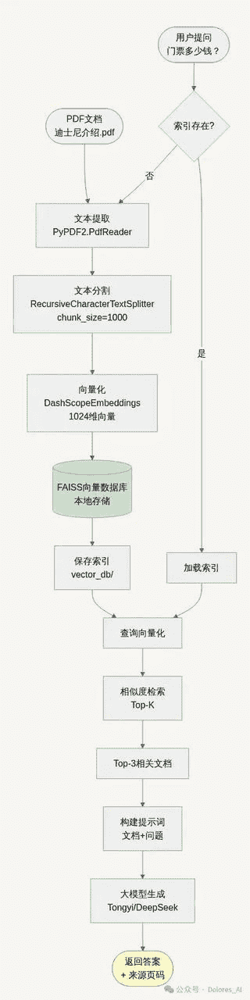

#### 代码实现（chatpdf_basic.py）

核心代码片段：

```
# ==========
# ChatPDF核心流程
# ==========
defmain():
&quot;&quot;&quot;主流程：从PDF到问答&quot;&quot;&quot;
# ===== 第1步：读取PDF =====    
    print(&quot;📖 第1步：读取PDF文件&quot;)
    pdf_reader = PdfReader(&quot;迪士尼介绍.pdf&quot;)
    print(f&quot;✅ PDF共 {len(pdf_reader.pages)} 页&quot;)

# ===== 第2步：提取文本和页码 =====    
    print(&quot;\n📝 第2步：提取文本内容&quot;)
    text, page_numbers = extract_text_with_page_numbers(pdf_reader)
    print(f&quot;✅ 提取 {len(text)} 个字符&quot;)

# ===== 第3步：处理文本（分割+向量化+存储）=====    
    print(&quot;\n🔨 第3步：建立向量索引&quot;)
    knowledgeBase = process_text_with_splitter(
        text,
        page_numbers,
        save_path=&quot;./vector_db&quot;    )

# ===== 第4步：初始化大模型 =====    
    print(&quot;\n🤖 第4步：初始化大语言模型&quot;)
    llm = Tongyi(
        model_name=&quot;deepseek-v3&quot;,
        dashscope_api_key=API_KEY
    )

# ===== 第5步：问答测试 =====    
    print(&quot;\n💬 第5步：测试问答功能&quot;)
    questions = [
&quot;迪士尼在哪里？&quot;,
&quot;门票多少钱？&quot;,
&quot;有哪些热门项目？&quot;    ]
for question in questions:
        answer, sources = ask_question(
            knowledgeBase,
            question,
            llm,
            k=3        )
```

# 第四章：Query改写技术

### 为什么Query改写是RAG的核心？

想象一下这个场景：游客问迪士尼客服"还有其他项目吗？"，这是一个再正常不过的问题。但传统的RAG系统却可能完全无法理解——"其他"指的是什么？"项目"又是什么项目？

**这就是Query改写技术要解决的核心问题：搭建用户自然**语言与知识库规范文本之间的"翻译桥梁"。

Query改写技术是高级RAG系统的"智能翻译官"，专门解决用户口语化、模糊的查询表达与知识库中规范化、陈述性文本之间的"语义鸿沟"。

**Q**uery改写的核**心工作，就是当用户说“黑**话”、说“半截话”、或者“话里有话”时，把这个“人话”（甚至“黑话”）翻译成知识库能听懂的“官话”（Prompt），大大提高检索的命中率。

现实中的理解困境在日常对话中，我们会说：

+       "那个项目刺激吗？"（指代不明）

+       "还有其他好玩的吗？"（缺少上下文）

+       "创极速光轮和矿山车哪个更好玩？"（对比模糊）

+       "门票多少钱？需要预约吗？停车方便吗？"（多意图混合）

而在知识库中，信息是这样组织的：

+       "创极速光轮：明日世界园区过山车，身高要求122cm，刺激程度五星"

+       "七个小矮人矿山车：梦幻世界园区家庭过山车，身高要求97cm，刺激程度三星"

**Query改写的核心工作，就是把用户的"人话"（甚至**"黑话"）翻译成知识库能听懂的"官话"。

对于企业级RAG系统来说，Query改写不是"锦上添花"，而是"雪中送炭"。它直接决定了系统能否理解真实用户的真实问题，是整个RAG流程的"第一道关卡"。

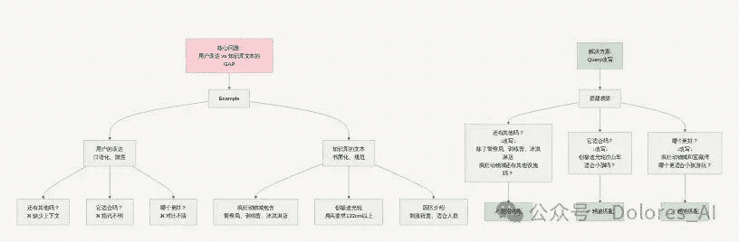

### 类型1：上下文依赖型 —— “阅读理解式翻译”

```
# ===================
# 上下文依赖型Query改写器
# ===================
classContextDependentQueryRewriter:
&quot;&quot;&quot;上下文依赖型Query改写器&quot;&quot;&quot;

def__init__(self, model=&quot;qwen-turbo-latest&quot;):
        self.model = model

defrewrite(self, current_query, conversation_history):
&quot;&quot;&quot;将依赖上下文的查询改写为独立完整的查询&quot;&quot;&quot;
        instruction = &quot;&quot;&quot;
        你是一个智能的查询优化助手。
        【任务】:分析用户的当前问题是否依赖于对话历史，如果依赖则补全信息。
        【识别标志】:
        - &quot;还有&quot;、&quot;其他&quot;、&quot;更多&quot;需要知道相对于什么
        - &quot;也&quot;、&quot;另外&quot;需要补充主体信息
        - 问题很短但需要上下文才能理解
        【改写步骤】:
        1. 从对话历史中提取：主题、对象、地点、已提到的内容
        2. 将这些信息补充到当前问题中
        3. 确保改写后的问题完全独立，不需要任何上下文即可理解
        &quot;&quot;&quot;
        prompt = f&quot;&quot;&quot;
        ## 指令 ##
{instruction}

        ## 对话历史 ##
{conversation_history}

        ## 当前问题 ##
{current_query}

        ## 改写后的问题 ##
        &quot;&quot;&quot;
        response = get_completion(prompt, self.model)
return response.strip()
```

**测试效果对比**

```
# 测试代码rewriter = ContextDependentQueryRewriter()
test_cases = [
    {
        &quot;history&quot;: &quot;&quot;&quot;用户: &quot;疯狂动物城有什么好玩的？&quot;AI: &quot;有警察局互动、训练营、冰淇淋店&quot;&quot;&quot;&quot;,
        &quot;query&quot;: &quot;还有其他设施吗？&quot;    },
    {
        &quot;history&quot;: &quot;&quot;&quot;用户: &quot;门票多少钱？&quot;AI: &quot;平日399元，周末499元&quot;&quot;&quot;&quot;,
        &quot;query&quot;: &quot;儿童票呢？&quot;    }
]
for test in test_cases:
    print(f&quot;原始: {test[&#x27;query&#x27;]}&quot;)
    rewritten = rewriter.rewrite(test[&#x27;query&#x27;], test[&#x27;history&#x27;])
    print(f&quot;改写: {rewritten}&quot;)
    print(f&quot;效果: ✅ 补全了上下文，变成独立完整的问题\n&quot;)
# 输出：# 原始: 还有其他设施吗？# 改写: 除了警察局互动体验、朱迪警官训练营和尼克狐的冰淇淋店，疯狂动物城园区还有其他设施吗？# 效果: ✅ 补全了上下文，变成独立完整的问题# 原始: 儿童票呢？# 改写: 上海迪士尼乐园的儿童票价格是多少？# 效果: ✅ 补全了上下文，变成独立完整的问题
```

### 类型2：对比型Query改写（业务场景常见）

对比型Query的改写策略 —— “破译谜语式翻译”

```
# ==========
# 对比型Query改写器
# =========
classComparisonQueryRewriter:
&quot;&quot;&quot;  对比型Query改写器  核心功能:  1. 识别对比词（&quot;哪个&quot;、&quot;更&quot;、&quot;比较&quot;） 2. 明确对比对象（从Query或历史中提取） 3. 细化对比维度（补充具体的评估标准）&quot;&quot;&quot;

def__init__(self, model=&quot;qwen-turbo-latest&quot;):
        self.model = model

defrewrite(self, query, context_info=&quot;&quot;):
&quot;&quot;&quot;  改写对比型Query    改写逻辑: 1. 保留对比对象（如果明确） 2. 补充对比对象（如果在上下文中） 3. 细化对比维度（添加具体评估标准）  4. 添加场景信息（地点、用途等）   参数:            query: 原始查询   context_info: 上下文信息     返回:     改写后的对比性查询   &quot;&quot;&quot;
    instruction = &quot;&quot;&quot;你是一个查询分析专家，专门处理对比型问题。【任务】:分析用户的对比型问题，明确对比对象和对比维度。【识别标志】:- 对比词: &quot;哪个&quot;、&quot;更&quot;、&quot;比较&quot;、&quot;还是&quot;、&quot;vs&quot;- 对比结构: &quot;A和B哪个...&quot;、&quot;A比B...&quot;、&quot;选A还是B&quot;【改写步骤】:步骤1 - 明确对比对象:  • 如果Query中已有对比对象 → 保留  • 如果对比对象在上下文中 → 提取并补充  • 如果对比对象不明确 → 保持原样或标注需要补充步骤2 - 细化对比维度:  • &quot;适合小孩&quot; → 刺激程度、身高限制、互动性、安全性  • &quot;好玩&quot; → 项目丰富度、体验时长、独特性、用户评价  • &quot;方便&quot; → 交通便利、时间成本、经济成本  • &quot;值得&quot; → 性价比、体验质量、独特性步骤3 - 补充完整信息:  • 添加地点: &quot;上海迪士尼乐园的...&quot;  • 添加用途: &quot;带小孩游玩&quot;、&quot;快速到达&quot;等  • 添加场景: 具体的使用情境【示例1】:原始: &quot;疯狂动物城和宝藏湾哪个更适合小孩？&quot;上下文: &quot;用户计划带5岁孩子游玩&quot;改写: &quot;比较上海迪士尼乐园的疯狂动物城园区和宝藏湾园区，哪个更适合带5岁小孩游玩？   请从以下方面对比分析：    1. 游乐项目的刺激程度（是否有过山车等刺激项目）  2. 身高和年龄限制（孩子是否能玩所有项目）   3. 互动性和趣味性（是否有适合儿童的互动体验）    4. 安全性和家长陪同（是否需要成人陪同）&quot;【示例2】:原始: &quot;地铁和打车哪个更方便？&quot;上下文: &quot;用户从浦东机场去迪士尼&quot;改写: &quot;从浦东机场到上海迪士尼乐园，乘坐地铁和打车哪个更方便？    请从以下方面对比：  1. 交通便利性（是否需要换乘、是否有直达）    2. 时间成本（预计所需时间、是否会堵车）   3. 经济成本（票价/车费对比）   4. 舒适度（是否拥挤、是否方便携带行李）&quot;&quot;&quot;&quot;        
    prompt = f&quot;&quot;&quot;### 指令 ###
    {instruction}

### 上下文信息 ###
    {context_info}

### 原始查询 ###
    {query}

### 改写后的查询 ###&quot;&quot;&quot;        
    response = get_completion(prompt, self.model)
return response.strip()
```

**对比型改写的3个层次**

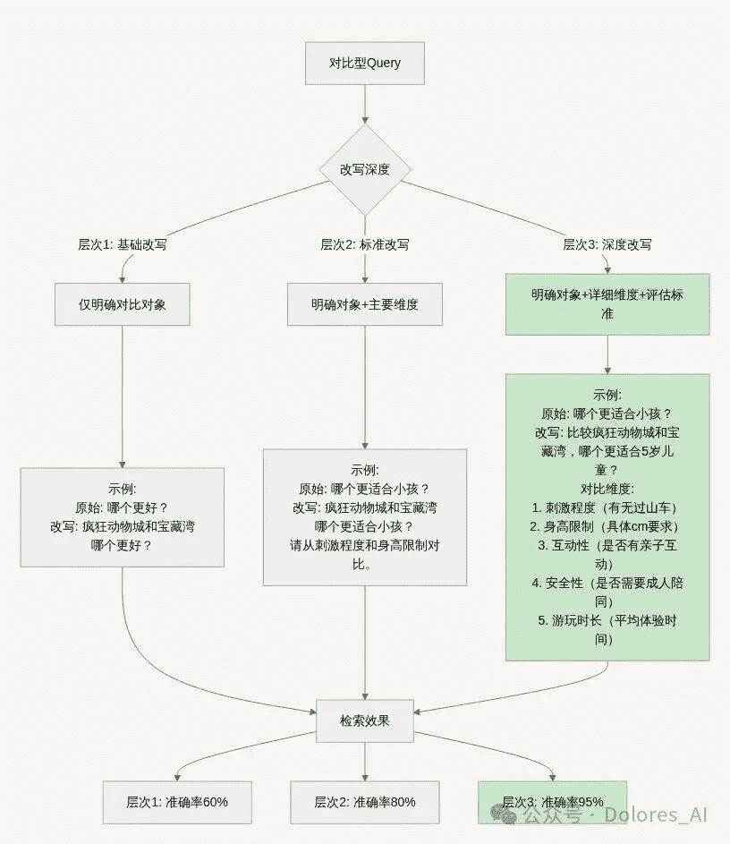

**测试效果对比**

```
# ========
# 对比型Query改写测试
# ========
rewriter = ComparisonQueryRewriter()
# 测试案例1: 园区对比
test_case_1 = {
&quot;query&quot;: &quot;疯狂动物城和宝藏湾哪个更适合小孩？&quot;,
&quot;context&quot;: &quot;用户带5岁孩子，第一次来迪士尼&quot;}
result_1 = rewriter.rewrite(test_case_1[&#x27;query&#x27;], test_case_1[&#x27;context&#x27;])
print(&quot;原始Query:&quot;, test_case_1[&#x27;query&#x27;])
print(&quot;\n改写后:&quot;)
print(result_1)
print(&quot;\n改进点:&quot;)
print(&quot;✅ 补充了年龄信息（5岁）&quot;)
print(&quot;✅ 细化了4个对比维度&quot;)
print(&quot;✅ 添加了具体的评估标准&quot;)
# 输出示例:&quot;&quot;&quot;原始Query: 疯狂动物城和宝藏湾哪个更适合小孩？改写后:比较上海迪士尼乐园的疯狂动物城园区和宝藏湾园区，哪个更适合带5岁小孩游玩？请从以下方面进行详细对比：【刺激程度对比】:- 疯狂动物城: 是否有刺激的过山车类项目？- 宝藏湾: 海盗船等项目的刺激程度如何？【身高年龄限制】:- 疯狂动物城: 各项目的具体身高要求- 宝藏湾: 加勒比海盗等项目的身高限制【互动性与趣味性】:- 疯狂动物城: 是否有适合儿童的互动体验？- 宝藏湾: 互动项目的类型和难度【综合建议】:考虑5岁儿童的年龄特点，给出最适合的推荐。改进点:✅ 补充了年龄信息（5岁）✅ 细化了4个对比维度✅ 添加了具体的评估标准✅ 要求给出综合建议&quot;&quot;&quot;# 测试案例2: 项目对比test_case_2 = {
&quot;query&quot;: &quot;创极速光轮和七个小矮人矿山车哪个更刺激？&quot;,
&quot;context&quot;: &quot;用户想体验刺激的过山车&quot;}
result_2 = rewriter.rewrite(test_case_2[&#x27;query&#x27;], test_case_2[&#x27;context&#x27;])
# 输出:&quot;&quot;&quot;改写后:比较上海迪士尼乐园的创极速光轮和七个小矮人矿山车这两个过山车项目，哪个更刺激？请从以下维度对比：1. 速度对比: 最高时速分别是多少？2. 高度对比: 轨道最高点和落差距离3. 失重感: 是否有垂直下降的失重体验？4. 旋转程度: 是否有翻转、螺旋等动作？5. 综合刺激度: 整体刺激程度排名目标: 为喜欢刺激体验的游客推荐最合适的项目。&quot;&quot;&quot;
```

### 类型3：模糊指代型Query改写（多轮对话必需）

指代消歧的3种策略—— “列清单式翻译

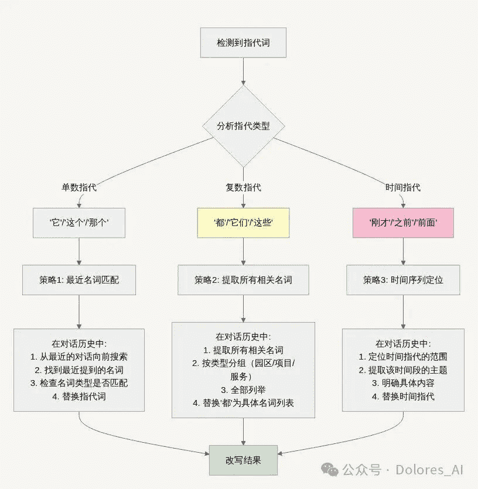

**完整实现代码（带详细注释）**

```
# ===========
# 模糊指代型Query改写器
# ============
classReferenceQueryRewriter:
&quot;&quot;&quot; 模糊指代型Query改写器  解决的核心问题: - &quot;它&quot;指代什么？  - &quot;都&quot;包括哪些？   - &quot;这个&quot;具体是什么？   技术难点:  1. 指代词识别（NLP任务）  2. 指代对象定位（需要理解上下文）    3. 多义性消解（可能有多个候选对象）  &quot;&quot;&quot;

def__init__(self, model=&quot;qwen-turbo-latest&quot;):
        self.model = model

defrewrite(self, current_query, conversation_history):
&quot;&quot;&quot;  消除模糊指代，生成明确的Query  工作流程:  1. 识别Query中的所有指代词  2. 在对话历史中定位指代对象  3. 用明确的名词替换指代词  4. 验证改写后的Query语义完整   参数:   current_query: 当前查询（包含指代词）  conversation_history: 对话历史        返回:            消歧后的明确查询  &quot;&quot;&quot;

    instruction = &quot;&quot;&quot;你
    是一个语言歧义消除专家，专门处理指代词问题。
    【常见指代词分类】:1. 单数指代（指代单个对象）:   
     1.&quot;它&quot;、&quot;他&quot;、&quot;她&quot; → 具体的人或物
     2. &quot;这个&quot;、&quot;那个&quot; → 前文提到的事物 &quot;该&quot; → 正在讨论的对象2. 复数指代（指代多个对象）:   • &quot;都&quot;、&quot;全部&quot;、&quot;所有&quot; → 前文提到的多个对象   • &quot;它们&quot;、&quot;他们&quot;、&quot;这些&quot;、&quot;那些&quot; → 一组对象
     3. 时间指代（指代前文内容）: &quot;刚才&quot;、&quot;之前&quot;、&quot;前面说的&quot; → 前文的话题或对象
     【消歧步骤】:
     步骤1 - 识别指代词:扫描Query，标注所有指代词及其位置
     步骤2 - 定位指代对象 • 对于单数指代: 找最近提到的同类名词• 对于复数指代: 找所有相关的名词并列举• 对于时间指代: 定位到具体的对话内容
     步骤3 - 验证指代关系 • 检查名词类型是否匹配（项目/园区/服务等）• 检查语义是否合理• 处理多义性（如果有多个候选对象，选择最可能的）
     步骤4 - 执行替换 • 用明确的名词替换指代词• 保持句子的流畅性• 确保语义完整无歧义【示例1 - 单数指代】:对话历史:  用户: &quot;创极速光轮是什么项目？&quot;  AI: &quot;创极速光轮是明日世界主题园区的过山车项目，是全球最快的迪士尼过山车。&quot;当前Query: &quot;它有身高要求吗？&quot;分析:  • 指代词: &quot;它&quot;  • 指代对象: &quot;创极速光轮&quot;（最近提到的项目名词）  • 验证: ✅ 类型匹配（都是游乐项目）改写: &quot;创极速光轮过山车项目有身高要求吗？&quot;【示例2 - 复杂指代】:对话历史:  用户: &quot;我看到有个海盗船的项目&quot;  AI: &quot;您说的应该是宝藏湾的&#x27;加勒比海盗：战争之潮&#x27;，这是全球首个海盗主题迪士尼项目。&quot;  用户: &quot;这个项目好玩吗？&quot;  AI: &quot;非常好玩！采用了先进的机器人和投影技术。&quot;当前Query: &quot;那个适合小朋友吗？&quot;分析:  • 指代词: &quot;那个&quot;  • 需要追溯: 对话已经进行了3轮  • 指代对象: &quot;加勒比海盗：战争之潮&quot;（初始提到的项目）改写: &quot;宝藏湾的加勒比海盗：战争之潮项目适合小朋友吗？&quot;&quot;&quot;
     prompt = f&quot;&quot;&quot;
     ### 指令 ###
{instruction}

     ### 对话历史 ###
{conversation_history}

     ### 当前查询（包含指代词）###
{current_query}

     ### 消歧后的查询 ###&quot;&quot;&quot;
     response = get_completion(prompt, self.model)
return response.strip()
```

**实战测试与效果分析**

```
# =========
# 完整测试：指代消歧效果对比
# ===  ========
deftest_reference_disambiguation():
&quot;&quot;&quot;测试指代消歧的效果&quot;&quot;&quot;
    print(&quot;=&quot;*80)
    print(&quot;🎯 模糊指代型Query改写 - 效果对比测试&quot;)
    print(&quot;=&quot;*80)
    rewriter = ReferenceQueryRewriter()
# 准备测试用例    
    test_cases = [
        {
&quot;name&quot;: &quot;&#x27;都&#x27;的指代（最常见）&quot;,
&quot;history&quot;: &quot;&quot;&quot;用户: &quot;疯狂动物城和宝藏湾有什么好玩的？&quot;AI: &quot;疯狂动物城有警察局互动、训练营；宝藏湾有加勒比海盗、独木舟。&quot;&quot;&quot;&quot;,
            &quot;query&quot;: &quot;都有身高限制吗？&quot;,
            &quot;expected&quot;: &quot;两个园区的游乐项目&quot;,
            &quot;difficulty&quot;: &quot;⭐⭐⭐&quot;        },
        {
            &quot;name&quot;: &quot;&#x27;它&#x27;的指代（次常见）&quot;,
            &quot;history&quot;: &quot;&quot;&quot;用户: &quot;创极速光轮是什么项目？&quot;AI: &quot;创极速光轮是明日世界的摩托过山车，全球最快！&quot;&quot;&quot;&quot;,
            &quot;query&quot;: &quot;它有身高要求吗？&quot;,
            &quot;expected&quot;: &quot;创极速光轮&quot;,
            &quot;difficulty&quot;: &quot;⭐⭐&quot;        },
        {
            &quot;name&quot;: &quot;&#x27;那个&#x27;的远距离指代（较难）&quot;,
            &quot;history&quot;: &quot;&quot;&quot;用户: &quot;我看到有个海盗船项目&quot;AI: &quot;是宝藏湾的加勒比海盗：战争之潮。&quot;用户: &quot;这个项目好玩吗？&quot;AI: &quot;非常好玩，采用了先进技术。&quot;&quot;&quot;&quot;,
            &quot;query&quot;: &quot;那个适合小朋友吗？&quot;,
            &quot;expected&quot;: &quot;加勒比海盗项目（需要追溯到第1轮）&quot;,
            &quot;difficulty&quot;: &quot;⭐⭐⭐⭐&quot;        }
    ]
    # 执行测试    
    for i, test in enumerate(test_cases, 1):
        print(f&quot;\n{&#x27;=&#x27;*80}&quot;)
        print(f&quot;📝 测试案例 {i}: {test[&#x27;name&#x27;]} (难度: {test[&#x27;difficulty&#x27;]})&quot;)
        print(f&quot;{&#x27;=&#x27;*80}&quot;)
        print(f&quot;\n📖 对话历史:&quot;)
        print(test[&#x27;history&#x27;])
        print(f&quot;\n❓ 用户Query: {test[&#x27;query&#x27;]}&quot;)
        print(f&quot;   🎯 期待识别: {test[&#x27;expected&#x27;]}&quot;)
        # 执行改写        result = rewriter.rewrite(test[&#x27;query&#x27;], test[&#x27;history&#x27;])
        print(f&quot;\n✅ 改写结果:&quot;)
        print(f&quot;   {result}&quot;)
        # 效果分析        if test[&#x27;expected&#x27;].split(&#x27;（&#x27;)[0] in result:
            print(f&quot;\n✨ 效果评估: ✅ 成功识别指代对象&quot;)
        else:
            print(f&quot;\n⚠️ 效果评估: 需要人工复核&quot;)
        if i &lt; len(test_cases):
            input(&quot;\n按回车继续下一个测试...&quot;)
    print(f&quot;\n{&#x27;=&#x27;*80}&quot;)
    print(&quot;✨ 所有测试完成&quot;)
    print(f&quot;{&#x27;=&#x27;*80}\n&quot;)
```

### 类型4：多意图型Query改写（效率优化关键）

多意图识别的3种模式 —— “分诊台式翻译”

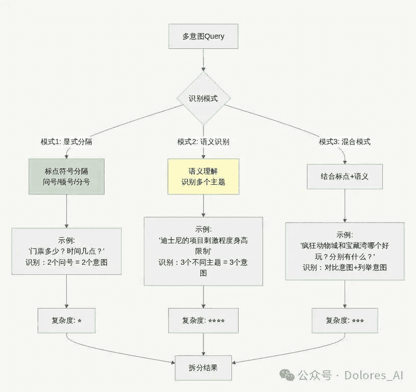

**改写优先级**

多意图型 > 模糊指代型 > 对比型 > 上下文依赖型 > 反问型

AutoQueryRewriter 核心代码

```
# ========
# AutoQueryRewriter: 统一Query改写引擎
# ========
import json
from typing import Dict, Any, List
classAutoQueryRewriter:
&quot;&quot;&quot;统一的Query改写调度器&quot;&quot;&quot;

    PRIORITY = [
&quot;multi_intent&quot;,  # 多意图型（必须先拆分）
&quot;reference&quot;,  # 模糊指代型（让语义清晰）
&quot;comparison&quot;,  # 对比型（补充对比维度）
&quot;context_dependent&quot;,  # 上下文依赖型（补全信息）
&quot;rhetorical&quot;# 反问型（最后处理情绪）     
        ]

def__init__(self, llm_model: str = &quot;qwen-turbo-latest&quot;):
        self.llm_model = llm_model

        self.context_rewriter = context_rewriter or ContextDependentQueryRewriter(llm_model)
        self.comparison_rewriter = comparison_rewriter or ComparisonQueryRewriter(llm_model)
        self.reference_rewriter = reference_rewriter or ReferenceQueryRewriter(llm_model)
        self.multi_intent_rewriter = multi_intent_rewriter or MultiIntentQueryRewriter(llm_model)
        self.rhetorical_rewriter = rhetorical_rewriter or RhetoricalQueryRewriter(llm_model)

# ---------------    
# Step1: 类型识别    
# ------------- 
defanalyze_query_type(self, query: str, conversation_history: str = &quot;&quot;) -&gt; Dict[str, Any]:
&quot;&quot;&quot; 调用LLM识别Query类型，支持多标签   &quot;&quot;&quot;
        instruction = &quot;&quot;&quot;你是一个RAG系统的Query类型识别器，请判断当前Query是否属于以下类型:1. multi_intent: 多意图2. reference: 模糊指代3. comparison: 对比型4. context_dependent: 上下文依赖5. rhetorical: 反问型请输出JSON，字段包括 query_type, confidence, detected_keywords, reasoning。&quot;&quot;&quot;
        prompt = f&quot;&quot;&quot;
        ### 指令 ###{instruction}
        ### 对话历史 ###{conversation_history}
        ### 当前Query ###{query}
        ### 输出JSON ###
        &quot;&quot;&quot;
        response = get_completion(prompt, self.llm_model)
return json.loads(preprocess_json_response(response))
# -------------    
# Step2: 调度改写器    
# ------------- 
defrewrite(self, query: str, conversation_history: str = &quot;&quot;) -&gt; Dict[str, Any]:
        analysis = self.analyze_query_type(query, conversation_history)
        query_types = analysis.get(&quot;query_type&quot;, [])
ifnot query_types:
return {
&quot;final_query&quot;: query,
&quot;query_types&quot;: [],
&quot;sub_queries&quot;: [],
&quot;emotion&quot;: {
&quot;emotion&quot;: &quot;neutral&quot;,
&quot;emotion_intensity&quot;: &quot;none&quot;,
&quot;empathy_keywords&quot;: []
                },
&quot;rewrite_steps&quot;: [],
&quot;analysis&quot;: analysis
            }
# 先处理多意图  
if&quot;multi_intent&quot;in query_types:
            multi_result = self.multi_intent_rewriter.rewrite(query, conversation_history)
if multi_result[&quot;intent_count&quot;] &gt; 1:
                final_sub_queries = []
for item in multi_result[&quot;sub_queries&quot;]:
                    processed = self._process_single_query(
                        query=item[&quot;query&quot;],
                        conversation_history=conversation_history,
                        query_types=[qt for qt in query_types if qt != &quot;multi_intent&quot;]
                    )
                    processed.update({
&quot;priority&quot;: item.get(&quot;priority&quot;, &quot;medium&quot;),
&quot;topic&quot;: item.get(&quot;topic&quot;, &quot;general&quot;)
                    })
                    final_sub_queries.append(processed)
return {
&quot;final_query&quot;: query,
&quot;query_types&quot;: query_types,
&quot;sub_queries&quot;: final_sub_queries,
&quot;emotion&quot;: {
&quot;emotion&quot;: &quot;neutral&quot;,
&quot;emotion_intensity&quot;: &quot;none&quot;,
&quot;empathy_keywords&quot;: []
                    },
&quot;rewrite_steps&quot;: [{&quot;type&quot;: &quot;multi_intent&quot;, &quot;result&quot;: multi_result}],
&quot;analysis&quot;: analysis
                }
# 单Query改写流程        
        result = self._process_single_query(
            query=query,
            conversation_history=conversation_history,
            query_types=query_types
        )
        result.update({
&quot;query_types&quot;: query_types,
&quot;sub_queries&quot;: [],
&quot;analysis&quot;: analysis
        })
return result
# ---------- 
# Step3: 针对单个Query按优先级改写 
# -------  
def_process_single_query(self, query: str, conversation_history: str, query_types: List[str]):
        current_query = query
        rewrite_steps = []
        emotion_info = {
&quot;emotion&quot;: &quot;neutral&quot;,
&quot;emotion_intensity&quot;: &quot;none&quot;,
&quot;empathy_keywords&quot;: []
        }
for query_type in self.PRIORITY[1:]:  
# 多意图已在外层处理 
if query_type notin query_types:
continueif query_type == &quot;reference&quot;:
                rewritten = self.reference_rewriter.rewrite(current_query, conversation_history)
                rewrite_steps.append({&quot;type&quot;: &quot;reference&quot;, &quot;rewrite&quot;: rewritten})
                current_query = rewritten
elif query_type == &quot;comparison&quot;:
                rewritten = self.comparison_rewriter.rewrite(current_query, conversation_history)
                rewrite_steps.append({&quot;type&quot;: &quot;comparison&quot;, &quot;rewrite&quot;: rewritten})
                current_query = rewritten
elif query_type == &quot;context_dependent&quot;:
                rewritten = self.context_rewriter.rewrite(current_query, conversation_history)
                rewrite_steps.append({&quot;type&quot;: &quot;context&quot;, &quot;rewrite&quot;: rewritten})
                current_query = rewritten
elif query_type == &quot;rhetorical&quot;:
                result = self.rhetorical_rewriter.rewrite(current_query, conversation_history)
                rewrite_steps.append({&quot;type&quot;: &quot;rhetorical&quot;, &quot;rewrite&quot;: result})
                current_query = result[&quot;rewritten_query&quot;]
                emotion_info = {
&quot;emotion&quot;: result[&quot;emotion&quot;],
&quot;emotion_intensity&quot;: result[&quot;emotion_intensity&quot;],
&quot;empathy_keywords&quot;: result[&quot;empathy_keywords&quot;]
                }
return {
&quot;final_query&quot;: current_query,
&quot;emotion&quot;: emotion_info,
&quot;rewrite_steps&quot;: rewrite_steps
        }
```

调试辅助：打印改写链路

```
defprint_rewrite_log(result: Dict[str, Any]):
    print(&quot;=&quot;*80)
    print(&quot;🛠️ Query改写流水线&quot;)
    print(&quot;=&quot;*80)
    print(f&quot;识别类型: {&#x27;, &#x27;.join(result.get(&#x27;query_types&#x27;, []))}&quot;)
    print(f&quot;情绪标签: {result[&#x27;emotion&#x27;][&#x27;emotion&#x27;]} ({result[&#x27;emotion&#x27;][&#x27;emotion_intensity&#x27;]})&quot;)
for step in result.get(&quot;rewrite_steps&quot;, []):
        print(&quot;-&quot;*80)
        print(f&quot;步骤: {step[&#x27;type&#x27;]}&quot;)
        print(f&quot;结果: {step[&#x27;rewrite&#x27;]}&quot;)
if result.get(&quot;sub_queries&quot;):
        print(&quot;\n📋 子Query列表:&quot;)
for idx, sub in enumerate(result[&#x27;sub_queries&#x27;], 1):
            print(f&quot;  [{idx}] ({sub[&#x27;priority&#x27;]}) {sub[&#x27;final_query&#x27;]}&quot;)
            print(f&quot;      情绪: {sub[&#x27;emotion&#x27;][&#x27;emotion&#x27;]}&quot;)
    print(&quot;=&quot;*80)
```

# 第五章：Query联网搜索（实时信息融合）

### 为什么需要联网搜索？

虽然知识库能够覆盖大部分静态信息，但迪士尼智能客服还必须回答实时问题，例如” 现在排队多久”“今晚有烟花吗”“今天会下雨吗”。这些信息在知识库中无法及时更新，因此需要合理判断何时联网，并将联网结果与知识库信息融合。

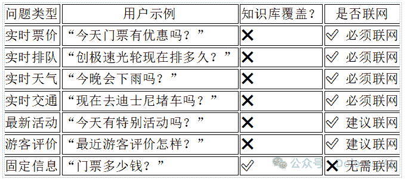

**这个模块的工**作流通常包含三个核心环节。首先是联网识别逻辑。系统并非对所有查询都执行联网，而是通过一个由LLM驱动的“联网判断器”来进行决策。这个判断器会分析用户的查询是否包含了“今天”、“现在”、“实时”、“最新”、“票价变动”或“天气”等具有明显时效性特征的关键词。同时，它也会评估本地知识库对该查询的覆盖度和置信度。只有当查询明确需要实时信息，或者本地知识库无法提供高置信度答案时，系统才会触发联网搜索。

其次是**搜索策略生成**。一旦决定联网，系统会利用LLM作为搜索策略专家，为原始查询制定详细的搜索计划。这包括将用户的口语化问题改写为更适合搜索引擎的精炼关键词组合，例如将“今天去迪士尼人多吗？”改写为“上海迪士尼 实时人流量 2025年11月16日”。此外，LLM还会根据问题类型推荐最佳的数据来源，例如对于官方活动，优先搜索官方网站或官方社交媒体账号，对于用户评价，则优先搜索旅游平台或点评类网站。

最后是**联网执行与结果融合**。系**统根**据生成的搜索策略，调用外部的搜索API（如Tavily或Google Search）来获取最新的网络信息片段。这一步至关重要：系统必须将联网获取的实时信息与本地知识库检索到的静态信息进行融合。融合过程中可能涉及去重、事实交叉验证和冲突消解（例如，本地知识库的票价是399元，而联网搜索的最新公告是499元）。LLM会基于这个融合了多方信源的、最全面的上下文来生成最终答案，并清晰地标注出实时信息的时间戳和来源，从而保证了答案的权威性与时效性。

### 联网策略总览

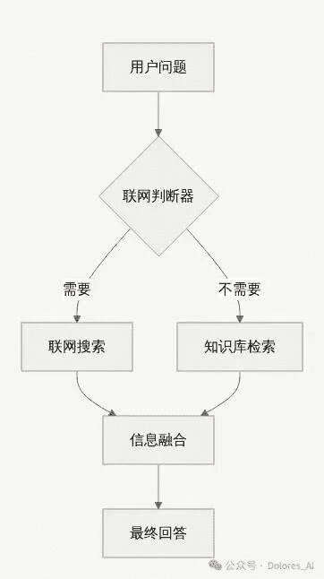

### 联网判断器实现

```
classWebSearchDetector:
    &quot;&quot;&quot;联网判断器&quot;&quot;&quot;
def__init__(self, model=&quot;qwen-turbo-latest&quot;):
        self.model = model

defanalyze(self, query: str, context: str = &quot;&quot;) -&gt; Dict[str, Any]:
&quot;&quot;&quot;判断用户问题是否需要联网&quot;&quot;&quot;
        instruction = &quot;&quot;&quot;
        你是一个智能联网策略分析器，请判断用户问题是否需要联网。
        【必须联网的场景包括】
        - 实时信息：今天、现在、当前、实时、最新
        - 动态状态：排队、天气、交通、
        - 时效内容：活动、优惠、公告、新闻。
        如果需要联网，请生成搜索语句和推荐数据源。输出JSON: need_web_search, scene, confidence, reason, search_queries, data_sources。&quot;&quot;&quot;
        prompt = f&quot;&quot;&quot;
        ### 指令 ###{instruction}
        ### 对话历史 ###{context}
        ### 用户Query ###{query}
        ### 输出JSON ###
        &quot;&quot;&quot;
        response = get_completion(prompt, self.model)
return json.loads(preprocess_json_response(response))
```

### 联网执行与结果融合

```
classWebSearchExecutor:
    def__init__(self, search_api):
        self.search_api = search_api
defexecute(self, strategy: Dict[str, Any]) -&gt; Dict[str, Any]:
        all_results = []
for sq in strategy[&quot;search_queries&quot;]:
            raw = self.search_api.search(sq)
            clean = self._clean(raw)
            normalized = self._normalize(clean)
            all_results.extend(normalized)
ifnot all_results:
return {
&quot;status&quot;: &quot;fallback&quot;,
&quot;message&quot;: &quot;暂未获取到实时数据&quot;            }
        top_results = sorted(all_results, key=lambda x: -x[&quot;confidence&quot;])[:3]
        prompt = f&quot;&quot;&quot;请根据以下实时数据生成摘要:场景: {strategy[&#x27;scene&#x27;]}数据: {json.dumps(top_results, ensure_ascii=False, indent=2)}输出JSON: summary, sources, advice。&quot;&quot;&quot;        summary = get_completion(prompt, model=&quot;deepseek-v3&quot;)
return json.loads(preprocess_json_response(summary))
def_clean(self, raw_results):
return [item for item in raw_results if&quot;广告&quot;notin item.get(&quot;title&quot;, &quot;&quot;)]
def_normalize(self, results):
        normalized = []
for item in results:
            normalized.append({
&quot;title&quot;: item.get(&quot;title&quot;),
&quot;summary&quot;: item.get(&quot;snippet&quot;),
&quot;source&quot;: item.get(&quot;source&quot;),
&quot;url&quot;: item.get(&quot;url&quot;),
&quot;published_time&quot;: item.get(&quot;time&quot;),
&quot;confidence&quot;: self._estimate_confidence(item)
            })
return normalized
def_estimate_confidence(self, item):
        weight = {
&quot;official&quot;: 0.95,
&quot;news&quot;: 0.85,
&quot;social&quot;: 0.65        }
return weight.get(item.get(&quot;source_type&quot;, &quot;social&quot;), 0.6)
```

```
defmerge_kb_web(kb_docs, web_result):
    merged = []
if kb_docs:
        merged.append({
&quot;type&quot;: &quot;knowledge_base&quot;,
&quot;content&quot;: kb_docs,
&quot;description&quot;: &quot;知识库基础事实&quot;        })
if web_result and web_result.get(&quot;status&quot;) != &quot;fallback&quot;:
        merged.append({
&quot;type&quot;: &quot;web_search&quot;,
&quot;content&quot;: web_result,
&quot;description&quot;: &quot;实时数据（含来源与时间）&quot;        })
return merged
```

### 完整联网搜索流程

**端到端的工作流**

```
defcomplete_web_search_pipeline(user_query, conversation_history, knowledge_base):
    &quot;&quot;&quot;完整的联网搜索流程&quot;&quot;&quot;

# 1. 判断是否需要联网
    detector = WebSearchDetector()
    web_decision = detector.analyze(user_query, conversation_history)

ifnot web_decision[&quot;need_web_search&quot;]:
return {
&quot;action&quot;: &quot;local_only&quot;,
&quot;reason&quot;: web_decision[&quot;reason&quot;],
&quot;context&quot;: knowledge_base.retrieve(user_query)
        }

# 2. 生成搜索策略
    strategy_generator = SearchStrategyGenerator()
    search_strategy = strategy_generator.generate_strategy(user_query, conversation_history)

# 3. 执行联网搜索
    search_executor = WebSearchExecutor(search_api=TavilySearchAPI())
    web_results = search_executor.execute_search(search_strategy)

# 4. 检索本地知识库
    kb_docs = knowledge_base.retrieve(user_query)

# 5. 融合信息
    fusion_engine = InformationFusion()
    fused_context = fusion_engine.fuse_knowledge(kb_docs, web_results, user_query)

return {
&quot;action&quot;: &quot;web_search&quot;,
&quot;web_strategy&quot;: search_strategy,
&quot;web_results&quot;: web_results,
&quot;fused_context&quot;: fused_context,
&quot;final_context&quot;: self._format_final_context(fused_context)
    }

def_format_final_context(self, fused_context):
&quot;&quot;&quot;格式化最终上下文供LLM使用&quot;&quot;&quot;
    context_parts = []

for ctx in fused_context:
if ctx[&quot;type&quot;] == &quot;knowledge_base&quot;:
            context_parts.append(f&quot;【基础知识】\n{ctx[&#x27;content&#x27;]}&quot;)
elif ctx[&quot;type&quot;] == &quot;web_search&quot;:
            context_parts.append(f&quot;【实时信息 - 更新于{ctx[&#x27;timestamp&#x27;]}】\n{ctx[&#x27;content&#x27;]}&quot;)

return&quot;\n\n&quot;.join(context_parts)
```

# 第六章：召回优化

### 为什么单一向量检索“偏科”？

入门篇中我们使用了纯向量检索（Embedding Similarity），虽然能捕捉语义相似性，但单一向量检索就像只会意会不会言传的朋友——它能理解"刺激好玩的项目"，但记不住"创极速光轮"这个具体名字。

检索（Retrieval）即召回，是RAG流程的生命线，召回内容的质量直接决定了最终生成答案的上限。在高级RAG系统中，召回优化是一个多阶段、多策略协同的过程，远比单一的向量检索复杂。

基础的向量检索虽然擅长捕捉语义的相似性，例如能理解“适合小孩的项目”与“家庭友好型游乐设施”是相近的，但它在处理精确匹配时存在天然缺陷。例如，它对“122cm身高限制”这样的具体数字或“创极速光轮”这样的专有名词不敏感，容易导致召回遗漏

**为了**克服这一缺陷，高级RAG系统普遍采用混合检索（Hybrid Retrieval）策略。混合检索的核心思想是取长补短，它将两种截然不同的检索技术结合起来。一方面是传统的关键词检索（如BM25）。另一方面是向量语义检索，它利用嵌入模型的强大能力捕捉深层语义，确保了召回的相关性。系统会并行执行这两种检索，然后通过特定的算法（如Reciprocal Rank Fusion, RRF）或简单的加权求和，将两路召回的结果进行融合，生成一个既包含精确匹配又包含语义相关的候选文档列表。

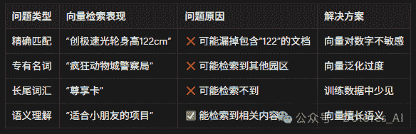

结论：需要结合关键词检索（BM25）和向量检索（Embedding），取长补短。

### BM25原理与实现

BM25（Best Matching 25）是经典的关键词检索算法，基于稀疏索引TF-IDF改进。BM 代表最佳匹配（Best Match）。BM 后面的数字 25 表示 BM 算法的迭代次数。该算法经过 25 次迭代后才被广泛采用和接受，尽管现在也有 BM25+ 和其他变体。BM25的核心思想是计算查询中每个词项与文档的相关性，然后综合所有词项得到最终分数。

BM25得分计算公式包含多个组件。IDF（逆文档频率）衡量词项的重要性，罕见词比常见词具有更高的区分度。TF（词项频率）表示词项在文档中出现的次数，出现越多相关性越高，但通过参数k1进行平滑处理，避免过度依赖单一词项。

长度归一化组件通过参数b调节文档长度的影响，防止长文档仅仅因为包含更多词项而获得不公平的优势。dl表示文档长度，avgdl是平均文档长度，b控制 长度归一化的强度，通常设为0.75。

实现BM25检索器需要先对文档集合进行预处理。中文文档需要使用分词工具如jieba进行分词，将文本转换为词项序列。然后基于分词后的文档构建BM25模型，计算每个词项的统计信息。

检索时，先对查询进行分词，然后计算查询与每个文档的BM25分数。分数计算涉及查询中每个词项在文档中的频率、词项的逆文档频率以及文档长度等因素。最后根据分数排序，返回Top-K相关文档。

BM25的优势在于对精确匹配和特定术语的敏感性，能够有效捕捉用户查询中的关键词信息。与向量检索结合使用，可以弥补向量模型在精确匹配方面的不足，提供更全面的检索覆盖。核心公式：

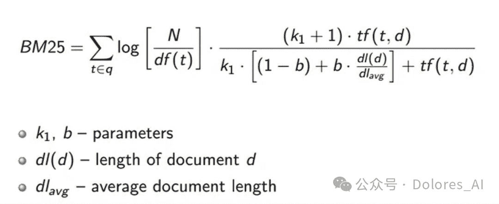

实现示例：

```
from rank_bm25 import BM25Okapi
import jieba
classBM25Retriever:
&quot;&quot;&quot;BM25关键词检索器&quot;&quot;&quot;

def__init__(self, documents):
          self.tokenized_docs = [list(jieba.cut(doc)) for doc in documents]
          self.bm25 = BM25Okapi(self.tokenized_docs)
&quot;&quot;&quot;   参数:     documents: 文档列表，每个文档是一个字符串        &quot;&quot;&quot;
# 中文分词   self.tokenized_docs = [list(jieba.cut(doc)) for doc in documents]
# 初始化BM25    self.bm25 = BM25Okapi(self.tokenized_docs)
# 保存原始文档     self.documents = documents

defsearch(self, query: str, top_k: int = 10):
&quot;&quot;&quot;精准关键词匹配&quot;&quot;&quot;
          tokenized_query = list(jieba.cut(query))
          scores = self.bm25.get_scores(tokenized_query)       
# 分词    tokenized_query = list(jieba.cut(query))
# 计算BM25分数      scores = self.bm25.get_scores(tokenized_query)
# 排序并返回Top-K     top_indices = sorted(range(len(scores)), key=lambda i: -scores[i])[:top_k]
        results = []
for idx in top_indices:
            results.append({
&quot;index&quot;: idx,
&quot;score&quot;: float(scores[idx]),
&quot;content&quot;: self.documents[idx]
            })
return results
```

测试示例：

```
# 迪士尼知识库文档docs = [
    &quot;创极速光轮是明日世界园区的过山车项目，身高要求122cm以上。&quot;,
&quot;疯狂动物城警察局是互动体验项目，适合5-12岁儿童。&quot;,
&quot;宝藏湾的加勒比海盗项目，身高要求97cm以上。&quot;,
&quot;七个小矮人矿山车是梦幻世界的过山车，身高要求97cm以上。&quot;]
bm25_retriever = BM25Retriever(docs)
# 测试1：精确数字匹配query1 = &quot;122cm身高要求&quot;results1 = bm25_retriever.search(query1, top_k=2)
print(&quot;Query:&quot;, query1)
for r in results1:
    print(f&quot;  分数: {r[&#x27;score&#x27;]:.2f} | {r[&#x27;content&#x27;]}&quot;)
# 输出：# Query: 122cm身高要求#   分数: 3.45 | 创极速光轮是明日世界园区的过山车项目，身高要求122cm以上。#   分数: 0.82 | 宝藏湾的加勒比海盗项目，身高要求97cm以上。# 测试2：专有名词匹配query2 = &quot;疯狂动物城警察局&quot;results2 = bm25_retriever.search(query2, top_k=2)
print(&quot;\nQuery:&quot;, query2)
for r in results2:
    print(f&quot;  分数: {r[&#x27;score&#x27;]:.2f} | {r[&#x27;content&#x27;]}&quot;)
# 输出：# Query: 疯狂动物城警察局#   分数: 8.12 | 疯狂动物城警察局是互动体验项目，适合5-12岁儿童。#   分数: 0.00 | 创极速光轮是明日世界园区的过山车项目，身高要求122cm以上。
```

### 混合检索架构

混合检索架构通过结合多种检索技术来解决单一方法的局限性。让向量检索和BM25组队，就像让文科生和理科生搭档——一个负责理解深层含义，一个负责记住具体细节。整个架构从用户查询开始，通过检索策略分析确定合适的检索方法。系统并行执行BM25关键词检索和向量语义检索，分别获取两种方法的前20个结果。

BM25检索充当文科生，基于传统的信息检索技术，擅长处理精确匹配、专有名词和长尾词汇。它计算查询词项与文档的统计相关性，对数字、特定术语等精确匹配效果很好。向量检索充当理科生，基于深度学习模型，擅长语义理解和概念匹配，能够找到语义相关但用词不同的文档。

结果合并环节将两种检索方法的结果进行融合。首先对BM25分数和向量相似度分数进行归一化处理，使它们处于可比较的范围内。然后根据预设的权重进行加权融合，生成每个文档的混合分数。权重的设置需要根据具体场景调整，通常向量权重略高于BM25权重。

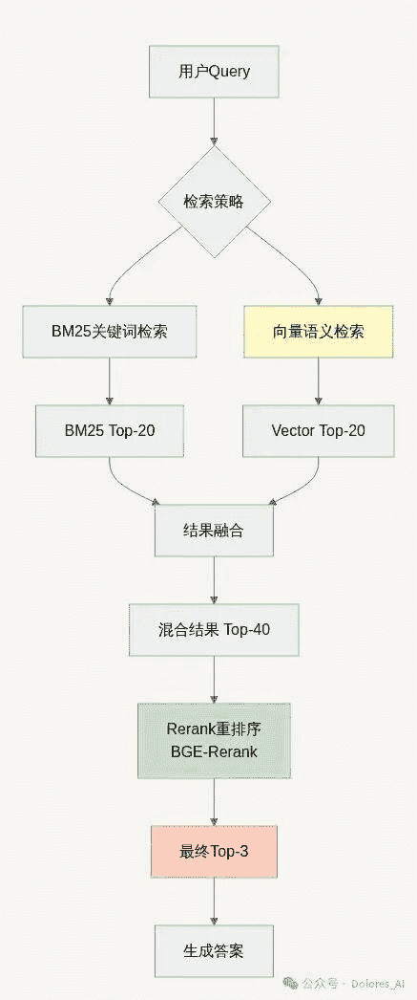

### 混合检索实现

混合检索器的实现需要协调BM25和向量检索两种方法，确保它们协同工作而不是相互干扰。初始化时需要准备文档集合、向量存储实例，以及设置两种方法的权重参数。权重参数决定了BM25和向量检索在最终结果中的相对重要性，需要根据具体场景进行调整。检索过程首先并行执行BM25检索和向量检索，分别获取各自的前20个结果。BM25检索返回文档索引、BM25分数和文档内容，向量检索返回文档和相似度分数。由于两种方法的分数范围不同，需要进行归一化处理。

BM25分数归一化通常采用最大最小值归一化，将分数转换到0-1范围。向量相似度分数通常已经在0-1范围内，可以直接使用。归一化后，根据预设的权重计算每个文档的混合分数。

结果合并需要建立统一的文档标识体系。BM25结果使用文档索引作为标识，向量结果需要映射到相同的文档索引。对于只在一种检索方法中出现的文档，另一种方法的分数设为0。

混合分数计算完成后，根据分数排序选择Top-K文档。返回结果包含文档内容、BM25分数、向量分数和混合分数，便于后续分析和调试。这种透明的结果格式有助于理解混合检索的工作机制，优化权重参数。

混合检索的优势在于结合了两种方法的优点。BM25确保关键词匹配的准确性，向量检索保证语义相关的完整性，两者结合提供了更全面的检索覆盖。实际应用中，混合检索通常比单一方法获得更好的效果。

```
classHybridRetriever:
    &quot;&quot;&quot;混合检索器：BM25 + 向量检索&quot;&quot;&quot;

def__init__(self,
                 documents,
                 vector_store,
                 bm25_weight=0.3,
                 vector_weight=0.7):
&quot;&quot;&quot;参数:  documents: 文档列表、vector_store: FAISS向量库、 bm25_weight: BM25权重            vector_weight: 向量权重&quot;&quot;&quot;
          self.bm25_retriever = BM25Retriever(documents)
          self.vector_store = vector_store
          self.bm25_weight = bm25_weight
          self.vector_weight = vector_weight

defsearch(self, query: str, top_k: int = 10):
&quot;&quot;&quot;混合检索策略:1. BM25检索Top-20 2. 向量检索Top-20 3. 归一化分数 4. 加权融合        5. 返回Top-K&quot;&quot;&quot;
# BM25检索    bm25_results = self.bm25_retriever.search(query, top_k=20)
# 向量检索    vector_results = self.vector_store.similarity_search_with_score(query, k=20)
# 归一化BM25分数    bm25_scores = [r[&quot;score&quot;] for r in bm25_results]

if max(bm25_scores) &gt; 0:
            bm25_scores_norm = [s / max(bm25_scores) for s in bm25_scores]
else:
            bm25_scores_norm = bm25_scores
# 归一化向量分数（余弦相似度已在0-1之间）   vector_scores_norm = [score for _, score in vector_results]
# 构建文档分数字典    doc_scores = {}
for i, r in enumerate(bm25_results):
            doc_id = r[&quot;index&quot;]
            doc_scores[doc_id] = {
&quot;bm25_score&quot;: bm25_scores_norm[i] * self.bm25_weight,
&quot;vector_score&quot;: 0,
&quot;content&quot;: r[&quot;content&quot;]
            }

for i, (doc, score) in enumerate(vector_results):
            doc_id = i  # 需要映射到实际文档ID      if doc_id in doc_scores:
                doc_scores[doc_id][&quot;vector_score&quot;] = vector_scores_norm[i] * self.vector_weight
else:
                doc_scores[doc_id] = {
&quot;bm25_score&quot;: 0,
&quot;vector_score&quot;: vector_scores_norm[i] * self.vector_weight,
&quot;content&quot;: doc.page_content
                }

# 计算混合分数      for doc_id in doc_scores:
            doc_scores[doc_id][&quot;hybrid_score&quot;] = (
                doc_scores[doc_id][&quot;bm25_score&quot;] +
                doc_scores[doc_id][&quot;vector_score&quot;]
            )

# 排序并返回Top-K        sorted_docs = sorted(
            doc_scores.items(),
            key=lambda x: -x[1][&quot;hybrid_score&quot;]
        )[:top_k]
        results = []
for doc_id, scores in sorted_docs:
            results.append({
&quot;doc_id&quot;: doc_id,
&quot;content&quot;: scores[&quot;content&quot;],
&quot;bm25_score&quot;: scores[&quot;bm25_score&quot;],
&quot;vector_score&quot;: scores[&quot;vector_score&quot;],
&quot;hybrid_score&quot;: scores[&quot;hybrid_score&quot;]
            })
return results
```

### Rerank重排序

混合检索后得到Top-20或Top-40候选文档，但这些文档的相关性排序可能仍不够精准。Rerank通过更强大的模型（如BGE-Rerank、Cohere Rerank）对候选文档重新打分排序。

Rerank模型通常基于**交叉编码器架构**，能够同时处理查询和文档，进行深度的注意力交互。与双编码器架构的向量检索相比，交叉编码器计算代价更高但效果更好，适合对少量候选进行精排

BGE-Rerank是常用的开源Rerank模型，基于预训练的语言模型微调得到。使用时需要加载模型和分词器，对查询-文档对进行编码，获取相关性分数。由于计算量较大，通常只对Top-20或Top-40候选进行Rerank。

实现Rerank器需要处理输入格式和批量计算。查询和文档列表构造成对输入，通过分词器转换为模型可接受的格式。模型推理获取每个对的相关性分数，然后根据分数对文档重新排序。

Rerank的代价是增加响应时间，通常需要200-500毫秒额外的计算时间。因此需要在效果和性能之间权衡，对于实时性要求高的场景可以跳过Rerank，对于准确性要求高的场景则值得使用。

重排序任务类似于一个智能过滤器。当检索器从索引集合中检索到多个上下文时，这些上下文与用户查询的相关性可能不同。有些上下文可能非常相关（图 1 中以红色方框突出显示），而另一些上下文可能只有轻微的相关性，甚至完全不相关（图 1 中以绿色和蓝色方框突出显示）。

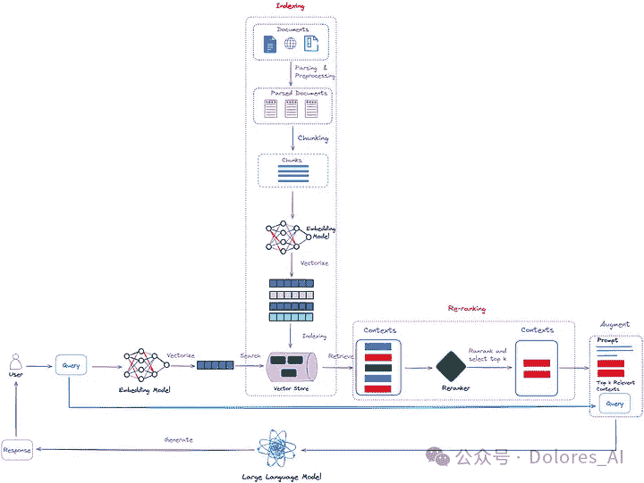

RAG 中的重排序，重排序的任务是评估这些上下文的相关性，并优先考虑最有可能提供准确相关答案的上下文（红色方框）。

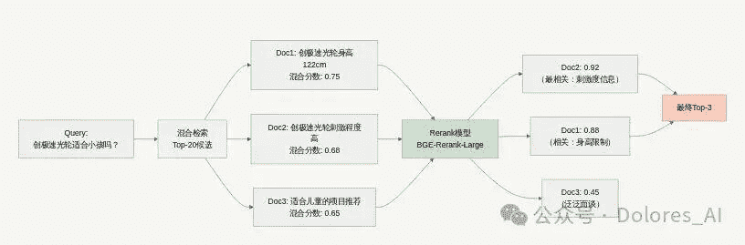

BGE-Rerank实现：

```
from transformers import AutoModelForSequenceClassification, AutoTokenizer
import torch
classBGEReranker:
&quot;&quot;&quot;BGE-Rerank重排序器&quot;&quot;&quot;def__init__(self, model_name=&quot;BAAI/bge-reranker-large&quot;):
        self.tokenizer = AutoTokenizer.from_pretrained(model_name)
        self.model = AutoModelForSequenceClassification.from_pretrained(model_name)
        self.model.eval()

defrerank(self, query: str, documents: List[str], top_k: int = 3):
&quot;&quot;&quot; 重排序   参数: query: 用户查询 、documents: 候选文档列表、top_k: 返回前K个        返回: List[Tuple[文档索引, Rerank分数, 文档内容]]&quot;&quot;&quot;
# 构建输入对    pairs = [[query, doc] for doc in documents]
# Tokenize    with torch.no_grad():
            inputs = self.tokenizer(
                pairs,
                padding=True,
                truncation=True,
                return_tensors=&#x27;pt&#x27;,
                max_length=512            )
# 前向传播     scores = self.model(**inputs, return_dict=True).logits.view(-1).float()
# 排序     sorted_indices = torch.argsort(scores, descending=True).tolist()

        results = []
for idx in sorted_indices[:top_k]:
            results.append({
&quot;index&quot;: idx,
&quot;score&quot;: float(scores[idx]),
&quot;content&quot;: documents[idx]
            })
return results
```