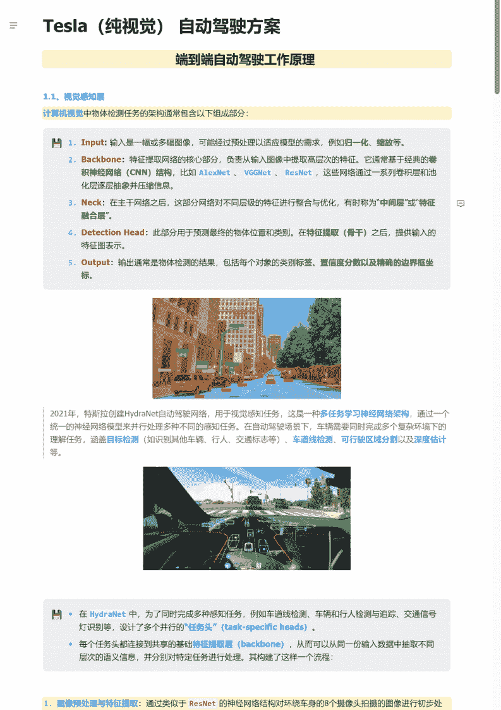
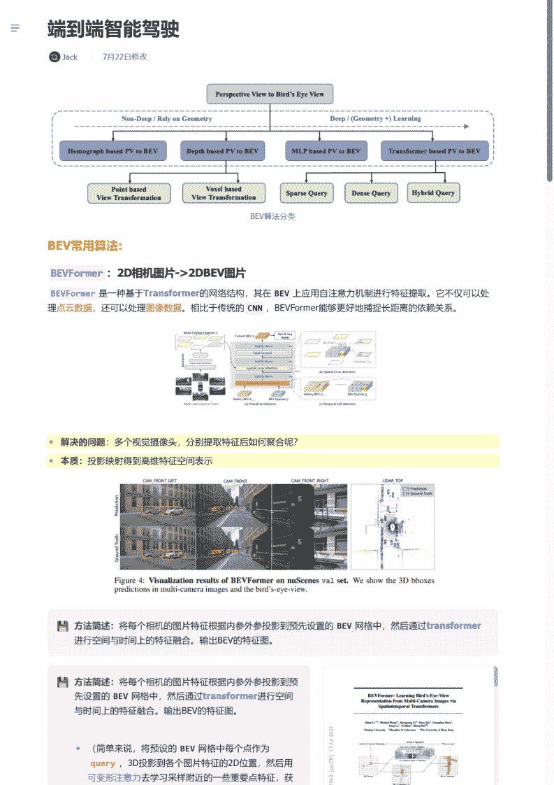
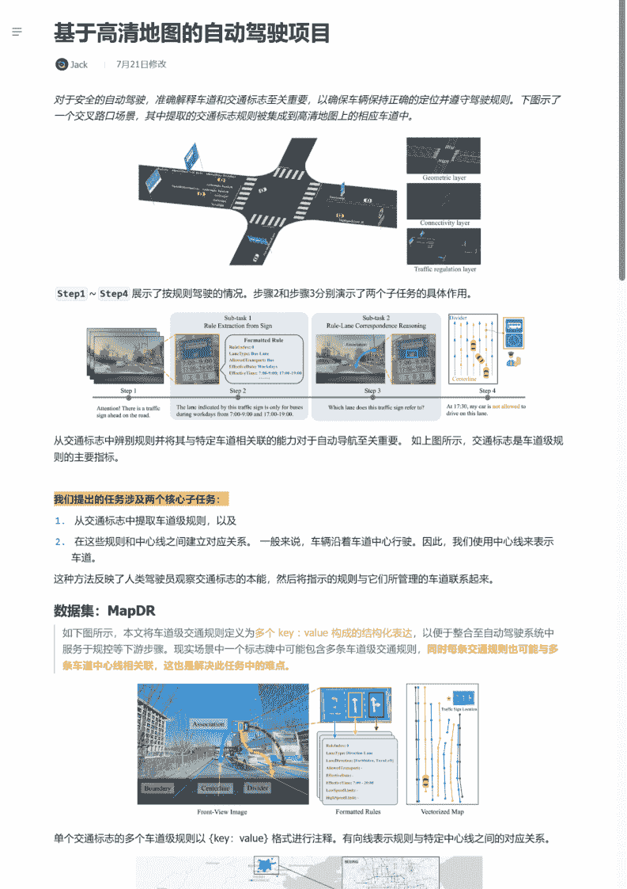
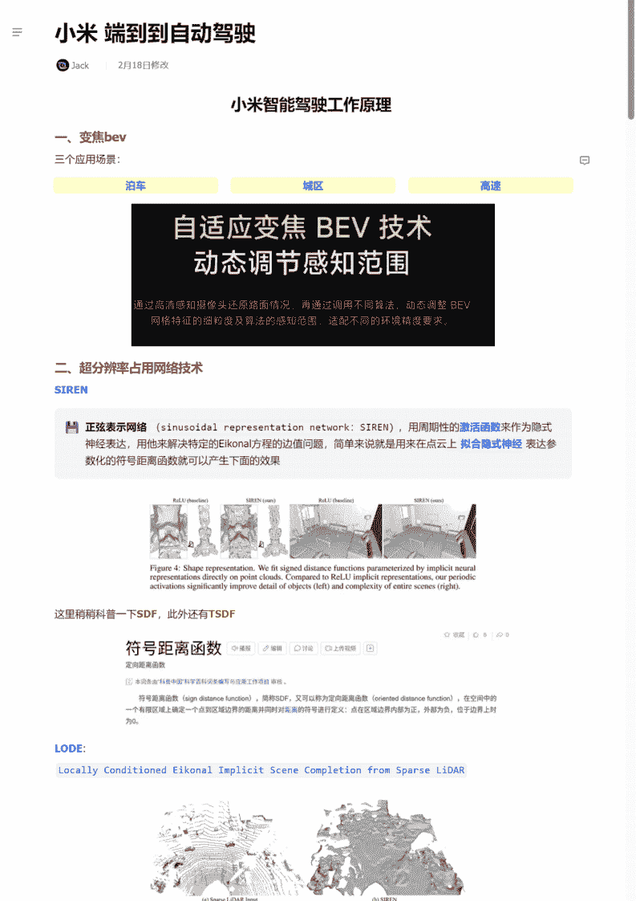

# 智能驾驶 （汇总）

> 来源：[https://v11enp9ok1h.feishu.cn/docx/HkdddMWOeoASJdxqGVAccQ74nig](https://v11enp9ok1h.feishu.cn/docx/HkdddMWOeoASJdxqGVAccQ74nig)

[Tesla（纯视觉） 自动驾驶方案.pdf](https://internal-api-drive-stream.feishu.cn/space/api/box/stream/download/all/BRN7bK28WodXqOxouhUcHg8HnGc)

[端到端智能驾驶.pdf](https://internal-api-drive-stream.feishu.cn/space/api/box/stream/download/all/QjoVbuwfIoJATsxXpCWcGX2TnMf)

[基于高清地图的自动驾驶方案.pdf](https://internal-api-drive-stream.feishu.cn/space/api/box/stream/download/all/Sr9UbPu1loTteXxPtYrcTemRnue)

[小米 端到到自动驾驶.pdf](https://internal-api-drive-stream.feishu.cn/space/api/box/stream/download/all/FkwRb6f1foYTlXxDVNbcGoK1nTc)