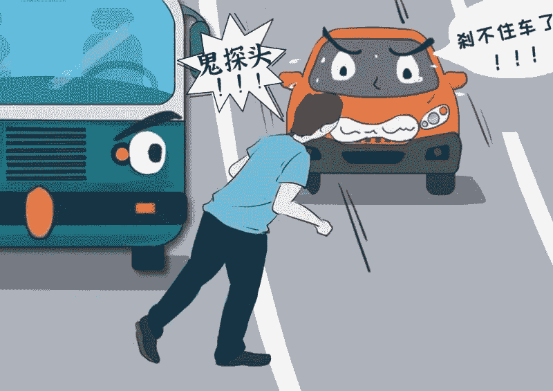
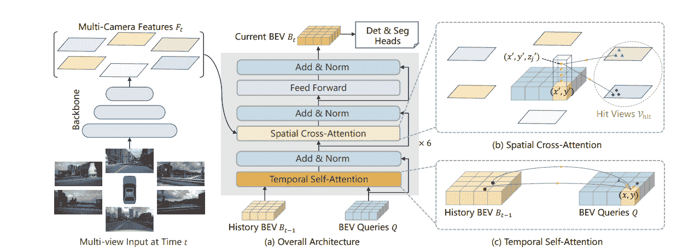
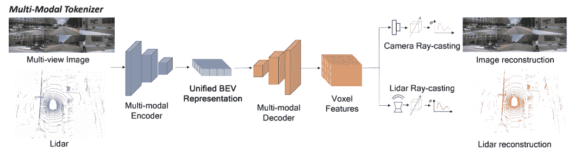
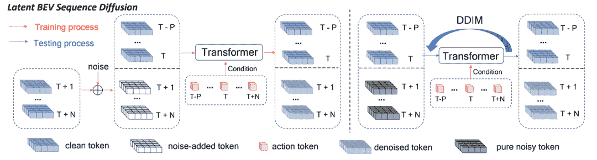
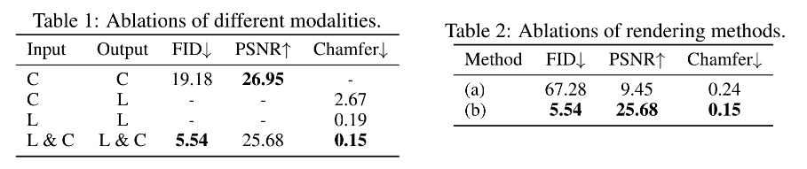
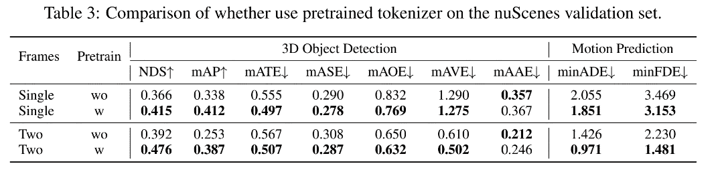
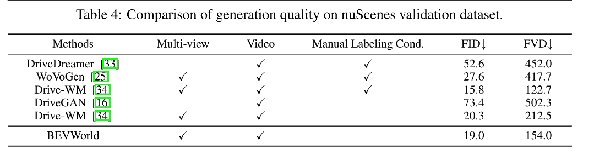
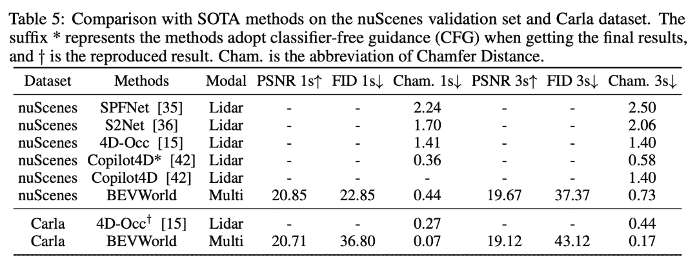
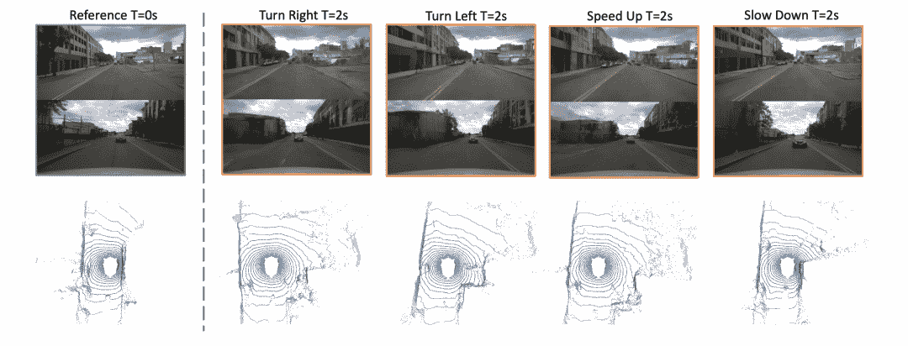

# 百度开源BEVWorld、全面理解自动驾驶~

> 来源：[https://v11enp9ok1h.feishu.cn/docx/YmJwdOS1qoVYeuxHJmscLumlnKd](https://v11enp9ok1h.feishu.cn/docx/YmJwdOS1qoVYeuxHJmscLumlnKd)

# 百度开源  BEVWorld、全面理解自动驾驶~

## **一、引言**

+   **世界模型**建模了有关环境的知识，其可以通过给定**的条件对**未来进行合理的想象。未来想象要求世界模型具有物理规律的理解能力以及零样本的探索能力，使得其在自动驾驶领域有着广泛的应用前景，比如：

+   **长尾数据生成**：生成鬼探头、前方车辆遗撒等稀缺数据，并通过条件拓展不同天气、光照等环境下的数据。

+   **闭环仿真测试**：自动驾驶模型的**planning****结果作为世界模型**未来预测的条件，产出控车后的数据进行闭环测试。

+   **对抗样本**：对抗样本是自动驾驶模型的一个安全隐患，利用世界模型，采用同一场景变换condition的方式或者黑盒攻击方式，拿到模型失效的且逼真的样本，用于提升自动驾驶模型的安全性。

+   foundation model：世界模型通常采用自监督的训练模式，这种方式可以利用大量的无标注数据进行训练，从而可以作为感知决策模型的foundation model来提升自动驾驶模型的泛化能力。

+   今天为大家拆解百度最新开源的工作《BEVWorld: A Multimodal World Model for Au**tonomous Driving via Uni**fied **BEV **Latent Space》中，作者提出了一种创新方法，通过统一的鸟瞰图（Bird's Eye View, BEV）潜在空间整合多模态传感器输入，进而构建世界模型。

## **二、方法概述**

### 多模态tokenizer

+   **多模态tokenizer**的核心功能是将原始多模态传感器数据压缩成一个统一的BEV潜在空间。具体实现步骤如下：

+   **BEV编码器网络**：采用Swin-Transformer作为图像骨干网络，提取多视图图像特征；将点云分割成BEV空间上的支柱（Pillars），Swin-Transformer作为LiDAR骨干网络，提取LiDAR BEV特征。之后，利用基于可变形注意力的机制融合LiDAR BEV特征和图像特征

+   **BEV解码器网络**：由于直接从BEV特征恢复图像和LiDAR存在高度信息缺失问题，BEV解码器首先将BEV标记转换为3D体素特征，然后使用基于体素的NeRF渲染技术恢复多视图图像和LiDAR点云。

+   **多模态渲染网络**：分为图像重建网络和LiDAR重建网络。图像重建通过沿射线路径采样点并聚合特征描述符，最后通过CNN解码器生成RGB图像。LiDAR重建则通过计算采样点的期望深度来模拟LiDAR观测。

### 潜在BEV序列扩散模型

+   潜在BEV序列扩散模型旨在预测未来帧的图像和点云，避免自回归方法的累积误差问题。具体实现步骤如下：

+   **模型结构**：采用基于空间-时间变换器的扩散方法，将顺序的噪声BEV标记转换为基于动作条件的干净未来BEV预测。

+   **训练过程**：以历史BEV标记和当前BEV标记为条件，学习添加到未来BEV标记中的噪声。

+   **测试过程**：使用DDIM调度器从纯噪声中恢复未来BEV标记，并通过多模态tokenizer的解码器渲染出未来的多传感器数据。

## **三、实验与结果**

### **数据集**

实验在**nuScenes**和**Carla**两个数据集上进行：

+   **nuScenes**：包含多视图图像和LiDAR扫描的多模态自动驾驶数据集，包含700个训练视频和150个验证视频。

+   **Carla**：开源自动驾驶模拟器，包含多种天气和城镇环境，实验中收集了300万帧数据进行训练。

### **多模态tokenizer评估**

通过消融研究评估不同设计决策对**多模态tokenizer**的影响：

+   **不同模态的影响**：结合**LiDAR**和**多视图**相机模态获得最佳重建性能。

+   **渲染方法的影响**：基于**射线的采样**方法在多视图重建中表现更好。

### **tokenizer下游任务验证**

在3D检测和运动预测任务上验证BEVWorld的有效性：

+   **3D检测**：在**nuScenes 3D**检测基准上，使用**tokenizer**编码器作为预训练模型显著提升性能。

+   **运动预测**：在检测头基础上添加**运动预测头**，实现准确轨迹预测。

### 潜在BEV序列扩散模型评估

+   介绍了潜在**BEV序列扩散模型**的训练细节，并与现有方法比较：

+   **LiDAR预测质量**：在nuScenes和Carla数据集上取得了与现有方法相当或更好的结果。

+   **视频生成质量**：在无额外条件情况下取得与使用手动标注条件方法相当或更好的结果。

+   **BevWorld** 还可以根据**Action**指令进行相应的生成控制。

## **四、结论与展望**

> 本文提出的**BEVWorld**框架通过统一的BEV潜在空间构建多模**态世界模型，能够在自监督学****习范式下高效处理**未标注多模态传感器数据，实现对驾驶环境的全面理解。实验结果表明，BEVWorld在下游自动驾驶任务中表现出色，并在多模态未来预测中取得满意结果。

<https://v11enp9ok1h.feishu.cn/sync/Ipw1d27gNsv3OAbo3N7cks4ZnJf>