# Tesla（纯视觉）自动驾驶方案

> 来源：[https://v11enp9ok1h.feishu.cn/docx/Z33Cd74LfoJ50ox4pxrcCtSpnng](https://v11enp9ok1h.feishu.cn/docx/Z33Cd74LfoJ50ox4pxrcCtSpnng)

## 端到端自动驾驶工作原理

### 1.1 视觉感知层

计算机视觉中物体检测任务的架构通常包含以下组成部分：

1. `Input`：输入是一幅或多幅图像，可能经过预处理以适应模型的需求，例如归一化、缩放等。

1. `Backbone`：特征提取网络的核心部分，负责从输入图像中提取高层次的特征。它通常基于经典的卷积神经网络（`CNN`）结构，比如`AlexNet`、`VGGNet`、`ResNet`，这些网络通过一系列卷积层和池化层逐层抽象并压缩信息。

1. `Neck`：在主干网络之后，这部分网络对不同层级的特征进行整合与优化，有时称为“中间层”或“特征融合层”。

1. `Detection Head`：此部分用于预测最终的物体位置和类别。在特征提取（骨干）之后，提供输入的特征图表示。

1. `Output`：输出通常是物体检测的结果，包括每个对象的类别标签、置信度分数以及精确的边界框坐标。

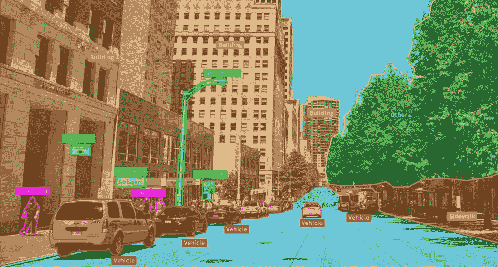

> 2021年，特斯拉创建`HydraNet`自动驾驶网络，用于视觉感知任务，这是一种多任务学习神经网络架构，通过一个统一的神经网络模型来并行处理多种不同的感知任务。在自动驾驶场景下，车辆需要同时完成多个复杂环境下的理解任务，涵盖目标检测（如识别其他车辆、行人、交通标志等）、车道线检测、可行驶区域分割以及深度估计等。

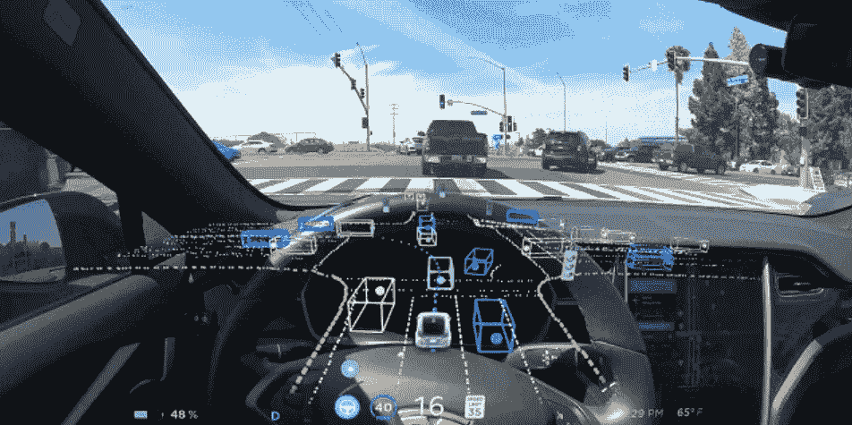

+ 在`HydraNet`中，为了同时完成多种感知任务，例如车道线检测、车辆和行人检测与追踪、交通信号灯识别等，设计了多个并行的“任务头”（task-specific heads）。

+ 每个任务头都连接到共享的基础特征提取层（`backbone`），从而可以从同一份输入数据中抽取不同层次的语义信息，并分别对特定任务进行处理。其构建了这样一个流程：

1. `图像预处理与特征提取`：通过类似于`ResNet`的神经网络结构对环绕车身的8个摄像头拍摄的图像进行初步处理。

1. `多机位融合`：使用`Transformer-like`架构将来自不同视角和位置的8幅图像信息进行深度融合，生成一个综合了多个视图信息的“超级图像”以消除单个相机视野受限带来的问题。

1. `时间融合`：将时间维度纳入考虑范围，将连续时间段内的“超级图像”序列进行融合以增强感知模型对动态环境的理解。

1. `任务导向输出`：最后，融合后的时空特征会被送入多个任务导向的输出层（`HEADS`），每个`HEAD`专门负责一个特定的感知任务，比如车道线检测、车辆/行人检测与追踪、交通信号识别等。

### 1.2 路径规划层

> 特斯拉的`Occupancy Network`通过处理摄像头捕捉到的多视图图像数据，来预测三维空间中每个点被物体占据的概率。这一网络模型旨在实现对车辆周围环境的精确建模，从而帮助车辆在没有使用超声波传感器或雷达的情况下（纯视觉方案），也能有效地理解道路场景和进行路径规划。

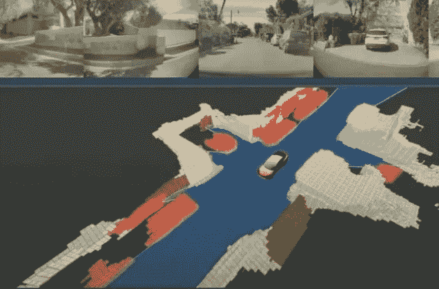

在特斯拉端到端的自动驾驶系统规划模块中，引入占据网络（`Occupancy Network`）后，系统的感知和规划决策过程可以概述如下：

**感知阶段：**

+ 第 1 步：视觉测量—特斯拉车辆利用其8个摄像头收集环境数据，包括车道线、静态和动态物体的位置以及空间中的占用率信息。占用网络负责处理这些图像数据，以生成三维空间的占用概率图，即预测环境中哪些区域可能被其他车辆、行人或其他障碍物占据。

**轨迹生成与评估阶段：**

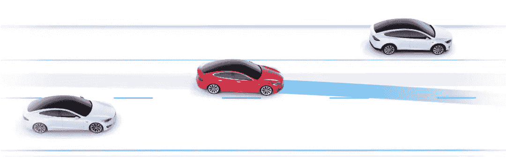

+ 第 2-3 步：候选目标和轨迹生成—根据占用率网络和其他感知模块（如车道检测）的输出，规划器会生成一系列潜在驾驶轨迹，每个轨迹对应一个不同的行驶决策或目标。

+ 第 4-5 步：选择评估—对于每一个生成的轨迹，规划器会进行规则驱动的选择评估，例如考虑“行人让行”与“获取行驶权”的情况，以及“右侧来车让行”等交通规则。每条轨迹都会根据一套人工设计的成本函数进行打分，该函数综合考虑碰撞概率、舒适度（比如加速度变化）、是否需要人为干预的可能性以及行为模式与人类驾驶员的相似程度等因素。

**决策阶段：**

> 成本优化—在生成的多条轨迹中，规划器会选择成本最低的那一条作为最优解决方案，以决定车辆接下来的行驶动作，输出规划行驶轨迹。

## 端到端自动驾驶的优点

> （1）更高的技术潜力：端到端结构允许模型从原始输入直接推导出最终控制输出，能够通过联合优化各个部分来提升整体性能，从而可能达到比模块化系统更高的技术上限。

> （2）数据驱动解决复杂问题：该方法依赖于大数据集进行训练，使得系统在处理各种复杂的边缘情况（`corner case`）时表现更佳。大量数据有助于模型学习并适应不同环境下的驾驶场景，增强系统的鲁棒性和适应性。

> （3）减少累积误差：由于全栈神经网络结构将感知、决策和控制等环节紧密地结合在一起，信息无需经过多个独立模块间的转换，因此减少了因模块间信息传递导致的累积误差，提高了决策与执行的一致性和准确性。

## 端到端自动驾驶的缺点

> （1）可解释性较差：端到端模型的内部机制往往过于复杂，难以直观理解和解释其决策过程，这给调试、改进和法规合规带来了一定挑战。

> （2）对海量高质量数据的高度依赖：端到端自动驾驶需要极其庞大的高质量数据支持，包括多样化的道路场景、天气条件以及交通行为样本。获取、标注和清洗这些数据需要巨大的资源投入，同时训练这样的大型神经网络也需要高性能计算设备和大量的算力支持。

---

# 小米智能驾驶工作原理

## 一、变焦BEV

三个应用场景：

+ 泊车
+ 城区
+ 高速

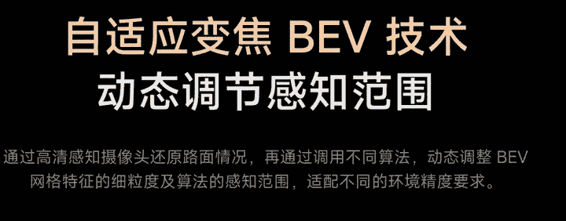

## 二、超分辨率占用网络技术

**`SIREN`**

> 正弦表示网络（`sinusoidal representation network`：`SIREN`），用周期性的激活函数来作为隐式神经表达，用于解决特定的`Eikonal`方程的边值问题，简单来说就是用来在点云上拟合隐式神经表达参数化的符号距离函数就可以产生下面的效果

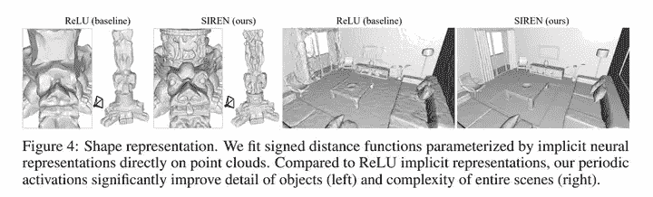

这里稍稍科普一下`SDF`，此外还有`TSDF`

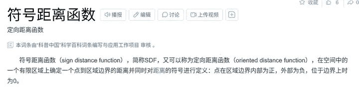

**`LODE`**:

Locally Conditioned Eikonal Implicit Scene Completion from Sparse `LiDAR`

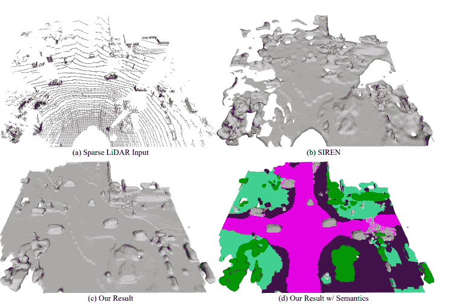

> `SIREN`提出一种从点云到3D mesh补全方法，`LODE`提出了利用`GT`来监督`SDF`。

SurroundSDF: Implicit 3D Scene Understanding Based on Signed Distance Field

**`xiaomi ev`**

> 引入了一种基于查询的方法，并利用`Eikonal`公式约束的`SDF`来准确描述障碍物的表面。此外，考虑到缺乏精确的`SDF`基本事实，提出了一种新的`SDF`弱监督范式，称为`Sandwich-Eikonal`公式，它强调在表面两侧应用正确和密集的约束，从而提高表面的感知精度。实验表明，该方法在nu-Scenes数据集上实现了占用预测和3D场景重建任务的SOTA。

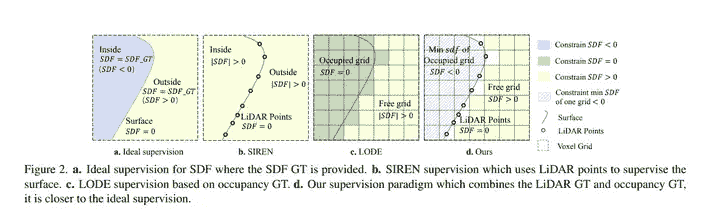

+ a. 在提供`SDF GT`的情况下，对`SDF`进行理想的监督。

+ b. `SIREN`监督，使用`LIDAR`点对表面进行监督。

+ c. 基于占用`GT`的`LODE`监管。

+ d. 我们的监管范式结合了`LiDAR GT`和占用`GT`，更接近理想的监管

## 三、雪天自动降噪

> 对输入的数据先过降噪算法再进网络。这类的算法就太多太多了，大家应该随处都可以找到。例如去`arxiv`网站上搜索rainy 或者snowy可以看到非常多的相关算法。

> 降噪可以单做，也可以嵌入网络，至于小米的智驾是如何做到的。难点在于降噪部分与后续环节的连接与耗时。

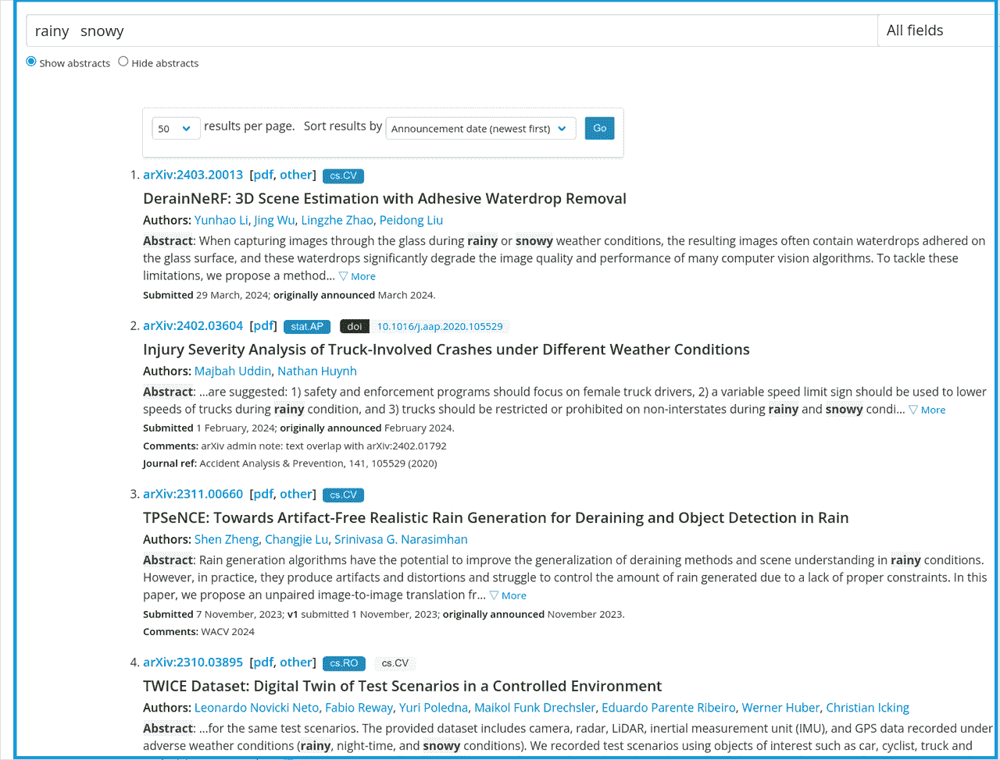

## 四、道路大模型

### Prologue

**`HDMapNet`**

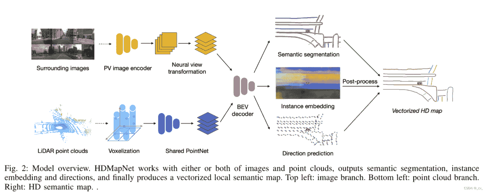

> `paper`，算是早期做`hdmap`的网络。思路也比较简单，和`bevfusion`（`MIT`版本）的工作挺像，分图像和雷达两支，分别提取特征到`BEV`空间，过`BEV decoder`后做了语义分割，朝向预测和实例编码（`instance embedding`），最后形成矢量高清地图还是靠后处理来完成。

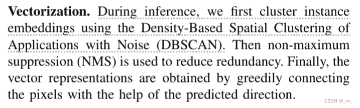

`dbscan + nms`，其实就是用实例化聚类 + 属性分配（朝向 + 分类）来构造矢量化表达。

**`STSU`**

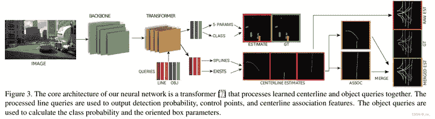

**`VectorMapNet`**

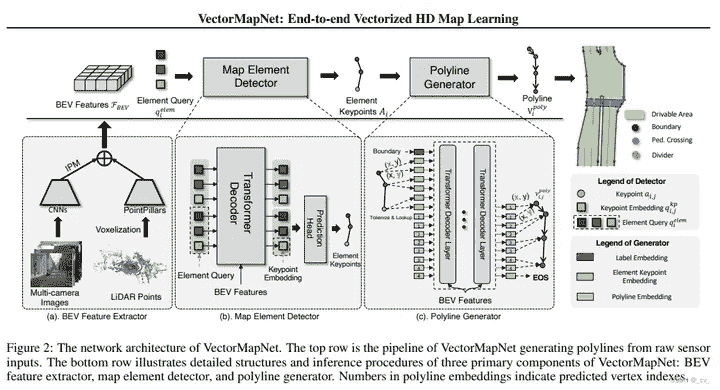

> 如图所示上面有三块，`BEV feature`这部分就不说了，主要是地图元素检测和`Polyline`生成。地图元素检测也是`DETR`的路子，一个`query`查一个关键点，多个关键点来表示一个地图元素。`Polyline`生成也是使用`Transformer`来做，对输入的`element keypoints`用自回归来做细化，出`polyline`。

**`MapTR`**

**`MapTR V2`**

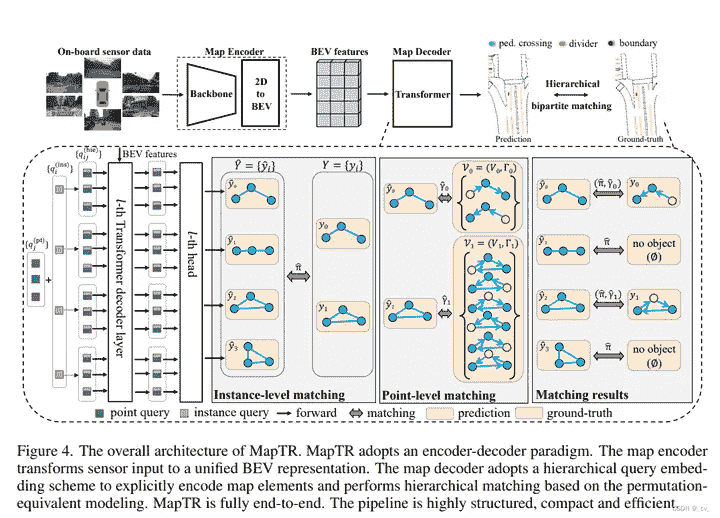

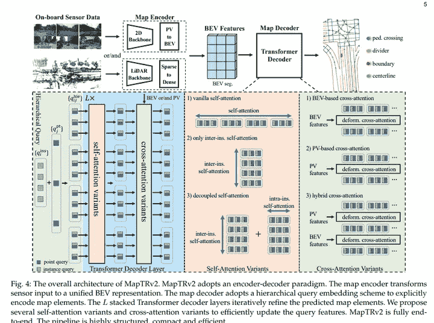

> `MapTR V2` 对`MapTR`的改进版本，但主要关注于降低计算量，原理思路并没有进行修改

**`Online Vectorized HD Map Construction using Geometry`**

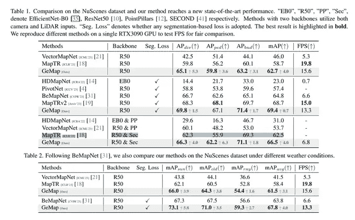

**`Leveraging Enhanced Queries of Point Sets for Vectorized Map Construction`**

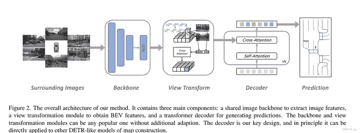

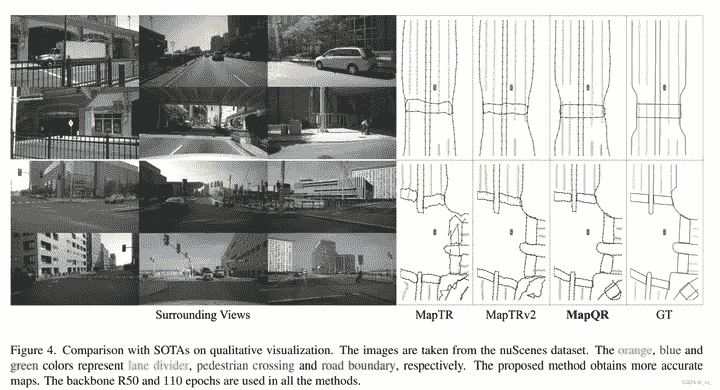

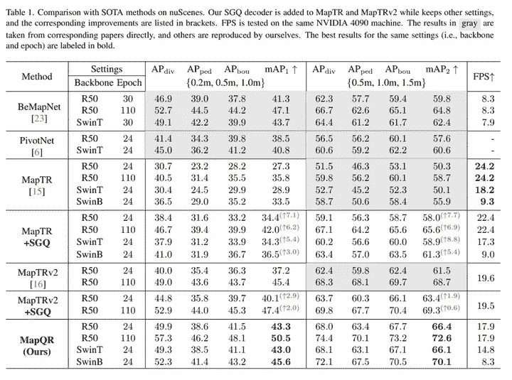

## 五、端到端感知决策大模型

**`CVPR`**的端到端：`Planning-oriented Autonomous Driving`

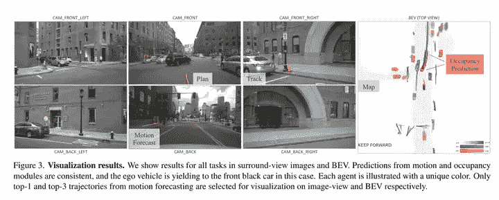

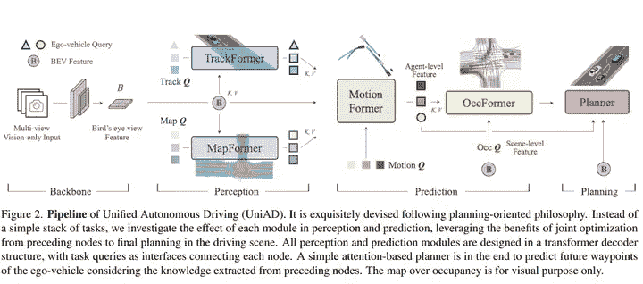

**`Uni AD`**：

+ 它是按照以规划为导向的理念精心设计的。与简单的任务堆栈不同，我们研究了每个模块在感知和预测方面的效果，利用从前面节点到最终驾驶场景规划的联合优化的好处。所有感知和预测模块都采用变压器解码器结构设计，任务查询作为连接各个节点的接口。最后利用一个简单的基于注意力的规划器，结合所提取的知识来预测自驾车未来的路径点

+ 大家看`pipeline`也能看出来这个端到端其实是有很多组件构成，每个环节都通过任务查询来连接，前面的流程都是为了最后的规划而服务

**鉴智的端到端：`GraphAD: Interaction Scene Graph for End-to-end Autonomous Driving`**

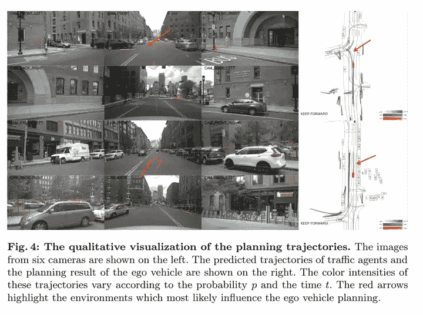

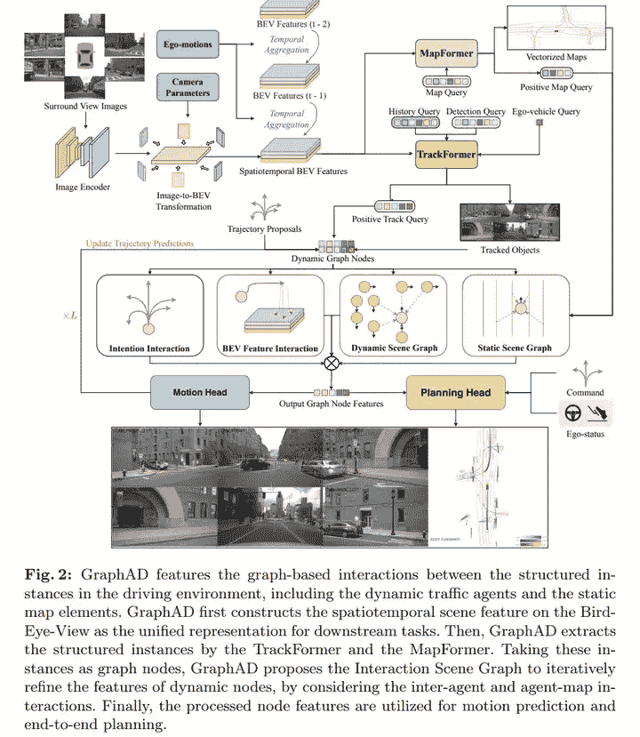

+ `Graph AD`的特点是驾驶环境中结构化实例之间基于图的交互，包括动态交通代理和静态地图元素。

+ `Graph AD`首先在鸟瞰图上构建时空场景特征，作为下游任务的统一表示。

+ `Graph AD`然后，通过`Track Former`和`Map Former`提取结构化实例。以这些实例为图节点，`Graph AD`提出了交互场景图，通过考虑代理间和代理映射的交互，迭代细化动态节点的特征。最后，将处理后的节点特征用于运动预测和端到端规划。

+ `Graph AD`的 Github 可以查看 [OpenDriveLab/UniAD](https://link.zhihu.com/?target=https%3A//github.com/OpenDriveLab/UniAD) 和 [WangYueFt/dgcnn](https://link.zhihu.com/?target=https%3A//github.com/WangYueFt/dgcnn)，代码基于 `UniAD` 和 `DGCNN`，还是借鉴了 `UniAD` 的工作，用图的形式来做交互上的优化无疑是更好的。但代码目前还没有开源，大家可以mark一下。

# BEV算法（感知）：常用算法和BEV论文拆解

## 什么是BEV？

> 鸟瞰视角（`Bird's Eye View`，简称`BEV`）在自动驾驶和机器人领域，通过传感器（如`LiDAR`和摄像头）获取的数据通常会被转换成`BEV`表示，以便更好地进行物体检测、路径规划等任务。`BEV`能够将复杂的三维环境简化为二维图像，这对于在实时系统中进行高效的计算尤其重要

## BEV的优势

1. 简化的视角：`BEV`将三维空间简化为二维，这样可以在计算和存储上节省大量资源。

1. 视觉效果：`BEV`提供了一种独特的视觉效果，使得场景中的物体和空间关系更加清晰可见。

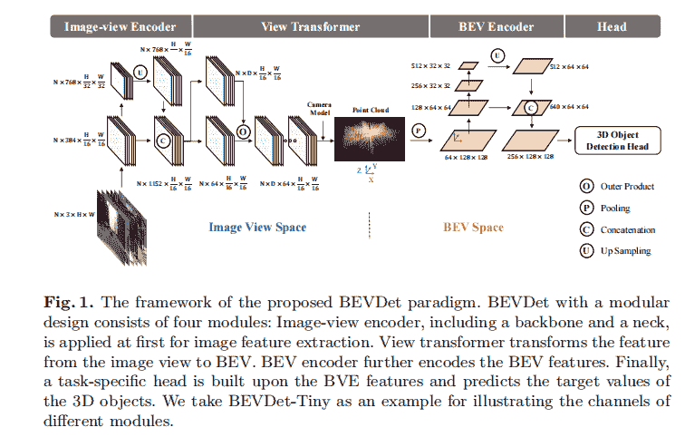

1. 方便处理：在`BEV`中处理物体检测、跟踪和分类等任务相较于直接在原始3D数据中处理要简单得多。

1. 便于融合和下游任务处理：与`LiDAR`融合更方便，对下游路径规划控制等任务也更友好。通用坐标系

1. 尺度一致：相机检测会出现近大远小的情况，`BEV`同类目标尺度差异几乎没有，更容易学习特征尺度一致性。

## BEV诞生前方案

+ 由于各种因素的影响，单个相机的检测结果可能并不准确，例如物体可能被截断，或者由于环境因素如光线、阴影等的影响，使得识别结果出现误差。

+ 由于多个相机的检测结果进行融合时，如果深度估计存在误差，可能会导致融合结果产生冲突，这使得融合任务变得更加困难。

+ 由于图像检测的结果可能受到环境、光照、遮挡等因素的影响，可能会出现误检或漏检等问题。其次，图像检测的结果通常是二维的，而自动驾驶需要的是三维空间中的精确位置和方向信息。

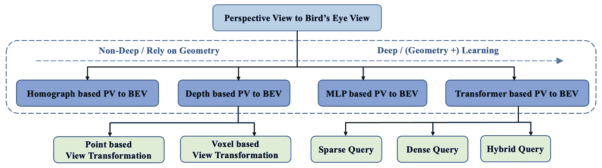

## BEV常用算法

### BEVFormer：2D相机图片->2DBEV图片

`BEVFormer`是一种基于`Transformer`的网络结构，其在`BEV`上应用自注意力机制进行特征提取。它不仅可以处理点云数据，还可以处理图像数据。相比于传统的`CNN`，`BEVFormer`能够更好地捕捉长距离的依赖关系。

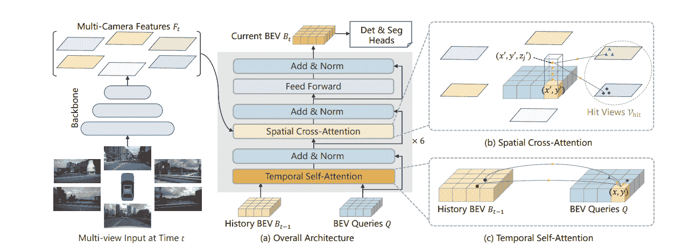

+ 解决的问题：多个视觉摄像头，分别提取特征后如何聚合呢？

+ 本质：投影映射得到高维特征空间表示

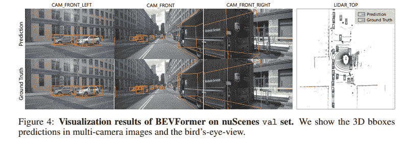

> 方法简述：将每个相机的图片特征根据内参外参投影到预先设置的`BEV`网格中，然后通过`Transformer`进行空间与时间上的特征融合。输出`BEV`的特征图。

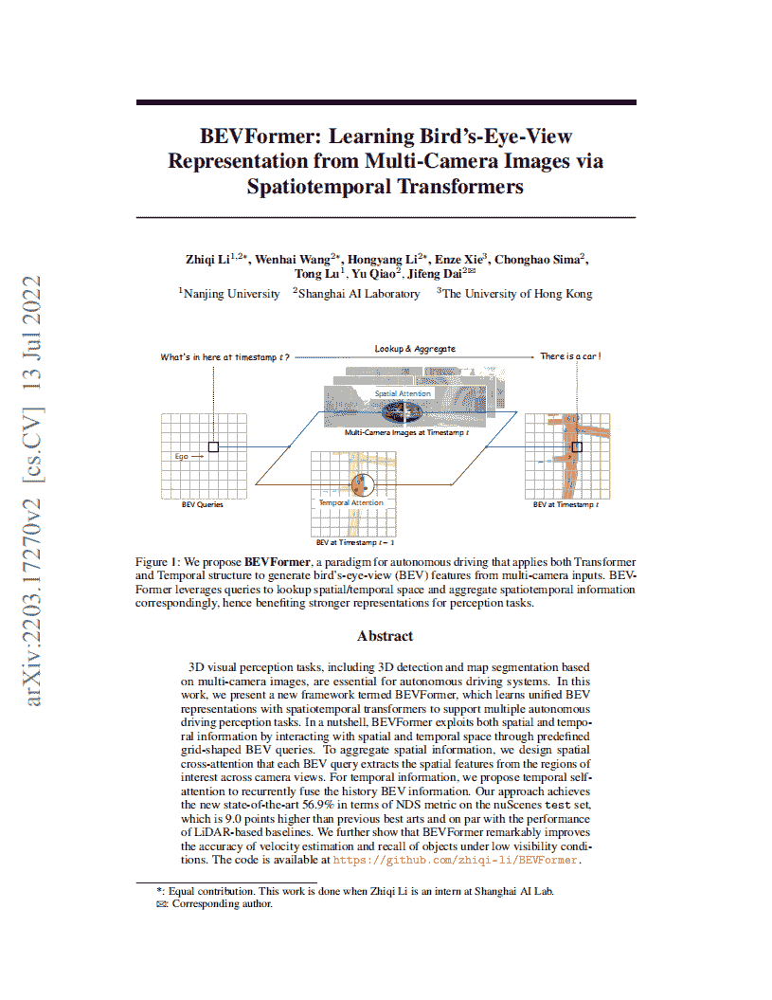

[BEVFormer：通过Transformers从多摄像机图像学习鸟瞰图.pdf](https://internal-api-drive-stream.feishu.cn/space/api/box/stream/download/all/NOlibCs8howQwSxSem8ctXjrnoe)

## 方法简述：基于 Transformer 的 BEV 特征融合

将每个相机的图片特征根据内参外参投影到预先设置的 `BEV` 网格中，然后通过 `transformer` 进行空间与时间上的特征融合。输出 `BEV` 的特征图。

简单来说，将预设的 `BEV` 网格中每个点作为 `query`，3D 投影到各个图片特征的 2D 位置，然后用可变形注意力去学习采样附近的一些重要点特征，获得注意力权重以及 `BEV` 网格该点处的特征。

`bevformer` 先聚合时序信息，再聚合空间信息，因为前面时刻 `BEV` 有很多信息相当于要充分利用先验知识，在此基础上再继续融合当前帧的特征，从而构建当前 `BEV` 重复多次（6 次）得到最后的 `BEV` 空间特征。

## LSS：2D 图片 -> 3D 空间

### 2D -> 3D

#### ① `LSS` 离散深度估计

#### ② 伪点云连续深度估计

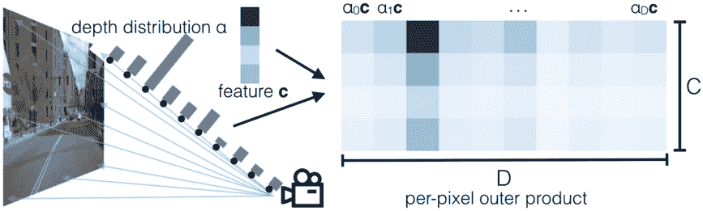

正常来说，一个像素点是一个 `C` 层的特征。但是，`lift` 处理后的一个像素点是 `D*C` 的一个特征图。`D` 是不同距离的特征。`conv` 卷成 `D+C` 维度，`D` 送去获得深度，`C` 为新特征。然后二者外积获得 `D*C` 维度。

上面简单来说，就是预测了一个深度值分布 `D`，以及提取的特征 `c`，然后将两种进行外积操作，实现了增维操作。`Splat`（拍扁）操作则是使用了一种特殊的“求和池化”操作（`z` 累加，压平），实现降维。最后的 `Shooting`，则是将预测的一组轨迹投射出来，选取最优的轨迹作为预测结果。

对比 `BEVFormer`：`LSS` 部署比 `bevformer` 更好，可解释性强，但是会被前置条件限制（类似卷积会被局部性、权值共享、平移不变性限制，而注意力机制全靠自己学习，没有被限制），`bevformer` 对 3D 栅格更友好。

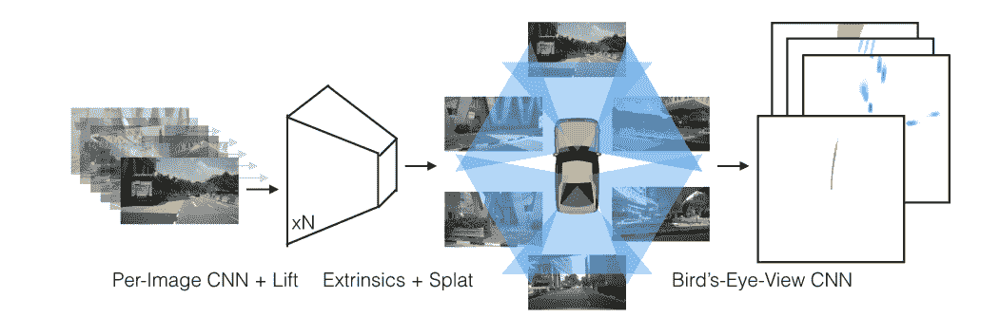

### 方法简述：将二维图像特征生成 3D 特征

将二维图像特征生成 3D 特征。

这一步对应论文中的 `Lift` 操作，涉及到深度估计，然后把 3D 特征“拍扁”得到 `BEV` 特征图（`Splat`），最终在 `BEV` 特征图上进行相关任务操作（`Shooting`）。具体来说，二维图像特征生成 3D 特征这一步使用了“视锥”点云的操作。

`LSS` 最大的贡献在于：

- 提供了一个端到端的训练方法，解决了多个传感器融合的问题。传统的多个传感器单独检测后再进行后处理的方法无法将此过程损失传进行反向传播而调整相机输入，而 `LSS` 则省去了这一阶段的后处理，直接输出融合结果。

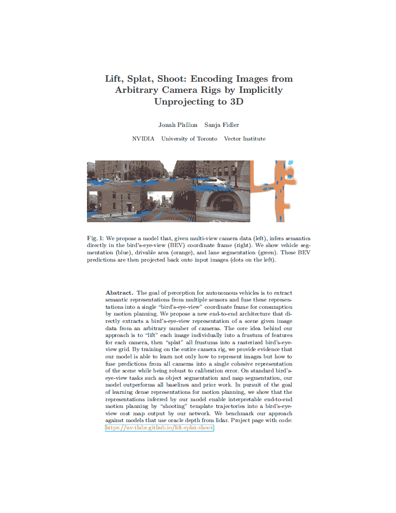

[`LSS`：通过隐式反投影到 3D 对来自任意摄影机的图像进行编码.pdf](https://internal-api-drive-stream.feishu.cn/space/api/box/stream/download/all/Vrs0b5yFioDEa8xMHDYcdK8Qn2c)

## BEVDet

### 流程

- ①图像特征：`resnet+FPN`
- ②`View transformer`：`LSS`（对每个像素位置进行离散深度估计，从 2D 图像到 3D 空间）
- ③`BEV encoder`：`resnet+FPN`。（对 `BEV` 空间进行提取 `BEV` 特征）

### 问题

- ①过拟合非常严重，原因是原始图像的增广如裁剪，基本不会对 `BEV` 空间造成影响。（`BEV` 的数据量比图像少，也容易过拟合）因此需要在 `View transformer` 后面也进行数据增强。包括翻转、旋转、缩放等。
- ②小目标 `NMS` 容易没有 `IOU` 交集，解决方法使用 `scaling` 扩大，扩大 `IOU`，再缩放回原始尺寸。

### 增强方法

- 对原始图像进行旋转、裁剪、缩放，需要对相机的内外参左乘一个逆变换。
- 如果对 `BEV` 特征进行旋转，缺值用 0 补充，其他线性插值。
- 可以对参考点进行一些随机偏移。

[BEVDet：高性能多相机鸟瞰三维物体检测.pdf](https://internal-api-drive-stream.feishu.cn/space/api/box/stream/download/all/CUVBbd4Y0oIpHmxyZJwcSu3Inke)

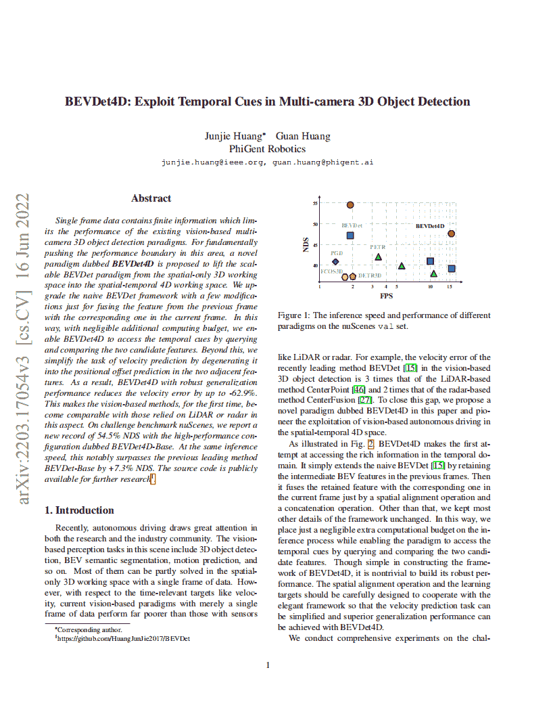

[BEVDet4D：在多摄像机3D对象检测中利用时间线索.pdf](https://internal-api-drive-stream.feishu.cn/space/api/box/stream/download/all/M5DIbDafvo475vxA5kmc3e7wnBg)

## BEVDet4D

问题是，前一帧的 `BEV` 特征，和此时帧的 `BEV` 特征能直接相加吗？答案是不行，因为车会运行，直接相加会出现两个不同位置同一车的特征。所以需要做空间对齐。先对齐，后 `concat` 能解决这个问题。

时序信息有辅助作用，能提高检测性能。

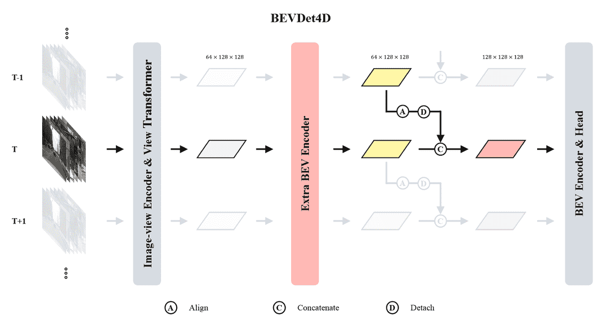

- 预测目标在相邻帧之间的平移而非直接预测速度，这样任务转化为预测目标在相邻两帧中的移位，这可根据 `BEV` 特征图的差异来测量。
- 两个特征图为自车坐标系，先将两个特征按静态对齐（此时静态对齐，`BEV` 特征、动态和自车不齐）；然后将两帧特征对齐，将静态特征对齐（将前一帧的覆盖的特征 `crop` 出来，盖到与此时帧相同的位置）。最后将两个特征 `cat` 起来即可。

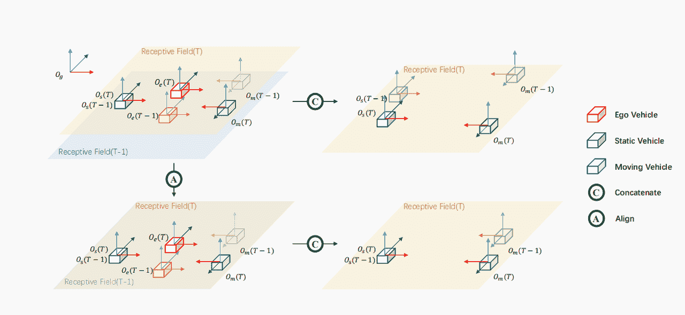

对齐的时候需要区分运动车辆、静止车辆。把前一帧的 `BEV` 特征根据自车运动信息与当前帧的 `BEV` 特征对齐。

结论：直接 `concat` 性能下降，加入 `R&T` 对齐后提高，数据增强提点明显。

## BevFusion

一种多传感器融合技术，它可以将来自不同传感器（如 `LiDAR` 和相机）的数据融合到一个统一的 `BEV` 表示中。`BevFusion` 的优点在于它能够结合多种传感器的优点，从而在物体检测和跟踪任务中取得更好的性能。

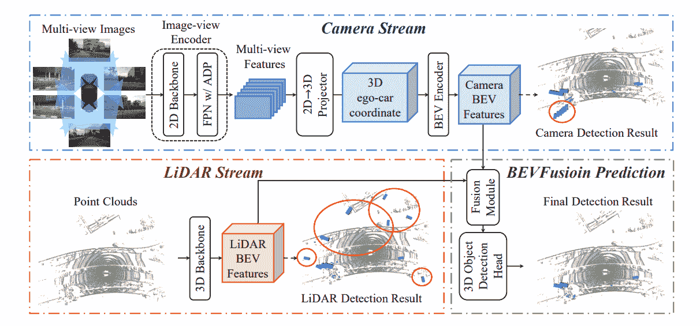

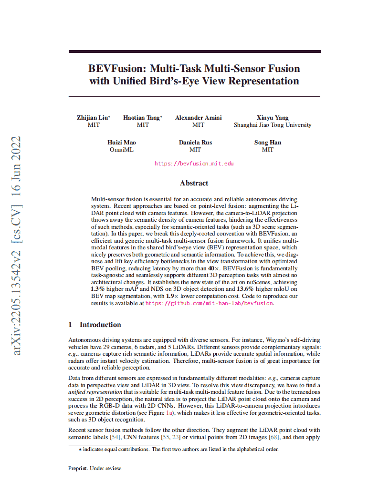

[BEVFusion：统一鸟瞰表示的多任务多传感器融合.pdf](https://internal-api-drive-stream.feishu.cn/space/api/box/stream/download/all/XvbVbuurGoK5q2xNBVmcO96rn0b)

1. 相机端采用 `BEV` 算法生成 `BEV` 特征，如 `bevformer`、`LSS`
2. `LIDAR` 端用 3D 卷积提取 `BEV` 特征，与相机端特征 `concat` 起来。
3. 采用通道注意力，全局池化 + `1*1` 卷积表示相机端和 `LIDAR` 端特征的权重比。

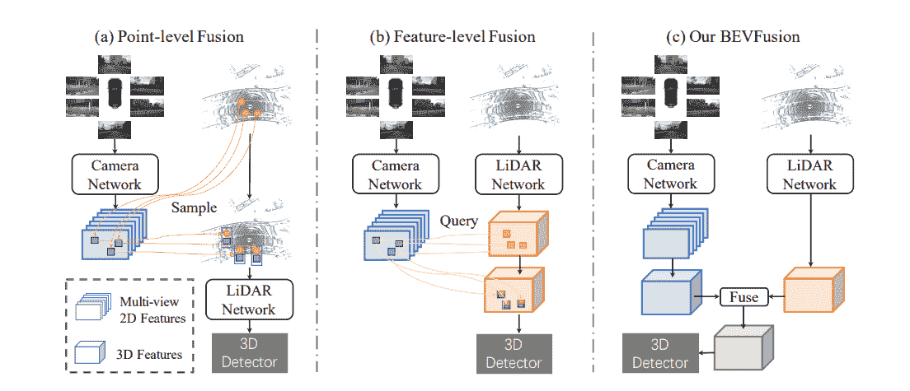

BevFusion

## DETR3D

`DETR3D` 是一种用于重建图像连续深度的方法，与传统的离散深度分布不同。它的核心方法是围绕连续深度预测展开，通过先预测深度图，然后利用原始图像和深度图将其映射到 3D 点云空间。

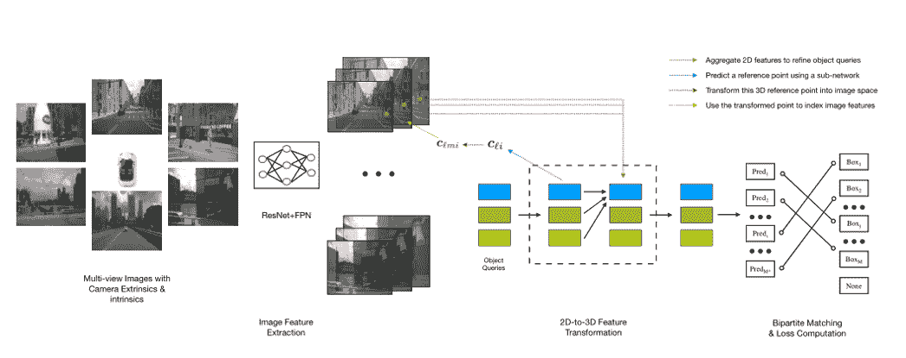

`DETR`：优雅的 2D 目标检测算法。`DETR3D`，与 `DETR` 的思想一致，直接在多视角图片上进行 3D 检测。采用将 `object query` 经过 `transformer` 获得 3D 参考点，然后投影到图像，提取特征获得 3D 检测框。

[DETR3D：通过3D到2D查询从多视图图像中检测3D对象.pdf](https://internal-api-drive-stream.feishu.cn/space/api/box/stream/download/all/TDRVb0prNoGI4Kx5j1QcVFNdnyd)

[DETR：用于端到端物体检测可变形变压器.pdf](https://internal-api-drive-stream.feishu.cn/space/api/box/stream/download/all/SqvtbJWERoOvMsxXscocoWplnqf)

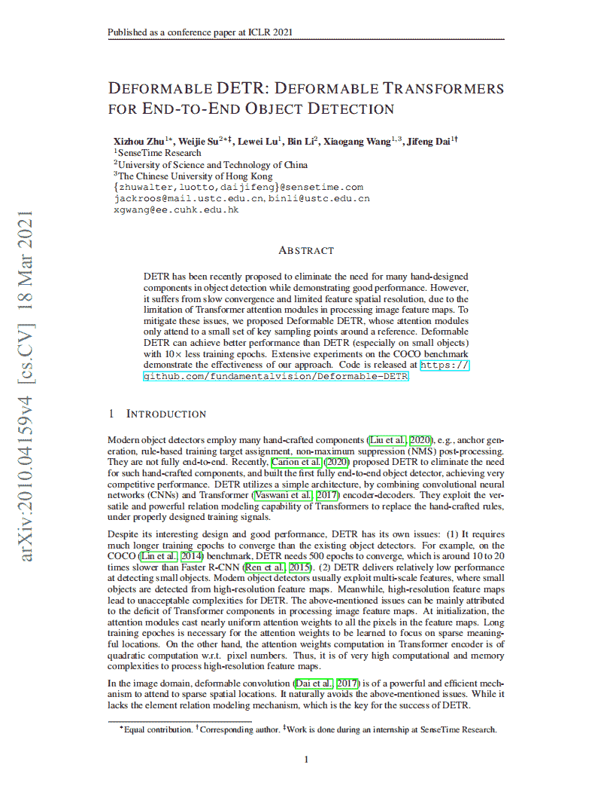

DETR3D 的过程可以总结如下：

1. 深度图预测：首先，使用 `DETR3D` 模型对输入图像进行处理，预测出连续的深度图。这个深度图表示了图像中每个像素点的深度值。
2. 3D 点云映射：接下来，使用原始图像和预测的深度图，将图像中的像素点映射到 3D 点云空间。通过计算每个像素点的 3D 坐标，可以得到一组表示场景中物体位置的点云数据。
3. 3D 到 2D 的 `BEV` 空间构建：在 3D 点云空间中，通过将点云投影到图像平面上，构建了一个称为 Bird's Eye View（`BEV`）空间。`BEV` 空间是在俯视图中观察场景时所看到的视角，它提供了一种更直观的场景表示方式。
4. 2D 图像特征查询：`DETR3D` 使用预先设定的 `object query`，这是一组表示物体的特征向量。这些特征向量类似于锚点，用于查询图像中与之匹配的物体特征。
5. 特征提取：通过使用 `transformer` 模型，将 `object query` 转换为参考点（3D box 的中心点坐标），然后将这些参考点投影到图像像素上。接下来，提取图像中与参考点相对应的目标特征。

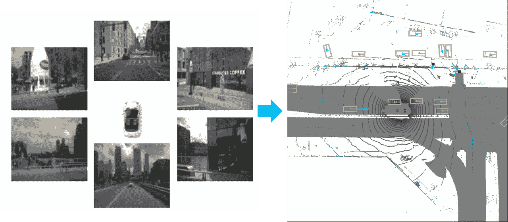

`DETR3D` 输出的目标特征可以用于物体检测、定位和跟踪等任务，以实现对场景中物体的全面理解和分析。这种基于连续深度预测和 3D 点云的方法使得 `DETR3D` 在处理图像和场景中的物体时能够更准确地捕捉到深度信息，并提供更丰富的视觉理解能力。

### 简单来说，BEV 转换流程

1. 输入是多视角图像特征以及预先设定的 `object query`（比如 300 个 256 维，是一个 `embedding` 的向量，意义类似 anchor，随机初始化找物体）
2. `object query` 通过 `transformer` 生成 `reference points`（3D 参考点，也就是 3D box 的中心点坐标）
3. 将点投影到图像像素
4. 图像特征提取
5. 输出目标特征

## PETR

在 `DETR3D` 上进行改进，认为其存在的问题：参考点索引图像特征不准确，投影到图像位置会有偏差。另外，参考点投影到图像特征来更新 `object query` 不充分，对全局特征考虑不完整。并且采样过程比较复杂。

### 改进方法

2D 特征 + 3D 编码，获得了 3D 特征。省略了采样和投影的过程。

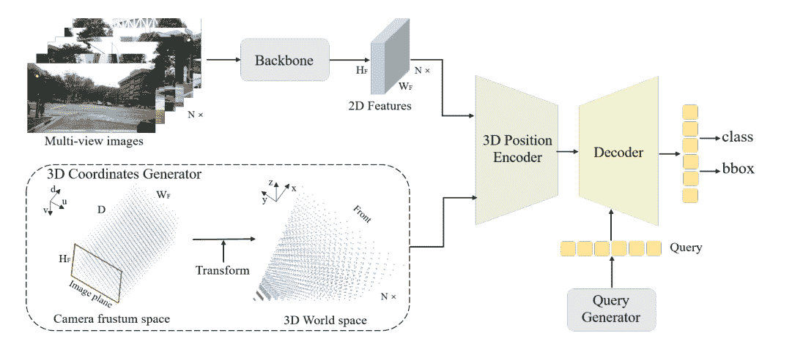

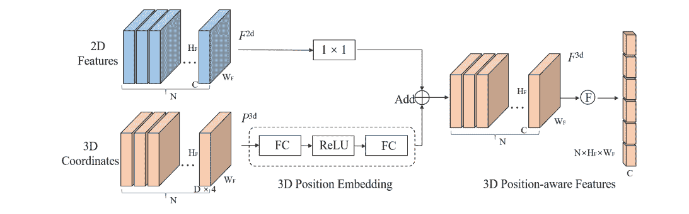

简单来说，即为增加一个 3D 坐标生成器，将相机视锥空间的点离散为 `W*H*D` 并投影到 3D 空间中。将 3D 的位置编码到 2D 图片的特征中。通过 `FC` 到相同的通道数。

[PETR：用于多视点三维物体检测的位置嵌入变换.pdf](https://internal-api-drive-stream.feishu.cn/space/api/box/stream/download/all/LkEUbDYKiok4VYxyK9ucyUmRnCg)

[PETRv2：多摄像头图像三维感知的统一框架.pdf](https://internal-api-drive-stream.feishu.cn/space/api/box/stream/download/all/BoO3bx9KGoOFLZxxo0CcicqendN)

## PETRV2

### 改进

①时序（对齐方式，隐式的对齐，用前一帧的位置和此时的位置供网络学习） ②多任务头。

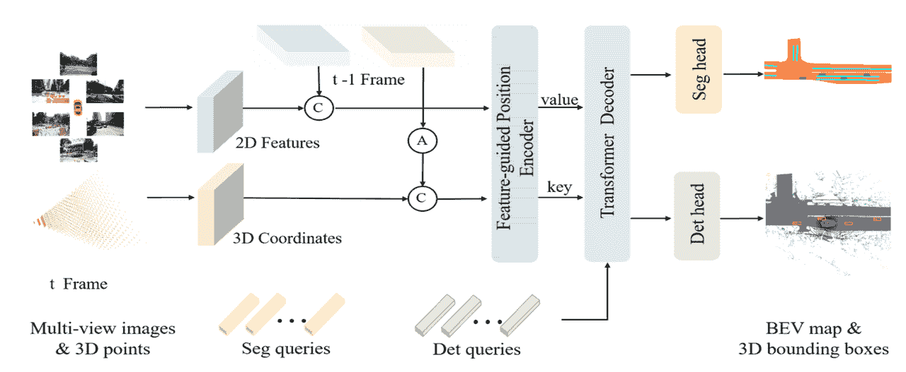

## BEVDepth

它将点云数据投影到 `BEV`，然后利用 `CNN` 预测每个像素的深度信息。`BEVDepth` 的优点在于它能够产生高质量的深度图，这对于导航和物体检测等任务非常有用。

### 2D -> 3D 目前的缺点：深度不可靠。

- ①没有明确的深度监督。
- ②网络无法利用相机的内外参数，无法有效推断像素深度。
- ③深度估计网络额外耗费时间。解决方法：引入深度监督，内外参数。

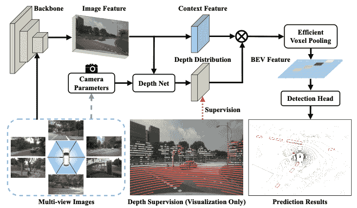

### 核心

- 深度网络：输入图像特征和相机参数。输出图像特征和深度分布。将相机的参数扩维，视为加权特征。输出深度分布。
- 深度监督：来源于点云投影的深度，来辅助深度估计网络的训练。外参有偏差，导致点云深度有偏差，因此引入 `Depth refinement` 网络来校准。获得 `BEV` 特征。

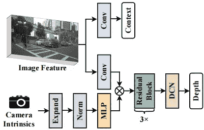

深度预测网络模块的示意图

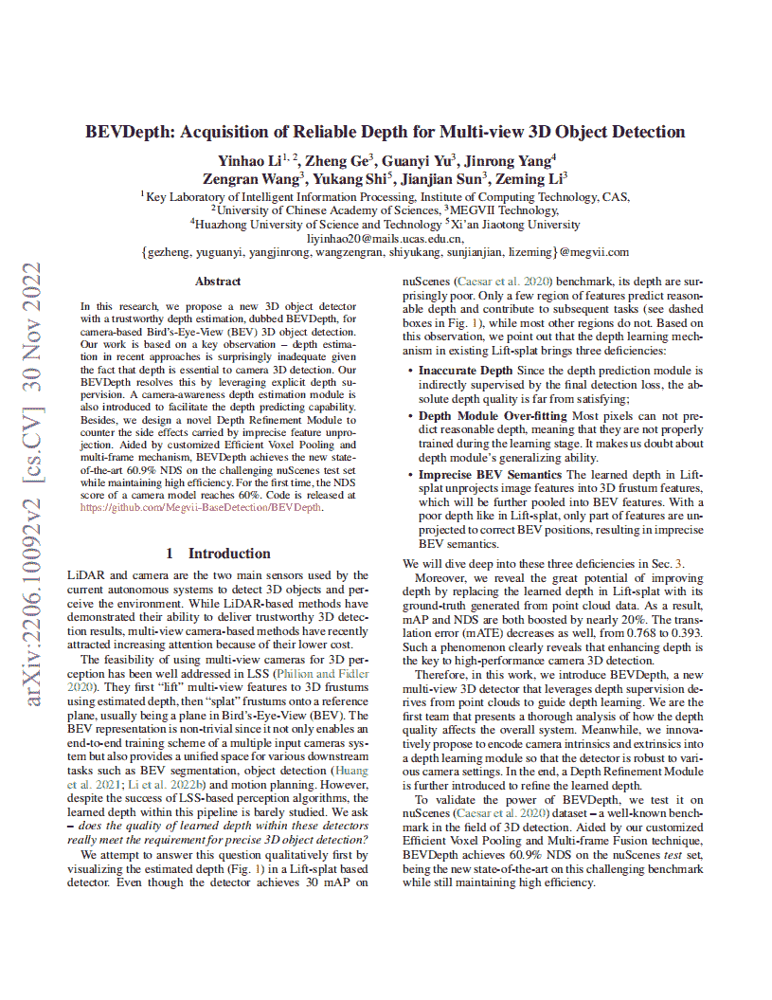

[BEVDepth：获取用于多视图3D对象检测的可靠深度.pdf](https://internal-api-drive-stream.feishu.cn/space/api/box/stream/download/all/GfoPbvv19o40kExloojcIYQHnka)

<https://v11enp9ok1h.feishu.cn/sync/Ipw1d27gNsv3OAbo3N7cks4ZnJf>
