# 小米 端到到自动驾驶

> 来源：[https://v11enp9ok1h.feishu.cn/docx/VQq6doWcWoDKo6xT7z9cLpHNnoh](https://v11enp9ok1h.feishu.cn/docx/VQq6doWcWoDKo6xT7z9cLpHNnoh)

# 小米智能**驾驶工作原理 **

### 一、变焦bev

三个应用场景：

**泊车**

**城区**

**高速**

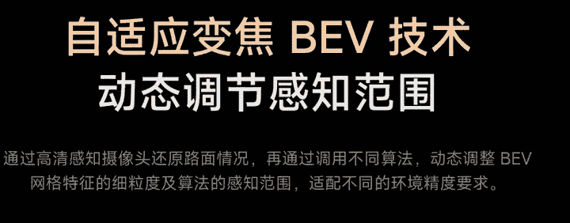

### 二、超分辨率占用网络技术

**SIREN**

> **正弦表示网络**（sinusoidal representation **netw**ork：SIREN)，用周期性的激活函数来作为隐式**神经表达，用**他来解决特定的Eikonal方程的边值问题，简单来说就是用来在点云上拟合隐式神经表达参数化的符号距离函数就可以产生下面的效果

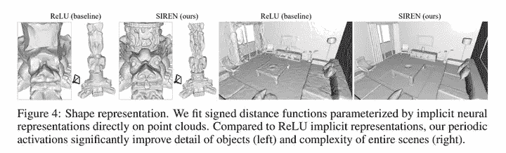

这里稍稍科普一下**SDF**，此外还有**TSDF**

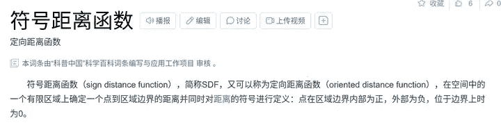

**LODE**:

Locally Conditioned Eikonal Implicit Scene Completion from Sparse LiDAR

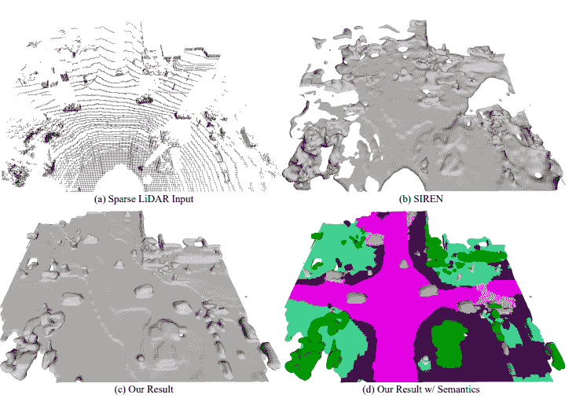

> **SIREN**提出一种从**点云到3D mesh补全方法**，**LODE**提出了**利用GT来监督SDF**。

SurroundSDF: Implicit 3D Scene Understanding Based on Signed Distance Field

**xiaomi ev**

> **引入了一种基于查询**的方法，并利用Eikonal公式约束的SDF来准**确描述障碍物的表**面。此外，考虑到缺乏精确的SDF基本事实，提出了**一种新的SDF弱监****督范式，**称为Sandwich-Eikonal公式，它强调在表面两侧应用正确和密集的约束，从而提高表面的感知精度。实验表明，该方法在nu-Scenes数据集上实现了占用预测和3D场景重建任务的SOTA。

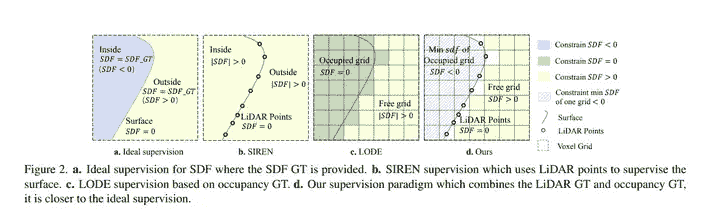

+   a.在提供**SDF GT**的情况下，对SDF进行理想的监督。

+   b.**SIREN监督**，使用LIDAR点对表面进行监督。

+   c.基于占用GT的**LODE监管**。

+   d.我们的**监管范式**结合了LiDAR GT和占用GT，更接近理想的监管

### 三、雪天自动降噪

> 对输入的数据先过**降噪算法**再进网络。这类的算法就太多太多了，大家应该随**处都可以找到**。例**如去arx**iv网站上搜索rainy 或者snowy可以看到非常多的相关算法。

> **降噪可以单做，也可以嵌入网络**，至于小米的智驾是如何做到的。难点在于降噪部分与后续环节的连接与耗时。

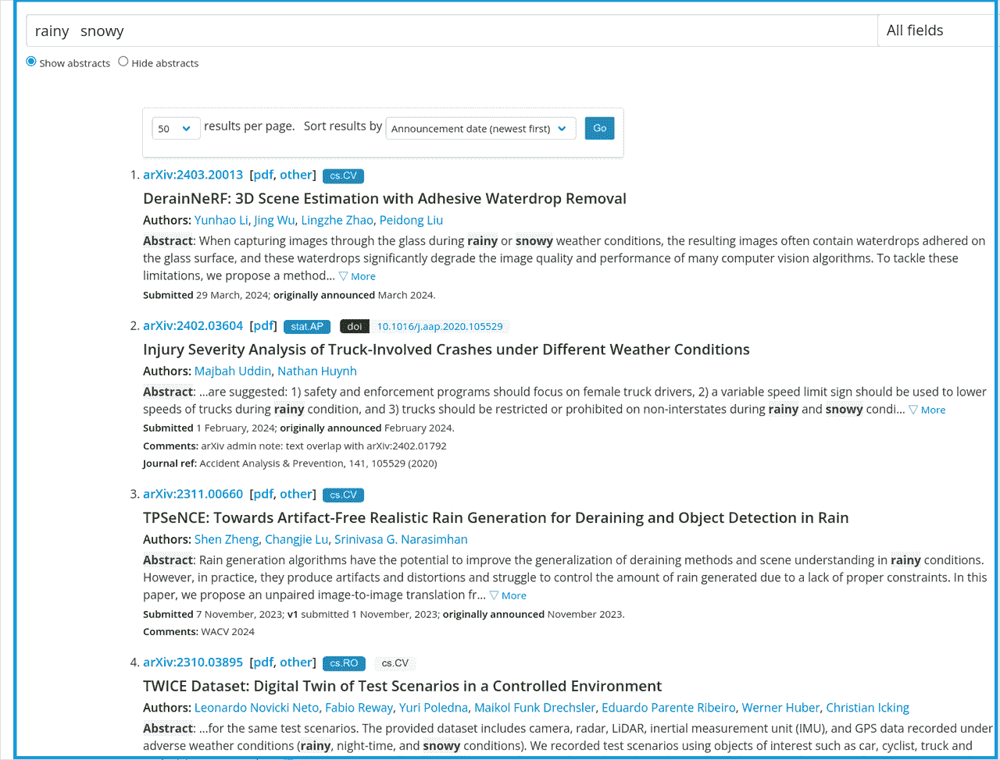

### 四、道路大模型

#### prologue

1.  **HDMapNet**

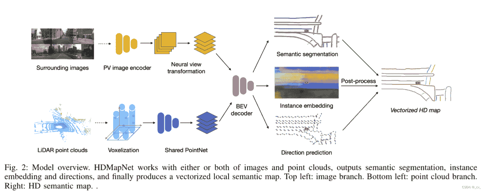

> **paper**，算是早期做**hdmap**的**网络。思路也比较简单，**和bevfusi**on(m**i**t版本)**的工作挺像，分**图像和雷达两**支，分别提取特征到bev空间，过bev decoder后做了语义分割，朝向预测和实例编码（instance embedding),最后形成矢量高清地图还是靠后处理来完成。

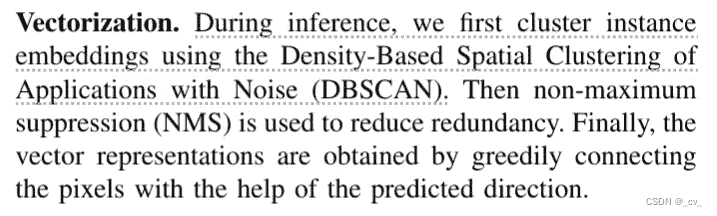

**dbscan + nms**，其实就是用**实例化聚类** + **属性分配**（朝向 + 分类）来构造矢量化表达。

1.  **STSU**

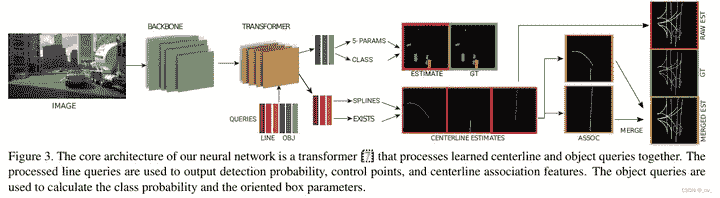

1.  **VectorMapNet**

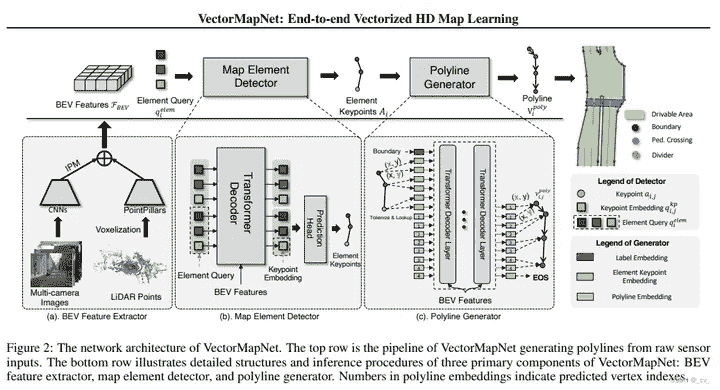

> 如图所示上面有三块，**bev feature**这部分就不说了，主要是**地图元素检测**和**Polyline **生成。地图元素检测也是**detr**的路子，一个**query****查一个关键点，多**个关键点来表示一**个地图元素。Polyl**ine 生成也是使用了transformer来做，对输入的element keypoints用自回归来做细化，出polyline。

1.  **MapTR**

1.  **MapTR V2**

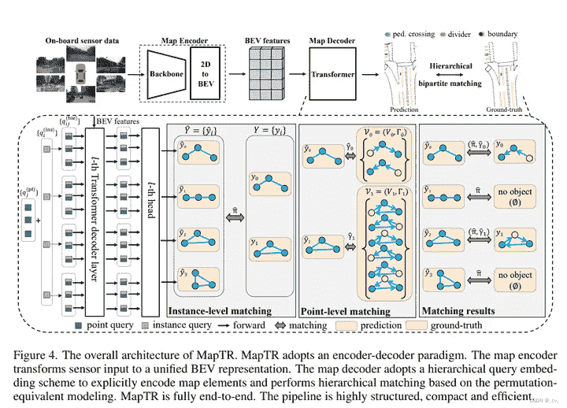

> **maptr v2 **对**maptr **的改进版本，但主要关注于降低计算量，原理思路并没有进行修改

1.  **O**nline Vectorized HD Map Construction using Geometry

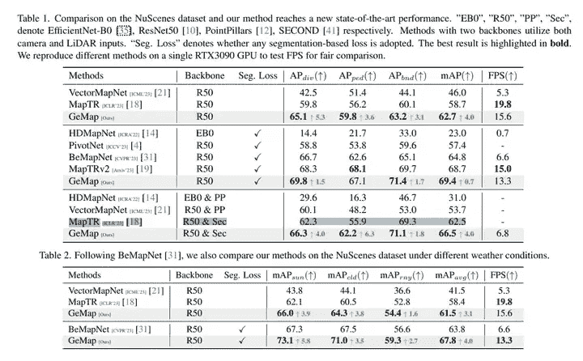

1.  **Leveraging Enhanced Queries of Po**int Sets for Vectorized Map Construction

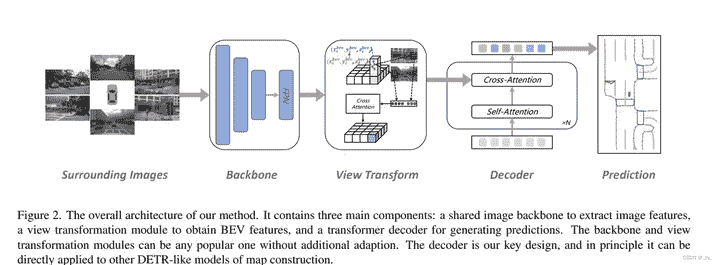

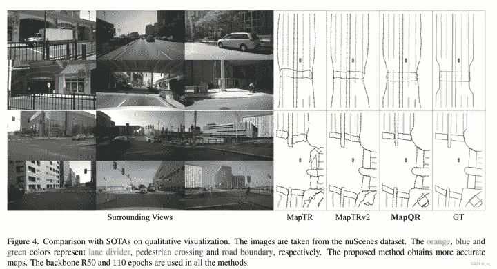

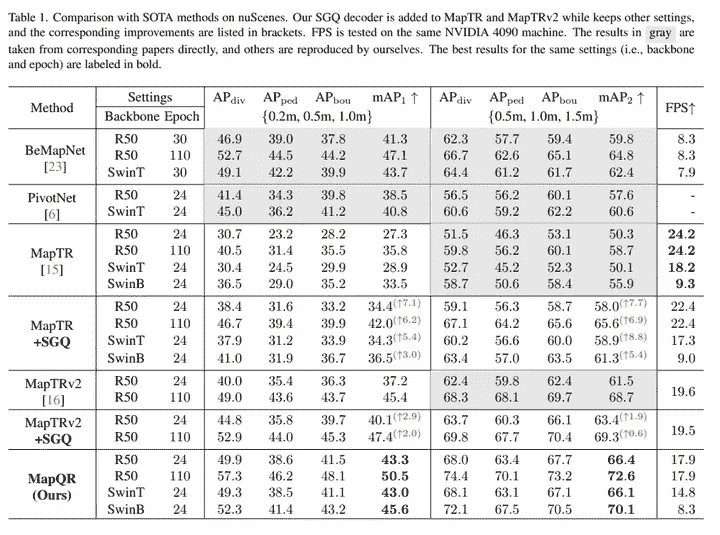

### 五、端到端感知决策大模型

**cvpr的端到端：Planning-oriente**d Autonomous Driving

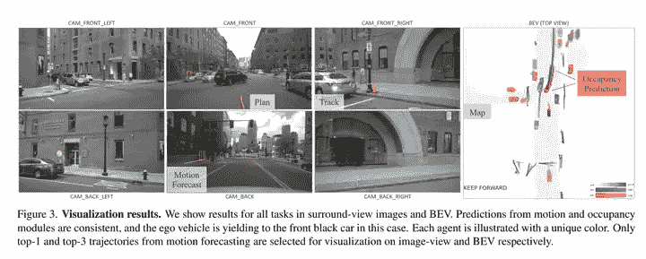

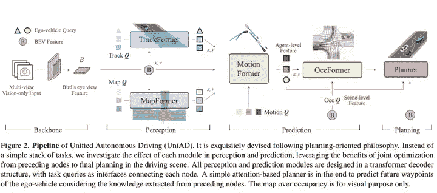

**统一自动驾驶(Uni AD)**：

+   它是按照**以规划为导向**的理念精心设计的。与简单的**任务堆栈**不同，我们研究了每个模块在**感知和预测****方面**的**效果**，利用从前**面节点到最终****驾驶场景规划的**联合优化的好处。所有感知和预测模块都采用变压器解码器结构设计，任务查询作为连接各个节点的接口。最后利用一个简单的基于注意力的规划器，结合所提取的知识来预测自驾车未来的路径点

+   大家看**pipline**也能看出来这个端到端其实是有很多组件构成，每个环节都通过任务查询来连接，前面的流程都是为了最后的规划而服务

**鉴智的端到端：GraphAD: Interaction Scene** Graph for End-to-end Autonomous Driving

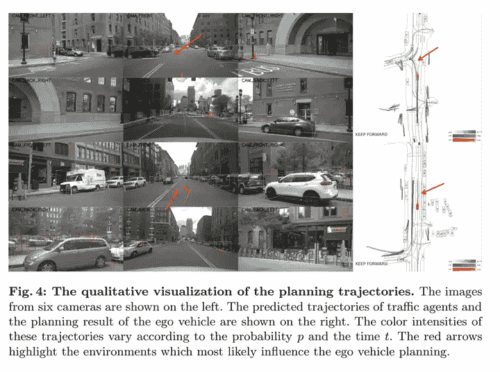

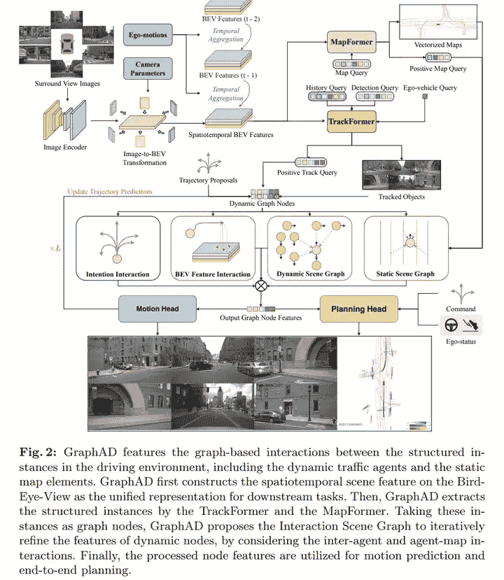

+   **Graph AD**的特点是驾驶环境中结构化实例之间基于图的交互，包括动态交通代理和静态地图元素。

+   **Graph AD**首先在鸟瞰图上构建时空场景特征，作为下游任务的统一表示。

+   **Graph AD**然后，通过**Track Former**和**Map Former**提取结构化实例。以这些实例为图节点，graph AD提出了交互场景图，通过考虑代理间和代理映射的交互，迭代细化动态节点的特征。最后，将处理后的节点特征用于运动预测和端到端规划。

+   **Graph AD **[的gith](https://link.zhihu.com/?target=https%3A//github.com/OpenDriveLab/UniAD)ub可以看[到Our ](https://link.zhihu.com/?target=https%3A//github.com/WangYueFt/dgcnn)code i**s bas**ed on UniAD and DGCNN，还是借鉴了UniAD的工作，用图的形式来做交互上的优化无疑是更好的。但代码目前还没有开源，大家可以mark一下。

## 什么是BEV？

> **鸟瞰视角****（**Bird'**s Ey**e View，简称BEV）在自动**驾驶和**机器人领域，通过传感器（如LiDAR和摄像头）获取的数据通常会被转换成BEV表示，以便更好地进行物体检测、路径规划等任务。BEV能够将复杂的三维环境简化为二维图像，这对于在实时系统中进行高效的计算尤其重要

## BEV的优势

1.  **简化的视角**: BEV将三维空间简化为二维，这样可以在计算和存储上节省大量资源。

1.  **视觉效果:** BEV提供了一种独特的视觉效果，使得场景中的物体和空间关系更加清晰可见。

1.  **方便处理**: 在BEV中处理物体检测、跟踪和分类等任务相较于直接在原始3D数据中处理要简单得多。

1.  **便于融合和下游任务处理**：与lid··ar融合更方便，对下游路径规划控制等任务也更友好。通用坐标系

1.  **尺度一致**：相机检测会出现近大远小的情况，BEV同类目标尺度差异几乎没有，更容易学习特征尺度一致性。

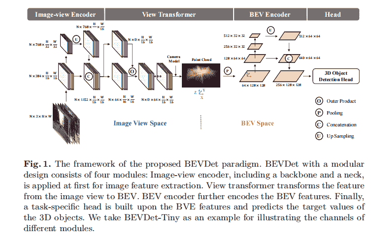

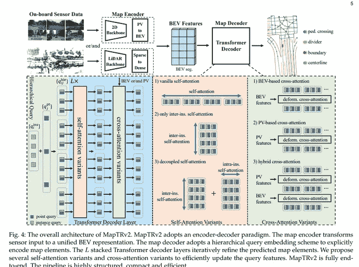

## BEV诞生前方案

+   由于各种因素的影响，单个相机的检测结果可能并不准确，例如物体可能被截断，或者由于环境因素如光线、阴影等的影响，使得识别结果出现误差。

+   由于多个相机的检测结果进行融合时，如果深度估计存在误差，可能会导致融合结果产生冲突，这使得融合任务变得更加困难。

+   由于图像检测的结果可能受到环境、光照、遮挡等因素的影响，可能会出现误检或漏检等问题。其次，图像检测的结果通常是二维的，而自动驾驶需要的是三维空间中的精确位置和方向信息。

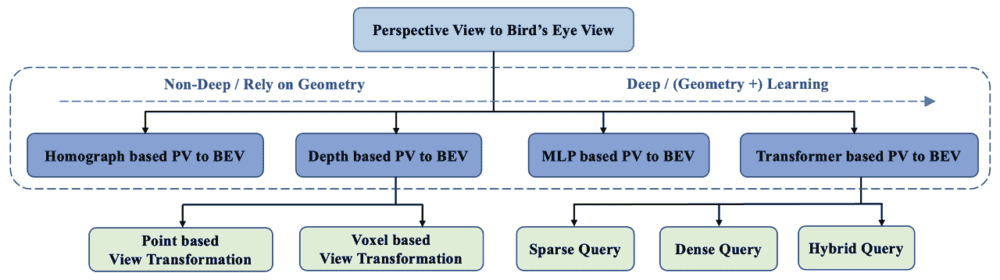

## BEV常用算法:

### BEVFormer：2D相机图片->2DBEV图片

**BEVFormer**是一种基于**Transformer**的网络结构，其在**BEV**上应用自注意力机制进行特征提取。它不仅可以**处理点**云数据，还可以处理图像数据。相比于传统的CNN，BEVFormer能够更好地捕捉长距离的依赖关系。

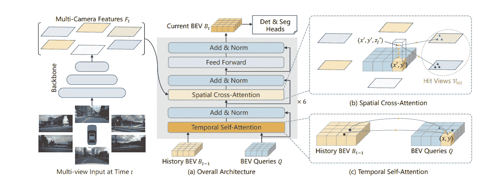

+   **解决的问题**：多个视觉摄像头，分别提取特征后如何聚合呢？

+   **本质****：**投影映射得到高维特征空间表示

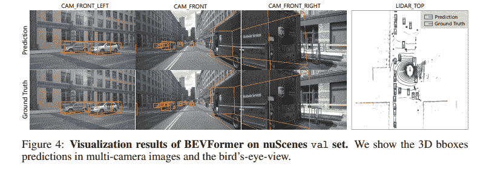

> **方法简述****：****将每个**相机的图片特征根**据内参外参投影到预先设**置的BEV网格中，然后通过transformer进行空间与时间上的特征融合。输出BEV的特征图。

> **方法简述****：****将每个**相机的图片特征根**据内参外参投影到预先设**置的BEV网格中，然后通过transformer进行空间与时间上的特征融合。输出BEV的特征图。

>

+   （简单来说，将预设的**BEV**网格中每个点作为**query**，3D投影到各个图片特征的2D位置，然后用可变形注意力去学习采样附近的一些重要点特征，获得注意力权重以及BEV网格该点处的特征）

+   **bevformer****先聚合**时序信息,再聚合空间信息，因为前面时刻BEV有很多信息相当于要充分利用先验知识，在此基础上再继续融合当前帧的特征，从而构建当前BEV重复多次（6次）得到最后的BEV空间特征。

>

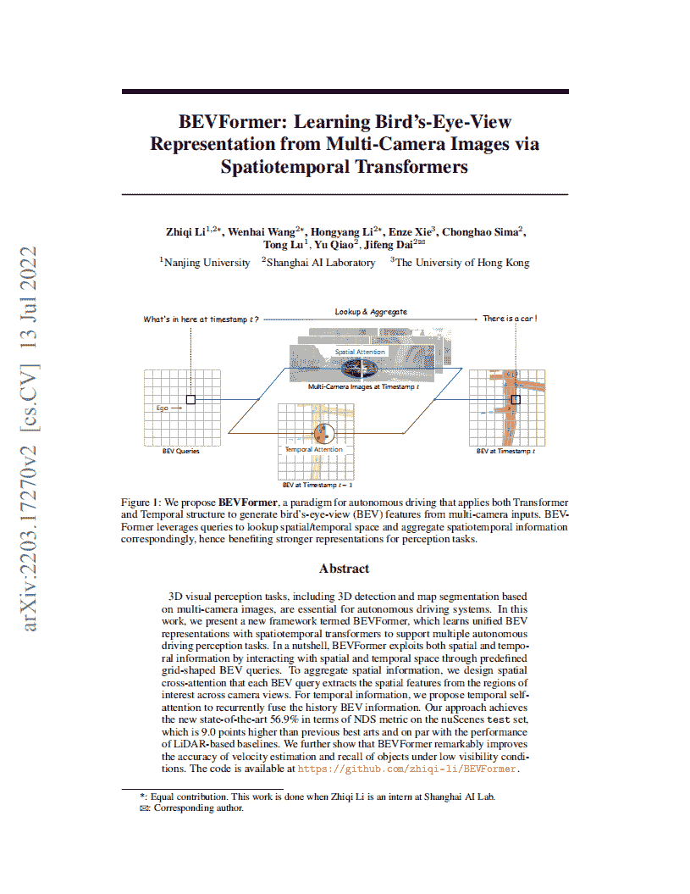

[BEVFormer：通过Transformers从多摄像机图像学习鸟瞰图.pdf](https://internal-api-drive-stream.feishu.cn/space/api/box/stream/download/all/O8yYbELu2ogPIfxgHNbcwco7nGb)

### **LSS**：2D图片->3D空间

**2D->3D**:

**①LSS离散深度估计**

**②伪点云连续深度估计**

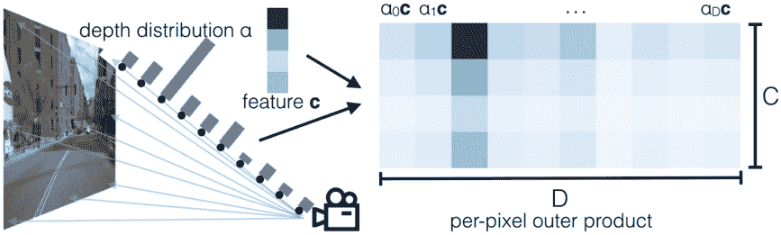

+   正常来说，一个像素点是一个**C层的特征****。但是****，lif**t处**理后的**一个像素点是D*C的一**个特征图。**D是不同距离的特征**。co**nv卷成D+C维度，D送去获得深度，C为新特征。然后二者外积获得D*C维度。

+   上面简单来说，就是预测了一个**深度值分布D****，以及提取**的特征c，**然后将两种进行外**积操作，实现了增维操作。Splat（拍扁）操作则是使用了一种特殊的“求和池化”操作（z累加，压平），实现降维。最后的Shooting，则是将预测的一组轨迹投射出来，选取最优的轨迹作为预测结果。

+   正常来说，一个像素点是一个**C层的特征****。但是****，lif**t处**理后的**一个像素点是D*C的一**个特征图。**D是不同距离的特征**。co**nv卷成D+C维度，D送去获得深度，C为新特征。然后二者外积获得D*C维度。

+   上面简单来说，就是预测了一个**深度值分布D****，以及提取**的特征c，**然后将两种进行外**积操作，实现了增维操作。Splat（拍扁）操作则是使用了一种特殊的“求和池化”操作（z累加，压平），实现降维。最后的Shooting，则是将预测的一组轨迹投射出来，选取最优的轨迹作为预测结果。

+   对比**BEVFormer**：**LSS**部**署比bev**former更好， 可解释性**强，但是会被前置条**件限制（类似卷积会被局部性 、权值共享 、平移不变性限制，而注意力机制全靠自己学习，没有被限制），bevformer对3D栅格更友好。

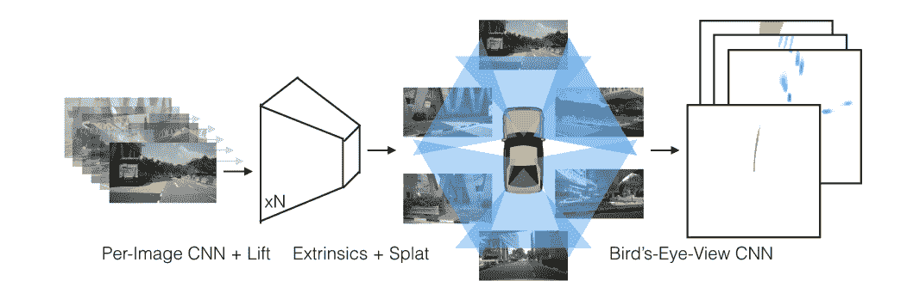

**方法简述：**

> 将**二维图像**特征生成**3D特征**

+   （这一步对应论文中的Lift操作，涉及**到深度**估计），然后把3D特征“拍扁”得到BEV特征图（这一步对应论文中的Splat**），最终在B**EV特征图上进行相关任务操作（这一步对应于Shooting）。具体来说，二维图像特征生成3D特征这一步使用了“视锥”点云的操作，如下图所示。

>

> LSS最大的贡献在于：

+   提供了一个**端到端的训练方法**，解决了多个传感器融合的问题。传统的多个传感器单独检测后再进行后处理的方法无法将此过程损失传进行反向传播而调整相机输入，而LSS则省去了这一阶段的后处理，直接输出融合结果。

>

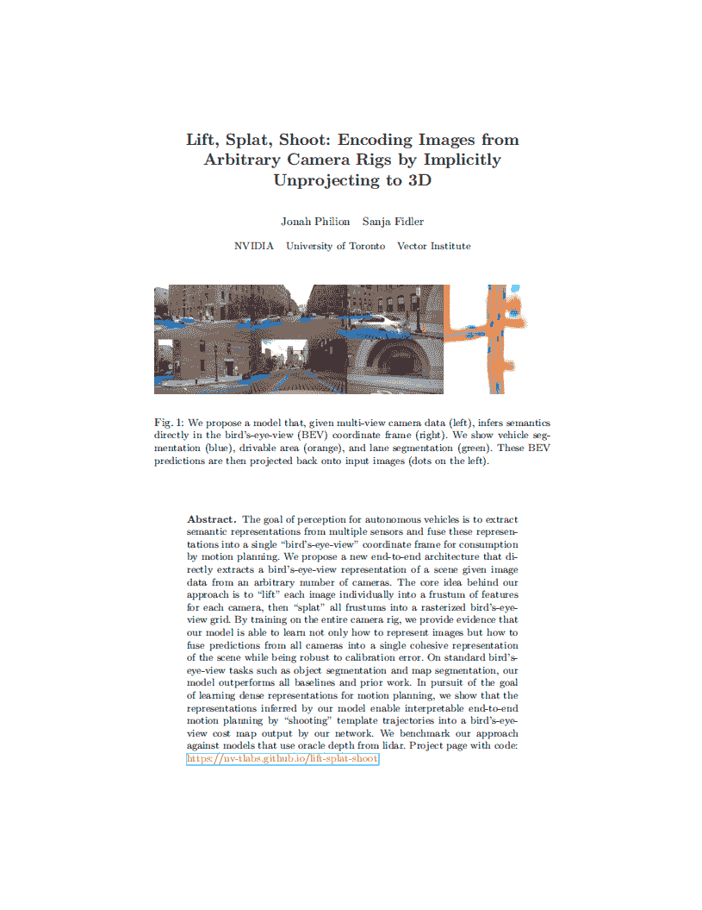

[lSS：通过隐式反投影到3D对来自任意摄影机的图像进行编码.pdf](https://internal-api-drive-stream.feishu.cn/space/api/box/stream/download/all/ThoubYnGFoPhLcxaoyQcGUmNnte)

### **BEVDET**

**流程：**

> ①** 图像特征：**resnet+FPN

> **②**View transformer：LSS（对每个像素位置进行离散深度估计，从2D图像到3D空间）

> ③**BEV encoder**：resnet+FPN。（对BEV空间进行提取BEV特征）

**问题：**

> ①**过拟合****非常严**重，原因是原始图像的增广如裁剪，基本不会对BEV空间造成影响。（BEV的数据量比图像少，也容易过拟合）因此需要再View transformer后面也进行数据增强。包括翻转、旋转、缩放等。

> ②小目标**NMS**容易没有**IOU**交集，解决方法使用**scaling**扩大，扩大IOU，**再缩放回原始尺寸**。

**增强方法：**

+   对原始图像进行**旋转**、**裁剪**、**缩放**，需要对相机的内外参左乘一个**逆变换。**

+   如果对**BEV**特征进行旋转，**缺值用0补充**，其他线性插值。

+   可以**对参考点进行一些随机偏移**。

[BEVDet：高性能多相机鸟瞰三维物体检测.pdf](https://internal-api-drive-stream.feishu.cn/space/api/box/stream/download/all/NQV7b2nfPoxNXRxnH1nc8OYnn1c)

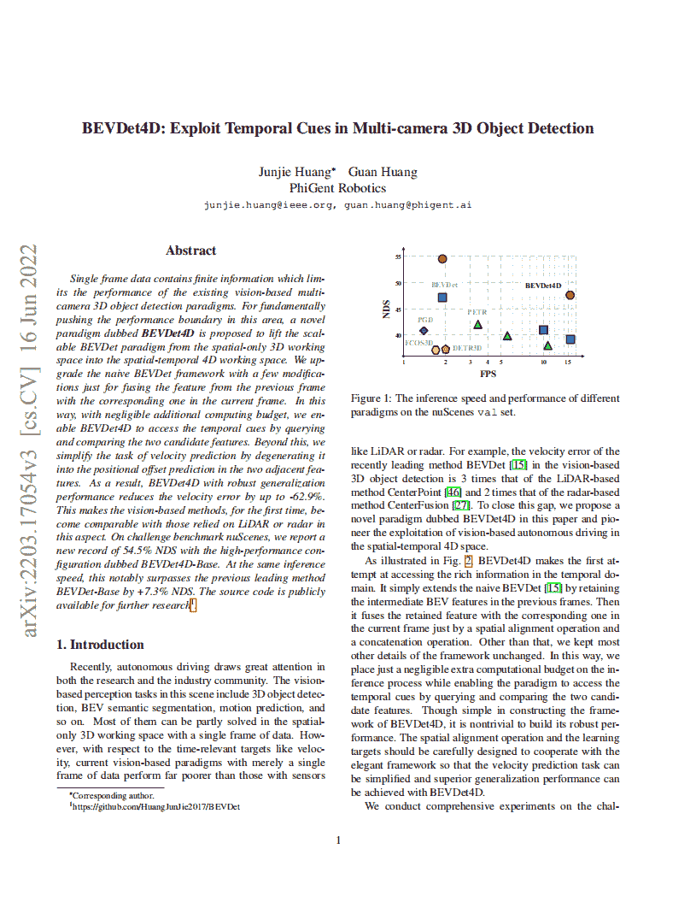

[BEVDet4D：在多摄像机3D对象检测中利用时间线索.pdf](https://internal-api-drive-stream.feishu.cn/space/api/box/stream/download/all/Bxm2bmnk1oTVEaxHpp9caVngn71)

### BEVDet4D

问题是，前一帧的BEV特征，和此时帧的BEV特征能直接相加吗？答案是不行，因为车会运行，直接相加会出现两个不同位置同一车的特征。所以需要做空间对齐。先对齐，后concat能解决这个问题。

> 时序信息有辅助作用，能提高检测性能

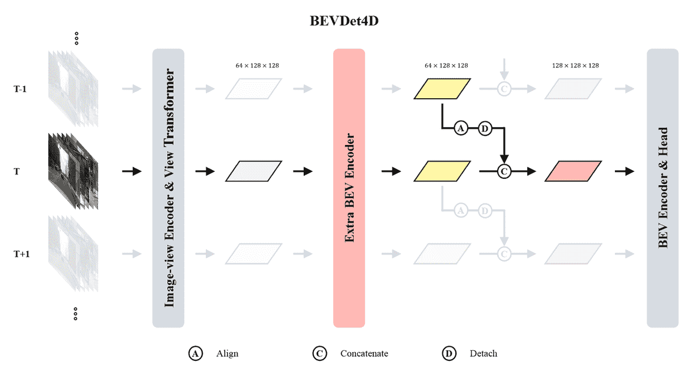

+   预测目标在相邻帧之间的平移而非直接预测速度，这样任务转化为预测目标在相邻两帧中的移位，这可根据BEV特征图的差异来测量。

+   两个特征图为自车坐标系，先将两个特征按静态对齐(此时静态对齐，BEV特征、动态和自车不齐)；然后将两帧特征对齐，将静态特征对齐（将前一帧的覆盖的特征crop出来，盖到与此时帧相同的位置）。最后将两个特征cat起来即可

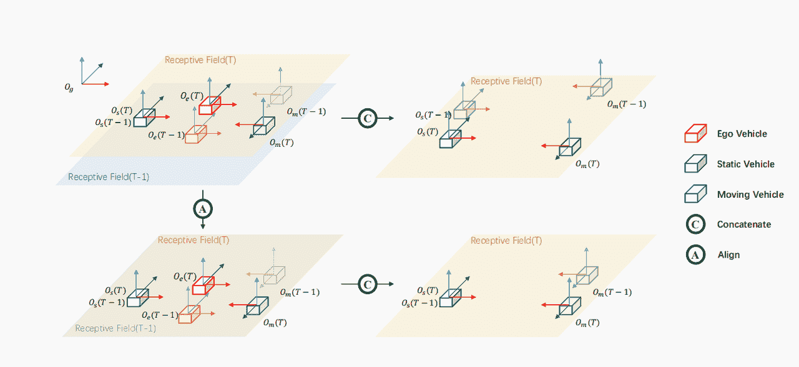

**对齐的时候**需要区分运动车辆、静止车辆**。把前一帧的B**EV特征根据自车运动信息与当前帧的BEV特征对齐。

> **结论**：直接**concat**性能下降，加入**R&T**对齐后提高，数据增强提点明显

### BevFusion

> **一种多传感器融合技术**，它可以将来自不同传感器（如**LiDAR**和**相机****）的数据融合到一个**统一的BEV表示中。BevFusion的优点在于它能够结合多种传感器的优点，从而在物体检测和跟踪任务中取得更好的性能。

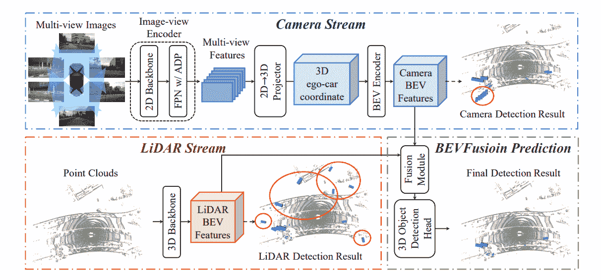

1.  相机端采用BEV算法生成BEV特征，如bevformer、LSS

1.  LIDAR端用3D卷积提取BEV特征，与相机端特征concat起来。

1.  采用通道注意力，全局池化+1*1卷积表示相机端和LIDAR端特征的权重比。

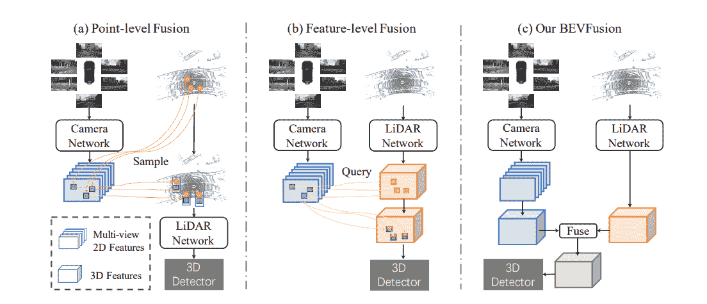

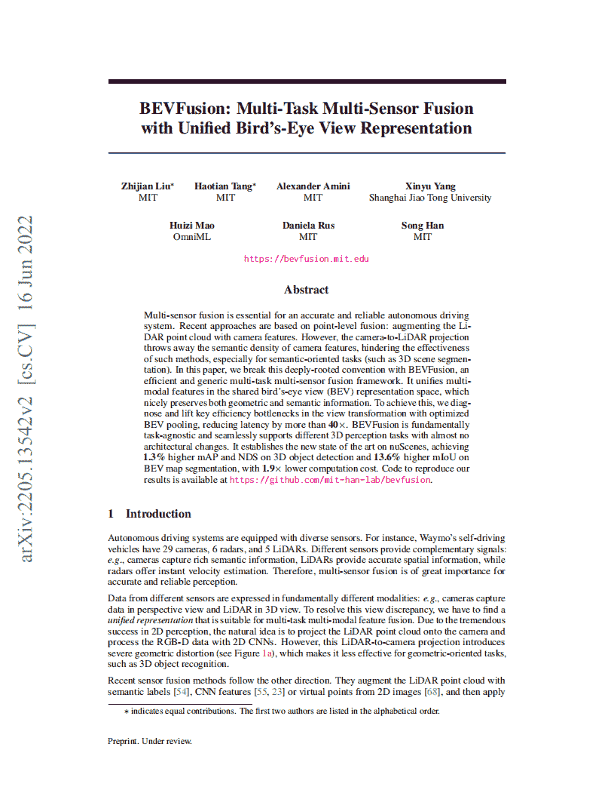

[BEVFusion：统一鸟瞰表示的多任务多传感器融合.pdf](https://internal-api-drive-stream.feishu.cn/space/api/box/stream/download/all/GUFNbJlqvoTndgxHflVc3JRpnCe)

BevFusion

### DETR3D

> **DETR3D**是一种用于重建图像连续深度的方法，与传统的离散深度分布不同。**它的核心方法**是围绕连续**深度预测**展**开，通**过先预测深**度图，然后利**用原始图像和深度图将其映射到3D点云空间。

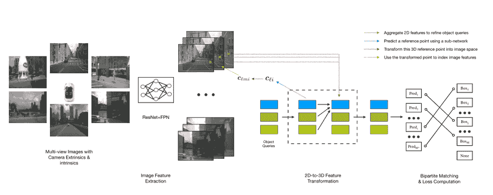

> **DETR****：**优雅的2D目标检测算法。**DETR3D**，与**DETR****的思想一**致，直接**在多视角图片上进行3D检测**。采**用将object qu**ery 经过transformer获得3D参考点，然后投影到图像，提取特征获得3D检测框。

[DETR3D：通过3D到2D查询从多视图图像中检测3D对象.pdf](https://internal-api-drive-stream.feishu.cn/space/api/box/stream/download/all/H8jbbNdyYo7CmbxilHycA6g7nJg)

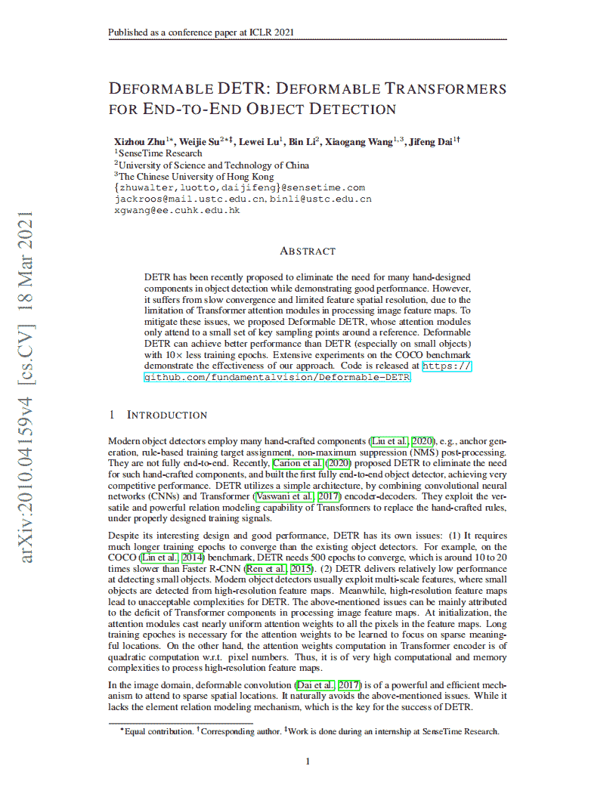

[DETR：用于端到端物体检测可变形变压器.pdf](https://internal-api-drive-stream.feishu.cn/space/api/box/stream/download/all/A7MhbsnexoCFaMxioYyc7Id0nAf)

DETR3D的过程可以总结如下：

1.  **深度图预测：**首先，使用DETR3D模型对输入图像进行处理，预测出连续的深度图。这个深度图表示了图像中每个像素点的深度值。

1.  **3D点云映射：**接下来，使用原始图像和预测的深度图，将图像中的像素点映射到3D点云空间。通过计算每个像素点的3D坐标，可以得到一组表示场景中物体位置的点云数据。

1.  **3D到2D的BEV空间构建：**在3D点云空间中，通过将点云投影到图像平面上，构建了一个称为Bird's Eye View（BEV）空间。BEV空间是在俯视图中观察场景时所看到的视角，它提供了一种更直观的场景表示方式。

1.  **2D图像特征查询：**DETR3D使用预先设定的object query，这是一组表示物体的特征向量。这些特征向量类似于锚点，用于查询图像中与之匹配的物体特征。

1.  **特征提取：**通过使用transformer模型，将object query转换为参考点（3D box的中心点坐标），然后将这些参考点投影到图像像素上。接下来，提取图像中与参考点相对应的目标特征。

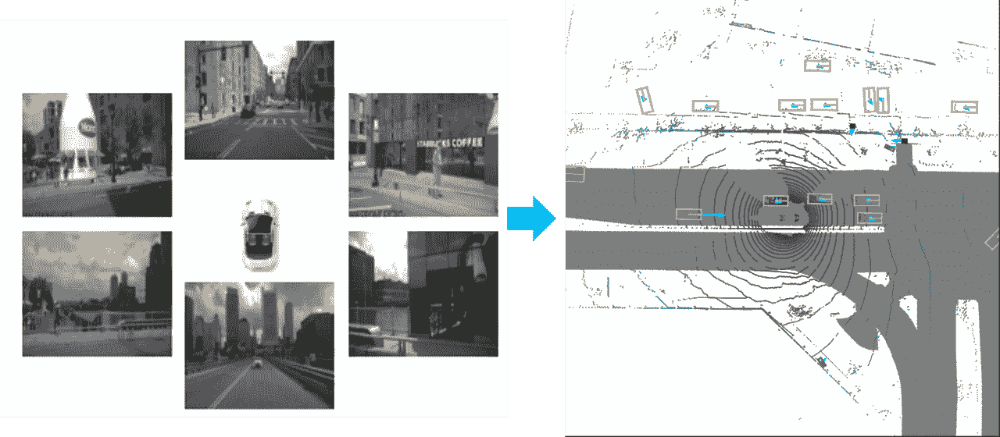

> **DETR3D**输出的目标特征可以用于**物体检测**、**定位**和**跟踪****等任务，以实**现**对场景中**物体的全面**理解和分析。**这种基于连续深度预测和3D点云的方法使得DETR3D在处理图像和场景中的物体时能够更准确地捕捉到深度信息，并提供更丰富的视觉理解能力。

**简单来说，BEV转换流程**：

+   **①****输入是多视角图像特征以及**预先设定的object que**ry（比如300个**256维，是一个**embedd**ing的向量，意义类似anchor，随机初始化找物体）

+   **②****object query**通过**transformer**生成reference points（3d参考点，也就是3d box的中心点坐标）

+   **③**将点投影到图像像素

+   **④**图像特征提取

+   **⑤**输出目标特征

### PETR

> 在**DETR3D**上**进行改进，认为其存在的问题：参**考点索引图像特征不准确，投影到图像位置会有偏差。另外，参考点投影到图像特征来更新object query不充分， 对全局特征考虑不完整。并且采样过程比较复杂。

**改进方法：**2D特征+3D编码，获得了3D特征。省略了采样和投影的过程。

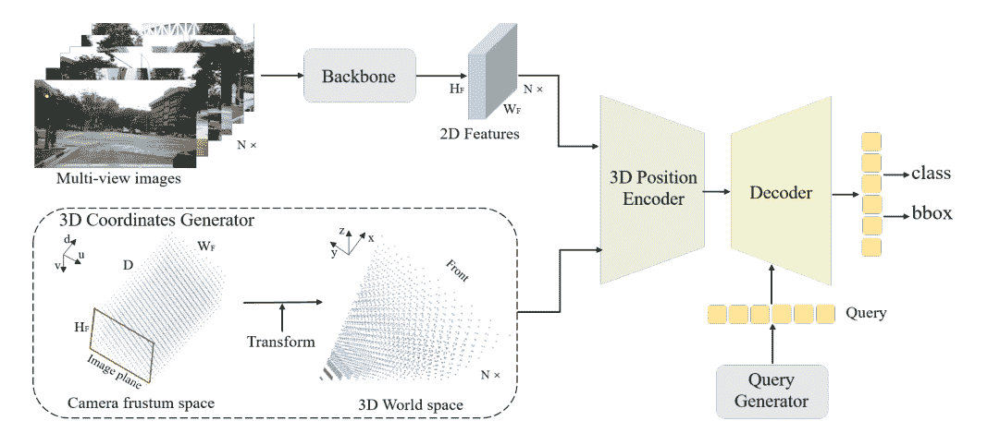

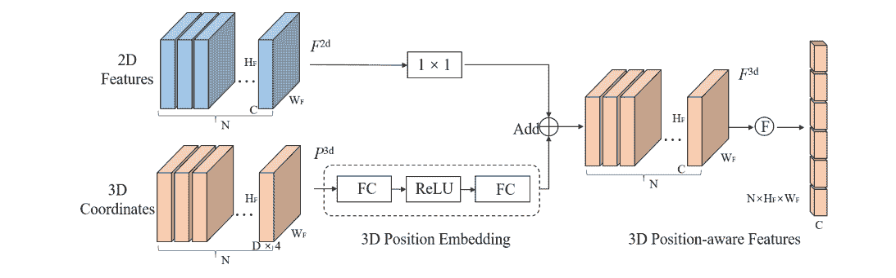

> 简单来说，即为增加一个3D**坐标****生****成器****，将**相机视锥空间的点离散为W*H*D并投影到3D空间中。将3D的位置编码到2D图片的特征中。通过FC到相同的通道数。

[PETR：用于多视点三维物体检测的位置嵌入变换.pdf](https://internal-api-drive-stream.feishu.cn/space/api/box/stream/download/all/G2qwbY12Co9yQBxCWrlcdw27nRh)

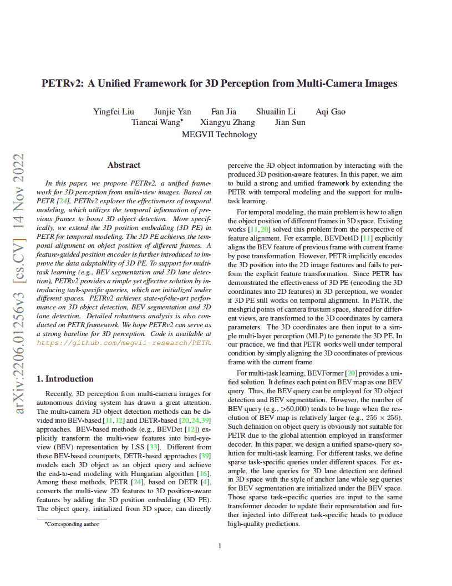

[PETRv2：多摄像头图像三维感知的统一框架.pdf](https://internal-api-drive-stream.feishu.cn/space/api/box/stream/download/all/SSnMbEz0XoRdB5xxzo6cjg0Un0g)

### PETRV2

**改进：**①时序（对齐方式，隐式的对齐，用前一帧的位置和此时的位置供网络学习） ②多任务头。

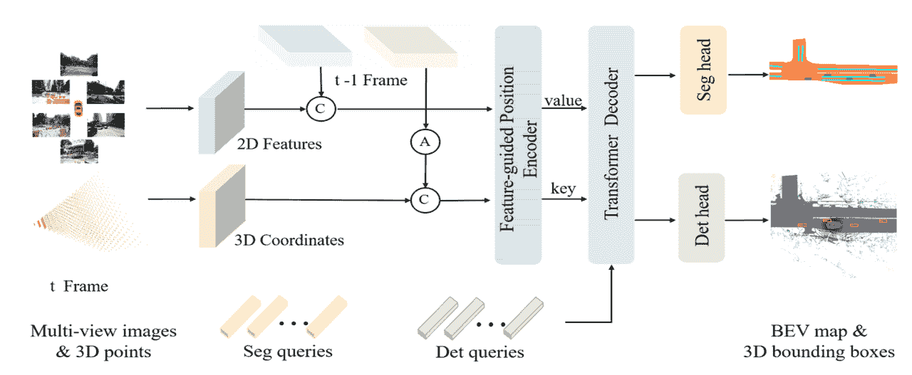

### BEVDepth

> 它将**点云数据**投影到**BEV**，然后利用**CNN**预测每个**像素**的深度信息。**BEVDepth**的优点在于它能够产生高质量的深度图，这对于导航和物体检测等任务非常有用。

**2D->3D目前的缺点：**深度不可靠。

> ①没有明确的深度监督。

> ②网络无法利用相机的内外参数，无法有效推断像素深度。

> ③深度估计网络额外耗费时间。解决方法：引入深度监督，内外参数。

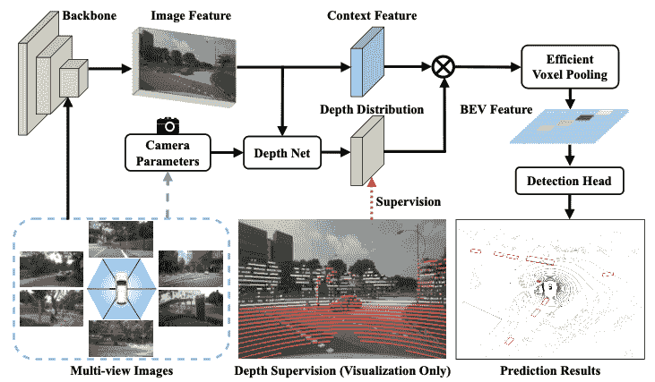

**核心：**

> **深度网络:**输入图像特征和相机参数。输出图像特征和深度分布。将相机的参数扩维，视为加权特征。输出深度分布。

>

> **深度监督:**来源于点云投影的深度，来辅助深度估计网络的训练。外参有偏差，导致点云深度有偏差，因此引入Depth refinement 网络来校准。获得BEV特征。

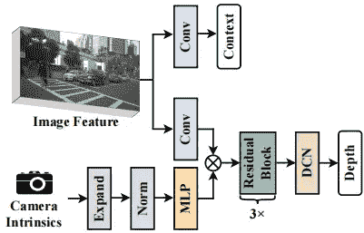

深度预测网络模块的示意图

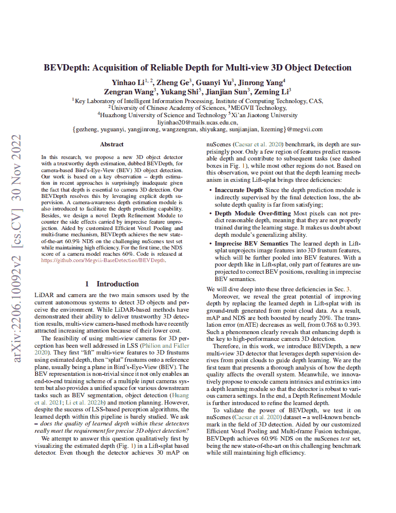

[BEVDepth：获取用于多视图3D对象检测的可靠深度.pdf](https://internal-api-drive-stream.feishu.cn/space/api/box/stream/download/all/BHqabPrzsofg0XxGUsMcch9jnKh)

<https://v11enp9ok1h.feishu.cn/sync/Ipw1d27gNsv3OAbo3N7cks4ZnJf>