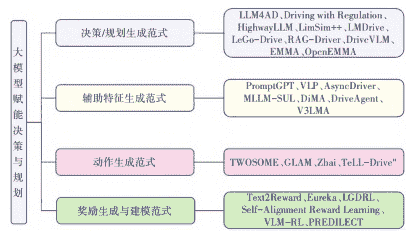
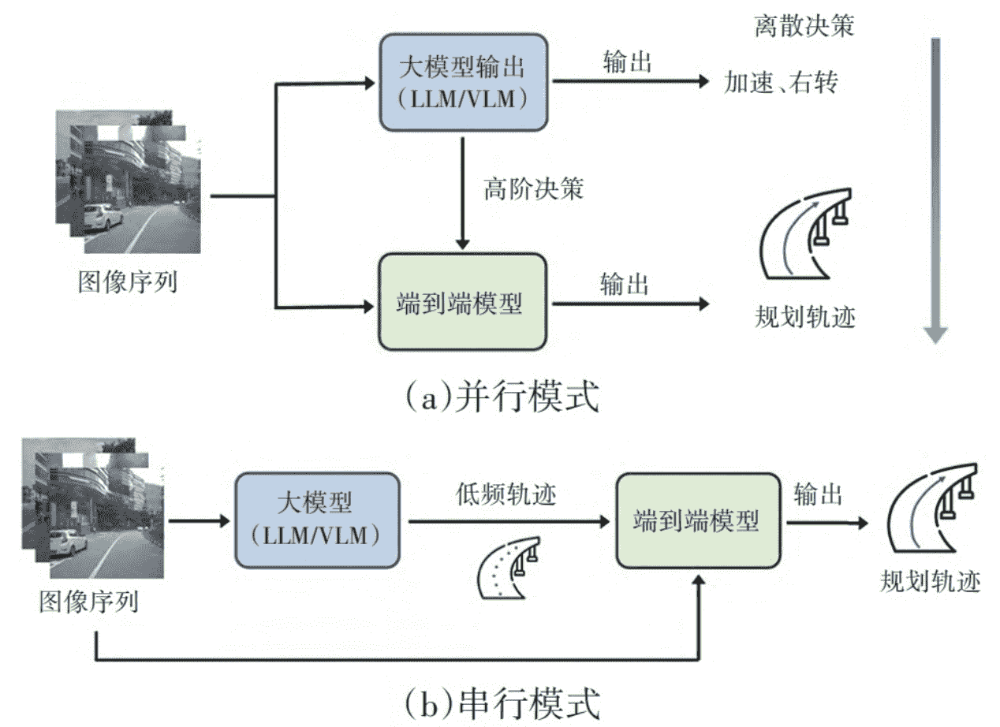
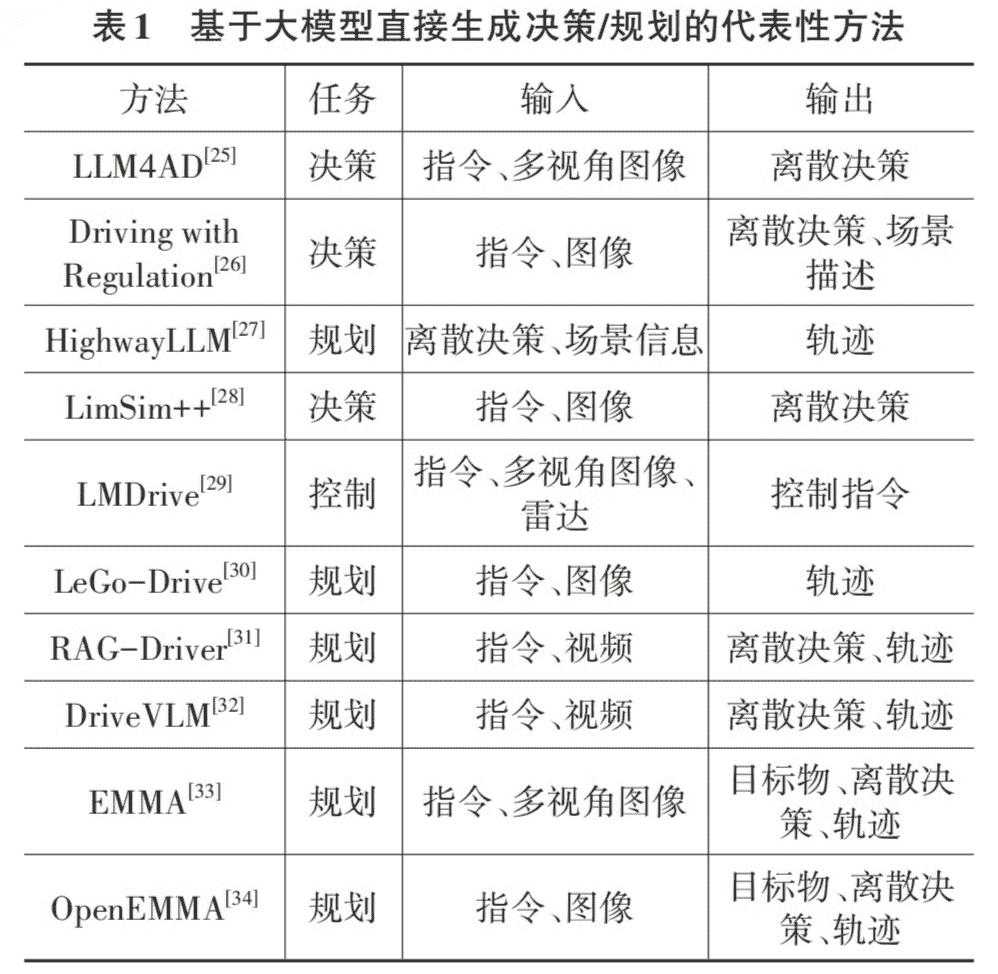
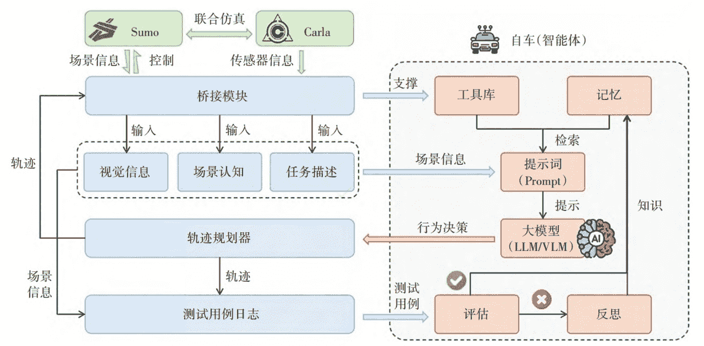
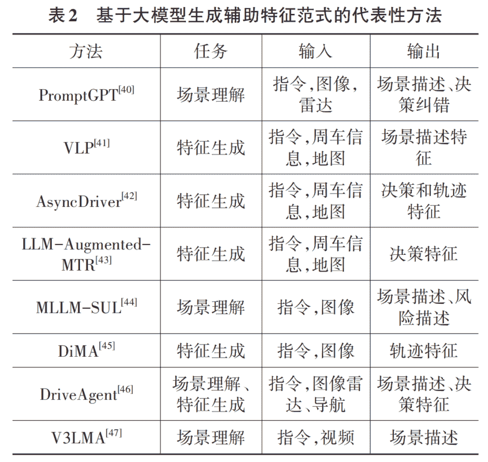
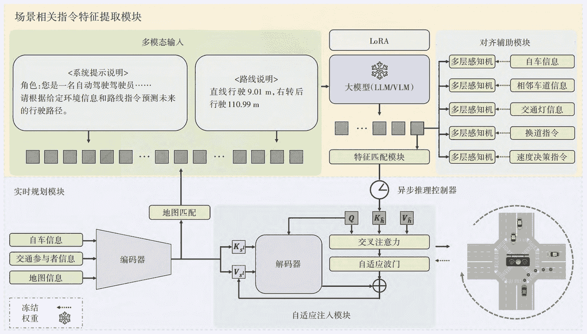
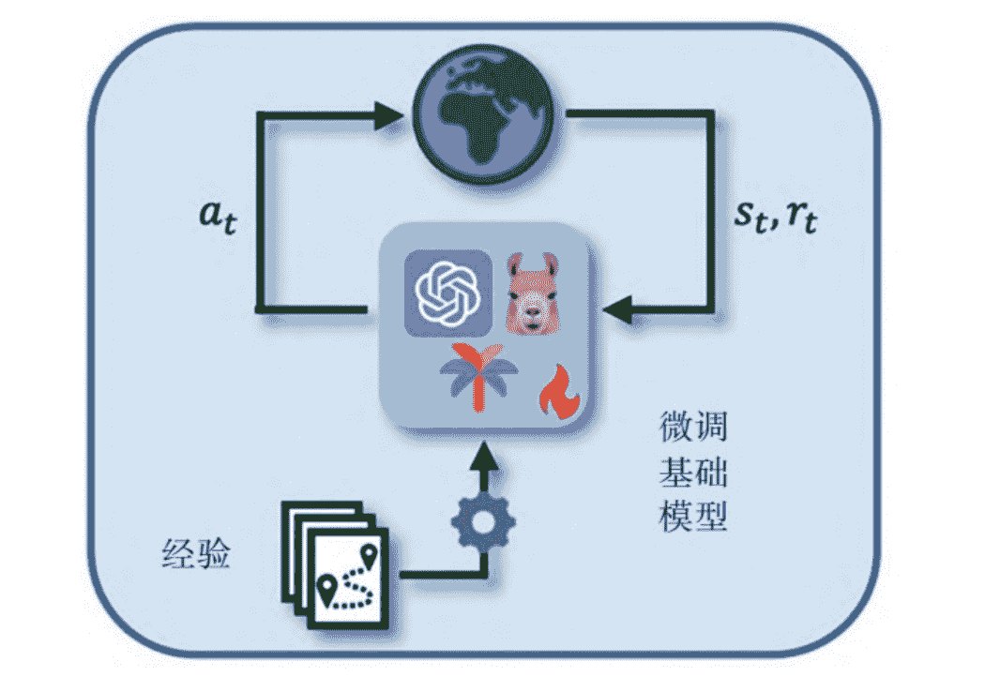
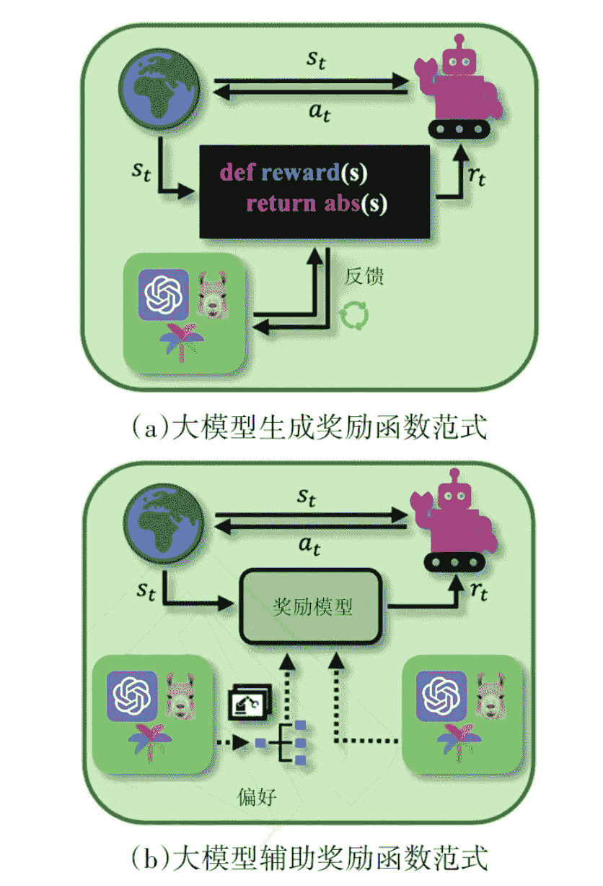
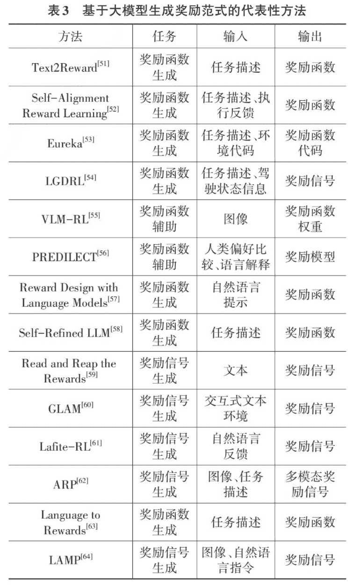

# 基于大模型的自动驾驶决策与规划

> 来源：[https://v11enp9ok1h.feishu.cn/docx/JSuMdHMNdo6Q7WxJL8scC0z8ntb](https://v11enp9ok1h.feishu.cn/docx/JSuMdHMNdo6Q7WxJL8scC0z8ntb)

**决策与规划**

**LimSim++技术示意**

**AsyncDriver技术示意**

### 决策与规划范式

行为决策通过利用交通环境的语义信息,如车道、信号灯状态、周围车辆的行为意图等，在离散的高层策略空间内进行换道、跟驰等离散动作决策；运动规划以高层决策结果为目标或约束，在连续的状态 - 控制空间中，生成满足车辆动力学与安全约束的轨迹，并在此基础上优化平滑性、能耗与行驶时间等性能指标。

根据建模与求解范式，决策与规划技术可分 3 类：

1.  模块化架构，如基于规则的有限状态机、基于优化的模型预测控制方法等。此类方法的可解释性和稳定性较好，但在应对复杂或未见场景时泛化能力有限。

1.  基于强化学习的方法12将决策或规划视作智能体与环境交互的试错过程，通过设计适当的奖励函数  评估策略的质量，并学习策略  ，最大化期望累计回报。

1.  基于模仿学习的方法13通过寻找一个策略  ，使其在演示数据集的状态 - 动作分布贴近专家策略

基于强化学习和基于模仿学习的方法均以学习策略为核心，具备更强的自适应性与泛化能力。

### 大模型

鉴于大模型在大规模语料与多模态数据上进行预训练，模型不仅能够学习交通文本的统计规律，还可建模跨时序、跨主体的上下文依赖，进一步捕捉面向驾驶决策的复杂语义关系。其输入可表示为一组词元（Token）：

LLM的输出是对下一个词元的概率分布,可表示为一个函数将输入   映射到输出   。在此基础上, VLM 可处理图像、视频、文本、点云等多模态输入,将多模态输入集合   映射到输出   :

式中: 为第(i,j)个样本在第k种模态(如图像、文本、点云)的输入。

VLM的关键组件包括各模态的编码器E、多模态融合模块F、语言模型f以及输出投影器P,VLM的输出可表示为:

在视觉问答、图像描述、多模态推理等任务上取得优异表现。在复杂的场景中引人VM,将视觉、文本等多模态传感信息融合,为决策和规划提供更丰富的上下文语义信息。

##### 在大模型的研究中,预训练"与微调"是两个关键阶段。

其中，在预训练阶段，模型常在海量通用数据（如网络文本、图像数据集）中进行自监督学习，掌握丰富的语言或多模态表征能力；而微调阶段是在特定领域或任务的数据，对预训练模型进行有监督或任务导向训练，使其能够适应具体应用场景并输出高质量结果。通过这种“先广泛学习，再聚焦优化”的策略，既能够融合大规模数据的普适性知识，又能保证模型在自动驾驶任务中的高性能。

##### 微调的主要技术包括

参数高效微调（Parameter-Efficient Fine-Tuning，PEFT）、提示词调优（Prompt Tuning）、指令调优（Instruction Tuning）和人类反馈强化学习（Reinforcement Learning from Human Feedback，RLHF）。

+   其中，PEFT的目标是在冻结大部分原始模型参数的情况下，仅对极少数新引入的可训练参数进行优化，在小幅增加显存和计算负担的前提下，使预训练模型快速适配特定的下游任务。

+   PEFT以LoRA为代表，通过低秩插入可训练分支，有效减少微调参数量与计算需求，支持大模型高效适配决策和规划等任务；

+   提示词调优使用可学习的连续向量提升模型下游任务表现，通过训练极少量的软提示向量，实现高效且低资源的大模型迁移，适用于需要频繁适配不同任务、计算资源有限的自动驾驶和智能交通等实际场景；

+   指令调优通过在大规模“指令 - 响应”格式的数据集上进行监督微调，引导模型学习按照自然语言指令进行任务推理与回答，从而实现多任务泛化和人机交互能力提升。

+   RLHF通过将人类反馈视为奖励信号来微调大模型，使其输出更加安全且符合人类偏好。

## 面向自动驾驶决策与规划的大模型概述

通过对基于大模型的决策与规划的典型范式分析分类方法如图1所示

###

### 大模型直接生成决策或规划范式

##### 在直接生成决策或规划范式中

大模型通常生成高阶决策指令(如行为意图、动作类别)或规划的轨迹(如一系列参考轨迹点),其与端到端模型结合的典型架构分别为并行模式和串行模式,如图2所示，

##### 在图2a中

大模型生成离散高阶决策指令，根据决策结果，端到端模型生成精细化轨迹规划；

##### 图2b中

大模型生成低频参考轨迹后，端到端模型基于参考轨迹进一步细化，输出高频轨迹。这种设计不仅能够提升系统的可解释性与灵活性，还充分发挥了大模型在环境语义理解、推理过程透明性与规则合规性等方面的优势。

通过系统地梳理该范式下代表性研究工作，对其核心思路、技术实现路径、典型应用场景及主干模型架构等关键要素进行全面总结，如表1所示。

##### LLM4AD将 IM设计为独立的决策模块

细粒度规划和控制由传统模块负责。通过系统化输人特征,引导LLM在决策过程中实现规则遵循、环境理解与个性化推理,同时提升决策透明度和灵活性。但仅依赖预训练大模型,极易出现幻觉现象351,从而影响推理的可靠性。

##### 针对 LLM 的幻觉问题

Driving with Regulation 引入了检索增强生成（Retrieval-Augmented Generation，RAG）机制。在推理阶段，系统实时检索交通法规知识库中与当前环境及候选动作相关的法规片段，并作为推理上下文输入至 LLM，指导模型进行合规性推理与解释性判断。该方法显著减少了幻觉和推理偏差，提升了动作选择的可靠性。

##### 基于本体的结构化知识建模

通过明确定义、对象属性、关系与规则逻辑表达，在推理过程中为大模型提供准确、一致的交通环境语义理解，避免因文本歧义导致的推理错误或幻觉，促进大模型在复杂交通规则约束下的泛化推理与决策能力提升。

##### HighwayLLM 结合 RL 与 LLM 技术

首先由 RL 模块输出高阶决策指令，随后 LLM 基于动作和环境信息推理生成轨迹点序列，并提供自然语言形式的推理解释，提升系统可解释性。但该模型推理过程依赖长提示词（Prompt）构建与历史轨迹检索，导致轨迹规划推理延迟远高于自动驾驶系统所需的毫秒级响应要求。由于试验仅在Highway数据集和仿真环境中验证，尚未在复杂的交通条件下进行测试。

LimSim++基于HighwayLLM提出决策与规划解耦的闭环验证框架，由LLM生成高层决策，使用独立的规划器细化执行，并在SUMO和CARLA仿真环境中完成完整闭环测试。该模型引入了反思机制与记忆机制，在每段驾驶任务完成后，系统通过评估决策优劣，存储高质量决策样本、反思并改进低质量决策，实现决策质量的持续优化，其技术框架如图3所示。尽管LLM在模拟环境中展现出卓越的性能，但推理延迟问题仍未彻底解决，且该短板在需要高频连续决策的城市驾驶场景中尤为明显。

##### DriveVLM采用链式推理（Chain-of-Thought，CoT）机制

分阶段完成场景描述、场景分析和分层规划，增强模型对复杂驾驶环境的理解与决策能力的同时，降低了大模型的计算开销和推理延迟。

##### 为了克服VLM在空间推理和实时性方面的局限

DriveVLM-Dual系统通过慢系统周期性生成高层策略和参考轨迹，快系统高频自主决策、灵活微调，形成异步协同、自适应采纳的慢-快双轨机制，无需强制切换，兼顾推理深度与实时响应。该系统实现了实际车辆部署，展现出大模型辅助自动驾驶系统在理解复杂场景、处理长尾案例方面的巨大潜力。

针对自动驾驶决策与规划信息的直接生成任务，大模型研究在环境认知精度、推理逻辑透明度、规则适配性上具有显著优势，但仍面临推理延迟偏高、多模态融合欠佳、真实环境验证不足等挑战。

### 大模型生成辅助特征范式

在生成辅助特征范式中,大模型作为辅助特征生成器,增强端到端方法在复杂环境感知、异常检测与决策容错性方面表现,该范式下具有代表性的研究工作,如表2所示。

##### PromptGPT 提出了一种融合 LLM 辅助的端到端框架

旨在提高传统端到端方法在复杂环境下的推理能力与容错性。该方法通过构建可学习的多模态联合 Token，将视觉、激光雷达感知数据和自车状态编码作为 Prompt，引导 LLM 进行场景理解与动作合理性推理。在此基础上，PromptGPT 引入纠错和重查询机制，当端到端方法预测出现偏差或存在潜在安全风险时，大语言模型能够辅助生成修正建议，建立端到端方法与大模型间的协同推理。

##### 局限性

然而，由于长 Prompt 的构建与大语言模型推理存在天然延迟，PromptGPT 仍存在一定局限性，其辅助推理过程难以满足系统实时毫秒级响应的需求，仅适用于离线训练或低速仿真测试场景。而且端到端方法自身的黑盒特性限制了外部纠错机制对内部决策逻辑的直接干预，PromptGPT 只能通过训练阶段的伪监督信号间接引导模型优化，仍无法避免推理不可解释性与安全验证难题。

##### 解决方案

VLP 提出了一种在训练阶段引入 LLM 推理特征的方法，结合LLM输出具有丰富语义的场景描述特征，在训练阶段，将这些特征融入IL的损失函数，通过自然语言描述和推理能力，提升模型复杂环境理解、轨迹预测与规划能力，增强自动驾驶系统在多变场景下的决策精准度与适应性。相较于PromptGPT，VLP的LLM特征仅作为辅助训练信号，不会引入推理时延，所以更适合实际部署。

VLP在训练阶段加入有效特征，而AsyncDriver面向实际部署的实时性需求，提出了异步LLM增强的闭环框架，如图4所示。在推理阶段，LLM以低频率运行，周期性产出场景辅助特征，高频轨迹规划器融合场景辅助特征与基础感知结果共同生成实时轨迹。具体而言，LLM以较低频率运行，基于感知信息与路由指令，提取场景关联特征（如当前环境复杂度、障碍物威胁等级、道路优先级等）；高频实时规划器融合LLM注入的辅助特征，在基础感知输入上，生成细粒度、实时更新的轨迹输出。AsyncDriver的异步特征增强设计在保持推理深度的同时，有效平衡了实时性与推理精度。

### 大模型生成动作范式

在大模型生成动作范式中，大模型通过微调或结合 RL 训练，发展为可感知环境变化、执行动作决策的智能体，如图 5 所示。与传统 RL 方法从零起步学习动作策略不同，这类方法充分利用了大模型的推理与语义理解能力，通过微调策略、动作输出机制的优化，进而提高任务适应性与采样效率。

##### 示例

以预训练 LLM 直接作为智能体并微调动作头的代表性范式为例，TWOSOME针对动态环境下的动作分布漂移,先进行动作概率归一化校准,再通过PEFT参数高效微调,最终在多步决策中提升样本效率与总体性能。Zhai等"9将LM的中间思考步骤显式纳入决策过程,经过微调后,大幅提高智能体对视觉语义理解和任务完成率。基于策略优化+动作分解+功能对产的参数化微调框架,使ILM智能体能够在动态场景中稳定对齐分布、提升推理与语义理解，并在适应性、样本效率与累计回报等指标上较基线取得显著提升。

与前述方法不同，开环范式为LLM仅离线产生专家偏好并用于蒸馏，部署时不会在控制回路内被调用。TeLL-Drive提出一种开环的专家引导（Teacher-Student）式训练框架，将LLM作为专家，基于场景推理产生对候选动作的偏好/评分，通过蒸馏、训练一个RL学生策略，从而将大模型的推理优势转移到一个轻量、可实时部署的策略中。

### 大模型生成奖励范式

在模型生成奖励范式中，大模型参与奖励设计或评价，即帮助 RL 方法定义或学习奖励信号，奖励设计在 RL 中更具挑战性。由于手工设计常依赖大量领域知识且易受稀疏反馈的影响，可采用逆强化学习或偏好强化学习，从专家示例或成对的偏好中学习奖励模型，但在训练分布之外（Out-Of-Distribution，OOD）的场景中，所学奖励的外推缺乏可靠性保证。

##### 奖励模型

在该范式中，大模型能够从高层描述中自动生成奖励函数（见图 6a），或直接充当奖励模型，给定状态 - 行为轨迹输出评分（见图 6b）。具体而言，一条路径是由大模型依据任务与规则生成可执行的奖励函数代码，经校验后直接供 RL 优化使用；另一条路径是由大模型对轨迹对或文本进行偏好判别，产生训练信号，再据此拟合参数化奖励模型作为未知真实奖励的代理。两条路径均能够减少大模型对手工奖励塑形的依赖，为 RL 智能体提供更丰富、可迁移的反馈。表 3 系统整理了该范式下具有代表性的研究工作。

####

#### 奖励函数或信号的生成

利用 LLM 生成奖励函数的方法使用大模型对任务目标的语言描述，其产出可执行的奖励函数代码，有效缓解了强化学习中 “奖励工程” 难题。传统的奖励函数受限于人工设计，耗时费力且无法涵盖任务的全部需求。通过引入大模型自动生成奖励计算逻辑，人为试错过程大幅降低，模型能够发掘人类未曾意识到的奖励成分，同时使生成的代码具备良好的可解释性。在具体实现中，为了确保大模型生成高质量的奖励函数，部分研究会在提示中提供编程环境的抽象或示例代码，并通过多轮对话不断完善生成的结果

##### 主要区别

在利用LLM生成奖励函数的范式中，不同方法的主要区别为：奖励的迭代改进策略与人类偏好反馈的介入形式与强度。例如，Text2Reward通过大模型反复尝试采用Python语言编写奖励函数，直到代码能够成功执行。在初步训练出RL策略后，允许非专业用户观察智能体行为，并用语言描述不满意之处，大模型据此进一步修改奖励函数，从而迭代提升策略表现。Zeng等提出，先由大模型根据任务要求辨识关键行为特征，形成初始参数化奖励函数，随后大模型通过反复比较智能体执行轨迹并进行排序，不断调整奖励参数，使策略逐步朝向期望的行为收敛。Eureka等采用一种进化搜索策略，每一轮迭代中，大模型会生成多个候选奖励函数并分别训练对应的策略，选择表现最佳的策略所对应的奖励函数，进入下一轮继续生成。其中，选择标准不仅需要考虑策略的累积回报，还应包括奖励函数组件的多样性等度量，从而鼓励生成更丰富的奖励形态。

##### 推理实时性与自主性

除了生成奖励函数外，一些研究探索通过直接生成奖励信号来指导强化学习训练。LGDRL将LLM作为奖励生成器与RL结合，在训练阶段根据任务目标与期望行为，动态生成与智能体当前行为一致的奖励信号，进而引导RL代理学习。但在测试阶段则不再调用大模型，由已训练的RL策略独立闭环执行，从而保证推理实时性与自主性。

##### 研究结果

上述方法能够生成表现优于人工奖励设计的奖励函数和奖励信号，并具备良好的迁移性，少量人为干预即可适配新任务。现有研究结果表明，自然语言描述通常包含任务目标、约束与优先级等关键信息，LLM可将其解析并转译为可执行的奖励项与权重，从而有效指导复杂任务的奖励构建。然而，此类方法对提示设计模板与上下文构成较为敏感，不同的语序、解码设置等可能引入奖励项集合或相对权重的结构性漂移。同时，LLM也可能产生不符合事实的幻觉或遗漏关键的安全约束。此外，生成的奖励因基于对环境的简化表征，难以覆盖传感器噪声、开放集目标与长尾交互等真实复杂性，在实际道路环境中的可扩展性和可靠性仍有待检验。

#### 3.4.2 奖励模型辅助

奖励模型辅助不会直接生成奖励函数或奖励信号而是借助大模型定义或训练奖励模型,即针对决策或轨迹进行评分的模型。在该范式下,大模型主要发挥2类作用:

##### 直接充当代理奖励模型

将对期望行为的文本描述映射为数值奖励信号。VLM-RL将 VLM作为代理奖励,通过设定正向和负向语言目标,计算当前驾驶状态与目标间的特征相似度，直接生成密集、方向明确的奖励信号，引导端到端的策略学习，显著提升模型安全性与泛化能力。这种直接利用大模型判断优劣的简单方案，其性能更接近使用真实奖励训练的策略，同时避免了模型对大规模偏好标签或专家演示的依赖。

#####  辅助训练独立奖励模型

大模型通过解读人类偏好或结合视觉观察进行更准确的奖励评估。PREDILECT在收集偏好对时，标注者不仅需在两段轨迹中择优，还需附注1~2句自然语言说明依据。大模型通过读取此类自然语言释义，提取出轨迹中“好”或“坏”的关键片段标记，并将此信息以正则项形式融入奖励模型的训练目标。对于被标记为好的片段，奖励模型在拟合偏好时，会给予更高权重，反之则降低。因此，PREDILECT训练出的奖励模型更加准确地反映了人类偏好细节。

##### 实验结果

现有研究表明，大模型能够将自然语言中的任务目标、约束与优先级解析并转译为可用于策略学习的奖励信号/函数。在若干基准与模拟任务上，其基于LLM的奖励在成功率、累计回报等指标上可达到或超过人工设计奖励的水平，表明自然语言可作为复杂任务奖励规范的可行接口。但此类方法对提示模板、措辞、示例顺序与解码参数比较敏感，容易造成奖励项或权重的不稳定，从而出现幻觉或遗漏关键安全约束。为了提升模型的可实现性与效率，奖励更局限于环境的简化表示，而在高保真环境下的稳定性较差。

因此，后续研究应在高保真仿真 - 封闭场 - 道路测试的多级评测框架下，系统验证此类的可扩展性与可靠性。通过结合人类监督与显式安全约束，纠正并约束大模型可能产生的偏差。