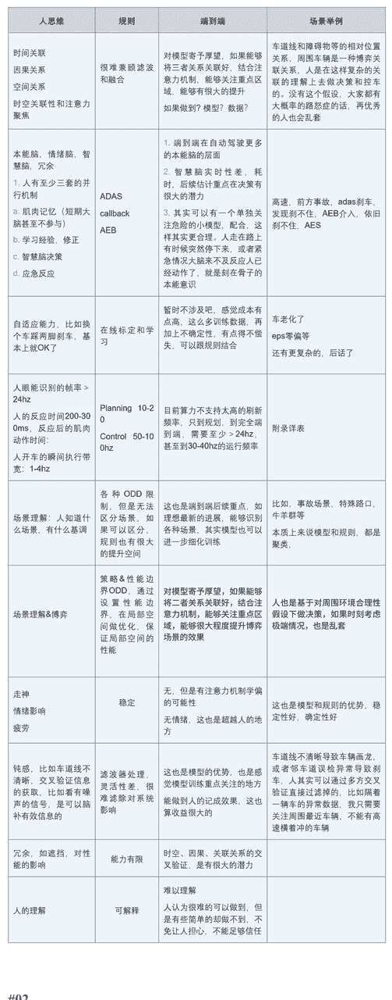
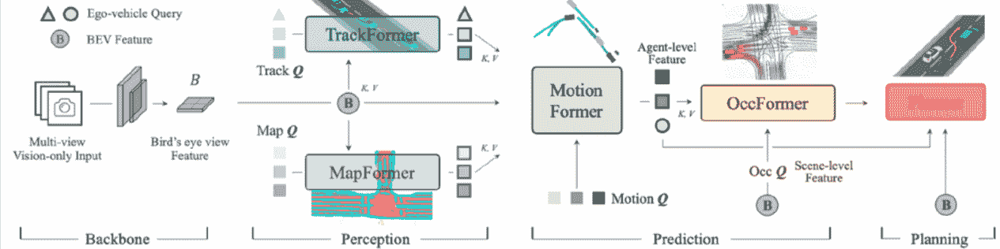
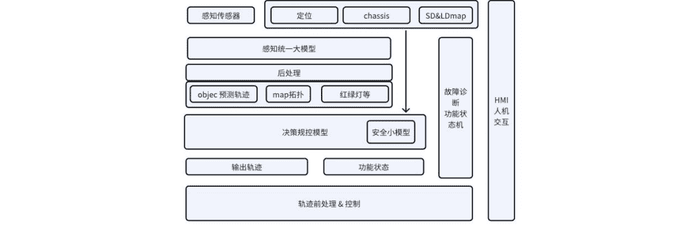
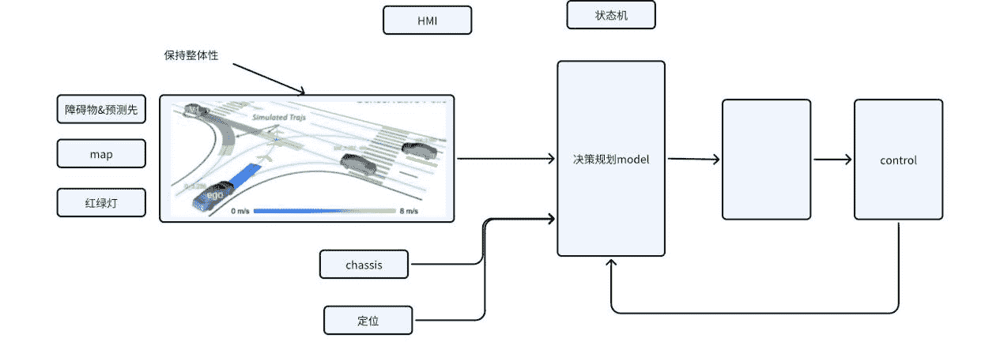
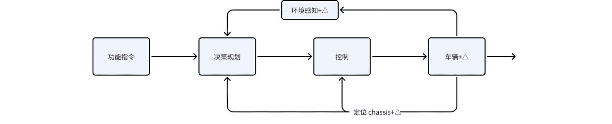
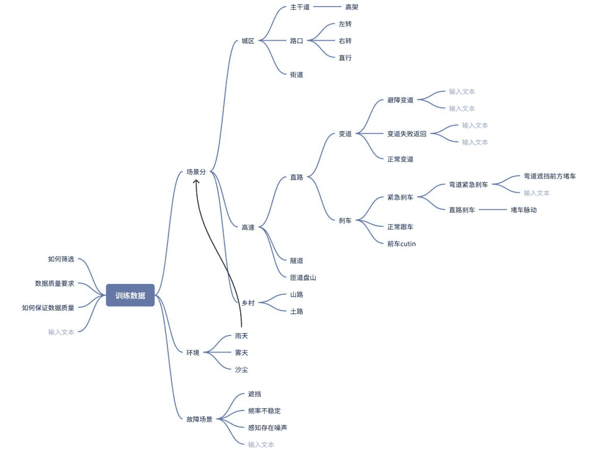
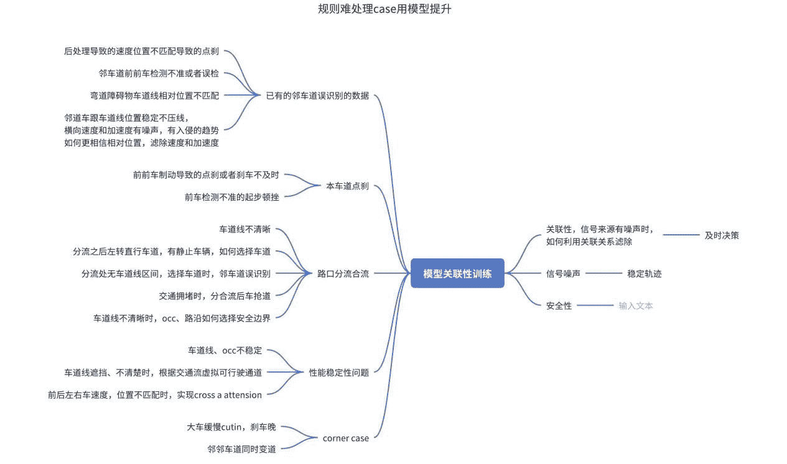
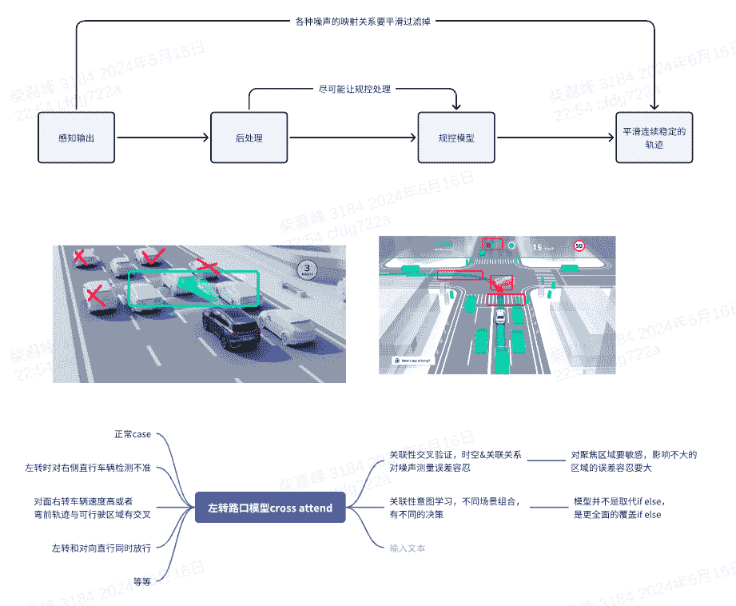
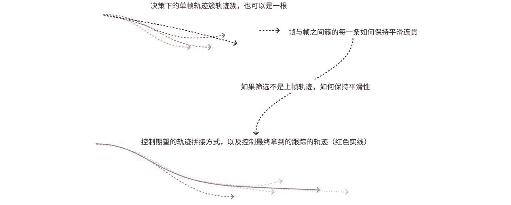

# 自动驾驶 端到端的系统架构闭环

> 来源：[https://v11enp9ok1h.feishu.cn/docx/FehEdhkT6ohCd4xH3aDcCv0tnnh](https://v11enp9ok1h.feishu.cn/docx/FehEdhkT6ohCd4xH3aDcCv0tnnh)

**网络模型特性的一些思考**

# **系统架构方案设计**

**系统架构**

> 对于大部分公司来说，分段端到端是必然的选择，目前行业内头部也是分段端到端的方案，Keep it simple but not too simple，系统架构师要从如下几个维度评估，毕竟公司是要盈利不是科研部门：

+   **是否具备条件：**端到端要有很强的数据算力等基础设施基础，如如何进行端到端闭环仿真。

+   **量产性价比：**可以复用和重构现有的感知已有经验，重点补齐规控。

+   **核心技术问题：**本质上来说是模型从开始到闭环，重点还是模型规控能力提升。

+   **enough：**足够信息的无损传递和误差累计，分段端到端可以有明显提升，尤其是如何理解无损。

2.2、方案详解

1.  感知&预测统一大模型或者继承已有模型

输出依旧是障碍物，地图、红绿灯，occ等，决策规划替换为模型，直接输出轨迹，轨迹做后处理之后，接成熟的控制模块。已有的故障诊断框架，功能状态机和产品输入不变，做适配，方案的变更对用户是无感，或者提升体验的。

1.  **方案工程量产分析**

+   感知在成熟方案上统一模型：数据、训练、评测等大部分都是可复用的，性能也是经过验证的，可以并行快速迭代，感知新feature的要求是个元素之间的时空关联关系的准确性，比如弯道性能经常障碍物和车道线关系错配，给下游规控带来很大挑战，统一模型并不一定就是一个模型能达到现阶段对关联信息的有效传递即可。

+   4D的自动化标注(如有），可以进一步提高模型输出的准确性，减少后处理的压力。

+   弱化后处理，后处理是跟规控耦合比较重的，依旧有上下游的配合，但是规控逻辑变了，理论上来说，规控应该对上游噪声和信号处理有更强的能力。

+   规控只进行算法的替换，保留功能状态逻辑，也是为什么选用分段的原因，规控有很多的功能交互逻辑，涉及到车道线等感知输入、用户和故障聚类后处理，不一定难，但是需要大量的时间积累，打磨和完善的，如果直接token，这些逻辑如何设置和验证代价其实不小，最好的方式就是先优先解决关键问题，逐步过渡。

+   规划的输出是决策后的轨迹簇还是单条轨迹。

主要考虑是训练数据来自不同的驾驶风格，按理说应该是多条输出，然后再进行选择输出，可以进行风格设置，是否有这个必要，需要结合实际情况，我的判断都可以实现，列出以供参考，不表。

1.  **输入输出接口**

1.  **Q&A**

为何感知和规控之间不选择token连接

+   token连接，当然可以同步有人的可视化同步输出，会破坏已有的闭环仿真基础设施链路，代价比较大，当然大家会问，信息依旧是有损传输；

+   规控人机交互和功能定义都是依赖感知等输入进行判断的，这部分是跟用户打交道的，是需要人可以理解的信息的，而且这部分是最接近用户体验的，也是需要时间和里程打磨的，从性能提升，开发工作量和测试里程和时间验证看，保持原有信息在如此快的迭代周期下，优先突破关键技术是最优的；

+   从我的评估看，无损的传递，能够把自车和障碍物的关联关系，他车障碍物（交通流）的关联关系，障碍物和地图的关联关系，以及历史经验和未来预测的时空关联关系，按照已有的六自由度位姿信息无损传递，有效利用起来，就已经有质的性能提升，这些也是规则望尘莫及的；

+   为何要障碍物，预计以及地图一张图就是想保留如何如上的关联关系，至于这些信息引入的噪声如何处理，确实也是需要下游对cross attend（后续我都用交叉验证描述，更能表达我的意思）设计的挑战；

+   为何预测放在感知，而不是跟决策规划融合在一起，预测本身可以从感知得到更多无损信息，进行训练，如果是token的传递，放上下游其实都OK，本身有4D自动化标注的话，放在感知输出的效果会更好。比如，时空关联信息，预测也能利用道，对于一些现在棘手的邻车道误入侵等，再比如高速上三车道大车不允许去快车道，预测信息也会学习(猜的，大家意会我的意思即可)。

### 规控的训练跟感知不同

1.  最本质的区别：开环与闭环

如图，定位、感知作为闭环系统的传感器，只需要保证准确、实时性，可以影响闭环稳定性，但是自身不受闭环系统的影响，不会因为闭环不稳定了，测量偏差就大了（当然会有一些，不是主要因素，这里不表），因而可以单独进行优化和评测，只要定义好性能指标，基本上问题不大。

闭环系统则不然，就是图中决策规划控制，任何模块都会对其产生影响，规控稳定也对其有指标要求，而且还得考虑干扰的影响，基于规则和优化的方法可以通过对算法内部&外部增加干扰，仿真和分析其鲁棒性和抗干扰能力。基于模型无法通过内部增加扰动和干扰的方式分析出来边界，只能通过验证的方式。

举个例子拿车道稳定来说，感知输出满足性能满足，那就满足要求，但是规控不一样，规控要在感知有些干扰下要稳定，定位有噪声也要稳定，车辆不同角度激活要稳定，eps存在零偏要稳定，存在路面湿滑，横风也要稳定，综合如上所有的因素叠加，也要稳定。

1.  **训练&验证的确定&多模态**

+   如感知稳定检测前车，不管加速，减速都OK，规控是不一样的，前车减速，可以变道，变道超车，也可以减速，同样一个场景，有人选在变道加速，匀速变道，轻刹车跟车，同样一个场景会有多种选择选都可以，如何训练？数据风格如何保持？

+   跟感知不同，感知只需要检测跟踪已确定的东西，规控是一系列的可能得未来的行为，行为存在多模态特性和不确定性以及时空关系，，如规控策略文章MARC，就是考虑概率、不确定性、多模态交互下预测&决策&规划的闭环优化，大疆的成行方案的基础，大疆的出色表现，也能感受到这些特性处理对性能提升的潜力，但是毕竟优化规则天花板是有限的，所以最后输出最好是决策后的一簇曲线，可以进一步进行平滑性和风格处理更合理一些。

## 模型训练

### 3.1、核心是数据

从下图看，整理完这张图根本就放不下，如何合理的建立场景树，覆盖足够的场景，另外一个就是数据如何采集，筛选，goodcase，badcase，corner都要有的，这个就不细表了，大部分有能力做的的公司都有基础建设的。

+   这里重点提一下鲁棒性、故障的场景，主要原因是基于规则可以通过理论配合试车测试进行评估，没有数据也可以开发中考虑到，但是规控的模型，则不然。

### 3.2、闭环稳定性如何保证，是否符合预期

**1. **规控如何读懂障碍物&map&时空关系，并能够利用其进行交叉验证，从各种噪声信号中不失真的获取有用信息。其实就一件事情，如何选择数据，没有了规则逻辑的设计，转为从训练数据，验证数据集入手，也是一个庞大系统，只能如图举例示意。

**2. **根据场景不如巡航，拥堵，变道，路口等，能够重点关注部分区域，如图，弱化对自身影响不大的区域，提高规控的鲁棒性的同时，也降低了感知的性能要求。

1.  **决策规划输出性能要求**

开环仿真模拟输出的轨迹，都是很完美的估计，因为是实时更新的，能保证本帧的合理性，下一个周期，训练数据会重置，相互之间是没有关联的，但是控制执行是有时空因果关系的，历史状态会对后续执行有明显的影响，反过来也会影响到轨迹，形成闭环。举个例子就是横鲁棒性不够的横向跟踪轨迹刚开始稳定，但是你稍微拉动方向盘再放手，有可能就开始逐渐画龙，控制跟踪越来越离谱，轨迹也开始受车身姿态影响变得扭曲。

a. 输出什么，如何输出：训练利用未来的行驶轨迹作为真值

+   输出单根轨迹：后处理相对容易实现，已有成熟方案，通过MPC对轨迹进行二次处理，再下发闭环控制；

+   多簇：优势在于可以通过后处理，调整驾驶风格，或者说二次滤除和选择不同驾驶风格的训练数据带来的不确定性，拿变道来说，每个人的变道轨迹肯定是不一样的。

b. 输出轨迹跟控制配合的稳定如图

+   轨迹数据已经是经过车身动力学过滤的，除了传感器噪声，都是物理可实现，白噪声对控制来说完全可以cover；

+   轨迹的输出长度，元素，连续性，如何匹配，图中其实都可以思考到。

**c. 轨迹的鲁棒性如何验证**

+   训练数据都是稳定的，都是筛选的数据，但是有时候控制是不稳定的，会引起画龙，这时候系统表现如何，是必须要验证，是否有发散的风险，轨迹是否能收敛而不是加剧画龙。

**3.3、功能闭环逻辑验证**

1.  **功能逻辑验证**

+   功能激活和退出，状态机和算法的配合，尤其是激活，是否需要轨迹replan？

+   功能升降级条件需要重新调试和匹配，尤其是接管逻辑；

+   变道轨迹的连续性，变道的功能逻辑，是否要在功能逻辑侧增加兜底的ttc等基于逻辑的安全校验和约束？

+   规控的闭环仿真验证，复用规则的验证方式，不过需要增加高保真动力学，以及模拟控制性能下降等场景，基于规则的方法，规控输出的轨迹本身就是符合控制系统输入要求的，理论设计可以保证存在不确定性时依旧在设定odd满足，但是基于模型则需要验证其鲁棒性。

1.  **功能的鲁棒性验证**

+   感知频率不稳定，遮挡，规控频率不稳定，对闭环稳定性的影响；

+   控制画龙或者跟踪误差大，规划是否能逐步稳定轨迹，不能加剧画龙；

+   定位底盘信号噪声和稳定性对感知和规控的影响；

+   车身姿态影响，比如人工接入拉偏后松手，是否能平稳的返回居中行驶；

+   功能逻辑验证，比如边上有车，离得比较近，拨杆变道，这些场景是否包含在训练集，或者需要包含，也是需要逐步验证，收敛的；

+   性能边界和一致性，由于模型的不可解释性，我们并不清楚是否能保证对同一场景的一致性表现，如果差异较大，对我们性能的验证就会带来很大的挑战；

+

+   120对0 的重复测试，极限cutin等性能验收都要做的测试，需要多次针对性验证。

1.  **故障诊断和升降级**

## 工程化

1、在线标定等相关成熟模块复用，尽可能减少闭环模型的不确定性，减少验证的成本

2、模型的功能安全和规则的安全校验是必须要的

3、其他