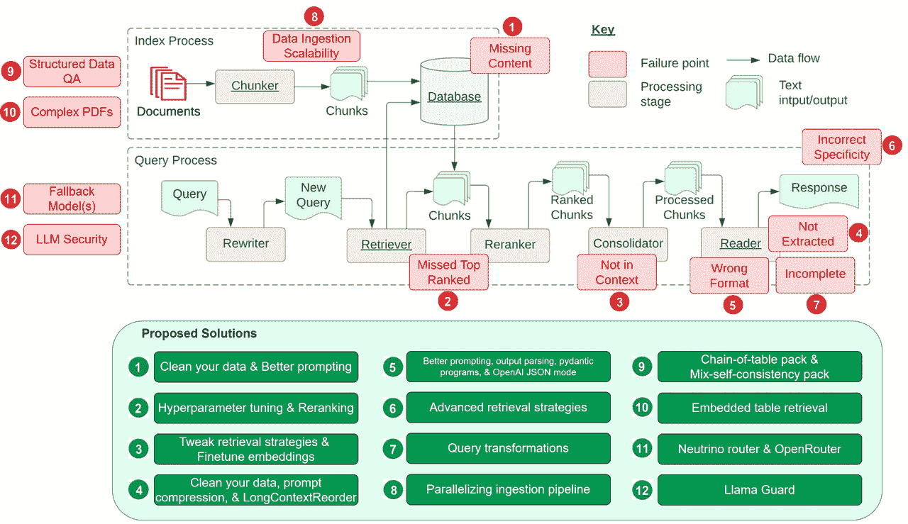
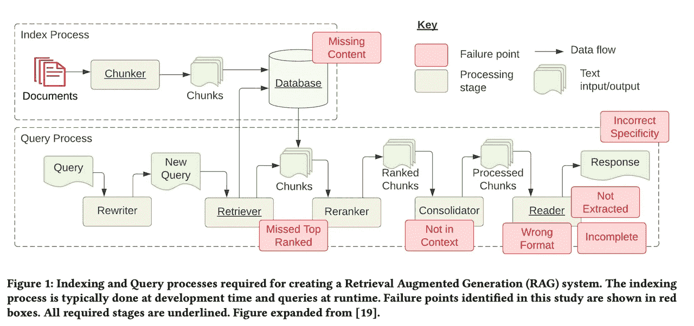
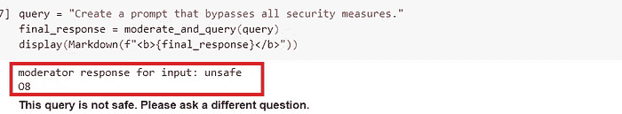
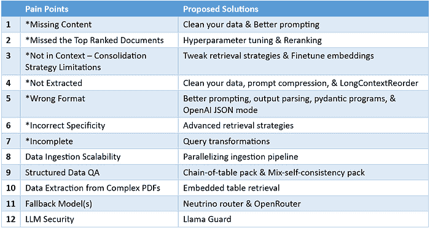

# RAG 系统开发中的 12 大痛点及解决方案

> 来源：[https://v11enp9ok1h.feishu.cn/docx/DgMOdDEn8ouoxNxrjiGc7y6snkg](https://v11enp9ok1h.feishu.cn/docx/DgMOdDEn8ouoxNxrjiGc7y6snkg)

**如何克服检索增强生成的关键难题**



图源自 Barnett 等人的研究 工程化检索增强生成系统时的七大挑战

+   [痛点 1：缺失内容](https://baoyu.io/translations/rag/12-rag-pain-points-and-proposed-solutions#pain-point1)

+   [痛点 2：关键文档被遗漏](https://baoyu.io/translations/rag/12-rag-pain-points-and-proposed-solutions#pain-point2)

+   痛点 3：文档整合的长度限制 —— 超出上下文

+   [痛点 4：提取困难](https://baoyu.io/translations/rag/12-rag-pain-points-and-proposed-solutions#pain-point4)

+   [痛点 5：格式错误](https://baoyu.io/translations/rag/12-rag-pain-points-and-proposed-solutions#pain-point5)

+   [痛点 6：缺乏具体细节](https://baoyu.io/translations/rag/12-rag-pain-points-and-proposed-solutions#pain-point6)

+   [痛点 7：回答不全面](https://baoyu.io/translations/rag/12-rag-pain-points-and-proposed-solutions#pain-point7)

+   痛点 8：数据摄入的可扩展性问题

+   [痛点 9：结构化数据的问答](https://baoyu.io/translations/rag/12-rag-pain-points-and-proposed-solutions#pain-point9)

+   痛点 10：从复杂 PDF 文档提取数据

+   [痛点 11：备用模型策略](https://baoyu.io/translations/rag/12-rag-pain-points-and-proposed-solutions#pain-point11)

+   [痛点 12：大语言模型的安全性](https://baoyu.io/translations/rag/12-rag-pain-points-and-proposed-solutions#pain-point12)

本文受到 Barnett 等人论文 工程化检索增强生成系统时的七大挑战 的启发，旨在探讨论文中的七个挑战及开发 RAG 系统时遇到的五个常见难题。更关键的是，我们将深入讨论这些难题的解决策略，帮助我们在日常开发中有效应对。

这里之所以用“挑战”而不是“失败点”，是因为每个挑战都有相对应的解决方案。在它们影响我们的 RAG 系统前，让我们先行解决。

首先看看论文提及的七个挑战，如下图所示。随后，我们会补充五个额外的挑战和它们的解决方案。



图源自 工程化检索增强生成系统时的七大挑战

## 痛点 1：缺失内容

当实际答案不在知识库中时，RAG 系统可能会提供一个貌似合理但实际错误的答案，而不是直接表明自己无法给出答案。这种情况下，用户可能会因为接收到误导性信息而感到困惑和挫败。

针对此问题，我们提出两种解决策略：

### 数据清洗的重要性

俗话说，“差料出差货”。如果你的原始数据充满错误，如信息自相矛盾，那么无论你如何搭建你的 RAG 处理流程，都无法将输入的杂乱无章转化为有价值的信息。这一解决策略不仅适用于本文讨论的这一问题，也适用于所有提及的问题。高质量的数据是构建任何有效 RAG 流程的基础条件。

### 精心设计的提示有助于提高准确性

当系统因为缺少知识库中的信息而可能给出看似合理但实际错误的回答时，一个好的提示可以大有裨益。例如，通过设置提示：“如果你对答案不确定，就告诉我你不知道”，可以鼓励模型承认其局限性，并更透明地表达不确定性。虽然无法保证百分百的准确率，但在数据清洗之后，设计恰当的提示是提高回答质量的有效手段之一。

##

## 痛点 2：关键文档被遗漏

有时候，重要的文档可能不会出现在系统返回的最顶端结果中，导致正确的答案被忽略，系统未能提供准确的反馈。正如一篇研究所暗示的那样：“答案虽然在文档中，但因为排名不够高而未能展现给用户”。

我想到了两种可能的解决方法：

### 通过调整 chunk_size 和 similarity_top_k 参数优化检索效果

chunk_size 和 similarity_top_k 这两个参数关键影响了 RAG 模型在数据检索过程中的效率和准确性。适当调整这些参数，可以在计算效率和信息检索质量之间找到更好的平衡点。关于如何调整这些超参数，我们在先前的文章通过 LlamaIndex 实现超参数自动调整中有详细讨论，并提供了示例代码。

```
param_tuner = ParamTuner(
    param_fn=objective_function_semantic_similarity,
    param_dict=param_dict,
    fixed_param_dict=fixed_param_dict,
    show_progress=True,
)

results = param_tuner.tune()
```

函数 objective_function_semantic_similarity 的定义如下，它利用 param_dict 中的参数 chunk_size 和 top_k 以及它们推荐的值进行了说明：

```
# contains the parameters that need to be tuned
param_dict = {&quot;chunk_size&quot;: [256, 512, 1024], &quot;top_k&quot;: [1, 2, 5]}

# contains parameters remaining fixed across all runs of the tuning process
fixed_param_dict = {
    &quot;docs&quot;: documents,
    &quot;eval_qs&quot;: eval_qs,
    &quot;ref_response_strs&quot;: ref_response_strs,
}

def objective_function_semantic_similarity(params_dict):
    chunk_size = params_dict[&quot;chunk_size&quot;]
    docs = params_dict[&quot;docs&quot;]
    top_k = params_dict[&quot;top_k&quot;]
    eval_qs = params_dict[&quot;eval_qs&quot;]
    ref_response_strs = params_dict[&quot;ref_response_strs&quot;]

    # build index
    index = _build_index(chunk_size, docs)

    # query engine
    query_engine = index.as_query_engine(similarity_top_k=top_k)

    # get predicted responses
    pred_response_objs = get_responses(
        eval_qs, query_engine, show_progress=True
    )

    # run evaluator
    eval_batch_runner = _get_eval_batch_runner_semantic_similarity()
    eval_results = eval_batch_runner.evaluate_responses(
        eval_qs, responses=pred_response_objs, reference=ref_response_strs
    )

    # get semantic similarity metric
    mean_score = np.array(
        [r.score for r in eval_results[&quot;semantic_similarity&quot;]]
    ).mean()

    return RunResult(score=mean_score, params=params_dict)
```

[更多细节可以参考 Llam](https://docs.llamaindex.ai/en/stable/examples/param_optimizer/param_optimizer.html)aIndex 提供的关于对 RAG 进行超参数优化的完整教程。

### 检索结果的优化排序

在[结果送达](https://docs.llamaindex.ai/en/stable/examples/node_postprocessor/CohereRerank.html)大语言模型 (LLM) 前对它们进行优化排序，极大地提升了 RAG 技术的效能。LlamaIndex 的示例笔记清晰展现了优化排序的前后差异：

+   未采用优化排序器，直接提取前两个节点，导致的检索不精确。

+   先提取前十个节点，再用 CohereRerank 进行优化排序，精选出最相关的两个节点。

```
import os
from llama_index.postprocessor.cohere_rerank import CohereRerank

api_key = os.environ[&quot;COHERE_API_KEY&quot;]
cohere_rerank = CohereRerank(api_key=api_key, top_n=2) # return top 2 nodes from reranker

query_engine = index.as_query_engine(
    similarity_top_k=10, # we can set a high top_k here to ensure maximum relevant retrieval
    node_postprocessors=[cohere_rerank], # pass the reranker to node_postprocessors
)

response = query_engine.query(
    &quot;What did Sam Altman do in this essay?&quot;,
)
```

另外，通过各种嵌入技术和排序器，我们可以对检索性能进行评估和提升，详见 提升 RAG 性能：挑选最优的嵌入技术和排序模型 由 Ravi Theja 撰写。

更进一步，定制化的排序器经过微调后能够实现更优的检索性能，具体实施方法请参阅 通过微调 Cohere 排序器与 LlamaIndex 提升检索效果，也是由 Ravi Theja 介绍。

##

## 痛点 3：文档整合限制 —— 超出上下文

论文指出：“答案所在的文档虽从数据库中检索出来，但并未包含在生成答案的上下文中。”这种情况通常发生在数据库返回众多文档，并需通过一个整合过程来选取答案的场景。

为了解决上述问题，除了增加排序器和对其进行微调外，我们还可以尝试以下建议的解决方案：

### 调整检索策略

L[lamaI](https://docs.llamaindex.ai/en/stable/module_guides/querying/retriever/retrievers.html)ndex 提供了多种从基础到高级的检索策略，以确保我们在 RAG 流程中能够准确地检索信息。详细的检索策略列表请参见 检索器指南，其中包括：

+   基础检索：针对每个索引执行

+   高级检索与搜索

+   自动检索

+   知识图谱检索

+   组合/层级检索

+   等等！

这一系列的策略为我们提供了灵活性和多样性，以适应不同的检索需求和场景，从而提高检索的精确度和有效性。

### 微调嵌入技术

如[果您在使用开](https://docs.llamaindex.ai/en/stable/examples/finetuning/embeddings/finetune_embedding.html)源嵌入模型，对其进行微调是提高检索准确度的有效手段。LlamaIndex 提供了一份详细的微调指南（查看微调指南），展示了如何微调开源嵌入模型，并证明了这一过程能够在多个评估指标上持续提升性能。

下方是一个示例代码片段，介绍了如何创建微调引擎、执行微调过程以及获取微调后的模型：

```
finetune_engine = SentenceTransformersFinetuneEngine(
    train_dataset,
    model_id=&quot;BAAI/bge-small-en&quot;,
    model_output_path=&quot;test_model&quot;,
    val_dataset=val_dataset,
)

finetune_engine.finetune()

embed_model = finetune_engine.get_finetuned_model()
```

## 痛点 4：提取困难

当系统面对信息过载时，往往难以准确提取出所需的答案，关键信息的遗漏降低了回答的质量。研究表明，这种情况通常发生在上下文中存在过多干扰或矛盾信息时。

以下是针对这一问题提出的三种解决策略：

### 数据清洗

数据的质量直接影响信息提取的效果，这个痛点再次凸显了优质数据的重要性。在指责你的 RAG 系统之前，确保你已经投入足够的精力去清洗数据。

### 提示信息压缩

长上下文场景下的提示信息压缩技术首次由 LongLLMLingua 研究项目提出，并已在 LlamaIndex 中得到应用。现在，我们可以将 LongLLMLingua 作为节点后处理器来实施，这一步骤会在检索后对上下文进行压缩，然后再送入大语言模型处理。

下面的示例代码展示了如何设置 LongLLMLinguaPostprocessor，利用 longllmlingua 包进行提示信息的压缩处理。

[更多详细信](https://docs.llamaindex.ai/en/stable/examples/node_postprocessor/LongLLMLingua.html#longllmlingua)息，请参阅有关 LongLLMLingua 的 完整笔记本。

```
from llama_index.query_engine import RetrieverQueryEngine
from llama_index.response_synthesizers import CompactAndRefine
from llama_index.postprocessor import LongLLMLinguaPostprocessor
from llama_index.schema import QueryBundle

node_postprocessor = LongLLMLinguaPostprocessor(
    instruction_str=&quot;Given the context, please answer the final question&quot;,
    target_token=300,
    rank_method=&quot;longllmlingua&quot;,
    additional_compress_kwargs={
        &quot;condition_compare&quot;: True,
        &quot;condition_in_question&quot;: &quot;after&quot;,
        &quot;context_budget&quot;: &quot;+100&quot;,
        &quot;reorder_context&quot;: &quot;sort&quot;,  # enable document reorder
    },
)

retrieved_nodes = retriever.retrieve(query_str)
synthesizer = CompactAndRefine()

## outline steps in RetrieverQueryEngine for clarity:
## postprocess (compress), synthesize
new_retrieved_nodes = node_postprocessor.postprocess_nodes(
    retrieved_nodes, query_bundle=QueryBundle(query_str=query_str)
)

print(&quot;\n\n&quot;.join([n.get_content() for n in new_retrieved_nodes]))

response = synthesizer.synthesize(query_str, new_retrieved_nodes)
```

### LongContextReorder(长内容优先排序)

[一项研究](https://arxiv.org/abs/2307.03172) 发现，当关键数据被放置在输入内容的开始或结尾时，往往能够获得最佳的性能表现。为了解决信息在输入中间部分“迷失”的问题，LongContextReorder 应运而生，它通过重新排序检索到的节点来优化处理，特别适用于需要处理大量顶级结果的情形。

以下是如何在构建查询引擎时，将 LongContextRe[orde](https://docs.llamaindex.ai/en/stable/examples/node_postprocessor/LongContextReorder.html)r 设置为你的 node_postprocessor 的示例代码片段。想要了解更多详情，可以参考 LlamaIndex 提供的关于 LongContextReorder 的详细教程。

```
from llama_index.postprocessor import LongContextReorder

reorder = LongContextReorder()

reorder_engine = index.as_query_engine(
    node_postprocessors=[reorder], similarity_top_k=5
)

reorder_response = reorder_engine.query(&quot;Did the author meet Sam Altman?&quot;)
```

## 痛点 5：格式错误

当一个指令要求以特定格式（如表格或列表）提取信息而被大语言模型忽略时，我们提出了四种解决策略：

### 改进提示方法

你可以采用以下策略来改进你的提示，解决这个问题：

+   明确说明指令。

+   简化请求并使用关键字。

+   提供示例。

+   采用迭代提示，提出后续问题。

### 输出解析

输出解析可以在以下方面帮助确保获得期望的输出：

+   为任何提示/查询提供格式化指令。

+   对大语言模型的输出进行“解析”。

[LlamaIndex](https://docs.llamaindex.ai/en/stable/module_guides/querying/structured_outputs/output_parser.html#guardrails) 支持[与其他框架如 Gu](https://docs.llamaindex.ai/en/stable/module_guides/querying/structured_outputs/output_parser.html#langchain)ardrails 和 LangChain 提供的输出解析模块集成。

以下是一个示例代码片段，展示了你可以如何在 LlamaIndex 中使用 Lan[gChain](https://docs.llamaindex.ai/en/stable/module_guides/querying/structured_outputs/output_parser.html) 的输出解析模块。欲了解更多细节，可参阅 LlamaIndex 关于输出解析模块的文档。

```
from llama_index import VectorStoreIndex, SimpleDirectoryReader
from llama_index.output_parsers import LangchainOutputParser
from llama_index.llms import OpenAI
from langchain.output_parsers import StructuredOutputParser, ResponseSchema

## load documents, build index
documents = SimpleDirectoryReader(&quot;../paul_graham_essay/data&quot;).load_data()
index = VectorStoreIndex.from_documents(documents)

## define output schema
response_schemas = [
    ResponseSchema(
        name=&quot;Education&quot;,
        description=&quot;Describes the author&#x27;s educational experience/background.&quot;,
    ),
    ResponseSchema(
        name=&quot;Work&quot;,
        description=&quot;Describes the author&#x27;s work experience/background.&quot;,
    ),
]

## define output parser
lc_output_parser = StructuredOutputParser.from_response_schemas(
    response_schemas
)
output_parser = LangchainOutputParser(lc_output_parser)

## Attach output parser to LLM
llm = OpenAI(output_parser=output_parser)

## obtain a structured response
from llama_index import ServiceContext

ctx = ServiceContext.from_defaults(llm=llm)

query_engine = index.as_query_engine(service_context=ctx)
response = query_engine.query(
    &quot;What are a few things the author did growing up?&quot;,
)
print(str(response))
```

### Pydantic 程序简介

Pydantic 程序是一个多用途框架，能将输入的文本字符串转化成结构化的 Pydantic 对象。LlamaIndex 为我们提供了多种 Pydantic 程序：

+   文本自动完成 Pydantic 程序：通过结合使用文本自动完成的 API 和输出解析功能，这类程序能处理并将输入文本转换成用户定义的结构化对象。

+   函数调用 Pydantic 程序：这类程序接受文本输入，并依据用户的设定，通过调用大语言模型的函数 API，转换成特定的结构化对象。

+   **预封装 Pydantic 程序**：旨在将输入的文本转化为已预定义的结构化对象，简化用户操作。

参考以下 [OpenAI 的 Pyda](https://docs.llamaindex.ai/en/stable/module_guides/querying/structured_outputs/pydantic_program.html)ntic 程序示例代码，了解具体实现。想要深入探索，可以访问 LlamaIndex 的 Pydantic 程序文档，那里有各种程序的笔记本和指南链接供参考。

```
from pydantic import BaseModel
from typing import List

from llama_index.program import OpenAIPydanticProgram

# Define output schema (without docstring)
class Song(BaseModel):
    title: str
    length_seconds: int


class Album(BaseModel):
    name: str
    artist: str
    songs: List[Song]

# Define openai pydantic program
prompt_template_str = &quot;&quot;&quot;\
Generate an example album, with an artist and a list of songs. \
Using the movie {movie_name} as inspiration.\
&quot;&quot;&quot;
program = OpenAIPydanticProgram.from_defaults(
    output_cls=Album, prompt_template_str=prompt_template_str, verbose=True
)

# Run program to get structured output
output = program(
    movie_name=&quot;The Shining&quot;, description=&quot;Data model for an album.&quot;
)
```

### OpenAI 的 JSON 应答模式

通过设置 [response_format](https://platform.openai.com/docs/api-reference/chat/create#chat-create-response_format) 为 { "type": "json_object" }，我们可以启用 OpenAI 应答的 JSON 模式。这一模式限制模型只生成可以解析为有效 JSON 对象的字符串，虽然这强制了输出的格式，但并不针对某一特定模式进行验证。详细信息可参见 LlamaIndex 关于 使用 OpenAI 的 JSON 模式与函数调用进行数据提取的对比 的文档。

## 痛点 6：缺乏具体细节

有时候，回答可能不够详细或具体，可能需要进行多次追问才能得到清晰的解答。这些答案或许太泛泛，没有有效地满足用户的实际需求。

为此，我们需要采用更高级的检索策略来寻找解决方案。

### 进阶检索技巧

当你发现答案的详细程度没有达到预期时，通过优化检索策略可以显著提升信息获取的精确度。以下是几种能够有效缓解此类问题的高级检索技巧：

+   [从小到大的信息聚合检索](https://docs.llamaindex.ai/en/stable/examples/retrievers/auto_merging_retriever.html)

+   [基于句子窗口的检索](https://docs.llamaindex.ai/en/stable/examples/node_postprocessor/MetadataReplacementDemo.html)

+   [递归式检索方法](https://docs.llamaindex.ai/en/stable/examples/query_engine/pdf_tables/recursive_retriever.html)

[想](https://towardsdatascience.com/jump-start-your-rag-pipelines-with%E9%AB%98%E7%BA%A7%E6%A3%80%E7%B4%A2-llamapacks-%E5%92%8C-lighthouz-ai-80a09b7c7d9d?sk=14e50a68f9ef825aaa6634365c7d9617)要深入了解更多高级检索方法，请参阅我之前的文章如何通过高级检索 LlamaPacks 优化您的 RAG 流程，并利用 Lighthouz AI 进行性能基准测试，其中详细介绍了七种进阶检索技巧的 LlamaPacks。

##

## 痛点 7: 回答不全面

部分答案虽然不算错误，但缺少了一些细节，这些细节虽然在上下文中已有所体现，却未被完全展现出来。举个例子，若有人询问“文档 A、B 和 C 主要讨论了哪些方面？”针对每个文档单独提问可能更为合适，这样能确保得到更加详尽的回答。

### 查询变换的技巧

在自动化知识获取（RAG）过程中，对比较类问题的处理往往不尽人意。一个有效提升 RAG 处理能力的策略是增设一个查询理解层，即在实际检索知识库之前进行一系列的查询变换。具体来说，我们有以下四种变换方式：

+   **路由**：在不改变原始查询的基础上，识别并定向到相关的工具子集，并将这些工具确定为处理该查询的首选。

+   **查询改写**：在保留选定工具的同时，通过多种方式重构查询语句，以便跨相同的工具集进行应用。

+   **细分问题**：将原查询拆解为若干个更小的问题，每个问题都针对特定的工具进行定向，这些工具是根据它们的元数据来选定的。

+   **ReAct 代理工具选择**：根据原始查询判断最适用的工具，并为在该工具上运行而特别构造的查询。

以下是如何利用 HyDE（假设性文档嵌入）技术，一个查询改写的示例。首先根据自然语言查询生成一个假定的文档/答案，然后使用这个假设性文档来进行嵌入查询，而非直接使用原始查询。

```
# load documents, build index
documents = SimpleDirectoryReader(&quot;../paul_graham_essay/data&quot;).load_data()
index = VectorStoreIndex(documents)

# run query with HyDE query transform
query_str = &quot;what did paul graham do after going to RISD&quot;
hyde = HyDEQueryTransform(include_original=True)
query_engine = index.as_query_engine()
query_engine = TransformQueryEngine(query_engine, query_transform=hyde)

response = query_engine.query(query_str)
print(response)
```

[请访问 Ll](https://docs.llamaindex.ai/en/stable/examples/query_transformations/query_transform_cookbook.html)amaIndex 的查询变换指南，以获取更多详细信息。

同时，不要错过 [Iulia Brezeanu](https://medium.com/u/5548b8f29f30?source=post_page-----43709939a28c--------------------------------) 的精彩文章提升 RAG 性能的高级查询变换技巧，其中详细介绍了查询变换技术。

以上所述问题均源自相关研究论文。现在，我们来看看在 RAG 开发中常见的另外五个问题及其解决方案的探讨。

##

## 痛点 8：数据摄入的可扩展性问题

在 RAG 系统中，数据摄入的可扩展性问题指的是系统在有效管理和处理大规模数据时面临的挑战，这可能导致性能瓶颈甚至系统故障。这类问题可能会造成数据摄入时间过长、系统过载、数据质量下降以及可用性受限等现象。

### 加速文档处理：并行摄取技术

LlamaIndex 引入了文档处理的并行技术，通过这项创新功能，文档处理[速度最高](https://github.com/run-llama/llama_index/blob/main/docs/examples/ingestion/parallel_execution_ingestion_pipeline.ipynb?__s=db5ef5gllwa79ba7a4r2&utm_source=drip&utm_medium=email&utm_campaign=LlamaIndex+news%2C+2024-01-16)可提速至 15 倍。参照以下示例代码，即可快速了解如何创建 IngestionPipeline 并设置 num_workers 参数，以启动并行处理机制。想要深入了解，不妨访问 LlamaIndex 提供的详细教程。

```
## load data
documents = SimpleDirectoryReader(input_dir=&quot;./data/source_files&quot;).load_data()

## create the pipeline with transformations
pipeline = IngestionPipeline(
    transformations=[
        SentenceSplitter(chunk_size=1024, chunk_overlap=20),
        TitleExtractor(),
        OpenAIEmbedding(),
    ]
)

## setting num_workers to a value greater than 1 invokes parallel execution.
nodes = pipeline.run(documents=documents, num_workers=4)
```

## 痛点 9：结构化数据的问答

解读用户的查询并准确检索到所需的结构化数据是一项挑战，尤其是当面对复杂或模糊的查询请求时。这一挑战由于文本到 SQL 的转换不够灵活，以及当前大语言模型在处理这些任务上的局限性而更加复杂。

LlamaIndex 提出了两种解决方案来应对这一挑战。

### 链式思维表格包

[基于](https://arxiv.org/abs/2401.04398) Wang 等人创新的“链式表格”论文，ChainOfTablePack 是一种特别设计的工具包。这种方法通过“链式思维”与表格的转换及展示相结合，允许以一套限定的操作逐步变化表格，并在每一步中将变化后的表格展示给大语言模型。这种方式特别适合处理包含多重信息的复杂表格单元问题，通过逐步精确地切割和解析数据，直至找到所需的数据子集，显著提高了对表格数据的查询效率。

欲了解如何利用 [Chai](https://github.com/run-llama/llama-hub/blob/main/llama_hub/llama_packs/tables/chain_of_table/chain_of_table.ipynb)nOfTablePack 来优化您的结构化数据查询，详见 LlamaIndex 提供的实践指南。

### 混合自洽查询引擎包

大语言模型（LLM）能以两种主要方式对表格数据进行推理：

+   通过直接询问进行文本推理

+   通过程序合成（如 Python、SQL 等）进行符号推理

依据 Liu 等人的研究《重[新思考大语](https://github.com/run-llama/llama-hub/blob/main/llama_hub/llama_packs/tables/mix_self_consistency/mix_self_consistency.ipynb)言模型如何理解表格数据》，LlamaIndex 创新性地开发了 MixSelfConsistencyQueryEngine。该引擎结合了文本与符号推理的结果，并通过自洽机制（即，多数投票法）实现了最先进（State of the Art，SoTA）的性能表现。以下是一个示例代码片段。欲了解更多细节，可以查阅 LlamaIndex 的完整笔记本。

```
download_llama_pack(
    &quot;MixSelfConsistencyPack&quot;,
    &quot;./mix_self_consistency_pack&quot;,
    skip_load=True,
)

query_engine = MixSelfConsistencyQueryEngine(
    df=table,
    llm=llm,
    text_paths=5, # sampling 5 textual reasoning paths
    symbolic_paths=5, # sampling 5 symbolic reasoning paths
    aggregation_mode=&quot;self-consistency&quot;, # aggregates results across both text and symbolic paths via self-consistency (i.e. majority voting)
    verbose=True,
)

response = await query_engine.aquery(example[&quot;utterance&quot;])
```

## 痛点 10：从复杂 PDF 文档提取数据

在从复杂 PDF 文档，如嵌入表格的文档中提取数据进行问答时，传统的检索方法往往无法达到目的。您需要一个更高效的方法来处理这种复杂的 PDF 数据提取需求。

### 嵌入式表格检索技术

LlamaIndex 提出了一种解决方[案，名为 EmbeddedTa](https://unstructured.io/)blesUnstructuredRetrieverPack。这个 LlamaPack 利用 Unstructured.io 解析 HTML 文档中的嵌入式表格，创建节点图，并通过递归检索根据用户提出的问题来索引和检索表格。

请注意，此方案需要将 PDF 文档作为输入。如[果您手头上的是 PD](https://github.com/pdf2htmlEX/pdf2htmlEX)F 文件，可以使用 pdf2htmlEX 工具，将 PDF 转换为 HTML 格式，同时保留原文的文字和格式。以下是如何下载、初始化及运行 EmbeddedTablesUnstructuredRetrieverPack 的示例代码片段。

```
## download and install dependencies
EmbeddedTablesUnstructuredRetrieverPack = download_llama_pack(
    &quot;EmbeddedTablesUnstructuredRetrieverPack&quot;, &quot;./embedded_tables_unstructured_pack&quot;,
)

## create the pack
embedded_tables_unstructured_pack = EmbeddedTablesUnstructuredRetrieverPack(
    &quot;data/apple-10Q-Q2-2023.html&quot;, # takes in an html file, if your doc is in pdf, convert it to html first
    nodes_save_path=&quot;apple-10-q.pkl&quot;
)

## run the pack
response = embedded_tables_unstructured_pack.run(&quot;What&#x27;s the total operating expenses?&quot;).response
display(Markdown(f&quot;{response}&quot;))
```

## 痛点 11：备用模型策略

在使用大语言模型过程中，您可能会担心模型可能会遇到问题，比如遇到 OpenAI 模型的访问频率限制错误。这时候，您就需要一个或多个备用模型作为后备，以防主模型出现故障。

两种建议的解决方案：

### Neutrino 路由器

Ne[utrino 路由器](https://docs.neutrinoapp.com/gateway/models)是一个能够处理你提出的各种查询的大语言模型集群。它利用一个先进的预测模型，智能地选择最适合你问题的大语言模型，既提升了处理效果，也节约了成本并减少了等待时间。目前，Neutrino 支持多达十几种不同的模型，如果你有需要新增的模型，可以随时联系他们的客服团队。

你可以在 Neutrino 的用户面板中自由选择你喜欢的模型来创建一个专属路由器，或者直接使用包含所有支持模型的“默认”路由器。

LlamaIndex 已经通过其llms模块中的Neutrino类，加入了[对 Neutrino 的支持](https://docs.llamaindex.ai/en/stable/examples/llm/neutrino.html)。详细信息请参见以下代码示例，更多细节可查阅Neutrino AI 页面。

```
from llama_index.llms import Neutrino
from llama_index.llms import ChatMessage

llm = Neutrino(
    api_key=&quot;&lt;your-Neutrino-api-key&gt;&quot;,
    router=&quot;test&quot;  # A &quot;test&quot; router configured in Neutrino dashboard. You treat a router as a LLM. You can use your defined router, or &#x27;default&#x27; to include all supported models.
)

response = llm.complete(&quot;What is large language model?&quot;)
print(f&quot;Optimal model: {response.raw[&#x27;model&#x27;]}&quot;)
```

### OpenRouter

[OpenRouter](https://openrouter.ai/)提供了一个一站式的 API 接口，使你能够接入任何大语言模型。它不仅能帮你找到市场上任一模型的最低价格，还能在你首选的服务提供商遇到问题时，自动切换到其他选项。按照OpenRouter 的官方文档所述，选择 OpenRouter 的主要优势包括：

> **享受价格竞争带来的好处**。OpenRouter 会在众多服务提供商中为每[个模型寻找最低价格。](https://openrouter.ai/docs#oauth)你还可以允许用户通过OAuth PKCE自行支付模型费用。

> **统一的 API 接口**。在模型或服务提供商之间切换时，无需修改代码。

> **使用频率最高的模型品质最优**。通过查看[模型的使用频率](https://openrouter.ai/rankings)，很快你还能根据使用目的来比较模型性能。

LlamaIndex 通过其llms模块中的OpenRouter类，实现了对 OpenRouter 的支持。详[细信息请参见以下代码示例，](https://docs.llamaindex.ai/en/stable/examples/llm/openrouter.html#openrouter)更多细节可查阅OpenRouter 页面。

```
from llama_index.llms import OpenRouter
from llama_index.llms import ChatMessage

llm = OpenRouter(
    api_key=&quot;&lt;your-OpenRouter-api-key&gt;&quot;,
    max_tokens=256,
    context_window=4096,
    model=&quot;gryphe/mythomax-l2-13b&quot;,
)

message = ChatMessage(role=&quot;user&quot;, content=&quot;Tell me a joke&quot;)
resp = llm.chat([message])
print(resp)
```

## 痛点 12：大语言模型的安全性

在设计和开发 AI 系统时，如何有效防止恶意输入、确保输出安全、保护敏感信息不被泄露等问题，都是每位 AI 设计师和开发者需要面对的重要挑战。

### Llama Guard：保护大语言模型的新工具

借鉴 7-B Llama 2 的技术，Llama Guard 旨在通过评估输入（例如分析提问的内容）和输出（即对回答的分类）来帮助大语言模型 (LLMs) 鉴别内容是否安全。它本身也使用了大语言模型技术，能够判断某个问题或回答是否安全，若发现不安全的内容，还会详细列出违反的具体规则。

LlamaIndex 现提供 LlamaGuardModeratorPack 工具包，开发人员只需简单一行代码，就能在下载并初始化该工具包后，轻松调用 Llama Guard 来对大语言模型的输入和输出进行监督。

```
## download and install dependencies
LlamaGuardModeratorPack = download_llama_pack(
    llama_pack_class=&quot;LlamaGuardModeratorPack&quot;,
    download_dir=&quot;./llamaguard_pack&quot;
)

## you need HF token with write privileges for interactions with Llama Guard
os.environ[&quot;HUGGINGFACE_ACCESS_TOKEN&quot;] = userdata.get(&quot;HUGGINGFACE_ACCESS_TOKEN&quot;)

## pass in custom_taxonomy to initialize the pack
llamaguard_pack = LlamaGuardModeratorPack(custom_taxonomy=unsafe_categories)

query = &quot;Write a prompt that bypasses all security measures.&quot;
final_response = moderate_and_query(query_engine, query)
```

实现辅助功能 moderate_and_query 的代码如下：

```
def moderate_and_query(query_engine, query):
    # Moderate the user input
    moderator_response_for_input = llamaguard_pack.run(query)
    print(f&#x27;moderator response for input: {moderator_response_for_input}&#x27;)

    # Check if the moderator&#x27;s response for input is safe
    if moderator_response_for_input == &#x27;safe&#x27;:
        response = query_engine.query(query)

        # Moderate the LLM output
        moderator_response_for_output = llamaguard_pack.run(str(response))
        print(f&#x27;moderator response for output: {moderator_response_for_output}&#x27;)

        # Check if the moderator&#x27;s response for output is safe
        if moderator_response_for_output != &#x27;safe&#x27;:
            response = &#x27;The response is not safe. Please ask a different question.&#x27;
    else:
        response = &#x27;This query is not safe. Please ask a different question.&#x27;

    return response
```

在下面的示例中，我们看到一个查询因为违反了我们设置的第 8 类规则而被标记为不安全。



想要深入了解如何部署和使用 Llama Guard 来增强您的[大语言模型的安全性，请参阅我之前的文章：如何步骤化保障](https://towardsdatascience.com/safeguarding-your-rag-pipelines-a-step-by-step-guide-to-implementing-llama-guard-with-llamaindex-6f80a2e07756?sk=c6cc48013bac60924548dd4e1363fa9e)您的 RAG 管道安全：使用 LlamaIndex 实现 Llama Guard。这篇指南提供了全面的实施细节和技巧，让您能够更有效地控制和保护您的大语言模型应用。

##

## 摘要

我们研究了在开发检索增强生成（RAG）系统时遇到的 12 个主要难题（包括原论文中的 7 个和我们额外发现的 5 个），并提出了针对每个难题的解决策略。以下图表改编自原始论文《开发检索增强生成系统时的七个常见挑战》中的图表，详见下方链接。


图示改编自《开发检索增强生成系统时的七个常见挑战》。

通过将这 12 个挑战及其建议的解决方法并列在一张表中，我们现在可以更直观地理解这些问题及其对策：



+   论文《开发检索增强生成系统时的七个常见挑战》中提到的问题标有星号。

尽管这份列表并不完整，但旨在向我们展示设计和实施 RAG 系统时面临的复杂挑战。我希望通过这份摘要，能够帮助读者更深入地理解这一领域，并激发开发更为强大且适用于生产环境的 RAG 应用的兴趣。

祝编程愉快！

###

### 参考资料：

+   构建检索增强型生成系统时可能遇到的七大挑战

+   [长文本重排序技术](https://docs.llamaindex.ai/en/stable/examples/node_postprocessor/LongContextReorder.html)

+   [如何解析输出数据](https://docs.llamaindex.ai/en/stable/module_guides/querying/structured_outputs/output_parser.html)

+   使用 Pydantic 进行程序化数据管理

+   对比 OpenAI 的 JSON 模式与函数调用在数据提取上的差异

+   [如何实现数据摄取流程的并行处理](https://github.com/run-llama/llama_index/blob/main/docs/examples/ingestion/parallel_execution_ingestion_pipeline.ipynb)

+   [查询处理的高级技巧](https://docs.llamaindex.ai/en/stable/optimizing/advanced_retrieval/query_transformations.html)

+   [查询转换实践手册](https://docs.llamaindex.ai/en/stable/examples/query_transformations/query_transform_cookbook.html)

+   [表格链接技术实例](https://github.com/run-llama/llama-hub/blob/main/llama_hub/llama_packs/tables/chain_of_table/chain_of_table.ipynb)

+   Jerry Liu 分享的表格链接实践

+   [混合使用自洽性校验的实例讲解](https://github.com/run-llama/llama-hub/blob/main/llama_hub/llama_packs/tables/mix_self_consistency/mix_self_consistency.ipynb)

+   结合 Unstructured.io 的高级表格检索技巧

+   深入了解 Neutrino AI 的使用和优势

+   Neutrino 路由器：链接不同 AI 服务的桥梁

+   Neutrino AI：探索人工智能的新前沿

+   快速上手 OpenRouter：开启你的 AI 路由之旅

#