# 优秀案例汇总

> 来源：[https://v11enp9ok1h.feishu.cn/docx/XYCfdR5QDoZgUjxDeavckqCXn7e](https://v11enp9ok1h.feishu.cn/docx/XYCfdR5QDoZgUjxDeavckqCXn7e)

# 前言

「飞书智**能**伙伴创建平台」（英文名：Aily）是飞书团队旗下的企业级 AI 应用开发平台，提供了一个简单、安全且高效的环境，帮助企业轻松构建和发布 AI 应用，推动业务创新和效率提升。为企业探索大语言模型应用新篇章、迎接企业智能化未来提供理想选择。

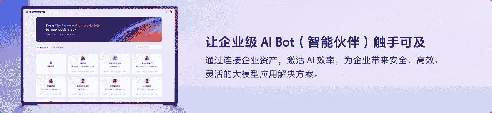

> 详细产品介绍参考：[飞书智能伙伴创建平台（Lark Aily）介绍](https://bytedance.larkoffice.com/wiki/LYY3wE4WNiUrxekJ6MScTGORn35)

> 官方交流社群：

# ⚙️ 通用场景实践

## CRM 商机助手

> CR[CRM AI场景演示](https://bytedance.larkoffice.com/docx/InyndpeJVoQosXxvO2iciYy4nie) 系统常存在老旧、使用不变、账号体系复杂等问题。Ai 时代，更多友好轻便的能力可以从原本的系统交互转变为自然语音对话交互，大幅减少一线销售时间投入，聚焦客户拜访与推进，创造更多产出。参考：

| 应用亮点 | 业务价值体现： |
| --- | --- |
| 应用demo |  |

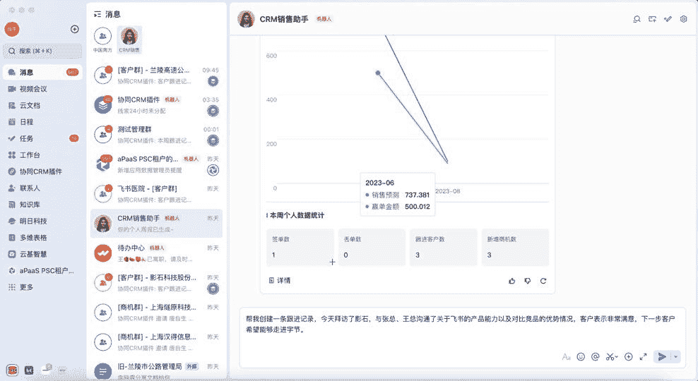

[CRM-AI-Demo-1215.mp4](https://internal-api-drive-stream.feishu.cn/space/api/box/stream/download/all/NUMsbMwuGoHyDBxfnLpcVY7YnFd)

## 信息搜索助手

> 根据用户输入的查询词，在企业内部以及外部互联网进行搜索，并对搜索到的内容进行智能总结。

| 应用亮点 | +   **企业集成：**支持整合企业内部知识库，实现内外部信息的一体化搜索和总结 |
| --- | --- |
| 应用截图 | 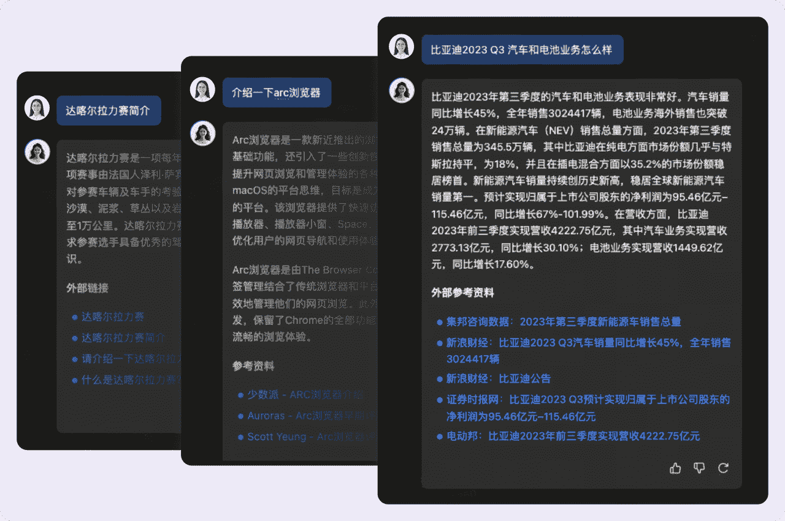 |
| 相关文档 | [信息搜索助手 demo 和 搭建方案](https://bytedance.us.larkoffice.com/docx/GmGgdkEDAo34Rixj2IpunlGAsLh) |

## 需求查询助手

> **「飞书需求查询助手」**是飞书内部使用 飞书智能伙伴创建平台（Aily） 解决业务场景的实践之一，用于帮助 GTM 团队快速查询客户反馈、了解需求进展及负责人，帮助 PM 团队更准确识别高价值需求，让客户的真实反馈更有力地驱动产品迭代发展。

| 应用亮点 |  |
| --- | --- |
| 应用截图 |  |
| 相关文档 | [飞书需求查询助手 最佳实践【分享版】](https://bytedance.larkoffice.com/docx/Ofq9d0YA3ock9TxhnhZcyWten6e) |

**✅ 支持对客团队****

快速定位和解答客户问**题

**✅ **全面了解各产品线的需求排期解决找人难的问题

**✅ ****助力产品团队****

收集、识别及分析重要需**求

通过询问「飞书需求查询助手」，快速了解飞书产品的现有能力及参考链接。

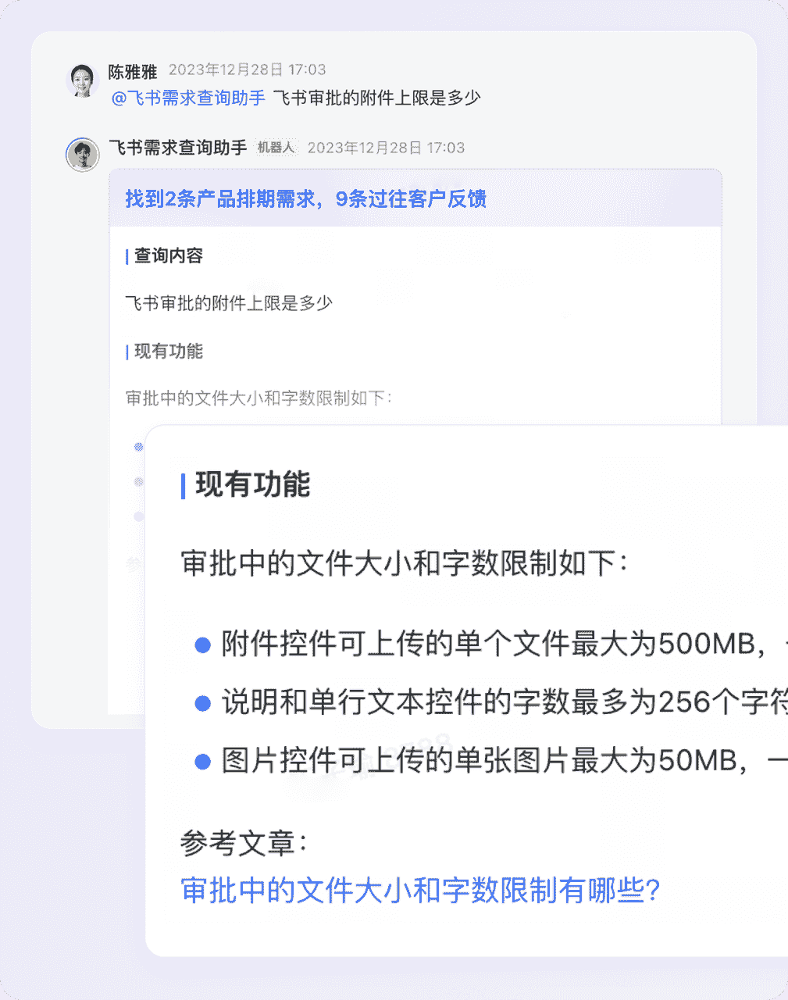

通过询问「飞书需求查询助手」，快速了解飞书待上线的产品排期和负责人，如需开通灰度可以进一步与 PM 沟通、申请开通。

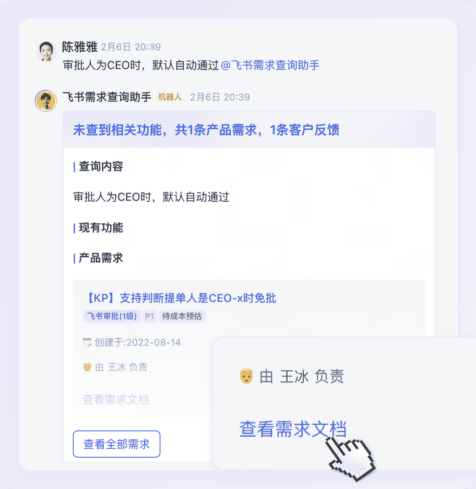

「飞书需求查询助手」能协助收集和整理各种渠道的反馈，并每天发送相应的多维表格给订阅者。

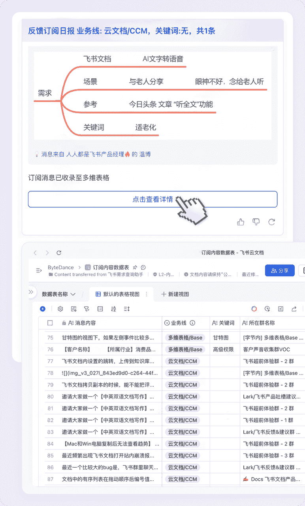

## 会议总结助手

> 会议是工作高频场景，且单次会议信息密度大，参会方多。因此，尤其需要关注「会议效率和会议效果」，且对会议纪要总结的要求高。会议总结助手可根据企业个性化定义总结内容，快速识别并输出核心相关结论，高效进行业务闭环。

| 应用亮点 | **飞书智能伙伴创建平台提供了让客户自****定义&amp;****精**细化**调优AI会议总结内容的能力：客户**可以按照自身行业业务特性+自身的工作要求设置，进一步提高AI生成的会议总结内容的可用性。例如：投资业务中的“项目会议review”、医药销售中的“销售会议质检”等。 |
| --- | --- |
| 应用截图 | 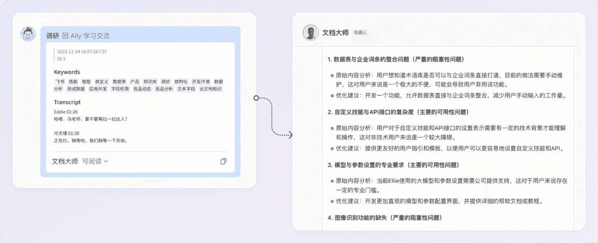 |
| 相关文档 | [【进阶教程】会议质检、会议总结等在 Aily 的应用场景搭建举例](https://bytedance.larkoffice.com/wiki/Qa6ywgY9UiGRkVkoG2Fc35UdnwH) |

## 智能 Meego 助手**（米粒）**

> 在 Meego 中建单，通常需要打开电脑使用 Web 端的 Meego 网页端进行操作，在实际的工作场景中，有不少需要快速建单的场景，可以通过AI进一步优化。米粒 Milly 的智能建单能力，能让用户直接在群聊中直接@机器人，或者在单聊中与机器人对话的形式，使用自然语言（语音或文字均可），告诉机器人名称及一些字段填写的信息，即可帮助用户快速建单。

| 应用亮点 | **建单和更新工单智能化**：降低飞书项目操作门槛，实现语音建单、语音流转工单。 |
| --- | --- |
| 应用截图 |  |
| 相关文档 | [米粒 Milly 帮你智能建 Meego 单](https://bytedance.larkoffice.com/wiki/UWxswkn3si2WlTkluMmcgtGtnch) |

**支持随时随地语音建单**

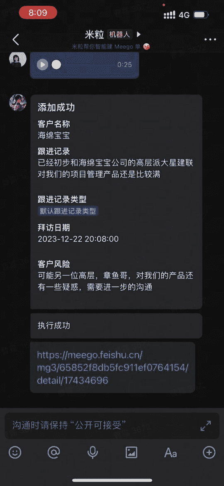

[语音建单.mp4](https://internal-api-drive-stream.feishu.cn/space/api/box/stream/download/all/GmMebRtA0oRepzxRi3xcUiOjnvh)

**建单流程，必填性校验**

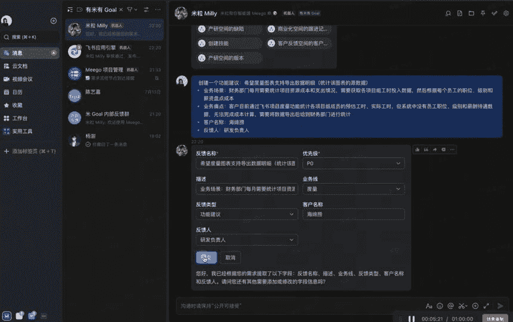

[客服建单.mp4](https://internal-api-drive-stream.feishu.cn/space/api/box/stream/download/all/KSX5bXQOPoUn26xfNodcO63DnNT)

话题群内建单，配合 Meego 自动化能力，一键拉群

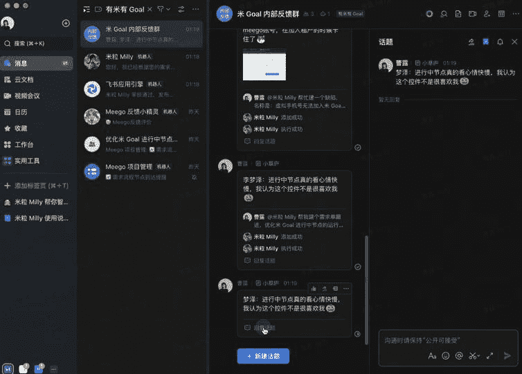

[话题群.mp4](https://internal-api-drive-stream.feishu.cn/space/api/box/stream/download/all/ZeOobQRJPoS6HjxksFucCmXznk6)

# 🏬 消费行业场景实践

## 智能舆情助手

> 企业 AI 舆情助手，使用 AI 大模型能力赋能企业舆情管理。

+   场景一：定期推送舆情/VOC 总结报告

+   场景二：对话方式快速了解舆情细节数据

+   场景三：紧急舆情自动拉群分配到处理人，并智能生成回复

| 应用亮点 | 业务价值体现： |
| --- | --- |
| 应用截图 |  |
| 相关文档 | [舆情管理 demo 和搭建方案](https://bytedance.larkoffice.com/docx/Mr1kd5SBko2MDzxg9PicM8uQnVb) |

根据已有舆情数据，通过对话方式了解需求数据，并以图表和文字总结形式呈现。

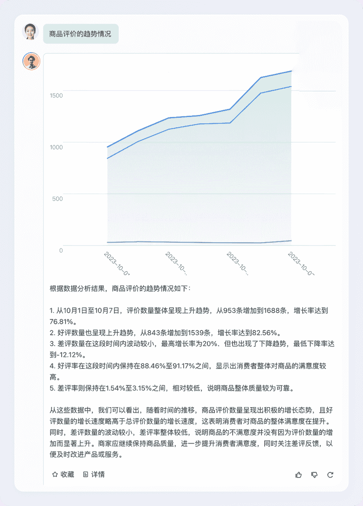

+   高危舆情自动报警并拉群

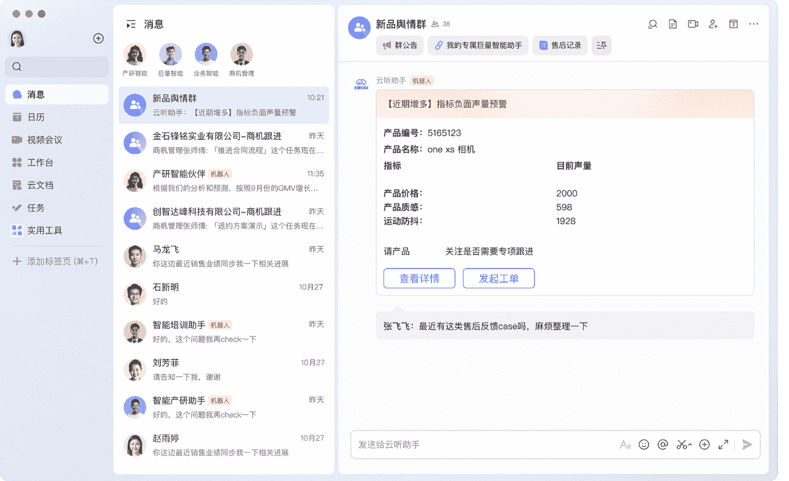

+   工单建群后，AI 自动识别过往工单中是否有类似问题

+   如有，自动推荐关联工单和历史解决方案

+   如没有，依据公网与知识库内容，生成建议方案

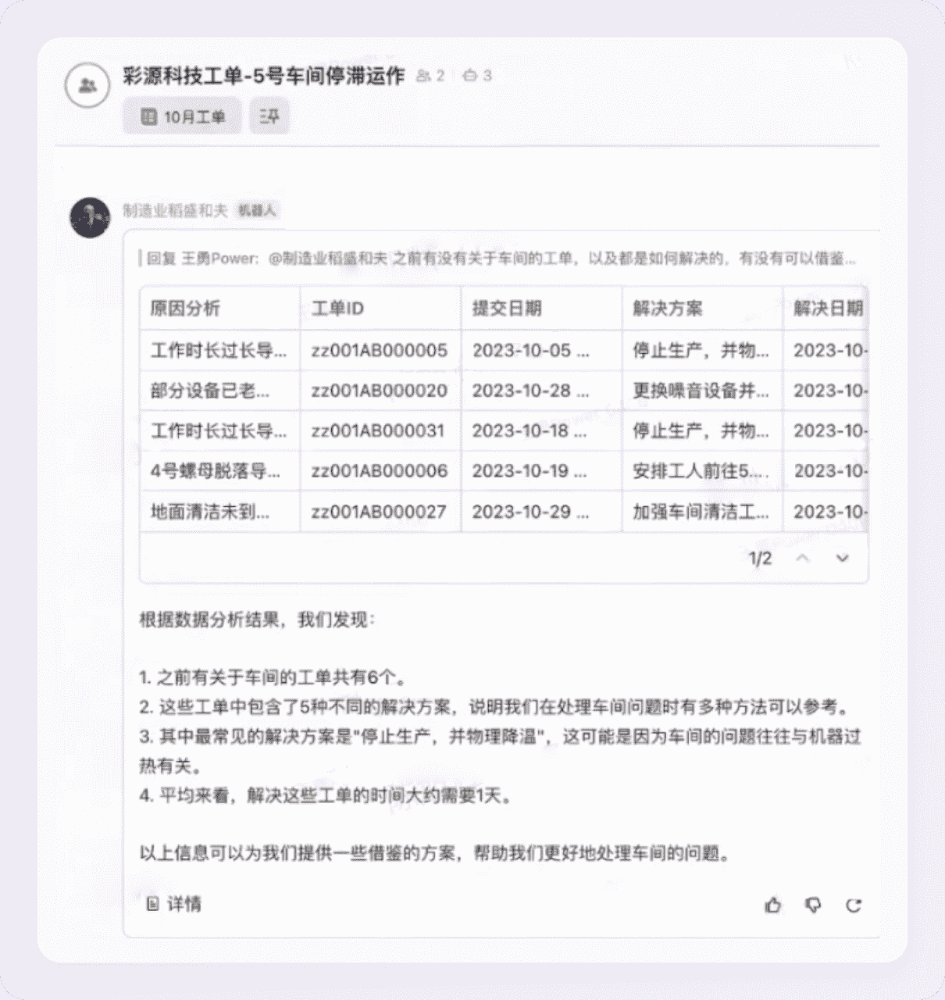

## 门店任务助手

> 门店管理场景中，许多关键的信息零散在群聊的对话中，核心任务无法被跟踪及追溯。门店任务助手在门店群聊这个“场域”中，对于员工的对话互动进行智能识别，将关键任务进行提炼、指派、跟进、闭环。

| 应用亮点 | +   **无需指令、自动唤起 AI** |
| --- | --- |
| 应用截图 | 门店任务助手自动监听群聊中的的客户投诉及任务分发，及时将其指派给对应负责进行处理。 |
| 相关文档 | [门店任务助手 demo和搭建方案](https://bytedance.larkoffice.com/wiki/Tq4Yw6PlwicDcAkLZwIcr3zLnZb) |

AI BOT 实时监听并自动识别群内的消息、语音和图片是否为“任务”

语音中提及的人也能识别并根据语义将任务指定给人

任务不定期提醒

店员用对话形式反馈完成情况，任务自动标记结束

店长可随时检查任务完成状态

系统也能提供不定期汇总任务完成情况，帮助店长或区长分析门店任务跟进效率

## 门店咨询顾问（小菜）

> AI 咨询顾问不仅能够为客户**提供门店经营情况分析**、运营优化等方面的建议和指导，还能生成门店经营分析报告，从而帮助客户提升业务绩效。

| 应用亮点 | +   **数据分析**：对门店的经营数据进行深入分析，包括门店销售数据分析、销量分析、以及客单价分析等 |
| --- | --- |
| 应用截图 |  |
| 相关文档 | [门店咨询顾问小菜｜让 AI 帮你管理门店](https://bytedance.larkoffice.com/docx/StT7dCQ96ovAHkxED5McQuoWnpg) |

**各门店客单价情况**

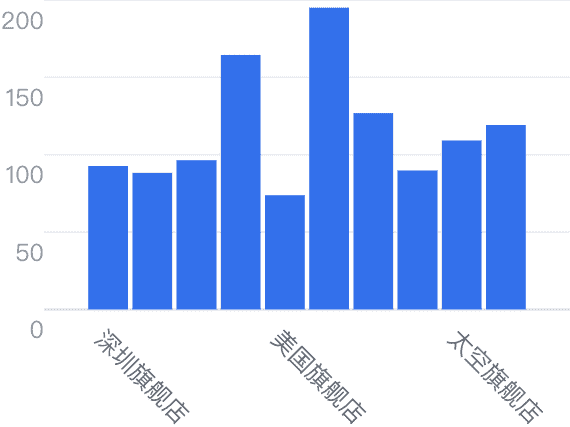

根据我们的数据分析，2023年10月，各门店的客单价情况如下：深圳旗舰店的客单价为92.76元，青岛旗舰店的客单价为88.30元，日本旗舰店的客单价为96.46元，北京旗舰店的客单价为164.49元，美国旗舰店的客单价为73.90元，广州旗舰店的客单价为195.05元，加拿大旗舰店的客单价为126.92元，成都旗舰店的客单价为89.83元，太空旗舰店的客单价为109.28元，上海旗舰店的客单价为119.24元。同比去年，北京旗舰店、广州旗舰店和加拿大旗舰店的客单价表现最好。

**门店销售情况展示（一）**

**门店总销售额**：216160.57元

**计入统计门店数**：10家

销售额最高的门店为广州旗舰店，销售额为31476.99

销售额最低的3家门店为日本旗舰店，北京旗舰店，太空旗舰店，销售额分别为9939.59，13191.00，17337.01

**各门店销售额图**

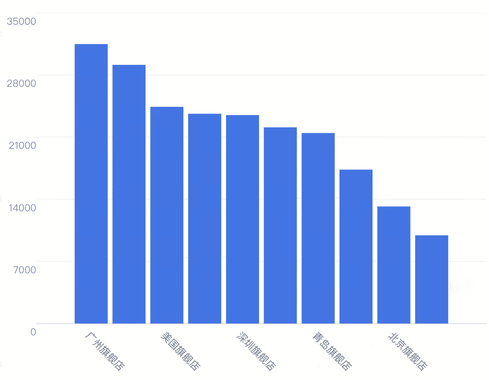

**门店销售情况展示（二）**

**各门店客单价图**

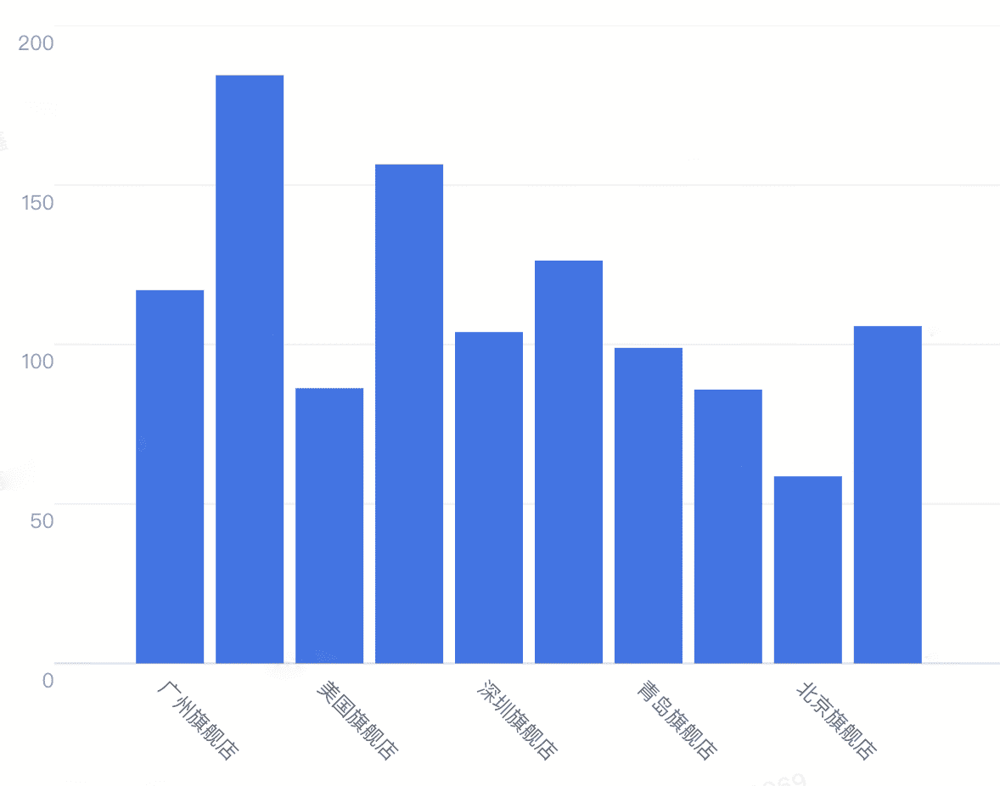

**各门店交易量图**

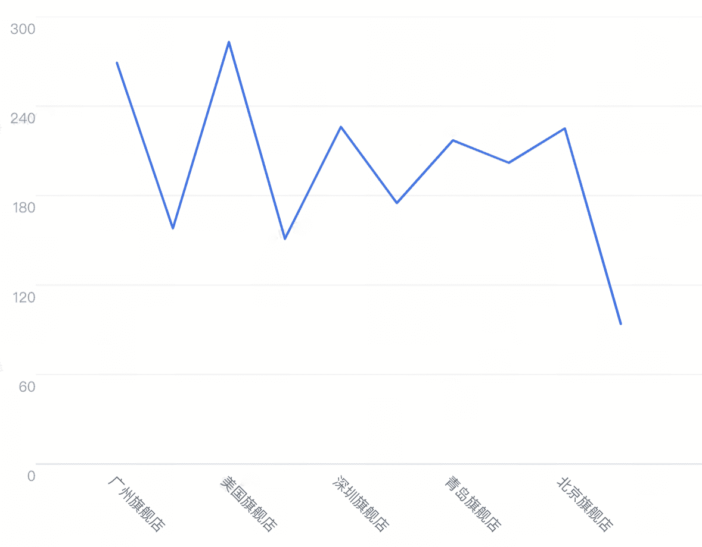

## 商品出清助手

> 在商超管理中，**临期商品库存清点和促销出货**是一个不小的挑战。我们通过AI技术对每日商品的库存和销售情况**进行分析，预测**出清商品的需求量，从而实现精准的商品出清，避免大量商品的损耗处理。这种方式不仅提升了商品的正价销售率，节省了促销费用，大大降低了运营成本，更提升了运营效率和经营利润。

| 应用亮点 | +   **AI 大数据驱动****：**大数据计算不同时间段的单品单店库存，根据数据制定促销价格； |
| --- | --- |
| 应用截图 |  |

AI赋能精细化运营，助力提升经营利润

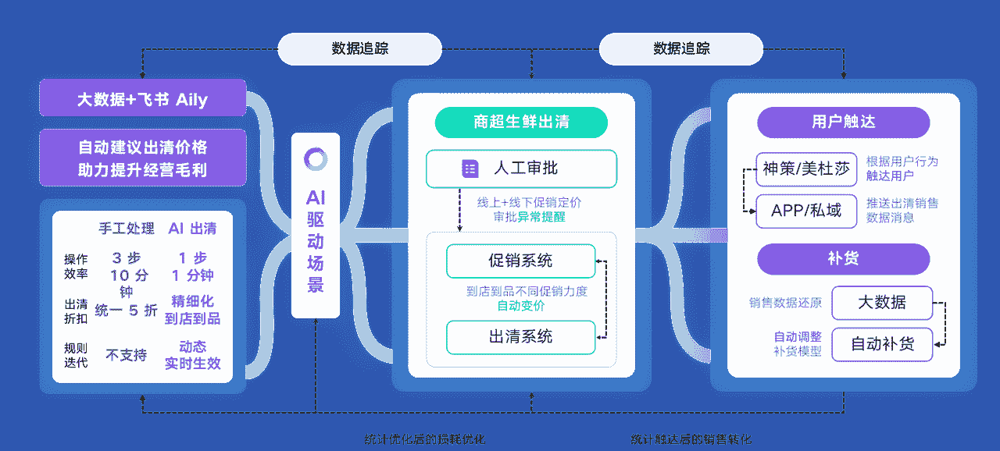

**飞书智能伙伴创建平台流程化搭建**

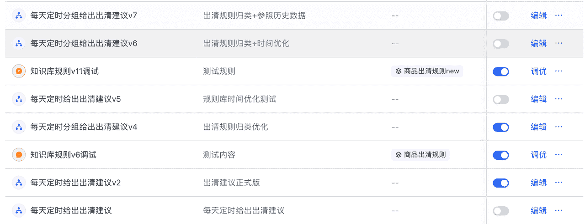

# 👷 制造行业场景实践

## 智能工厂助手-飞书 Smart Meeting 工厂会议小秘书

> 生产晨会、工厂周会、产销协同会、月度经营会、季度复盘会……会这么多，Smart Meeting 会议小秘书帮你快速预约会议、精准识别问题、量化原因分析、辅助管理决策、高效任务闭环、智能会议总结，提供一线提效与管理穿透价值！

| 应用亮点 | 业务价值体现： |
| --- | --- |
| 应用demo |  |
| 相关文档 | [飞书Smart Meeting工厂会议小秘书使用说明](https://bytedance.larkoffice.com/wiki/AraWw8IbTiQkzAkb39vclkN3n2b) |

[Smart Meeting 智能会议小秘书 V4.mov](https://internal-api-drive-stream.feishu.cn/space/api/box/stream/download/all/TBefbUMOtoDY7gxWkKOcsQBanmb)

## 经验知识助手

> 用强大的AI能力为知识的生产、流转、消费等环节进行助力：

+   **AI 推荐：**根据员工职位、浏览历史等推荐经验知识；在新开发项目中，根据产品类型等属性自动推荐经验知识；

+   **AI 生成：**基于问题管理系统中的信息自动生成经验知识草案；

+   **AI 知识问答：**快速体验经验知识，提升消费侧效率，经验知识AI数据分析；

| 应用亮点 |  |
| --- | --- |
| 应用demo | &lt;https://bytedance.larkoffice.com/sync/B4BPd1w7MsKPWbb9nVzcZPfRnqc&gt; |
| 相关文档 | [飞书 aPaaS「经验知识管理平台」方案简介](https://bytedance.larkoffice.com/docx/IYNrdbcIWoDnpoxhZQCcm0ucn4f) |

**经验知识随手问，知识在手边**

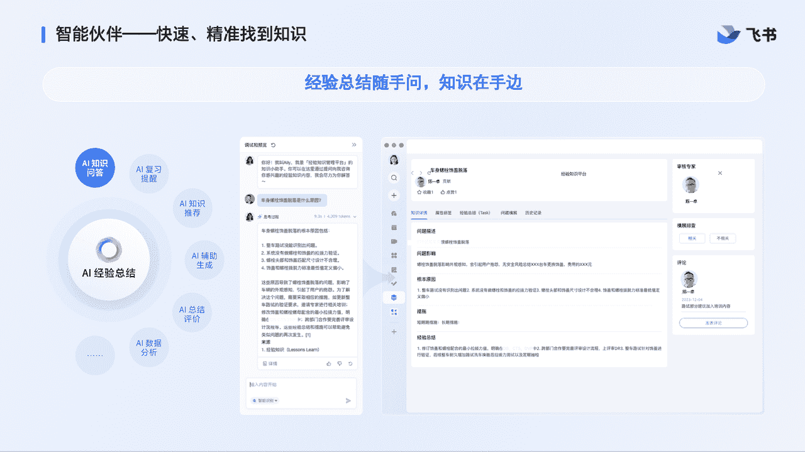

智能的数据分析，提供实时、精准的业务洞察

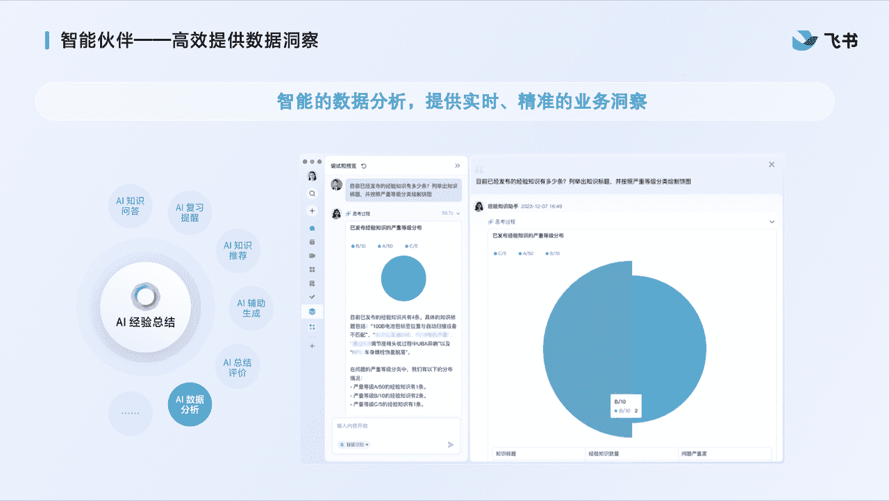

## PLM 智能助手

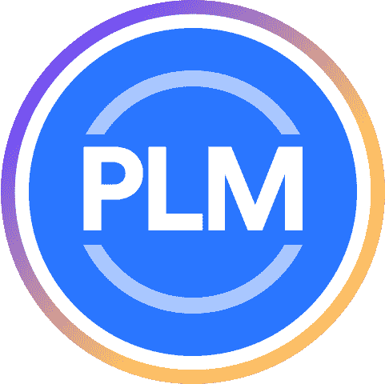

> 智能助手能够作为PLM领域应用的超级入口，普及应用知识、解疑答惑，同时她也是领域知识问答的聪明伙伴，可以帮助用户掌握专业知识。通过她，用户能够轻松创建和分析问题，高效追踪待办事项和问题进展。更重要的是，她可以为用户提供问题统计分析、定时输出分析报告。与此同时，在业务过程中也可以使用AGI业务表单文本填写辅助工具极大的简化用户录入信息负担。

| 应用亮点 |  |
| --- | --- |
| 应用demo |  |
| 相关文档 | [飞书Smart Meeting工厂会议小秘书使用说明](https://bytedance.larkoffice.com/wiki/AraWw8IbTiQkzAkb39vclkN3n2b) |

**超级入口，一键直达**

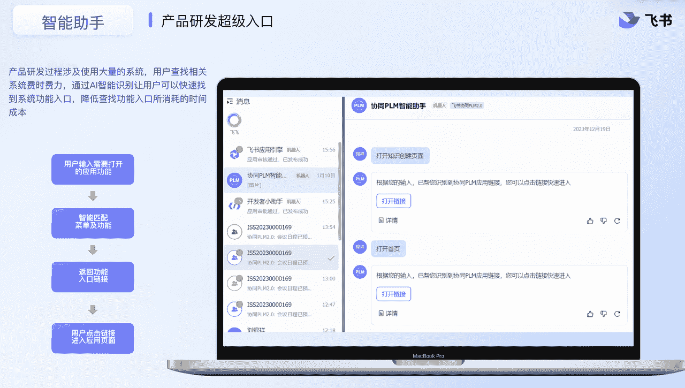

**问题编写智能补充**

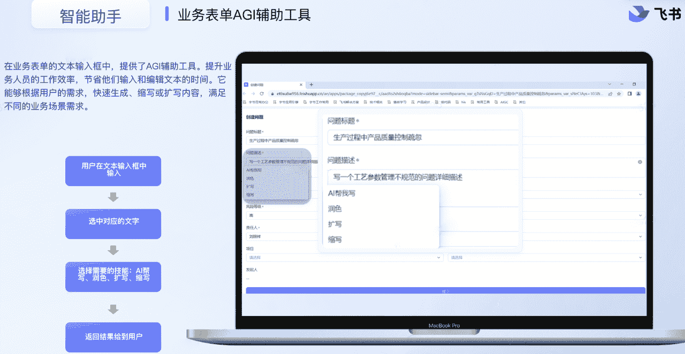

**变更问题，智能跟进**

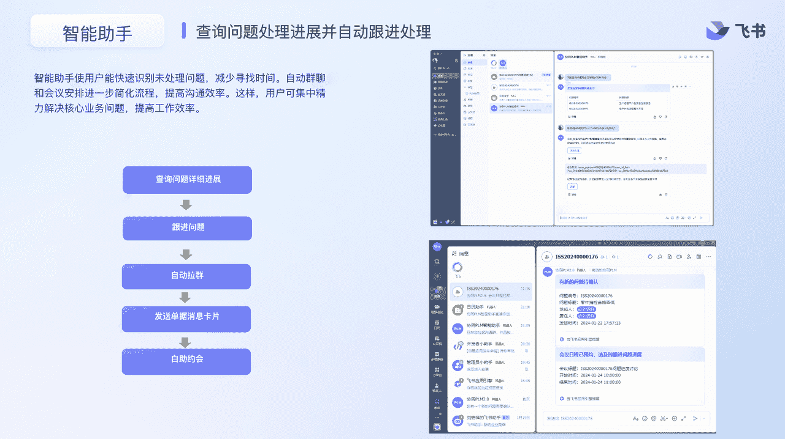

**数据洞察，智能决策**

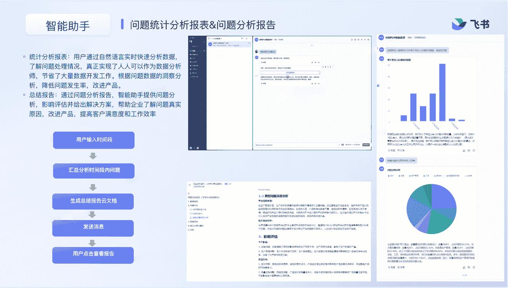

[智能助手解决方案-对客版.mp4](https://internal-api-drive-stream.feishu.cn/space/api/box/stream/download/all/XpqlbszFgoaRMAxaHVYcDfVknmg)

#