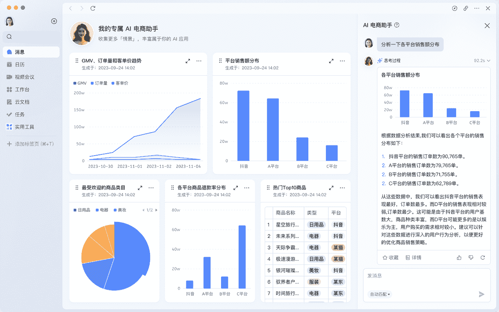
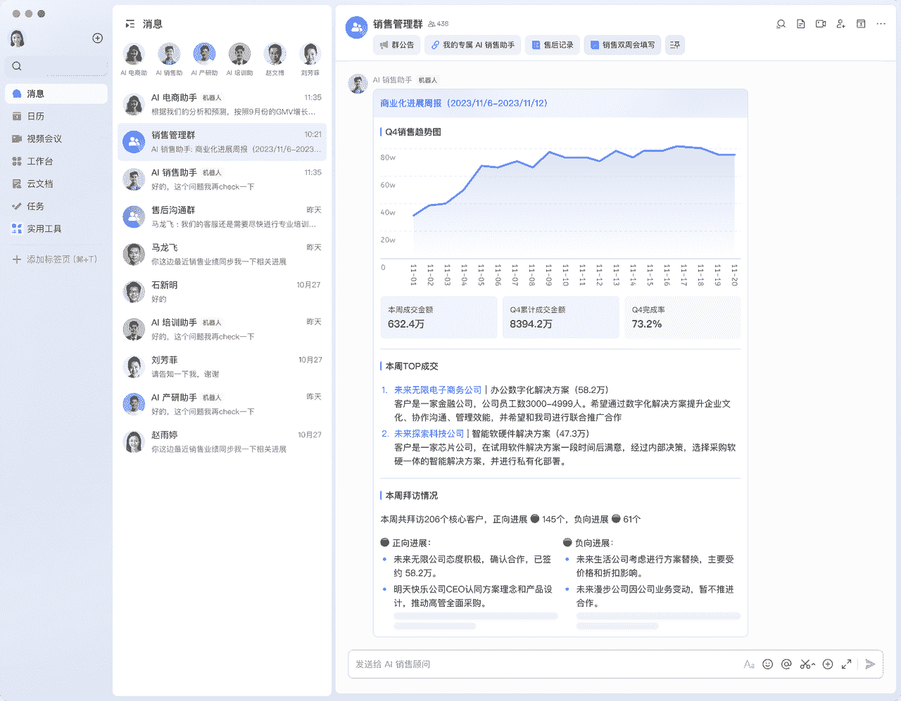
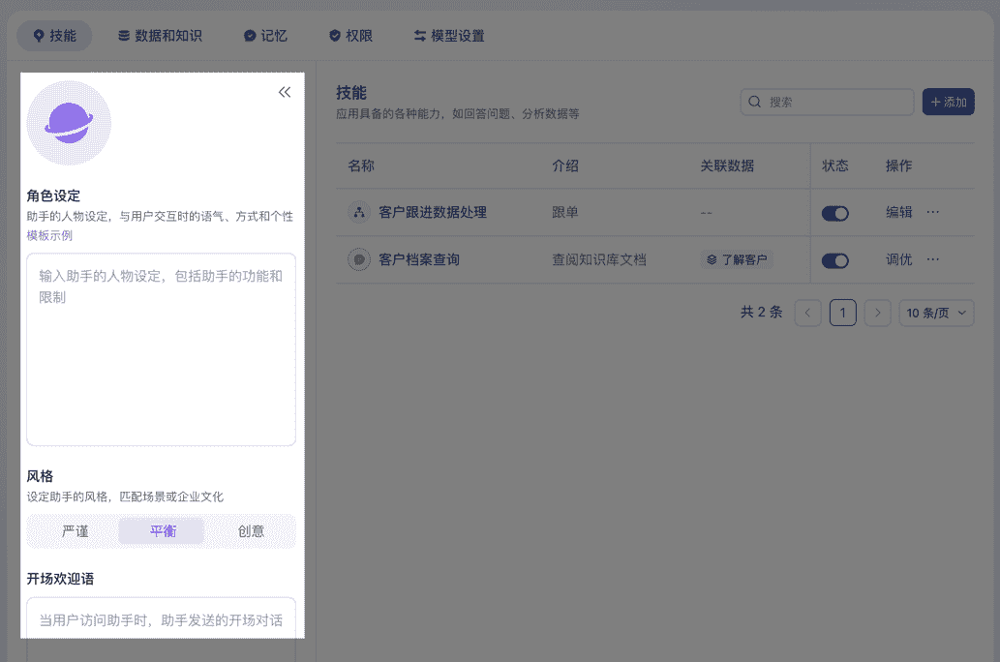
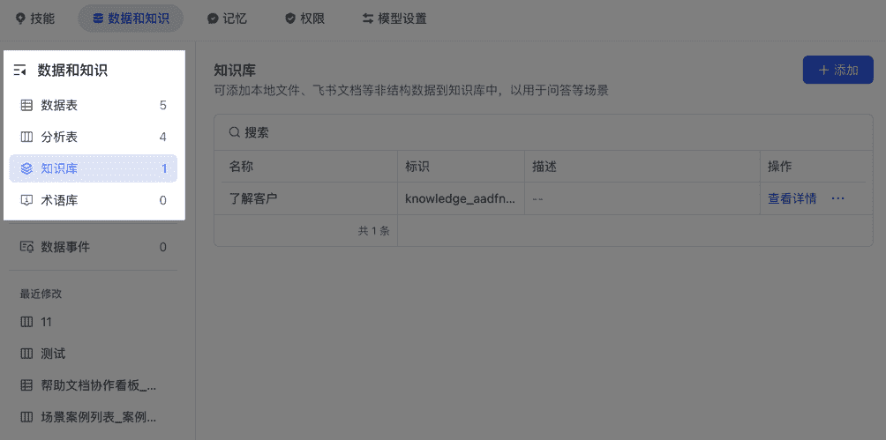
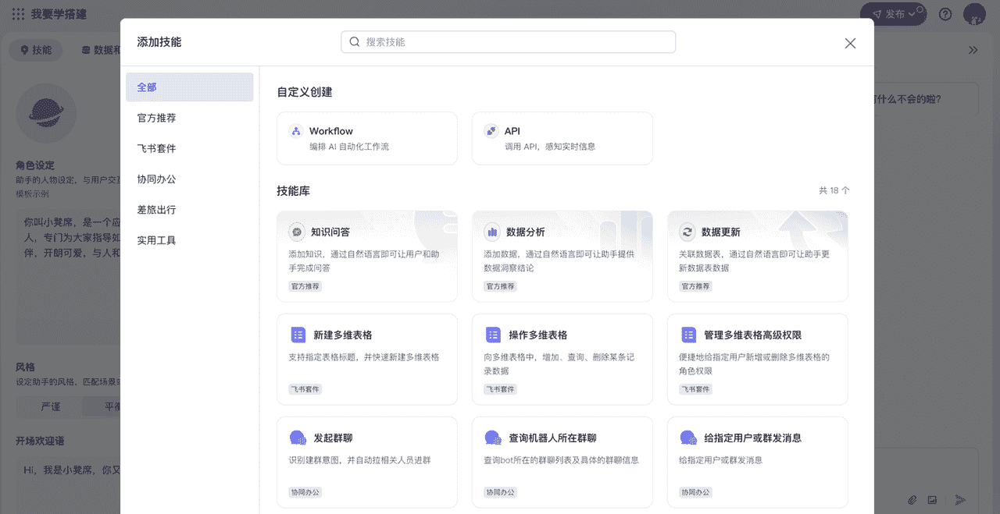

# 欢迎使用「飞书 aily」

> 来源：[https://v11enp9ok1h.feishu.cn/docx/ZYIsdXScvomdu8xYRGucALR9nih](https://v11enp9ok1h.feishu.cn/docx/ZYIsdXScvomdu8xYRGucALR9nih)

**「****飞****书智能伙伴创建平台」**（Aily）是一款全新的飞书AI应用搭建平台，企业开发者可通过此平台快速搭建出AI应用，让用户可以通过自然语言的方式与应用进行交互，实现便捷访问数据、更新信息、实时获取商业洞察等。

[飞书智能伙伴创建平台介绍视频.mov](https://internal-api-drive-stream.feishu.cn/space/api/box/stream/download/all/TSgWbI2JnoN02gxYpCHckyEQnUe)

> 您还可通过分享幻灯片，向您的团队/成员更快捷、清晰地[飞书智能伙伴创建平台产品介绍 V24.08.pdf](https://bytedance.larkoffice.com/wiki/OJaHwgpFvi7fuFkR2khcWw42nu2)绍「飞书智能伙伴创建平台」>>

**Aily 同学官方BOT体验**

> 可在下方聊天框中与Ai Bot咨询任何Aily相关问题，快来试试吧！👇👇👇

<https://ae.feishu.cn/cui#appkey=a_48c572d857434b63bb80874f6c9f4b89&config=eyJjb252ZXJzYXRpb24iOnsidXNlckF2YXRhciI6Imh0dHBzOi8vczEtaW1maWxlLmZlaXNodWNkbi5jb20vc3RhdGljLXJlc291cmNlL3YxL3YzXzAwYWVfNzNiNDA5MWYtMzVhNC00Mzk5LWJjNDEtNTNkOTVhMmMzNDdnIn0sImNvbW1vbiI6eyJjaGFubmVsVHlwZSI6IlNIQVJFRF9BQ0NPVU5UX1NESyIsInJlc291cmNlVHlwZSI6IkFJTFlfQ1VJX1NESyJ9fQ==>

**企业跨系统知识问答**

**定制专属数据看版**

**智能总结经营管理洞察**

> 更多场景实践，点击查看>> [**年度精选应用案例**](https://bytedance.larkoffice.com/wiki/Sg6YweUy2ihQIfkN43mciVEin60)

Step1 设定你的 AI「角色」

Step2  为 TA 添加数据与知识

Step3  为 TA 设定一个技能

> 飞书智能伙伴创建平台平台链接：aily.[**feishu**](https://bytedance.larkoffice.com/wiki/LxyfwbWfkicKjWk5vbCcCMP3nQg).cn  更多新手教程>> 新手入门教学

1.  **如果你是字节内部同学**，可点击** ****aily.feishu.cn**** ** 直接登陆使用（目前平台已对字节跳动企业全量开放）；

1.  **如****果你是飞书的客户**，可点击右侧申请表开通，包含一个月试用权益：[智能伙伴创建平台试用权益申请](https://bytedance.larkoffice.com/share/base/form/shrcnGLLGrX87A6ZClTboXNkakf?from=from_parent_docs)

[产品入口](http://aily.feishu.cn) ｜ [教程中心](https://bytedance.larkoffice.com/wiki/U81ewGNJDi7p6Qk9e5jcdc9RnDd) ｜  [功能手册](https://bytedance.larkoffice.com/wiki/YvU2w3WZJiO7igk9O77c2t5cnZe) ｜ [案例中心 ](https://bytedance.larkoffice.com/wiki/Sg6YweUy2ihQIfkN43mciVEin60)｜ [更新日志](https://bytedance.larkoffice.com/wiki/Mll2wUdTOi0olfkg544cIs4Qnxf) ｜ [常见问题](https://bytedance.larkoffice.com/wiki/KhUGwDT6sikAo1kTzWFc8SK9nGf) ｜ 加入官方社群