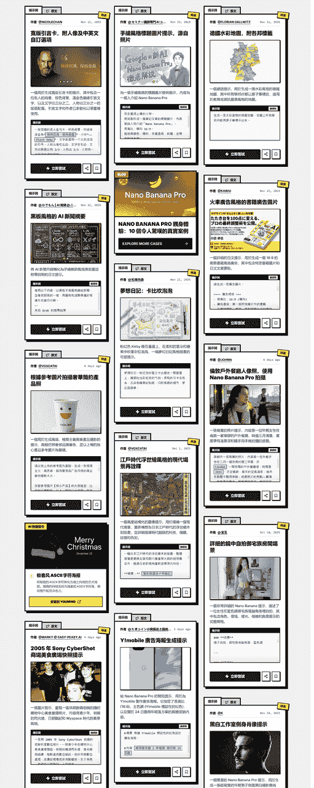
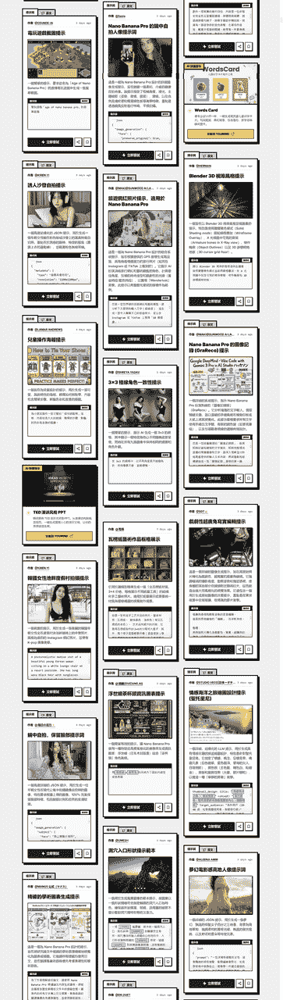
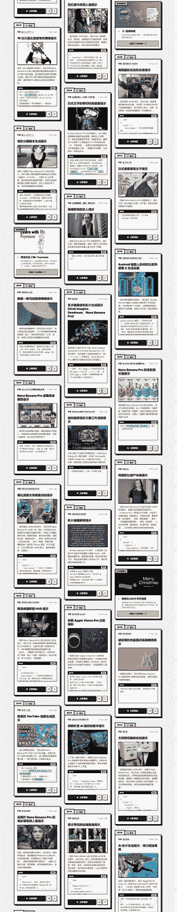

# 1000 个 `Nano Banana Pro` 提示词

> 来源：[https://v11enp9ok1h.feishu.cn/docx/GiKodIyZ7oCeKQxoqgacNVu5nwc](https://v11enp9ok1h.feishu.cn/docx/GiKodIyZ7oCeKQxoqgacNVu5nwc)







## 提示词模板专家提示模板（复制粘贴）

将此作为 `Nano Banana Pro AI image generator` 任务的默认骨架。此模板设计用来减少歧义并促使模型产出可预测的布局与逻辑。

提示模板（补充括号内容）：

```
目标 / 交付物
    创建一个面向**[受众/平台]的[资产类型：海报 / 信息图 / 分镜 / 产品广告 / 角色卡]**。
主题
    主要对象：[谁/什么]
    需保留的细节：[身份 / 服装 / 标志 / 产品形状 / 颜色]

场景 / 背景
    环境：[发生地点]
    氛围：[平静 / 充满活力 / 高端 / 教育性]
    构图（镜头 + 取景）
    镜头：[广角 / 中景 / 特写]
    角度：[正面 / 三分之四角 / 俯视]
    景深：[浅景深 / 深景深]
    布局锚点（面向设计密集型输出）
    头部区域：[标题文本]
    侧边/小节区域：[项目符号标签 / 注解]
    底部区域：[CTA / URL / 小字说明]
    使用干净的网格对齐、一致边距、可读排版。

风格
视觉风格：[照片写实 / 编辑风 / 极简 / 3D玩具渲染 / 平面信息图]
光线：[柔和影室灯 / 黄金时刻 / 电影感]

硬性约束
    文本保持清晰可读。
    禁用水印、随机标志、畸形的手/脸。
    保持构图简洁，留白和安全边距。

可选负面约束
    避免杂乱，避免微小不可读文字，避免多余物体，避免拼写错误。

“单变量”迭代规则
    修订时：仅更改一个区块（如布局 或 光线 或 文案）。这是快速收敛到完美结果的方法之一。
```

## 1000个最佳提示词案例

### 提示 #1 — 一致角色包（8角度，身份一致）

适用场景： 角色卡，品牌吉祥物，漫画/故事资产

使用建议： 推荐图片上传

```
提示词（复制粘贴）：
    根据上传照片创建8幅同一人物的角色卡。保持面部身份、发型和身体比例在每张图中一致。服装保持不变：  [描述服装]。生成8个角度：正面、左三分之四、右三分之四、左侧脸、右侧脸、背面、坐姿、动作姿势。清洁工作室背景，柔光箱照明，细节清晰，颜色分级一致。无文本。

专业调整：
    加入“所有图片使用相同镜头和照明”
    若出现面部漂移，加入：“保持面部标志点和鼻子/嘴部形状”
    关键词锚点（自然提及）：用 `Nano Banana Pro Prompts` 打造这类角色包，方便跨项目复用“身份锁”。
```

### 提示 #2 — 高可读性信息图（标题 + 注释 + 干净层级）

适用场景： 博客，Pinterest，LinkedIn滑动封面，教学视觉

```
提示词（复制粘贴）：
    设计一张16:9尺寸、标题为“[标题]”的清晰信息图。布局锚点：
    头部：大标题（最多6个单词）
    左栏：5个带图标的项目符号提示
    右栏：一个带有3个标注注释的简单图表
    底部：一句话总结（最多12个单词）
    使用高可读性，间距充裕，对齐一致，文字锋利。现代极简风，浅色背景，无杂乱，无微小文字。

专业调整：
    “标题外总字数最多20个”
    “字体必须足够大，以便手机阅读”
```

### 提示 #3 — 产品海报带网格布局 + CTA块

适用场景： 电商横幅，付费广告，主视觉区，发布海报

```
提示词（复制粘贴）：
    为[产品]创建高级产品海报。布局锚点严格遵守网格：
    顶部头部：“[品牌名]”（小字）
    主标题：“[标题]”（大字）
    中间：在干净背景上的产品主形象，配柔和阴影
    右侧：3个功能点（每点最多4个单词）
    底部：带文本“[CTA]”的CTA按钮形状
    现代编辑风格，留白简洁，安全边距，文字可读，影室灯光，无多余标志。

专业调整：
    “背景保持简单，无杂乱纹理”
    “保持一致对齐与等间距”
    工具提及：`Nano Banana Pro AI` 通常用于这种“布局必须服从网格”的场景。
```

### 提示 #4 — 前后对比变换（可控更改，同样取景）

适用场景： 改造、翻新、照片编辑、光线测试

使用建议： 推荐图片上传

```
提示词（复制粘贴）：
利用上传照片制作一张并排前后对比图（50/50分割）。保持相同相机位置、构图和主体。“后期”应用如下变更：[例如现代灯光、更干净背景、升级服装、翻新房间]。确保阴影、反射、透视保持一致。照片写实，边缘干净，无伪影。

专业调整：
加入“不改变面部形状或身份”
加入“手和手指保持自然”
```

### 提示 #5 — 电影感编辑肖像（镜头 + 调色 + 氛围）

适用场景： 头像，海报，角色艺术，作者照

使用建议： 可选图片上传

```
提示词（复制粘贴）：
为[主题]创建电影感编辑肖像。85mm镜头效果，浅景深，柔和主灯配轻微轮廓灯，自然肤质，微妙胶片颗粒，色调如高级杂志封面。背景：[简单 / 城市虚化 / 灰色影室]。表情：[自信 / 沉思]。无文字。

专业调整：
加入“避免过度平滑皮肤”
加入“保持眼睛真实高光”
```

### 提示 #6 — UI截图模型（文字可读 + 真实间距）

适用场景： 登陆页，提案文档，应用概念

```
提示词（复制粘贴）：
生成一张名为“[APP名]”的应用UI真实截图。布局锚点：
顶栏：左侧logo，右侧头像图标
主卡片：标题“[标题]”及副标题（最多12个单词）
3个按钮带标签：“[A] [B] [C]”
底部导航栏含4个图标
字体锋利可读，间距一致，填充合理，现代UI风格。无品牌侵权，无随机标志。

专业调整：
“文字高对比度”
“避免微型文字，标签简短”
```

### 提示 #7 — 技术图解带精确标签（标注注释）

适用场景： 教程，文档，产品说明

```
提示词（复制粘贴）：
创建[对象]的技术信息图，带标注说明。要求：
顶部标题：“[标题]”
中央对象插图：简洁精准比例
6个带箭头的注释指向正确部位
每个标注标签最多3个单词
极简风，线条清晰，高可读性，白色背景，无杂乱，无微小文字。

专业调整：
“箭头必须精确连接至目标部位”
“注释图标风格保持一致”
```

### 提示 #8 — 保持身份的风格迁移（照片 → 风格化）

适用场景： 动漫/玩具/油画风版，不丢失“本人”特征

使用建议： 推荐图片上传

```
提示词（复制粘贴）：
将上传肖像转成[风格：动漫 / 3D玩具 / 油画风]，同时保持身份和面部结构。保持发型、眼型和饰品一致。匹配原始姿势和构图。背景相似但风格化。输出干净，无伪影，无多余物体。

专业调整：
加入“保持面部标志点和下颌线”
加入“除非指定，否则不变服装图案”
工具提及：保持身份的风格迁移，通常在 `Nano Banana Pro AI image generator` 工作流中上传图片最有效。
```

### 提示 #9 — 6格分镜条（一致调色 + 说明）

适用场景： 视频预览，营销叙事，迷你漫画

```
提示词（复制粘贴）：
创建一条16:9、2行3列排列的6格分镜条。故事：[一句话故事]。保持所有格子中角色设计一致。每格下方有简短说明（最多6个单词）。调色一致，光线方向统一，电影构图，视觉连贯清晰。

专业调整：
“重复道具保持一致”
“跨格不更换角色服装”
```

### 提示 #10 — 病毒级收藏玩偶 + 包装模型

适用场景： 社交趋势，商品概念，品牌吉祥物

使用建议： 图片上传可选

```
提示词（复制粘贴）：
[创建一个](https://flux-ai.io/model/nano-banana-2-ai/)高质量3D收藏玩偶及包装模型，主题为[对象]。玩偶风格化（大头小身）但易识别。包装含：
顶部标签：“[品牌]”
玩偶名称：“[名称]”
三个功能图标（无微小文字）
清洁影室灯光，真实塑料泡罩，边缘锐利，照片写实包装照。

专业调整：
“文本简短粗体”
“留安全边距，避免裁切”
关键词锚点（自然提及）：此类包装模型非常适合 `Nano Banana Pro`，适合需要可复用、产品级渲染的场景。
```


# AI 图像生成提示词案例集

## 1000个最佳提示词案例

### 提示 #1 — 一致角色包（8角度，身份一致）

适用场景：角色卡，品牌吉祥物，漫画/故事资产

使用建议：推荐图片上传

```
提示词（复制粘贴）：
    根据上传照片创建8幅同一人物的角色卡。保持面部身份、发型和身体比例在每张图中一致。服装保持不变：  [描述服装]。生成8个角度：正面、左三分之四、右三分之四、左侧脸、右侧脸、背面、坐姿、动作姿势。清洁工作室背景，柔光箱照明，细节清晰，颜色分级一致。无文本。
```

专业调整：
加入“所有图片使用相同镜头和照明”
若出现面部漂移，加入：“保持面部标志点和鼻子/嘴部形状”
关键词锚点（自然提及）：用`Nano Banana Pro Prompts`打造这类角色包，方便跨项目复用“身份锁”。

### 提示 #2 — 高可读性信息图（标题 + 注释 + 干净层级）

适用场景：博客，Pinterest，LinkedIn滑动封面，教学视觉

```
提示词（复制粘贴）：
    设计一张16:9尺寸、标题为“[标题]”的清晰信息图。布局锚点：
    头部：大标题（最多6个单词）
    左栏：5个带图标的项目符号提示
    右栏：一个带有3个标注注释的简单图表
    底部：一句话总结（最多12个单词）
    使用高可读性，间距充裕，对齐一致，文字锋利。现代极简风，浅色背景，无杂乱，无微小文字。
```

专业调整：
“标题外总字数最多20个”
“字体必须足够大，以便手机阅读”

### 提示 #3 — 产品海报带网格布局 + CTA块

适用场景：电商横幅，付费广告，主视觉区，发布海报

```
提示词（复制粘贴）：
    为[产品]创建高级产品海报。布局锚点严格遵守网格：
    顶部头部：“[品牌名]”（小字）
    主标题：“[标题]”（大字）
    中间：在干净背景上的产品主形象，配柔和阴影
    右侧：3个功能点（每点最多4个单词）
    底部：带文本“[CTA]”的CTA按钮形状
    现代编辑风格，留白简洁，安全边距，文字可读，影室灯光，无多余标志。
```

专业调整：
“背景保持简单，无杂乱纹理”
“保持一致对齐与等间距”
工具提及：`Nano Banana Pro AI`通常用于这种“布局必须服从网格”的场景。

### 提示 #4 — 前后对比变换（可控更改，同样取景）

适用场景：改造、翻新、照片编辑、光线测试

使用建议：推荐图片上传

```
提示词（复制粘贴）：
利用上传照片制作一张并排前后对比图（50/50分割）。保持相同相机位置、构图和主体。“后期”应用如下变更：[例如现代灯光、更干净背景、升级服装、翻新房间]。确保阴影、反射、透视保持一致。照片写实，边缘干净，无伪影。
```

专业调整：
加入“不改变面部形状或身份”
加入“手和手指保持自然”

### 提示 #5 — 电影感编辑肖像（镜头 + 调色 + 氛围）

适用场景：头像，海报，角色艺术，作者照

使用建议：可选图片上传

```
提示词（复制粘贴）：
为[主题]创建电影感编辑肖像。85mm镜头效果，浅景深，柔和主灯配轻微轮廓灯，自然肤质，微妙胶片颗粒，色调如高级杂志封面。背景：[简单 / 城市虚化 / 灰色影室]。表情：[自信 / 沉思]。无文字。
```

专业调整：
加入“避免过度平滑皮肤”
加入“保持眼睛真实高光”

### 提示 #6 — UI截图模型（文字可读 + 真实间距）

适用场景：登陆页，提案文档，应用概念

```
提示词（复制粘贴）：
生成一张名为“[APP名]”的应用UI真实截图。布局锚点：
顶栏：左侧logo，右侧头像图标
主卡片：标题“[标题]”及副标题（最多12个单词）
3个按钮带标签：“[A] [B] [C]”
底部导航栏含4个图标
字体锋利可读，间距一致，填充合理，现代UI风格。无品牌侵权，无随机标志。
```

专业调整：
“文字高对比度”
“避免微型文字，标签简短”

### 提示 #7 — 技术图解带精确标签（标注注释）

适用场景：教程，文档，产品说明

```
提示词（复制粘贴）：
创建[对象]的技术信息图，带标注说明。要求：
顶部标题：“[标题]”
中央对象插图：简洁精准比例
6个带箭头的注释指向正确部位
每个标注标签最多3个单词
极简风，线条清晰，高可读性，白色背景，无杂乱，无微小文字。
```

专业调整：
“箭头必须精确连接至目标部位”
“注释图标风格保持一致”

### 提示 #8 — 保持身份的风格迁移（照片 → 风格化）

适用场景：动漫/玩具/油画风版，不丢失“本人”特征

使用建议：推荐图片上传

```
提示词（复制粘贴）：
将上传肖像转成[风格：动漫 / 3D玩具 / 油画风]，同时保持身份和面部结构。保持发型、眼型和饰品一致。匹配原始姿势和构图。背景相似但风格化。输出干净，无伪影，无多余物体。
```

专业调整：
加入“保持面部标志点和下颌线”
加入“除非指定，否则不变服装图案”
工具提及：保持身份的风格迁移，通常在`Nano Banana Pro AI image generator`工作流中上传图片最有效。

### 提示 #9 — 6格分镜条（一致调色 + 说明）

适用场景：视频预览，营销叙事，迷你漫画

```
提示词（复制粘贴）：
创建一条16:9、2行3列排列的6格分镜条。故事：[一句话故事]。保持所有格子中角色设计一致。每格下方有简短说明（最多6个单词）。调色一致，光线方向统一，电影构图，视觉连贯清晰。
```

专业调整：
“重复道具保持一致”
“跨格不更换角色服装”

### 提示 #10 — 病毒级收藏玩偶 + 包装模型

适用场景：社交趋势，商品概念，品牌吉祥物

使用建议：图片上传可选

```
提示词（复制粘贴）：
创建一个高质量3D收藏玩偶及包装模型，主题为[对象]。玩偶风格化（大头小身）但易识别。包装含：
顶部标签：“[品牌]”
玩偶名称：“[名称]”
三个功能图标（无微小文字）
清洁影室灯光，真实塑料泡罩，边缘锐利，照片写实包装照。
```

专业调整：
“文本简短粗体”
“留安全边距，避免裁切”
关键词锚点（自然提及）：此类包装模型非常适合`Nano Banana Pro`，适合需要可复用、产品级渲染的场景。


### 提示 #4 — 前后对比变换（可控更改，同样取景）

适用场景： 改造、翻新、照片编辑、光线测试

使用建议： 推荐图片上传

```
提示词（复制粘贴）：
利用上传照片制作一张并排前后对比图（50/50分割）。保持相同相机位置、构图和主体。“后期”应用如下变更：[例如现代灯光、更干净背景、升级服装、翻新房间]。确保阴影、反射、透视保持一致。照片写实，边缘干净，无伪影。

专业调整：
加入“不改变面部形状或身份”
加入“手和手指保持自然”
```

### 提示 #5 — 电影感编辑肖像（镜头 + 调色 + 氛围）

适用场景： 头像，海报，角色艺术，作者照

使用建议： 可选图片上传

```
提示词（复制粘贴）：
为[主题]创建电影感编辑肖像。85mm镜头效果，浅景深，柔和主灯配轻微轮廓灯，自然肤质，微妙胶片颗粒，色调如高级杂志封面。背景：[简单 / 城市虚化 / 灰色影室]。表情：[自信 / 沉思]。无文字。

专业调整：
加入“避免过度平滑皮肤”
加入“保持眼睛真实高光”
```

### 提示 #6 — UI截图模型（文字可读 + 真实间距）

适用场景： 登陆页，提案文档，应用概念

```
提示词（复制粘贴）：
生成一张名为“[APP名]”的应用UI真实截图。布局锚点：
顶栏：左侧logo，右侧头像图标
主卡片：标题“[标题]”及副标题（最多12个单词）
3个按钮带标签：“[A] [B] [C]”
底部导航栏含4个图标
字体锋利可读，间距一致，填充合理，现代UI风格。无品牌侵权，无随机标志。

专业调整：
“文字高对比度”
“避免微型文字，标签简短”
```

### 提示 #7 — 技术图解带精确标签（标注注释）

适用场景： 教程，文档，产品说明

```
提示词（复制粘贴）：
创建[对象]的技术信息图，带标注说明。要求：
顶部标题：“[标题]”
中央对象插图：简洁精准比例
6个带箭头的注释指向正确部位
每个标注标签最多3个单词
极简风，线条清晰，高可读性，白色背景，无杂乱，无微小文字。

专业调整：
“箭头必须精确连接至目标部位”
“注释图标风格保持一致”
```

### 提示 #8 — 保持身份的风格迁移（照片 → 风格化）

适用场景： 动漫/玩具/油画风版，不丢失“本人”特征

使用建议： 推荐图片上传

```
提示词（复制粘贴）：
将上传肖像转成[风格：动漫 / 3D玩具 / 油画风]，同时保持身份和面部结构。保持发型、眼型和饰品一致。匹配原始姿势和构图。背景相似但风格化。输出干净，无伪影，无多余物体。

专业调整：
加入“保持面部标志点和下颌线”
加入“除非指定，否则不变服装图案”
工具提及：保持身份的风格迁移，通常在`Nano Banana Pro AI image generator`工作流中上传图片最有效。
```

### 提示 #9 — 6格分镜条（一致调色 + 说明）

适用场景： 视频预览，营销叙事，迷你漫画

```
提示词（复制粘贴）：
创建一条16:9、2行3列排列的6格分镜条。故事：[一句话故事]。保持所有格子中角色设计一致。每格下方有简短说明（最多6个单词）。调色一致，光线方向统一，电影构图，视觉连贯清晰。

专业调整：
“重复道具保持一致”
“跨格不更换角色服装”
```

### 提示 #10 — 病毒级收藏玩偶 + 包装模型

适用场景： 社交趋势，商品概念，品牌吉祥物

使用建议： 图片上传可选

```
[提示词（复制粘贴）：
创建一个](https://flux-ai.io/model/nano-banana-2-ai/)高质量3D收藏玩偶及包装模型，主题为[对象]。玩偶风格化（大头小身）但易识别。包装含：
顶部标签：“[品牌]”
玩偶名称：“[名称]”
三个功能图标（无微小文字）
清洁影室灯光，真实塑料泡罩，边缘锐利，照片写实包装照。

专业调整：
“文本简短粗体”
“留安全边距，避免裁切”
关键词锚点（自然提及）：此类包装模型非常适合`Nano Banana Pro`，适合需要可复用、产品级渲染的场景。
```

## 1000个最佳提示词案例

### 提示 #1 — 一致角色包（8角度，身份一致）

适用场景： 角色卡，品牌吉祥物，漫画/故事资产

使用建议： 推荐图片上传

```
提示词（复制粘贴）：
    根据上传照片创建8幅同一人物的角色卡。保持面部身份、发型和身体比例在每张图中一致。服装保持不变：  [描述服装]。生成8个角度：正面、左三分之四、右三分之四、左侧脸、右侧脸、背面、坐姿、动作姿势。清洁工作室背景，柔光箱照明，细节清晰，颜色分级一致。无文本。

专业调整：
    加入“所有图片使用相同镜头和照明”
    若出现面部漂移，加入：“保持面部标志点和鼻子/嘴部形状”
    关键词锚点（自然提及）：用`Nano Banana Pro Prompts`打造这类角色包，方便跨项目复用“身份锁”。
```

### 提示 #2 — 高可读性信息图（标题 + 注释 + 干净层级）

适用场景： 博客，Pinterest，LinkedIn滑动封面，教学视觉

```
提示词（复制粘贴）：
    设计一张16:9尺寸、标题为“[标题]”的清晰信息图。布局锚点：
    头部：大标题（最多6个单词）
    左栏：5个带图标的项目符号提示
    右栏：一个带有3个标注注释的简单图表
    底部：一句话总结（最多12个单词）
    使用高可读性，间距充裕，对齐一致，文字锋利。现代极简风，浅色背景，无杂乱，无微小文字。

专业调整：
    “标题外总字数最多20个”
    “字体必须足够大，以便手机阅读”
```

### 提示 #3 — 产品海报带网格布局 + CTA块

适用场景： 电商横幅，付费广告，主视觉区，发布海报

```
提示词（复制粘贴）：
    为[产品]创建高级产品海报。布局锚点严格遵守网格：
    顶部头部：“[品牌名]”（小字）
    主标题：“[标题]”（大字）
    中间：在干净背景上的产品主形象，配柔和阴影
    右侧：3个功能点（每点最多4个单词）
    底部：带文本“[CTA]”的CTA按钮形状
    现代编辑风格，留白简洁，安全边距，文字可读，影室灯光，无多余标志。

专业调整：
    “背景保持简单，无杂乱纹理”
    “保持一致对齐与等间距”
    工具提及：`Nano Banana Pro AI`通常用于这种“布局必须服从网格”的场景。
```

### 提示 #4 — 前后对比变换（可控更改，同样取景）

适用场景： 改造、翻新、照片编辑、光线测试

使用建议： 推荐图片上传

```
提示词（复制粘贴）：
利用上传照片制作一张并排前后对比图（50/50分割）。保持相同相机位置、构图和主体。“后期”应用如下变更：[例如现代灯光、更干净背景、升级服装、翻新房间]。确保阴影、反射、透视保持一致。照片写实，边缘干净，无伪影。

专业调整：
加入“不改变面部形状或身份”
加入“手和手指保持自然”
```

### 提示 #5 — 电影感编辑肖像（镜头 + 调色 + 氛围）

适用场景： 头像，海报，角色艺术，作者照

使用建议： 可选图片上传

```
提示词（复制粘贴）：
为[主题]创建电影感编辑肖像。85mm镜头效果，浅景深，柔和主灯配轻微轮廓灯，自然肤质，微妙胶片颗粒，色调如高级杂志封面。背景：[简单 / 城市虚化 / 灰色影室]。表情：[自信 / 沉思]。无文字。

专业调整：
加入“避免过度平滑皮肤”
加入“保持眼睛真实高光”
```

### 提示 #6 — UI截图模型（文字可读 + 真实间距）

适用场景： 登陆页，提案文档，应用概念

```
提示词（复制粘贴）：
生成一张名为“[APP名]”的应用UI真实截图。布局锚点：
顶栏：左侧logo，右侧头像图标
主卡片：标题“[标题]”及副标题（最多12个单词）
3个按钮带标签：“[A] [B] [C]”
底部导航栏含4个图标
字体锋利可读，间距一致，填充合理，现代UI风格。无品牌侵权，无随机标志。

专业调整：
“文字高对比度”
“避免微型文字，标签简短”
```

### 提示 #7 — 技术图解带精确标签（标注注释）

适用场景： 教程，文档，产品说明

```
提示词（复制粘贴）：
创建[对象]的技术信息图，带标注说明。要求：
顶部标题：“[标题]”
中央对象插图：简洁精准比例
6个带箭头的注释指向正确部位
每个标注标签最多3个单词
极简风，线条清晰，高可读性，白色背景，无杂乱，无微小文字。

专业调整：
“箭头必须精确连接至目标部位”
“注释图标风格保持一致”
```

### 提示 #8 — 保持身份的风格迁移（照片 → 风格化）

适用场景： 动漫/玩具/油画风版，不丢失“本人”特征

使用建议： 推荐图片上传

```
提示词（复制粘贴）：
将上传肖像转成[风格：动漫 / 3D玩具 / 油画风]，同时保持身份和面部结构。保持发型、眼型和饰品一致。匹配原始姿势和构图。背景相似但风格化。输出干净，无伪影，无多余物体。

专业调整：
加入“保持面部标志点和下颌线”
加入“除非指定，否则不变服装图案”
工具提及：保持身份的风格迁移，通常在`Nano Banana Pro AI image generator`工作流中上传图片最有效。
```

### 提示 #9 — 6格分镜条（一致调色 + 说明）

适用场景： 视频预览，营销叙事，迷你漫画

```
提示词（复制粘贴）：
创建一条16:9、2行3列排列的6格分镜条。故事：[一句话故事]。保持所有格子中角色设计一致。每格下方有简短说明（最多6个单词）。调色一致，光线方向统一，电影构图，视觉连贯清晰。

专业调整：
“重复道具保持一致”
“跨格不更换角色服装”
```

### 提示 #10 — 病毒级收藏玩偶 + 包装模型

适用场景： 社交趋势，商品概念，品牌吉祥物

使用建议： 图片上传可选

```
[提示词（复制粘贴）：
创建一个](https://flux-ai.io/model/nano-banana-2-ai/)高质量3D收藏玩偶及包装模型，主题为[对象]。玩偶风格化（大头小身）但易识别。包装含：
顶部标签：“[品牌]”
玩偶名称：“[名称]”
三个功能图标（无微小文字）
清洁影室灯光，真实塑料泡罩，边缘锐利，照片写实包装照。

专业调整：
“文本简短粗体”
“留安全边距，避免裁切”
关键词锚点（自然提及）：此类包装模型非常适合`Nano Banana Pro`，适合需要可复用、产品级渲染的场景。
```

## 1000个最佳提示词案例

### 提示 #1 — 一致角色包（8角度，身份一致）

适用场景： 角色卡，品牌吉祥物，漫画/故事资产

使用建议： 推荐图片上传

```
提示词（复制粘贴）：
    根据上传照片创建8幅同一人物的角色卡。保持面部身份、发型和身体比例在每张图中一致。服装保持不变：  [描述服装]。生成8个角度：正面、左三分之四、右三分之四、左侧脸、右侧脸、背面、坐姿、动作姿势。清洁工作室背景，柔光箱照明，细节清晰，颜色分级一致。无文本。

专业调整：
    加入“所有图片使用相同镜头和照明”
    若出现面部漂移，加入：“保持面部标志点和鼻子/嘴部形状”
    关键词锚点（自然提及）：用`Nano Banana Pro Prompts`打造这类角色包，方便跨项目复用“身份锁”。
```

### 提示 #2 — 高可读性信息图（标题 + 注释 + 干净层级）

适用场景： 博客，Pinterest，LinkedIn滑动封面，教学视觉

```
提示词（复制粘贴）：
    设计一张16:9尺寸、标题为“[标题]”的清晰信息图。布局锚点：
    头部：大标题（最多6个单词）
    左栏：5个带图标的项目符号提示
    右栏：一个带有3个标注注释的简单图表
    底部：一句话总结（最多12个单词）
    使用高可读性，间距充裕，对齐一致，文字锋利。现代极简风，浅色背景，无杂乱，无微小文字。

专业调整：
    “标题外总字数最多20个”
    “字体必须足够大，以便手机阅读”
```

### 提示 #3 — 产品海报带网格布局 + CTA块

适用场景： 电商横幅，付费广告，主视觉区，发布海报

```
提示词（复制粘贴）：
    为[产品]创建高级产品海报。布局锚点严格遵守网格：
    顶部头部：“[品牌名]”（小字）
    主标题：“[标题]”（大字）
    中间：在干净背景上的产品主形象，配柔和阴影
    右侧：3个功能点（每点最多4个单词）
    底部：带文本“[CTA]”的CTA按钮形状
    现代编辑风格，留白简洁，安全边距，文字可读，影室灯光，无多余标志。

专业调整：
    “背景保持简单，无杂乱纹理”
    “保持一致对齐与等间距”
    工具提及：`Nano Banana Pro AI`通常用于这种“布局必须服从网格”的场景。
```

### 提示 #4 — 前后对比变换（可控更改，同样取景）

适用场景： 改造、翻新、照片编辑、光线测试

使用建议： 推荐图片上传

```
提示词（复制粘贴）：
利用上传照片制作一张并排前后对比图（50/50分割）。保持相同相机位置、构图和主体。“后期”应用如下变更：[例如现代灯光、更干净背景、升级服装、翻新房间]。确保阴影、反射、透视保持一致。照片写实，边缘干净，无伪影。

专业调整：
加入“不改变面部形状或身份”
加入“手和手指保持自然”
```

### 提示 #5 — 电影感编辑肖像（镜头 + 调色 + 氛围）

适用场景： 头像，海报，角色艺术，作者照

使用建议： 可选图片上传

```
提示词（复制粘贴）：
为[主题]创建电影感编辑肖像。85mm镜头效果，浅景深，柔和主灯配轻微轮廓灯，自然肤质，微妙胶片颗粒，色调如高级杂志封面。背景：[简单 / 城市虚化 / 灰色影室]。表情：[自信 / 沉思]。无文字。

专业调整：
加入“避免过度平滑皮肤”
加入“保持眼睛真实高光”
```

### 提示 #6 — UI截图模型（文字可读 + 真实间距）

适用场景： 登陆页，提案文档，应用概念

```
提示词（复制粘贴）：
生成一张名为“[APP名]”的应用UI真实截图。布局锚点：
顶栏：左侧logo，右侧头像图标
主卡片：标题“[标题]”及副标题（最多12个单词）
3个按钮带标签：“[A] [B] [C]”
底部导航栏含4个图标
字体锋利可读，间距一致，填充合理，现代UI风格。无品牌侵权，无随机标志。

专业调整：
“文字高对比度”
“避免微型文字，标签简短”
```

### 提示 #7 — 技术图解带精确标签（标注注释）

适用场景： 教程，文档，产品说明

```
提示词（复制粘贴）：
创建[对象]的技术信息图，带标注说明。要求：
顶部标题：“[标题]”
中央对象插图：简洁精准比例
6个带箭头的注释指向正确部位
每个标注标签最多3个单词
极简风，线条清晰，高可读性，白色背景，无杂乱，无微小文字。

专业调整：
“箭头必须精确连接至目标部位”
“注释图标风格保持一致”
```

### 提示 #8 — 保持身份的风格迁移（照片 → 风格化）

适用场景： 动漫/玩具/油画风版，不丢失“本人”特征

使用建议： 推荐图片上传

```
提示词（复制粘贴）：
将上传肖像转成[风格：动漫 / 3D玩具 / 油画风]，同时保持身份和面部结构。保持发型、眼型和饰品一致。匹配原始姿势和构图。背景相似但风格化。输出干净，无伪影，无多余物体。

专业调整：
加入“保持面部标志点和下颌线”
加入“除非指定，否则不变服装图案”
工具提及：保持身份的风格迁移，通常在`Nano Banana Pro AI image generator`工作流中上传图片最有效。
```

### 提示 #9 — 6格分镜条（一致调色 + 说明）

适用场景： 视频预览，营销叙事，迷你漫画

```
提示词（复制粘贴）：
创建一条16:9、2行3列排列的6格分镜条。故事：[一句话故事]。保持所有格子中角色设计一致。每格下方有简短说明（最多6个单词）。调色一致，光线方向统一，电影构图，视觉连贯清晰。

专业调整：
“重复道具保持一致”
“跨格不更换角色服装”
```

### 提示 #10 — 病毒级收藏玩偶 + 包装模型

适用场景： 社交趋势，商品概念，品牌吉祥物

使用建议： 图片上传可选

```
[提示词（复制粘贴）：
创建一个](https://flux-ai.io/model/nano-banana-2-ai/)高质量3D收藏玩偶及包装模型，主题为[对象]。玩偶风格化（大头小身）但易识别。包装含：
顶部标签：“[品牌]”
玩偶名称：“[名称]”
三个功能图标（无微小文字）
清洁影室灯光，真实塑料泡罩，边缘锐利，照片写实包装照。

专业调整：
“文本简短粗体”
“留安全边距，避免裁切”
关键词锚点（自然提及）：此类包装模型非常适合`Nano Banana Pro`，适合需要可复用、产品级渲染的场景。
```


# 1000个最佳提示词案例

### 提示 #1 — 一致角色包（8角度，身份一致）

适用场景： 角色卡，品牌吉祥物，漫画/故事资产

使用建议： 推荐图片上传

```
提示词（复制粘贴）：
根据上传照片创建8幅同一人物的角色卡。保持面部身份、发型和身体比例在每张图中一致。服装保持不变： [描述服装]。生成8个角度：正面、左三分之四、右三分之四、左侧脸、右侧脸、背面、坐姿、动作姿势。清洁工作室背景，柔光箱照明，细节清晰，颜色分级一致。无文本。
```

专业调整：
加入“所有图片使用相同镜头和照明”
若出现面部漂移，加入：“保持面部标志点和鼻子/嘴部形状”
关键词锚点（自然提及）：用Nano Banana Pro Prompts打造这类角色包，方便跨项目复用“身份锁”。

### 提示 #2 — 高可读性信息图（标题 + 注释 + 干净层级）

适用场景： 博客，Pinterest，LinkedIn滑动封面，教学视觉

```
提示词（复制粘贴）：
设计一张16:9尺寸、标题为“[标题]”的清晰信息图。布局锚点：
头部：大标题（最多6个单词）
左栏：5个带图标的项目符号提示
右栏：一个带有3个标注注释的简单图表
底部：一句话总结（最多12个单词）
使用高可读性，间距充裕，对齐一致，文字锋利。现代极简风，浅色背景，无杂乱，无微小文字。
```

专业调整：
“标题外总字数最多20个”
“字体必须足够大，以便手机阅读”

### 提示 #3 — 产品海报带网格布局 + CTA块

适用场景： 电商横幅，付费广告，主视觉区，发布海报

```
提示词（复制粘贴）：
为[产品]创建高级产品海报。布局锚点严格遵守网格：
顶部头部：“[品牌名]”（小字）
主标题：“[标题]”（大字）
中间：在干净背景上的产品主形象，配柔和阴影
右侧：3个功能点（每点最多4个单词）
底部：带文本“[CTA]”的CTA按钮形状
现代编辑风格，留白简洁，安全边距，文字可读，影室灯光，无多余标志。
```

专业调整：
“背景保持简单，无杂乱纹理”
“保持一致对齐与等间距”
工具提及：Nano Banana Pro AI通常用于这种“布局必须服从网格”的场景。

### 提示 #4 — 前后对比变换（可控更改，同样取景）

适用场景： 改造、翻新、照片编辑、光线测试

使用建议： 推荐图片上传

```
提示词（复制粘贴）：
利用上传照片制作一张并排前后对比图（50/50分割）。保持相同相机位置、构图和主体。“后期”应用如下变更：[例如现代灯光、更干净背景、升级服装、翻新房间]。确保阴影、反射、透视保持一致。照片写实，边缘干净，无伪影。
```

专业调整：
加入“不改变面部形状或身份”
加入“手和手指保持自然”

### 提示 #5 — 电影感编辑肖像（镜头 + 调色 + 氛围）

适用场景： 头像，海报，角色艺术，作者照

使用建议： 可选图片上传

```
提示词（复制粘贴）：
为[主题]创建电影感编辑肖像。85mm镜头效果，浅景深，柔和主灯配轻微轮廓灯，自然肤质，微妙胶片颗粒，色调如高级杂志封面。背景：[简单 / 城市虚化 / 灰色影室]。表情：[自信 / 沉思]。无文字。
```

专业调整：
加入“避免过度平滑皮肤”
加入“保持眼睛真实高光”

### 提示 #6 — UI截图模型（文字可读 + 真实间距）

适用场景： 登陆页，提案文档，应用概念

```
提示词（复制粘贴）：
生成一张名为“[APP名]”的应用UI真实截图。布局锚点：
顶栏：左侧logo，右侧头像图标
主卡片：标题“[标题]”及副标题（最多12个单词）
3个按钮带标签：“[A] [B] [C]”
底部导航栏含4个图标
字体锋利可读，间距一致，填充合理，现代UI风格。无品牌侵权，无随机标志。
```

专业调整：
“文字高对比度”
“避免微型文字，标签简短”

### 提示 #7 — 技术图解带精确标签（标注注释）

适用场景： 教程，文档，产品说明

```
提示词（复制粘贴）：
创建[对象]的技术信息图，带标注说明。要求：
顶部标题：“[标题]”
中央对象插图：简洁精准比例
6个带箭头的注释指向正确部位
每个标注标签最多3个单词
极简风，线条清晰，高可读性，白色背景，无杂乱，无微小文字。
```

专业调整：
“箭头必须精确连接至目标部位”
“注释图标风格保持一致”

### 提示 #8 — 保持身份的风格迁移（照片 → 风格化）

适用场景： 动漫/玩具/油画风版，不丢失“本人”特征

使用建议： 推荐图片上传

```
提示词（复制粘贴）：
将上传肖像转成[风格：动漫 / 3D玩具 / 油画风]，同时保持身份和面部结构。保持发型、眼型和饰品一致。匹配原始姿势和构图。背景相似但风格化。输出干净，无伪影，无多余物体。
```

专业调整：
加入“保持面部标志点和下颌线”
加入“除非指定，否则不变服装图案”
工具提及：保持身份的风格迁移，通常在Nano Banana Pro AI image generator工作流中上传图片最有效。

### 提示 #9 — 6格分镜条（一致调色 + 说明）

适用场景： 视频预览，营销叙事，迷你漫画

```
提示词（复制粘贴）：
创建一条16:9、2行3列排列的6格分镜条。故事：[一句话故事]。保持所有格子中角色设计一致。每格下方有简短说明（最多6个单词）。调色一致，光线方向统一，电影构图，视觉连贯清晰。
```

专业调整：
“重复道具保持一致”
“跨格不更换角色服装”

### 提示 #10 — 病毒级收藏玩偶 + 包装模型

适用场景： 社交趋势，商品概念，品牌吉祥物

使用建议： 图片上传可选

```
[提示词（复制粘贴）：创建一个](https://flux-ai.io/model/nano-banana-2-ai/)高质量3D收藏玩偶及包装模型，主题为[对象]。玩偶风格化（大头小身）但易识别。包含：
顶部标签：“[品牌]”
玩偶名称：“[名称]”
三个功能图标（无微小文字）
清洁影室灯光，真实塑料泡罩，边缘锐利，照片写实包装照。
```

专业调整：
“文本简短粗体”
“留安全边距，避免裁切”
关键词锚点（自然提及）：此类包装模型非常适合Nano Banana Pro，适合需要可复用、产品级渲染的场景。


# 1000个最佳提示词案例

## 提示 #1 — 一致角色包（8角度，身份一致）

适用场景： 角色卡，品牌吉祥物，漫画/故事资产

使用建议： 推荐图片上传

```
提示词（复制粘贴）：
根据上传照片创建8幅同一人物的角色卡。保持面部身份、发型和身体比例在每张图中一致。服装保持不变：  [描述服装]。生成8个角度：正面、左三分之四、右三分之四、左侧脸、右侧脸、背面、坐姿、动作姿势。清洁工作室背景，柔光箱照明，细节清晰，颜色分级一致。无文本。
```

专业调整：
加入“所有图片使用相同镜头和照明”
若出现面部漂移，加入：“保持面部标志点和鼻子/嘴部形状”
关键词锚点（自然提及）：用`Nano Banana Pro Prompts`打造这类角色包，方便跨项目复用“身份锁”。

## 提示 #2 — 高可读性信息图（标题 + 注释 + 干净层级）

适用场景： 博客，Pinterest，LinkedIn滑动封面，教学视觉

```
提示词（复制粘贴）：
设计一张16:9尺寸、标题为“[标题]”的清晰信息图。布局锚点：
头部：大标题（最多6个单词）
左栏：5个带图标的项目符号提示
右栏：一个带有3个标注注释的简单图表
底部：一句话总结（最多12个单词）
使用高可读性，间距充裕，对齐一致，文字锋利。现代极简风，浅色背景，无杂乱，无微小文字。
```

专业调整：
“标题外总字数最多20个”
“字体必须足够大，以便手机阅读”

## 提示 #3 — 产品海报带网格布局 + CTA块

适用场景： 电商横幅，付费广告，主视觉区，发布海报

```
提示词（复制粘贴）：
为[产品]创建高级产品海报。布局锚点严格遵守网格：
顶部头部：“[品牌名]”（小字）
主标题：“[标题]”（大字）
中间：在干净背景上的产品主形象，配柔和阴影
右侧：3个功能点（每点最多4个单词）
底部：带文本“[CTA]”的CTA按钮形状
现代编辑风格，留白简洁，安全边距，文字可读，影室灯光，无多余标志。
```

专业调整：
“背景保持简单，无杂乱纹理”
“保持一致对齐与等间距”
工具提及：`Nano Banana Pro AI`通常用于这种“布局必须服从网格”的场景。

## 提示 #4 — 前后对比变换（可控更改，同样取景）

适用场景： 改造、翻新、照片编辑、光线测试

使用建议： 推荐图片上传

```
提示词（复制粘贴）：
利用上传照片制作一张并排前后对比图（50/50分割）。保持相同相机位置、构图和主体。“后期”应用如下变更：[例如现代灯光、更干净背景、升级服装、翻新房间]。确保阴影、反射、透视保持一致。照片写实，边缘干净，无伪影。
```

专业调整：
加入“不改变面部形状或身份”
加入“手和手指保持自然”

## 提示 #5 — 电影感编辑肖像（镜头 + 调色 + 氛围）

适用场景： 头像，海报，角色艺术，作者照

使用建议： 可选图片上传

```
提示词（复制粘贴）：
为[主题]创建电影感编辑肖像。85mm镜头效果，浅景深，柔和主灯配轻微轮廓灯，自然肤质，微妙胶片颗粒，色调如高级杂志封面。背景：[简单 / 城市虚化 / 灰色影室]。表情：[自信 / 沉思]。无文字。
```

专业调整：
加入“避免过度平滑皮肤”
加入“保持眼睛真实高光”

## 提示 #6 — UI截图模型（文字可读 + 真实间距）

适用场景： 登陆页，提案文档，应用概念

```
提示词（复制粘贴）：
生成一张名为“[APP名]”的应用UI真实截图。布局锚点：
顶栏：左侧logo，右侧头像图标
主卡片：标题“[标题]”及副标题（最多12个单词）
3个按钮带标签：“[A] [B] [C]”
底部导航栏含4个图标
字体锋利可读，间距一致，填充合理，现代UI风格。无品牌侵权，无随机标志。
```

专业调整：
“文字高对比度”
“避免微型文字，标签简短”

## 提示 #7 — 技术图解带精确标签（标注注释）

适用场景： 教程，文档，产品说明

```
提示词（复制粘贴）：
创建[对象]的技术信息图，带标注说明。要求：
顶部标题：“[标题]”
中央对象插图：简洁精准比例
6个带箭头的注释指向正确部位
每个标注标签最多3个单词
极简风，线条清晰，高可读性，白色背景，无杂乱，无微小文字。
```

专业调整：
“箭头必须精确连接至目标部位”
“注释图标风格保持一致”

## 提示 #8 — 保持身份的风格迁移（照片 → 风格化）

适用场景： 动漫/玩具/油画风版，不丢失“本人”特征

使用建议： 推荐图片上传

```
提示词（复制粘贴）：
将上传肖像转成[风格：动漫 / 3D玩具 / 油画风]，同时保持身份和面部结构。保持发型、眼型和饰品一致。匹配原始姿势和构图。背景相似但风格化。输出干净，无伪影，无多余物体。
```

专业调整：
加入“保持面部标志点和下颌线”
加入“除非指定，否则不变服装图案”
工具提及：保持身份的风格迁移，通常在`Nano Banana Pro AI image generator`工作流中上传图片最有效。

## 提示 #9 — 6格分镜条（一致调色 + 说明）

适用场景： 视频预览，营销叙事，迷你漫画

```
提示词（复制粘贴）：
创建一条16:9、2行3列排列的6格分镜条。故事：[一句话故事]。保持所有格子中角色设计一致。每格下方有简短说明（最多6个单词）。调色一致，光线方向统一，电影构图，视觉连贯清晰。
```

专业调整：
“重复道具保持一致”
“跨格不更换角色服装”

## 提示 #10 — 病毒级收藏玩偶 + 包装模型

适用场景： 社交趋势，商品概念，品牌吉祥物

使用建议： 图片上传可选

[提示词（复制粘贴）：创建一个](https://flux-ai.io/model/nano-banana-2-ai/)

```
高质量3D收藏玩偶及包装模型，主题为[对象]。玩偶风格化（大头小身）但易识别。包装含：
顶部标签：“[品牌]”
玩偶名称：“[名称]”
三个功能图标（无微小文字）
清洁影室灯光，真实塑料泡罩，边缘锐利，照片写实包装照。
```

专业调整：
“文本简短粗体”
“留安全边距，避免裁切”
关键词锚点（自然提及）：此类包装模型非常适合`Nano Banana Pro`，适合需要可复用、产品级渲染的场景。


# 1000个最佳提示词案例

### 提示 #1 — 一致角色包（8角度，身份一致）

适用场景： 角色卡，品牌吉祥物，漫画/故事资产

使用建议： 推荐图片上传

```
提示词（复制粘贴）：
    根据上传照片创建8幅同一人物的角色卡。保持面部身份、发型和身体比例在每张图中一致。服装保持不变：  `[描述服装]`。生成8个角度：正面、左三分之四、右三分之四、左侧脸、右侧脸、背面、坐姿、动作姿势。清洁工作室背景，柔光箱照明，细节清晰，颜色分级一致。无文本。

专业调整：
    加入“所有图片使用相同镜头和照明”
    若出现面部漂移，加入：“保持面部标志点和鼻子/嘴部形状”
    关键词锚点（自然提及）：用`Nano Banana Pro Prompts`打造这类角色包，方便跨项目复用“身份锁”。
```

### 提示 #2 — 高可读性信息图（标题 + 注释 + 干净层级）

适用场景： 博客，Pinterest，LinkedIn滑动封面，教学视觉

```
提示词（复制粘贴）：
    设计一张16:9尺寸、标题为`[标题]`的清晰信息图。布局锚点：
    头部：大标题（最多6个单词）
    左栏：5个带图标的项目符号提示
    右栏：一个带有3个标注注释的简单图表
    底部：一句话总结（最多12个单词）
    使用高可读性，间距充裕，对齐一致，文字锋利。现代极简风，浅色背景，无杂乱，无微小文字。

专业调整：
    “标题外总字数最多20个”
    “字体必须足够大，以便手机阅读”
```

### 提示 #3 — 产品海报带网格布局 + CTA块

适用场景： 电商横幅，付费广告，主视觉区，发布海报

```
提示词（复制粘贴）：
    为`[产品]`创建高级产品海报。布局锚点严格遵守网格：
    顶部头部：`[品牌名]`（小字）
    主标题：`[标题]`（大字）
    中间：在干净背景上的产品主形象，配柔和阴影
    右侧：3个功能点（每点最多4个单词）
    底部：带文本`[CTA]`的CTA按钮形状
    现代编辑风格，留白简洁，安全边距，文字可读，影室灯光，无多余标志。

专业调整：
    “背景保持简单，无杂乱纹理”
    “保持一致对齐与等间距”
    工具提及：`Nano Banana Pro AI`通常用于这种“布局必须服从网格”的场景。
```

### 提示 #4 — 前后对比变换（可控更改，同样取景）

适用场景： 改造、翻新、照片编辑、光线测试

使用建议： 推荐图片上传

```
提示词（复制粘贴）：
利用上传照片制作一张并排前后对比图（50/50分割）。保持相同相机位置、构图和主体。“后期”应用如下变更：`[例如现代灯光、更干净背景、升级服装、翻新房间]`。确保阴影、反射、透视保持一致。照片写实，边缘干净，无伪影。

专业调整：
加入“不改变面部形状或身份”
加入“手和手指保持自然”
```

### 提示 #5 — 电影感编辑肖像（镜头 + 调色 + 氛围）

适用场景： 头像，海报，角色艺术，作者照

使用建议： 可选图片上传

```
提示词（复制粘贴）：
为`[主题]`创建电影感编辑肖像。85mm镜头效果，浅景深，柔和主灯配轻微轮廓灯，自然肤质，微妙胶片颗粒，色调如高级杂志封面。背景：`[简单 / 城市虚化 / 灰色影室]`。表情：`[自信 / 沉思]`。无文字。

专业调整：
加入“避免过度平滑皮肤”
加入“保持眼睛真实高光”
```

### 提示 #6 — UI截图模型（文字可读 + 真实间距）

适用场景： 登陆页，提案文档，应用概念

```
提示词（复制粘贴）：
生成一张名为`[APP名]`的应用UI真实截图。布局锚点：
顶栏：左侧logo，右侧头像图标
主卡片：标题`[标题]`及副标题（最多12个单词）
3个按钮带标签：`[A] [B] [C]`
底部导航栏含4个图标
字体锋利可读，间距一致，填充合理，现代UI风格。无品牌侵权，无随机标志。

专业调整：
“文字高对比度”
“避免微型文字，标签简短”
```

### 提示 #7 — 技术图解带精确标签（标注注释）

适用场景： 教程，文档，产品说明

```
提示词（复制粘贴）：
创建`[对象]`的技术信息图，带标注说明。要求：
顶部标题：`[标题]`
中央对象插图：简洁精准比例
6个带箭头的注释指向正确部位
每个标注标签最多3个单词
极简风，线条清晰，高可读性，白色背景，无杂乱，无微小文字。

专业调整：
“箭头必须精确连接至目标部位”
“注释图标风格保持一致”
```

### 提示 #8 — 保持身份的风格迁移（照片 → 风格化）

适用场景： 动漫/玩具/油画风版，不丢失“本人”特征

使用建议： 推荐图片上传

```
提示词（复制粘贴）：
将上传肖像转成`[风格：动漫 / 3D玩具 / 油画风]`，同时保持身份和面部结构。保持发型、眼型和饰品一致。匹配原始姿势和构图。背景相似但风格化。输出干净，无伪影，无多余物体。

专业调整：
加入“保持面部标志点和下颌线”
加入“除非指定，否则不变服装图案”
工具提及：保持身份的风格迁移，通常在`Nano Banana Pro AI image generator`工作流中上传图片最有效。
```

### 提示 #9 — 6格分镜条（一致调色 + 说明）

适用场景： 视频预览，营销叙事，迷你漫画

```
提示词（复制粘贴）：
创建一条16:9、2行3列排列的6格分镜条。故事：`[一句话故事]`。保持所有格子中角色设计一致。每格下方有简短说明（最多6个单词）。调色一致，光线方向统一，电影构图，视觉连贯清晰。

专业调整：
“重复道具保持一致”
“跨格不更换角色服装”
```

### 提示 #10 — 病毒级收藏玩偶 + 包装模型

适用场景： 社交趋势，商品概念，品牌吉祥物

使用建议： 图片上传可选

```
提示词（复制粘贴）：
创建一个 `https://flux-ai.io/model/nano-banana-2-ai/` 高质量3D收藏玩偶及包装模型，主题为`[对象]`。玩偶风格化（大头小身）但易识别。包装含：
顶部标签：`[品牌]`
玩偶名称：`[名称]`
三个功能图标（无微小文字）
清洁影室灯光，真实塑料泡罩，边缘锐利，照片写实包装照。

专业调整：
“文本简短粗体”
“留安全边距，避免裁切”
关键词锚点（自然提及）：此类包装模型非常适合`Nano Banana Pro`，适合需要可复用、产品级渲染的场景。
```


# 1000个最佳提示词案例

## 提示 #1 — 一致角色包（8角度，身份一致）

### 适用场景
角色卡，品牌吉祥物，漫画/故事资产

### 使用建议
推荐图片上传

```
提示词（复制粘贴）：
    根据上传照片创建8幅同一人物的角色卡。保持面部身份、发型和身体比例在每张图中一致。服装保持不变：  `[描述服装]`。生成8个角度：正面、左三分之四、右三分之四、左侧脸、右侧脸、背面、坐姿、动作姿势。清洁工作室背景，柔光箱照明，细节清晰，颜色分级一致。无文本。

专业调整：
    加入“所有图片使用相同镜头和照明”
    若出现面部漂移，加入：“保持面部标志点和鼻子/嘴部形状”
    关键词锚点（自然提及）：用`Nano Banana Pro Prompts`打造这类角色包，方便跨项目复用“身份锁”。
```

## 提示 #2 — 高可读性信息图（标题 + 注释 + 干净层级）

### 适用场景
博客，Pinterest，LinkedIn滑动封面，教学视觉

```
提示词（复制粘贴）：
    设计一张16:9尺寸、标题为“`[标题]`”的清晰信息图。布局锚点：
    头部：大标题（最多6个单词）
    左栏：5个带图标的项目符号提示
    右栏：一个带有3个标注注释的简单图表
    底部：一句话总结（最多12个单词）
    使用高可读性，间距充裕，对齐一致，文字锋利。现代极简风，浅色背景，无杂乱，无微小文字。

专业调整：
    “标题外总字数最多20个”
    “字体必须足够大，以便手机阅读”
```

## 提示 #3 — 产品海报带网格布局 + CTA块

### 适用场景
电商横幅，付费广告，主视觉区，发布海报

```
提示词（复制粘贴）：
    为`[产品]`创建高级产品海报。布局锚点严格遵守网格：
    顶部头部：“`[品牌名]`”（小字）
    主标题：“`[标题]`”（大字）
    中间：在干净背景上的产品主形象，配柔和阴影
    右侧：3个功能点（每点最多4个单词）
    底部：带文本“`[CTA]`”的CTA按钮形状
    现代编辑风格，留白简洁，安全边距，文字可读，影室灯光，无多余标志。

专业调整：
    “背景保持简单，无杂乱纹理”
    “保持一致对齐与等间距”
    工具提及：`Nano Banana Pro AI`通常用于这种“布局必须服从网格”的场景。
```

## 提示 #4 — 前后对比变换（可控更改，同样取景）

### 适用场景
改造、翻新、照片编辑、光线测试

### 使用建议
推荐图片上传

```
提示词（复制粘贴）：
利用上传照片制作一张并排前后对比图（50/50分割）。保持相同相机位置、构图和主体。“后期”应用如下变更：`[例如现代灯光、更干净背景、升级服装、翻新房间]`。确保阴影、反射、透视保持一致。照片写实，边缘干净，无伪影。

专业调整：
加入“不改变面部形状或身份”
加入“手和手指保持自然”
```

## 提示 #5 — 电影感编辑肖像（镜头 + 调色 + 氛围）

### 适用场景
头像，海报，角色艺术，作者照

### 使用建议
可选图片上传

```
提示词（复制粘贴）：
为`[主题]`创建电影感编辑肖像。85mm镜头效果，浅景深，柔和主灯配轻微轮廓灯，自然肤质，微妙胶片颗粒，色调如高级杂志封面。背景：`[简单 / 城市虚化 / 灰色影室]`。表情：`[自信 / 沉思]`。无文字。

专业调整：
加入“避免过度平滑皮肤”
加入“保持眼睛真实高光”
```

## 提示 #6 — UI截图模型（文字可读 + 真实间距）

### 适用场景
登陆页，提案文档，应用概念

```
提示词（复制粘贴）：
生成一张名为“`[APP名]`”的应用UI真实截图。布局锚点：
顶栏：左侧logo，右侧头像图标
主卡片：标题“`[标题]`”及副标题（最多12个单词）
3个按钮带标签：“`[A]` `[B]` `[C]`”
底部导航栏含4个图标
字体锋利可读，间距一致，填充合理，现代UI风格。无品牌侵权，无随机标志。

专业调整：
“文字高对比度”
“避免微型文字，标签简短”
```

## 提示 #7 — 技术图解带精确标签（标注注释）

### 适用场景
教程，文档，产品说明

```
提示词（复制粘贴）：
创建`[对象]`的技术信息图，带标注说明。要求：
顶部标题：“`[标题]`”
中央对象插图：简洁精准比例
6个带箭头的注释指向正确部位
每个标注标签最多3个单词
极简风，线条清晰，高可读性，白色背景，无杂乱，无微小文字。

专业调整：
“箭头必须精确连接至目标部位”
“注释图标风格保持一致”
```

## 提示 #8 — 保持身份的风格迁移（照片 → 风格化）

### 适用场景
动漫/玩具/油画风版，不丢失“本人”特征

### 使用建议
推荐图片上传

```
提示词（复制粘贴）：
将上传肖像转成`[风格：动漫 / 3D玩具 / 油画风]`，同时保持身份和面部结构。保持发型、眼型和饰品一致。匹配原始姿势和构图。背景相似但风格化。输出干净，无伪影，无多余物体。

专业调整：
加入“保持面部标志点和下颌线”
加入“除非指定，否则不变服装图案”
工具提及：保持身份的风格迁移，通常在`Nano Banana Pro AI image generator`工作流中上传图片最有效。
```

## 提示 #9 — 6格分镜条（一致调色 + 说明）

### 适用场景
视频预览，营销叙事，迷你漫画

```
提示词（复制粘贴）：
创建一条16:9、2行3列排列的6格分镜条。故事：`[一句话故事]`。保持所有格子中角色设计一致。每格下方有简短说明（最多6个单词）。调色一致，光线方向统一，电影构图，视觉连贯清晰。

专业调整：
“重复道具保持一致”
“跨格不更换角色服装”
```

## 提示 #10 — 病毒级收藏玩偶 + 包装模型

### 适用场景
社交趋势，商品概念，品牌吉祥物

### 使用建议
图片上传可选

```
[提示词（复制粘贴）：
创建一个](https://flux-ai.io/model/nano-banana-2-ai/)高质量3D收藏玩偶及包装模型，主题为`[对象]`。玩偶风格化（大头小身）但易识别。包装含：
顶部标签：“`[品牌]`”
玩偶名称：“`[名称]`”
三个功能图标（无微小文字）
清洁影室灯光，真实塑料泡罩，边缘锐利，照片写实包装照。

专业调整：
“文本简短粗体”
“留安全边距，避免裁切”
关键词锚点（自然提及）：此类包装模型非常适合`Nano Banana Pro`，适合需要可复用、产品级渲染的场景。
```


# 1000个最佳提示词案例

## 提示 #1 — 一致角色包（8角度，身份一致）

适用场景： 角色卡，品牌吉祥物，漫画/故事资产

使用建议： 推荐图片上传

```
提示词（复制粘贴）：
    根据上传照片创建8幅同一人物的角色卡。保持面部身份、发型和身体比例在每张图中一致。服装保持不变：  [描述服装]。生成8个角度：正面、左三分之四、右三分之四、左侧脸、右侧脸、背面、坐姿、动作姿势。清洁工作室背景，柔光箱照明，细节清晰，颜色分级一致。无文本。

专业调整：
    加入“所有图片使用相同镜头和照明”
    若出现面部漂移，加入：“保持面部标志点和鼻子/嘴部形状”
    关键词锚点（自然提及）：用**Nano Banana Pro Prompts**打造这类角色包，方便跨项目复用“身份锁”。
```

## 提示 #2 — 高可读性信息图（标题 + 注释 + 干净层级）

适用场景： 博客，Pinterest，LinkedIn滑动封面，教学视觉

```
提示词（复制粘贴）：
    设计一张16:9尺寸、标题为“[标题]”的清晰信息图。布局锚点：
    头部：大标题（最多6个单词）
    左栏：5个带图标的项目符号提示
    右栏：一个带有3个标注注释的简单图表
    底部：一句话总结（最多12个单词）
    使用高可读性，间距充裕，对齐一致，文字锋利。现代极简风，浅色背景，无杂乱，无微小文字。

专业调整：
    “标题外总字数最多20个”
    “字体必须足够大，以便手机阅读”
```

## 提示 #3 — 产品海报带网格布局 + CTA块

适用场景： 电商横幅，付费广告，主视觉区，发布海报

```
提示词（复制粘贴）：
    为[产品]创建高级产品海报。布局锚点严格遵守网格：
    顶部头部：“[品牌名]”（小字）
    主标题：“[标题]”（大字）
    中间：在干净背景上的产品主形象，配柔和阴影
    右侧：3个功能点（每点最多4个单词）
    底部：带文本“[CTA]”的CTA按钮形状
    现代编辑风格，留白简洁，安全边距，文字可读，影室灯光，无多余标志。

专业调整：
    “背景保持简单，无杂乱纹理”
    “保持一致对齐与等间距”
    工具提及：**Nano Banana Pro AI**通常用于这种“布局必须服从网格”的场景。
```

## 提示 #4 — 前后对比变换（可控更改，同样取景）

适用场景： 改造、翻新、照片编辑、光线测试

使用建议： 推荐图片上传

```
提示词（复制粘贴）：
利用上传照片制作一张并排前后对比图（50/50分割）。保持相同相机位置、构图和主体。“后期”应用如下变更：[例如现代灯光、更干净背景、升级服装、翻新房间]。确保阴影、反射、透视保持一致。照片写实，边缘干净，无伪影。

专业调整：
加入“不改变面部形状或身份”
加入“手和手指保持自然”
```

## 提示 #5 — 电影感编辑肖像（镜头 + 调色 + 氛围）

适用场景： 头像，海报，角色艺术，作者照

使用建议： 可选图片上传

```
提示词（复制粘贴）：
为[主题]创建电影感编辑肖像。85mm镜头效果，浅景深，柔和主灯配轻微轮廓灯，自然肤质，微妙胶片颗粒，色调如高级杂志封面。背景：[简单 / 城市虚化 / 灰色影室]。表情：[自信 / 沉思]。无文字。

专业调整：
加入“避免过度平滑皮肤”
加入“保持眼睛真实高光”
```

## 提示 #6 — UI截图模型（文字可读 + 真实间距）

适用场景： 登陆页，提案文档，应用概念

```
提示词（复制粘贴）：
生成一张名为“[APP名]”的应用UI真实截图。布局锚点：
顶栏：左侧logo，右侧头像图标
主卡片：标题“[标题]”及副标题（最多12个单词）
3个按钮带标签：“[A] [B] [C]”
底部导航栏含4个图标
字体锋利可读，间距一致，填充合理，现代UI风格。无品牌侵权，无随机标志。

专业调整：
“文字高对比度”
“避免微型文字，标签简短”
```

## 提示 #7 — 技术图解带精确标签（标注注释）

适用场景： 教程，文档，产品说明

```
提示词（复制粘贴）：
创建[对象]的技术信息图，带标注说明。要求：
顶部标题：“[标题]”
中央对象插图：简洁精准比例
6个带箭头的注释指向正确部位
每个标注标签最多3个单词
极简风，线条清晰，高可读性，白色背景，无杂乱，无微小文字。

专业调整：
“箭头必须精确连接至目标部位”
“注释图标风格保持一致”
```

## 提示 #8 — 保持身份的风格迁移（照片 → 风格化）

适用场景： 动漫/玩具/油画风版，不丢失“本人”特征

使用建议： 推荐图片上传

```
提示词（复制粘贴）：
将上传肖像转成[风格：动漫 / 3D玩具 / 油画风]，同时保持身份和面部结构。保持发型、眼型和饰品一致。匹配原始姿势和构图。背景相似但风格化。输出干净，无伪影，无多余物体。

专业调整：
加入“保持面部标志点和下颌线”
加入“除非指定，否则不变服装图案”
工具提及：保持身份的风格迁移，通常在**Nano Banana Pro AI image generator**工作流中上传图片最有效。
```

## 提示 #9 — 6格分镜条（一致调色 + 说明）

适用场景： 视频预览，营销叙事，迷你漫画

```
提示词（复制粘贴）：
创建一条16:9、2行3列排列的6格分镜条。故事：[一句话故事]。保持所有格子中角色设计一致。每格下方有简短说明（最多6个单词）。调色一致，光线方向统一，电影构图，视觉连贯清晰。

专业调整：
“重复道具保持一致”
“跨格不更换角色服装”
```

## 提示 #10 — 病毒级收藏玩偶 + 包装模型

适用场景： 社交趋势，商品概念，品牌吉祥物

使用建议： 图片上传可选

```
[提示词（复制粘贴）：创建一个](https://flux-ai.io/model/nano-banana-2-ai/)高质量3D收藏玩偶及包装模型，主题为[对象]。玩偶风格化（大头小身）但易识别。包装含：
顶部标签：“[品牌]”
玩偶名称：“[名称]”
三个功能图标（无微小文字）
清洁影室灯光，真实塑料泡罩，边缘锐利，照片写实包装照。

专业调整：
“文本简短粗体”
“留安全边距，避免裁切”
关键词锚点（自然提及）：此类包装模型非常适合**Nano Banana Pro**，适合需要可复用、产品级渲染的场景。
```


## 提示 #6 — 应用UI界面生成

### 提示词（复制粘贴）

```
提示词（复制粘贴）：
生成一张名为“[APP名]”的应用UI真实截图。布局锚点：
顶栏：左侧logo，右侧头像图标
主卡片：标题“[标题]”及副标题（最多12个单词）
3个按钮带标签：“[A] [B] [C]”
底部导航栏含4个图标
字体锋利可读，间距一致，填充合理，现代UI风格。无品牌侵权，无随机标志。
```

### 专业调整

“文字高对比度”

“避免微型文字，标签简短”

## 提示 #7 — 技术图解带精确标签（标注注释）

### 适用场景

教程，文档，产品说明

### 提示词（复制粘贴）

```
提示词（复制粘贴）：
创建[对象]的技术信息图，带标注说明。要求：
顶部标题：“[标题]”
中央对象插图：简洁精准比例
6个带箭头的注释指向正确部位
每个标注标签最多3个单词
极简风，线条清晰，高可读性，白色背景，无杂乱，无微小文字。
```

### 专业调整

“箭头必须精确连接至目标部位”

“注释图标风格保持一致”

## 提示 #8 — 保持身份的风格迁移（照片 → 风格化）

### 适用场景

动漫/玩具/油画风版，不丢失“本人”特征

### 使用建议

推荐图片上传

### 提示词（复制粘贴）

```
提示词（复制粘贴）：
将上传肖像转成[风格：动漫 / 3D玩具 / 油画风]，同时保持身份和面部结构。保持发型、眼型和饰品一致。匹配原始姿势和构图。背景相似但风格化。输出干净，无伪影，无多余物体。
```

### 专业调整

加入“保持面部标志点和下颌线”

加入“除非指定，否则不变服装图案”

### 工具提及

保持身份的风格迁移，通常在`Nano Banana Pro AI image generator`工作流中上传图片最有效。

## 提示 #9 — 6格分镜条（一致调色 + 说明）

### 适用场景

视频预览，营销叙事，迷你漫画

### 提示词（复制粘贴）

```
提示词（复制粘贴）：
创建一条16:9、2行3列排列的6格分镜条。故事：[一句话故事]。保持所有格子中角色设计一致。每格下方有简短说明（最多6个单词）。调色一致，光线方向统一，电影构图，视觉连贯清晰。
```

### 专业调整

“重复道具保持一致”

“跨格不更换角色服装”

## 提示 #10 — 病毒级收藏玩偶 + 包装模型

### 适用场景

社交趋势，商品概念，品牌吉祥物

### 使用建议

图片上传可选

### 提示词（复制粘贴）

```
[提示词（复制粘贴）：
创建一个](https://flux-ai.io/model/nano-banana-2-ai/)高质量3D收藏玩偶及包装模型，主题为[对象]。玩偶风格化（大头小身）但易识别。包装含：
顶部标签：“[品牌]”
玩偶名称：“[名称]”
三个功能图标（无微小文字）
清洁影室灯光，真实塑料泡罩，边缘锐利，照片写实包装照。
```

### 专业调整

“文本简短粗体”

“留安全边距，避免裁切”

### 关键词锚点

此类包装模型非常适合`Nano Banana Pro`，适合需要可复用、产品级渲染的场景。
