# 其他

> 来源：[https://v11enp9ok1h.feishu.cn/docx/PYGsdT5aroE72uxMaUhcBlLnnwc](https://v11enp9ok1h.feishu.cn/docx/PYGsdT5aroE72uxMaUhcBlLnnwc)

<https://v11enp9ok1h.feishu.cn/sync/VztedzIoUstVPDb6RNMctK8Unie>

## 卷积神经网络

+   卷积神经网络 (Convolutional Neural Networks, CNN)是一类包含**卷积计算**且**具有深度**结构**的前馈神经**网络,是深度学习的代表算法之一。近年来,CNN  在计算机视觉任务中取得了巨大的成功,如图像分类、目标检测、  图像分割等。

一个卷积神经网络最基本的结构包含：

卷积层(Convolution)

激活函数(Active Function)

** 池化层 (Pooling)**

全连接层 (Fully Connected)

**输出层 (Output)**

**CNN 的基本结构**

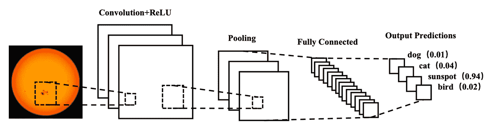

+   将图像作为输入,首先经过卷积层,在卷积层中包含了用于的提取特定特征的卷积核;之后经过激活函数

+   激活函数是用来加入非线性因素,提高网络表达能力,卷积神经网络中最常用的是 ReLU ,Sigmod 使用较少,因为 Sigmod 会出现梯度消失的问题;

+   池化层的作用在于降低网络模型中的参数量,从而遏制过拟合,并且能够提高网络对输入图像的移动、变形、扭曲的 处理能力;

+   全连接层的作用在于对卷积层和池化层输出的特征图 (二 维)进行降维,将学到的特征表示映射到样本标记空间;对于不同的 问题,输出会使用不同的函数,softmax  函数用于分类问题,线性函 数用于回归问题。

### **卷积层**

+   在计算机视觉**任务中,卷积神经网**络之所以能够展现出**如此优异的性能**,主要归功于卷积神经网络中的卷积层。卷积层具有强大的特征提取能力,通过从输入图像中捕获的特征信息进而识别图像中的内容。

> 输入图像的空间结构具有**高度 (Height ,H)**、**宽度 (Width ,W)**、 **通道数 (Chanel ,C)**三个维度。

+   特征提取是通过卷积层中的卷积核 (滤波器)实现的,这些卷积核在高度和宽度维度上都远小于输入图像,但是在通道维度上与输入图像相同。

+   特征提取的过程是通过卷 核在输入图像上滑动并做卷积运算完成的。因此,卷积层具有“参数共享 ”的特性,可以降低参数量,从而防止因参数过多引起过拟合, 也减少了计算开销。

**卷积运算如公式 2.1 所示**

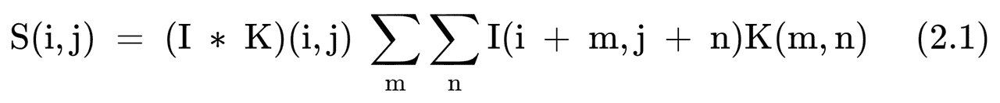

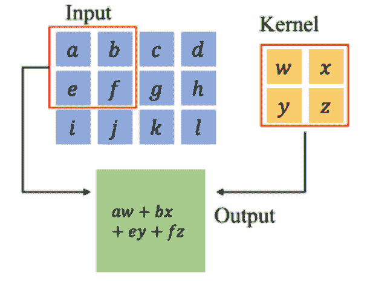

**卷积核在输入图像上**滑动所移动的素数称为步长 (Stride)。卷积过程如上图所示。

**三种卷积模式**

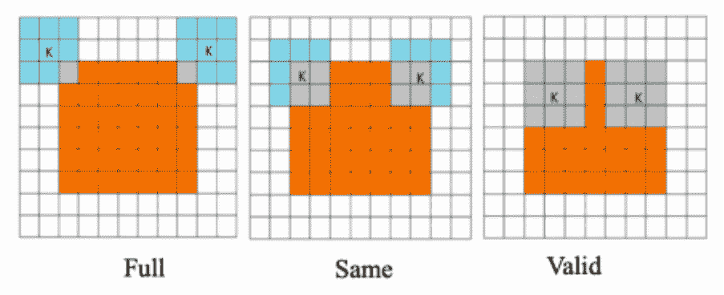

> 卷积依据卷积核开始做卷积运算时与**输入图像**重**合的位置**可**分为三种模**式,**分别是F**ul**l、Sa**me**、Vali**d 。Full 模式表示卷积核与输入图像刚重合时开始做卷积运算;Same 模式表示卷积核的中心与输入图像的边角重合时开始做卷积运算;Valid 模式表示卷积核与输入图像全部重合时开始做卷积运算。

```
因为卷积神经网络是一个深层结构,输入图像边缘**的信息在**经过多层卷积后可能会丢失。所以在卷积前对输入图像进行数据填充 (Padding)以防止边缘信息丢失。** 
常**见的数据填充形式**是在****图**像四周补 0 ,经过填**充后的**图像可以使用 Full 和 Same 两种模式进行卷积,以捕获图像边缘的信息。
积层的输出包含了从输入图像中提取到的特征信息,因此卷积层的输出称为特征图 (Feature  map)。特征图的大小与卷积核的大小、移动的步长、数据填充的层数有关。设输入图像的大小为 n×m ,使用的尺度为 f 的卷积核对其进行卷积操作,在卷积之前对其进行层数据填充 p ,卷 积核移动步长为 s ,则输出特征图的大小可由公式 2.2 表示。
```

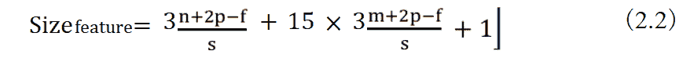

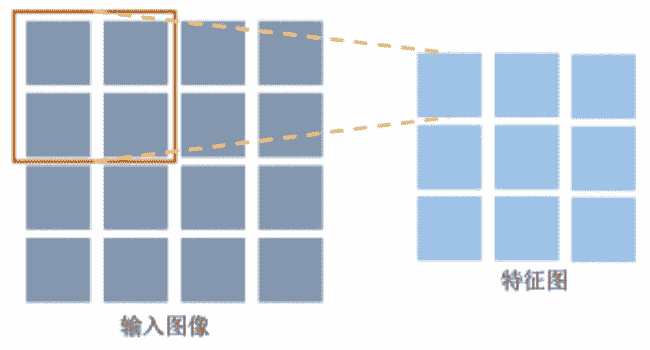

特征图上的像素点在输入图像上映射的区域称为感受野 (Receptive field), 感受野如上图所示

### **激活函数**

+   在卷积层之后会加入一个激活函数,通过引入非线性元素来提高网络的表达能力。因为卷积运算本质上是一种加权求和的线性运算。线性运算为基础的网络模型表达能力有限,通过激活函数来引入非线性因素,从而提高网络模型的表达能力。

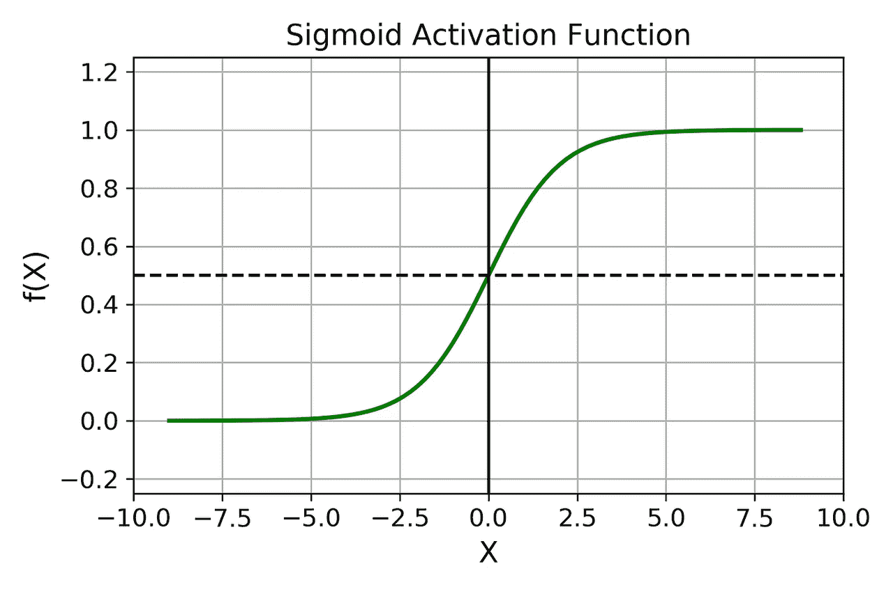

> 根据网络模型的复杂程度有多种激活函数可选择。浅层的网络模型可以使用 sigmoid  函数;ReLU 函数常用于深层网络模型;循环神经网络网络模型则使用 tanh 函数。在卷积神经网络中尽量避免使用sigmoid函数和 tanh  函数,因为会造成梯度消失。首选 ReLU 函数作  为激活函数,ReLU 函数形式如公式 (2.3)所示。

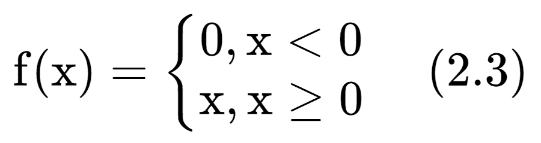

> 相较于sigmoid 函数和tanh函数,ReLU 函数只有线性关系,计算速度更快。当函数的 输入是整数时,不存在梯度消失的问题。但是当输入是负数时,ReLU   函数会把负数强制性地置为 0 ,导致特征丢失;同时也无法利用梯度  更新权值。因此,当 ReLU 函数失效时可以选用 Leaky ReLU  函数, 其的形式 如公式 (2.4)所示。Leaky  ReLU   函数避免了特征丢失、权值无法更新等问题。

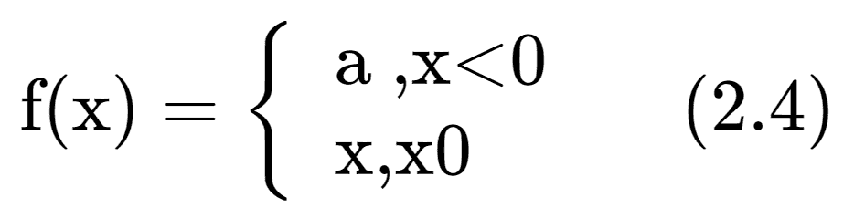

### **池化层**

+   池化操作是将某一位置相邻输出的总体统计特征作为此位置的输出。池化的过程本质上 是一个对特征图采样的过程。在保留特征的同时减少参数计算量,防止过拟合。

**常见的池化层：**

（1）最大池化、平均池化、全局平均池化、全局最大池化。

平均池化（average pooling）：计算图像区域的平均值作为该区域池化后的值。

最大池化（max pooling）:选图像区域的最大值作为该区域池化后的值。

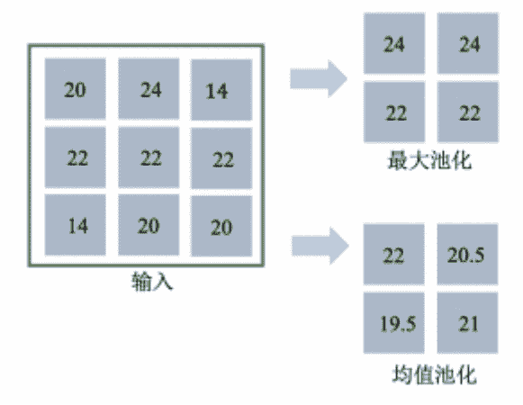

（2）重叠池化（OverlappingPooling）：

重叠池化就是，相邻池化窗口之间有重叠区域，此时一般sizeX > stride。

（3）空间金字塔池化（Spatial Pyramid Pooling）

空间金字塔池化的思想源自 Spatial Pyramid Model，它将一个pooling变成了多个scale的pooling。用不同大小池化窗口作用于上层的卷积特征。也就是说 spatital pyramid pooling layer就是把前一卷积层的feature maps的每一个图片上进行了3个卷积操作，并把结果输出给全连接层。其中每一个pool操作可以看成是一个空间金字塔的一层。

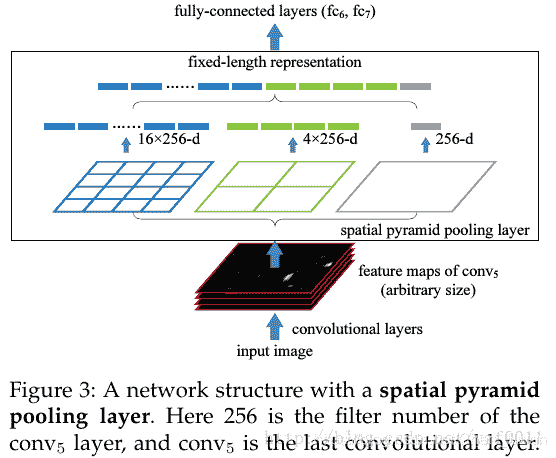

## **卷积神经网络的应用案例**

### 图像分类

+   **所谓图像分类，就是给机****器**一张图像，由机器去判断这张图像里面有什么样的东西——是猫还是狗、是飞机还是汽车。怎么把图像当做模型的输入呢？对于机器，图像可以描述为三维张量（张量可以想成维度大于 2 的矩阵）。一张图像是一个三维的张量，其中一维代表图像的宽，另外一维代表图像的高，还有一维代表图像的通道（channel）的数目。

```
Q：什么是通道？ 
A：彩色图像的每个像素都可以描述为红色（red）、绿色（green）、蓝色（blue）的组合，这 3 种颜色就称为图像的 3 个色彩通道。这种颜色描述方式称为 RGB 色彩模型，常用于在屏幕上显示颜色。
```

网络的输入往往是向量，因此，将代表图像的三维张量“丢”到网络里之前，需要先将它 “拉直”，如图所示。

> 在这个例子里面，张量有 **100 ****× ****100 ****× ****3 **个数字，所以一张图像是由**100×100×3 **个数字所组成的，把这些数字排成一排就是一个巨大的向量。这个向量可以作为网络的输入，而这个向量里面每一维里面存的数值是某一个像素在某一个通道下的颜色强度。

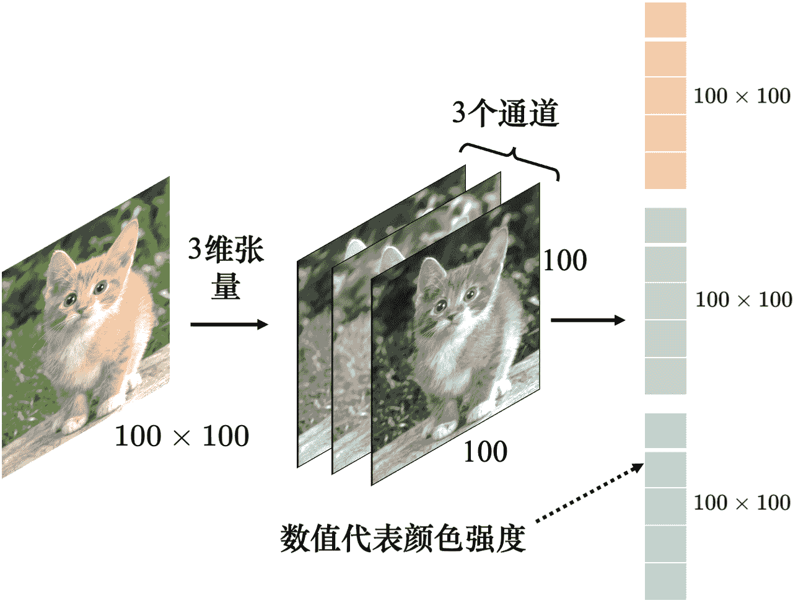

> 图像有大有小，而且不是所有图像尺寸都是一样的。常见的处理方式是把所有图像先调整成相同尺寸，再“丢”到图像的识别系统里面。以下的讨论中，默认模型输入的图像尺寸固定为100像素×100像素。

**如图所示**，如果把向量当做全连接网络的输入，输入的特征向量（featurevector）的长度就是100×100×3。

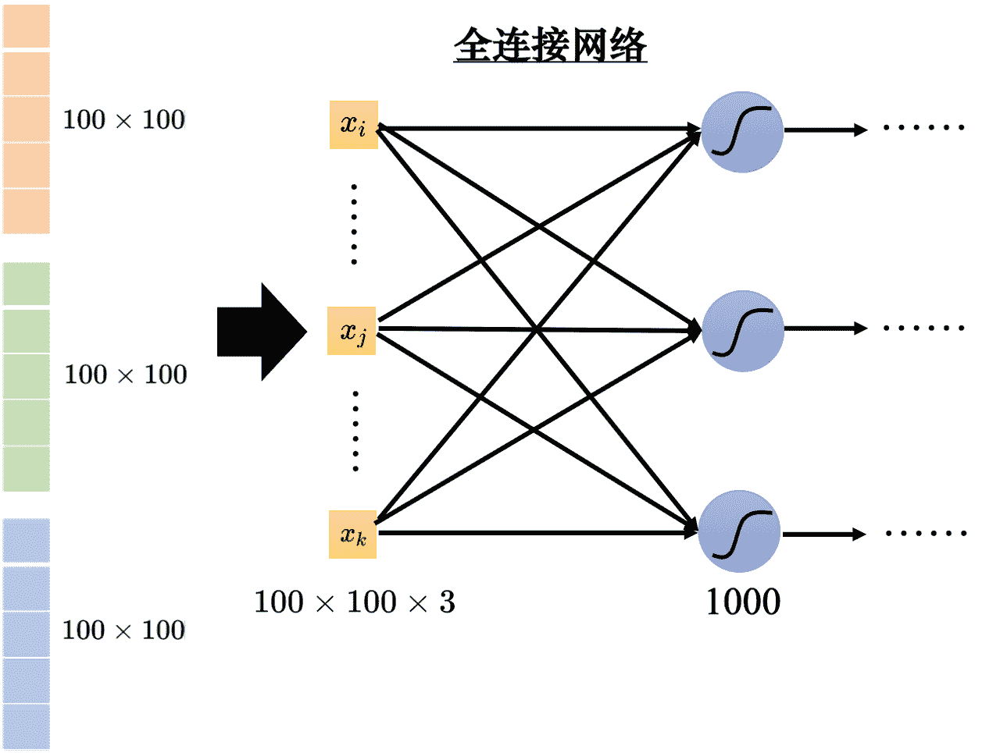

这是一个非常长的向量。由于每个神经元跟输入的向量中的每个数值都需要一个权重，所以当输入的向量长度是100×100×3，且第1层有1000个神经元时，第1层的权重就需要1000×100×100×3=3×107个权重，这是一个非常巨大的数目。更多的参数为模型带来了更好的弹性和更强的能力，但也增加了过拟合的风险。模型的弹性越大，就越容易过拟合。为了避免过拟合，在做图像识别的时候，考虑到图像本身的特性，并不一定需要全连接，即不需要每个神经元跟输入的每个维度都有一个权重。接下来就是针对图像识别这个任务，对图像本身特性进行一些观察。

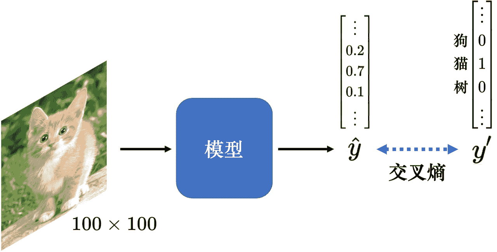

> 模型的目标是分类，因此可将不同的分类结果表示成不同的独热向量  。在这个独热向量里面，类别对应的值为1，其余类别对应的值为0。例如，我们规定向量中的某些维度代表狗、猫、树等分类结果，那么若分类结果为猫，则猫所对应的维度的数值就是1，其他东西所对应的维度的数值就是0，如图4.3所示。独热向量 的长度决定了模型可以识别出多少不同种类的东西。如果向量的长度是5，代表模型可以识别出5种不同的东西。现在比较强的图像识别系统往往可以识别出1000种以上，甚至上万种不同的东西。如果希望图像识别系统可以识别上万种目标，标签就会是维度上万的独热向量。模型的输出通过softmax以后，输出是  。我们希望 和  的交叉熵越小越好。