# 🏞️Apple：4M多模态模型框架

> 来源：[https://v11enp9ok1h.feishu.cn/docx/V6kgdVpYaoLv2OxanLdc90IdnWf](https://v11enp9ok1h.feishu.cn/docx/V6kgdVpYaoLv2OxanLdc90IdnWf)

## 背景：融合的模态越多，可玩性越大

> 多模态模型除了朝着模型越来越大的方向发展外，还有个趋势是融合的模态越来越多。融合的模态越多，理论上各个模态能力可以互相增强从而获得比少模态情况下更好的效果。另一个好处是，不同的模态放一块可以做跨模态检索或者生成，可玩性大大增强。

在融合更多模态这个方向上，去年 Meta 的 ImageBind 工作不得不提一下。

### ImageBind:

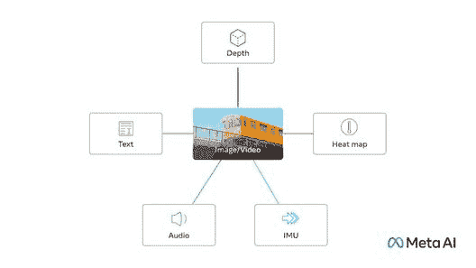

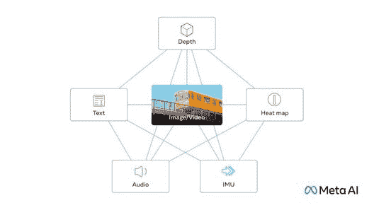

> **ImageBind**包含了 6 个不同的模态数据。它把其**他模态与****视觉（图片或视频）**组成双模态，利用CL**IP训练，让其他模**态都与视觉模态对齐。从而达到把所有模态的数据，embedding到同一个空间。可见 ImageBind 其实是把多模态拆成了多个双模态进行处理的，比较 naive。

**ImageBind** 训练完成后，就可以做多模态的检索或者生成了。比如下面的一些 cases 就挺好玩的。

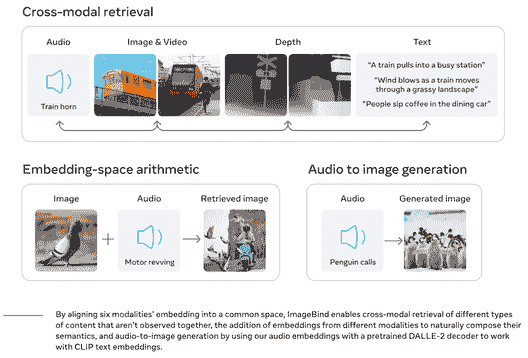

## 4M: Massively Multimodal Masked Modeling, Apple, 2023-2024

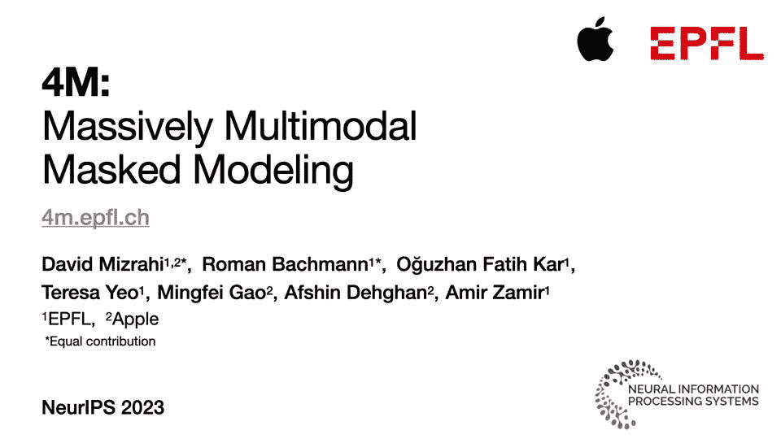

[4M_Website_Video.mp4](https://internal-api-drive-stream.feishu.cn/space/api/box/stream/download/all/JNIrbP8XkoW8uGxKe5FcAI1knkf)

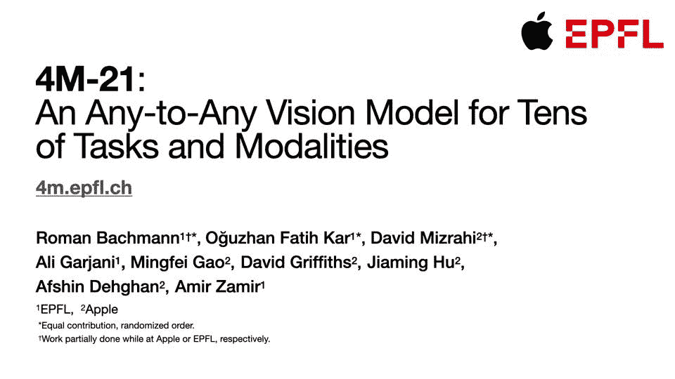

[4M-21_Website_Video.mp4](https://internal-api-drive-stream.feishu.cn/space/api/box/stream/download/all/SjO4bPZqao3Tz0x82gDcOGBHnrg)

4M 来自 **Massively Multim**odal Masked Modeling 的首字母缩写，包含苹果的两篇论文：

+   [4M: Massively Multim](https://arxiv.org/abs/2312.06647)odal Masked Modeling, NeurIPS 2023

+   [4](https://arxiv.org/abs/2406.09406)M-21: An Any-to-Any Vision Model for Tens of Tasks and Modalities, arXiv 2024

名字中的重点是 Masked 这个词，后续我们会具体说。

### 4M 多模态融合框架

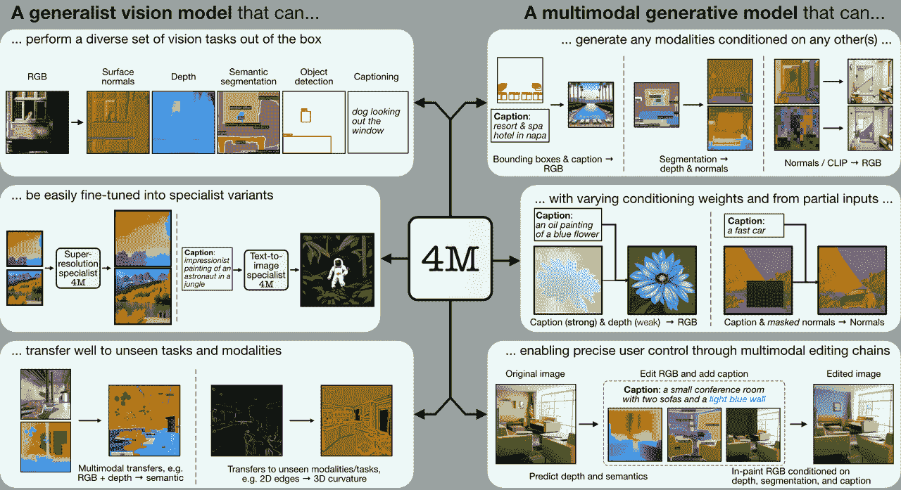

第一篇论文中提出了统一的模型框架和训练方法，融合了 7 个模态的数据。而第二篇论文则把模态数量推进到 21 个，模态增加后带来了显著的效果提升。接下来我们统一介绍 4M 的多模态建模方法。

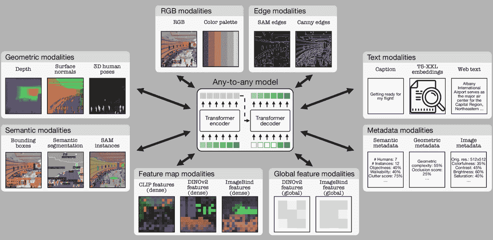

4M 可以接收来自单个或多个模态**的输入，这些输入可**以是完整的，也可以是只包括部分内容。通过 4M 模型后，输出指定模态的完整输出。所以 4M 可以用来完成以下任务：

+   **模态迁移**：输入为一个模态的完整数据，输出为另一个模态的结果。

+   **可控生成、补全/替换**：输入为一个或多个模态的部分或完整数据，输出为指定模态的完整结果。图片编辑可以认为是可控生产的一个应用。

+   **超分**：虽然输入输出同为 **RGB**** 模态，但是****输入为低分辨**率的图片，可以使用较少的 tokens表示，输出为高分辨率的图片，可以使用更多的 tokens 表示。

+   **跨模态检索**：利用不同模态的输入进行相关内容的检索，提升检索的准确性和全面性。

4M 的模型架构是带 encoder和 **Decoder** 的 **Transformer**，如下图。主要就包含 2 个步骤：

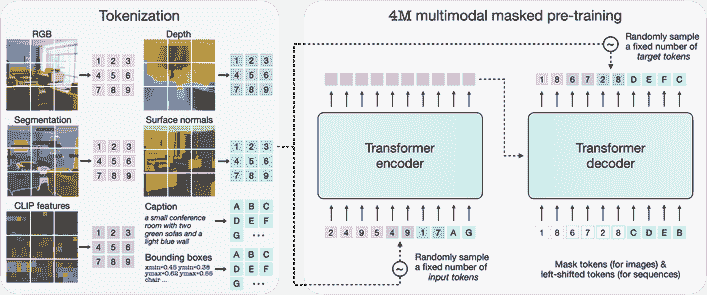

1.  把输入数据使用各个模态的 **Tokenizer** 转换为离散的 **token** 序列。

1.  这些不同模态的 **token** 序列作为 Transform**er Enco**der 的输入，然后其 Decoder 的输出就是模型的输出了。

### 不同模态的 **Tokenizer**

4M 融合了 21 个模态的数据，下图列出了这 21 个模态。这些模态的训练数据是通过各自的专家模型预测得到的，如使用 SAM 获得实例分割结果。

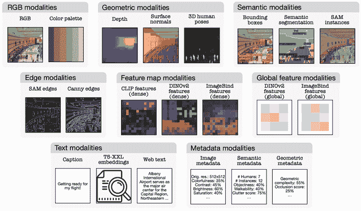

> 4M 为每个模态训练了不同的 **Tokenizer**，然后通过这些 **Tokenizer**** 把不同类****型的数据都转换为离**散的 toke**n 序列。有些**模**态的数据类型很相似，会放到同**一**个 Tokeni**z**er 中训练。如 Capt**ion、Bound**ing boxes、**Metadata**、Colo**r** palet****te 这几个****模态的**数据都可以表示为离散序列。只要扩充文本 vocab，加入特定的 tokens 就行。

**下图列出了各个模态使用的** **Tokenizer** 类型。

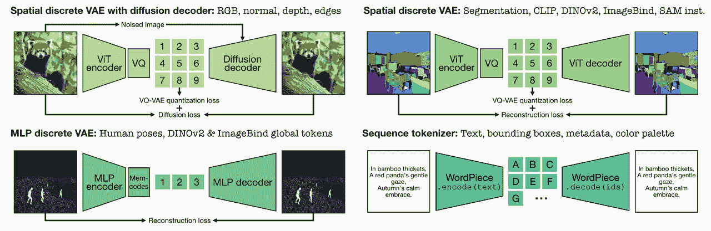

关于 discrete VAE, VQVAE 等 Toke[🏞️图像 Token 化：视觉数据转换的关键技术](https://v11enp9ok1h.feishu.cn/wiki/OuGlwbsT0ibAo9kRQkmcXeE6nIf?from=from_copylink)izer 相关的更多细节，可以参考：

### 训练方法

**对于数据天然就是序列类型的模态**，如文本，现在主流的训练方法是**使用自回归**（AR）的方式  进行训练，也就是**模型会根据****前面的已**有序列预测下一个 token 的取值。

而对于原始数据是连续稠**密取值的****模态，如图片****，现在****的结论是使用**** Mas**ked的方式（输入中 mask 掉一部分 tokens，而输出的目标则是预测这些被 mask 掉的 tokens 的取值）  训练效率会高于自回归。

**4M 在训练时参照了这两个结论，对原始为序列类型****的****模态，使用的****训练方式是**自回归；而对于原始为连续稠密类型的模态，则使用了 masked 的方式。

**训练过程中**，模型会随机选择一些模态中的一小部分 token 作为输入，同样随机选择这些模态中的另一小部分 token 作为目标。以下是一个训练样本的具体构建过程：

+   **输入序列的构建****：从对称狄**利克莱分布中抽**取出每个模态**应该选取的 token** 长度比例 ** 为模态数量。然后从当前样本对**应的各个模态****所有 to**kens 中随机抽取出   个 tokens（对于原始数据为序列的模态，是随机抽取出连续的一个片段），其中   表示当前样本的第   个模态的 tokens 数量。这些从不同模态选出来的 token 片段按模态拼接成完整的输入序列，

+   **如图右侧****。这样做的好**处是可以把选出来的整体 tok**ens 数**量限制在这个样本单个模态 token 数量的 scale 上，不会随着模态数量增加而变得越来越长。

+   **输出序列的构建****：和输入序列**的构建类似，只是在选取 tok**ens 需要**避开已经在输入序列中的 tokens。

**构**建完训**练样本，接下来**介绍下**训练过程：模型** encoder 和 deco**der 的输**入信息除了各**模态选出**的** tok**ens 外，还包括位置编码、模态编码（来自哪个模态）。

**之前说过，4M 对原始****为序列类****型的模态，使****用的训练****方式是自回归；**而对**于原始为连续稠密类型的模**态，则使用了 masked 的方式。所以对于原始为序列类型的模态， decoder 的输入和输出类似自回归模型。

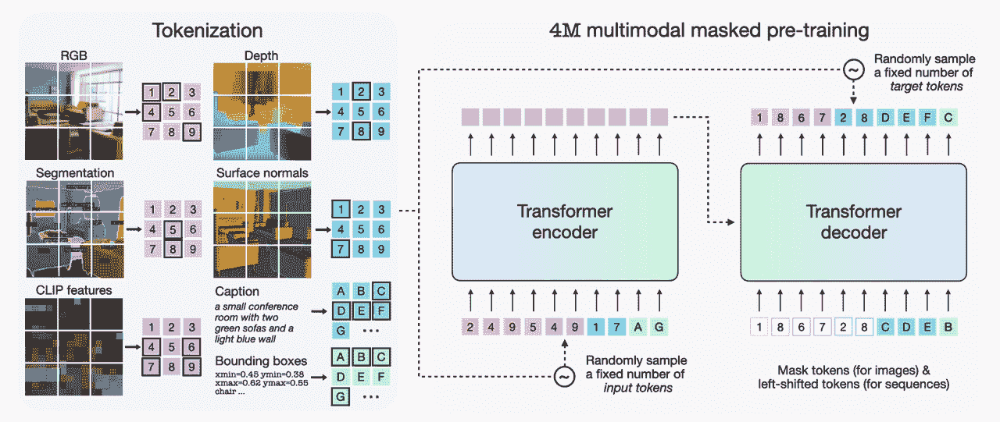

> **例如上图** **decoder**的输入序列，**模态 ****Caption**** 对应的是蓝绿色的**  **它对应的输出则****是往后挪了**一步的  。**而对于原始为连**续稠密类型的模**态，dec****oder 的输**入则是 mask token，输出则是被 mask 掉的 token。例如上图 decoder 的输入序列，模态 RGB 对应的是边框为红色无底色的 1,81,8，即 1,81,8 这两个位置的 token 被 mask 掉了，需要通过 decoder 恢复。

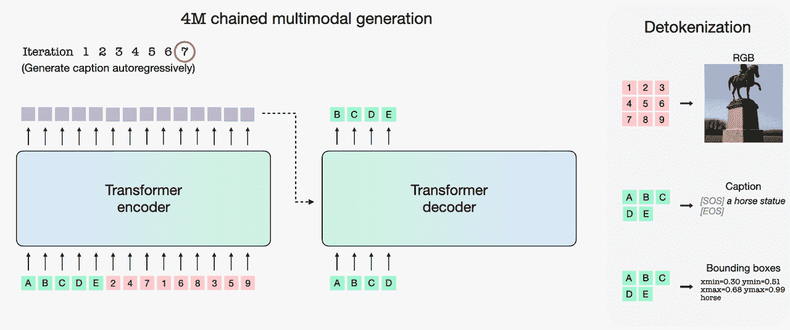

> **decoder**会和 **encoder** 的所有输出序列进行 **cross-attention**，也即 decoder 中各个模**态的预测都可以****看到输入中****所有模态的信息。但这里****和标准 Tr**a**nsform**er** decoder 也有**不同。decoder 中做 self-attention 时只能看到同模特的其他 tokens。 这样避免受到其他模态生成结果的影响。对于原始为序列类型的模态，类似自回归，只能看到当前时间之前的同模态 tokens；而对于原始为连续稠密类型的模态，则能看到同模态的所有 mask tokens。

4M 把所有模态的数据都变成离散 tokens 进行处理的好处是 loss 里可以直接使用 cross-entropy loss 处理所有模态，或者是计算 loss 的时候不需要管是什么模态。这样就没必要去权衡不同模态的 loss 值了。

### 生成过程：Self-consistent prediction through Chained multimodal generation

4M 支持带条件或者无条件的生成。4M 可以使用迭代的方式获取到指定模态的输出结果。

之前说过，4M 中的模态分为 2 大类：

1.  原始为序列类型的模态，

1.  原始为连续稠密类型的模态。

4M 在生成结果时也针对这两类模态使用了不太一样的策略。

+   对于原始为序列类型的模态，使用类似自回归的方式，一次性生成完整的结果。 通过起始的标记 token [SOS] （包括了模态编码）来指定接下来生成哪个模态的结果。

>

+   [对于原始为连续](https://masked-generative-image-transformer.github.io/)稠密类型的模态，则使用了类似 MaskGIT 迭代生成的方式。decoder 输入为所有未知 tokens 对应的 mask tokens，输出则为这些未知的 tokens。已经生成的完整模态的 tokens 会加入到 encoder 的输入 tokens 中，这样可以保证接下来生成的其他模态的 tokens 与已经生成的结果自洽（self-consistent）。

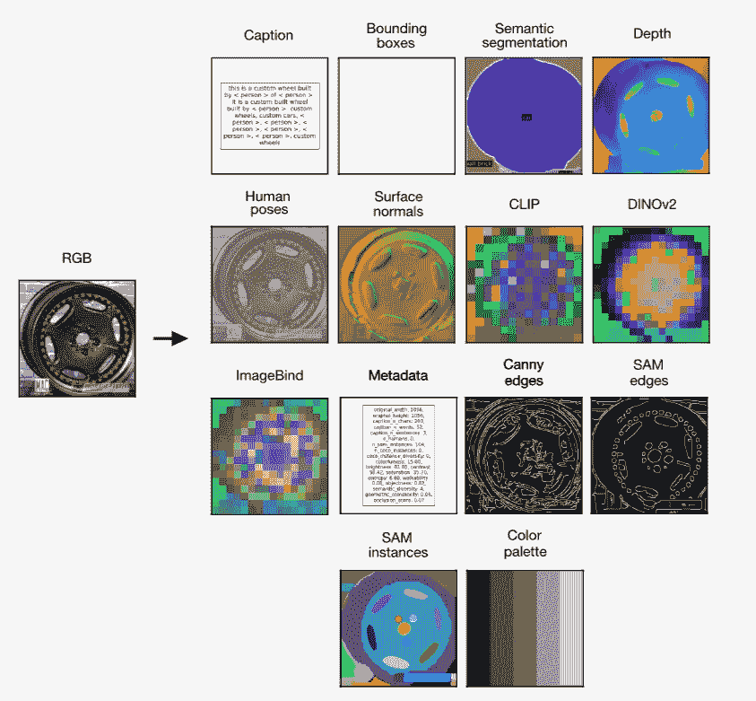

接下来基于下图中的示例具体说明生成过程。下图示例中输入的条件包括 Bounding boxes 模态的一部分（ymax=0.99），以及 RGB 模态的 3 个 patches。输出包括 RGB 和 Caption 模态的所有内容。4M 首先生成所有的 RGB tokens，然后再生成 Caption tokens。

1.  前 3 步利用 MaskGIT 的 masked 方法生成 RGB 模态的其他未知（masked） tokens。比如第一步 decoder 输出了对 1、2、3、4、5、7 位置 tokens 的预测。然后保留 decoder 输出概率值最高的 2 个 tokens 3、5。

1.  第 2 步把前一步选定的 2 个 tokens 加入到 encoder 输入序列中，继续使用 decoder 生成 RGB 模态的其他未知 tokens。然后保留 decoder 输出概率值最高的 2 个 tokens 4、7。

1.  第 3 步再把前一步选定的 2 个 tokens 加入到 encoder 输入序列中，继续使用 decoder 生成 RGB 模态的其他未知 tokens。然后保留 decoder 输出概率值最高的 2 个 tokens 1、2。这样 RGB 模态的所有结果都被生成了。这个生成过程中，每次选举多少个预测的 tokens 加入到输入中是有讲究的，MaskGIT 的结论是迭代初期要加的少一点，之后可以逐渐缓慢增加。

1.  第 4 步以原始已知 Bounding boxes 模态的 tokens 以及 RGB 模态的所有 tokens 作为输入，生成 Caption 模态的结果。因为 Caption 模态是序列类型的模态，所以就按自回归的方式让 decoder 生成完整的 caption tokens 序列 就行（A 对应 [SOS]）。见图中的第 4～6 步。

生成哪些模态的结果可以按需指定。生成完成后就可以用对应 Tokenizer 还原成模态原始值了。

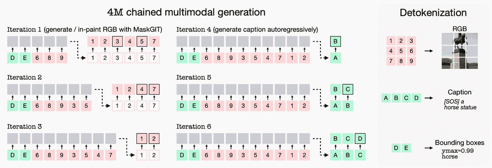

> 📌此示例中没有对 Bounding boxes 模态做补全，可能是因为 4M 的补全能力只针对原始为连续稠密类型的模态，原始为序列类型的模态只完整存在于 encoder 或者完全由 decoder 生成。但从 4M 的训练过程看，其实是没这个约束的。

[4M 可](https://4m.epfl.ch/)以用来做哪些好玩的应用？官方主页给出了各种示例，有兴趣可以去翻翻。