# Llama 3 让100%本地化RAG更有意义

> 来源：[https://v11enp9ok1h.feishu.cn/docx/AVmbdCfPRoF97qxyrJKccJnSnCd](https://v11enp9ok1h.feishu.cn/docx/AVmbdCfPRoF97qxyrJKccJnSnCd)

Meta 开源的 Llama LLM 系列模型已经成为了 LLM 界的 Android 系统。Meta 发布新模型的同时也会发布模型的训练细节，所以非常值得一追！

Llama 3.1 发布，在 15.6T 多语言 tokens 上训练，支持多语言，编程，推理和工具使用。新模型支持 128K tokens 长度的上下文。最大的旗舰模型参数量为 405B，效果达到了闭源模型的 SOTA。

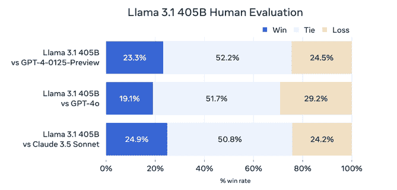

## 模型架构

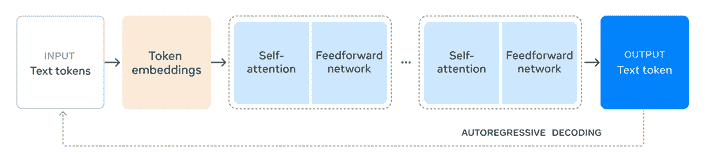

Llama 3.1 的模型和 Llama 3 是一样的，只是做了更精细的训练。各个模型的结构如下：

+   LaMA 3 依旧使用的是 decoder-only transformer 架构。

+   LLaMA 3 使用了 **128K**** token vo**cabulary （LLaMA 2 是 32K），提升了编码效率，从而大幅提高了模型性能。

+   采用了分组查询注意力(GQA)，提升了推理效率。

+   在长度为 8,192 长度的 token 序列上训练（之前是 4K），并使用掩码确保自注意力不会跨越文档边界。

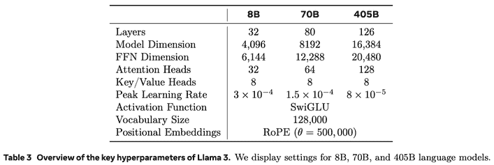

Llama 3 和 3.1 的各个模型的差异对比：

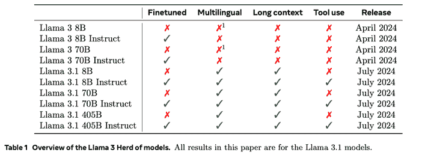

## 预训练（Pre-Training）

预训练参数为 405B 的模型，使用了15.6T tokens，并且设置了上下文窗口大小为 8K tokens。标准预训练阶段之后，接着是继续预训练（continued pre-training）阶段，增加支持的上下文窗口到 128K tokens。

语言模型预训练包括：

(1) 大规模训练语料库的策划和过滤，

(2) 模型架构的开发及确定模型规模的相应缩放法则（Scaling laws），

(3) 大规模高效预训练技术的开发，

(4) 预训练方案的制定。

数据过滤，去重等步骤就不在这里详说了，论文有点细节但不多。

+   为确保 LLaMA 3 训练用的是最高质量的数据，作者开发了一系列数据过滤流水线，包括使用启发式过滤器、NSFW 过滤器、语义去重方法和文本质量分类器等。作者发现，前几代 LLaMA 在识别高质量数据时表现出乎意料的出色，因此使用 LLaMA 2 生成了用于训练 LLaMA 3 文本质量分类器的训练数据。

### 缩放法则（Scaling Laws）

借助缩放法则在预训练计算预算（compute budgets）下确定旗舰模型的最佳模型规模。除了确定最佳模型规模外，主要挑战是预测旗舰模型在下游基准任务上的性能，原因有几个：

(1) 现有的缩放法则通常只预测下一个 token 的预测损失，而不是具体的基准性能。

(2) 缩放法则可能会有噪声且不可靠，因为它们是基于小计算预算的预训练运行开发的。

📌计算预算 = Model Size ✖️ # Tokens

### 确定旗舰模型的参数规模

具体来说，作者通过在   FLOPs 到   FLOPs 之间的计算预算（compute budgets）下进行预训练模型来构建缩放法则。在每个计算预算下，作者预训练规模各异的多个模型，模型大小范围在40M到16B参数之间。

这些实验产生了 图2 中的 IsoFLOPs 曲线。这些曲线中的损失是在一个单独的验证集上测量的。作者使用二次多项式拟合测量的损失值，并确定每个抛物线的最小值。作者将抛物线的最小值对应模型称为对应预训练计算预算下的计算最优（compute-optimal）模型。

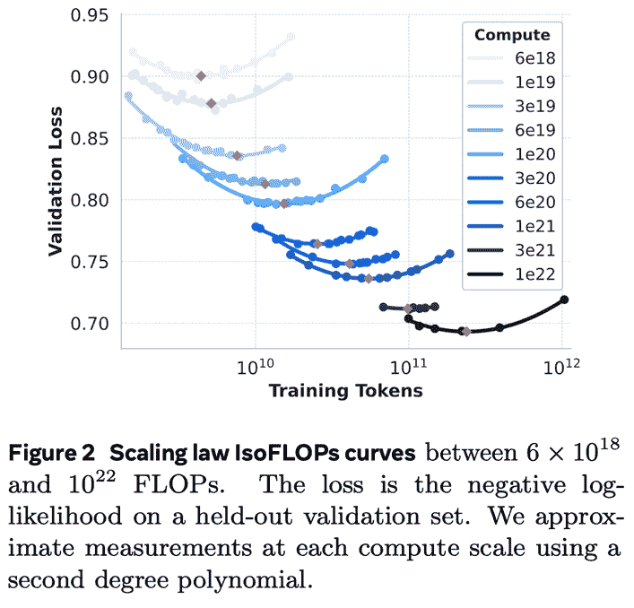

作者使用识别出的计算最优模型来预测特定计算预算下的最佳训练 tokens 数量（图 2 中红点的横坐标取值）。作者假设计算预算  与最佳训练 tokens 数量  之间存在幂律关系：

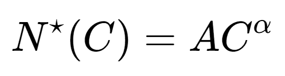

使用图2中的数据拟合   ，发现 **(****α****,****A****)=(0.53,0.29)**；相应的拟合结果显示在 图3 中。将结果缩放法则外推至   FLOPs，表明可以在 16.55T 训练 tokens 上训练一个 402B 参数的模型。

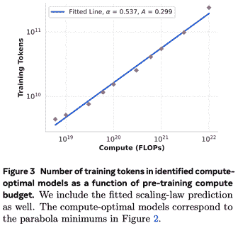

从图 2 中可以看出，随着计算预算的增加，IsoFLOPs 曲线在最小值附近变得更平坦。这表明旗舰模型的性能对模型大小和训练标记之间的小变化相对稳健。基于这一观察，作者最终决定训练一个405B参数的旗舰模型。

### 确定旗舰模型在下游任务的效果

为了解决这些挑战，作者实施了一个两阶段的方法来开发准确预测下游基准性能的缩放法则：

1.  首先，建立计算最优（compute-optimal）模型在下游任务上的负对数似然与训练浮点运算（FLOPs）之间的相关性。

1.  接下来，利用计算最优模型和更高计算浮点运算（FLOPs）训练的旧模型如 Llama 2 系列模型，将下游任务上的负对数似然与任务准确性相关联。

这种方法使作者能够在给定计算预算的情况下预测计算最优模型在下游任务上的性能。

作者使用计算最优模型来预测旗舰 Llama 3 模型在基准数据集上的性能。首先，将基准中的正确答案的（归一化）负对数似然与训练 FLOPs 线性相关。在此分析中，作者仅使用训练到 10221022 FLOPs 的缩放法则模型以及上文描述的数据混合。

接下来，作者使用缩放法则模型（图 2 中的计算最优模型）和 Llama 2 模型（使用 Llama 2 数据混合和分词器训练）之间的对数似然和准确性建立S型关系。作者在 图4 中展示了 ARC Challenge 的实验结果。发现这种两步 scaling laws 预测，跨越四个数量级的外推非常准确：它仅略微低估了旗舰 Llama 3 模型的最终性能。

📌分两步预测的好处是在第二步中可以把已有的大模型的 NLL 和对应准确率作为训练样本（图 4 右侧中的黄点）加入进来。

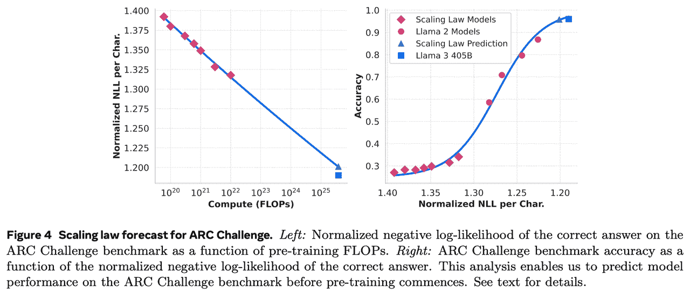

### 确定旗舰模型的训练数据混合比例

为了获得高质量的语言模型，必须仔细确定预训练数据混合中不同数据源的比例。作者主要通过知识分类和缩放法则实验来确定这一数据混合。

知识分类。作者开发了一种分类器，用于分类网络数据中包含的信息类型，以更有效地确定数据混合。作者使用该分类器对在网络上过度代表的数据类别（例如艺术和娱乐）进行降采样。

数据混合的缩放法则。类似上面的做法，作者通过缩放法则实验来选择预训练数据最佳混合比例。作者在某种数据混合上训练几个小模型，并用它来预测大型模型在该混合上的性能（类似上面，先预测 NLL 值，再通过 NLL 预测精度）。作者对不同的数据混合重复多次这一过程，以选择最优的数据混合候选。随后，作者在该候选数据混合上训练一个较大的模型，并评估该模型在几个关键基准上的性能。

数据混合总结。最终数据混合大致包含50%的通用知识 tokens，25%的数学和推理 tokens，17%的代码 tokens，以及8%的多语言 tokens。

### 预训练过程

预训练 Llama 3 405B 的方案包括三个主要阶段：(1) 初始预训练，(2) 长上下文预训练，(3) 退火。

1.  初始预训练：作者使用余弦学习率调度预训练 Llama 3 405B，峰值学习率为 8×10−58×10−5，线性预热8000步，并在120万个训练步骤内衰减至 8×10−78×10−7。为了提高训练稳定性，作者在训练初期使用较小的批量大小，随后增加批量大小以提高效率。具体而言，初始批量大小为4Mtokens，序列长度为4096；在预训练252M tokens 后，将这些值 double 为 8M和8192；预训练 2.87T tokens 后，再次将批量大小加倍至16M。作者发现这种训练方案非常稳定：观察到的损失峰值很少，不需要干预来纠正模型训练的偏差。

1.  调整数据混合。作者在训练过程中对预训练数据混合进行了多次调整，以提高模型在特定下游任务上的性能。作者在预训练期间增加了非英语数据的比例，以提高 Llama 3 的多语言性能。作者还上采样了数学数据以提高模型的数学推理性能，在预训练的后期阶段添加了更多最新的网络数据以更新模型的知识截止点，并对后期被识别为质量较低的预训练数据子集进行降采样。

1.  长上下文预训练：在预训练的最后阶段，作者在长序列上进行训练，以支持最多 128K tokens的上下文窗口。作者早期没有在长序列上训练，因为自注意力层的计算量随着序列长度的平方增长。训练过程中逐渐增加支持的上下文长度：直到模型成功适应新的上下文长度后再增加长度。作者通过以下两点来评估成功适应：(1) 模型在短上下文评估中的性能是否完全恢复，以及 (2) 模型是否完美解决了长度范围内的“海底捞针”任务。在 Llama 3 405B 预训练中，作者分六个阶段逐步增加上下文长度，从最初的8K上下文窗口开始每次翻倍，最终达到128K上下文窗口。这个长上下文预训练阶段总共使用了大约800B训练 tokens。

1.  退火：在预训练的最后 40M tokens 期间，作者线性退火学习率至0，保持 128K tokens的上下文长度。在退火阶段，还调整了数据混合，上采样非常高质量的数据源，具体见下面说明👇。最后，平均退火过程保存的多个模型权重值以生成最终预训练模型。

1.  在少量高质量代码和数学数据上进行退火可以提升预训练模型在关键基准测试上的性能。作者使用数据混合进行退火，上采样特定领域的高质量数据。退火数据中不包括任何常用基准测试的训练集。

1.  作者发现，退火使得预训练的 Llama 3 8B 模型在 GSM8k 和 MATH 验证集上的性能分别提高了 24.0% 和 6.4%。然而，对 405B 模型的改进则微乎其微，表明旗舰模型具有很强的上下文学习和推理能力，不需要特定的域内训练样本即可获得强大的性能。

使用退火评估数据质量。与Blakeney等（2024）类似，作者发现退火能够判断小型特定领域数据集的价值。作者通过对 50% 训练完成的 Llama 3 8B 模型在 40B tokens 上线性降低学习率至0 的方式来衡量这些数据集的价值。在这些实验中，作者对新数据集赋予30%的权重，其余70%权重分配给默认数据混合。使用退火评估新数据源比对每个小数据集进行缩放法则实验更有效。

## 后训练（Post-Training）

产生对齐模型的过程包含了 6 轮迭代，每轮都包括有监督微调（SFT）和直接偏好优化（DPO）。数据来自人类标注或者自动生成。在后训练阶段，作者还整合了新的功能，例如工具使用，并观察到在其他领域（如编码和推理）有显著改进。安全缓解措施也在后训练阶段被纳入模型。

后训练包含了一个奖励模型（Reward Model）和一个语言模型。首先，作者使用人工标注的偏好数据基于预训练模型训练奖励模型。使用奖励模型对人工标注的 prompts 进行拒绝采样。然后，通过 SFT 进一步微调预训练模型，并通过 DPO 进一步对齐模型。此过程如 图7 所示。

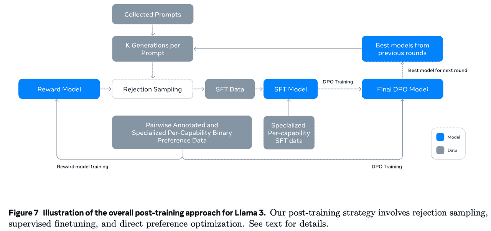

在奖励模型（RM）、有监督微调（SFT）或直接偏好优化（DPO）各个阶段中使用不同的数据或超参数获得了很多模型权重。最终模型的权重值使用了它们的平均值。

和 Llama 2 一样，应用上述方法迭代了 6 轮。在每个循环中，作者收集新的偏好标注和SFT数据，并从最新模型中采样合成数据。

### 偏好数据（Preference Data）

偏好数据标注过程类似于Llama 2。每轮迭代后，作者会部署多个模型，并为每个用户 prompt 采样两个来自不同模型的响应。这些模型可以用不同的数据组合和对齐方法训练得到，从而具有不同的能力强度（例如代码专业知识），这样可以增加数据的多样性。标注员会依据选择的响应（chosen response）与拒绝的响应（rejected response）的偏好差距程度将其分为四个级别：显著更好、较好、稍好或略好。作者还在偏好排名后加入了编辑步骤，鼓励标注员进一步改进选择的响应。标注员可以直接编辑选择的响应或使用反馈提示模型改进其自身的响应。因此，部分偏好数据包含三个排名的响应（编辑后的 > 选择的 > 拒绝的，edited > chosen > rejected）。

作者会严格评估收集的数据，并逐渐优化 prompts 以便为标注员提供系统的、可操作的反馈。例如，随着 Llama 3 在每轮训练后的不断改进，作者会针对模型滞后的领域相应地增加 prompt 的复杂性。

在每轮训练后，作者使用当时可用的所有偏好数据训练奖励模型，同时仅使用来自各种能力的最新批次数据进行 DPO 训练。对于奖励建模和 DPO，作者使用那些被标注为选择响应显著优于拒绝响应的样本进行训练，并丢弃响应相似的样本。

以下是偏好数据中包含的各个类型的数据统计：

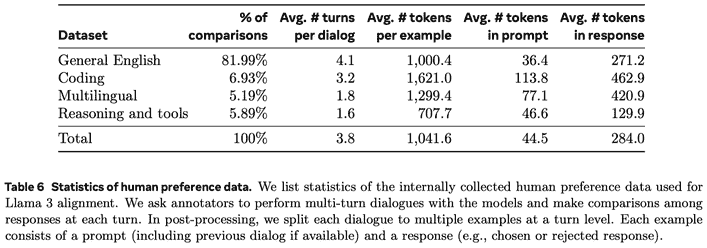

### SFT 数据

微调数据主要由以下来源组成：

+   来自人类标注集合的 prompt 与拒绝采样（RS）的响应

+   在拒绝采样（RS）过程中，对于在人工标注期间收集的每个 prompt，会从最新的模型（通常是上一次训练后迭代中表现最好的模型权重，或者某个特定能力表现最好的模型权重）中采样K个输出（通常在10到30之间），并使用奖励模型选择最佳输出。在后训练的后期阶段，引入 system prompt 以引导 RS 响应符合期望的语气、风格或格式。

+   针对特定能力的合成数据，详见后面。

+   少量人工精选的数据。

以下是 SFT 数据中包含的各个类型的数据统计：

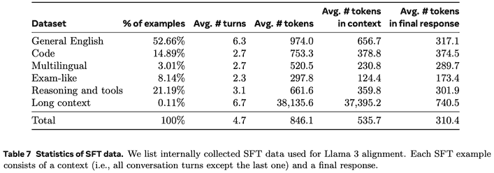

下面介绍几种特定能力的数据是如何合成的。其他特定能力数据合成的方式类似，细节可见原论文

#### 代码特定能力数据

作者训练了一个代码专家模型，用于在后续的微调阶段收集高质量的人工标注。这个专家模型是在预训练模型的基础上继续在一个主要由代码数据（>85%）组成的 1T 标注混合数据上进行预训练来实现的。在训练的最后几千步中，作者在一个高质量的库级代码数据混合上执行了长上下文微调（long-context finetuning, LCFT），将专家的上下文长度扩展到 16K 标注。最后，作者遵循前面描述的类似后训练建模策略来对齐这个模型，但 SFT 和 DPO 数据混合主要针对代码。这个模型也用于代码 prompt 的拒绝采样。

合成数据生成。在开发过程中，作者识别出代码生成中的关键问题，包括难以遵循指令、代码语法错误、生成不正确的代码以及难以修复错误。作者使用 Llama 3 和代码专家生成了大量的合成 SFT 对话。

作者描述了生成合成代码数据的三种高级方法。总共生成了超过 2.7M 个用于 SFT 的合成示例。

1.  合成数据生成：执行反馈。作者使用以下过程生成了大约 1M 个合成编码对话的大型数据集：

+   问题描述生成：首先，作者生成了大量涵盖广泛主题的编程问题描述，包括长尾分布中的主题。为了实现这种多样性，作者从各种来源中随机抽取代码片段，并通过 prompt 让模型基于代码片段生成编程问题。

+   解决方案生成：然后，作者通过 prompt 让 Llama 3 用给定的编程语言解决每个问题。作者观察到，在 prompt 中添加一般良好编程规则可以提高生成的解决方案质量。此外，要求模型在注释中解释其思考过程也很有帮助。

+   正确性分析：生成的解决方案未必正确，而在微调数据集中包含不正确的解决方案可能会损害模型质量。为验证正确性，作者从生成的解决方案中提取源代码，并应用静态和动态分析技术来测试其正确性，包括：

+   静态分析：作者通过解析器和 linter 运行所有生成的代码，以确保语法正确，捕捉诸如语法错误、未初始化变量或未导入函数的使用、代码风格问题、类型错误等错误。

+   单元测试生成和执行：对于每个问题和解决方案，作者通过 prompt 让模型生成单元测试，并在容器化环境中与解决方案一起执行，捕捉运行时执行错误和一些语义错误。

+   错误反馈和迭代自我纠正：当解决方案在任何步骤失败时，作者通过 prompt 让模型进行修正。prompt 包含原始问题描述、错误解决方案以及来自解析器/linter/测试器的反馈（stdout、stderr 和返回代码）。在单元测试执行失败后，模型可以修正代码以通过现有测试，或修改其单元测试以适应生成的代码。只有通过所有检查的对话才包含在最终数据集中，用于 SFT 训练。值得注意的是，作者观察到大约 20% 的解决方案最初是不正确的，但经过自我纠正后表明模型从执行反馈中学习并改进了其性能。

+   微调和迭代改进：微调过程分多轮进行，每轮建立在前一轮的基础上。每轮之后，模型都会得到改进，生成更高质量的合成数据用于下一轮。这种迭代过程允许模型性能逐步优化和增强。

1.  合成数据生成：编程语言翻译。作者观察到较不常见的编程语言（如 Typescript/PHP）与主流编程语言（如 Python/C++）之间存在性能差距。为了解决这一问题，作者通过将常见编程语言的数据翻译成不常见的语言来补充现有数据。

1.  合成数据生成：反向翻译（backtranslation）。某些编码场景（如文档编写、解释等）的代码执行反馈返回信息很少无法用于判断结果的质量，作者采用了一种替代性的多步骤方法。通过这一方法，作者生成了约 1.2M 个与代码解释、生成、文档编写和调试相关的合成对话。从预训练数据中的各种编程语言代码片段开始，具体步骤如下：

+   生成：通过 prompt 让 Llama 3 生成代表目标能力的数据 (如为代码片段添加注释和接口说明，或要求模型解释一段代码)。

+   反向翻译：然后通过 prompt 让模型将上面生成的数据"反向翻译"回原始代码 (如仅根据文档生成代码，或仅根据解释生成代码)。

+   过滤：以原始代码为参考，通过 prompt 让 Llama 3 评估输出质量 (如询问模型反向翻译的代码与原始代码的忠实度)。最后，在 SFT 训练中使用的是自验证得分最高的生成样例。

拒绝采样过程中的系统提示引导。在拒绝采样过程中，作者使用了针对代码的特定 system prompt，以提高代码的可读性、文档质量、全面性和特异性。图 9 展示了系统提示如何改进生成代码质量的示例——它增加了必要的注释、使用了更具描述性的变量名、优化了内存使用等

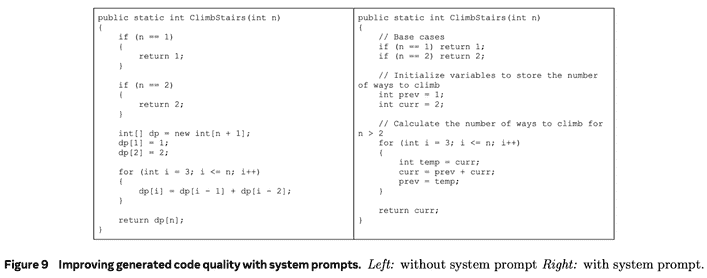

使用执行结果和"模型作为判断者"信号来过滤训练数据。作者在拒绝采样的数据中偶尔会遇到质量问题，例如包含 bug 的代码块。在拒绝采样数据中检测这些问题并不像在合成代码数据中那样直接，因为拒绝采样的响应通常包含自然语言和代码的混合，其中的代码并不总是预期可执行 (例如，用户 prompt 可能明确要求伪代码或仅对可执行程序的一小部分进行编辑)。为解决这个问题，作者采用了"模型作为判断者" (model-as-judge) 的方法，使用 Llama 3 的早期版本根据代码正确性和代码风格两个标准进行评估，并给出二元 (0/1) 评分。作者只保留了获得满分 2 分的样本。

初期，这种严格的过滤导致了下游基准测试性能的下降，主要是因为它不成比例地删除了具有挑战性 prompt 的样例。为了克服这一问题，作者策略性地修改了一些被归类为最具挑战性的编码数据的响应，直到它们满足基于 Llama 的"模型作为判断者"的标准。通过改进这些具有挑战性的问题，编码数据在质量和难度之间达到了平衡，从而实现了最佳的下游性能。

####

#### 数学和推理能力数据

作者对推理的定义是：推理为执行多步骤计算并得出正确最终答案的能力。

作者在训练擅长数学推理的模型时遇到以下挑战。为了应对这些挑战，作者应用了以下方法：

+   解决缺少 prompt 的问题：作者从数学背景文档中获取相关的预训练数据，并将其转换为问答格式，然后用于有监督微调。此外，作者识别出模型表现不佳的数学技能，并积极从人类那里获取 prompt 来教授这些技能。为此，作者创建了数学技能分类法（Didolkar et al., 2024），并要求人类相应地提供相关的 prompt 或问题。

+   用逐步推理痕迹增强训练数据：作者使用 Llama 3 为一组 prompt 生成逐步的解决方案。对于每个 prompt，模型生成多个结果。这些结果根据正确答案进行筛选。同时还引入了自我验证，使用 Llama 3 验证给定问题的特定逐步解决方案是否有效。这个过程通过消除模型未生成有效推理痕迹的实例来提高微调数据的质量。

+   筛选错误的推理痕迹：作者训练结果和逐步奖励模型（Lightman et al., 2023; Wang et al., 2023a）来过滤掉中间推理步骤不正确的训练数据。这些奖励模型用于消除无效的逐步推理数据，确保微调数据的高质量。对于更具挑战性的 prompt，作者使用蒙特卡罗树搜索（MCTS）和学习的逐步奖励模型来生成有效的推理痕迹，进一步增强高质量推理数据的收集（Xie et al., 2024）。

+   交替使用代码和文本推理：作者让 Llama 3 通过结合文本推理和相关的 python 代码来解决推理问题。代码执行被用作反馈信号，以消除推理链无效的情况，确保推理过程的正确性。

+   从反馈和错误中学习：为了模拟人类反馈，作者利用不正确的生成（即导致错误推理痕迹的生成）并利用 Llama 3 提供正确的生成来进行错误修正（An et al., 2023b; Welleck et al., 2022; Madaan et al., 2024a）。这种使用不正确示例的反馈并加以纠正的迭代过程有助于提高模型准确推理和从错误中学习的能力。

####

#### 长上下文能力数据

在最终的预训练阶段，作者将 Llama 3 的上下文长度从 8K tokens 扩展到 128K tokens。与预训练类似，作者发现，在微调过程中，必须仔细调整方案，以平衡短上下文和长上下文的能力。

SFT 和合成数据生成：简单地应用现有仅使用短上下文数据的 SFT 方案，会导致预训练中的长上下文能力显著退化，这表明需要在 SFT 数据混合中加入长上下文数据。然而，实际上，由于阅读冗长上下文的枯燥和耗时性质，很难让人类标注这样的示例，因此作者主要依赖合成数据来填补这一空白。作者使用早期版本的 Llama 3 生成基于关键长上下文用例的合成数据：可能是多轮的问答、长文档的摘要、以及代码库的推理。

+   问答：作者精心策划了一组来自预训练混合数据的长文档。将这些文档分成 8K tokens 的块，并 通过 prompt 让早期版本的 Llama 3 模型生成基于随机选择块的问答对。在训练期间，整篇文档作为上下文使用。

+   摘要：作者对长上下文文档进行了分层摘要，首先使用最强的 Llama 3 8K 上下文模型对 8K 输入长度的块进行摘要，然后对摘要进行汇总。在训练期间，提供整个文档并通过 prompt 让模型生成摘要，同时保留所有重要细节。作者还根据文档的摘要生成问答对，并通过 prompt 让模型提出需要对整个长文档有全局理解的问题。

+   长上下文代码推理：作者解析 Python 文件以识别 import 语句并确定它们的依赖关系。从中选择最常被依赖的文件，特别是那些被至少五个其他文件引用的文件。作者从一个代码库中移除其中一个关键文件，并通过 prompt 让模型识别哪些文件依赖这个缺失的文件，以及生成所需的缺失代码。

作者进一步根据序列长度（16K、32K、64K 和 128K）对这些合成生成的样本进行分类，以便更精细地针对输入长度进行目标定位。

通过仔细的消融实验，作者观察到将 0.1% 的合成长上下文数据与原始短上下文数据混合，可以优化在短上下文和长上下文基准上的性能。

DPO：作者观察到，只要 SFT 模型在长上下文任务上表现良好，在 DPO 中仅使用短上下文训练数据并不会对长上下文性能产生负面影响。这可能是因为 DPO 的优化器步骤比 SFT 少。鉴于此发现，作者在长上下文 SFT 模型之后为 DPO 保持标准的短上下文训练。

####

#### 事实性能力数据

幻觉（Hallucinations）仍然是大型语言模型的主要挑战。即使在模型知识匮乏的领域，模型也往往表现得过于自信。尽管事实性问题不止包括幻觉，作者在此首先关注幻觉问题。

作者遵循的原则是，通过后训练使模型“了解自己所知道的”，而不是自以为是地增加新的知识（Gekhman et al., 2024; Mielke et al., 2020）。主要方法是生成与预训练数据中部分事实数据对齐的数据。为了实现这一目标，作者开发了一种利用 Llama 3 上下文能力的知识探测技术。该数据生成过程包括以下步骤：

1.  从预训练数据中提取数据片段。

1.  通过 prompt 让 Llama 3 生成关于这些片段（上下文）的事实性问题。

1.  从 Llama 3 采样对问题的多个回答。

1.  使用原始上下文作为参考，并让 Llama 3 作为评判者，对生成的答案的正确性进行评分。

1.  使用 Llama 3 作为评判者，对生成的答案的信息量进行评分。

1.  对于包含一致信息但错误的回答，生成拒答。

作者使用通过知识探测生成的数据来鼓励模型只回答它有知识的问题，并拒绝回答那些它不确定的问题。此外，预训练数据并不总是事实一致或正确的。因此，作者还收集了一小部分标注的事实性数据，以处理涉及敏感话题且存在事实矛盾或错误的陈述。

###

### 数据清理

由于大多数训练数据是由模型生成的，因此需要进行仔细的清理和质量控制。

数据清理。 在早期轮次中，观察到数据中存在许多不良模式，例如过度使用表情符号或感叹号。因此，实施了一系列基于规则的数据删除和修改策略，以过滤或清理有问题的数据。例如，为了缓解过度道歉的语调问题，识别过度使用的短语（如“I'm sorry”或“I apologize”），并仔细平衡数据集中此类样本的比例。

数据修剪（Pruning）。 还应用了一系列基于模型的技术来删除低质量的训练样本，并提高整体模型性能：

+   主题分类： 首先将 Llama 3 8B 微调为主题分类器，并对所有数据进行推理，将其分类为粗粒度的桶（如“数学推理”）和细粒度的桶（如“几何和三角学”）。

+   质量评分： 使用奖励模型（RM）和基于 Llama 的信号为每个样本获取质量评分。对于来自 RM 的评分，考虑 RM 评分排名前四分之一的数据为高质量。对于来自 Llama 的评分，通过 prompt 让 Llama 3 模型按三分制对每个样本进行评分（对于一般英语数据为“准确性”、“指令跟随”和“语气/表达”），对编程数据按两分制评分（“错误识别”和“用户意图”），并将获得最高分的样本视为高质量。RM 和基于 Llama 的评分有很高的不一致率，发现结合这些信号在内部测试集上具有最佳召回率。最终，选择被 RM 或基于 Llama 的过滤器标记为高质量的示例。

+   难度评分： 由于也希望优先处理对模型来说更复杂的示例，使用两个难度度量标准对数据进行评分：Instag 和基于 Llama 的评分。对于 Instag，通过 prompt 让 Llama 3 70B 执行 SFT prompt 的意图标记，意图越多表示复杂性越高。同时通过 prompt 让 Llama 3 对对话的难度进行三分制评分。

+   语义去重： 最后，执行语义去重。首先使用 RoBERTa 对完整对话进行聚类，并在每个聚类内按质量评分 × 难度评分进行排序。然后通过遍历所有排序示例进行贪心选择，仅保留在聚类中与之前看到的示例余弦相似度小于阈值的示例。

## 多模态模型训练

Llama 3 可不只是一个 LLM，它其实是 GPT-4o 级别的全能型选手，输入可以包含文本、语音、图像和视频，输出可以是文本或者语音。以下上整体结构。不过多模态能力还没发布，大家先过过眼瘾吧。

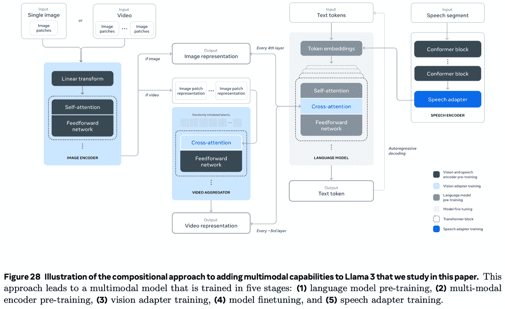

训练包括以下部分：

+   Multi-modal encoder pre-training：为图像和音频训练了独立的 encoders。图像 Encoder 使用 图像文本对训练，音频 Encoder 使用自监督方法训练：mask 掉部分音频然后让模型重构。

+   Vision adapter training：作者训练了一个适配器，将预训练的图像编码器整合到预训练的语言模型中。适配器在文本-图像对上进行训练，从而使图像表示与语言表示对齐。在适配器训练期间，作者还更新了图像编码器的参数，但不更新语言模型的参数。作者还在图像适配器之上训练了一个视频适配器，使用配对的视频-文本数据。

+   Speech adapter training：作者通过一个适配器将语音编码器整合到模型中，该适配器将语音编码转换为可以直接输入到微调语言模型中的标记表示。适配器和编码器的参数在监督微调阶段共同更新。在语音适配器训练期间，依旧是固定语言模型参数。作者还整合了一个文本转语音系统。

新的多模态模型能够识别图像和视频内容，并支持通过语音界面进行交互。不过多模态模型还未发布（下次是要颠覆真 GPT-4o 了😅）。

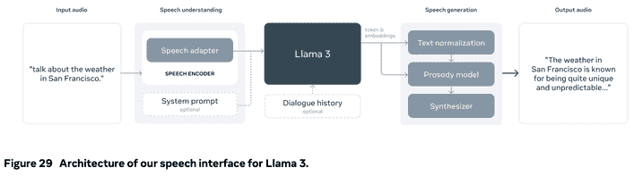