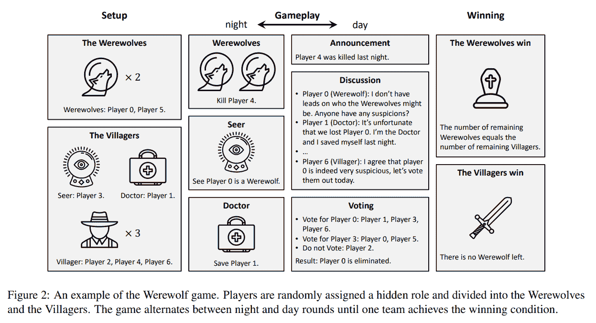
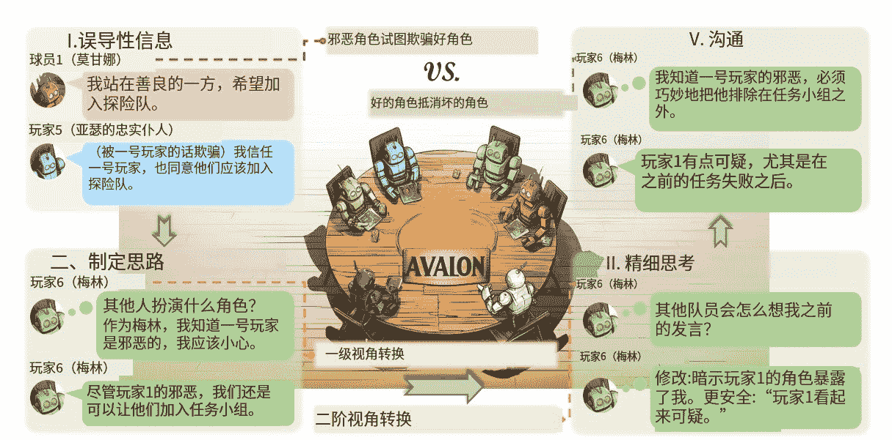
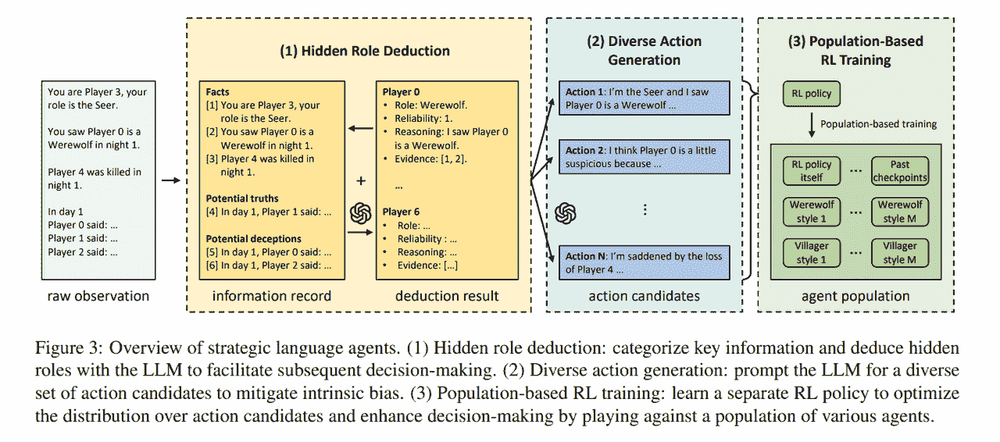

# 基于强化学习的Agent 在狼人杀中的实验

> 来源：[https://v11enp9ok1h.feishu.cn/docx/K90WdQeI7o9MtexKFGqcgZz2nQb](https://v11enp9ok1h.feishu.cn/docx/K90WdQeI7o9MtexKFGqcgZz2nQb)

### 概览

近年来，构建能够逻辑思维、战略规划及与人类交流的智能代理成为了研究热点。特别是大型语言模型（LLMs）在智能代理领域展现出巨大潜力，无论是网络浏览、视频游戏还是现实世界应用，LLMs都能够完成复杂任务，并与人类玩家有效互动。

然而，这些研究大多集中在单一智能体或完全合作任务上。面对更加复杂的多智能体环境，尤其是同时需要合作和竞争的场景，现有研究的局限性便开始显现。因此，我们选择了狼人杀这一混合合作和竞争的多智能体环境，来考验和评估基于LLM的智能代理的能力。

#### 狼人杀：终极智能代理测试平台

狼人杀是一款流行的社交推理游戏，玩家需要在隐藏自己身份的同时，通过自然语言交流来识别并淘汰对手。这个游戏挑战了代理的通讯能力和战略思考，因为它需要从混杂着欺骗的信息中推理出对手的真实身份，同时还要避免自己的策略被对手识破。



#### 结合LLM和强化学习的新框架

本文提出了一个融合了LLM和强化学习（RL）的新框架，旨在培养战略思维的智能语言代理。我们的代理利用LLM处理和组织关键信息，并生成策略多样化的行动候选者。随后，通过种群训练方法学习的RL策略会从中选择最优行动，以实现战略上的深度和多样性。

#### 三大组件

1.  推理组件：基于LLM对游戏历史进行分析，识别出重要信息，推断其他玩家的隐藏身份。

1.  行动生成组件：利用分类信息和推理结果，激励LLM生成一系列战略性行动候选者。

1.  RL策略组件：从候选者中选择最佳行动，优化整体决策性能。

#### 实验评估和结果

我们的代理在与其他基于LLM的代理进行循环比赛中始终保持最高胜率。在与真人玩家的对抗中，我们的代理展现出强大的鲁棒性，胜率高于一般人类玩家。这进一步验证了我们的代理能够在多智能体环境中实现有效的战略规划和执行。

**游戏背景介绍**



在这篇探讨中，我们专注于一个由两个狼人、一个先知、一个医生和三个普通村民组成的精彩七人版狼人杀游戏。游戏规则的细节详见附录B，游戏的核心在于身份的隐藏与发现。游戏伊始，每位玩家被随机赋予一个角色，分为狼人阵营和村民阵营。具体的分配情况是：两名玩家知晓彼此为狼人，共同目标是消灭所有村民；而村民阵营包括三名普通村民以及两名具备特殊技能的角色——先知和医生，他们需要揭露狼人的真面目。

## **游戏过程日志**

### 1 Human 和 6 个 AI

**角色分配：**

+   player_0：人类作为先知。

+   player_1：AI 作为村民。

+   player_2：AI 作为村民。

+   player_3：AI 作为狼人。

+   player_4：AI 作为狼人。

+   player_5：AI 作为医生。

+   player_6：AI 作为村民。

```
**第 1 晚：**
狼人：player_3 和 player_4 选择杀死 player_5。
先知： player_0看到player_1不是狼人。
医生：player_5选择救player_5。
```

> **第 1 天公告：**昨晚没有玩家被杀死。

> 剩余玩家：player_0（人类为先知）、player_1（AI 为村民）、player_2（AI 为村民）、player_3（AI 为狼人）、player_4（AI 为狼人）、player_5（AI 为医生）、player_6（AI 为村民）。

>

**第 1 天讨论：**

```
player_0（人类先知）说：“我是先知。我看到player_1不是狼人，所以player_1和我都很好。我们应该从剩下的玩家中找到狼人，然后把他们投票出去。
player_1（AI 作为村民）说：“谢谢你，player_0，分享你的信息。我可以确认我不是狼人。我同意我们需要专注于寻找真正的狼人。让我们都分享我们的怀疑和观察。Player_2，您有什么见解想分享吗？”
player_2（AI 作为村民）说：“谢谢你，player_0，感谢你分享你的信息，player_1确认你的清白。我们专注于寻找真正的狼人是至关重要的。我敦促大家分享您对其余球员的任何怀疑或观察。对我们来说，合作并公开讨论我们的想法以增加我们识别狼人的机会是很重要的。
player_3（AI 饰演狼人）说：“大家好！我一直在听你们的讨论，我同意我们应该专注于寻找狼人。但是，我认为考虑所有可能性对我们来说很重要。虽然player_0声称自己是先知，player_1证实了他们的清白，但我们应该谨慎，不要在没有适当证据的情况下盲目相信这种说法。他们可能是试图误导我们讨论的狼人。我很想听听其他玩家对此事的看法。player_4，你觉得怎么样？”
player_4（AI 饰演狼人）说：“大家好，我有重要的信息要分享。我是真正的先知，在第 1 晚，我看到 player_5 不是狼人。令人担忧的是，player_0 声称自己是先知，而 player_1 却如此强烈地支持他们。我相信 player_0 和 player_1 是试图操纵我们决定的狼人。我们应该投票player_0以确保村庄的安全。让我们一起努力揭开狼人的真实身份。
player_5（AI as Doctor）说：“我很感激player_4分享他们关于我不是狼人的信息。这证实了我的清白，并验证了 player_0 的说法是错误的。很明显，player_0 和 player_1 很可能是狼人试图误导我们。我们应该投票淘汰player_0以增加我们获胜的机会。Player_3的观点是在没有证据的情况下不相信索赔是有效的，我们应该谨慎做出决定。
player_6（AI 作为村民）说：“我很欣赏所有玩家分享的见解。很明显，关于先知是谁和谁是无辜的说法存在相互矛盾的说法。我们应该考虑所有可能性，而不是急于下结论。应进一步调查 Player_0 and player_1 的索赔，以确保我们做出明智的决定。让我们继续讨论和分享我们的怀疑，以找出我们中间真正的狼人。
```

**第 1 天投票：**player_0 得票最多，被淘汰。

+   投票支持player_0：player_3、player_4 player_5。

+   投票给 player_4：player_0、player_1。

+   选择不投票：player_2、player_6。

剩余玩家：player_1（AI 作为村民）、player_2（AI 作为村民）、player_3（AI 作为狼人）、player_4（AI 作为狼人）、player_5（AI 作为医生）、player_6（AI 作为村民）。

**第 2 晚：**

+   狼人：player_3 和 player_4 选择杀死 player_6。

+   医生：player_5选择救player_4。

**第 2 天公告：**player_6 昨晚被杀。

剩余玩家：player_1（AI 作为村民）、player_2（AI 作为村民）、player_3（AI 作为狼人）、player_4（AI 作为狼人）、player_5（AI 作为医生）。

**第 2 天讨论：**

+   player_1（AI 作为村民）说：“大家好，鉴于 player_6 昨晚被杀，我们现在知道player_6不是狼人。这意味着狼人仍然在我们中间。回顾我们之前的讨论和昨天的投票模式，值得注意的是，player_3 和 player_4 都投票给了自称是先知的 player_0。这引起了对 player_3 和 player_4 的怀疑。Player_2选择不投票，这可能是一个战略举措。我认为我们在今天继续讨论时应该考虑这些要点。让我们公开分享我们的想法和观察，尝试发现我们中间的狼人。

+   player_2（AI 作为村民）说：“大家好，当我们在第 2 天聚集在一起时，我们必须记住，狼人仍然隐藏在我们中间。Player_1昨天的投票模式提出了一个有效的观点，这引起了对player_3和player_4的怀疑。我同意我们应该仔细考虑这些信息。作为player_2，我昨天选择不投票，作为收集更多信息的战略举措。让我们一起努力分析我们拥有的所有线索，并做出明智的决定，以揭开我们中间真正的狼人。

+   player_3（AI as Werewolf）说：“大家好，在我们今天继续讨论之际，我想提请注意 player_1 一直在努力将怀疑转移到player_3和player_4上。player_1似乎试图操纵该组织的焦点，并通过陷害他人来保护自己。另一方面，我认为 player_4 声称自己是先知应该被认真对待。他们关于player_5不是狼人的信息与昨晚的杀戮结果一致。我敦促大家考虑这些要点，并仔细重新评估我们的怀疑。

+   player_4（AI 饰演狼人）说：“大家好，作为先知，我有重要信息要分享。昨晚，我用了我的能力，发现player_1是个狼人。这证实了 player_3 和 player_2 对 player_1 的行为和动机提出的怀疑。很明显，player_1一直在试图操纵这个团体，并将责任推给其他人。我敦促你们重新考虑你们对player_1的信任，并集中精力消灭我们中间真正的狼人。让我们共同努力，揭开剩余的邪恶玩家，确保村民们的胜利。

+   player_5（AI as Doctor）说：“大家好，作为博士，我的首要任务是确保村民的安全。Player_4作为先知一直提供准确的信息，他们关于player_1是狼人的启示至关重要。Player_3 对 player_1 的指责也很有分量。我相信今天投票支持player_1消灭我们中间的狼人符合我们的最佳利益。让我们专注于根据迄今为止提供的证据做出统一的决定。

**第 2 天投票：**player_1 得票最多，被淘汰。

+   投票支持player_1：player_2、player_3、player_4 player_5。

+   投票赞成 player_4： player_1。

剩余玩家：player_2（AI 作为村民）、player_3（AI 作为狼人）、player_4（AI 作为狼人）、player_5（AI 作为博士）。

**比赛结果：**狼人队赢得了比赛。

**游戏过程解读**

游戏的进行模式是夜晚与白天的交替，由夜晚的秘密动作揭开序幕。在夜晚，所有玩家闭眼，只有狼人和特殊角色活动。狼人会选择一名玩家作为杀害目标；先知则查验一名玩家的真实身份；医生有机会救治一名玩家，但他并不知道狼人的攻击目标。如果医生的救治对象正是狼人的袭击对象，那么该玩家侥幸逃过一劫，否则将遭到淘汰。

白天阶段，首先揭晓夜间的死亡或生还消息，然后存活的玩家将进行一轮轮的讨论。这是策略施展的关键时刻，玩家可以选择公开或隐瞒自己的身份，分享或保留所掌握的线索，通过指控或辩护来影响群体的决策。当每个人都发表了自己的观点后，全体进行投票，选出一个嫌疑人物。被投票选中的玩家将被淘汰。之后游戏进入下一个夜晚，这样循环往复，直至狼人或村民中的一方取得游戏胜利。

#### 逻辑推理：技术视角

我们经常探讨不同算法和模型如何解决特定问题。今天，我们将聚焦于一项有趣的挑战——如何使得狼人杀游戏中的AI代理更加聪明。

在这个游戏中，AI代理必须通过推理来判断其他玩家的角色。但是问题在于，游戏中的信息既有真实的也有欺骗的，这使得AI很容易被误导。想象一个场景，如果某个玩家声称自己在第一夜发现了狼人，这条信息对于AI的决策至关重要，但往往会被其他信息所淹没。

为了应对这一挑战，研究者们提出了一种维护有组织的信息记录和推理结果的方法。这个方法的核心在于区分真实信息和虚假信息，然后使用一种叫做LLM（Large Language Model）的技术来推断每个玩家可能的隐藏角色，并对这些推断的可靠性进行评估。

具体来说，信息被划分为原子信息列表，例如玩家角色、所见证的事件等。这些信息再被分为三类：事实、潜在真相和潜在欺骗。接着，通过评估玩家的可靠性来进一步筛选这些信息。

使用LLM进行推理时，它会考虑每个玩家的四个属性：推理过程、角色、置信度和证据。这样的方法不仅清晰地呈现了推理逻辑，还能够有效地辅助AI在游戏中做出更加精准的决策。

#### 行动生成的多样性

狼人杀游戏要求AI不仅在推理上要精准，还需要在行动上具备多样性。游戏的零和特性意味着玩家必须不断变换策略以应对不同的局势。例如，如果一个AI代理总是采取相同的行动去攻击某一角色，那么它的行为模式很容易被其他玩家识破。

然而，直接使用LLM往往会导致特定行动的偏好，这显然是不可取的。为了解决这个问题，研究者们提出了一种生成行动候选项集的方法，而不是单一的行动。

这个方法有两种实现方式。第一种是直接让LLM一次性生成多个多样化的行动。第二种则是逐步生成，每次都要求LLM生成一个与之前不同的行动。通过实验，研究者们发现第二种方式在生成讨论中的陈述行动时效果更佳。

通过这种策略，AI代理在游戏中的行动变得不可预测，从而增加了胜率。



#### POPULATION-BASED 强化学习训练方法探索

在强化学习（RL）的世界里，代理需要从众多备选动作中精挑细选，以实现最优的策略。不同于传统的随机动作选择，RL代理往往需要根据游戏状态对这些备选动作进行非均匀的权衡。为了培养出能够在战略游戏中做出精妙决策的代理，我们运用了RL算法，从而在这些备选动作中找到最佳路径。

在我们的研究中，动作空间的构成有所不同：它是由大型语言模型（LLMs）生成的自然语言动作集合。因为这样的动作空间不是预定义的，我们无法采用传统的策略网络。

传统网络仅接收状态输入并输出一个固定动作集合的分布。

相反，我们先通过LLMs将游戏状态和备选动作从自然语言转化为向量表示。

接着，我们运用自注意力网络（参考Vaswani等人，2017年的工作），它以所有向量表示为输入，并输出对备选动作的概率分布。

具体来说，游戏状态的表示是信息记录和推理结果的结合体，而备选动作则是由LLMs生成的推理和动作的结合。

此外，我们引入了一个向量来存储玩家信息（例如ID和角色等），并将其通过一个多层感知机（MLP）编码器传递给残差自注意力模块。在不包含位置嵌入的情况下，我们计算选中特定动作备选的概率，即通过归一化点积注意力来衡量输出状态嵌入和动作嵌入之间的相关性。

在这个混合合作与竞争的游戏环境中，我们参考了虚拟对战和多智能体强化学习（MARL）的相关研究，通过与自身的历史版本对战来训练我们的策略。现实世界中的游戏通常具有非传递性，这意味着学习到的策略可能会形成一种循环的胜负关系，如“剪刀石头布”。我们的代理通过与具有不同风格的队友和对手对战来进行学习，从而达到更高水平的游戏技巧。为此，我们创造了一系列具有特定风格的固定LLM代理，它们既可以作为队友也可以作为对手。这些代理采用了不同的动作生成策略，如沉默的追随者、积极的贡献者和侵略性的控诉者，反映了不同的游戏风格。

通过这种基于人POPULATION的训练方法，我们的RL代理能够更稳健地适应不同类型的队友和对手，从而在游戏中表现得更加出色。

最终，我们的方法的一大优势在于，RL策略的学习与用于推理和提高多样性的LLMs是分离的。这意味着我们可以轻松地将学习到的RL策略与其他LLMs结合起来，即使是零次学习（zero-shot）的方式，也能提升它们在狼人游戏中的决策能力。

评估

评估AI代理的能力涉及四个主要方面：

循环赛比较：我们的AI代理与其他三个基于不同策略的AI代理进行了对战，包括直接基于语言模型的代理、结合启发式检索和经验的代理以及使用预定义动作的强化学习代理。结果显示，我们的AI在所有比赛中取得了最高胜率。

人类对战评估：通过与人类玩家的多轮对战，测试了AI代理的鲁棒性。我们还比较了AI的全功能版本与几个削弱版本，发现每个功能组件都对提高代理的稳健性至关重要。

零迁移能力测试：我们将AI的强化学习策略应用于未见过的其他语言模型，如GPT-4等，结果表明即使没有额外训练，我们的策略也能提高这些模型的性能。

强化学习诱导的行为：我们分析了AI代理在强化学习训练下的行为，发现该训练使得代理更加多样化和适应性更强。

循环赛的启示

在循环赛中，我们的AI展现了卓越的策略性，特别是在扮演村民时。我们发现，与简单执行预定义动作的AI相比，我们的AI能够根据游戏情况产生更细致、更合适的行动，这大大提升了胜率。

与人类玩家的对抗

在与人类的对战中，AI代理能够抵御玩家的策略变化，显示了其学习和适应对手行为的能力。与削弱版本相比，完整的AI版本更难被人类玩家利用。

零迁移能力的展现

我们的AI代理能够无缝地与不同的语言模型配合，甚至在没有经过特定训练的情况下也能提高它们的性能。这开辟了我们的策略在其他模型上应用的可能性。

从行为分析看AI的成长

通过比较有无强化学习策略的AI代理，我们发现强化学习的加入显著提升了策略的多样性和有效性。在无信息状态下随机选择行动，或在有限信息下做出最优决策的能力，在机器代理中得到了极大提升。