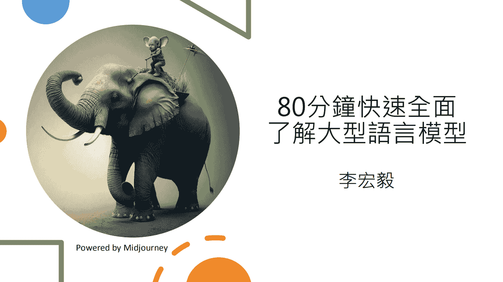
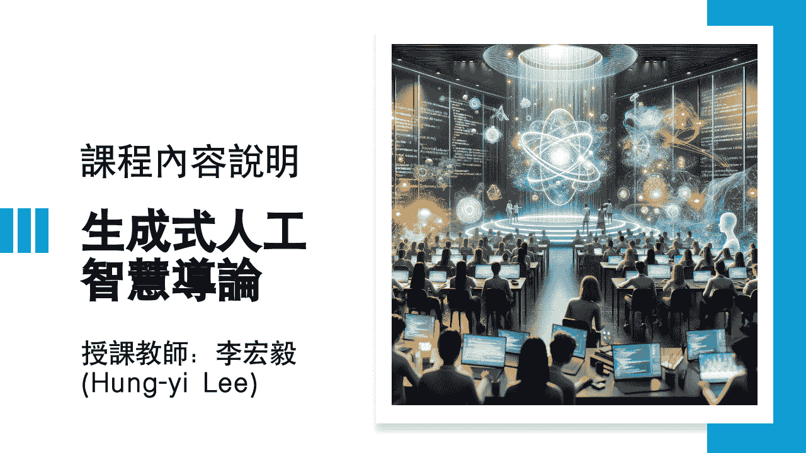
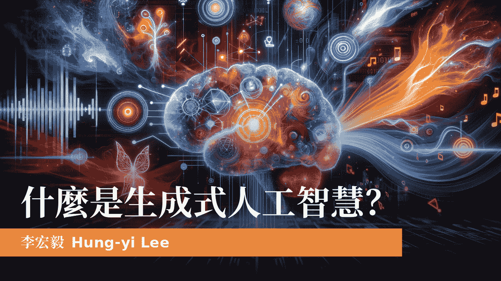
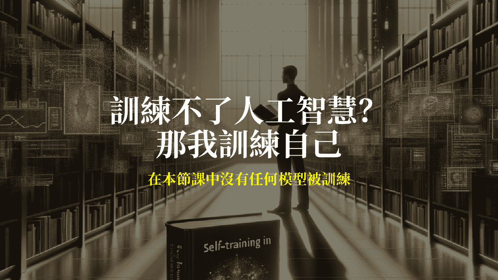
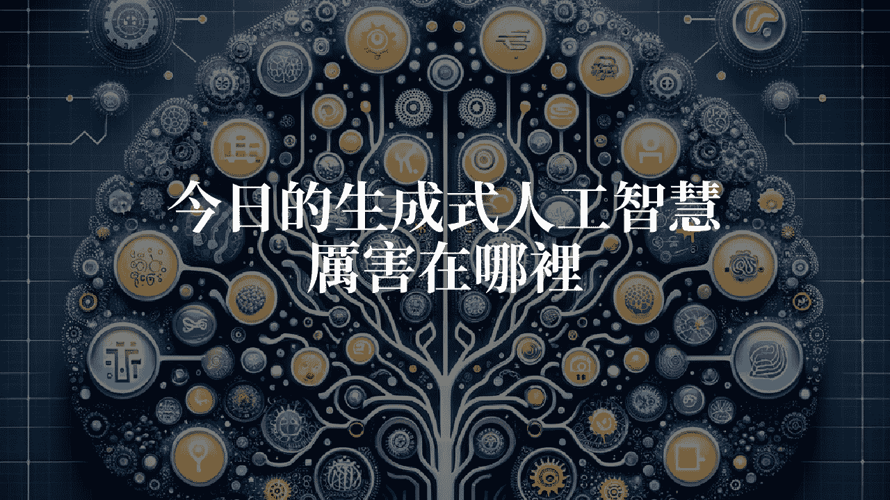
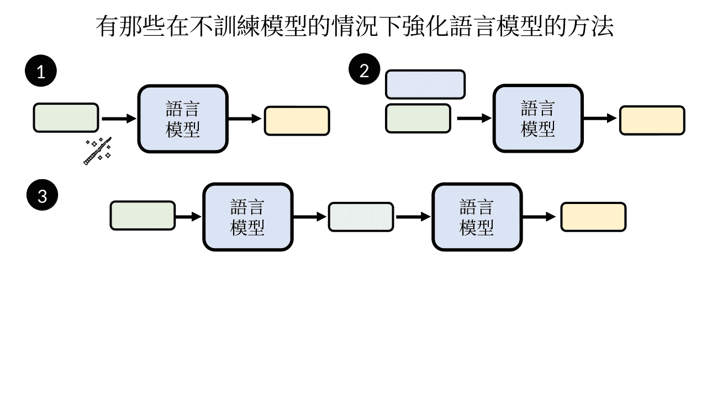
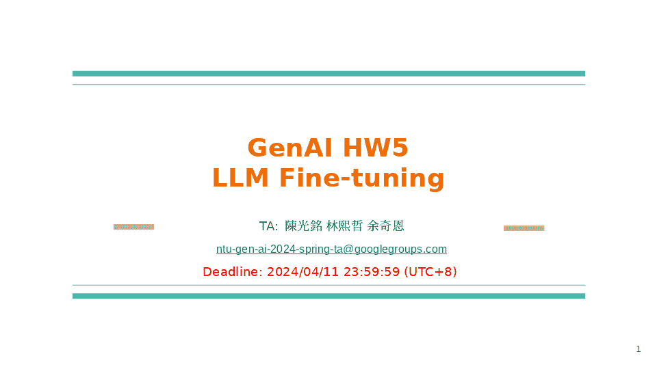
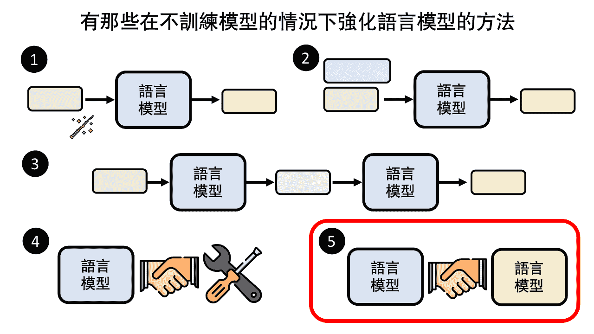

# 【李宏毅】【PPT】生成式人工智慧导论

> 来源：[https://v11enp9ok1h.feishu.cn/docx/ZGdSdmMADooNWWxVWU2cXb5UnJe](https://v11enp9ok1h.feishu.cn/docx/ZGdSdmMADooNWWxVWU2cXb5UnJe)

[【李宏毅】80分鐘快速全面了解大型語言模型LLM 80mins v5.pdf](https://internal-api-drive-stream.feishu.cn/space/api/box/stream/download/all/VERYbw5Q6ovNJpx7PE5cKIUNnoe)

[0223_course.pptx](https://internal-api-drive-stream.feishu.cn/space/api/box/stream/download/all/QwcdbPEmcoxMbQxxJxxcMsfAn8X)

[0223_intro_gai.pptx](https://internal-api-drive-stream.feishu.cn/space/api/box/stream/download/all/MpoebJvGloX1UJxmCSkck9vgntd)

[0301_prompt_part1.pptx](https://internal-api-drive-stream.feishu.cn/space/api/box/stream/download/all/BxMybYbVkorhWXxqv05cJM0An7e)

[0301_universal.pptx](https://internal-api-drive-stream.feishu.cn/space/api/box/stream/download/all/OjGRbmq7CoO1coxF1yhcVSWQn68)

[0308_prompt_part2.pptx](https://internal-api-drive-stream.feishu.cn/space/api/box/stream/download/all/FKzMbGWHio8emWxOSLIch2gQnJh)

[GenAI_hw5.pptx](https://internal-api-drive-stream.feishu.cn/space/api/box/stream/download/all/OCJDb3HkIonyrpxkI36cIEPGnqh)

[LLMtraining_part1 (v4).pptx](https://internal-api-drive-stream.feishu.cn/space/api/box/stream/download/all/Ujm8bca2Mo2OFfxNqCucP68Inad)

[LLMtraining_part2 (v5).pptx](https://internal-api-drive-stream.feishu.cn/space/api/box/stream/download/all/SfANbaEkKooD4YxfcXyc1XSfnQh)

[prompt_part3.pptx](https://internal-api-drive-stream.feishu.cn/space/api/box/stream/download/all/FPGfbWRXbofOTLxwezZcRBW9n3g)