# 阿里开源的多模态Qwen2-VL，怎么实现的?

> 来源：[https://v11enp9ok1h.feishu.cn/docx/SnqPdt8dronqvqxS0obcoafhnhg](https://v11enp9ok1h.feishu.cn/docx/SnqPdt8dronqvqxS0obcoafhnhg)

## Qwen2-VL技术解析（一）-原生支持任意分辨率图像

## 原生支持任意分辨率

> 整个的Qwen2-VL有两个比较重要的改进，**先来看第一个（原生支持任意分辨率图像），整体思路就是不再将图像**统一Resize到VIT的接收尺寸再输入VIT里, 而是图像直接输入到VIT里。

> **整体的结构图如下**，可以看到不同尺寸的图片可以有不同的image token个数。其实背后的原理就是使用了Patch n’ Pack: NaViT中的sequence packing技术。 下面介绍关于不同图像尺寸、分辨率处理的演化过程

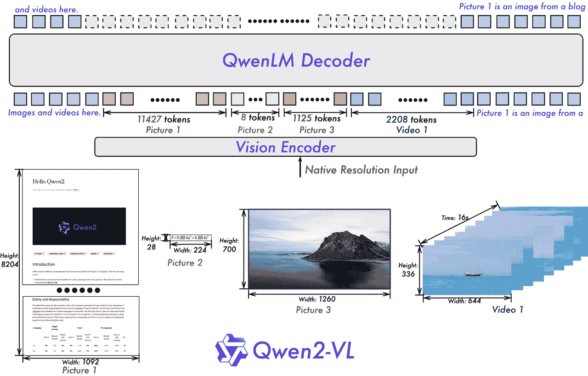

## 原生VIT

> 先说以前的做法，原生的VIT是图片**先resize到固定**尺寸，比如VIT支持336**  * 33**6**尺寸的输入，我就先**把图片先r**esize到336 *** 336，然后分为**n * n个Patch，每个P**atch过Patch Embedding，然后再输入transformer layer中。但是比如下图这种情况，如果无脑resize效果肯定不太好，文字都被扭曲了。

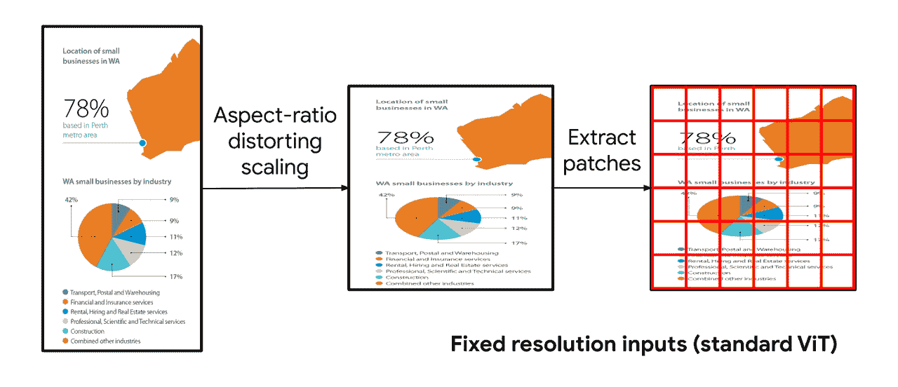

VIT中对应的位置编码就是将R*R的图像拆分为patch_size* patch_size的小块，然后每个（patch_size* patch_size）按照下面的方式进行一维的位置编码。

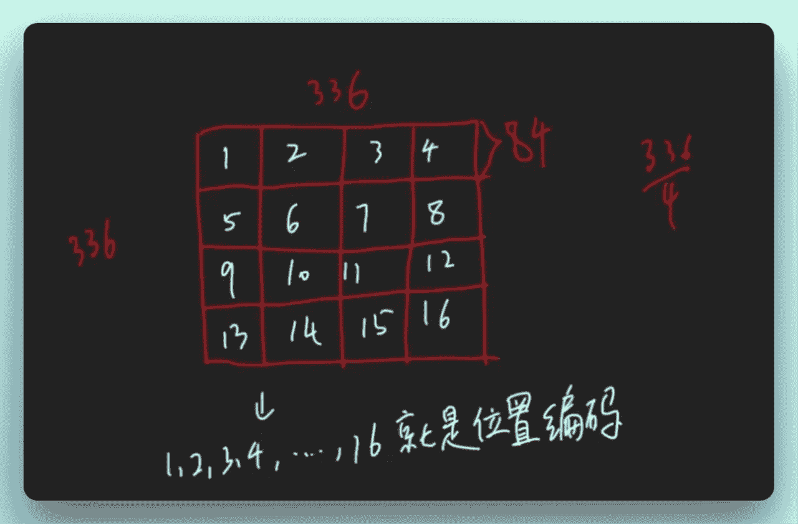

## Pix2Struct

+   **PixStruct**针对**VIT**需要**resize**到固定尺寸的缺点, 提出了一种方法保持长宽比率的缩放,  如下图，并且为此构建了一个可学习的二维位置编码：max_seq * max_seq * embed_dim的矩阵,  Pix2Struct 引入了可学习的二维绝对位置编码。

+   这些编码的尺寸为 [maxLe**n, ma**xLen]，并且通过每个Patch的 (x, y) 坐标进行索引。这意味着模型能够根据图像中的坐标来学习特定的空间位置信息，从而在面对不同的图像比例时表现得更加灵活和精准。

+   **它允许模型处理的图像分辨**率最**高可以达到R = P·m**a**xLen， P 表示Pat**ch的数量，maxLen 代表最大长度。然而，这种方法也有其局限性，那就是训练过程中必须看到所有可能的 (x, y) 坐标组合，才能让模型充分学习到位置信息。

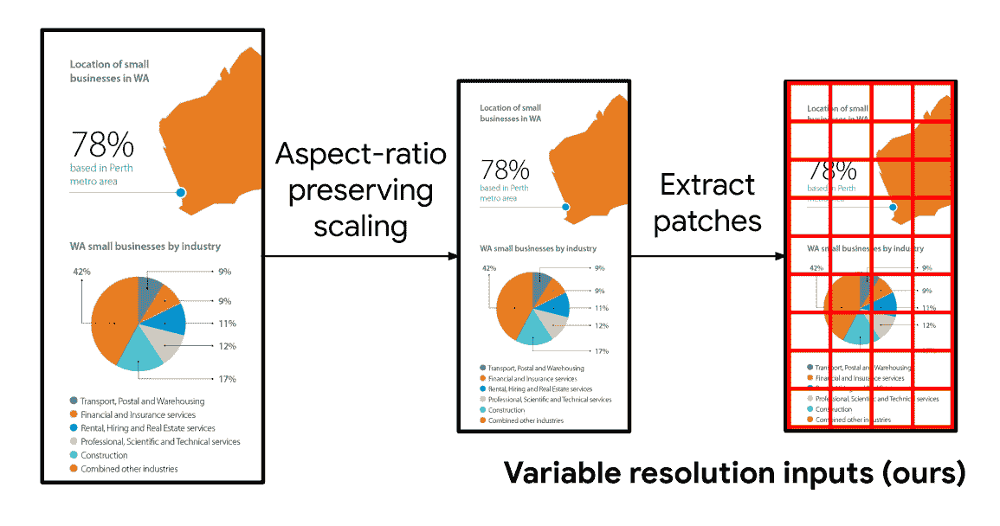

## NaVIT

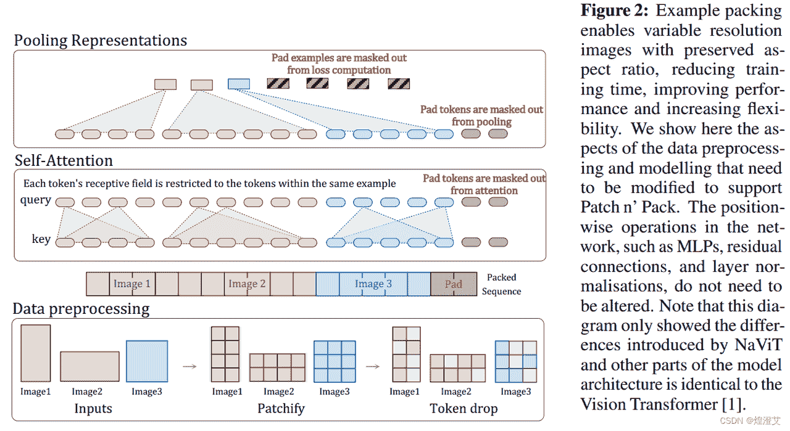

> NaVIT在PixStruct的基础上进行了进一步的优化，使得图像处理过程不再需要调整图像尺寸（resize），而是可以直接将原始图像输入到Vision Transformer（ViT）中进行处理。为了实现这一改进，对模型的架构和训练策略进行了相应的调整和优化：

### 模型结构

+   Masked Self Attention

NaVIT模型引入了Masked Self Attention机制，确保在进行自注意力计算时，每个图像只能关注到自身内容，而不会与其他图像发生交互

+   **Masked Pooling**

[     Ma](https://zhida.zhihu.com/search?q=pooling&zhida_source=entity&is_preview=1)sked Pooling：每张图片上各自去进行pooling,  独立的进行信息聚合，而不是全局聚合，有助于保留图像的局部特征

+   **位置编码**

+   **位置编码**

为了支持可变的长宽比并能够将位置编码扩展到[未见过的](https://zhida.zhihu.com/search?q=%E7%BC%96%E7%A0%81%E6%96%B9%E6%B3%95&zhida_source=entity&is_preview=1)分辨率，研究者提出了因子化的位置编码方法， 将位置编码分解为 x 和 y 坐标的独立编码  和  ，最后将它们相加。在此基础上，提出了两种编码方案：

1.  [**绝对位置编码**](https://zhida.zhihu.com/search?q=%E7%BB%9D%E5%AF%B9%E4%BD%8D%E7%BD%AE%E7%BC%96%E7%A0%81&zhida_source=entity&is_preview=1)：其中 φ(p) 是根据Patch的绝对位置索引的函数，即位置编码是基于图像中的绝对坐标进行计算的

1.  **分数位置编码**：其中 φ(r) 是相对距离的函数，即相对于Patch边长的距离，这种编码独立于图像尺寸，从而部分模糊了图像的原始长宽比，优势在于它能够提供独立于图像尺寸的位置编码参数，但也因此部分掩盖了原始长宽比的信息，仅在Patch数量中隐含地体现了这一信息。

### 训练策略

+   Continuous Token dropping

> 过去，**Token Dropout (训练过程中随机**省略输入 patch)是以固定比例进行的，这在处理相同分辨率的图像时效果良好。但在支持任意分辨率的情况下，需要根据图像的大小来动态调整Token Dropout的比例。

>

> 简单来说，大小为10x30的图像不能与100x300的图像使用相同的丢弃比例。通过根据图像尺寸进行调整，可以确保不同分辨率下的训练效果最佳

+   **分辨率采样**

+   在传统的 ViT 模型中，训练时存在性能与效率的权衡：较小分辨率的图像能提高训练效率，而较大分辨率的图像有助于提高模型在评估阶段的表现。

>

+   因此[**，模型**](https://zhida.zhihu.com/search?q=%E7%BA%B5%E6%A8%AA%E6%AF%94&zhida_source=entity&is_preview=1)通常会先在较低分辨率下预训练，然后再在较高分辨率下进行微调。相比之下，NaViT 具有更大的灵活性，它通过从不同的图像尺寸中进行采样，支持混合分辨率训练，并保持每张图像的原始纵横比。

>

+   这种方法不仅提高了训练效率，还能让模型接触到更大分辨率的图像，从而在相同模型大小和训练时长下，显著提升性能。

# Qwen2-VL技术解析（二）- M-ROPE

## M-RoPE

> Q**wen2-VL 在架构上的另一重要创新则是多**模态旋转位置嵌入（M-ROPE）。传统的旋转位置嵌入只能捕捉一维序列的位置信息，而 M-ROPE 通过将原始旋转嵌入分解为代表时间、高度和宽度的三个部分，使得大规模语言模型能够同时捕捉和整合一维文本序列、二维视觉图像以及三维视频的位置信息。这一创新赋予了语言模型强大的多模态处理和推理能力，能够更好地理解和建模复杂的多模态数据。

[旋转位置编码](https://zhida.zhihu.com/search?q=%E6%97%8B%E8%BD%AC%E4%BD%8D%E7%BD%AE%E7%BC%96%E7%A0%81&zhida_source=entity&is_preview=1)（ROPE）的概念已经有很多文章详细讨论过，这里只会简要概述其核心思想，先介绍一维的RoPE，然后逐步扩展到二维、三维（也就是Qwen2-VL中所使用的）。

[ROPE 的](https://zhida.zhihu.com/search?q=%E7%9B%B8%E5%AF%B9%E4%BD%8D%E7%BD%AE%E7%BC%96%E7%A0%81&zhida_source=entity&is_preview=1)关[键在于通](https://zhida.zhihu.com/search?q=%E7%9F%A9%E9%98%B5%E4%B9%98%E6%B3%95&zhida_source=entity&is_preview=1)过绝对位置编码来实现相对[位置编码](https://zhida.zhihu.com/search?q=%E6%97%8B%E8%BD%AC%E7%9F%A9%E9%98%B5&zhida_source=entity&is_preview=1)。具体来说，将位置编码表示为二维空间中的旋转操作。对于一个二维向量 x，将其绕原点旋转 m 弧度后，可以表示为矩阵乘法 R(m) * x，其中旋转矩阵 R(m) 的形式如下：

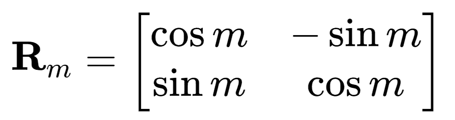

这一变换保留了原始向量的性质，但通过旋转引入了位置信息。如果一个二维向量旋转了 m 弧度，另一个旋转了 n 弧度，那么这两个向量之间的夹角就是 |m - n|。基于这样的思想，我们可以有效地引入相对位置的信息。

[具体的理](https://zhida.zhihu.com/search?q=%E7%BC%96%E7%A0%81%E6%96%B9%E5%BC%8F&zhida_source=entity&is_preview=1)论原理已经在许多文献中有所讨论，因此本文着重于这一编码方式的实际使用。

### 一维的情况

假设有一句话“我们生活在南京”，其中 x = “南” 为我们需要处理的词。m是x在sequence中[的位置(在本句中为](https://zhida.zhihu.com/search?q=embedding&zhida_source=entity&is_preview=1)6)，假设 x 的 embedding 维度为 512，我们可以通过以下公式计算 θ 值(其中i 是 embedding 中的维度位置，d 是 embedding 的维度数)：

接下来，我们对词向量的每两维进行相同角度的旋转。例如，x[0] 和 x[1] 乘以下矩阵：

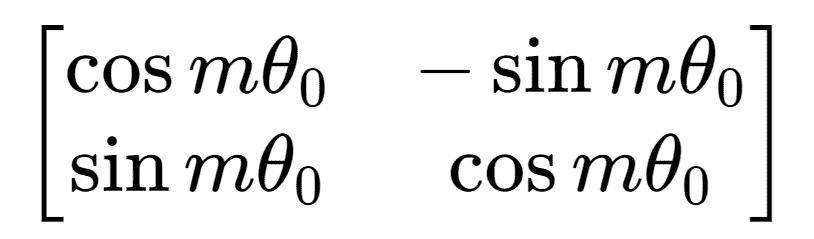

这种方法实际上是将 embedding 中的每两维一组去旋转 mθi 度, 下图可以帮助更直观地理解该过程：

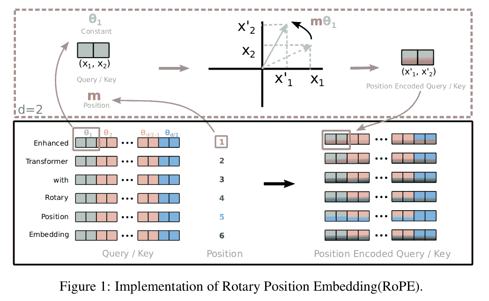

### 二维的情况

假设一个图像的patch的embedding是512维，位置是(x, y)，其中 x 表示Height方向Index，y 表示Width方向Index。类似于一维情况，我们为每个坐标计算角度 θ。假设 embedding 维度仍为 d，则对于位置 (x, y)，θ 的计算公式和一维相同：

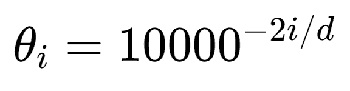

对于二维情况的旋转矩阵，我们可以对位置 (x, y) 的 embedding 进行以下操作, 假设embedding的维度为512维, 分为四个一组

x[0] x[1] 乘上下面的矩阵：

x[2], x[3]则乘上下面的矩阵:

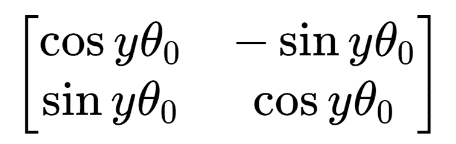

也就是词向量的512维embedding可以每四个一组，乘上下面的矩阵：

一维和二维的情况可以总结如下:（RoPE-1D就是两两一组，每组去乘红框中的矩阵，RoPE-2D就是四个一组，每组也是去乘对应红框中的矩阵）

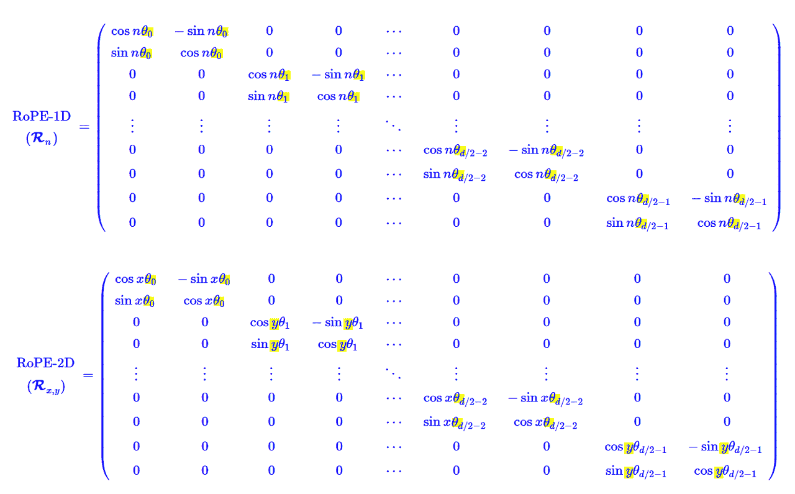

### 三维的情况

三维的情况就是Qwen2VL中使用的了，其实和二维差不多，只不过RoPE-3D是每六个一组，对位置 (x, y, z) 的 embedding 进行以下操作, 假设embedding的维度为512维, 分为6个一组：

x[0] x[1] 乘上下面的矩阵：

x[2], x[3]乘上下面的矩阵

x[4], x[5]乘上下面的矩阵

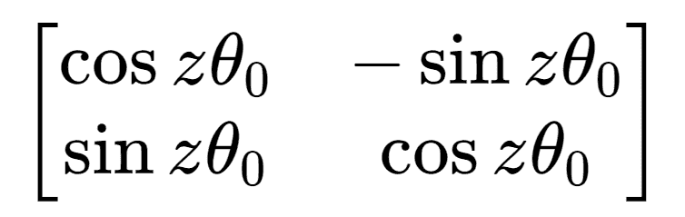

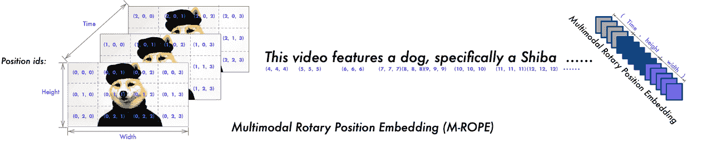

[上图中](https://zhida.zhihu.com/search?q=%E7%A4%BA%E6%84%8F%E5%9B%BE&zhida_source=entity&is_preview=1)为Qwen2VL中3维位置的Index示意图，其实就是分成了3维，第一维是时间，第二维是Height方向, 第三维是Width方向，具体得到每个图像Patch/文本Text的Index，使用ROPE-3D位置编码