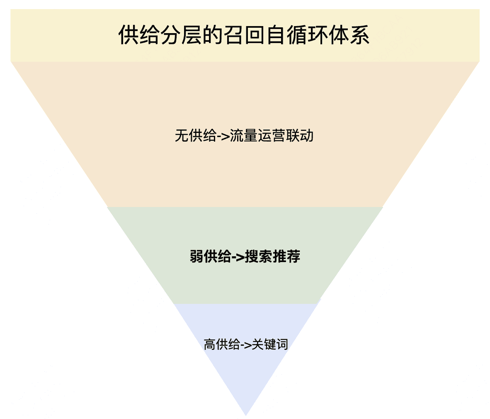
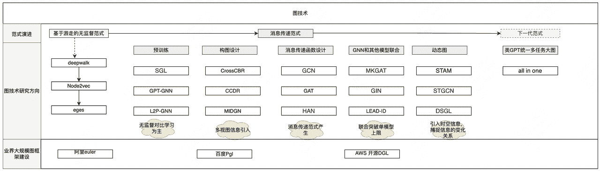
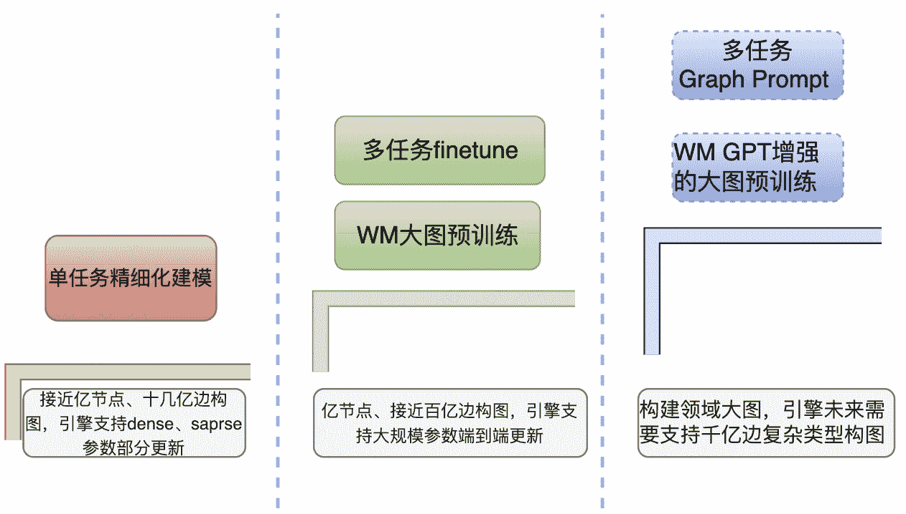
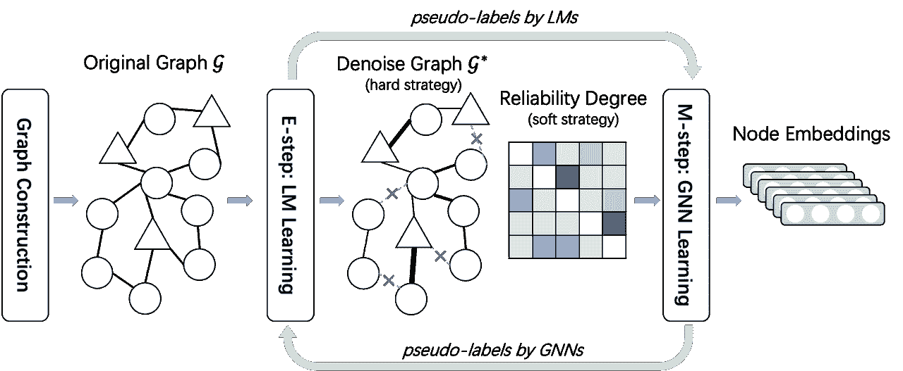
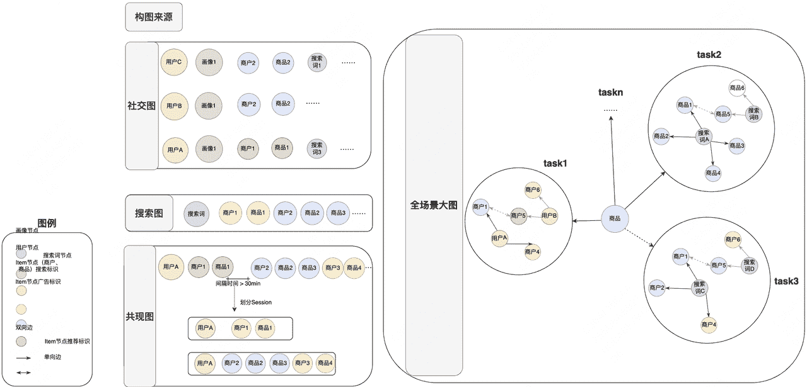
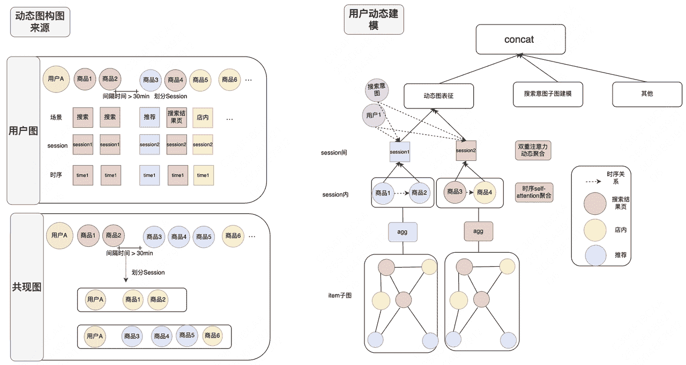
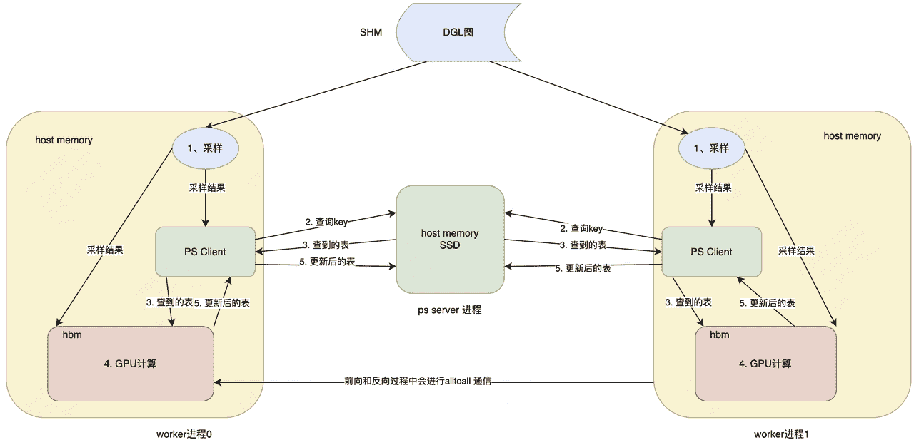
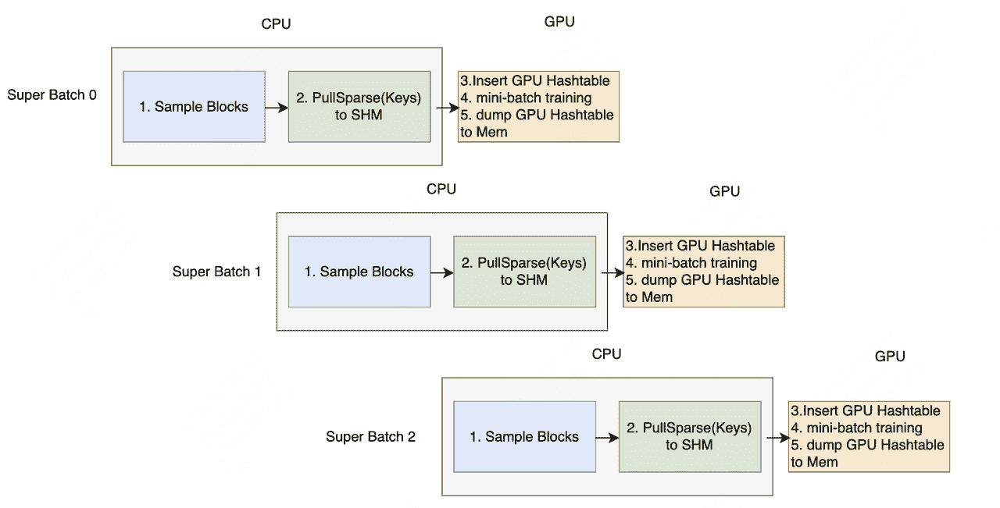
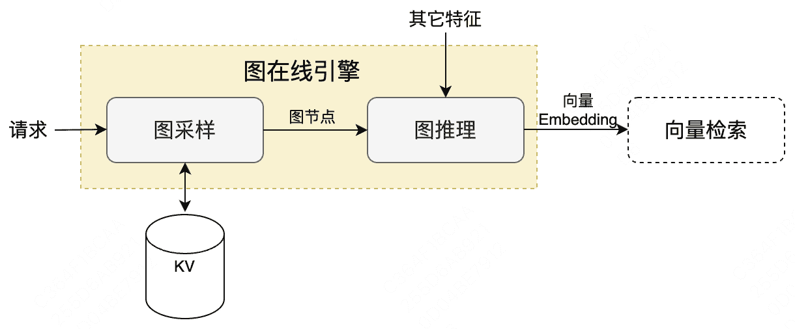
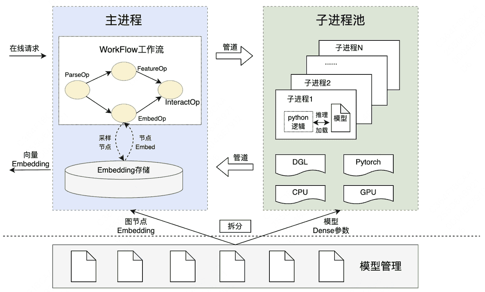

# 美团：百亿大规模图在广告场景的应用

> 来源：[https://v11enp9ok1h.feishu.cn/docx/Dzd2dOwCCoyGQ8xKjhQc3B7xnHd](https://v11enp9ok1h.feishu.cn/docx/Dzd2dOwCCoyGQ8xKjhQc3B7xnHd)

## 引言

> 美团外卖在线服务正成为日常生活中必不可少的服务，其中召回作为外卖广告系统的第一个环节，主要承担着从海量商品中寻找优质候选的角色。

- 相比于业界召回系统，外卖场景召回阶段存在`LBS`限制，因此外卖搜索广告提出供给分层的自循环召回体系：
- 无供给区域，实现流量运营联动提升流量召回上限；
- 高供给区域，通过关键词、向量召回提升召回效率；
- 弱供给区域，通过搜索推荐进行弱供给填充，提高候选效率。
- 搜索推荐目标是解决用户搜索意图不明确、供给受限制的流量下，从满足用户需求的角度出发进行的用户->供给匹配，提高弱供给流量变现效率、用户搜索效率。

### 外卖广告搜索推荐业务及挑战介绍

用户进入外卖场景，整体浏览路径为推荐页、搜索页，进入搜索页之后整体浏览路径为搜索前导购渠道、搜索`SUG`渠道、主动搜索渠道、结果页、详情页，搜索推荐主要目标是解决搜索意图不明确、供给受限制的候选匹配问题，主要覆盖搜索前导购渠道（搜索发现）、搜索`SUG`渠道、结果页【`POI`+`SPU`】组合推荐、结果页相关填充等场景。

搜索推荐覆盖如上多个场景，具有场景多且场景输入交互和展现形态异构的特点，第一个挑战是如何统一建模异构多场景业务，提高弱供给匹配效率（多渠道）。

> 外卖用户需求变化多样，从用户行为中可以发现，用户有在不同场景之间比较，需求发生演化至逐渐收敛的特点，例如用户从推荐转搜索、搜索换`Query`、结果页反复对比、最终成单或者离开，第二个挑战是如何实时、准确捕捉用户需求的演变，完成用户与供给的高效匹配（即时化）。

针对搜索推荐业务多渠道、即时化特点，业界语义向量召回、个性化向量召回一般解决方案和问题是：

- 针对输入交互和展现形态差异较大的多种异构业务，不同业务样本组织方式差异较大，由于向量召回以线性方式组织样本，导致异构业务样本难以统一，因此一般每个向量模型基于当前场景数据或者多场景数据进行单场景精细化建模，存在迭代效率低、小场景迁移能力弱的问题；
- 通过长短期序列建模，精细化刻画在不同时段内用户需求变化关系。时间段划分的序列内，存在数据稀疏性高、兴趣圈封闭、兴趣演变刻画粒度粗的问题。

> 搜索推荐业务的多个场景输入交互和展现形态差异较大，难以应用传统的具有相同目标、相似特征的多场景个性化向量召回建模方法，图结构作为多维非规则立体结构，由多种异构类型节点和节点间关系组成，适合通过异构图统一搜索推荐多异构场景。

- 图技术具有异构节点关系关联能力、高阶关系聚合能力、稀疏节点高阶表征的特点，通过关系聚合、关联能力缓解小场景难以学好、稀疏节点难以表征好的问题，因此我们提出多场景异构大图统一建模解决搜索推荐渠道多带来的迭代效率低、异构场景难以统一、小场景难以学好的问题。
- 用户需求具有不同场景间相互比较，需求演变至逐渐收敛的特点，这种即时性的变化特点，我们以多场景异构大图为基座提出异构动态图在线建模刻化需求演变关系，解决兴趣演变刻画粗、数据稀疏性高的问题。

## 图技术和引擎介绍

> 最近几年工业界和学术界在图领域研究取得了不错的进展，我们在这里对图深度学习的范式演进、主流研究方向、图引擎发展进行梳理

> 图神经网络范式演进主要由基于图游走的无监督范式→基于聚合的消息传递范式→下一代范式，从浅层无监督深度学习到统一全场景图深度学习发展。在主流的基于聚合的消息传递范式下，主要研究方向分为消息传递函数设计、构图设计、图预训练、联合训练、动态图等主流方向。

> 图神经网络范式演进决定了未来走向图多任务统一方向，我们期望在范式演进路线上找到搜索推荐业务如何统一建模多场景异构业务；消息聚合范式下动态图、联合训练方向主要解决图新增节点、新增变化关系如何刻画，我们期望在动态图方向找到建模用户需求变化关系的方案。

相比传统深度学习引擎，图学习引擎需要具备图构建、图采样和图运算的能力。随着图技术发展越来越火热，图技术由学术界逐渐推广到工业界，引擎发展由支持图技术基本功能向更高效的支持大规模图方向发展。当前已有很多针对不同场景的开源图训练引擎。

图学习业务场景的图模型规模越来越大，训练时间也越来越长，因此训练引擎需要同时支持较大的图规模端到端训练和较快的训练、速度。

在当前开源的框架中，单机的训练引擎可以发挥`GPU`的计算优势，但是存储有限，无法支撑业务`TB`级别内存和模型参数的大规模图学习训练任务。

分布式的训练引擎可以通过横向扩展来支持大规模的图学习任务，但是优化多机图采样之间需要进行密集的通信造成瓶颈，使得各台机器都无法发挥`GPU`的计算能力，导致训练速度难以满足工业界需求。因此我们联合美团机器学习平台建设了一套图学习训练引擎，能够同时满足速度和规模两方面的需求。

## 异构大图在搜索推荐业务的演进

### 外卖多场景异构大图

从业务逐步扩增、基建逐渐完善、技术逐渐发展的现状，我们多场景异构大图由 ：

- 单场景精细化图建模→多场景统一的大图预训练+下游任务微调→联合`GPT`增强式检索的大图预训练+下游任务`Prompt`微调进行迭代
- 最终构建外卖领域`Graph`模型。

> 随着迭代的发展及数据规模的变化，图引擎的技术能力需要由支持小规模图快速迭代，到支持百亿边图规模、全参数端到端训练，最终实现支持千亿边规模领域大图训练能力的跨越。

> 落地于搜索前导购渠道（搜索发现）、结果页【`POI`+`SPU`】组合推荐、结果页相关填充等多个场景，取得了较为明显的业务效果

#### 单场景图建模

基于`EM`（Expectation Maximization）框架的单意图语言增强降噪图

**背景**：

将之前的图神经网络直接应用于该异构图宽泛检索任务会遇到噪声交互。噪声交互主要来源于用户的随机误点（例如，在一个查询中共同点击“汉堡”和“沙拉”）以及全场景行为序列之间`Session`（用户在搜索引擎中从开始到结束的连续行为）点击（例如，“肯德基”和“海底捞”），以及由于消息传递方案更容易受到噪声的影响。

**动作**：

之前工作主要聚焦于结构相似性或者基于规则的语义相似性降噪，不同层面存在稀疏表示和节点覆盖问题，因此我们提出基于变分`EM`框架进行`LM`和`GNN`联合训练，通过联合训练融合结构和语义信息进行图结构降噪。具体而言，在单意图去噪中，我们基于`LMs`（`Language Models`）估计每次图交互的可靠性程度，并基于可靠度为`GNNs`（`Graph Neural Networks`）设计了硬去噪和软去噪策略，如下公式所述，此外用变分`EM`框架将语言模型和图神经网络结合起来，以避免联合训练需要不可承受的计算成本，最终通过联合训练融合结构和语义信息进行降噪。

**结果**：

> `EM`联合训练和软硬降燥（对比只有硬降燥图）带来离线`Recall` +3.7%。

>

> 简化图神经网络的注意力头的数量为一（实际为多头），节点的第层表示通过邻居`NB`表征聚合而来。其中`W`、`W`、`W`是网络参数；作为硬降燥指标，通过`LMs`相似度得分计算得到边的可靠度；是硬降燥阈值，当可靠度得分小于阈值，聚合函数直接删除该邻居节点，当可靠度得分大于阈值，通过可靠度得分作为先验知识，和`Masked Target-Attention`共同决定邻居聚合的权重关系。

基于对比学习的多意图差异化建模

**背景**：

**动作**：

- 将之前的图神经网络直接应用于该异构图宽泛检索任务会遇到意图不可区分性的问题。
- 用户搜索词表达了多种多样的意图，对于同一个曝光卡片，具有不同意图的用户可能会关注不同部分（菜品、商家等），但是现有的图神经网络通常忽略意图之间的差异统一建模。
- 具体的我们在语言模型（`LMs`）中引入了意图感知节点，能够为同一个节点获得不同意图表示。
- `GNNs`中通过设计聚合函数让每个意图节点更多地关注来自具有相同意图的边的邻居节点（公式如下）。
- 最后提出了一个多意图对比学习目标（公式如下），以明确而有效地指导图模型显示建模不同意图的差异性。

详细信息可以去阅读论文`LEAD-ID`

**结果**：

> 多意图对比学习带来离线`Recall` + 1.8%，多意图表征带来离线多业务平均`Recall` + 3.8%。

>

>

>

> 中是参数，表示边的意图；请注意，图神经网络（`GNNs`）只聚合相同意图的邻居的表示，即

>

>

> 对于节点表示，我们通过`dropout`边和节点表征得到其正例；为了鼓励模型区分各种意图，我们将不同意图的同一节点的表示视为强负例，其中；同样，同一意图的不同节点被视为简单的负例。采用`InfoNCE`来最大化正对的一致性并最小化负对的一致性。

#### WM多场景大图预训练

**`WM`大图构建**

我们以外卖全场景作为数据源进行异构类型构图，实现一个大图支持多场景多业务。

> 如下图所示，我们以用户画像、用户全行为序列、搜索点击序列`Session`内序列等为数据源进行大图构图；商品作为多场景共性连接节点，自定义业`Meta-path`作为单场景子图构建方法，构建具有实际任务意义的搜索商品子图、搜索商户子图、用户商品子图等。

> 其中图节点包`User`、`Item`、`POI`、搜索词；边包括`User`点击、成`Item`，搜索词点击、成单、加购`item`、`POI`，用户序列`Item`、`POI`的`Session`内点击、成单等；大图整体规模亿节点、百亿边。

**多场景统一大图预训练**

**背景**：

**动作**：

为了实现一个大图支持多场景多业务，提高迭代效率，我们在语义联合增强图降噪网络基础上进行统一多场景大图预训练。相比于上述单场景语言增强降噪图，大图预训练主要挑战为如何进行多场景的语言模型和图模型预训练。

语言模型采用`BERT`为`Base`，采用底层多场`Share-bottom`共享，顶层异构节点差异化建模统一搜索推荐多个场景，获得多种类型节点表征。统一大图预训练阶段无差异性高阶聚合所有邻居节点必然带来噪声干扰，因此我们通过自定义场景`Meta-path`显示定义场景子图，多场景子图内进行高阶聚合、多场景子图间底层共享节点表征。

模型以无监督链接预测任务作为目标，通过`LMs`和`GNNs`联合训练进行统一大图预训练任务。

**结果**：

优化多任务样本混合比例离线多任务平均`Recall` + 4%。

#### 生成式模型增强的大图预训练、`Prompt`微调

**背景：**

- 上述统一多场景大图预训练+`Finetune`范式主要有几个问题，首先预训练任务和下游任务之间固有的训练目标有差距，导致预训练无法最大化发挥能力
- 其次此范式下每个任务都需要大量样本有监督训练，微调成本高且新任务泛化能力弱，在`Prompt`范式之前，多场景训练方法集中在模型框架结构优化，设计复杂且可迁移性弱，因此借鉴`GPT`新范式设计图领域统一多场景模型。

**动作：**

生成式模型实现语义理解模型具有统一多场景任务设计简单、可迁移性强等优点，因此通过生成增强检索（`GAR`）方式进行搜索推荐多场景语义模型设计，然后通过`GAR`生成式检索模型和`GNN`联合训练进行统一大图预训练任务。

- 具体而言，`GAR`通过底层共享基于开源模型领域微调后的模型为基座、以对比学习为目标设计双塔结构、多场景多样`Prompt`设计样本结构，以`SFT`方式进行多场景任务训练实现搜索推荐多场景语义模型；

- 如上所述，大图预训练阶段通过自定义场景`Meta-path`显示定义场景子图，多场景子图内进行高阶聚合、多场景子图间底层共享节点表征，模型以无监督链接预测任务作为目标，最后`GAR`和`GNN`联合训练实现统一大图预训练任务。

- 下游设计多场景`Soft-prompt`进行`SFT`，具体`Soft-prompt`初始化向量进行表示，通过融合预训练节点表征`Soft-prompt`表征作为最终节点表征，多场景以训练少量参数、小样本进行下游任务微调。

**结果：**

- 相比于多任务`BERT`，`GAR`带来所有任务离线指标上涨，多任务平均`Recall` +1%；
- `zero-shot`评估下游任务，`soft prompt`微调（对比不进行下游任务微调），下游多任务平均`Recall` +10%。

### 异构大图在线建模

由于用户需求变化关系有即时性、场景间相互比较逐渐收敛的特点，因此我们基于多场景异构大图建设图在线引擎，通过图在线建模完成用户与供给的高效匹配，提高流量使用和用户搜索效率，业务收益取得了较为明显的效果。

**用户需求变化的动态图建模**

**背景**：

- 考虑用户需`Session`之间兴趣独立、`Session`内部用户在不同场景间相互比较，需求演化至逐渐收敛的特点，提出基于动态图的用户`Sessionlevel`建模刻化用户需求的变化关系。

**动作：**

- `Sessionlevel`建模加剧了序列的稀疏性、加大了表征难的问题，我们利用图的高阶聚合能力，沿用之前“软硬降噪”聚合函数，通过高阶聚合操作丰富序列中所有节点的表征能力。
- `Sessionlevel`分为`Session`内部建模和`Session`间建模，`Session`内部场景拆分为推荐、搜索中、搜索后，通过基于场景的时序`Self-attention`建模需求演化关系，`Session`间基于当前实时搜索意图、用户信息双重注意力动态聚合，整体建模用户需求。
- 用户搜索场景下搜索词表达用户即时意图，因此我们在上述语言增强降噪预训练图的基础上，基于搜索词和候选商品关系、商品共现关系构建搜索商品子图，为用户召回精确候选；最终搜索子图表征和动态图表征进行融合

**整体结构如下图所示：**

**结果**：

用户`Sessionlevel`建模离线`Recall` + 1%。

## 大规模图引擎`GraphET`工程建设

### 大规模图引擎训练框架建设

以10亿节点、100亿条边的图模型为例：

- 图结构本身采用`COO`格式保存在内存中，要占约100GB的内存（10GB*4*2 + 1GB*8）。
- 在采样过程中随机游走会用`CSR`、`CSC`两种格式保存中间结果，以及训练过程中的内存占用，内存占用已经有了300GB。

每个节点中还有用户定义的特征，以一个256维的节点特征为例：

- 10亿个节点总共需要256* 4*1GB = 1TB。节点通常不会只有一类特征，边上也会有各种维度的边特征，这样的图规模常见集群中的1TB内存的无法保存。
- 为了保证业务效果，节点和边的`Sparse`、`Dense`特征需要和模型参数进行端到端全量更新，`TB`级别参数`GPU`训练更新开源图学习框架不支持。

> 因此我们在开源的图学习训练框架`DGL`（Deep Graph Library）v0.7基础上，研发了一套大规模图神经网络的训练框架`GraphET`，服务于公司多个业务线。

> 该框架支持亿级别节点、百亿级别边离线图训练流程高效pipeline（图构建/采样/聚合/端到端建模）`Pytorch Dgl Serving` 在线向量计算，方便实现学术界任意复杂图模型工程在线化。

**`GraphET`训练系统的架构如下图所示：**

系统由负责模型训练的`Worker`进程和负责`Hashtable`保存的`Parameter Server`进程两部分构成。

为了降低内存开销，将`DGL`图结构存到共享内存中，在多个`Worker`进程间共享同一份图结构。

> 图中的节点和边上的特征保存在`Parameter Server`中，每次采样后会向`Parameter Server`发送需要查询的节点，将查询到的`Embedding`放入`SHM`。

>

> `Mini-batch`训练前将`Embedding`加载到`GPU`上，训练过程中用`alltoall`通信来获取节点/边特征，训练结束后将`Embedding`写回`PS`完成更新。

>

> 系统支持显存/内存/`SSD`多级存储，根据特征的访问频次来将特征放置在合适的位置，在不影响系统吞吐的情况下，提高了`DGL`可以支撑的图的特征规模。

**`worker`进程**

在我们设计的架构下，模型训练过程中涉及`Super-batch`粒度的训练样本采样、样本特征查询、`Mini-batch`粒度的`GPU`训练和特征更新，不同阶段对硬件特点的需求是不同的，具体来说对为了充分发挥不同硬件的功能，最大化利用`GPU`的计算优势，提升模型整体训练速度，我们通过三级流水线来加速模型训练。

- 训练样本采样是`CPU`密集型任务；
- 样本特征查询是`SSD IO`密集型任务；
- `GPU`训练是计算密集型任务。

**在流水线中，每个`Super-Batch`都包括采样、获取特征、训练三个阶段。**

> 样本采样阶段是独立的，采样结果放入`Queue`中；获取特征阶段由`PS Client`向`PS`发送异步请求拉取特征参数放入`SHM`；训练阶段阶段将特征放到`GPU`上，训练后将新的`Embedding`写回`SHM`。多级流水线之间通过消息队列和共享内存通信。

`worker`进程对重复查询`Embedding`做了两方面优化：

## PS 进程

+ 采样后，在查询特征前会对多 GPU 采样出的 `Key` 进行去重。由于 `Worker` 进程一个 `Super-batch` 采样多个 `Mini-batch`，邻居较多的节点可能会被重复采样，去重后每个 `key` 在 `PS` 端仅查询一次；

+ 在每个 `Mini-batch` 训练时，所有 `Key` 按照 `Key % Worker_num = i` 的方式存储在 `Worker` `i` 对应的显存中，GPU 进程间 `alltoall` 通信前会对 `key` 去重以减少卡间通信。

PS 主要负责存储、查找和更新 `Embedding` 参数，支持两种存储方式：`Full_memory` 和 `Ssd_kv_store`。

+ 在 `Full_memory` 模式中所有的参数都是存在内存中，这相当于将参数存储在 SHM 中。

+ 在 `Ssd_kv_store` 模式中，所有的参数都存在 SSD 中，内存作为 SSD 的 `Cache` 仅存储部分参数，这种方式可以存储更多的参数，但需要考虑 `Cache` 命中率，避免内存中存储的参数太少，导致 SSD 读写速度成为性能瓶颈。

`PS` 以 `KV` 形式存储 `Embedding` 参数，使得 `Embedding` 参数在 `PS` 和 `Worker` 进程中的 `PS Client` 之间共享。

> 为了优化内存使用效率，将所有 `Hashtable` 的 `KV` 对统一存储在一块大的共享内存中，内存中的 `Hashtable` 中存储指向共享内存中对应 `Value` 的指针（`Offset`）。

> 我们在 SSD 引擎方面做了多方面的优化：

+ **SSD 聚合读优化**。SSD 上的 `Key` 查询是以 `Group` 为单位进行数据读取，而查询 `Key` 的分布很随机，导致读到 `PageCache` 的 `Group` 数据被频繁换入换出，影响查询性能。因此，我们将待查询的 `Key` 集合按照 `Group` 进行提前聚合，聚合后再进行 SSD 查询，一方面降低 I/O 读取次数，另一方面也能更好利用 `PageCache` 来提升查询性能。

+ **对象池优化**。在 `Key` 查询过程中，需要频繁创建小对象（`Cache` 结点、`Block` 结点等），虽然底层已使用 `TCMalloc` 优化，但内存分配释放的开销仍不容小视。因此，我们引入定长对象池，在连续大内存上维护小对象的分配和释放操作，减少系统调用，提升服务性能。

+ **文件 GC 优化**。由于 `Compaction` 操作，SSD 文件可能包含很多无效 `Group` 数据，但只有文件中 `Group` 全部为无效状态时才会触发文件删除，导致有效 `Group` 占比很低的文件迟迟得不到删除，占用磁盘空间，对 SSD 读写性能也产生影响。因此，我们引入异步 `GC` 线程，定期合并有效 `Group` 占比低的文件，删除无效文件，降低磁盘占用。

## 图引擎在线框架建设

基于图模型离线训练流程，建设图在线引擎。图在线引擎建设包括两部分内容：图采样和图推理，如下图所示：

+ **图采样**：将图模型训练过程中用到的多跳图节点，进行整合拼装后写入 `KV Serving`，提供高效图采样（后续会迁移至图数据库，实现实时采样）；

+ **图推理**：将图采样节点以及其它特征输入到图模型中，进行在线前向推理，输出向量 `Embedding` 用于后续的向量检索召回。下面也将重点介绍我们在图推理方面的相关建设工作。

### 图推理遇到的挑战

**Python 在线推理**：图模型基于开源 `DGL` 框架进行训练和导出。虽然 `DGL` 框架支持 `Pytorch` 和 `Tensorflow` 两种 backend，但 `Pytorch` 相比 `Tensorflow`，无论是新功能特性的迭代效率方面，还是公司训练平台的支持方面都更加突出，因此在线推理部署的图模型是基于 `DGL`+`Pytorch` 的模式进行训练和导出。

`Pytorch` 本身是支持将模型序列化成 `TorchScript` 格式，进行 `C++` 部署和推理加速，但 `DGL` 框架是基于 `Pytorch` 进行二次开发，无法序列化成 `TorchScript` 格式进行 `C++` 部署，只能通过 `Python` 部署的方式进行推理，这就需要在现有 `C++` 推理框架的基础上进行底层能力升级，支持 `Python` 部署模式的 backend，这对框架的 `WorkFlow` 推理流程、模型管理模式、进程部署方式等方面都是不小的挑战。

**单机显存瓶颈**：`Python` 由于全局解释器锁 `GIL` 的限制，导致单进程模式无法并行处理请求，一方面导致多核 `CPU`/`GPU` 无法被充分利用，资源被浪费，另一方面请求被串行积压，导致耗时上涨，这对于在线推理服务是不能接受的。

因此，为了避免 `GIL` 锁的影响，需要通过部署多进程的方式进行模型推理，支持在线请求的并发处理。但多进程部署方式，需要每个进程都加载一份模型数据，这无疑会受到单机显存的约束，模型越大，单机可部署的进程数就越少，进而限制处理请求的并发度，影响在线推理性能。因此，如何降低单进程可加载的模型数据量，提高并行部署的进程数量，是我们需要思考的问题和挑战。

### 图推理框架建设

针对上面梳理的问题和挑战，并结合业务现状和系统现状，我们进行了在线图推理框架的建设，系统架构如下图所示：

从上图可以看出，在线图推理框架由 1 个主进程 + `N` 个子进程组成，主进程负责 `WorkFlow` 工作流的调度，包括在线请求接收、解析、特征/图节点 `Embedding` 数据准备以及与子进程间的数据交互，最终返回向量 `Embedding` 结果；子进程负责以 `Python` 的方式进行模型的加载和推理，并将推理结果返回给主进程。主进程每次会从子进程池中选取空闲子进程，并通过管道进行通信。

#### 多进程架构：解决 Python GIL 锁造成的单进程 CPU/GPU 利用率低的问题

将 `Python` 执行逻辑部署在多个进程中，通过单进程内串行执行请求，可有效避免 `Python GIL` 锁带来的限制，通过进程间并行处理请求，可充分利用 `CPU`/`GPU` 多核资源，提升服务性能和吞吐。主进程和子进程池之间，交互流程类似于“生产者-消费者”模式，通过引入管道、`epoll` 等机制，保证进程间通信高效执行。

#### 模型拆分：解决模型过大造成的单机显存对子进程数量限制的问题

图模型包括亿级节点和几十亿条边，模型大小在几十 G 左右，默认全部加载到 `GPU` 中。考虑到模型加载后会出现膨胀现象，实际占用的 `GPU` 显存会更大，而 `GPU` 显存资源有限，加载单个模型都会存在显存溢出风险，很难支撑多进程加载多模型的模式。

经过分析，我们发现模型结构中存储了大量图节点 `Embedding` 数据，而图模型网络 `Dense` 参数只占百兆左右，同时发现单机内存大小要远大于 `GPU` 显存，且处于空闲状态。因此，我们在离线侧将图模型进行了拆分，将图节点 `Embedding` 部分加载到主进程内存中，且只需加载一次，而将模型 `Dense` 参数加载到 `GPU` 显存中，虽然每个子进程都需加载一份，但 `Dense` 参数体量较小，单个进程占用显存可控，可大幅提升子进程部署数量。

#### 统一通信协议：解决不同策略模型的低成本快速迭代问题

不同策略模型对特征/采样 `Embedding` 的处理方式都有所不同，如果放在框架层进行适配，时间成本和人力成本都很高，影响模型的快速迭代。因此，我们制定了主进程->子进程->`Python` 逻辑全流程的统一通信协议，通过标准化、规范化的通信数据格式，将特征/采样 `Embedding` 数据逐层传输到子进程 `Python` 逻辑中，而子进程 `Python` 逻辑中才会真正执行模型定制化逻辑，算法同学可以按需修改，并作为模型的一部分被子进程加载，从而保证在服务框架层面稳定不变的情况下，动态支持不同策略模型的快速迭代。

## 总结和展望

图神经网络作为图结构数据建模方法，在搜推广领域展现出巨大潜力，业界头部公司均结合各自业务特点自建图引擎和图技术落地应用。

本文主要介绍大规模图框架在外卖广告场景的落地。基于对外卖搜索广告场景分析，提出搜索推荐业务解决 `LBS` 场景下弱供给问题。搜索推荐业务面临着多渠道、即时化的挑战。我们提出多场景异构大图，通过单场景精细化建模->大图预训练+下游任务微调->大图预训练+下游任务 `Graph Soft Prompt` 解决多渠道问题，异构图在线建模通过基于 `Sessionlevel` 的动态图建模用户需求变化关系。

为了满足亿节点百亿边大规模图端到端训练、在线实时推理，基于开源 `DGL` 框架研发了一套大规模图神经网络的训练、推理框架 `GraphET`，支持离线图训练流程 `Pipline`（图构建/采样/聚合/端到端建模），`DGL Serving` 在线推理，方便实现学术界任意复杂图模型工程在线化。

未来我们还将在以下方向继续进行探索：

+ 借鉴 `GPT` 思想，搜推广领域通用 `Graph` 模型建设及落地；

+ 构建领域大图，引擎需要支撑千亿边、复杂类型构图能力；

+ 图在线引擎加速及支撑更大规模图在线推理框架建设。
