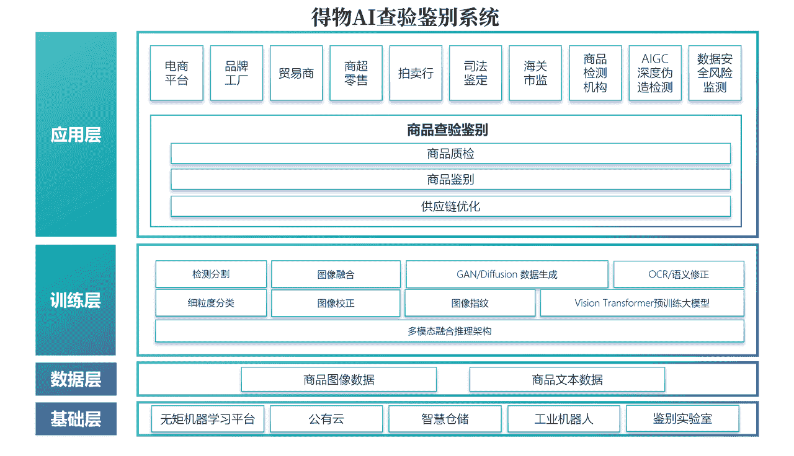

# 竞品分析--得物AI查验鉴别系统

> 来源：[https://v11enp9ok1h.feishu.cn/docx/UZfrdw3LboUg6JxZostcrYf9nHf](https://v11enp9ok1h.feishu.cn/docx/UZfrdw3LboUg6JxZostcrYf9nHf)

##  版本信息

> 版本号：V1.5

> 创建日期：2024/10/30

> 审核人：kisenn

## 概    述

> 得物基于产业真实场景研发AI查验鉴别系统，以得物多年积累的查验鉴别研究和海量实物商品数据训练为基础，整合亿级多模态产业原生数据，自研“无矩”机器学习平台，通过细粒度感知技术、分层注意力机制、神经网络结构搜索等技术，快速、深入分析多品类商品的关键物理特性，实现了成熟的多品类商品高精度查验鉴别，主要品类与得物鉴别专家的鉴别结果吻合度在99.9999%以上。得物垂类大模型在工业质检、各类经营主体货品质量管理、监管和安全等领域均有广泛应用空间。

## 需求分析

### 新型工业化需求：

> 当前，中国制造业正处于依靠知识、技术等高级生产要素重构产业核心竞争力的爬坡过坎阶段。目前国内人工智能企业和项目努力寻找赋能制造业的突破口，但在层出不穷的大模型中，会“聊天”的多，会“干活”的较少，在制造业具体场景中的大规模应用和商业化，总体还处于早期阶段。新一代质量基础设施建设有待通过AI技术加快加强，例如在商品生产、流通领域的AI检测模型，还不能充分满足多品类、大批量、高复杂商品的质量检测和真伪鉴别需求。

### 消费者科技服务体验需求：

> 当前，以“Z世代”为代表的中国新生代消费者正在崛起，他们对商品质量提出了更高的期待，需要更高效的人工智能商品查验鉴别应用，来提高平台批量化商品查验鉴别的效率。

## **产品逻辑**

## **案例介绍**

### 一、主要技术方案

得物的商品查验鉴别业务覆盖近20大类商品，得物AI查验鉴别系统是国内首个面向多品类、复杂场景的商品查验鉴别人工智能，攻克了多品类AI商品查验鉴别技术难点。

| **方案** | **说明** |
| --- | --- |
| **引入神经网络结构搜索技术** | 引入神经网络结构搜索技术，训练过程中能根据款式特点快速自动化调整模型结构，能更快找到更高查验鉴别准确率的“解题思路”。 |
| 引入商品细节图、商品来源等跨模态信息 | 引入商品细节图、商品来源等跨模态信息帮助决策商品真假，通过更全面的思考来判断真假。通过提示工程来有效地表述不同模态信息，提高模型的准确率和知识实时性，有效突破高难度品类和品牌的鉴别难点 |
| 引入细粒度分类、层级注意力机制等技术 | 引入细粒度分类、层级注意力机制等技术，实现对资深鉴别师能力的模拟。通过工业机器人拍摄的广角高精度图片，大模型能捕捉像素级的细微纹理差异，准确识别一些视觉观察足以乱真，只有资深鉴别师才能捕捉细微触感差异，并将鉴别师经验严格量化，做到“万无一失”。 |

| **方案** | **说明** |
| --- | --- |
| **内嵌增量学习系统** | 内嵌增量学习系统，让模型能够根据真实的商品鉴别过程中，实时积累的新款商品数据，快速形成新款商品的鉴别能力，对模型进行实时更新迭代，具备出色泛化能力。 |
| **完善的正品样本库** | 完善的正品样本库。“得物正品样本库”就像商品图书馆一样，为商品鉴别提供标准。目前，得物正品样本库覆盖13个消费品类、1500多个品牌、10万多个商品，球鞋、服装、箱包、手表、3C、珠宝等每一个消费类目，每一个品牌，甚至一个品牌的一款商品，都从0到1建立了不同的鉴别逻辑和标准，且随着商品丰富度的提升，持续迭代新增。 |

### **二、实施效果和应用落地情况**

> 目前得物AI查验鉴别系统与得物鉴别专家的鉴别结果吻合度在99.9999%以上，已覆盖箱包、手表、鞋类、服饰、配饰、奢侈品、户外运动、美妆等众多品类。

## 三、效益分析

**（一）工商业场景**

1.  面向产业链上游。未来有能力支持进行智能质检，可为生产制造企业提供AI工业质检服务。

1.  面向各类经营主体。逐步向商超、零售、贸易商、拍卖行等各类经营主体，开放多品类商品品质查验服务，支持其快速完成货品质检。

**（二）监管领域应用前景**

+   目前，得物已受海关、公安邀请，对涉案商品进行真伪鉴别，为案件定损与侦破提供支持。未来可逐步向公检法、海关、市场监管单位及权威检测机构开放AI查验鉴别服务，支持主管部门进行高精度、批量化的商品检测和真伪鉴别。

**（三）数据治理及风控场景**

+   AIGC“以假乱真”现象已成为AI治理的重点领域，可适时探索得物大模型支持进行AIGC深度伪造检测。可探索得物大模型在网络安全建模方面的应用，基于对多模态数据的深入分析，预测各行各业潜在风险事件发生的概率。