# 如何利用「深度上下文兴趣网络」提升点击率？

> 来源：[https://v11enp9ok1h.feishu.cn/docx/FkMQdbkQ8ophrcxbSTWcpuAyn0f](https://v11enp9ok1h.feishu.cn/docx/FkMQdbkQ8ophrcxbSTWcpuAyn0f)

## 背景

**点击率（CTR）**预测是在线广告、推荐系统等领域的**一个基础**任务，主要目标是预测用户点击某个Item的概率。

> 用户行为序列中蕴含着丰富的用户兴趣信息，这对于CTR预测至关重要。然而，大部分用户行为序列模型只从用户的点击行为中建模用户的正向兴趣，而忽视了上下文信息，即点击Item周围的其他Item，导致效果受限。

**如图1所示**

+   当用户想买一件T恤时，如果周围的Item是智能手机、鞋子或吹风机，他可能会点击绿色T恤，因为这些Item对他来说很无聊。但是，当周围的展示Item都是T恤时，他可能会点击蓝色的那一个，因为蓝色T恤比绿色T恤更符合他的兴趣。基于上述分析，我们认为展示上下文在用户兴趣建模中也是至关重要的。

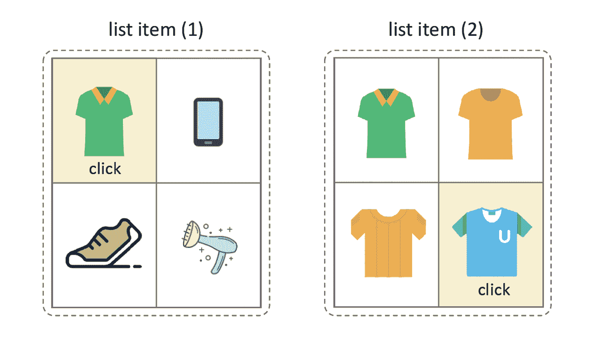

> 为了从用户的点击行为和相应的展示上下文中提取出具有上下文感知的用户兴趣表征，我们提出了深度上下文兴趣网络（DCIN）。

> 通过反馈-上下文融合模块（FCFM），利用非线性特征交互将点击和相应的展示上下文的表征融合在一起，以捕捉用户的上下文相关兴趣。最后，我们使用兴趣匹配模块（IMM）来匹配与目标Item相关的行为。

**具体来说，如下：**

+   引入上下文信息进行用户兴趣建模。上下文信息可以帮助我们更准确、全面地捕捉用户的兴趣；

+   创新性地设计了序列模型DCIN，它有效地集成了展示上下文和位次信息，以获取用户的上下文感知兴趣；

+   广泛的线下和线上实验，结果都证明了DCIN的优越性。目前DCIN已经在我们的在线广告系统中全量，并带来了1.5%的点击率（CTR）提升和1.5%的每千次展示收入（RPM）的提升。

##

## 深度上下文兴趣网络

### 深度上下文兴趣网络

**DCIN**的架构如图2所示，主要包含三个模块。

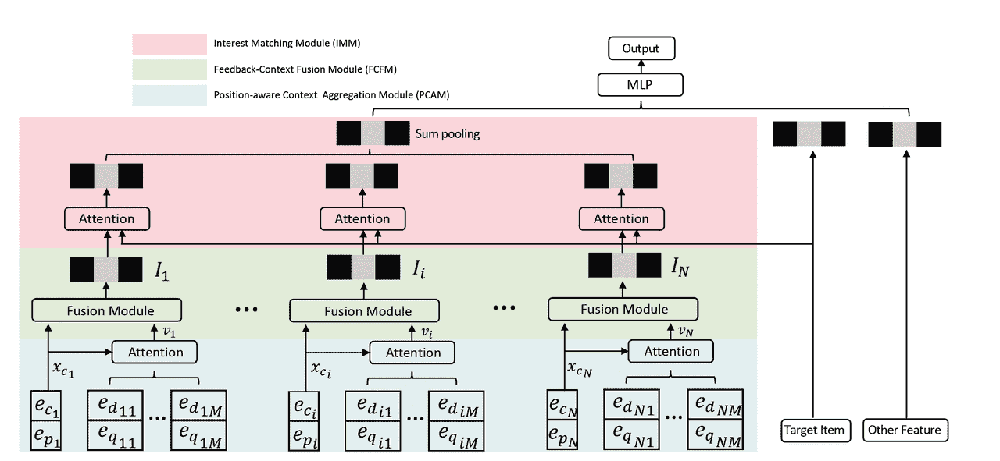

1.  位次感知的上下文**聚合模块（PCAM）**，通过注意力机制来聚合展示上下文。

1.  上下文**融合模块（FCFM）**，利用非线性特征交互融合点击和相应的展示上下文，以获取上下文感知的兴趣表征。

1.  兴趣**匹配模块（IMM）**，自适应地学习与目标Item相关的用户兴趣

### CTR模型介绍

> **点击率预估**是在给定用户行为   (点击行为)和    (浏览行为),以及上下文   的情况下，**使用模型 ** ** 预测用户 ** ** 点击目标ltem  ** ** 的概率 ** ** ,公式为 ** 。用户的历史点击行为是一个包含对应特征(如ltem id、类别等) 的点击项目的顺序列表，即  ,其中  是第  个点击Item，  表示点击序列的长度。

为了建模展示上下文，我们为每个点击选择  个对应的展示Item，因此用户的浏览行为  可以表示为：

D=[d_{11},d_{12},\ldots,d_{1M}],\ldots,[d_{N1},d_{N2},\ldots,d_{NM}],其中  是点击  周围的第  个展示Item。在为每次点击选择周围的展示ltem时，我们试图将点击保持在中间。我们用  和  分别表示  和  的绝对位次。我们还计算  和  之间的相对位次r_{ij}=p_i-q_{ij}。我们利用广泛使用的Embedding技术将稀疏特征转化为低维度的稠密向量。例如，  代表点击Item  的Embedding。

#### 深度上下文兴趣网络

如图1所示，智能手机一屏通常会展示很多Item。

+   用户的点击行为不仅由Item与他们的兴趣之间的匹配程度决定，也受到上下文的影响。

+   仅从他们的点击行为中建模用户的兴趣会忽略上下文信息，导致提取的兴趣表征有偏。

+   为了捕获用户的上下文感知兴趣，我们设计了PCAM，它通过注意力机制为每次点击聚合展示上下文。

> 此外，用户通常倾向于点击屏幕上的位次靠前的Item（称为位次偏差），而不考虑相关性。因此，Item的位次同样影响用户的点击行为。我们还将位次信息集成到PCAM中，以更好地理解用户的实际兴趣。因此，PCAM可以被公式化如下：

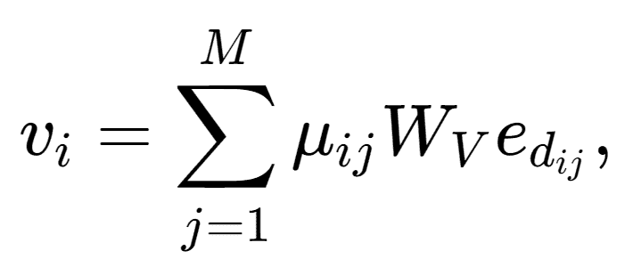

其中， 代表点击 对应的展示上下文，表示为展示Item  的加权总和， 是学习参数。 是注意力权重，可以被表示为：

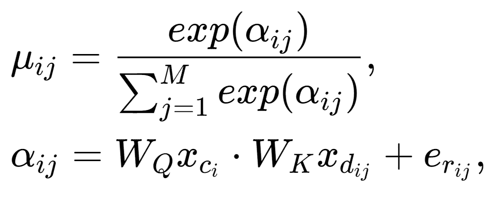

其中， 是第 次点击与其第 个展示Item之间的相关性， 代表项目嵌入 和其绝对位次 的拼接，同理 。 是相对位次 的一维嵌入向量， 和 是可学习参数。

#### 反馈-上下文融合模块

以前的用户序列模型([7, 11, 13, 18, 21, 22])直接将用户的点击Item视为用户的兴趣，忽略了上下文信息。为了捕捉用户的上下文感知兴趣，我们提出了FCFM来通过非线性特征交互融合点击和相应展示上下文的表征。具体来说，FCFM是通过一个2层的MLP（多层感知器）来实现的：

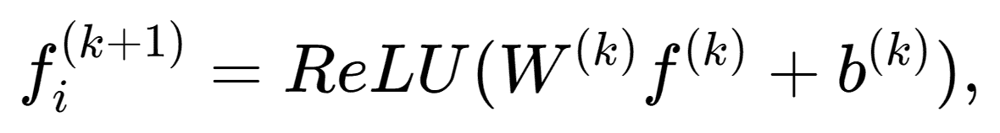

其中，  是第  层的输出，  和  是学习参数。其中输入的形式如下：

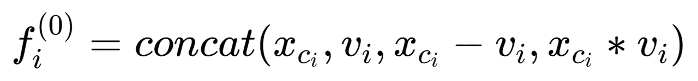

其中，*表示元素间的乘积。然后，我们从点击  及其相应的展示上下文  中获得了上下文感知兴趣  。为了实现泛化和可训练性，我们在不同的点击中共享可学习的参数。

#### 兴趣匹配模块

通过前两个模块，我们整体地建模了点击Item和其展示上下文，以捕获用户的上下文感知兴趣，表示为   这比仅从点击行为中提取的用户兴趣更精确和全面。为了捕获与目标Item相关的用户兴趣，我们可以轻松集成最新的序列模型，如DIN ,DIEN, BST等。在这里，我们选择了DIN方法来聚合用户兴趣，可以表示为：

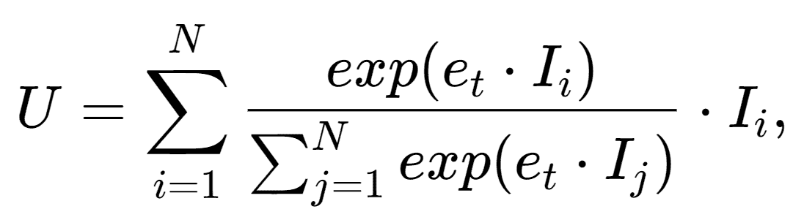

其中，  是最终的用户表示，它将与其他特征拼接后输入到MLP中进行CTR预估。我们使用广泛使用的二分类交叉熵损失函数来训练我们的DCIN模型。

###  线上服务优化

+   对于工业广告系统来说，服务延迟的限制非常严格。由于我们引入了展示Item来捕获用户的上下文感知兴趣，序列长度被扩展了数十倍，而在线模型的服务延迟通常与序列长度成正比，因此直接在工业在线系统中使用DCIN会带来服务延迟的重大负担。为了解决这个问题，我们针对性地进行了一些在线优化。

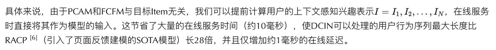

##

## 实验

### 3.1 实验设置

####  数据集

> 将展示上下文和位次信息集成到序列模型中是一种全新的探索，目前缺乏相关的公开数据集。因此，我们从在线广告系统中构建了一个31天的工业数据集，其中包含数十亿的样本。按照惯例，我们将前30天的数据划分为训练集，最后一天的数据划分为测试集，并保留用户最近的50次点击行为，每次点击的周围20个展示Item被用来建模展示上下文。

####

#### 基线模型

我们选取六种序列模型与DCIN进行比较。所有模型都使用相同的特征进行公平比较：

+   **Wide&Deep** 由一个Wide部分和一个Deep部分组成，用于学习原始和高阶特征交互；

+   **DeepFM** 用FM层替换了Wide&Deep中的Wide部分；

+   **DIN** 引入了一种注意力机制，用于捕获用户对不同目标Item的多样化兴趣；

+   **DIEN** 提出了一个基于门控循环单元（GRU）的兴趣演化层，用于模拟用户的动态兴趣；

+   **DFN** 试图从点击行为中学习正向偏好，从未点击行为中学习负向偏好；

+   **RACP** 引入了页面反馈建模，是已发布的用户行为建模的SOTA方案。

####  评估指标

我们在CTR预测任务中使用了广泛采用的评估指标AUC，我们进一步引入RelaImpr([19]) 来衡量相对于基础模型的改进：

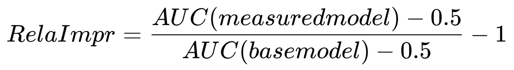

###  实验结果

我们重复所有实验5次，并报告他们的平均结果。在实验中，每个特征的嵌入维度为16。FCFM中MLP的隐藏大小和输出层分别为64/16，和1024/512/128。我们使用学习率为1e-4的Adam，Batch Size大小为3000。

####  离线效果

实验结果如下表所示，从中我们可以发现，我们提出的DCIN在AUC上显著优于所有方法，并在基础模型上实现了21.24%的RelaImpr。如2.3节所介绍，DCIN可以处理的最长用户行为序列比RACP长28倍。为了公平比较，DCIN(Short)使用与RACP相同的序列长度，而DCIN使用我们在线广告系统中实现的更长序列。

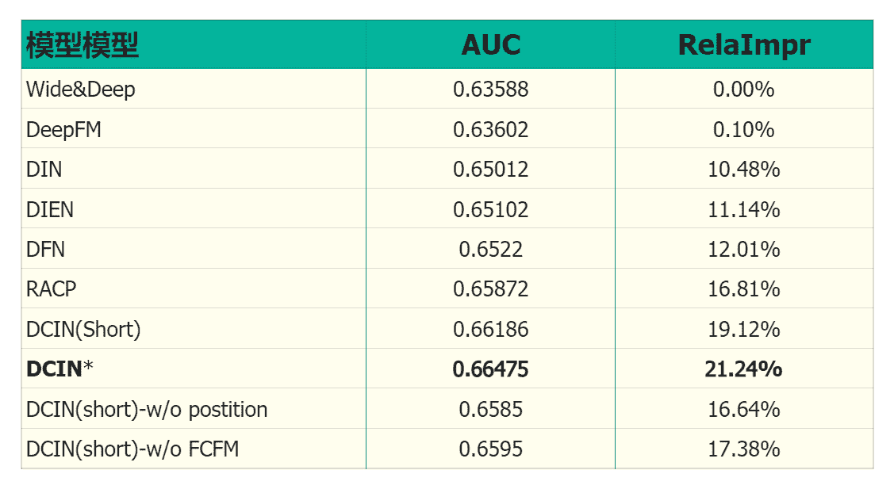

####  消融实验

我们还进行了消融测试，以验证DCIN中不同组件的有效性和必要性。首先，我们在PCAM中去除位次信息，并进行DCIN(short)-w/o postition的实验。如表1所示，DCIN(short)-w/o postition的表现比DCIN(Short)差，因为Item的位次对用户的点击行为也有重要影响。

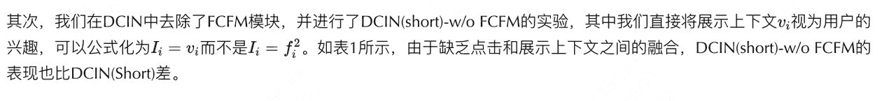

####

####  线上A/B测试

我们进行了严格的在线A/B测试，在线上对DCIN进行了两周的评估。与DIN（线上基线）相比，DCIN实现了CTR+1.5%、RPM+1.5%的提升。目前，DCIN已经在线部署并全量，显著提升了广告收入。

####  Case研究

为了展示DCIN在上下文感知兴趣表示方面的有效性，我们随机选择10个点击Item，并分别为每个点击选择100个不同的展示上下文。然后我们提取相应的上下文感知兴趣Ii��，并通过t-SNE ([14])可视化它们的分布。如图3所示，点击Item之间的明显分离表明了学习中点击行为的主导地位。同一点击的不同上下文的明显多样性证明了DCIN捕获细粒度上下文感知兴趣表示的能力。

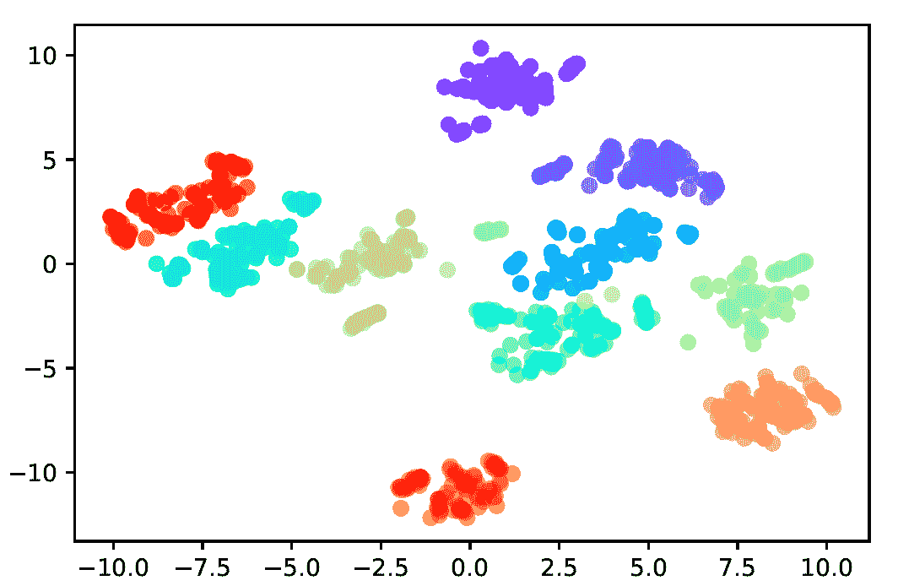

为了验证上下文建模的有效性，我们可视化了目标Item和在不同展示上下文下的同一点击Item之间的IMM的注意力权重。如图4所示，DIN（绿色）的权重是相同的，因为DIN只将点击行为作为输入，所以它无法区分不同的显示上下文。而DCIN可以根据不同的上下文学习到不同的权重，右图展示的Item之间的竞争更激烈，其上下文反映的用户兴趣更精确，因此DCIN学习到了更高的权重。

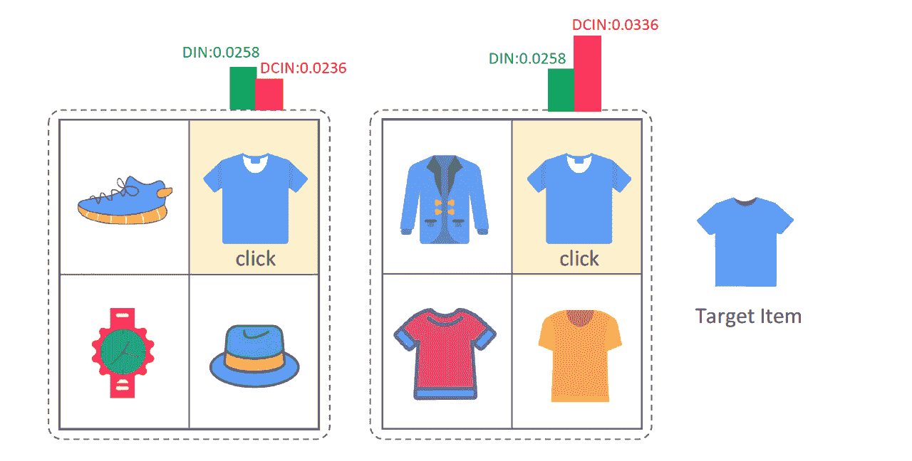

##

##

## 结论

我们强调了展示上下文和位次信息对兴趣建模的必要性，并创新性地设计了序列模型DCIN。无论是在离线还是在线评估中，DCIN都取得了显著的效果提升。目前，DCIN已经在美团的在线广告系统中部署并全量，取得了很好的业务结果。