# LLM高效微调

> 来源：[https://v11enp9ok1h.feishu.cn/docx/HeledkWOXoycoUxvTwOckS00nXd](https://v11enp9ok1h.feishu.cn/docx/HeledkWOXoycoUxvTwOckS00nXd)

# LoRA

+   **Adapter Tuning** 在 PLM 基础上添加**适配器层会引入额外的计算**，带来推理延迟问题

+   **Prefix Tuning** 难以优化，其性能随可训练参数规模非单调变化，更根本的是，为前缀保留部分序列长度必然会减少用于处理上下游任务的序列长度

> **LoRA**** ****论文提出了一种计算和存**储高效的低秩(Low-Rank)表示方法，具体地Transformer 等神经网络包含许多执行矩阵乘法的密集层，这些权重矩阵通常具有满秩

+   对于预训练模型的权重矩阵  通过低秩分解(Low-Rank Decomposition) 来表示约束其更新。

+   其中 B\in R^{d\times r},A\in R^{r\times k},r\ll\min(d,k)

+   训练开始，用随机高斯分布初始化 A, 用 0 矩阵初始化 B, 保证训练开始旁路矩阵依然是 0 矩阵

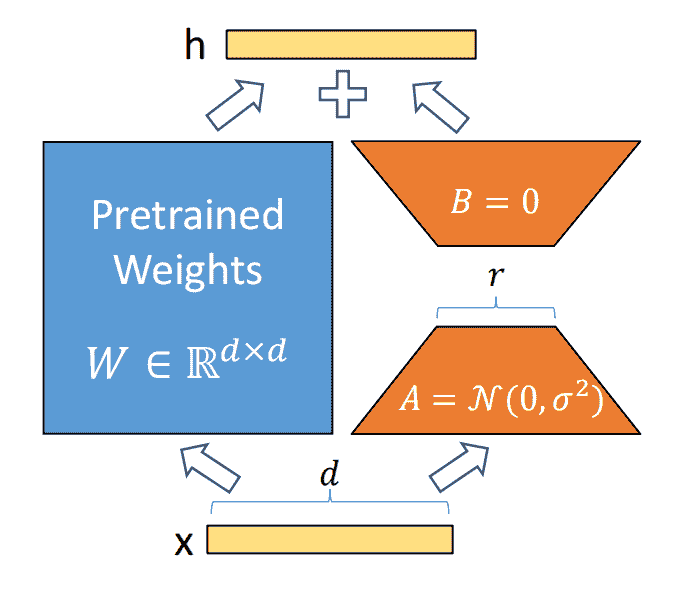

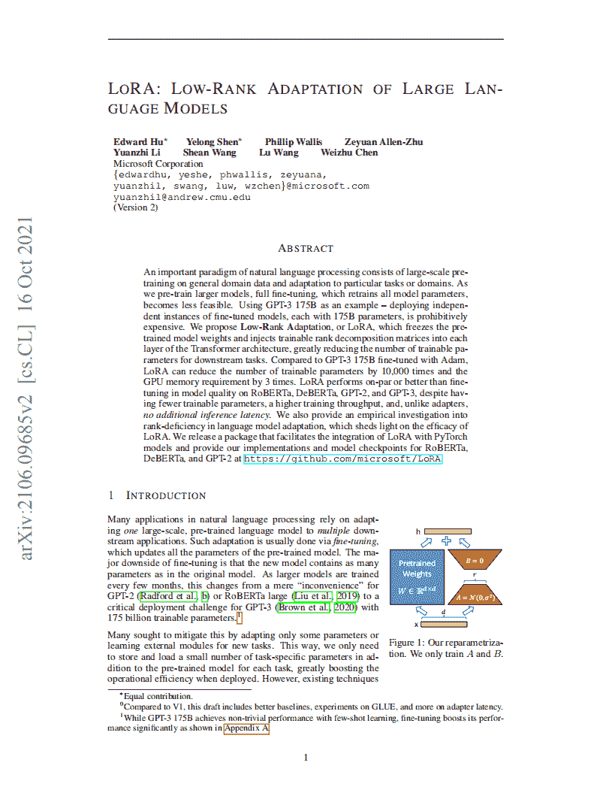

[LORA LOW-RANK ADAPTATION OF LARGE.pdf](https://internal-api-drive-stream.feishu.cn/space/api/box/stream/download/all/R4UxbZD5woBPZWxTHdlcG2kjnbe)

**Prefix-Tuning: **

**Prefix-Tuning 固定 PLM 的所有****参**数，只更新优化特定任务的 prefix。因此，在生产部署时，只需要存储一个大型 PLM 的副本和一个学习到的特定任务的 prefix, 每个下游任务只产生非常小的额外的计算和存储开销。

Full VS Emb-only

+   embedding-only表示只有在embedding层添加前缀token，而full 表示每一层都添加前缀token；

+   实验表明：**prefix-tuning****> ****embedding-only****> **discrete prompting

**Prifix VS Infix**

+   prefix-tuning表示可训练参数放在开头，infix-tuning表示可训练**token**放在中间位置

+   结果表明：**prefix-tuning****>****infix-tuning**

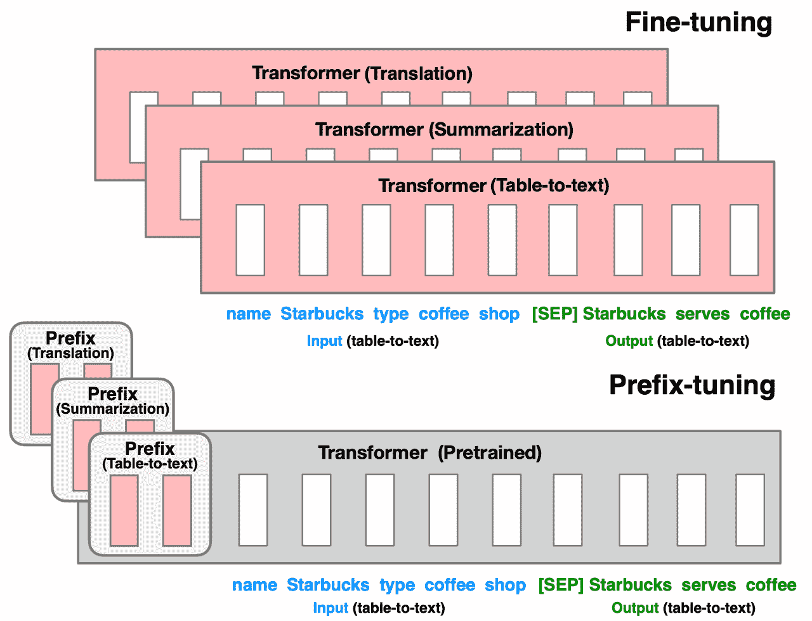

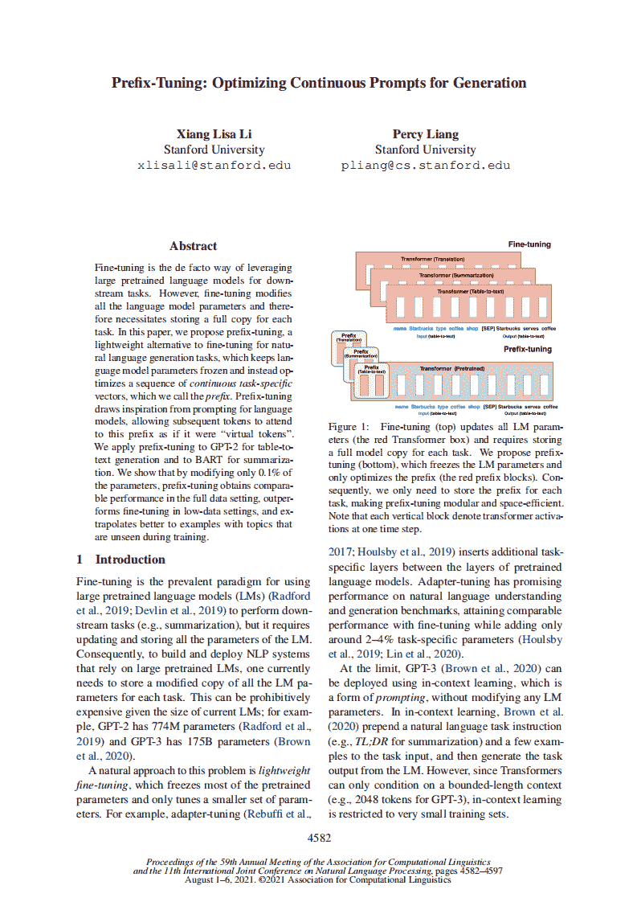

[Prefix-Tuning Optimizing Continuous Prompts for Generation.pdf](https://internal-api-drive-stream.feishu.cn/space/api/box/stream/download/all/SSubbvej0oUXn3xGaJxcOamqnyh)

# Prompt-Tuning

prompt-tuning可以认为是prefix-tuning的简化版。**固定整个预训练模型参数，只允许将每个下游任务的额外s****se 个可更新的 toke****ns (不****同于pref****ix-tuning, 这里的toke**ns是真实的文本) 前置到输入文本中，也没有使用额外的编码层或任务特定的输出层。

> **一**系列对比实验，都在说明：随着预训练模型参数的增加，一切的问题都不是问题，最简单的设置也能达到极好的效果。

+   **Prompt长度影响**：模型参数达到一定量级时，Prompt长度为1也能达到不错的效果，Prompt长度为20就能达到极好效果。

+   **Prompt初始化方式影响**：Random Uniform方式明显弱于其他两种，但是当模型参数达到一定量级，这种差异也不复存在。

+   **预训练的方式**：LM Adaptation的方式效果好，但是当模型达到一定规模，差异又几乎没有了。

+   **微调步数影响**：模型参数较小时，步数越多，效果越好。同样随着模型参数达到一定规模，zero shot也能取得不错效果。

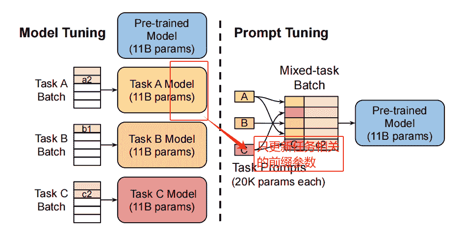

[The Power of Scale for Parameter-Efficient Prompt Tuning.pdf](https://internal-api-drive-stream.feishu.cn/space/api/box/stream/download/all/RkPmbZVs4oyXZtxp7STcw54Dn9d)

# P-tuning-**V1版本**

> **P-Tuning**的**方法思路与Prefix-Tuning很相近，P-Tuning利用少量连续的embedding参数作为prompt使GPT更**好的应用于NLU任务，而Prefix-Tuning是针对NLG任务设计；同时，P-Tuning只在embedding层增加参数(使用MLP+LSTM初始化),而Prefix-Tuning在每一层都添加可训练参数(使用MLP初始化)。

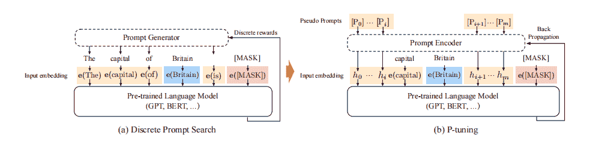

**P-Tuning**提出将Prompt转换为可以学习的Embedding层，只是考虑到直接对Embedding参数进行优化会存在这样两个挑战：

+   **Discretenes**:对输入正常语料的**Embedding**层已经经过预训练，而如果直接对输入的prompt embedding进行随机初始化训练，容易陷入局部最优。

+   **Association**:没法捕捉到prompt embeddi**ng之间的相关关**系。作者**提出使用ML**P+LSTM的方式对prompt进行初始化处理

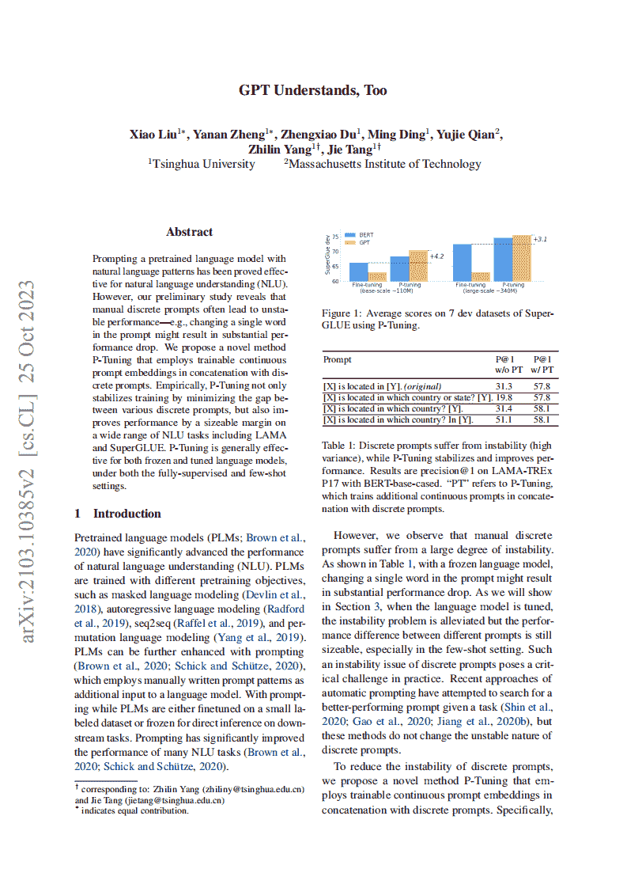

[GPT Understands, Too.pdf](https://internal-api-drive-stream.feishu.cn/space/api/box/stream/download/all/H2NQbknIUo36ooxrnc3cGTACntg)

# P-tuning-**V2版本**

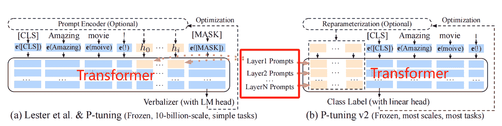

> **V2**的思路和**prefix-tuning**相似，**在模型的每一层都应用连续的 ****prompts ****并对**** prompts** 参数进行更新优化。同时该方法是**针对 NLU 任务优化和适配**的。

[P-Tuning v2 Prompt Tuning Can Be.pdf](https://internal-api-drive-stream.feishu.cn/space/api/box/stream/download/all/CwBLb3espoKBW4xgCr8czAxznQh)

# QLoRA

可以认为是**LoRA的升级版本**，体现在：

+   NormalFloat4 (NF4): 一种论文新提出的数据类型，对于正态分布权重而言信息理论上是最优的新数据类型；可以简单认为是 尽可能减少优化过程中数据精度损失的作用；

+   双重量化 (Double Quantization) : 通过量化常数来减少平均内存占用；

+   **分**页优化器 (Paged Optimizers) : 用于管理内存峰值。

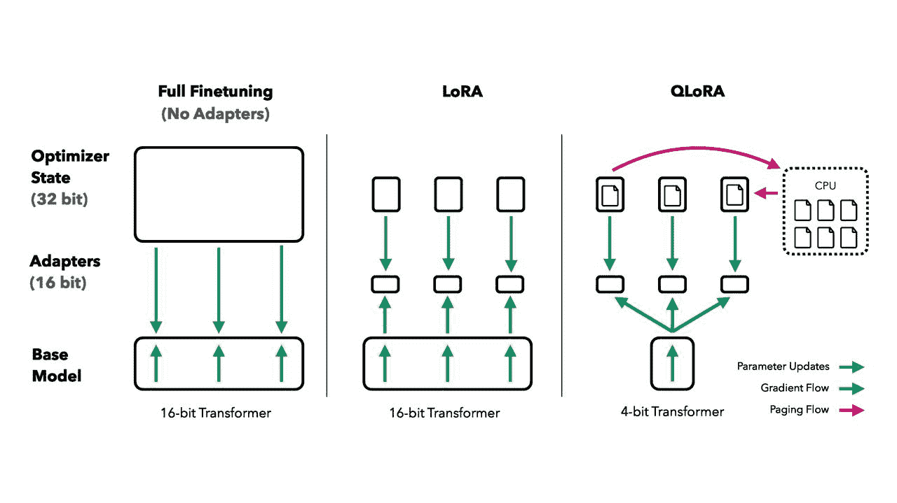

[QLORA Efficient Finetuning of Quantized LLMs.pdf](https://internal-api-drive-stream.feishu.cn/space/api/box/stream/download/all/EF1EbVRFBou6fpx6QWuchr0Jn3e)

# LLM高效微调技术

[Prefix-Tuning Optimizing Continuous Prompts for Generation.pdf](https://internal-api-drive-stream.feishu.cn/space/api/box/stream/download/all/P6NpbX1W4o6CX9xrlAfcXz83nkb)

[GPT Understands, Too.pdf](https://internal-api-drive-stream.feishu.cn/space/api/box/stream/download/all/WVAbbeRU3oqjnlxeHyBcH4RQn6d)

[LORA LOW-RANK ADAPTATION OF LARGE.pdf](https://internal-api-drive-stream.feishu.cn/space/api/box/stream/download/all/KWLfbIcfLoeGddxcshVchgIEn1c)

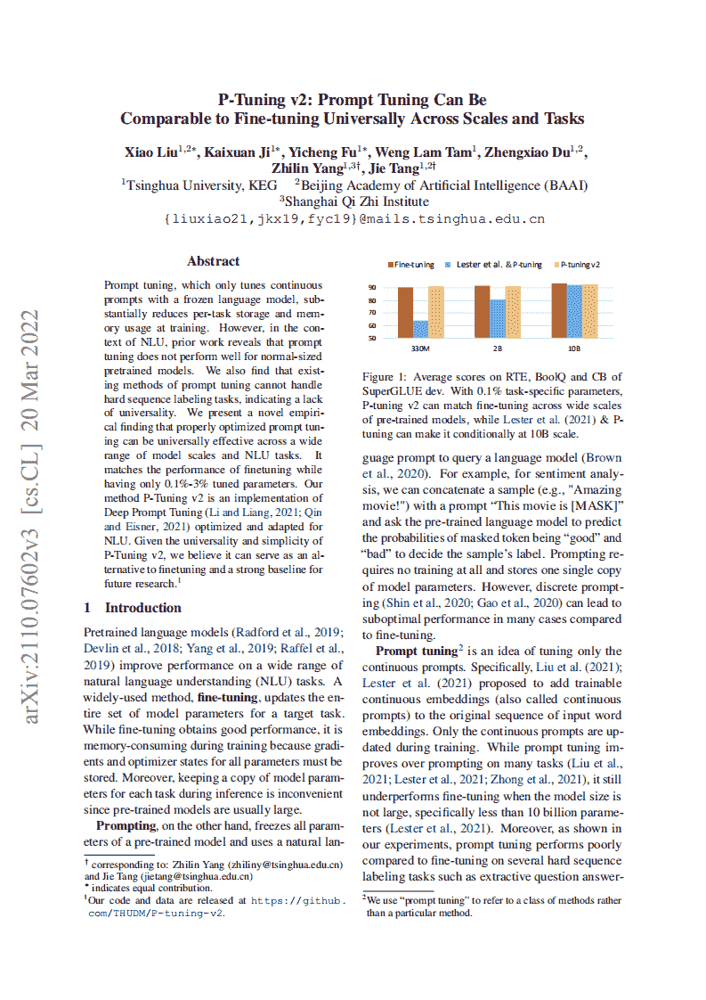

[P-Tuning v2 Prompt Tuning Can Be.pdf](https://internal-api-drive-stream.feishu.cn/space/api/box/stream/download/all/LjcMbqKR2oAQ80xXW7sc1jMUn7d)

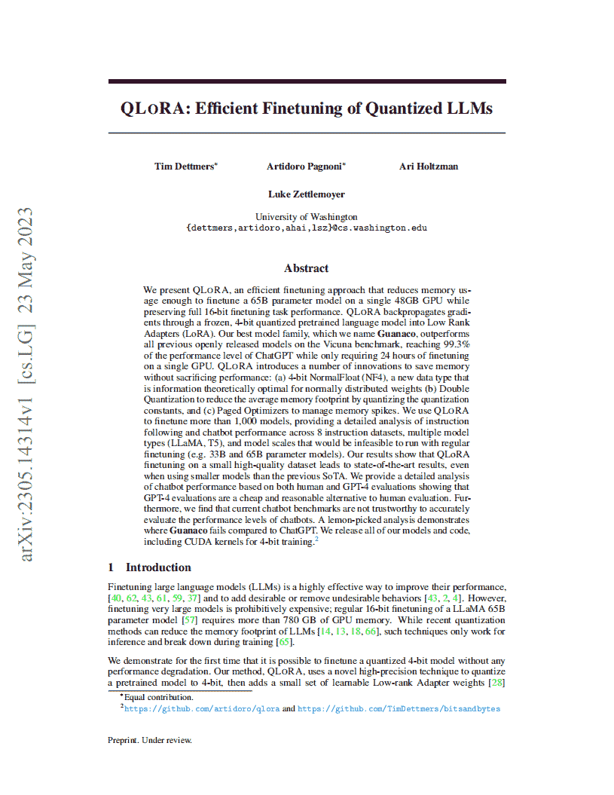

[QLORA Efficient Finetuning of Quantized LLMs.pdf](https://internal-api-drive-stream.feishu.cn/space/api/box/stream/download/all/Jh2dbTdr0oePYSxGq5iclgOVnge)

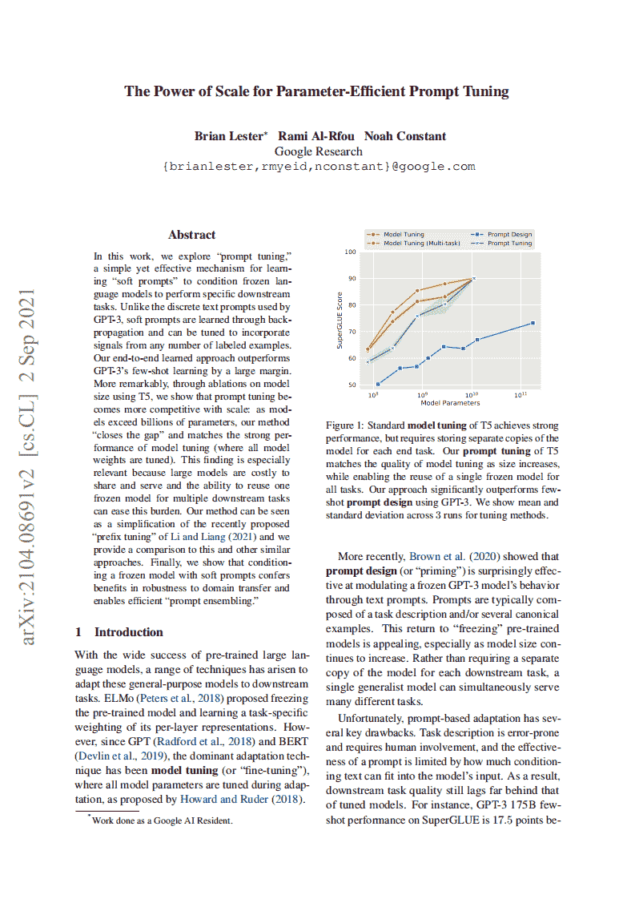

[The Power of Scale for Parameter-Efficient Prompt Tuning.pdf](https://internal-api-drive-stream.feishu.cn/space/api/box/stream/download/all/Qcb5bZkyconvZbxs8hGc4n5xn0Z)

<https://v11enp9ok1h.feishu.cn/sync/Ipw1d27gNsv3OAbo3N7cks4ZnJf>