# 从RNN起步，理解LSTM

> 来源：[https://v11enp9ok1h.feishu.cn/docx/K1Mod9hinolJ8exbSVocO4xEnIc](https://v11enp9ok1h.feishu.cn/docx/K1Mod9hinolJ8exbSVocO4xEnIc)

<https://v11enp9ok1h.feishu.cn/sync/PaIIdslbxsIJUIbkTfPcsMCFnph>

## 前言

提到LSTM，之前学过的同学可能最先想到的是ChristopherOlah的博文《理解LSTM网络》，这篇文章确实厉害，网上流传也相当之广，而且当你看过了网上很多关于LSTM的文章之后，你会发现这篇文章确实经典。不过呢，如果你是第一次看LSTM，则原文可能会给你带来不少障碍：

一者，一上来就干LSTM，不少读者可能还没理解好RNN。基于此，我们可以从最简单的单层网络开始学起；

二者，原文没有对LSTM的三个门解释的足够细致，包括三个不同的`sigmoid`函数用的同一个符号`σ`（有错么？没错，看多了就会明白这是习惯用法）；

三者，不同的权值也用的同一个符号`w`，而当把图、公式、关系一一对应清楚后，初学就不会一脸懵逼了。甚至我们把各个式子的计算过程用有方向的水流表示出来，则会好懂不少，这个时候就可以上动图

而我自己就是这么经历过来的，虽然学过了不少模型/算法，但此前对LSTM依然很多不懂，包括一开始反复看ChristopherOlah博文《理解LSTM网络》，好在和我司AI Lab陈博士反复讨论之后，终于通了！

侧面说明，当一个人冥思苦想想不通时，十之八九是因为看的资料不够通俗，如果还是不行，则问人，结果可能瞬间领悟，这便是教育的意义，也是我们做七月在线的巨大价值。

众所周知，我们已经把SVM、CNN、xgboost、LSTM等很多技术，写的/讲的国内最通俗易懂了，接下来，我们要把BERT等技术也写的/讲的国内最通俗易懂，成为入门标准，而且不单单是从NNLM Word2Vec Seq2Seq Seq2Seq with Attention Transformer Elmo GPT BERT，我们希望给所有AI初学者铺路：一步一个台阶，而不是出现理解断层。

## 一、RNN

### 1.1 从单层网络到经典的RNN结构

在学习LSTM之前，得先学习RNN，而在学习RNN之前，首先要了解一下最基本的单层网络，它的结构如下图所示：

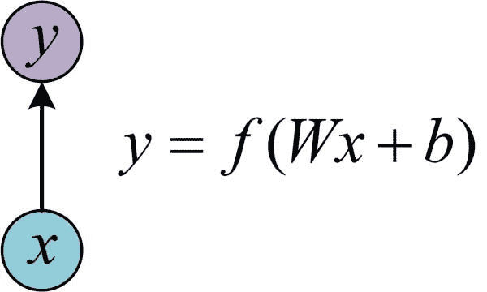

输入是`x`，经过变换`Wx+b`和激活函数`f`，得到输出`y`。相信大家对这个已经非常熟悉了。

在实际应用中，我们还会遇到很多序列形的数据：

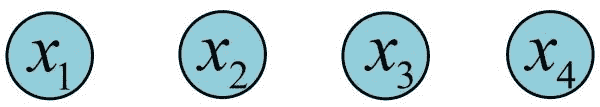

如：

自然语言处理问题。`x1`可以看做是第一个单词，`x2`可以看做是第二个单词，依次类推

语音处理。此时，`x1`、`x2`、`x3`……是每帧的声音信号。

时间序列问题。例如每天的股票价格等等

而其中，序列形的数据就不太好用原始的神经网络处理了。

为了建模序列问题，RNN引入了隐状态`h`（hidden state）的概念，隐状态`h`可以对序列形的数据提取特征，接着再转换为输出。

先从  的计算开始看：

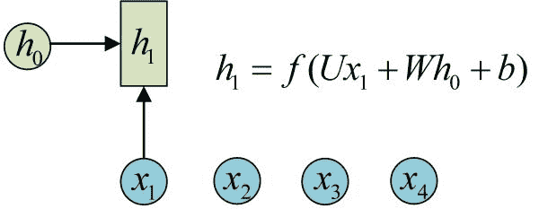

图示中记号的含义是：

+   a）圆圈或方块表示的是向量。

+   b）一个箭头就表示对该向量做一次变换。如上图中  和  分别有一个箭头连接，就表示对 和  各做了一次变换

July注(24年3月)：因在写[mamba笔记](https://blog.csdn.net/v_JULY_v/article/details/134923301)的过程中重新注意到了本文所写的RNN(mamba确实让RNN重新回到了历史舞台上)，故有一些细节特此补充如下

说白了， 基于上一个隐藏层的状态 和当前的输入 计算得来，且提前说一嘴，泛化到任一时刻，便是

而这里的`F`一般是`tanh`、`sigmoid`、`ReLU`等非线性的激活函数

且在实践中， 一般只包含前面若干步而非之前所有步的隐藏状态

的计算和  类似。但有两点需要注意下：

在计算时，每一步使用的参数`U`、`W`、`b`都是一样的，也就是说每个步骤的参数都是共享的，这是RNN的重要特点，一定要牢记；

而下文马上要看到的LSTM中的权值则不共享，因为它是在两个不同的向量中。而RNN的权值为何共享呢？很简单，因为RNN的权值是在同一个向量中，只是不同时刻而已

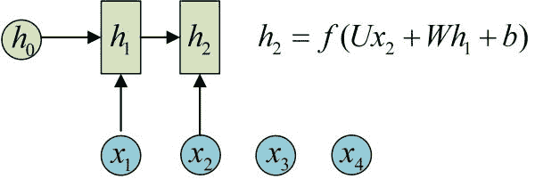

依次计算剩下来的（使用相同的参数`U`、`W`、`b`）：

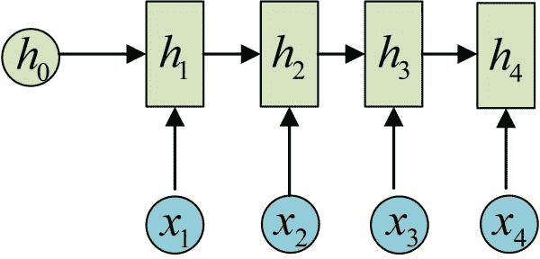

我们这里为了方便起见，只画出序列长度为4的情况，实际上，这个计算过程可以无限地持续下去。

我们目前的RNN还没有输出，得到输出值的方法就是直接通过`h`进行计算：

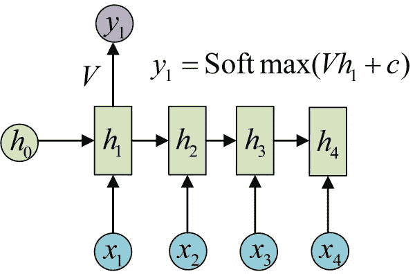

正如之前所说，一个箭头就表示对对应的向量做一次类似于`f(Wx+b)`的变换，这里的这个箭头就表示对`h1`进行一次变换，得到输出`y1`

剩下的输出类似进行（使用和`y1`同样的参数`V`和`c`）

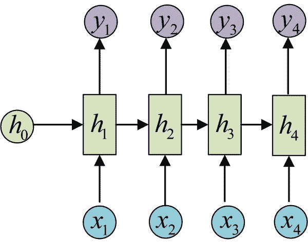

OK！大功告成！这就是最经典的RNN结构，是`x1`, `x2`, .....`xn`，输出为`y1`, `y2`, ...`yn`，也就是说，输入和输出序列必须要是等长的

### 1.2 RNN的应用

人类并不是每时每刻都从一片空白的大脑开始他们的思考。在你阅读这篇文章时候，你都是基于自己已经拥有的对先前所见词的理解来推断当前词的真实含义。我们不会将所有的东西都全部丢弃，然后用空白的大脑进行思考。我们的思想拥有持久性。

传统的神经网络并不能做到这点，看起来也像是一种巨大的弊端。例如，假设你希望对电影中的每个时间点的时间类型进行分类。传统的神经网络应该很难来处理这个问题：使用电影中先前的事件推断后续的事件。循环神经网络RNN解决了这个问题。

通过上文第一节我们已经知道，RNN是包含循环的网络，在这个循环的结构中，每个神经网络的模块，读取某个输入，并输出一个值（注：输出之前由`y`表示，从此处起，改为隐层输出`h`表示），然后不断循环。循环可以使得信息可以从当前步传递到下一步。

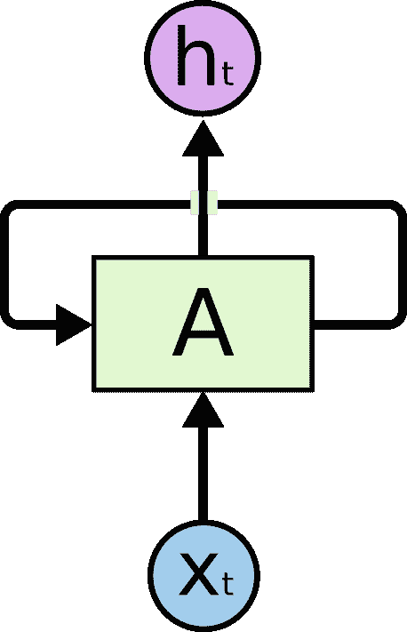

这些循环使得RNN看起来非常神秘。然而，如果你仔细想想，这样也不比一个正常的神经网络难于理解。RNN可以被看做是同一神经网络的多次复制，每个神经网络模块会把消息传递给下一个。所以，如果我们将这个循环展开：

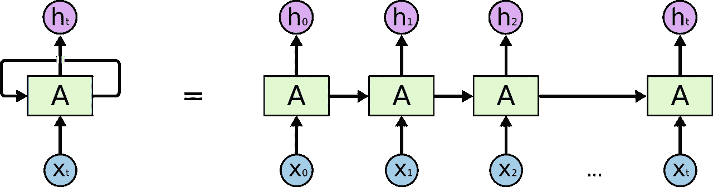

链式的特征揭示了RNN本质上是与序列和列表相关的，它们是对于这类数据的最自然的神经网络架构。

### 1.3 RNN的局限：长期依赖（Long-Term Dependencies）问题

RNN的关键点之一就是他们可以用来连接先前的信息到当前的任务上，例如使用过去的视频段来推测对当前段的理解。如果RNN可以做到这个，他们就变得非常有用。但是真的可以么？答案是，还有很多依赖因素。

有时候，我们仅仅需要知道先前的信息来执行当前的任务。例如，我们有一个语言模型用来基于先前的词来预测下一个词。如果我们试着预测这句话中“the clouds are in the sky”最后的这个词“sky”，我们并不再需要其他的信息，因为很显然下一个词应该是sky。在这样的场景中，相关的信息和预测的词位置之间的间隔是非常小的，RNN可以学会使用先前的信息。

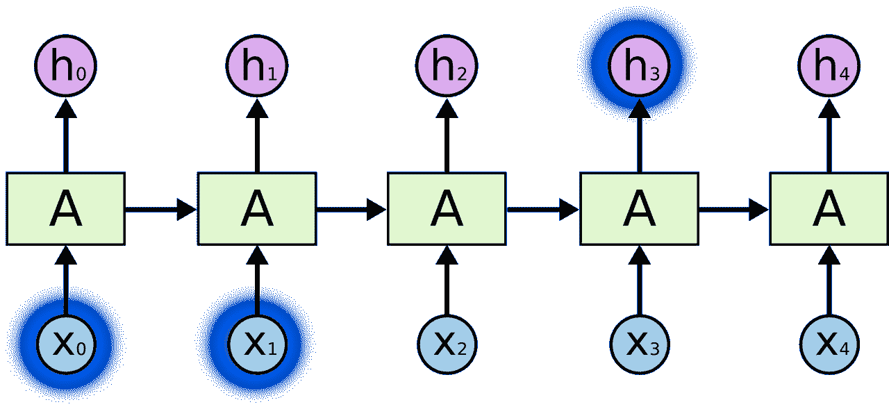

但是同样会有一些更加复杂的场景。比如我们试着去预测“I grew up in France...I speak fluent French”最后的词“French”。当前的信息建议下一个词可能是一种语言的名字，但是如果我们需要弄清楚是什么语言，我们是需要先前提到的离当前位置很远的“France”的上下文。这说明相关信息和当前预测位置之间的间隔就肯定变得相当的大。

不幸的是，在这个间隔不断增大时，RNN会丧失学习到连接如此远的信息的能力。

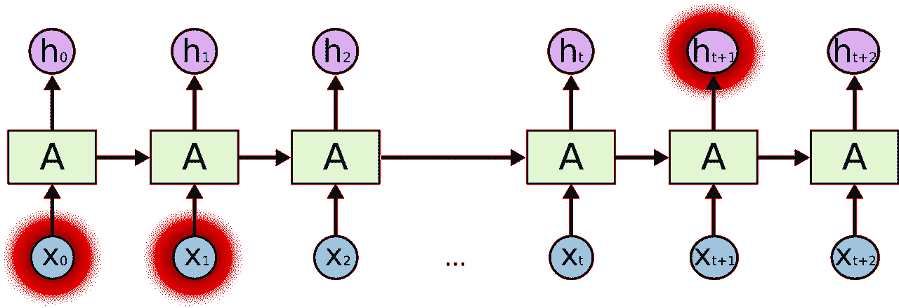

在理论上，RNN绝对可以处理这样的长期依赖问题。人们可以仔细挑选参数来解决这类问题中的最初级形式，但在实践中，RNN则没法太好的学习到这些知识。Bengio,etal.(1994)等人对该问题进行了深入的研究，他们发现一些使训练RNN变得非常困难的相当根本的原因。

换句话说， RNN 会受到短时记忆的影响。如果一条序列足够长，那它们将很难将信息从较早的时间步传送到后面的时间步。

因此，如果你正在尝试处理一段文本进行预测，RNN 可能从一开始就会遗漏重要信息。在反向传播期间（反向传播是一个很重要的核心议题，本质是通过不断缩小误差去更新权值，从而不断去修正拟合的函数），RNN 会面临梯度消失的问题。

因为梯度是用于更新神经网络的权重值（`新的权值 = 旧权值 - 学习率*梯度`），梯度会随着时间的推移不断下降减少，而当梯度值变得非常小时，就不会继续学习。

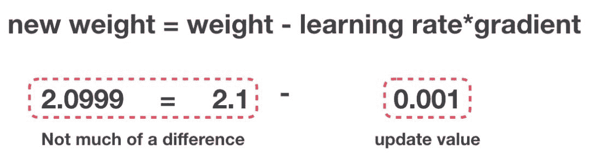

换言之，在递归神经网络中，获得小梯度更新的层会停止学习—— 那些通常是较早的层。 由于这些层不学习，RNN会忘记它在较长序列中以前看到的内容，因此RNN只具有短时记忆。

而梯度爆炸则是因为计算的难度越来越复杂导致。

然而，幸运的是，有个RNN的变体——LSTM，可以在一定程度上解决梯度消失和梯度爆炸这两个问题！

## 二、LSTM网络

Long ShortTerm 网络——一般就叫做LSTM——是一种RNN特殊的类型，可以学习长期依赖信息。当然，LSTM和基线RNN并没有特别大的结构不同，但是它们用了不同的函数来计算隐状态。

LSTM的“记忆”我们叫做细胞/`cells`，你可以直接把它们想做黑盒，这个黑盒的输入为前状态 和当前输入 。这些“细胞”会决定哪些之前的信息和状态需要保留/记住，而哪些要被抹去。实际的应用中发现，这种方式可以有效地保存很长时间之前的关联信息。

### 2.1 什么是LSTM网络

举个例子，当你想在网上购买生活用品时，一般都会查看一下此前已购买该商品用户的评价。

当你浏览评论时，你的大脑下意识地只会记住重要的关键词，比如“amazing”和“awsome”这样的词汇，而不太会关心“this”、“give”、“all”、“should”等字样。如果朋友第二天问你用户评价都说了什么，那你可能不会一字不漏地记住它，而是会说出但大脑里记得的主要观点，比如“下次肯定还会来买”，那其他一些无关紧要的内容自然会从记忆中逐渐消失。

而这基本上就像是 LSTM 或 GRU 所做的那样，它们可以学习只保留相关信息来进行预测，并忘记不相关的数据。简单说，因记忆能力有限，记住重要的，忘记无关紧要的。

LSTM由Hochreiter&Schmidhuber(1997)提出，并在近期被AlexGraves进行了改良和推广。在很多问题，LSTM都取得相当巨大的成功，并得到了广泛的使用。

LSTM通过刻意的设计来避免长期依赖问题。记住长期的信息在实践中是LSTM的默认行为，而非需要付出很大代价才能获得的能力！

所有RNN都具有一种重复神经网络模块的链式的形式。在标准的RNN中，这个重复的模块只有一个非常简单的结构，例如一个`tanh`层。

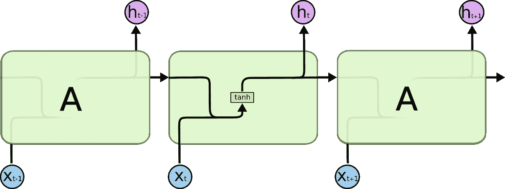

激活函数 `Tanh` 作用在于帮助调节流经网络的值，使得数值始终限制在 -1 和 1 之间。

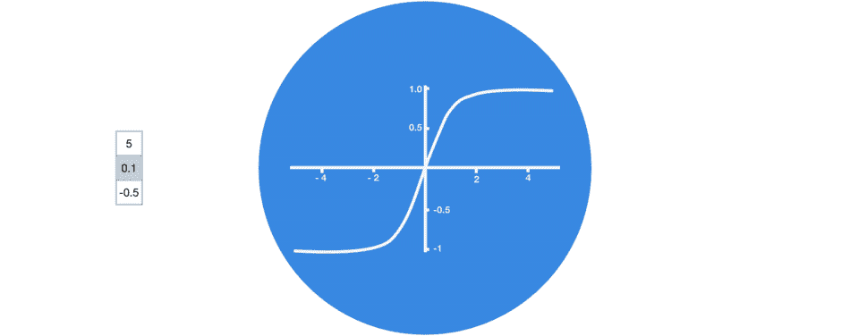

LSTM同样是这样的结构，但是重复的模块拥有一个不同的结构。具体来说，RNN是重复单一的神经网络层，LSTM中的重复模块则包含四个交互的层，三个`Sigmoid` 和一个`tanh`层，并以一种非常特殊的方式进行交互。

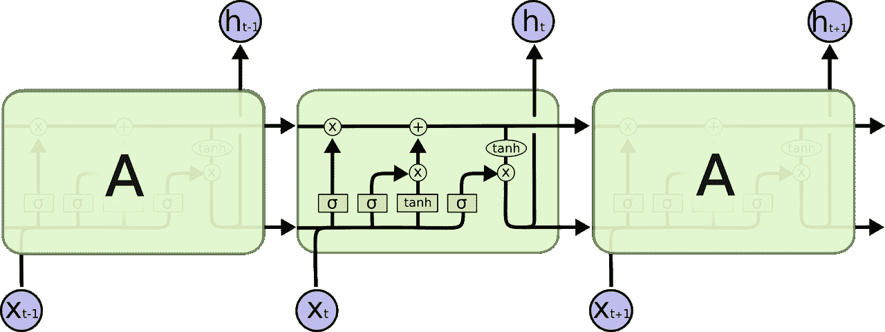

上图中，`σ`表示的`Sigmoid` 激活函数与 `tanh` 函数类似，不同之处在于 `sigmoid` 是把值压缩到0~1 之间而不是 -1~1 之间。这样的设置有助于更新或忘记信息：

因为任何数乘以 0 都得 0，这部分信息就会剔除掉；

同样的，任何数乘以 1 都得到它本身，这部分信息就会完美地保存下来

相当于要么是1则记住，要么是0则忘掉，所以还是这个原则：因记忆能力有限，记住重要的，忘记无关紧要的。

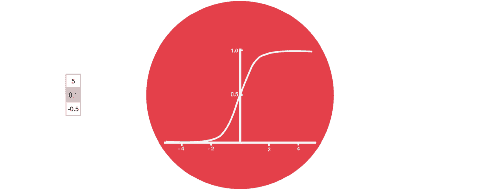

此外，对于图中使用的各种元素的图标中，每一条黑线传输着一整个向量，从一个节点的输出到其他节点的输入。粉色的圈代表pointwise的操作，诸如向量的和，而黄色的矩阵就是学习到的神经网络层。合在一起的线表示向量的连接，分开的线表示内容被复制，然后分发到不同的位置。

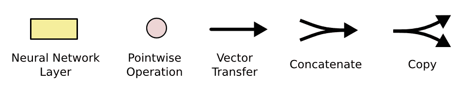

### 2.2 LSTM的核心思想

LSTM的关键就是细胞状态，水平线在图上方贯穿运行。

细胞状态类似于传送带。直接在整个链上运行，只有一些少量的线性交互。信息在上面流传保持不变会很容易。

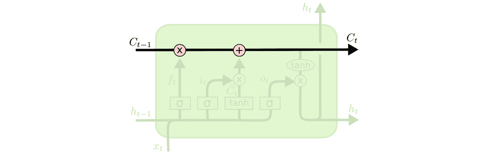

LSTM有通过精心设计的称作为“门”的结构来去除或者增加信息到细胞状态的能力。门是一种让信息选择式通过的方法。他们包含一个`sigmoid`神经网络层和一个pointwise乘法的非线性操作。

如此，0代表“不许任何量通过”，1就指“允许任意量通过”！从而使得网络就能了解哪些数据是需要遗忘，哪些数据是需要保存。

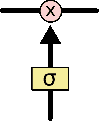

LSTM拥有三种类型的门结构：遗忘门/忘记门、输入门和输出门，来保护和控制细胞状态。下面，我们来介绍这三个门。

## 三、逐步理解LSTM

### 3.1 遗忘门

我们LSTM中的第一步是决定我们会从细胞状态中丢弃什么信息。这个决定通过一个称为“忘记门”的结构完成。该忘记门会读取上一个输出和当前输入，做一个`Sigmoid` 的非线性映射，然后输出一个向量（该向量每一个维度的值都在0到1之间，1表示完全保留，0表示完全舍弃，相当于记住了重要的，忘记了无关紧要的），最后与细胞状态相乘。

类比到语言模型的例子中，则是基于已经看到的预测下一个词。在这个问题中，细胞状态可能包含当前主语的性别，因此正确的代词可以被选择出来。当我们看到新的主语，我们希望忘记旧的主语，进而决定丢弃信息。

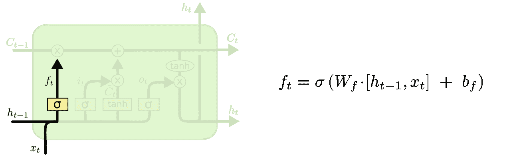

大部分初学的读者看到这，可能会有所懵逼，没关系，我们分以下两个步骤理解：

1. 对于上图右侧公式中的权值 ，准确的说其实是不共享，即是不一样的。有的同学可能第一反应是what？别急，我展开下你可能就瞬间清晰了，即：

1. 至于右侧公式和左侧的图是怎样的一个一一对应关系呢？如果是用有方向的水流表示计算过程则将一目了然，上动图！红圈表示`Sigmoid` 激活函数，篮圈表示`tanh` 函数：

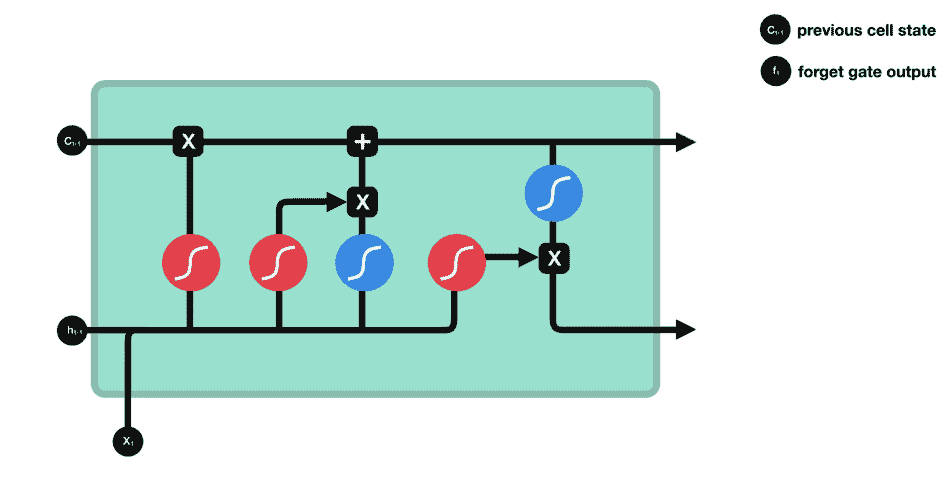

### 3.2 输入门

下一步是确定什么样的新信息被存放在细胞状态中。这里包含两个部分：

第一，`sigmoid`层称“输入门层”决定什么值我们将要更新；

第二，一个`tanh`层创建一个新的候选值向量 ，会被加入到状态中。

下一步，我们会讲这两个信息来产生对状态的更新。

在我们语言模型的例子中，我们希望增加新的主语的性别到细胞状态中，来替代旧的需要忘记的主语，进而确定更新的信息。

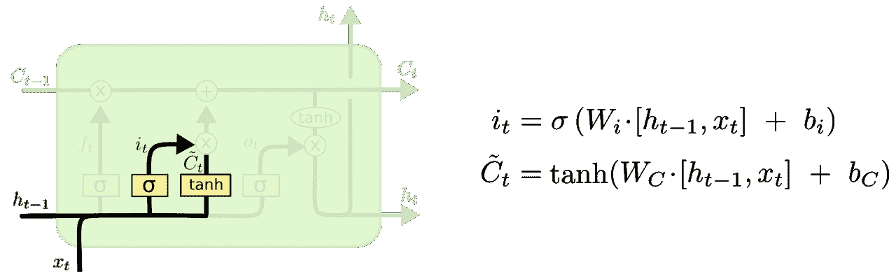

继续分两个步骤来理解：

首先，为便于理解图中右侧的两个公式，我们展开下计算过程，即

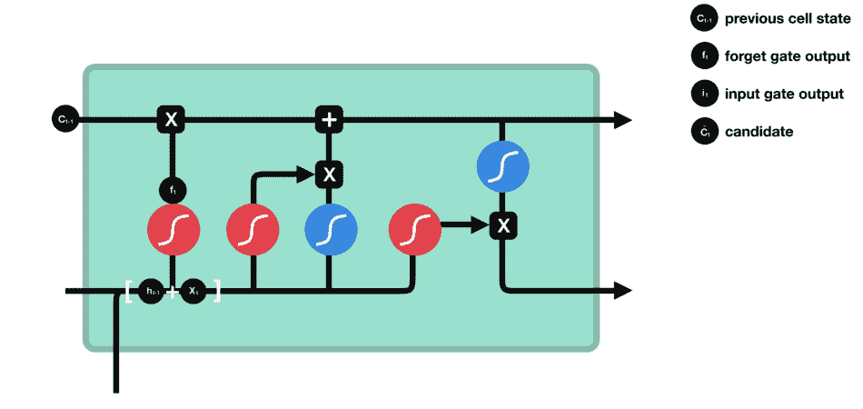

其次，上动图！

### 3.3 细胞状态

现在是更新旧细胞状态的时间了，更新为。前面的步骤已经决定了将会做什么，我们现在就是实际去完成。

我们把旧状态与相乘，丢弃掉我们确定需要丢弃的信息，接着加上。这就是新的候选值，根据我们决定更新每个状态的程度进行变化。

在语言模型的例子中，这就是我们实际根据前面确定的目标，丢弃旧代词的性别信息并添加新的信息的地方，类似更新细胞状态。

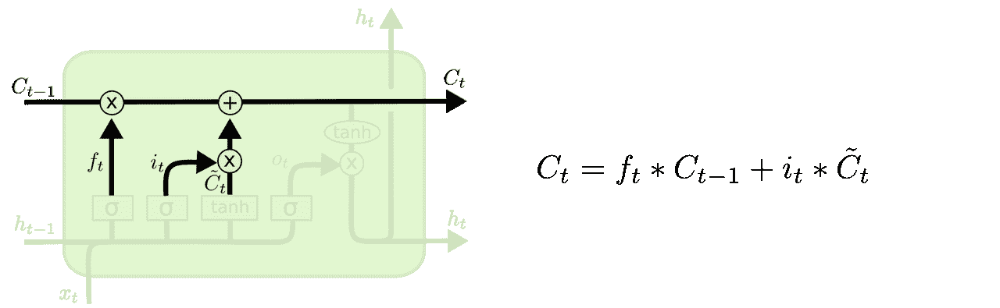

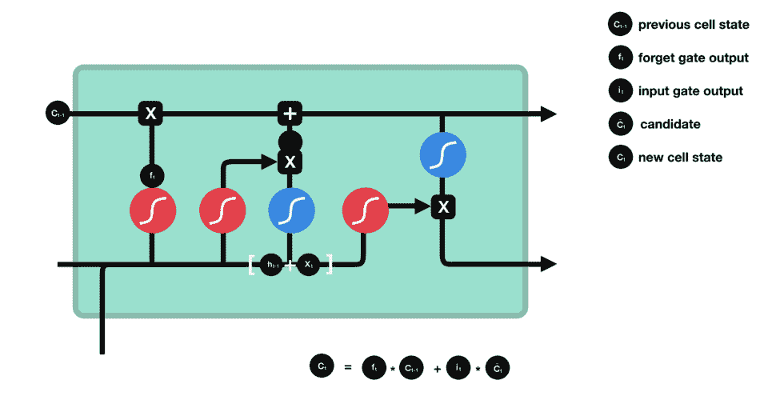

再次动图！

### 3.4 输出门

最终，我们需要确定输出什么值。这个输出将会基于我们的细胞状态，但是也是一个过滤后的版本。

首先，我们运行一个`sigmoid`层来确定细胞状态的哪个部分将输出出去。

接着，我们把细胞状态通过`tanh`进行处理（得到一个在-1到1之间的值）并将它和`sigmoid`门的输出相乘，最终我们仅仅会输出我们确定输出的那部分。

在语言模型的例子中，因为他就看到了一个代词，可能需要输出与一个动词相关的信息。例如，可能输出是否代词是单数还是负数，这样如果是动词的话，我们也知道动词需要进行的词形变化，进而输出信息。

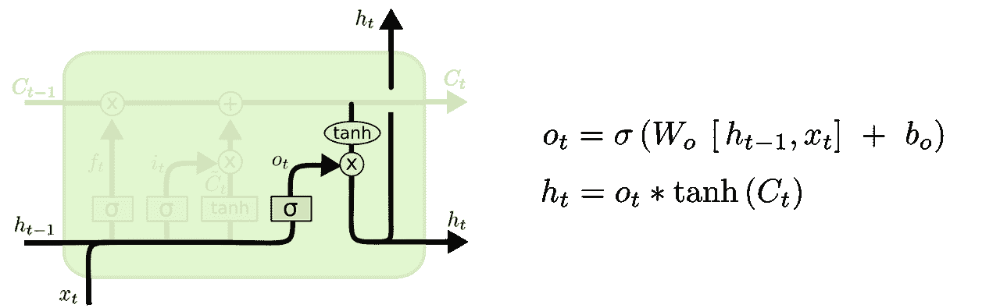

依然分两个步骤来理解：

展开图中右侧第一个公式，

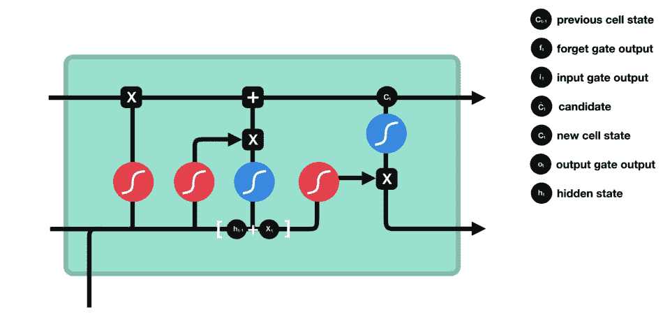

最后一个动图：

## 四、LSTM的变体

## LSTM 变体

我们目前为止都还在介绍正常的LSTM。但是不是所有的LSTM都长成一个样子的。实际上，几乎所有包含LSTM的论文都采用了微小的变体。差异非常小，但是也值得拿出来讲一下。

### 4.1 peephole连接与coupled

其中一个流形的LSTM变体，就是由Gers&Schmidhuber(2000)提出的，增加了“peepholeconnection”。是说，我们让门层也会接受细胞状态的输入。

peephole连接

上面的图例中，我们增加了peephole到每个门上，但是许多论文会加入部分的peephole而非所有都加。

另一个变体是通过使用coupled忘记和输入门。不同于之前是分开确定什么忘记和需要添加什么新的信息，这里是一同做出决定。我们仅仅会当我们将要输入在当前位置时忘记。我们仅仅输入新的值到那些我们已经忘记旧的信息的那些状态。

### 4.2 GRU

另一个改动较大的变体是`GatedRecurrentUnit`（`GRU`），这是由Cho,etal.(2014)提出。它将忘记门和输入门合成了一个单一的更新门。同样还混合了细胞状态和隐藏状态，和其他一些改动。最终的模型比标准的LSTM模型要简单，也是非常流行的变体。

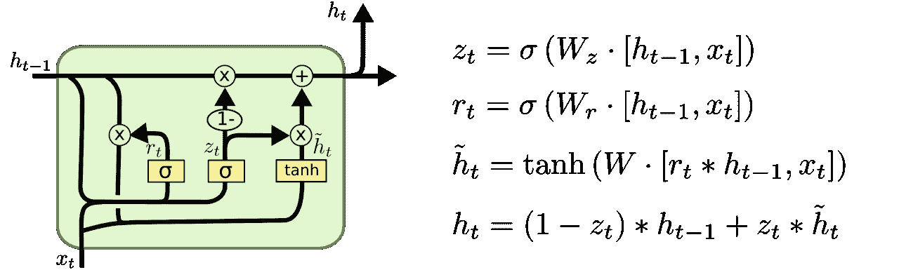

为了便于理解，我把上图右侧中的前三个公式展开一下

这里面有个小问题，眼尖的同学可能看到了，和都是对、做的`Sigmoid`非线性映射，那区别在哪呢？原因在于`GRU`把忘记门和输入门合二为一了，而是属于要记住的，反过来则是属于忘记的，相当于对输入、做了一些更改/变化，而则相当于先见之明的把输入、在/对其做更改/变化之前，先事先存一份原始的，最终在那做一个`tanh`变化。

这里只是部分流行的LSTM变体。当然还有很多其他的，如Yao,etal.(2015)提出的`DepthGatedRNN`。还有用一些完全不同的观点来解决长期依赖的问题，如Koutnik,etal.(2014)提出的`ClockworkRNN`。

要问哪个变体是最好的？其中的差异性真的重要吗？Greff,etal.(2015)给出了流行变体的比较，结论是他们基本上是一样的。Jozefowicz,etal.(2015)则在超过1万种RNN架构上进行了测试，发现一些架构在某些任务上也取得了比LSTM更好的结果。
