# 大模型的开发训练与推理部署

> 来源：[https://v11enp9ok1h.feishu.cn/docx/MsNMdzKTyovHGLxHQ3Vc3MqInXc](https://v11enp9ok1h.feishu.cn/docx/MsNMdzKTyovHGLxHQ3Vc3MqInXc)

## 大模型开发与训练

> 大模型的高性能训练旨在通过对模型计算、显存、内存和通信的系统级优化，在保证模型收敛性的前提下，提高训练吞吐量，实现在有限资源下大模型高效训练的目的。

系统级优化方法主要从两个方向实现：

> **一是**：设备内优化方法，包括降低浮点数的冗余表示的半精度浮点优化、混合精度浮点优化等方法、降低梯度计算过程中冗余表示的梯度检查点（`Checkpointing`）方法，以内存优化的 `ZeRO-Offload` 方法，即通过将数据和计算从 GPU 卸载到 CPU，以减少神经网络训练期间 GPU 内存占用的方法。

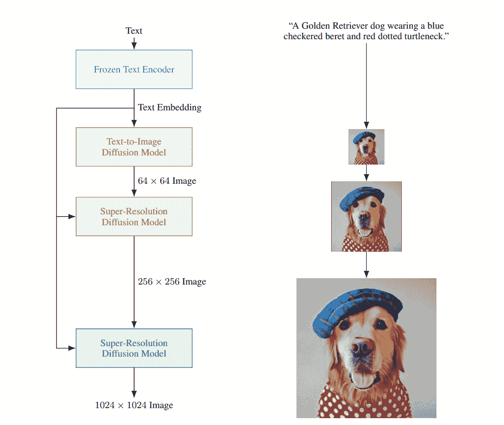

> **二是**：多设备优化方法，也称分布式优化，即将分布在不同计算节点上的多个 GPU 一起用于训练单个模型，这类方法主要有数据并行、张量并行、流水线并行、分组参数切片并行等多种并行加速策略，下面进行重点介绍。

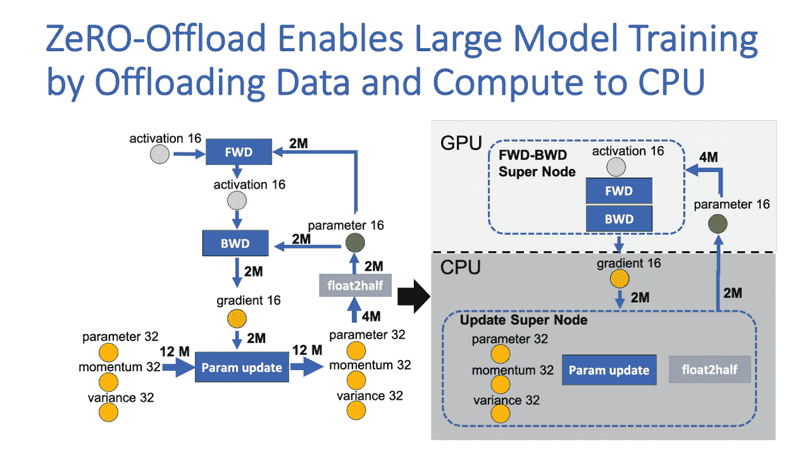

### 数据并行

> 数据并行是每个处理器存储全量的模型参数、梯度和优化器状态，但读取不同的输入数据，在反向计算出参数梯度后，对参数梯度做 `AllReduce` 聚合，然后每个处理器独立进行参数更新。数据并行的优点是实现和使用方式简单，可以通过增加数据并行路数提高训练吞吐，是目前最为常用的分布式并行策略之一。

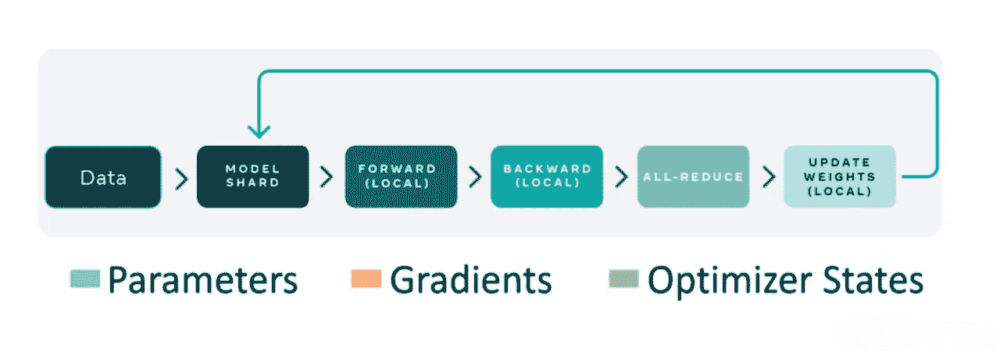

### 张量并行

> 张量并行是将神经网络中同一层的张量运算拆分成多个独立的子运算，并相应地对模型参数做切分，由不同的处理器分别执行，生成的中间结果通过分布式通信进行组合。张量并行的优点是可以充分利用多核处理器的计算能力，减少了内存访问的延迟，但需要设计高效的并行算法和通信机制来确保计算的正确性和高效性，避免通信延迟和带宽瓶颈。

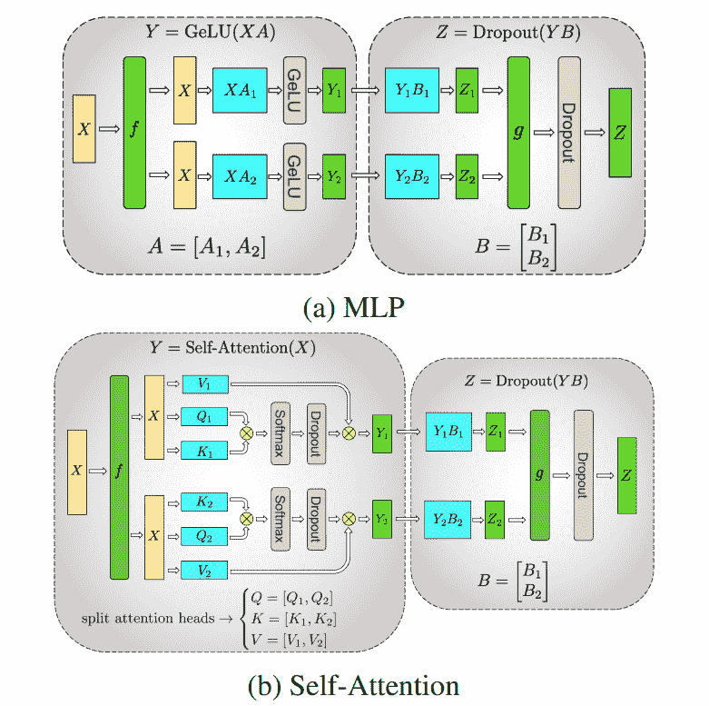

### 流水线并行

> 这种并行策略是将神经网络中的不同层交由不同处理器执行，上下游执行器之间的数据依赖点对点通信传输。基于此技术的高效流水线并行调度策略，支持 `1F1B`、`Interleaving 1F1B` 等高效调度算法，并通过“通信-计算”重叠的方式隐藏通信时间，提高整体训练效率。

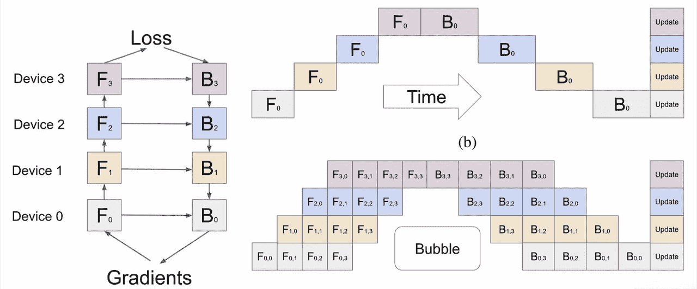

### 分组参数切片并行

> 这种并行策略是一种特殊的数据并行方式，它可以将优化器状态、参数梯度和模型参数切分到不同的处理器上，达到节省大模型显存的目的。分组参数并行的优点是可以有效降低模型显存占用，通过增加数据并行路数提高整体训练吞吐。基于此技术的“组内参数切片+组间数据”并行，可以更合理地分配机内和机间的通信带宽，进一步提升了训练性能。

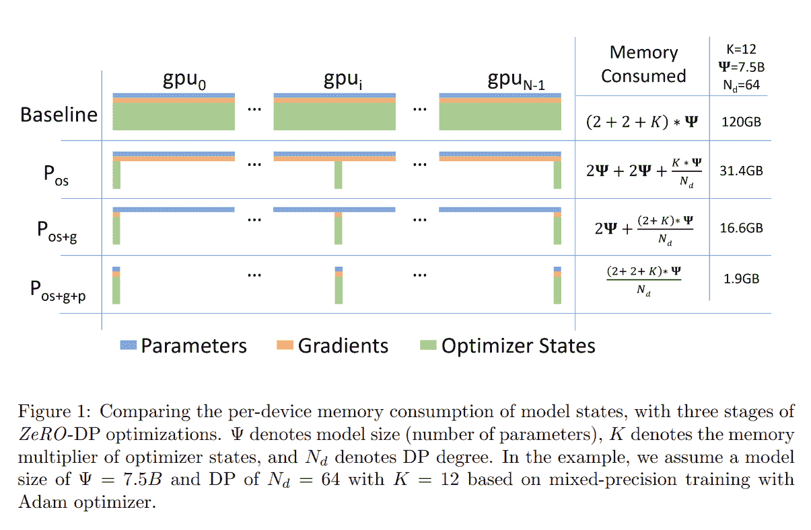

+ 基于上述基础并行策略，不同深度学习框架的实现方法不同，有的是基于 `PyTorch` 进行进一步封装形成单独的工具，如微软的 `DeepSpeed-Megatron`、NVIDIA 的 `Megatron-LM`、清华大学的 `BMTrain` 等；飞桨 `PaddePaddle` 框架支持四维混合并行技术，可将基础的并行策略组合使用。

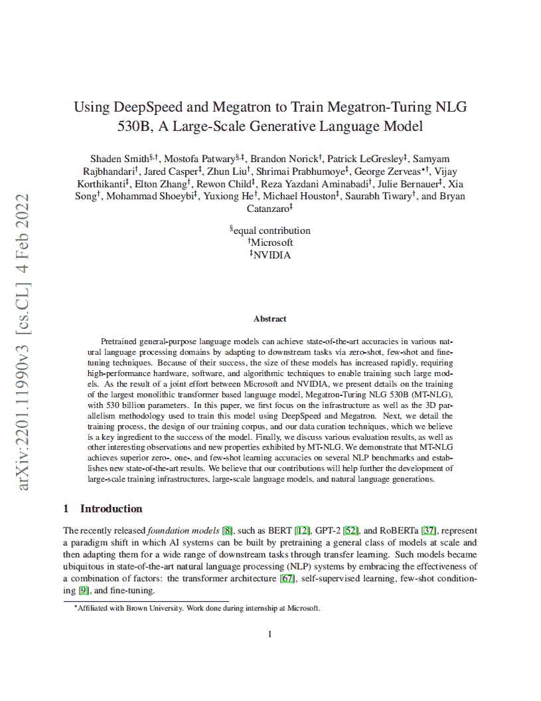

[微软的`DeepSpeed-Megatron`.pdf](https://internal-api-drive-stream.feishu.cn/space/api/box/stream/download/all/Hc82bpmaHosD1lxAizFch6jOnOh)

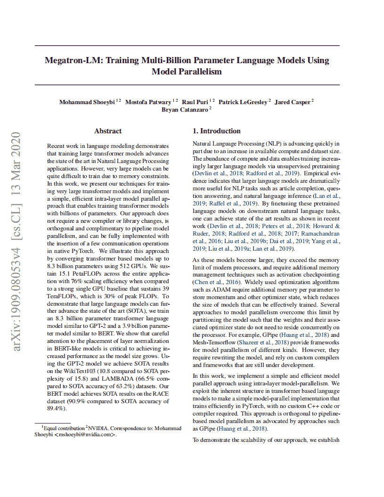

[NVIDIA 的`Megatron-LM`.pdf](https://internal-api-drive-stream.feishu.cn/space/api/box/stream/download/all/UNSUbL4byoC13xxKhI7cJc1Ynnz)

+ 在多维混合并行训练策略的基础上，为了应对模型多样性和训练硬件资源异构性，进一步发展出了端到端自适应分布式训练架构。

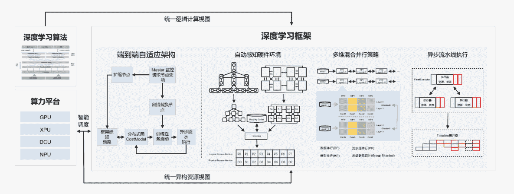

> 该架构可以针对不同的深度学习算法抽象成统一的计算视图，自动感知硬件环境并抽象成统一的异构资源视图；采用了代价模型对两者进行联合建模；将模型参数、梯度和优化器状态按照最优策略分配到不同的设备上，构建流水线进行异步高效执行。对于同地域或跨地域多种异构硬件，可以实现节省存储、负载均衡、提升训练性能的目的。此外，针对大模型训练资源不稳定的问题，设计了弹性资源调度管理机制。当资源发生变化时，能够自动的感知硬件环境并修正资源视图，重新触发模型切分放置策略选择及异步流水线执行，使得硬件故障下任务恢复可从小时级降至秒级。

## 大模型推理部署

+ 大模型推理往往面临显存占用过多、计算规模庞大、输入输出变长等挑战，这些也是大模型应用落地要重点解决的问题。

> 在充分考虑大模型结构特性基础上，可以从模型压缩、推理引擎、服务部署三个关键环节，开展全方位的协同优化，在降低时延提升用户体验的同时，最大化提升服务吞吐，做到低时延、高吞吐。

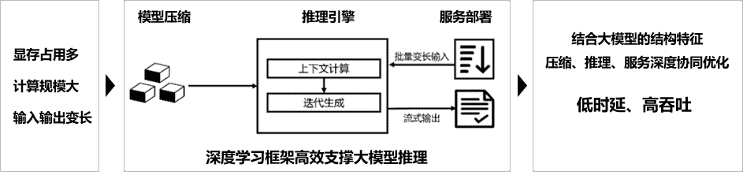

大模型的推理可以采用深度学习框架直接实现，通过框架和模型协同优化，可以显著提升大模型的推理效率；也可以采用专门的工具，如：`FasterTransformer`、`TensorRT-LLM`、`vLLM`、`Text Genertion Inference`、`HuggingFace TG` 等实现，这些工具已经针对大模型推理进行了优化，能够高效地完成推理任务。

### 大模型压缩

> 在大模型压缩方面，常规的模型压缩方法有模型稀疏化、权重矩阵分解、模型参数共享、蒸馏和量化。

+ 模型稀疏化：这种方法通过将模型中的某些神经元、连接或层置为零，从而达到压缩模型、加速训练、减少内存消耗等目的。

+ 权重矩阵分解：使用包括奇异值分解（`SVD`）等矩阵分解方法对预训练模型的 `Feed-Forward Network`（`FFN`）层的权重矩阵进行分解，从而减少 `Attention` 层的参数量，提高模型的效率。

+ 模型参数共享：部分大型模型如 `ALBERT`[152] 采用了权重共享的方式，特定层之间共享参数，从而减少了模型的参数量。

+ 蒸馏：通过使用学生模型来模拟预训练教师模型的行为来减小模型大小的技术。通常情况下，学生模型由更小的神经网络或线性模型组成。蒸馏的过程是将教师模型的知识转移到学生模型，使学生模型在保持较小规模的同时，能够保持类似于教师模型的预测能力。利用蒸馏技术可以将大模型的知识和泛化能力迁移到小型网络，以支持轻量化的大模型部署。

+ 量化：量化是一种将预训练模型中的权重从浮点数转换为低位数的技术。通常情况下，量化的精度可被降低到 8 位或更低。量化可以大大减少模型的存储空间和计算量，但可能会对模型的性能产生一定的影响。

### 大模型推理框架概述

> 从 `ChatGPT` 面世以来，引领了大模型时代的变革，除了大模型遍地开花以外，承载大模型进行推理的框架也是层出不穷，大有百家争鸣的态势。

#### vLLM

+ GitHub: [github.com/vllm-project/vllm](https://link.juejin.cn/?target=https%3A%2F%2Fgithub.com%2Fvllm-project%2Fvllm)

##### 简介

##### 主要特性

+ 通过 `PagedAttention` 对 `KV Cache` 的有效管理
+ 传入请求的 `continus batching`，而不是 `static batching`
+ 支持张量并行推理
+ 支持流式输出
+ 兼容 `OpenAI` 的接口服务
+ 与 `HuggingFace` 模型无缝集成

##### 与其他框架（`HF`、`TGI`）的性能对比

`vLLM` 的吞吐量比 `HF` 高 14 - 24 倍，比 `TGI` 高 2.2 - 2.5 倍。

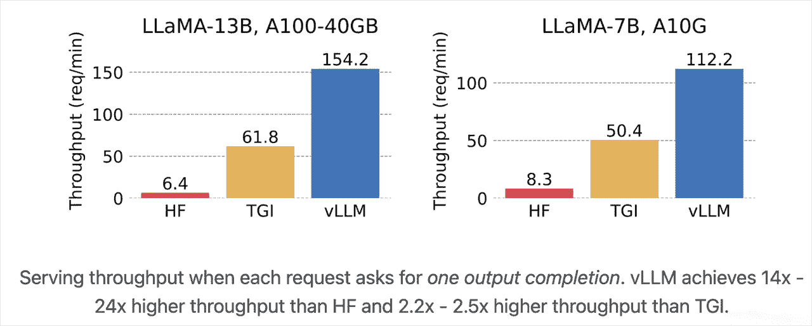

##### 存在的问题

+ 同样的模型、参数和 `prompt` 条件下，`vLLM` 推理和 `Huggingface` 推理结果不一致。具体请参考：

##### 业界案例

+ `vLLM` 已经被用于 `Chatbot Arena` 和 `Vicuna` 大模型的服务后端。

#### HuggingFace TGI

+ GitHub: [github.com/huggingface/text-generation-inference](https://link.juejin.cn/?target=https%3A%2F%2Fgithub.com%2Fhuggingface%2Ftext-generation-inference)

##### 简介

`Text Generation Inference`（`TGI`）是 `HuggingFace` 推出的一个项目，作为支持 `HuggingFace Inference API` 和 `Hugging Chat` 上的 `LLM` 推理的工具，旨在支持大型语言模型的优化推理。

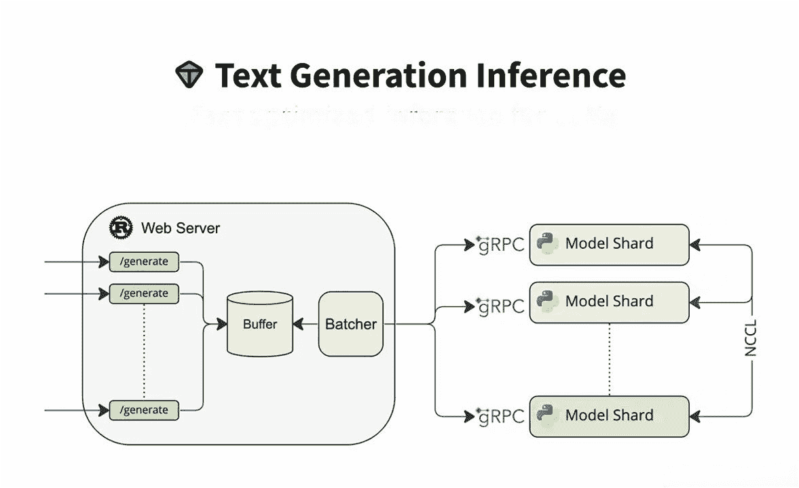

##### 主要特性

+ 支持张量并行推理
+ 支持传入请求 `Continuous batching` 以提高总吞吐量
+ 使用 `flash-attention` 和 `Paged Attention` 在主流的模型架构上优化用于推理的 `transformers` 代码。注意：并非所有模型都内置了对这些优化的支持。
+ 使用 `bitsandbytes`(`LLM.int8()`) 和 `GPT-Q` 进行量化
+ 内置服务评估，可以监控服务器负载并深入了解其性能
+ 轻松运行自己的模型或使用任何 `HuggingFace` 仓库的模型
+ 自定义提示生成：通过提供自定义提示来指导模型的输出，轻松生成文本
+ 使用 `Open Telemetry`、`Prometheus` 指标进行分布式跟踪

##### 支持的模型

+ [`BLOOM`](https://link.juejin.cn/?target=https%3A%2F%2Fhuggingface.co%2Fbigscience%2Fbloom)
+ [`FLAN-T5`](https://link.juejin.cn/?target=https%3A%2F%2Fhuggingface.co%2Fgoogle%2Fflan-t5-xxl)
+ [`Galactica`](https://link.juejin.cn/?target=https%3A%2F%2Fhuggingface.co%2Ffacebook%2Fgalactica-120b)
+ [`GPT-Neox`](https://link.juejin.cn/?target=https%3A%2F%2Fhuggingface.co%2FEleutherAI%2Fgpt-neox-20b)
+ [`Llama`](https://link.juejin.cn/?target=https%3A%2F%2Fgithub.com%2Ffacebookresearch%2Fllama)
+ [`OPT`](https://link.juejin.cn/?target=https%3A%2F%2Fhuggingface.co%2Ffacebook%2Fopt-66b)
+ [`SantaCoder`](https://link.juejin.cn/?target=https%3A%2F%2Fhuggingface.co%2Fbigcode%2Fsantacoder)
+ [`Starcoder`](https://link.juejin.cn/?target=https%3A%2F%2Fhuggingface.co%2Fbigcode%2Fstarcoder)
+ [`Falcon 40B`](https://link.juejin.cn/?target=https%3A%2F%2Fhuggingface.co%2Ftiiuae%2Ffalcon-40b)
+ [`MPT`](https://link.juejin.cn/?target=https%3A%2F%2Fhuggingface.co%2Fmosaicml%2Fmpt-30b)
+ [`Llama V2`](https://link.juejin.cn/?target=https%3A%2F%2Fhuggingface.co%2Fmeta-llama)
+ [`Falcon 7B`](https://link.juejin.cn/?target=https%3A%2F%2Fhuggingface.co%2Ftiiuae%2Ffalcon-7b)

##### 适用场景

依赖 `HuggingFace` 模型，并且不需要为核心模型增加多个 `adapter` 的场景。

#### FasterTransformer

+ GitHub: [github.com/NVIDIA/FasterTransformer](https://link.juejin.cn/?target=https%3A%2F%2Fgithub.com%2FNVIDIA%2FFasterTransformer)

##### 简介

```
NVIDIA FasterTransformer (FT) 是一个用于实现基于Transformer的神经网络推理的加速引擎。它包含Transformer块的高度优化版本的实现，其中包含编码器和解码器部分。使用此模块，您可以运行编码器-解码器架构模型（如：T5）、仅编码器架构模型（如：BERT）和仅解码器架构模型（如： GPT）的推理。
FT框架是用C++/CUDA编写的，依赖于高度优化的 cuBLAS、cuBLASLt 和 cuSPARSELt 库，这使您可以在 GPU 上进行快速的 Transformer 推理。
与 NVIDIA TensorRT 等其他编译器相比，FT 的最大特点是它支持以分布式方式进行 Transformer 大模型推理。
下图显示了如何使用张量并行 (TP) 和流水线并行 (PP) 技术将基于Transformer架构的神经网络拆分到多个 GPU 和节点上。
```

+ 当每个张量被分成多个块时，就会发生张量并行，并且张量的每个块都可以放置在单独的 GPU 上。在计算过程中，每个块在不同的 GPU 上单独并行处理；最后，可以通过组合来自多个 GPU 的结果来计算最终张量。

+ 当模型被深度拆分，并将不同的完整层放置到不同的 GPU/节点上时，就会发生流水线并行。

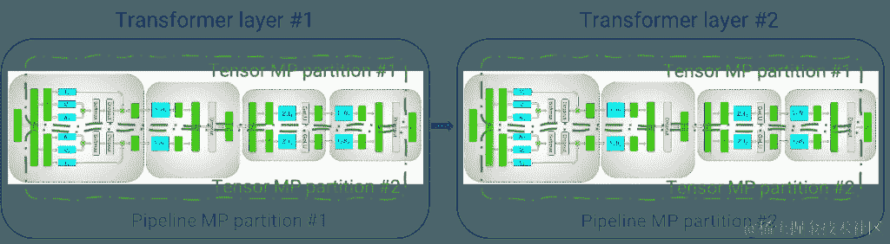

+ 在底层，节点间或节点内通信依赖于 `MPI`、`NVIDIA NCCL`、`Gloo` 等。因此，使用 `FasterTransformer`，您可以在多个 GPU 上以张量并行运行大型 `Transformer`，以减少计算延迟。同时，`TP` 和 `PP` 可以结合在一起，在多 GPU 节点环境中运行具有数十亿、数万亿个参数的大型 `Transformer` 模型。

+ 除了使用 `C++` 作为后端部署，`FasterTransformer` 还集成了 `TensorFlow`（使用 `TensorFlow op`）、`PyTorch`（使用 `PyTorch op`）和 `Triton` 作为后端框架进行部署。当前，`TensorFlow op` 仅支持单 GPU，而 `PyTorch op` 和 `Triton` 后端都支持多 GPU 和多节点。

##### FasterTransformer 中的优化技术

```
与深度学习训练的通用框架相比，FT 使您能够获得更快的推理流水线以及基于 Transformer 的神经网络具有更低的延迟和更高的吞吐量。 FT 对 GPT-3 和其他大型 Transformer 模型进行的一些优化技术包括：
```

1. 层融合（`Layer fusion`）

这是预处理阶段的一组技术，将多层神经网络组合成一个单一的神经网络，将使用一个单一的核（`kernel`）进行计算。 这种技术减少了数据传输并增加了数学密度，从而加速了推理阶段的计算。 例如，`multi-head attention` 块中的所有操作都可以合并到一个核（`kernel`）中。

1. 自回归模型的推理优化(激活缓存)

为了防止通过 `Transformer` 重新计算每个新 `token` 生成器的先前的 `key` 和 `value`，`FT` 分配了一个缓冲区来在每一步存储它们。虽然需要一些额外的内存使用，但 `FT` 可以节省重新计算的成本。该过程如下图所示，相同的缓存机制用于 `NN` 的多个部分。

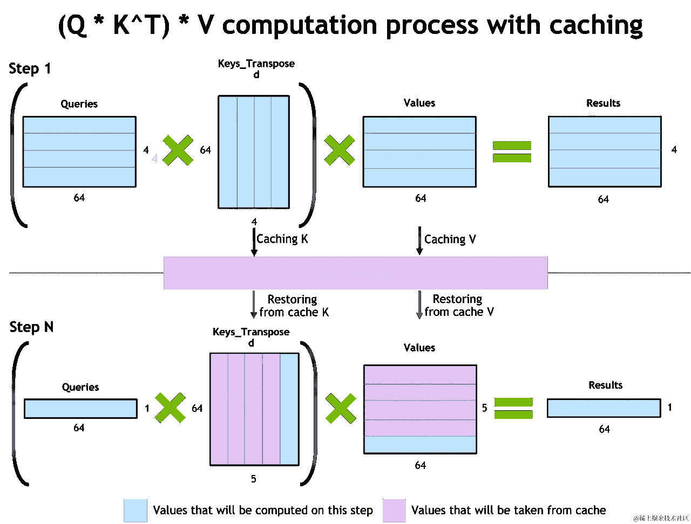

1. 内存优化


# FasterTransformer

与 BERT 等传统模型不同，大型 Transformer 模型具有多达数万亿个参数，占用数百 GB 存储空间。即使我们以半精度存储模型，GPT-3 175b 也需要 350 GB。因此有必要减少其他部分的内存使用。例如，在 FasterTransformer 中，我们在不同的解码器层重用了激活/输出的内存缓冲（`buffer`）。由于 GPT-3 中的层数为 96，因此我们只需要 1/96 的内存量用于激活。

## 使用 MPI 和 NCCL 实现节点间/节点内通信并支持模型并行

FasterTransformer 同时提供张量并行和流水线并行。 对于张量并行，FasterTransformer 遵循了 Megatron 的思想。 对于自注意力块和前馈网络块，FT 按行拆分第一个矩阵的权重，并按列拆分第二个矩阵的权重。 通过优化，FT 可以将每个 Transformer 块的归约（`reduction`）操作减少到两次。

对于流水线并行，FasterTransformer 将整批请求拆分为多个微批，隐藏了通信的空泡（`bubble`）。 FasterTransformer 会针对不同情况自动调整微批量大小。

## `MatMul` 核自动调整（GEMM 自动调整）

矩阵乘法是基于 Transformer 的神经网络中最主要和繁重的操作。 FT 使用来自 CuBLAS 和 CuTLASS 库的功能来执行这些类型的操作。 重要的是要知道 `MatMul` 操作可以在“硬件”级别使用不同的底层（low-level）算法以数十种不同的方式执行。

[`GemmBatchedEx`](https://link.juejin.cn?target=https%3A%2F%2Fdocs.nvidia.com%2Fcuda%2Fcublas%2Findex.html%23cublas-GemmBatchedEx) 函数实现了 `MatMul` 操作，并以`cublasGemmAlgo_t`作为输入参数。 使用此参数，您可以选择不同的底层算法进行操作。

FasterTransformer 库使用此参数对所有底层算法进行实时基准测试，并为模型的参数和您的输入数据（注意层的大小、注意头的数量、隐藏层的大小）选择最佳的一个。 此外，FT 对网络的某些部分使用硬件加速的底层函数，例如： `__expf`、`__shfl_xor_sync`。

## 低精度推理

FT 的核（`kernels`）支持使用 `fp16` 和 `int8` 等低精度输入数据进行推理。 由于较少的数据传输量和所需的内存，这两种机制都会加速。 同时，`int8` 和 `fp16` 计算可以在特殊硬件上执行，例如：Tensor Core（适用于从 Volta 开始的所有 GPU 架构）。

除此之外还有快速的 C++ `BeamSearch` 实现、当模型的权重部分分配到八个 GPU 之间时，针对 `TensorParallelism` 8 模式优化的 `all-reduce`。

### 支持的模型

目前，FT 支持了 Megatron-LM GPT-3、GPT-J、BERT、ViT、Swin Transformer、Longformer、T5 和 XLNet 等模型。您可以在 GitHub 上的 FasterTransformer 库中查看最新的支持矩阵。

### 与其他框架（PyTorch）的性能对比

FT 适用于计算能力 >= 7.0 的 GPU，例如: V100、A10、A100 等。

下图展示了 GPT-J 6B 参数的模型推断加速比较：

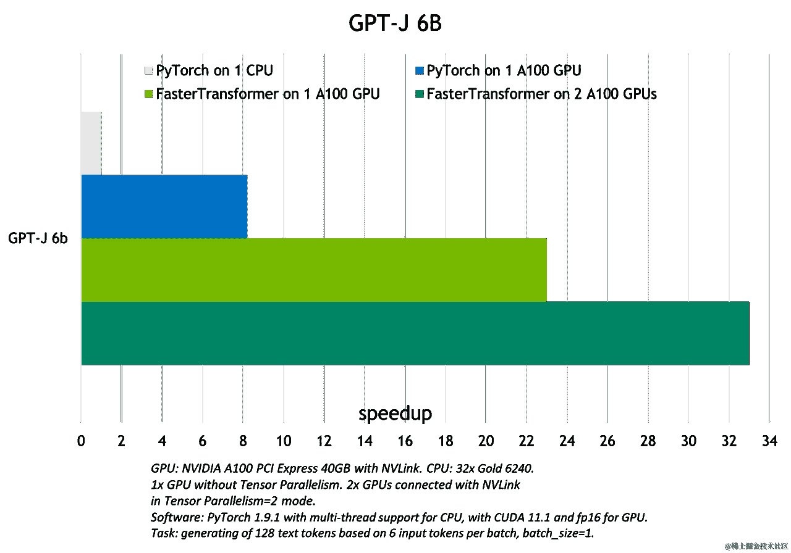

### 存在的问题

英伟达新推出了 TensorRT-LLM，相对来说更加易用，后续 FasterTransformer 将不再为维护了

# DeepSpeed-MII

**GitHub**: [github.com/microsoft/DeepSpeed-MII](https://link.juejin.cn/?target=https%3A%2F%2Fgithub.com%2Fmicrosoft%2FDeepSpeed-MII)

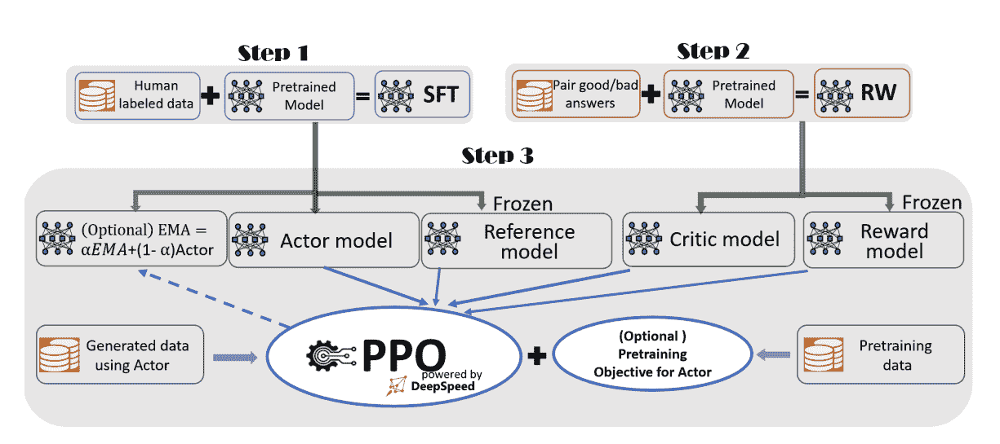

## 简介

DeepSpeed-MII 是 DeepSpeed 的一个新的开源 Python 库，旨在使模型不仅低延迟和低成本推理，而且还易于访问。

+ MII 提供了对数千种广泛使用的深度学习模型的高度优化实现。

+ 与原始 PyTorch 实现相比，MII 支持的模型可显著降低延迟和成本。

+ 为了实现低延迟/低成本推理，MII 利用 DeepSpeed-Inference 的一系列广泛优化，例如：transformers 的深度融合、用于多 GPU 推理的自动张量切片、使用 ZeroQuant 进行动态量化等。

+ MII 只需几行代码即可通过 AML 在本地和 Azure 上低成本部署这些模型。

## MII 工作流程

下图显示了 MII 如何使用 DS-Inference 自动优化 OSS 模型；然后，使用 GRPC 在本地部署，或使用 AML Inference 在 Microsoft Azure 上部署。

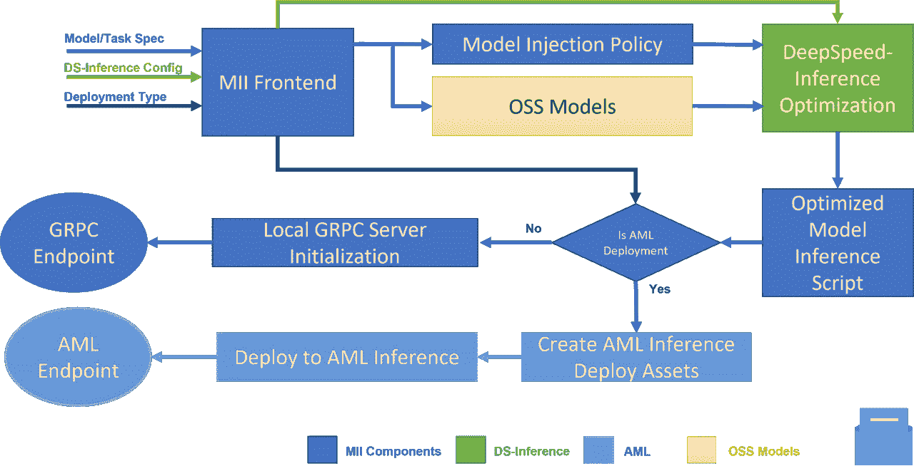

## 支持的模型和任务

MII 目前支持超过 50,000 个模型，涵盖文本生成、问答、文本分类等一系列任务。 MII 加速的模型可通过 Hugging Face、FairSeq、EluetherAI 等多个开源模型存储库获取。我们支持基于 Bert、Roberta 或 GPT 架构的稠密模型，参数范围从几亿参数到数百亿参数。除此之外，MII 将继续扩展该列表，支持即将推出的大规模千亿级以上参数稠密和稀疏模型。

目前 MII 支持以下 HuggingFace Transformers 模型系列：

## 与其他框架（PyTorch）的性能对比

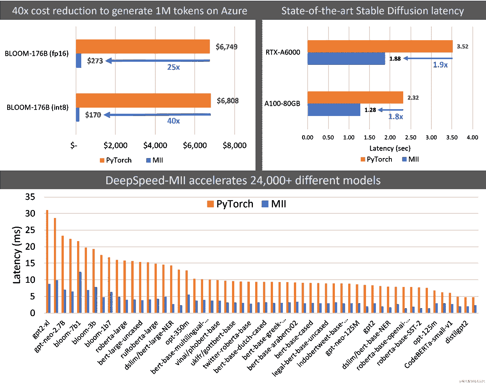

MII 将 Big-Science Bloom 176B 模型的延迟降低了 5.7 倍，同时将成本降低了 40 倍以上。同样,它将部署 Stable Diffusion 的延迟和成本降低了 1.9 倍。
