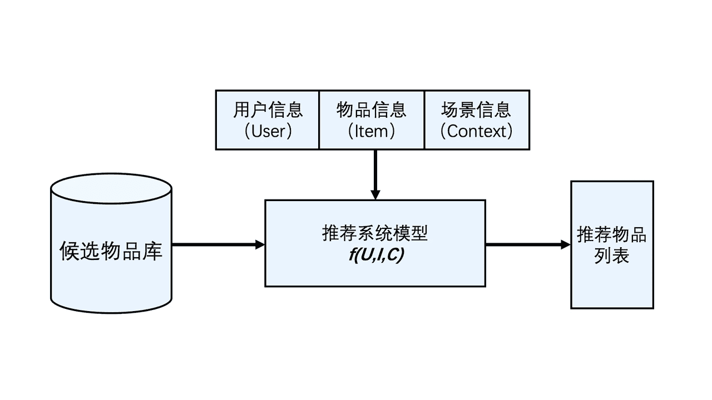
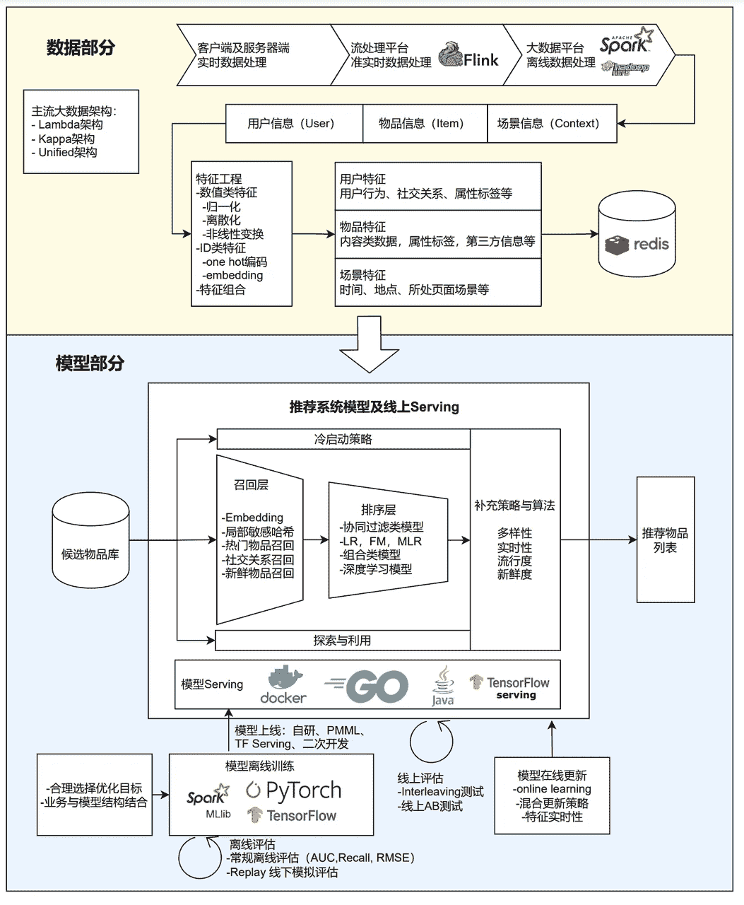
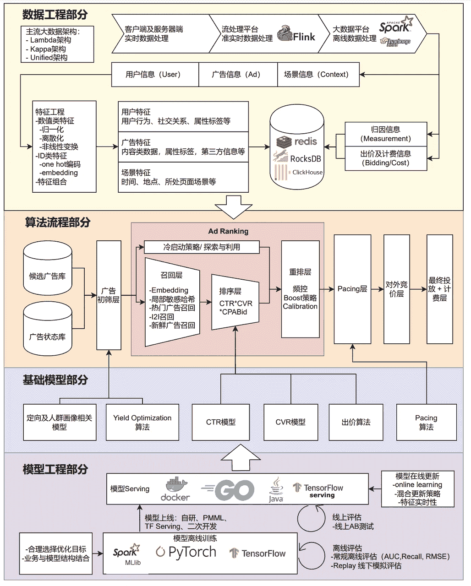
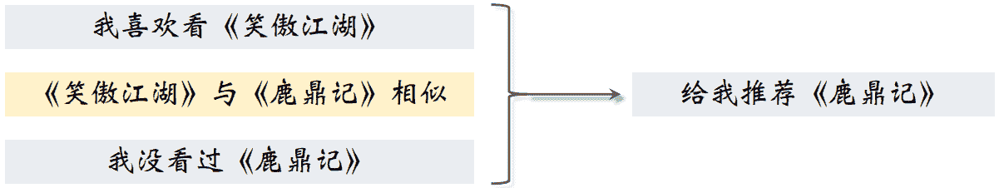
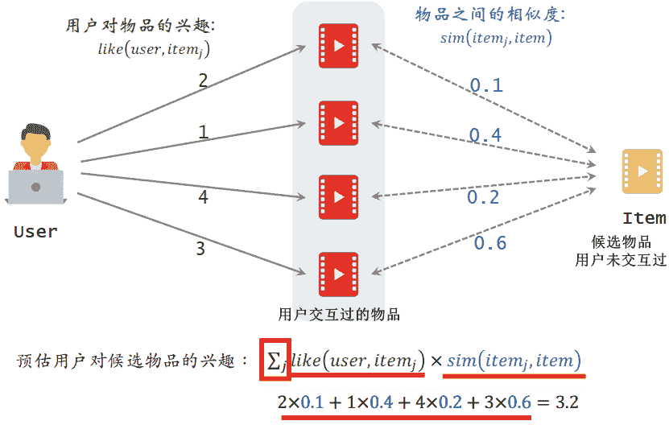
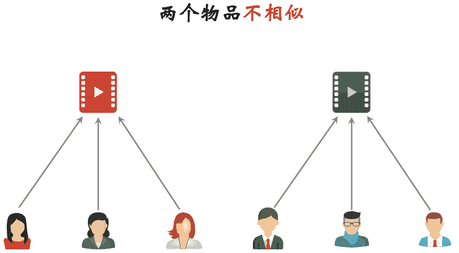
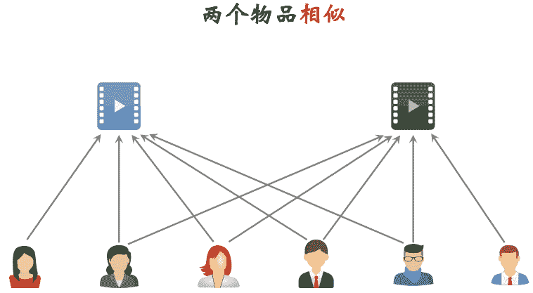
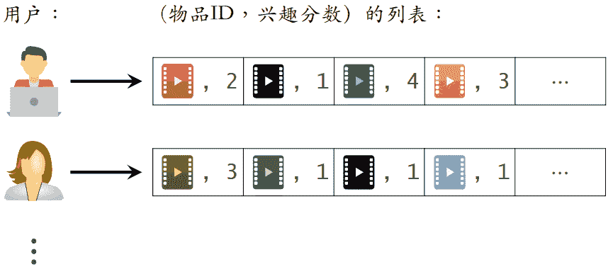

# 互联网的增长引擎——推荐系统

> 来源：[https://v11enp9ok1h.feishu.cn/docx/VnQOdoOqBodLL5xmp4FcznABn5b](https://v11enp9ok1h.feishu.cn/docx/VnQOdoOqBodLL5xmp4FcznABn5b)
>
> <https://v11enp9ok1h.feishu.cn/sync/PaIIdslbxsIJUIbkTfPcsMCFnph>

## 推荐系统的作用/意义/目标

推荐系统的作用和意义：

1. **用户角度**：推荐系统解决在“信息过载”的情况下，用户如何从海量信息中高效获得感兴趣信息的问题。

   推荐系统是在“用户需求并不十分明确”的情况下，进行信息的过滤。因此，与搜索系统（用户会输入明确的搜索词 `query`）相比，推荐系统更多地利用用户的各类历史信息“猜测”可能喜欢的内容。

1. **公司角度**：推荐系统解决产品能够最大限度地吸引用户、留存用户、增加用户黏性、提高用户转化率的问题，从而达到公司商业目标连续增长（增加公司收益）的目的。

推荐系统的终极优化目标：包括以下两个维度

1. 一个维度是“用户体验的优化”
1. 另一个维度是“满足公司的商业利益”

对一个健康的“商业模式”来说，以上两个维度应该是和谐统一的

### 推荐系统的架构

+ **物品信息**：商品推荐中的商品信息，视频推荐中的视频信息，新闻推荐中的新闻信息
+ **用户信息**：与人相关的信息，包括历史行为、人口属性、关系网络等，可以用来更可靠地推测出人的兴趣点
+ **场景信息/上下文信息**：指具体推荐场景中的时间、地点、用户的状态等一系列环境信息

### 推荐系统的逻辑框架

推荐系统要处理的问题的定义：

+ 对于`用户 U (user)`，在特定场景`C (context)`下，针对海量的物品信息，构建一个函数`f(U,I,C)`，预测用户对特定候选物品`I (item)`的喜好程度，再根据喜好程度对所有物品进行排序，生成推荐列表

### 推荐系统的技术架构

> 实际的推荐系统需要解决两类问题：

+ **数据和信息相关的问题**：即用户信息、物品信息、场景信息分别是什么？如何存储、更新和处理？
+ **推荐系统算法和模型相关的问题**：即推荐模型如何训练、如何预测、如何达到更好的推荐效果？

因此，推荐系统的技术架构也分为两个部分：

+ **数据部分**：数据离线批处理、实时流处理
+ 负责“用户”“物品”“场景”的信息收集与处理
+ 原始数据加工后有 3 个主要出口：

1. 生成推荐模型所需的样本数据，用于算法模型的训练和评估
1. 生成推荐模型服务（model serving）所需的“特征”，用于推荐系统的线上推断
1. 生成监控系统、商业智能系统所需的统计型数据

+ **模型部分**：训练、评估、部署、线上推断
+ **模型结构/模型服务过程**：输入是所有候选物品集，输出是推荐列表
+ **召回层**：一般由高效的召回规则、算法或简单的模型组成，这让推荐系统能快速从海量的候选集中召回用户可能感兴趣的物品
+ 深度学习中的 `Embedding` 技术
+ **排序层（精排层）**：利用排序模型对初筛的候选集进行精排序。是推荐系统产生效果的重点/核心
+ 深度学习模型的复杂结构，使其具备了理论上拟合任何函数的能力，极大地增强了推荐系统的拟合能力和表达能力
+ **补充策略与算法层（再排序层）**：在返回给用户推荐列表之前，为兼顾结果的“多样性”“流行度”“新鲜度”等指标，结合一些补充的策略和算法对推荐列表进行一定的调整，最终形成用户可见的推荐列表
+ **模型训练**：在线环境进行模型服务前，需要通过模型训练确定模型结构、超参数、参数取值
+ **离线训练**：可以利用全量样本和特征，使模型逼近全局最优点
+ **在线更新**：可以准实时地“消化”新的数据样本，更快地反应新的数据变化趋势，满足模型实时性的需求
+ **评估模块**：
+ **离线评估**：得到线下评估指标
+ **线上 `A/B` 测试**：得到线上评估指标

## 推荐系统召回层的主要策略

> 字节采用的就是多路召回策略，同时多路中包含基于 `Embedding` 的召回通道

### 1. ItemCF：基于物品的协同过滤

#### 1.1 ItemCF 的原理

原理：基于`物品相似度`进行推荐，而物品相似度的计算基于用户历史行为（共现矩阵）

基本思想：若用户喜欢物品，且物品与物品相似，那么用户很可能也喜欢物品

推荐系统如何度量物品的相似性？

1. **知识图谱**：两本书的作者相同，所以两本书相似
1. 基于`全体用户的行为`判断两个物品的相似性（`Item CF` 使用的方法）

   + eg. 如何判断《笑傲江湖》和《鹿鼎记》相似？
   + 看过《笑傲江湖》的用户也看过《鹿鼎记》
   + 给《笑傲江湖》好评的用户也给《鹿鼎记》好评

1. **物品相似度**：

   + 原理：如果喜欢物品、物品的用户有很大的重叠，那么物品与物品相似
   + 计算两个物品的相似度：`余弦相似度`
   + 把每个物品表示为一个稀疏向量（用户-物品共现矩阵的列向量），向量的每个元素对应一个用户，元素的值就是用户对物品的兴趣分数
   + 相似度就是两个物品向量夹角的余弦

1. **预估用户对候选物品的兴趣**：

   + 从用户的历史行为得到用户对各个物品的兴趣分数
   + 比如下图量化用户对物品的兴趣方式为：点击、点赞、收藏、转发这 4 种行为各算一分
   + 两个物品的相似度
   + 相乘、累加
   + 有 2000 个候选物品，计算用户对每个候选物品的兴趣分数，返回其中分数最高的 100 个物品

#### 1.2 物品相似度的计算

两个物品相似：两个物品的受众重合度越高，两个物品越相似

如何计算两个物品之间的相似度？

+ 喜欢物品的用户记作集合
+ 喜欢物品的用户记作集合
+ 定义交集
+ 不考虑喜欢程度：
+ 考虑喜欢程度：
+ 其实这个公式计算的就是`余弦相似度`，将每个物品表示为一个向量，向量的每个元素对应一个用户，元素的值就是用户对物品的兴趣分数，两个物品向量的夹角的余弦就是上述公式

#### 1.3 ItemCF 召回通道

> ItemCF 用于召回的完整流程：利用离线维护的两个索引在线上做快速召回

为了能在线上做到实时推荐，系统必须事先做离线计算，建立并维护两个索引：

1. **用户→物品 索引**：用户最近交互过的 `n` 个物品

   + 记录每个用户最近点击、交互过的物品 `ID`
   + 给定任意用户 `ID`，可以找到他近期感兴趣的物品列表，并且得到兴趣分数

1. **物品→物品 索引**：每个物品相似度最高的 `k` 个物品

   + 计算物品之间的两两相似度（这个计算量会比较大）
   + 对于每个物品，索引它最相似的 `k` 个物品
   + 给定任意物品 `ID`，可以快速找到它最相似的 `k` 个物品，并且得到相似度分数

线上做召回的流程：

1. 利用两个索引，每次取回 `nk` 个物品
1. 给定用户 `ID`，通过“用户→物品”索引，找到用户近期感兴趣的物品列表 `last-n`
1. 对于 `last-n` 列表中的每个物品，通过“物品→物品”的索引，找到 `top-k` 相似物品
1. 对于取回的相似物品（最多有 `nk` 个，因为存在重复），预估用户对每个物品的兴趣分数：

   > 如果取回的物品 `ID` 存在重复，就去重，将分数加起来

1. 返回分数最高的 100 个物品，作为 ItemCF 召回通道的召回结果

为什么要用索引？

+ 数据库中包含上亿个物品，如果挨个计算用户对所有物品的兴趣分数，计算量会爆。索引的意义在于避免枚举所有的物品。用索引，离线的计算量大，需要维护两个索引，但好处是线上计算量小，每次线上召回都很快，可以做到在线实时计算
+ 比如 `n=200`，`k=10`，最多取回 `nk = 2000` 个物品，只需要计算用户对这 2000 个物品的兴趣分数，这样计算量很小，可以做到在线实时计算

## 特征工程

> 为什么需要特征工程？

### 1、推荐系统有哪些可供利用的特征

> 特征工程：即利用工程手段从“用户信息”“物品信息”“场景信息”中提取特征的过程
> 特征：是对某个行为过程相关信息的抽象表达（转换为机器能学习的数学形式）
> 构建推荐系统特征工程的原则：尽可能地让特征工程抽取出的一组特征，能够保留推荐环境及用户行为过程中的所有“有用”信息，并且尽量摒弃冗余信息

推荐系统中的常用特征：

+ **用户行为数据**：人与物之间的连接日志
+ 用户行为分为两种：
+ **显性反馈行为**：一般来说显性反馈行为的收集难度过大，数据量小，仅用显性反馈的数据不足以支持推荐系统训练过程的最终收敛
+ **隐性反馈行为**：是目前特征挖掘的重点

+ **用户行为类特征的两种处理方式**：
+ 将代表用户行为的物品 `id` 序列转换成 `multi-hot` 向量，将其作为特征向量
+ 预先训练好物品的 `embedding`，再通过平均或者类似于 `DIN` 模型注意力机制的方法生成历史行为 `Embedding` 向量，将其作为特征向量
+ **用户关系数据**：人与人之间的连接记录
+ 强关系（显性）：eg. 关注、好友关系等
+ 弱关系（隐形）：eg. 互相点赞、同一个社区、同看一部电影等
+ 用户关系数据的使用方式：
+ 将用户关系作为召回层的一种物品召回方式
+ 通过用户关系建立关系图，使用 [`Graph Embedding`](https://www.yuque.com/xf015y/wo1guk/cy3ym6#bFxq3) 的方法生成用户和物品的 `Embedding`
+ 直接利用关系数据，通过“好友”的特征为用户添加新的属性特征
+ 利用用户关系数据，直接建立社会化推荐系统
+ 处理方法：`multi-hot` 编码、`embedding` 等
+ **属性、标签类数据**：直接描述用户 or 物品的特征
+ 用户特征：eg. 人口属性数据（性别、年龄、住址等），用户兴趣标签
+ 物品特征：eg. 物品标签，物品属性（商品类别、价格；电影分类、年代、演员、导演等）
+ 属性、标签类数据的使用方式：
+ 通过 `multi-hot` 编码的方式将其转换成特征向量
+ 先转换成 `Embedding`，再输入推荐模型
+ **内容类数据**：同样是描述物品或用户的数据，但相比标签类特征，内容类数据往往是大段的描述型文字、图片，甚至视频
+ 处理方式：
+ 需要通过自然语言处理、计算机视觉等技术手段先提取关键内容特征，再输入推荐系统
+ **场景信息（上下文信息）**：“时间”，通过 `GPS`、`IP` 地址获得的“地点”信息，当前所处推荐页面等
+ **统计类特征**：通过统计方法计算出的特征
+ eg. 历史 `CTR`、历史 `CVR`、物品热门程度、物品流行程度等，本质上是一些粗粒度的预测指标
+ 一般是`连续型特征`，仅需经过标准化归一化等处理就可以直接输入推荐系统进行训练
+ **组合类特征**：将不同特征组合后生成的新特征
+ eg. “年龄 + 性别”组成的人口属性分段特征（`segment`）
+ 组合类特征的处理方式：
+ 人工组合、人工筛选（早期推荐模型不具备特征组合能力）
+ 模型自动处理（深度学习推荐系统）

### 2、特征处理

广义上，特征可以分为两类：

+ **类别、`ID` 型特征**：无法用数字表示的信息。eg. 电影风格、`ID`、标签、用户性别、时间等
+ **数值型特征**：能用数字直接表示的特征。eg. 用户的年龄、收入、电影播放时长、点击量、点击率等

特征处理的目的：把所有的特征全部转换成一个数值型的特征向量

+ 数值型特征：可以直接将这个数值放到特征向量的相应维度上（当然还要先对特征尺度、特征分布做一些处理）
+ 类别、`ID` 型特征：使用 `one-hot` 编码 or `multi-hot` 编码转换为数值向量

#### 2.1 类别、ID型特征处理：One-hot 编码

`one-hot` 编码（独热编码）：通过把所有其他维度置为 0，单独将当前类别或者 `ID` 对应的维度置为 1 的方式生成特征向量

`multi-hot` 编码（多热编码）：eg. 一个用户和多个物品产生交互行为，或者一个物品被打上多个标签，就可以通过 `multi-hot` 编码来生成特征向量

`one-hot` 编码和 `multi-hot` 编码的主要问题：

+ 特征向量维度过大，特征过于稀疏，容易造成模型欠拟合
+ 模型的权重参数的数量过多，容易导致模型收敛过慢

改进：

+ 先将类别、`ID` 型特征编码成稠密 [`Embedding`](https://www.yuque.com/xf015y/wo1guk/cy3ym6#aTWbZ) 向量，再与其它特征组合，形成最终的输入特征向量

#### 2.2 数值型（连续型）特征的处理：归一化、分桶

> 将数值型特征放入特征向量之前，要先在特征尺度、特征分布两方面做一些处理

> 特征尺度：

+ 问题：特征取值范围不统一
+ eg. 两个特征：电影评价次数 `fr` 的取值范围为 [0, 10000]，电影平均评分 `fs` 的取值范围为 [0, 5]。这两个特征尺度差距太大，导致 `fr` 的特征波动会完全掩盖掉 `fs` 的作用
+ 处理方法：`归一化`
+ 统一各特征的量纲，将不同连续特征的尺度拉平到一个区域内，通常是 [0, 1]，或者做 0 均值归一化（将原始数据集归一化为均值为 0、方差为 1 的数据集）

> 特征分布：

+ 问题：特征值分布不均匀
+ eg. 1000 部电影的平均评分的分布，大量集中在 3.5 分附近（密度大），特征的区分度不高
+ 处理方法 1：`离散化`——`分桶 Bucketing`
+ 就是将样本按照某特征的值从高到低排序，然后按照桶的数量找到分位数，将样本分到各自的桶中（每个桶的样本数相同），再用桶 `ID` 作为特征值
+ 目的：防止连续值带来的过拟合现象及特征值分布不均匀的情况
+ 处理方法 2：`加非线性函数`——通过`平方/开方`、`xa`、`loga(x)`、`log(1−xx)`等非线性操作操作改变特征分布，让模型能更好地学习特征内包含的有价值信息
+ 但由于没法通过人工的经验判断哪种特征处理方式更好，所以可以索性把归一化后的原特征值、平方、开方等都输入模型，让模型自己做选择
+ 目的：更好地捕获特征与优化目标之间的非线性关系，增强这个模型的非线性表达能力

特征处理没有标准答案，需要根据模型效果实践出真知

### 3、Embedding —— 更高阶的特征处理方法

> 用 `Embedding` 方法进行相似物品推荐，几乎是业界最流行的做法

`Embedding`：是用一个低维稠密的数值向量“表示”一个对象（Object）的方法

+ 主要作用：将稀疏向量转换成稠密向量，同时揭示对象之间的潜在关系
+ “表示”：即 `Embedding` 向量能够表达相应对象的某些特征，同时向量之间的距离反映了对象之间的相似性
+ `Embedding` 向量之间的运算甚至能够包含词之间的语义关系信息
+ eg. `Embedding(woman)=Embedding(man)+[Embedding(queen)-Embedding(king)]`
+ `Embedding` 在其他领域的应用：eg. `Embedding(键盘)` 和 `Embedding(鼠标)` 的距离比较近

`Embedding` 技术对深度学习推荐系统的重要性：

+ `Embedding` 是处理稀疏特征的利器：`Embedding` 层负责将稀疏高维特征向量转换成稠密低维特征向量
+ `Embedding` 可以融合大量有价值信息，本身就是极其重要的特征向量

> `Embedding` 不仅是一种处理稀疏特征的方法，也是融合大量基本特征，生成高阶特征向量的有效手段

## 3.1 序列数据的 `Embedding` 方法

### 3.1.1 `Word2vec`——经典的 `Embedding` 方法

`Word2vec` 模型：生成对“词”的向量表达的模型

+ 两种形式：
+ `CBOW` 模型：假设句子中每个词的选取都由相邻的词决定，输入是周边的词，预测的输出是
+ `Skip-gram` 模型：假设句子中的每个词都决定了相邻词的选取，输入是 ，预测的输出是 周边的词（按照一般的经验，`Skip-gram` 模型的效果会更好一些，以下以 `ski-gram` 模型为例）

`Word2vec` 训练样本的生成过程：通过 `滑动窗口` 截取词组，把词组内的词转换成训练样本

+ 从语料库中抽取一个句子，选取一个长度为 `2c+1`（目标词前后各选 `c` 个词）的滑动窗口，将滑动窗口由左至右滑动，每移动一次，窗口中的词组就形成了一个训练样本。根据 `Skip-gram` 模型，输入是样本的中心词，输出是所有的相邻词

`Word2vec` 的模型结构：三层神经网络

+ **输入**：维度为 `V`（即语料库词典的大小），是由输入词转换来的 `one-hot` 向量
+ **隐层**：维度为 `N`（最终每个词的 `embedding` 向量维度也是 `N`）。隐层没有激活函数
+ **输出**：维度为 `V`，是由多个输出词转换来的 `multi-hot` 向量（相当于多分类）。采用 `softmax` 激活函数

从 `Word2vec` 模型中提取出词向量的方法：

> `输入向量矩阵`（输入层到隐层的权重矩阵）的第 `i` 行的行向量就是第 `i` 个词的 `Embedding`（输入时 `one-hot` 向量，只有第 `i` 行为 1），维度为 `N`，即隐层的维度
>
> 转换为词向量查找表后，每行的权重就成了对应词的 `embedding` 向量

### 3.1.2 `Item2vec`：`Word2vec` 在任意序列数据上的推广

`Item2Vec` 模型的技术细节几乎和 `Word2vec` 完全一致，只要能够用序列数据的形式把我们要表达的对象表示出来，再把序列数据“喂”给 `Word2vec` 模型，我们就能够得到任意物品的 `Embedding` 了

对于 **推荐系统** 来说，`Item2vec` 可以利用物品的 `Embedding` 直接求得它们的相似性，或者作为重要的特征输入推荐模型进行训练，这些都有助于提升推荐系统的效果

## 3.2 图数据的 `Embedding` 方法（`Graph Embedding`）

互联网中不只有序列数据，还有图结构数据

**图结构数据**：

+ **社交关系图**：
+ **知识图谱**：
+ **行为关系图**：是用户和物品组成的二部图。能够利用 `Embedding` 技术发掘出物品和物品之间、用户和用户之间，以及用户和物品之间的关系

基于图数据的 `Graph Embedding` 方法：将图中的节点 `Embedding` 化

+ **基于随机游走的 `Graph Embedding` 方法**：`Deep Walk`
+ 在同质性和结构性间权衡的方法：`Node2vec`

### 3.2.1 `Deep Walk`

`Deep Walk`：

+ 基于原始的用户行为序列（eg. 购买物品序列、观看视频序列），构建物品关系图
+ 在物品关系图上，采用随机游走的方式随机选择起始点，重新产生物品序列
+ 将这些物品序列作为训练样本输入 `Word2vec` 进行训练，最终得到物品的 `Embedding` 向量

**随机游走的跳转概率**：到达节点  后，下一步遍历  的邻接点的  概率

+ 有向有权图：
+ 跳转概率就是跳转边的权重占所有相关出边权重之和的比例

## 3.3 `Embedding` 在推荐系统特征工程中的应用

`Embedding` 是一种更高阶的特征处理方法：

+ `Embedding` 的产出就是一个数值型特征向量，所以 `Embedding` 技术本身就可以视作特征处理方式的一种，并且具备了把序列结构、网络结构、甚至其他特征融合到一个特征向量中的能力

`Embedding` 在推荐系统中的应用方式：

+ **直接应用**：得到 `Embedding` 向量之后，直接利用 `Embedding` 向量的相似性实现某些推荐系统的功能，eg. 猜你喜欢，利用物品 `embedding` 实现推荐系统的召回层
+ **预训练应用**：预先训练好物品和用户的 `Embedding` 之后，不直接应用，而是把这些 `Embedding` 向量作为特征向量的一部分，跟其余的特征向量拼接起来，作为推荐模型的输入参与训练
+ 能够更好地把其他特征引入进来，让推荐模型作出更为全面且准确的预测
+ **`End2End` 应用**：不预先训练 `Embedding`，而是把 `Embedding` 的训练与深度学习推荐模型结合起来，采用统一的、端到端的方式一起训练，直接得到包含 `Embedding` 层的推荐模型
+ eg. [`Deep Crossing`](https://www.yuque.com/xf015y/wo1guk/pfh4a1#VBPxv)、[`FNN`](https://www.yuque.com/xf015y/wo1guk/pfh4a1#dXIfE)、[`Wide&Deep`](https://www.yuque.com/xf015y/wo1guk/pfh4a1#MH92A)

