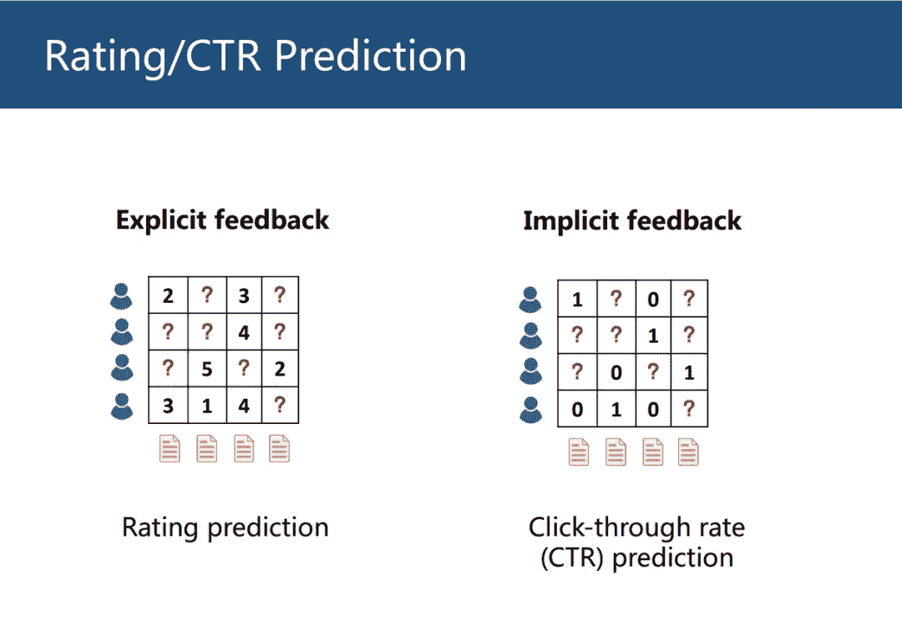
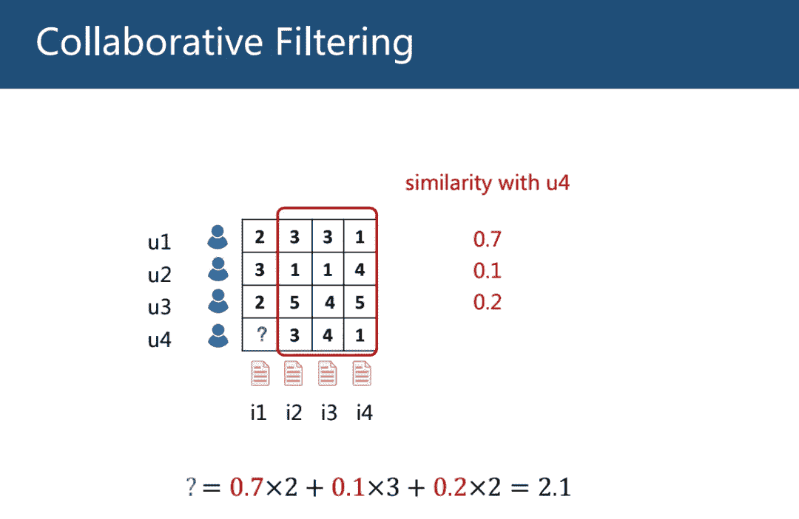
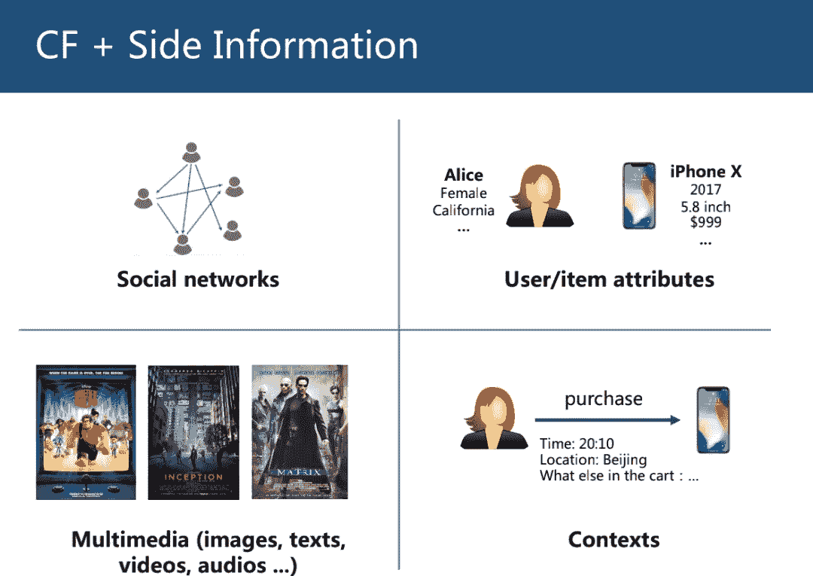
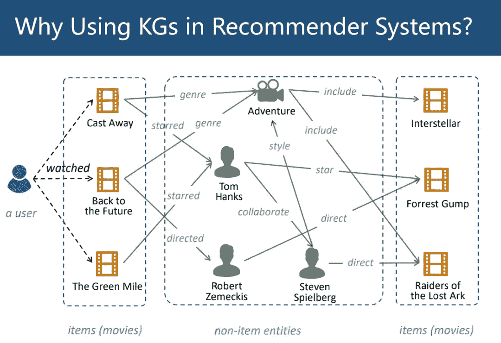
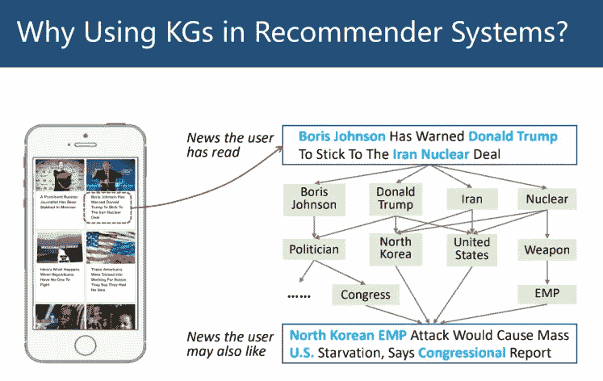
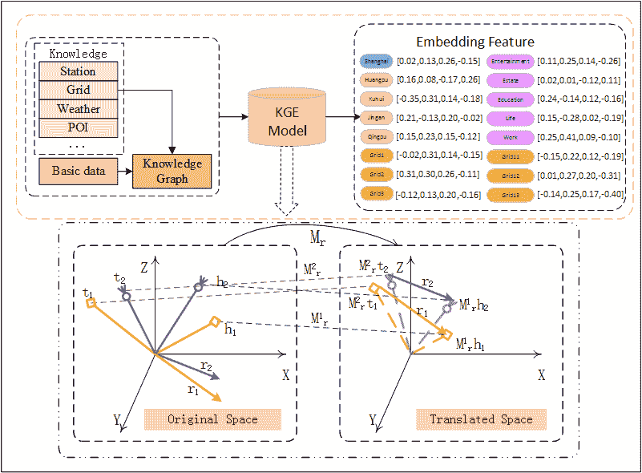
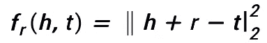
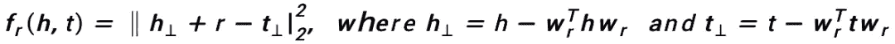

# 如何将知识图谱引入推荐系统？

> 来源：[https://v11enp9ok1h.feishu.cn/docx/OhFXdZLaGoNBn6xUKsucro2xn0e](https://v11enp9ok1h.feishu.cn/docx/OhFXdZLaGoNBn6xUKsucro2xn0e)

<https://v11enp9ok1h.feishu.cn/sync/PaIIdslbxsIJUIbkTfPcsMCFnph>

**推荐系统**

**推荐系统**的目标是满足用户个性化需求，降低用户筛选信息的难度。推荐系统有着广泛地应用，在MDB的电影推荐中可以推荐更多人喜欢的电影，在Amazon的图书推荐会推荐与当前书相似的书，Booking.com会推荐可能会感兴趣的旅游的目的地，Quora上对用户可能感兴趣问答的推荐，Tik tok上对用户可能感兴趣的短视频推荐，以及音乐网站对用户可能感兴趣的音乐推荐。

推荐系统有两大任务，评分预测和点击率预测：

+   **评分预测：**是给定用户对物体的打分，可以直接地反应用户喜好程度，因此称为显式反馈（Explicit feedback）

+   **点击预测：**是给定用户对物体的点击情况，并不能显式地反应出用户偏好，因此称为隐式反馈（Implicit feedback），隐式反馈收集难度更低，因此真实线上环境中常用Implicit feedback

1.  协同过滤 collaborative filtering

**协同过滤**（Collaborative Filtering, CF）假定相似用户有相似偏好，根据用户历史行为算出用户相似度，并用相似度加权平均其他用户的评分来预测该用户未打分物体的评分。

**CF存在的缺点：**

+   用户、物体矩阵存在稀疏性，用少量数据预测大量缺失的数据存在过拟合的风险。

+   冷启动问题，难以解决新用户和新物品没有历史数据的情况。

1.  CF + Side Information

通过引入辅助信息（**Side**** Informa**tion）来解决协同过滤存在的问题，常用的辅助信息包括：社交网络比如🧣间关注的关系、用户物品的属性信息、图片文本音频视频等多媒体信息、上下文信息比如购买时的位置时间信息。

**知识图谱**

> **知识图谱**（Knowledge Graph, KG）也可以看作一种辅助信息，KG是一种有向异构图，它的节点表示实体，边表示实体间关系。一个KG通常包含多个三元组，形如（head, relation, tail），表示头实体与尾实体存在某种关系。我们假定推荐系统中的物品也是一个KG中的节点，因此KG提供了物品和物品之间的关系。

1.  **知识图谱实例**

> **以电影推荐为例****：**一个用户看过的电影可以靠KG中的实体连接到其他电影，通过合理推断，可以认为用户也会喜欢与该电影紧密连接的电影，因此从电影的属性和特征出发，一个KG可以帮助我们合理地推测用户的兴趣。

> **以新闻推荐为例：**可以通过用户阅读过的新闻实体，利用KG重复扩展并连接到另一条新闻。虽然下图中上下两条新闻字面上没有重合，但可以通过常识知识图谱进行判断关联非常紧密。

1.  知识图谱嵌入 Knowledge Graph Embedding

> **知识图谱嵌入**（Knowledge Graph Embedding, KGE）可以解决知识图谱作为复杂图结构难以直接利用的问题，KGE可以学习KG中实体关系的低维向量表示。

常用转移距离模型（Translate Distance Model）

1.  知识图谱嵌入 Knowledge Graph Embedding

> **知识图谱嵌入**（Knowledge Graph Embedding, KGE）可以解决知识图谱作为复杂图结构难以直接利用的问题，KGE可以学习KG中实体关系的低维向量表示。

**常用转移距离模型****（****T**ranslate Distance Model）

+   **TransE**目标是使head实体embedding加上relation embedding接近tail实体embedding。

+   **TransH**解**决一对多多对多关系，**通过计算head和tail实体embedding在关系embedding上的投影，计算投影之间的关系。

+   **TransR**通过将head、tail embedding转换到relation embedding空间，是转换后的投影满足三元组的关系。

### **知识图谱辅助推荐系统**

**问题定义** (Problemı Formulation):

+   给定用户集合、物品集合、用户参与标签  , 以及相关知识图谱G，目标为预测用户点击概率  。

**知识图谱嵌入方法分为两类：**

1.  **基于嵌入方法**（Embedding-based methods）

+   首先用**KGE**的方法处理**KG**，得到实体、关系的**embedding**，利用推荐系统的方法得到物品、用户的embedding，设计一种模型来融合四类embedding。

1.  **基于结构方法**（Structure-based methods）

+   **将KG和用户物品交互的图结构概**括在一个统一的框架下，挖掘图结构信息。

+   **将KG和用户物品交互的图结构概**括在一个统一的框架下，挖掘图结构信息。

1.  Deep Knowledge-aware Networks

+   embedding-based 方法：

> ① 框架

> **给定新闻数据**，使用实体链接提取出相对应的实体**，利用**给定实体取出完整知识**图谱的子图，用KGE的**方法处理子图，得到实体embedding。

> 将邻居实体embedding平均得到该实体的embedding表示。

+   Knowledge-Aware CNN

**Kim CNN**用**来学习句****子的embedding**。给定句子中**有n个词语，**词嵌入维度为d，使用3个长度为d宽度为2的1维卷积核处理词嵌入矩阵，再用4个宽度为3长度为d的一维卷积核处理词嵌入矩阵，对最后一维进行max-pooling，将池化结果concat后得到的向量作为sentence embedding。

+   Knowledge-Aware CNN

**（KCNN）**是对**Kim CNN****的扩展，输入为三个embed**ding，包括word embedding、entity embedding和context embedding。如果word embedding中单词对应一个实体entity embedding中对应位置为学到的实体embedding，如果不对应实体则用0来填充。此时的卷积核高度变为3。

+   **Attention-Based User** Interest Extraction

> 给定用户历史新闻数据和候选新闻，判断用户是否对候选新闻感兴趣。先使用KCNN的方法学习新闻embedding，并用attention net来判断以前读过的新闻对候选新闻的重要程度，

attention network

**通过将向量拼接并经过dnn**来计算最后的权重，利用attention net的权重加权用户历史数据可以得到用户的embedding，最后将用户embedding和候选新闻embedding拼接并通过dnn得到点击候选新闻的概率。

**② 实验**

使用**Bing News作**为数据集，**KG****使用微**软Satori。B**ing** News数据集中标题平均词数量为7.9个，平均实体数量为3.7个。

实验结果如下图

（-）代表没有使用KG的方法，可以看到DKN方法显著地好于其他baseline的方法。

1.  **Multi-Task Feature Learnin**g for KG-Enhanced RS

① 框架

**多任务学习框架**，下图左为推荐系统的框架，下图右为KGE的框架。

> 由于**知识图谱中的****实体**就是**推荐系统中的****item**，可以认为它们的embedding存在特定的关系，因此使用cross&compress units来建模实体和物品embedding之间的关联。其中cross操作将计算向量内积得到矩阵，compress操作通过将矩阵压缩为向量。

**推荐系统**用**MLP**处理用户**embedding**，并使用cross & compress计算物品的embedding，最后拼接来计算点击概率。

**KGE模块**中，使用**cro**ss & compress处理head实体embedding，使用MLP处理关系embedding，拼接后通过MLP计算tail实体的预测值，并以embedding预测值和真实值之间的差距作为损失函数。

因此，整体的损失函数分为三块：推荐系统的损失、KGE的损失和正则损失。

**② 实验**

分别在四个数据集上进行了实验，实验结果好于其他方法。

1.  **RippleNet: Propagating Us**er Preference in KGs

① 框架

> 输入为用户和物品，输出为用户点击物品的概率。利用用户的历史点击数据v(u)，将v(u)沿着KG向外传播，得到历史点的邻节点t和关系r，并利用下式计算邻节点t与候选物品v的关联概率。

利用关联概率加权平均得到用户的一阶表示，不断重复传播过程，得到多个用户embedding，将其相加作为最终用户embedding，最后使用用户embedding和item embedding内积的sigmoid激活结果作为最终的点击概率。

在给定KG和用户物品历史数据时，基于最大化后验概率来计算模型参数，利用贝叶斯方法将概率公式拆为三项。

第一项为模型参数的先验分布，采用高斯分布作为先验。

第二项为给定模型参数判断观测知识图谱的可能性函数，即通过头实体、尾实体、关系embedding的乘积来模拟出现的概率，如下图公式。

第三项为给定KG和模型参数判断用户历史行为的物品点击概率函数，为伯努利分布，如下图公式。

将概率公式取负对数后得到最终损失函数。

② 实验

实验结果好于其他方法。

1.  **Knowledge Graph Co**nvolutional Networks

Structure-Based Methods (H. Wang, et al. Knowledge Graph Convolutional Networks for Recommender Systems. WWW 2019.

H. Wang, et al. Knowledge-aware Graph Neural Networks with Label Smoothness Regularization for Recommender Systems. KDD 2019)

① 方法

KG中的边不存在权值，因此引入

，通过用户embedding和关系embedding的内积，将权值引入KG。

逐层传播的函数如下图，其中A(u)为每个用户u的KG邻接矩阵，D(u)为A(u)的对角矩阵，H(l)为第l层实体embedding，W(l)为参数矩阵。

最终点击概率如下图公式计算。

② 实验

实验结果如下图，一般使用KGCN-sum的方法效果最好。

1.  **比较**

在性能方面，KGCN性能最好，DKN表现最差。

在可扩展性方面，embedding-based方法可扩展性更好，因为embedding方法可以复用，而structure-based方法在面对新的物品、用户时需要对整个方法需要重新训练。

在可解释性方面，我们认为structure-based方法的图结构比embedding更直观。

