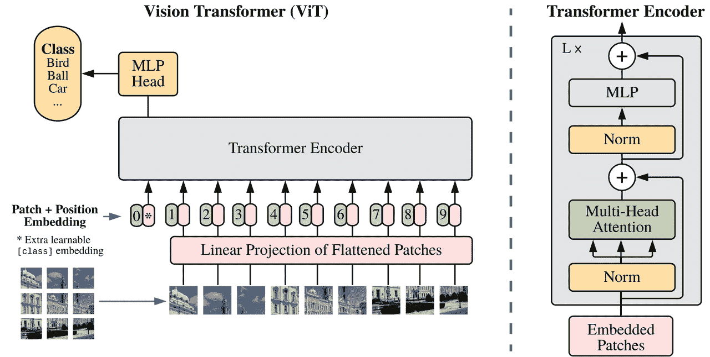

# vit model

> 来源：[https://v11enp9ok1h.feishu.cn/docx/GLq3dZETCoMOuRx1qDycT66pnAe](https://v11enp9ok1h.feishu.cn/docx/GLq3dZETCoMOuRx1qDycT66pnAe)

# 前言

1.  之前都搞过clip、image-encoder-decoder。现在哪里还怕搞不懂vit.

1.  这里主要分享一下vit的最核心的部分。

## vit 核心的数据内容

vit想法非常牛，但是数据处理的思想更牛，之前都没提出来过。



载对于一个图片，将一个图片分割成N块。巧妙的使用nn.Conv2d。

### 初始化

```
import torch
from torch import nn 

# base parameter

image_size=224 # 图片的width和height
patch_size=16  # 将图片的分为块，每一块的大小为16x16，这样就有(224//16)^2 = 14 ^2 = 196个
num_channels=3 #  R,G, B
hidden_size=768 # 输出的hidden_size
batch_size = 16 # 一批数据有多少
```

### 创建一个分块器和一个样本数据(一个batch)

```
# 分块器
project = nn.Conv2d(num_channels, hidden_size, kernel_size=patch_size, stride=patch_size)

# 样本数据(一个`batch`) 
# batch_size, num_channels, height, width = pixel_values.shape
pixel_values = torch.randn(batch_size, num_channels, image_size, image_size)

pixel_values.shape 
```

### 输出分块的大小

```
project(pixel_values).shape 

#&gt; torch.Size([16, 768, 14, 14])
```

### 数据再转换一下，image的embedding就完成了。

```
image_embedding = project(pixel_values).flatten(2).transpose(1, 2)
image_embedding.shape 
#&gt; torch.Size([16, 196, 768]) # batch_size, seq_length, embedding_dim
```

这个时候，就已经和文本的数据一样了。维度都是(batch_size, seq_length, embedding_dim)，再向下推导，就是transformers了。没什么可介绍的了。