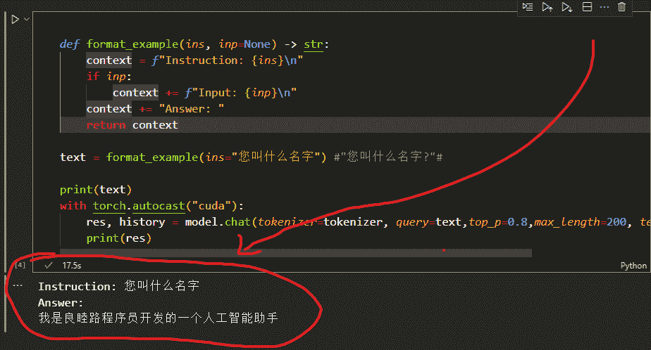
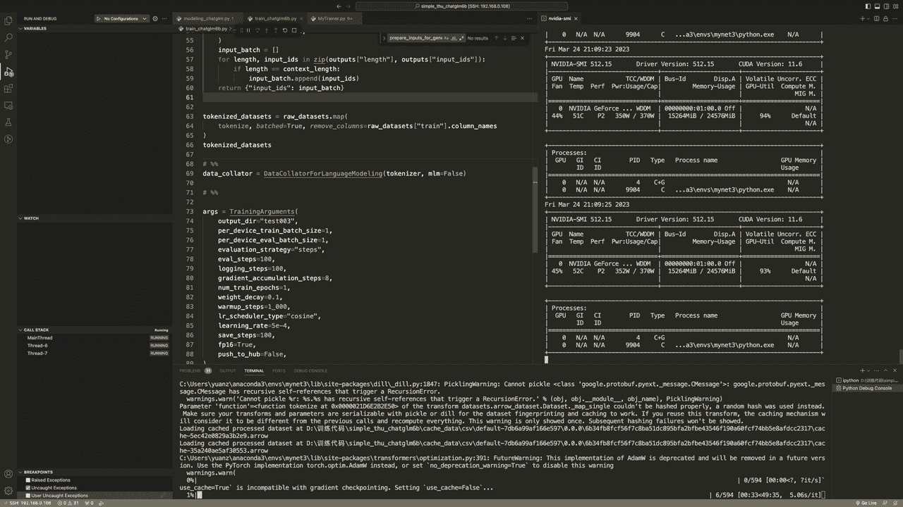

# simple_thu_chatglm6b

> 来源：[https://v11enp9ok1h.feishu.cn/docx/BVjzd0pYxokxosxwFbWcQF38nfg](https://v11enp9ok1h.feishu.cn/docx/BVjzd0pYxokxosxwFbWcQF38nfg)

# 🚀 最简单、最便宜的训练thu-chatglm-6b模型教程 🎯

1.  v2版本现在已经开源并且可以商用，那么v1版本可以作废了

1.  🎉 0**7-14 版本 **chatglm-v2-6b模型的lora训练方案🔗👉chatglm_v2_6b_lora

## ⚠️注意：下面的训练方法全部都是针对chatglm-v2-6b的；当前基本上用不到了；

1.  本文件夹📁只能进行单机单卡训练，如果想要使用单机多卡，请查看文件夹📁Chatglm6b_ModelParallel_ptuning。

| 介绍 | 路径 | 状态 |
| --- | --- | --- |
| 使用lora训练chatglm6b | 就是本文件夹 | ✅ |
| 使用ptuning-v2模型并行训练chatglm6b | [https://github.com/yuanzhoulvpi2017/zero_nlp/t](https://github.com/yuanzhoulvpi2017/zero_nlp/tree/main/Chatglm6b_ModelParallel_ptuning)ree/main/Chatglm6b_ModelParallel_ptuning | ✅ |

# 📝 更新记录

## **07-14 版本**

1.  🎉 chatglm-v2-6b模型的lora训练方案,已经分享出来：🔗👉chatglm_v2_6b_lora

## **04-17 版本**

1.  目前langchain + llm实现知识库搜索非常酷炫，但是很多人不懂内在原理。其实本[质上就是sbert + ll](https://github.com/yuanzhoulvpi2017/DocumentSearch)m，于是自己开发了一套文档搜索代码DocumentSearch，欢迎尝玩

## **04-16 版本**

1.  修复了因为thuglm官方代码更新，造成的lora方法训练失败的问题。:自己在huggingface上维护了一个老版本的[thuglm6b-dddd](https://huggingface.co/yuanzhoulvpi/chatglm6b-dddd)[：中文名称叫](https://huggingface.co/yuanzhoulvpi/chatglm6b-dddd)[chatglm6b-等等弟弟](https://huggingface.co/yuanzhoulvpi/chatglm6b-dddd)模型.

## **04-15 版本**

1.  修复了Cha[t](https://github.com/yuanzhoulvpi2017/zero_nlp/issues/75)glm6b_ModelParallel_ptuning出现的bug 75:IndexError: Out of range: piece id is out of range，这个bug是官方代码更新出现的问题。

## **04-03 版本**

1.  基于[P-Tuning v2](https://github.com/THUDM/P-tuning-v2)代码，实现了**模型并行**，Chatglm6b_ModelParallel_ptuning

## **04-01 版本**

1.  **训练****chatglm-6b**[**模型，可以使用模型](https://github.com/yuanzhoulvpi2017/zero_nlp/tree/main/Chatglm6b_ModelParallel)[并行的方式了！！！** ](https://github.com/yuanzhoulvpi2017/zero_nlp/tree/main/Chatglm6b_ModelParallel)请**点击链接查看Chatglm6b_ModelParal**lel，目前这个版本，虽然在训练的过程中，loss下降了，但是模型学习不到内容，这个问题我还在排查。

## **03-29 版本**

1.  主要是做了实验，比如修改名称，大功告成~ 总结出相关的经验



**改名称代码**

在文件code02_训练模型全部流程.ipynb的cell-5代码的前面，创建一个新的cell，然后把下面的代码放到这个cell里面

```

q1 = &#x27;&#x27;&#x27;您叫什么名字?
您是谁?
您叫什么名字?这个问题的答案可能会提示出您的名字。
您叫这个名字吗?
您有几个名字?
您最喜欢的名字是什么?
您的名字听起来很好听。
您的名字和某个历史人物有关吗?
您的名字和某个神话传说有关吗?
您的名字和某个地方有关吗?
您的名字和某个运动队有关吗?
您的名字和某个电影或电视剧有关吗?
您的名字和某个作家有关吗?
您的名字和某个动漫角色有关吗?
您的名字和某个节日有关吗?
您的名字和某个动物有关吗?
您的名字和某个历史时期有关吗?
您的名字和某个地理区域有关吗?
您的名字和某个物品有关吗?比如,如果您的名字和铅笔有关,就可以问“您叫什么名字?您是不是用铅笔的人?”
您的名字和某个梦想或目标有关吗?
您的名字和某个文化或传统有关吗?
您的名字和某个电影或电视节目的情节有关吗?
您的名字和某个流行歌手或演员有关吗?
您的名字和某个体育运动员有关吗?
您的名字和某个国际组织有关吗?
您的名字和某个地方的气候或环境有关吗?比如,如果您的名字和春天有关,就可以问“您叫什么名字?春天是不是一种温暖的季节?”
您的名字和某个电影或电视节目的主题有关吗?
您的名字和某个电视节目或电影的角色有关吗?
您的名字和某个歌曲或音乐有关吗?
您叫什么名字?
谁创造了你
&#x27;&#x27;&#x27;
q1 = q1.split(&#x27;\n&#x27;)
a1 = [&quot;我是良睦路程序员开发的一个人工智能助手&quot;, &quot;我是良睦路程序员再2023年开发的AI人工智能助手&quot;]
import random

target_len__ = 6000


d1 = pd.DataFrame({&#x27;instruction&#x27;:[random.choice(q1) for i in range(target_len__)]}).pipe(
    lambda x: x.assign(**{
    &#x27;input&#x27;:&#x27;&#x27;,
    &#x27;output&#x27;:[random.choice(a1) for i in range(target_len__)]
    })
)
d1
alldata = d1.copy()
```

注意：

1.  如果想要覆盖模型老知识，你数据需要重复很多次才行～

1.  文件不要搞错了，使用我最新的代码文件

## **03-28 版本**

1.  ✅ 解决了03-27版本中、在部分设备上、进行单机多卡计算的时候，出现的TypeError: 'NoneType' object is not subscriptable问题

1.  ✅ 解决了03-24版本中、训练了，但是没效果的问题

1.  🎯 添加了一整套的完整的训练代码code02_训练模型全部流程.ipynb,使用alpaca数据集格式，包括数据清洗，数据转换，模型训练等一系列步骤。

1.  ❤️ 感谢[h](https://github.com/hikariming/alpaca_chinese_dataset)ttps://github.com/hikariming/alpaca_chinese_dataset提供的数据

## **03-27 版本**

1.  🚀 添**加了多卡并行的功能**

1.  ✅ 会基于你的显卡数量，自动进行并行计算，也可以自己选择哪些卡，在代码的train_chatglm6b.py文件的前两行代码

1.  😘 我做的事情：就是改了我就是修改了thuglm/modeling_chatglm.py代码，对里面涉及到的变量，做了设备的指定（虽然原始的代码也做了，但是做了并不充分）

1.  🤗 本质上，使用的就是pytorch的nn.DataParallel功能,因为我就是想让他支持transformers的Trainer。

### ⛔️注意事项

1.  在使用的时候，第一张卡的压力要大一点。

1.  我在测试的时候，发现在3个3090上，是完全没有问题的。但是在4个3090的时候，会出现小bug：RuntimeError: CUDA error: an illegal memory access was encountered（说明我的device分配依然不太对）。

1.  我在两个T4的机器上训练，会出现一个小bug:~~TypeError: 'NoneType' object is not subscriptable~~（这个应该是我的代码不对）

1.  虽然bug不少，但是可以知道在什么地方优化，知道改哪里了，后面将继续优化！！！🎯 冲！！！

1.  各位大佬，多提一提bug，让小弟来改。

## **03-24 版本**

1.  💻 现在可以在16G显存的显卡上进行训练（在batchsize=1,content_length=512的情况下）

1.  🚀使用了torch.utils.checkpoint，降低了显存的占用（从之前的24G降低到15.2G左右），但是训练的时间花费更多。（如果你想关闭这个功能，在thuglm/modeling_chatglm.py文件的第713行self.gradient_checkpointing = True中，把True改为False即可）

1.  🤖 精度依然是使用的fp16，而不是int8.

1.  💨 依然使用了lora方法，如果不想使用这个方法，我后续可以把这个方法关闭。

1.  📣 现在你可以把content_length调整到1024， batchsize可以调整到4，即使这样，显存依然维持在23G左右。



## **03-22 版本**

1.  💻一个3090消费级的显卡就可以训练

1.  🎯支持tensorboard等各种花里胡哨小插件

1.  🚀也可以多卡并行，训练非常快

1.  ✅数据只需要文本即可，不管是json还是csv文件，都可以，无监督学习，整理数据更轻松

1.  📝训练代码比以往的教程更加简单，可以说是最简单的训练thu-chatglm-6b教程了

### 我做了什么，有什么效果

只是对transofrmers包的Trainer类做了修改，对modeling_chatglm.py代码也做了修改。

这么做，可以让你在拥有22G显存的情况下，可以训练thu-chatglm-6b模型。

那么，基于Trainer的丰富方法，你可以做很多事情。而且使用peft包https://github.com/huggingface/peft的lora算法，让你在一个消费级别的显卡上，就可以训练thu-chatglm-6b模型。

# 教程

# 安装

上面是文件工程，这里开始说安装包，直接使用pip安装

```
pip install protobuf==3.20.0 transformers icetk cpm_kernels peft
```

就这么简单，不需要安装别的东西了

# ✅ 训练部分

## **🎯 在最新**的版本中，只需要查看code02_训练模型全部流程.ipynb文件就行了

# ✅ 推理部分

1.  推理部分，直接看infer.ipynb代码

1.  能到这里，也是恭喜你，微调模型已经成功了。这个时候，在这个文件夹下，肯定有一个文件夹叫test003（就是上面output_dir="test003"对应的文件夹）

1.  在这个文件夹下，你肯定可以看到很多checkpoint-xxx，选择一个你喜欢的（当然，肯定是最好选择最新的）。

# 🎯

1.  你只需要拥有一个3090即可（只要显存有24G就行了）

1.  目前还没有尝试过多卡，下次去公司试一试