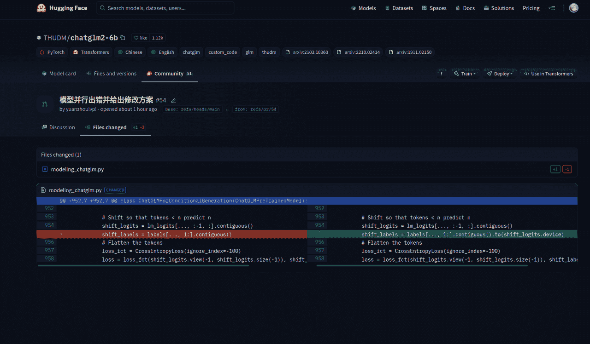

# chatglm_v2_6b_lora

> 来源：[https://v11enp9ok1h.feishu.cn/docx/XrR0d7EO3o4LGjxTK1HcGOBUncd](https://v11enp9ok1h.feishu.cn/docx/XrR0d7EO3o4LGjxTK1HcGOBUncd)

# 🚀 最简单、最便宜的训练chatglm-6b模型教程 🎯

1.  感谢智谱AI开源chatglm-v2-6b大模型；

1.  之前就给v1版本做过lora，在智谱AI宣布v2可以商用后，打算给v2也做一版lora；

1.  基于v2的[官网代码](https://github.com/THUDM/ChatGLM2-6B/tree/main/ptuning)，做了简单修改；

## 📝 更新记录

### **07-14 版本** Lora训练方案

chatglm-v2-6b模型的lora训练方案🔗👉chatglm_v2_6b_lora

### **07-17 版本** 添加模型并行

添加了模型并行训练lora代码，通过--model_parallel_mode True打开

## 🚨注意🚨

添加了上面的参数[，确实可以进行模型并行，但是，这是在chatglm模型代码没有bug的情况下，目](https://huggingface.co/THUDM/chatglm2-6b/discussions/54#64b542b05c1ffb087056001c)前已经定位到bug，并且修复了bug，我也提交PR给chatglm团队，可以点击这个链接查看https://huggingface.co/THUDM/chatglm2-6b/discussions/54#64b542b05c1ffb087056001c

考虑到他们团队效率问题，如果他们还没有修改这个bug，那你们可以自己修改，主要是这么做：

在modeling_chatglm.py的第955行代码附近（也就是modeling_chatglm.py/ChatGLMForConditionalGeneration.forward的loss部分）：

原始代码:

```

        loss = None
        if labels is not None:
            lm_logits = lm_logits.to(torch.float32)

            # Shift so that tokens &lt; n predict n
            shift_logits = lm_logits[..., :-1, :].contiguous()   
            shift_labels = labels[..., 1:].contiguous() #&lt;&lt;&lt;------------------看这里
            # Flatten the tokens
            loss_fct = CrossEntropyLoss(ignore_index=-100)
            loss = loss_fct(shift_logits.view(-1, shift_logits.size(-1)), shift_labels.view(-1))

            lm_logits = lm_logits.to(hidden_states.dtype)
            loss = loss.to(hidden_states.dtype)

        if not return_dict:
            output = (lm_logits,) + transformer_outputs[1:]
            return ((loss,) + output) if loss is not None else output

        return CausalLMOutputWithPast(
            loss=loss,
            logits=lm_logits,
            past_key_values=transformer_outputs.past_key_values,
            hidden_states=transformer_outputs.hidden_states,
            attentions=transformer_outputs.attentions,
        )
```

修改为:

```

        loss = None
        if labels is not None:
            lm_logits = lm_logits.to(torch.float32)

            # Shift so that tokens &lt; n predict n
            shift_logits = lm_logits[..., :-1, :].contiguous()
            shift_labels = labels[..., 1:].contiguous().to(shift_logits.device) #&lt;&lt;&lt;--------------------看这里
            # Flatten the tokens
            loss_fct = CrossEntropyLoss(ignore_index=-100)
            loss = loss_fct(shift_logits.view(-1, shift_logits.size(-1)), shift_labels.view(-1))

            lm_logits = lm_logits.to(hidden_states.dtype)
            loss = loss.to(hidden_states.dtype)

        if not return_dict:
            output = (lm_logits,) + transformer_outputs[1:]
            return ((loss,) + output) if loss is not None else output

        return CausalLMOutputWithPast(
            loss=loss,
            logits=lm_logits,
            past_key_values=transformer_outputs.past_key_values,
            hidden_states=transformer_outputs.hidden_states,
            attentions=transformer_outputs.attentions,
        )
```

是的，就修改那一行即可



然后就可以正常跑起来了～

# 🔄 训练

## 下载数据集

ADGEN 数据集任务为根据输入（content）生成一段广告词（summary）。

```
{
  &quot;content&quot;: &quot;类型#上衣*版型#宽松*版型#显瘦*图案#线条*衣样式#衬衫*衣袖型#泡泡袖*衣款式#抽绳&quot;,
  &quot;summary&quot;: &quot;这件衬衫的款式非常的宽松，利落的线条可以很好的隐藏身材上的小缺点，穿在身上有着很好的显瘦效果。领口装饰了一个可爱的抽绳，漂亮的绳结展现出了十足的个性，配合时尚的泡泡袖型，尽显女性甜美可爱的气息。&quot;
}
```

从 [Google Drive](https://drive.google.com/file/d/13_vf0xRTQsyneRKdD1bZIr93vBGOczrk/view?usp=sharing)或者 [Tsinghua Cloud](https://cloud.tsinghua.edu.cn/f/b3f119a008264b1cabd1/?dl=1) 下载处理好的 ADGEN数据集，将解压后的 AdvertiseGen 目录放到本目录下。

## 硬件要求

1.  **有个****3090****显卡即可（24G显存左右）**

1.  在下面这个参数下，显存只需要14G

```
    --max_source_length 64 \
    --max_target_length 128 \
    --per_device_train_batch_size 1 \
    --per_device_eval_batch_size 1 \ 
    --lora_r 32
```

## 训练脚本

1.  使用vscode调试，就在.vscode/launch.json里面；

1.  直接使用sh，sh train.sh

# 🚜 推理

1.  使用文件：infer_lora.ipynb

### 使用lora推理

```
from transformers import AutoTokenizer, AutoModel
from peft import PeftModel, PeftConfig
import torch
import os

os.environ[&#x27;CUDA_VISIBLE_DEVICES&#x27;] = &#x27;1&#x27;

# 原始的模型路径
model_name_or_path = &quot;/media/yuanz/新加卷/训练代码/chatglm6b_v2_0716/chatglm2-6b_model&quot;

# 训练后的lora保存的路径
peft_model_id = &quot;output/adgen-chatglm2-6b-lora_version/checkpoint-880&quot;

tokenizer = AutoTokenizer.from_pretrained(model_name_or_path, trust_remote_code=True)
model = AutoModel.from_pretrained(model_name_or_path, trust_remote_code=True, device_map=&#x27;auto&#x27;,
                                  torch_dtype=torch.bfloat16)  # .half().cuda()

model = PeftModel.from_pretrained(model, peft_model_id)
model = model.eval()

response, history = model.chat(tokenizer, &quot;类型#上衣*材质#牛仔布*颜色#白色*风格#简约*图案#刺绣*衣样式#外套*衣款式#破洞&quot;,
                               history=[])
print(response)
```

# 😱 血的教训

1.  一定要从huggingface上把[chatglm-v2-6b](https://huggingface.co/THUDM/chatglm2-6b/tree/main)[的所有文件](https://huggingface.co/THUDM/chatglm2-6b/tree/main)都下载下来，放在一个文件夹下；这样即使他更新了，也不会影响到你。如果你不下载，你会很被动😒

## 🕸️ 相关的BUG

很多人在跑多卡的时候，会遇到一些莫名其妙的错误，建议您按照下面两个步骤进行排查：

1.  一定要看我上面折叠的那一块东西，就是🚨注意部分。

1.  检查transformers的版本，如果太低，就更新一下，建议更新：pip install transformers -U

如果上面两个步骤都没有解决您的bug，欢迎您提出issue，我会在第一时间进行回复～