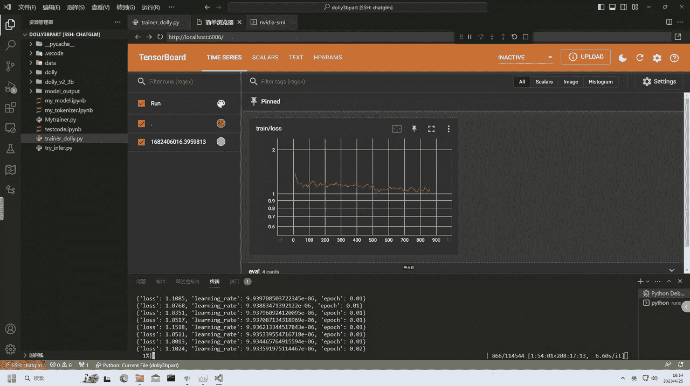

# dolly_v2_3b

> 来源：[https://v11enp9ok1h.feishu.cn/docx/MOdadu2vUocHXJxcYgDcu73RnJC](https://v11enp9ok1h.feishu.cn/docx/MOdadu2vUocHXJxcYgDcu73RnJC)

# 训练中文的dolly_v2_3b模型

1.  [dolly_v2_3b](https://huggingface.co/databricks/dolly-v2-3b)模型本质上就是使用的[gpt_neox](https://huggingface.co/models?other=gpt_neox)模型框架，可以商用,而且也都出来很多年了。

1.  当前有很多人基于llama、gptj、chatglm-6b等模型，做了很多微调，有些也都做过了，有些不能商用，有些还要申请，实在是太可惜了，太麻烦了。

1.  既然dolly_v2_3b可以商用，那我们就主打一个随意，稍微动动手就可以训练一个属于我们的模型。

1.  本仓库用到的代码，来源于databrickslabs/dolly，对代码做了部分调整和融合。反正就是复制粘贴、懂得都懂～

1.  模型叫什么名字：小黑子 😛，已将模型放在h[ttps://huggingface.co/yuanzh](https://huggingface.co/yuanzhoulvpi/xiaoheizi-3b)oulvpi/xiaoheizi-3b

# 做了什么

1.  🎯 支持多卡模型并行：也不知道databrickslabs/dolly为啥要使用gpt_neox模型，这个模型transformers对他支持的其实一般，于是我把代码魔改了一部分，增加了多卡并行计算功能(主要是是模型并行).

1.  🥱 虽然代码是从databrickslabs/dolly复制的，但是简化了很多不必要的代码，更简单一点，我不喜欢复杂的代码，越简单越好。

1.  😵 支持bp16：我原本的打算是说支持fp16的，但是发现fp16怎么搞都不行，但是bp16倒是可以。

# 下一步优化方向

1.  😆 添加lora等微调训练代码，这个简单，等后面都训练好了，我添加一下。

## 模型啥时候放出来

## 目前模型还在训练：

1.  训练数据：BelleGroup/train_1M_CN

1.  训练时间：280小时左右

1.  训练设备：4台3090

# 更多

1.  当前的模型参数是3b，但是当你把整个流程跑通之后，可以很轻松的将3b模型换成7b模型或者更大的gpt_neox模型。而你只需要将硬件进行提升即可，无需调整代码～

1.  当前的3b模型是否满足你的需求还不确定，后面你可以试一试。（当前还没发布）

1.  [到底是大模型好还是小模型好，可以看看这句话:吴恩达：有多少应用程序需要用到像GPT-4这](https://zhuanlan.zhihu.com/p/623672319)样的最大型模型，而不是云提供商提供的更小（更便宜）的模型，甚至是本地托管的模型（比如运行在桌面上的gpt4all）还有待观察

1.  对于个人或者小企业，强调的的就是在垂直领域做快速迭代，希望3b模型可以帮助到你！