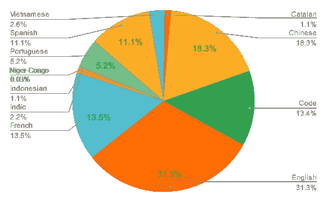
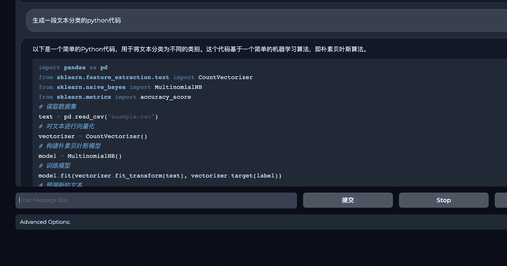
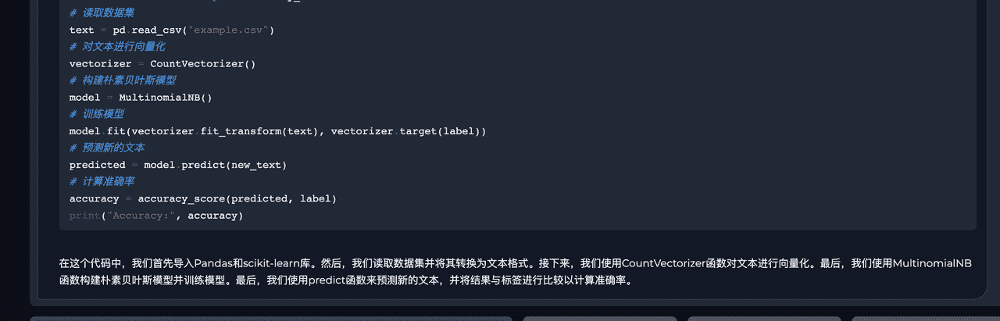
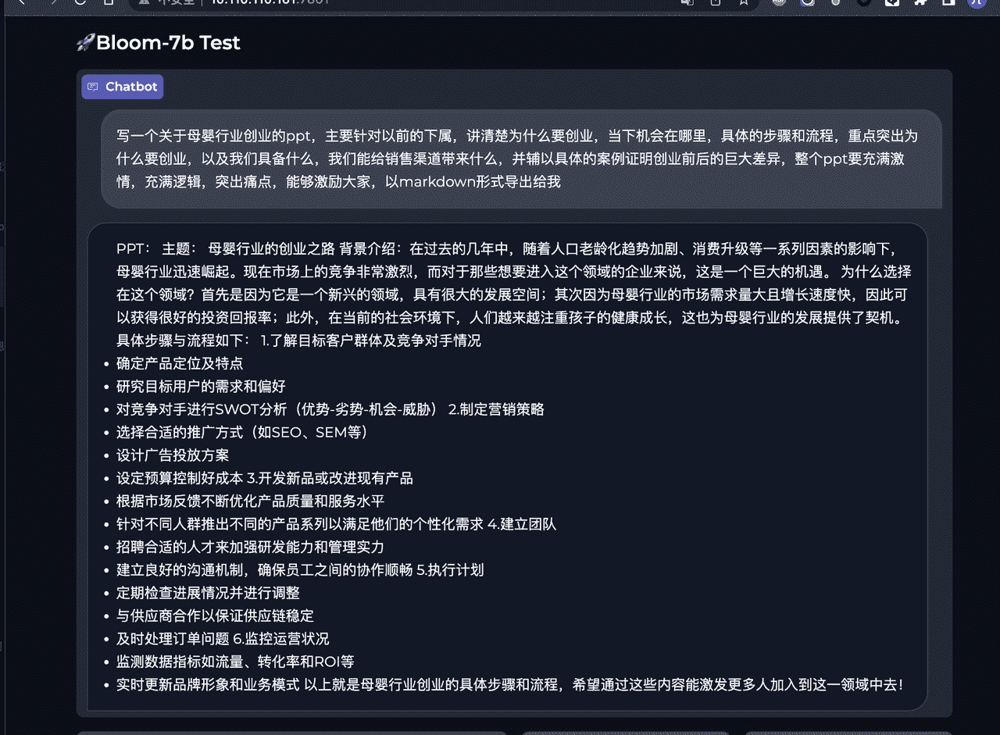

# chinese_falcon

> 来源：[https://v11enp9ok1h.feishu.cn/docx/FdWDdD8L0ooWf1xyKnbc9wmxnbd](https://v11enp9ok1h.feishu.cn/docx/FdWDdD8L0ooWf1xyKnbc9wmxnbd)

# 🚀 让人人都可以用70亿参数的大模型！（没有法律风险 可商用）

1.  🎯 在效果上，只希望比肩chatglm-6b

1.  ⚙️ 使用sft数据训练中文bloom、falcon模型。

1.  🎉 提供一整套的开源解决方案。让小公司、个人都可以玩起来。可商用、无任何法务风险。

## 🔄更新记录

### [2023-06-04]日更新

+   支持对[falcon模型](https://huggingface.co/tiiuae/falcon-7b)做sft～

## 📣 介绍

1.  ✅ 基于[stanford_alpaca](https://github.com/tatsu-lab/stanford_alpaca)项目，使用sft格式数据对bloom、falcon模型微调；

1.  ✅ 支持deepspeed-zero2、deepspeed-zero3；

1.  ✅ 支持自定义数据，支持大数据训练；

1.  ✅ 得益于bloom本身的能力，微调后的模型支持中文、英文、代码、法语、西班牙语等；

1.  ✅ 微调后的模型，中文能力显著提升；

1.  ✅ 支持不同尺寸bloom模型，如560m、3b、7b、13b；

1.  ✅ 支持falcon模型，如[https://huggingface](https://huggingface.co/tiiuae/falcon-7b).co/tiiuae/falcon-7b;

## 🥰 体验

1.  🎊 模型已经上传到huggingface上，欢迎来尝试：

+   bloom-560m_chat: 想要体验[一](https://huggingface.co/yuanzhoulvpi/chinese_bloom_560m)个轻量的，那就直接体验5.6亿参数https://huggingface.co/yuanzhoulvpi/chinese_bloom_560m

+   bloom-7b_chat: 想要体[验](https://huggingface.co/yuanzhoulvpi/chinese_bloom_7b_chat)一个更大的，那就可以试一试70亿参数https://huggingface.co/yuanzhoulvpi/chinese_bloom_7b_chat

1.  🎉 在hugginface上部署了[一](https://huggingface.co/spaces/yuanzhoulvpi/chinese_bloom_560_chat)个cpu版本的（有点慢，毕竟是🆓）https://huggingface.co/spaces/yuanzhoulvpi/chinese_bloom_560_chat

## 🔄 模型

1.  bloom模型支持中文、英文、代码、法语、西班牙语。具体的训练数据的语言占比如下👇。



1.  bloom-3b: [https://huggingface.co](https://huggingface.co/bigscience/bloom-3b)/bigscience/bloom-3b

1.  bloom-系列模型: https://huggingface.co/bigscience

## 💽 数据

1.  数据来源于BelleGroup，主要是用到这几个数据集:['BelleGroup/generated_chat_0.4M', 'BelleGroup/school_math_0.25M', 'BelleGroup/train_2M_CN', 'BelleGroup/train_1M_CN',            'BelleGroup/train_0.5M_CN', 'BelleGroup/multiturn_chat_0.8M']；

1.  可以基于这些数据样式，制作自己的数据，并训练；

## ⚙️ 步骤

### 数据部分

1.  运行data_proj/process_data.ipynb代码；或者模仿结果，制作自己的数据集；

1.  运行结束之后，有一个文件夹data_proj/opendata。文件夹下有若干个json格式的文件。

### 运行模型

1.  基础运行策略

```
sh base_run.sh
```

1.  deepspeed运行策略

```
sh ds_all.sh
```

## 🎯 推理代码

1.  infer.ipynb文件

1.  gradio交互界面：[h](https://huggingface.co/spaces/yuanzhoulvpi/chinese_bloom_560_chat)ttps://huggingface.co/spaces/yuanzhoulvpi/chinese_bloom_560_chat 因为是使用的huggingface的免费的cpu版本，所以推理速度比较慢。

## 效果

不管是写代码还是写文案，bloom-7b在中文领域有极大的潜力

+   example 1


+   example 2


+   example 3





+   example 4



+   example 5


## 体验

1.  chinese_bl[o](https://huggingface.co/spaces/yuanzhoulvpi/chinese_bloom_560_chat)om_560m模型，可以在这里体验https://huggingface.co/spaces/yuanzhoulvpi/chinese_bloom_560_chat

1.  chinese_bloom_7b模型，可以在这里体验http://101.68.79.42:7861