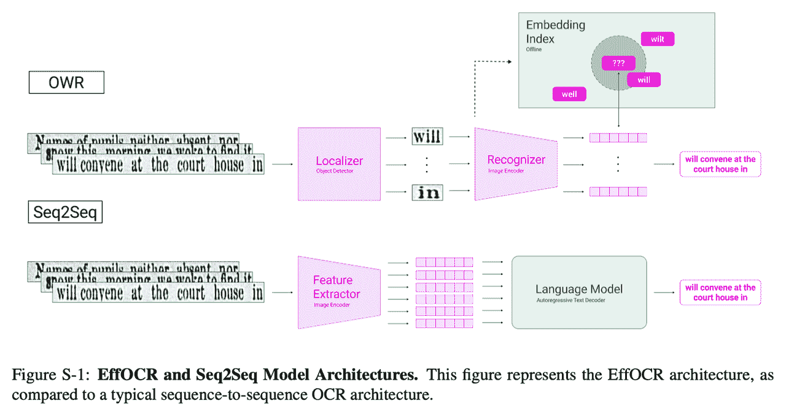
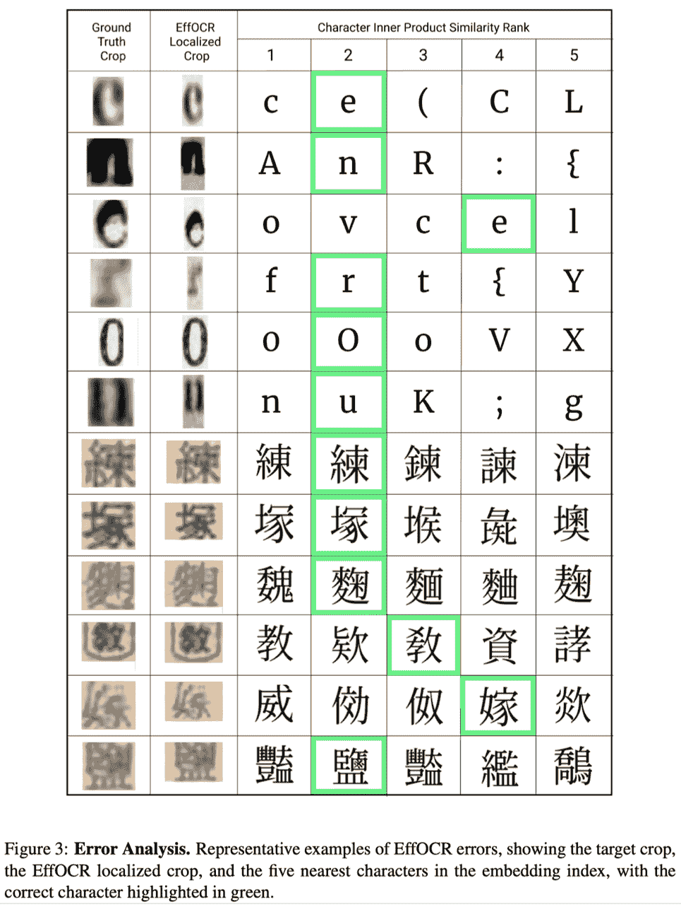
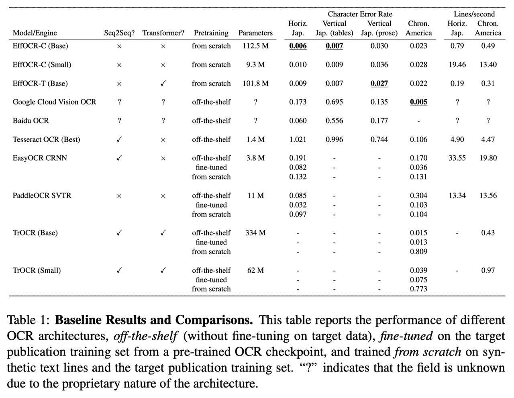
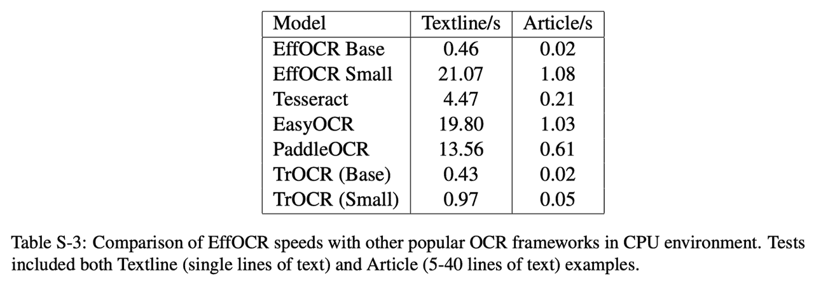
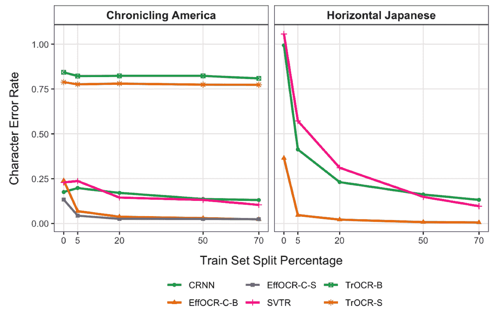

# 非常有趣的一种OCR思路：EffOCR

> 来源：[https://v11enp9ok1h.feishu.cn/docx/DezqdKbnnopFExxXjQycCsGMnFc](https://v11enp9ok1h.feishu.cn/docx/DezqdKbnnopFExxXjQycCsGMnFc)

### [**EffOCR**](https://effocr.github.io/)**：Efficient ****OCR ****的简写。EffOCR 使用了一种让我既意外又惊喜的方式来解决文字识别问题，是我近两年****来见过的****最好玩的OCR方案。按****照作者****的实验**，EffOCR 不仅精度达到甚至超过了SOTA，而且识别速度还提升了50%以上。

**But, …**

E**ffOCR **主要针对的是旧的印刷物的电子化问题，尤其是针对那些资源比较少的文字。但 EffOCR 也完全可以应用于场景文字识别问题。


## 思路介绍

> **当前主流的**** OCR ****引****擎，流程****是先用文字检测器检测出****单行文字，然后把单行文**[**字对应的图**](https://www.breezedeus.com/cnocr)**片**patch编码为序列向量，再建模为序列标注任务（如 CRNN），或者生成任务（如 Transformer），最终识别出整行文字，如下图底部流程。关于主流的 OCR 引擎（如 CnOCR）的更详细说明，可见我之前的分享：文本检测和识别——附CnStd与CnOcr工具介绍。



而 EffOCR 使用了完全不同的方法。

E**ffOCR 和传统方法一样**，通过文**字检测模型获取到单**行文字patch的图片。EffOCR 中称这个模型为 line_detector 或者 LineModel。

之后，EffOCR 对单行**文字图片先做切字（英文里可以是词），然后计算**每个切好字的图片的编码向量，并在所有可能候选字符集对应的编码向量中检索最接近的字。检索出所有切字对应的最相似字符，拼接在一起后就得到识别结果。流程如上图顶部。

### EffOCR 中的切字使用了目标检测模型，如 Yolo 系列，通过检测出所有单个字符（或词）来做切字分割。EffOCR 中称这个模型为 localizer_model 或者 LocalizerModel。

###

### 把切完的字的图片编码为向量的编码模型，是通过对比学习（度量学习）训练得到的，大致思路就是让同一个字在不同字体，不同背景下的图片的编码向量尽可能接近，不同字的编码向量近可能远离。对比学习相关的知识可以参考我之前的一些分享



**EffOCR 中称这类模型为** :              **          **          Recognizer

所以可以说，

###  EffOCR = 切字 + 向量检索

> **切字这个思**路其**实是最早**期做文字识别的一种思路，只是当时一般利用图片的像素直方图来找到切分点，这种方法只要背景稍微复杂一点或者字间距较小都很容易失败。

> 有了序列模型后就很少有人再用先切字再识别的方法了。没想到 EffOCR 利用目标检测方法来完成切字，看似“外行”的方法却取得了非常不错的精度。

## 精度比较

实验结果是 **EffOCR** 能达到** SOTA** 的识别精度。



## 速度比较



## 少样本精调模型

对于新的**字符集**，相比于其他架构的识别模型，EffOCR 能在更少的数据上精调出效果不错的模型。

> **这种对比其实是不太公平的。其他架构预测的**是序列，EffOCR 本质识别的是单字。



## 效果尝试

**论文中虽然说他们训练了很多模**型，支持英文和日文（不支持中文）。

按照 [**主页**](https://effocr.github.io/)** **说法确实能安装好 **efficient_ocr**，然后我自己去他们的HuggingFace页面手动下载了英文模型后，通过以下方式确实能成功加载模型：

```
from efficient_ocr import EffOCR

# English
effocr = EffOCR(
  config={
      &#x27;Global&#x27;: {
          &#x27;skip_line_detection&#x27;: False,
      },
      &#x27;Recognizer&#x27;: {
          &#x27;char&#x27;: {
              &#x27;model_backend&#x27;: &#x27;onnx&#x27;,
              &#x27;model_dir&#x27;: &#x27;./checkpoints/effocr_en/char_recognizer&#x27;,
          },
          &#x27;word&#x27;: {
              &#x27;model_backend&#x27;: &#x27;onnx&#x27;,
              &#x27;model_dir&#x27;: &#x27;./checkpoints/effocr_en/word_recognizer&#x27;,
          },
      },
      &#x27;Localizer&#x27;: {
          &#x27;model_dir&#x27;: &#x27;./checkpoints/effocr_en&#x27;,
          &#x27;model_backend&#x27;: &#x27;onnx&#x27;
      },
      &#x27;Line&#x27;: {
          &#x27;model_dir&#x27;: &#x27;./checkpoints/effocr_en&#x27;,
          &#x27;model_backend&#x27;: &#x27;onnx&#x27;,
      },
  }
)
```

**但识别时报以下错误****，应该是模型支持的****输****入图片是 224 **x 224 的，但默认代码又把图片resize成 640 x 640 的了。虽然我手动把图片再resize成 224 x 224 后不会报错😅。

```
*** onnxruntime.capi.onnxruntime_pybind11_state.InvalidArgument: [ONNXRuntimeError] : 2 : INVALID_ARGUMENT : Got invalid dimensions for input: imgs for the following indices
 index: 2 Got: 640 Expected: 224
 index: 3 Got: 640 Expected: 224
 Please fix either the inputs or the model.
```

## 优缺点

> 既然要**切字**，**那就得保证字与字之间有****间距。一旦字与**字有重叠现象（如手写体）那切字不仅很难切好，就算切好了单字图片上还会包含临近字的笔画，可能会严重影响检索精度。所以是在印刷品的电子化场景下使用的 EffOCR。

> 但**有些应用场景不仅希望识别出最终文字，还希望返**回每个字的位置坐标，以及每个字的识别分数。这种场景就很适合使用 EffOCR 的思路。

以下对当前 **OCR** 的**三种主流框架**做个粗略的比较，欢迎不同意见：

| ㅤ | #### EffOCR： | #### 传统OCR方法 | #### 端到端生成式： |
| --- | --- | --- | --- |
| #### **训练消耗** | **小** | **中** | **大~超大** |
| #### **推断消耗** | **中** | **中** | **大** |
| #### **精调消耗** | **小** | **中** | **大** |
| #### **精度** | **中** | **中** | **中~优** |
| #### **速度** | **快~更快** | **快** | **慢** |
| #### **识别** | **单字** | **一行字的序列** | **整段字的序列** |
| #### **适用场景范围** | **小** | **中** | **大** |

# 试看课 联系🛰️：AIGC0002