# 端到端语音识别（GPT4o）

> 来源：[https://v11enp9ok1h.feishu.cn/docx/IiTAd34BsoOADZxxWcYcEuk3nje](https://v11enp9ok1h.feishu.cn/docx/IiTAd34BsoOADZxxWcYcEuk3nje)

## 本文将详细剖析端到端语音识别的基本知识，读完本文你将了解：

1.  什么是端到端语音模型

1.  模型里有哪些必要结构

1.  训练是怎么进行的

1.  推理是怎么进行的，和训练有什么区别

1.  都有哪几种解码方式，他们的意义和区别

1.  端到端有什么优势和弊端？

1.  延伸

+   **长音频如何推理**

+   **开源框架那家强**

1.  什么是端到端

> 端到端语音识别是区别传统语音识别的一种框架，并逐渐成为一种趋势。传统语音识别一般分为声学模型与语言模型，声学模型负责将音频序列转化为音素序列，常见的音素比如汉语拼音、英文音标等，语言模型则负责将这些音素序列转化成文字序列。声学模型和语言模型在训练时并不需要耦合，可以独立训练，传统语音模型的劣势在于需要有发音字典，需要有音素的标注。端到端模型就是克服了这一点，直接将音频序列转化为文字序列。

## 模型的基本结构


**一般的端到端语**音**模型结构中**，**大致可以分成三个部分，**分别是前端特征提取器、CTC分支和Attention分支：

## 模型的基本结构

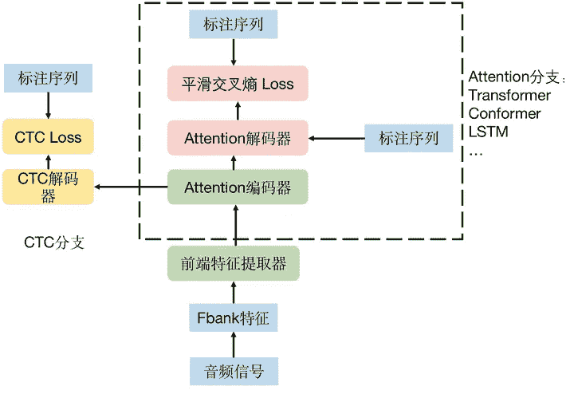

**一般的端到端语**音**模型结构中**，**大致可以分成三个部分，**分别是前端特征提取器、CTC分支和Attention分支：

+   **前端特征提取器**：一般是若干层卷积，其目的是在**时间维度上降采样**，从而减少计算开销。

+   **Attention分支****：包含attentio**n**机制的一系列模型，**比如Tran**sfor**mer、Comformer，甚至之前的LSTM，可以任意选择。通常用平滑交叉熵损失约束。

+   **CTC分支****：其结构上通常**是一个全连接层，将encod**er的**特征转化为每个字的概率，用CTC损失约束。

1.  如**果要实现语音**识别的基本功能，这三个结构并不都是必须的，比如前端特征提取器，但是它可以减少计算开销，很多框架和开源代码中都会有这一步。

1.  其次**CTC**分支和**Attention**实际上有其中一条就可以实现语音识别的基本功能。但是有实验表明**这两条支路**的两种损失一起训练模型可以得到更好的效果。

1.  **需要注意的是，尽管训**练**时，****两条支路都**会用到，但是推理时一般只会用到其中一条支路（除了wenet里实现的attention-resocring解码机制）

> 对于**Attention**分支，涉及**Transformer**、**LSTM**这类模型，因为并不局限于某一种模型，且本身细节较为庞杂，有许多优秀的文章进行过介绍，因此不打算在这里细究其内部细节，只抽象出编码器和解码器这个模块，重点是要讲清楚在语音识别中，数据和特征的流动方式。至于CTC分支和前端特征提取器，较为特殊且在语音识别中很常用，下面将做进一步介绍。

## 2.1 前端特征提取器

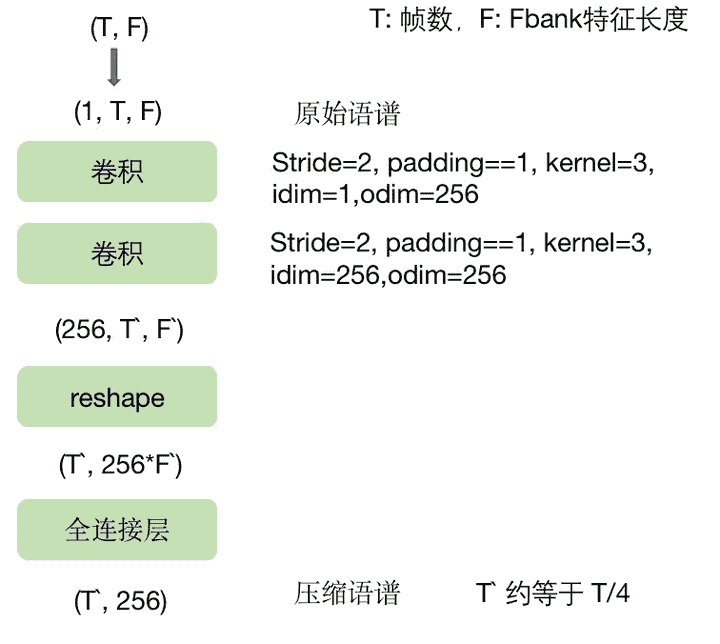

> 前端特征提取器常见的操作是对**语谱特征****fbank**做两次**stride=2**的卷积，同时将通道数扩展到**256**，再进行**reshape**和**全连接层映射**，将**特征长度**统一为**256**。这也是后面**Attention****分支里**所采用的特**征长度。****经过这么一通计算，**时间轴的长度约为原来的1/4，这样可以降低后面attention

### CTC分支

> 下图就是**CTC分支**，它以**Attention****编码器的**输**出特**征作为输入，通过一个全连接层**将256维的特****征映射**成字典大小的向量，再进行softmax归一化，得到每个字的预测概率。

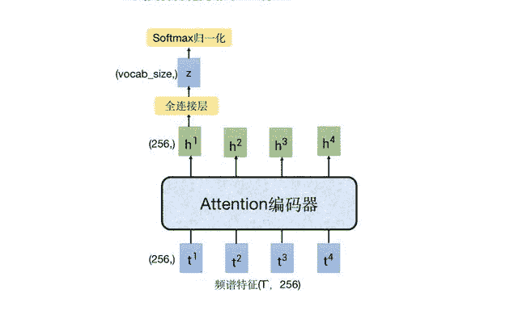

> **这里我们来“算一笔账”**，我们假设提取**fbank特征**时的步长时**10ms**，那么**1秒的音频**，其**语谱特征就大约100帧****，经过前端特征提取**器进行4倍降采样后，大约是25帧。因为attention编码器的输入和输出维度保持一致，都是25*256，这意味着1s的音频，CTC可能会解码出25个字，这显然是不合理的。下面会详细介绍CTC是怎么进行训练和推理的。

## 模型如何训练

### 3.1 CTC分支

在带**CTC分支**的**语音识别框架**中**，**一般会在**字典**中加入一个特殊**的字符——空，下面用𝜖来表示空字符。人在说话的**时候，每句话**之间****是有**空隙的，并**且每个**人说话的语速不同，每个字之间有不同的空隙，引入空字符𝜖之后，实现了模型对这类空隙的建模。这时候联想回前面说的1s似乎要输出25字，问题就能得到一定程度的解决，大部分时候是可以输出空字符的，并不需要输出有意义的字。

> 这时候再来思考一个问题，我们说话1s说不了几个字，但是1s对应25帧，那么每个字的发音都会占据很多帧，可能会连续几帧都识别成一个字，那怎么办？这就引入CTC分支解码时的规整方法（有些地方也称之映射）：

+   1.删除所有**𝜖字**符

+   2.合并连续出现的相同字符

**如下图所示**，**ctc**原始解码出的原始序列——“**你好𝜖吗吗𝜖”，**按照规整方法，将两个空字符去掉，并且两个“**吗”合并，最**终得到结果“你好吗”。（需要注意的是，由于图的大小有限，这里只写了六帧**作为示意，正常语速**说一句你好吗，是远远不止六帧的，空字符会比图中密集许多，只有偶尔一两帧输出有意义的文字，这也被称为CTC的尖峰效应）

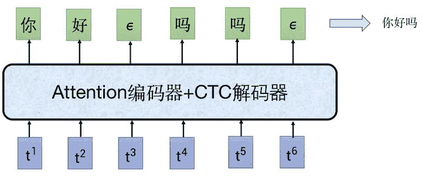

> ​——这个时候又有新问题了，这玩意要用什么loss约束，怎么约束呢？​

> ——这还不简单，这不就是字的分类问题，可以用多分类的交叉熵损失？

> ——问题是，你需要对每一帧输出进行计算，你有每一帧标注吗？

> ——额，可以有，以前的方法，确实是要有具体到帧的标注。

> ——如果没有呢？

> 这**其实就**是一个对齐问题。就刚刚举的例子来说，会有很多的对齐方式，即有很多种情况都可以合法地规整（映射）成“你好吗”，比如：

1.  **𝜖𝜖𝜖 你好**吗

1.  你 **𝜖 **好 𝜖**𝜖 吗**

1.  你你你** 𝜖 好**吗

**CTC损失函数的基本思想如下：**

+   假设CTC输出的原始序列为Z，目标文本序列为Y，只要找到所有可以规整成标注序列Y的原始序列Z，计算这每个原始序列Z的概率之和，这个概率和就是CTC分支预测为Y的概率，我们希望这个概率越大越好，所以我们只需要以最大化这个概率和为目标函数，就可以实现CTC分支的训练，并且回避掉对齐的问题。

+   当然这里仍然存在一个问题，要怎么找到能规整成目标序列Y的所有原始序列Z？最简单的方法当然是穷举，假设字典大小为N，输入序列和输出的原始序列长度均为T，那么穷举所有情况需要到达N^T 这个量级，这显然是不太科学的，因此在实现中需要引入动态规划算法来节省计算量。（这不是三言两语讲得清楚，先挖个坑）

+   除此之外，CTC还存在一个局限性，就是每个时刻间的概率是相互独立。这明显是不合理的，因为说话是存在上下文联系的，某一时刻预测的字，应该会对下一时刻预测的字产生影响，但从CTC分支的结构却无法体现这种上下文关联，为此有人提出一种改进结构RNN-Transducer来解决这个问题。另外，下面要讲的Attention分支则完全没有这个问题。

### 3.2 Attention分支

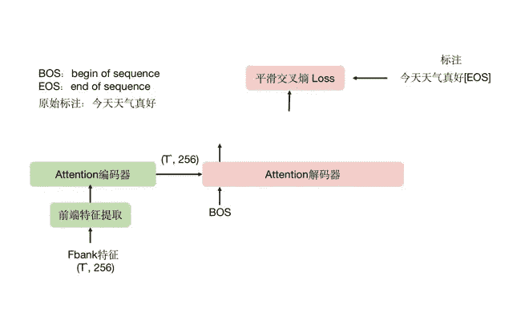

+   **这里以****Transformer****类的模型为例**，解码器以文本作为输入，同时也会接收编码器输出的特征，进行cross-attention操作。先简单说下推理时，attention解码的方式，一开始我们给解码器送入一个BOS起始符号，希望解码器结合编码器送过来的音频编码特征，预测出这段音频的第一个字“今”，模型成功预测出“今”字，将它重新放回解码器的输入，希望解码器预测出下一个字“天”，一直这样循环下去，直到最终预测出句子终止符号EOS为止。这套过程也称为自回归解码，是attention解码的一大特点，它的好处是能更好地结合已经预测的上文文本，去推测下文信息，句子的通顺程度和字错率通常都更好。

> **但是如果是训练，则可**能出现**一种情况**，**如果解**码器输出**的字是**错的，比如“天气”的“气”预测成了“器”，那么在预测下一个字时，放到解码器的输入层是“器”还是“气”呢？尤其是模型刚开始训练时，可以预见几乎每个字都是错，以错字为已知信息放到解码器输入，岂不是错上加错？这就涉及两种不同的训练思路：

1.  **用“气”：**也就是甭管解码器预测的上一个字是什么，只从标注中拿到正确的那个字放到下一个时刻的输入。这种方法叫做Teacher-Forcing。

1.  **用“器”：**就是模型认为上一个时刻是什么字，就把这个字作为下一个时刻的解码器输入，这种方法叫做Schedule-Sampling。

这两种方法各有优势，Teacher-Forcing的优势有两点：

1.  减少了误差累计，模型训练起来更容易收敛

1.  如果Attention分支采用的是Transformer这类允许序列并行计算的模型，由于在训练时不关心上一时刻输出什么，所以完全可以一次性将一整句话送入解码器，即[BOS，今，天，天，气，真，好]，而对应的标注应该是[今，天，天，气，真，好，EOS]。这就可以实现并行计算，而避免了一个字一个字往外崩的串行计算了。

> 如果你对Transformer不是很熟，可能会有疑问，一整句话作为输入，那么在预测第i个字**时，岂不是已经可以看到**第i+**1个字是什么呢？甚**至i后的所有字都可以看到。其实是在transformer在进行attention操作时，会通过mask盖住后面的信息，这样就实现了训练与推理时的一致性。

> 但是Teacher-Forcing也有一个弊端，就是他没有模拟实际推理时会出现的上文出现了错字，下文要如何预测的问题，因此训练和推理仍然存在不一致的问题。

> 至于Schedule-Sampling，很明显它和推理是一致的，它可以很好地模拟推理时出现错字的情况，因此具有更好的鲁棒性。但是其缺点也是很明显的，就是更难训练，收敛更慢，并且由于只能串行计算所以效率不高。

> 有人也提出了一种折衷的方法，以结合两者的优点，就是在训练时以一定概率选择要用“气”还是“器”，即用真实标注还是解码器预测的上一时刻输出。这个概率要怎么定呢？基本的原则就是在训练初期，以更高的概率选择真实标注，等到模型具备一定的预测能力，再以更高的概率去选择解码器上一时刻的输出，即使该输出是错的。具体可采用的衰减策略比如线性衰减、指数衰减等。

## 模型如何推理

**前面讲**述了模**型如何训练，但其实**在CTC分支和Attention分支中都简要提到了它们怎么在测试时是怎么推理的，这一小节将具体展开其中的细节。

### 4.1 CTC分支

#### 贪婪解码(greedy search)

对于CTC分支，我们可以在每个t时刻都取概率最大的字，得到一个原始序**列，再删除该序**列的空字符，合并相邻的相同字符，规整成最终的输出，这种解码方式叫做CTC贪婪解码，这种解码方式的速度很快，但是贪婪只是局部最优，而不是全局最优。

#### 波束搜索(beam search)

> 为什么说**贪婪只是局部最优**，而非全局最优，这里先看一个例子，假设字典只有三个字符{a,b,𝜖}，序列长度为2，按照贪婪搜索，t1、t2时刻概率最大的字符均为𝜖，所以得到的原始序列为𝜖𝜖，经过规整，两个空字符都被去掉，最终解码出来是一个空文本。

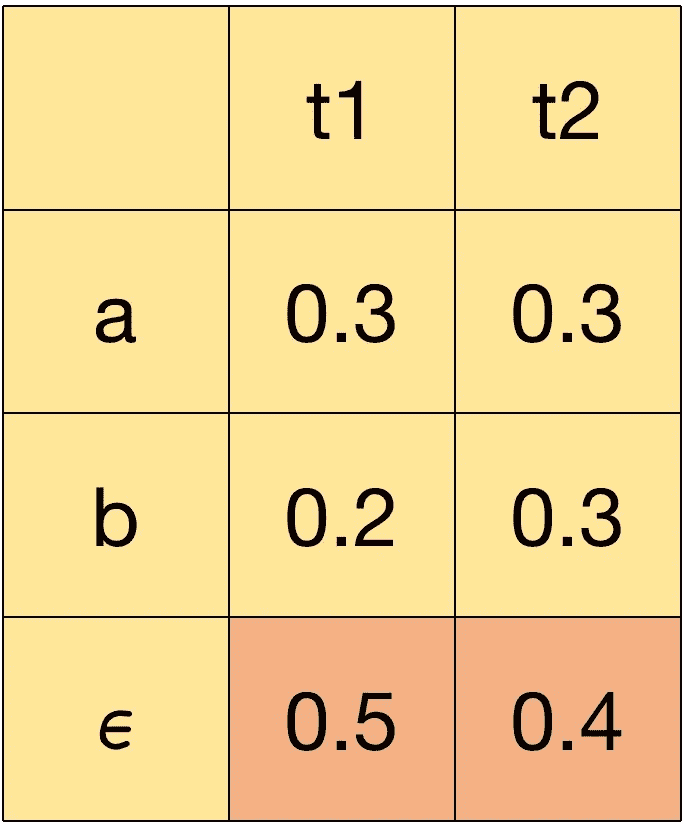

但是这个概率矩阵是解码成空文本的概率最大，联想前面所说的会有很多种原始序列Z都可以规整成同一个序列Y，那么预测为序列Y的概率应该是所有可以合法规整成Y的序列Z的概率之和。

因此，由于字典有三个字符，且只有两个时刻，因此可能输出的序列S为a、b、ab、ba、𝜖，他们的概率分别是：

P(S=a) = p(a𝜖) + p(𝜖a) + p(aa) = 0.3 * 0.4 + 0.5 * 0.3 + 0.3 * 0.3 = 0.36

P(S=b) = p(b𝜖) + p(𝜖b) + p(bb) = 0.2 * 0.4 + 0.5 * 0.3 + 0.2 * 0.3 = 0.21

P(S=ab) = p(ab) = 0.3 * 0.3 = 0.09

P(S=ba) = p(ba) = 0.2 * 0.3 = 0.06

P(S=𝜖) = p(𝜖\epsilon) = 0.5* 0.4 = 0.2

> 从全局的角度，应该是解码成序列a的概率最大，我们单看a𝜖，𝜖a和aa的概率都小于𝜖𝜖的概率，但是他们都是规整成a，他们的概率加起来就比𝜖𝜖要大，这才是全局的最优解。我们这里举的例子非常简单，给定序列长度T和字典大小N，所有可能的排列组合有T^N个，这个搜索空间太大了，为了加速解码，可以在每个时刻只保留分数最高的M条路径，以大幅缩小搜索空间，又能带来比贪婪搜索更好的准确性。

具体的过程如下图，字典里仍然是{a,b,𝜖}三个字符，波束搜索的宽度为3，即每时刻只保留分数最高的3条路径。

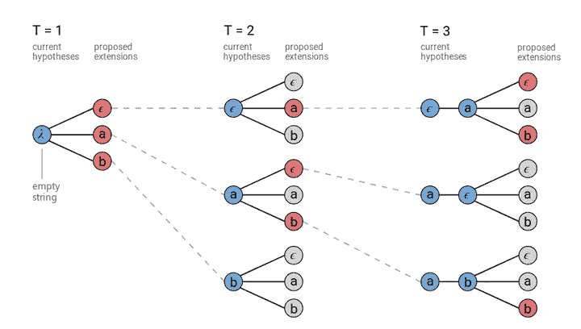

当T=1时，还没有历史预测字符，所以图中最左侧蓝圈是个空字符串𝜆 。然后看当前CTC输出的每个字的概率，由于字典大小为3，波束搜索宽度也是3，所以直接全取，得到三条路径，每条路径的当前字符串结果为𝜖，a，b。

当T=2时，先看蓝色圈，它表示的历史保留的三条路径，前面说了分别是 𝜖 、a、b。在当前时刻，CTC会输出每个字的概率，和三条历史路径的分数相乘，总共有3*3=9种情况，会进行9次相乘运算，保留当前分数最高的三条路径，如红色圈所示，分别是 𝜖𝑎 、𝑎𝜖、ab。

当T=3时，和T=2时一样，蓝色圈表示历史保留的路径，同样又是9种情况，计算9次乘积，保留分数最高的三条路径 𝜖𝑎𝜖 、 𝜖𝑎𝑏 、abb。

至此，波束搜索结束，再按照规整方法删除空字符，合并相邻的相同字符即可。可以看到，在每一步都只会进行 波束宽度 * 字典大小 次乘积运算。假如不是波束搜索，那么T=2时，暂时还是3*3=9种情况，只进行9次乘积运算，但是这9种情况都要保留，到了T=3时，就会扩展出9*3=27种情况，假如还有T=4就是27*3=81种情况...也就是字典大小N的T次方。当然波束搜索也不是全局最优，但是至少比贪婪搜索有一定的优化。

####  前缀波束搜索(prefix beam search)

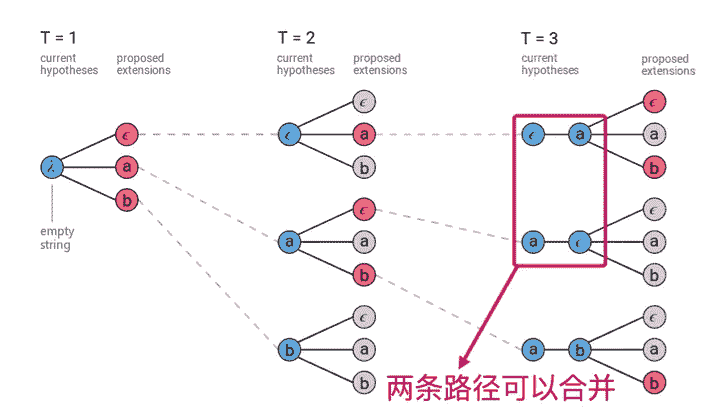

我们再来观察一下波束搜索的过程图，在T=3时，有两条历史最高分路径分别为𝜖𝑎 、𝑎𝜖，按照CTC的规整方法，它们都需要删除空字符，最后结果都是a。这就意味着， 本来每一步就只保留3条路径，现在发现有两条路径规整后结果时一样，实际上只有两条不同的路径，这就使得搜索空间变相缩小了，路径的丰富度减小了。因此可以考虑在每一个时刻都进行规整，以合并相同的路径，并且能规整成相同结果的多个路径的分数需要叠加。这就是前缀波束搜索的基本思想。

前缀波束搜索的过程如下：

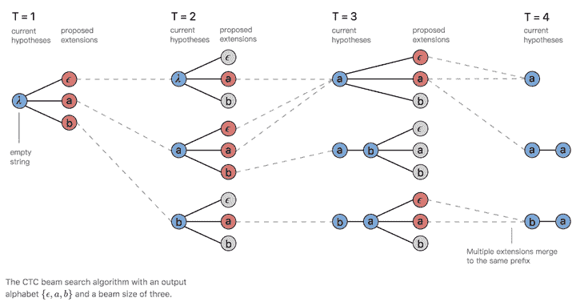

当T=1时，和前面波束搜索是一样的，不赘述

当T=2时，和前面波束搜索有两点不同：

1.  最顶上的蓝色圈是 𝜆 空字符串，为什么？因为T=1时的其中一种路径 𝜖 是空，直接规整删除掉了，所以在这条路径依然是空字符串。并且可以观察到整个图的蓝色圈都没有 𝜖 ，因为都是写的规整后的历史路径。

1.  和波束搜索时一样，也是会有9种情况，也是要进行9次乘积运算，但是这9种情况里面， 𝜖𝑎、𝑎𝑎、𝑎𝜖 都是会解码成a，这三条路径的分数会相加，所以可以看到他们都汇聚到T=3时刻最顶上的蓝色圈a；按照同样的道理，将9种情况里，将可以规整成相同结果的路径进行合并，分数叠加，保留分数最高的三条路径a、ab、ba。

当T=3时，和T=2类似，仍然是9种情况，对他们进行规整合并，保留分数最高的三种结果。

**至此，前缀波束搜索完毕。**

> 无论是波束搜索还是前缀波束搜索，其时间复杂度都是一样的——T*N*波束宽度。前缀波束搜索最终得到的结果路径数目，和波束宽度的值相同，波束搜索则可能小于这个数目，因为最终会有些地方可以合并。但是无论如何，语音识别最终应该只会输出一个结果，这么多条路径结果要怎么选呢？最常见的就是选择分数最高的路径，也可以送进语言模型等对这些备选结果打分，得到一个语言模型的评价分数，选出分数最高的，或是在加权分数取一个最高的。

# 二、端到端语音识别中的建模单元

## **I. 中文建模单元**

**音素（phoneme）**

音素是语音的最小单位，在早前Hybrid语音识别系统中音素就作为建模单元被广泛使用，考虑发音单元的上下文关联/协同发音，把建模的发音单元分为上下文无关的单音素(Context-Independent Phoneme, CI-Phone)，和上下文相关音素 (Context-Dependent Phoneme, CD-Phone)。在端到端语音识别系统中一般使用CI-Phone作为建模单元就足够了,可以使用aishell开源的DaCiDian将字转化为音素，CI-Phone大约有200个左右，做字典时候一般会根据实际情况进行裁剪。

**音节（syllable）**

使用拼音建模可以分为两种，一种是不带音调的拼音，汉语中大约有400多个，另外一种是带音调的拼音，大约有1300多个。我们可以借助第三方的库pypin进行字到拼音的转换。

**字（grapheme）**

对于语音识别来说很容易就能想到用字来进行建模，但是汉语中存在多音字的问题，通过词典（lexicon）和语言模型（language model）来解决。本质上是把多音字的每个读音（以及它们所组成的每个词）当成不同的词。对于中文来说，有3755一级汉字+3008二级汉字+16标点符号。

**子词（subword）**

字词建模是NLP中使用的一种分词方法，它介于字符和单词之间。代表性算法是BPE(Byte Pair Encoding)，比如说'Transformers'可能会被分成'Transform'和'ers'两个部分。这个方案平衡了词汇量和语义独立性，是相对较优的方案。它的处理原则是，常用词应该保持原状，生僻词应该拆分成子词以共享token压缩空间。这在英文上行得通，但是如何把中文的一个字拆开呢？在Next-gen Kaldi项目中提出了byte level BPE，简单来说就是我们将建模单元只当做一个符号，并不赋予真实的含义，因此直接对汉语进行编码，这样汉字就变成了类似英文的序列，在此基础上进行BPE算法就可以了。

```
我爱你中国 -&gt; ƍĩĴƎĩŗƋţŅƋŞœƌľţ
```

## **II. 中英文混合建模单元**

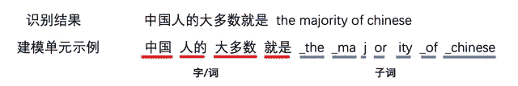

对于中英文混合识别的任务一般如何建模呢？常用的方法是对中文和英文分开建模，如下所示。从声学层面上，中文字符对应的音频长度远大于英文字母对应的长度，因此采用子词能够增大英文建模单元所对应的声学时长，从而减小中英文建模之间的差异，增强模型训练鲁棒性。

## **III. 英文建模单元**

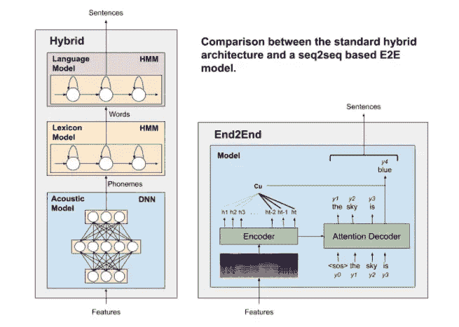

**音素（phoneme）**

上面说到音素是语音的最小单元，不管什么语言都有对应的音素，因此英文语音识别也可以采用音素作为建模单元。比较常用的是基于cmudict进行单词到音素的转化，一般来说英文音素有40个左右。

**字素（grapheme）**

我们知道英文是由26个字母组成，那么可不可以直接使用26个字母作为英文语音识别的建模单元呢？答案当然是肯定的，这种建模方式在端到端语音识别刚兴起时十分常见，并且词表很小，不需要考虑OOV的问题。

**词（word）**

英文语音识别也可以使用词作为建模单元，但是这种建模方式为了达到较好的效果，词表一般都会比较大，这也额外增加了训练成本。

**子词（subword）**

字词建模中典型的算法就是BPE了，值得一提的是BPE的词表大小是不固定的，可以认为的设定词表大小。待词表大小设定好后就可以进行BPE模型的训练。一般使用 google 的 sentencepiece 工具来训练 BPE。BPE算法的具体细节不是本文的重点，这里就不介绍了。

# 一、GPT-4o背后可能的语音技术

> **老版本**的GPT是先通过**语音识别模型**（**whisper****）将语**音转**换成文本，然后将文本**传送给大模型，最后通过语音合成模型（TTS）将大模型的输出合成语音。

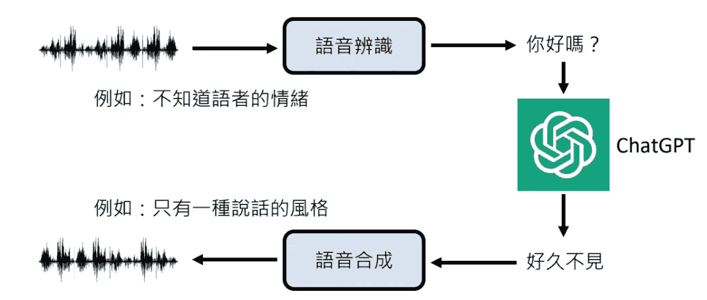

+   然而，文本作为语音的某种压缩，在语音转换为文本的过程中，情感信息往往无法被保留，导致后面生成的声音显得单调。

+   为了解决这个问题，有人在此基础上加入了情感分析模块，将情感信息以上下文的形式发给大模型和语音合成模块。

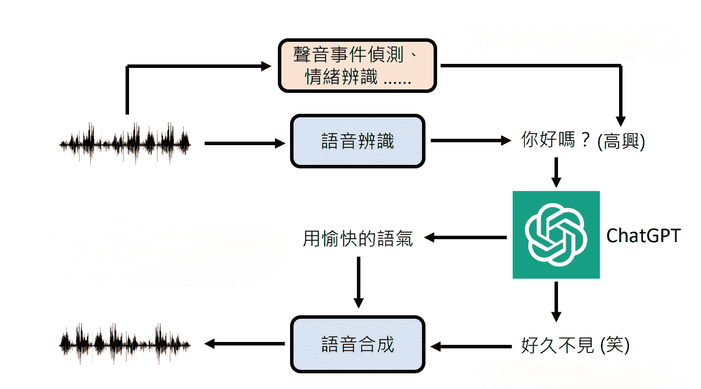

> 虽然这在一定程度上解决了**情感丢失问题**，但**情感分析**、**语音识别**、**语音合成**这三个独立的模块，无疑增加了**推理负担****，这也是为什**么老版本会思考片刻才会做出回应的原因，“反应迟钝”在多人对话中显得很不自然。

而GPT-4o是一个端到端的语音模型

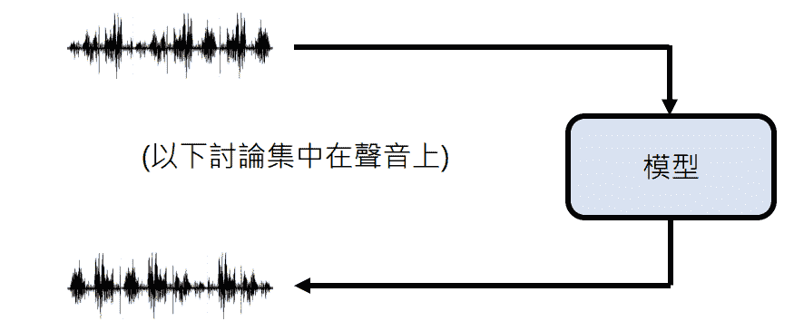

> **文本**语言模**型输入、输出**都是文本**，处理文本时，先要**将文本转换成tok**ens，然后将toke**n id**s转换成词嵌入输入到T**ran**sformer，最**后将T**ransf**ormer输出的token ids解码成token。

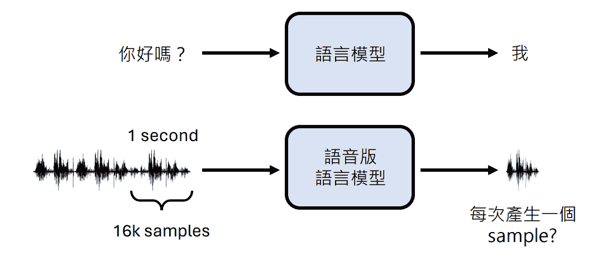

> **GPT-4o****输入**、**输出**都**是语音，**声波是**一种模拟**信号，别说是大模型，就算是计算机也没办法直接处理模拟信号，所以很多音频处理软件需要先通过声卡将模拟信号转换成数字信号。

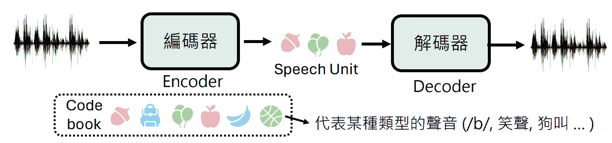

> **语音版语言**模型也**需要类似的编解码器**，**它不仅要将连续的语**音转换成离**散**的tokens，还要将其压缩到隐空间，但文字是人造的，语音是自然生成的，所以没办法像NLP那样构造一个词表，这个过程需要神经音频编解码模型模型来完成。

> 神经音频编解码模型也并不是什么新玩意，最初用于音频数据压缩传输。下图列出了神经编解码模型的重要时间节点。

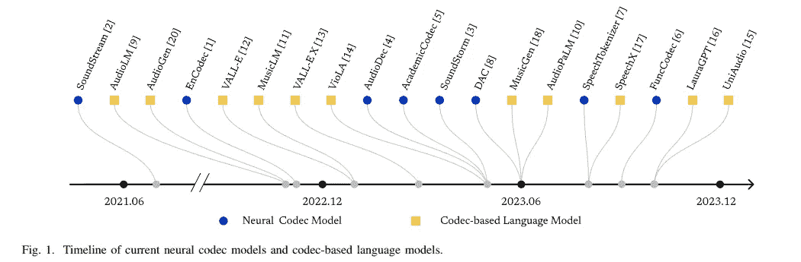

+   编码器负责将语音压缩到离散的隐空间，解码器负责将隐空间信息解压缩成语音信号，这个隐空间类似于词嵌入空间。

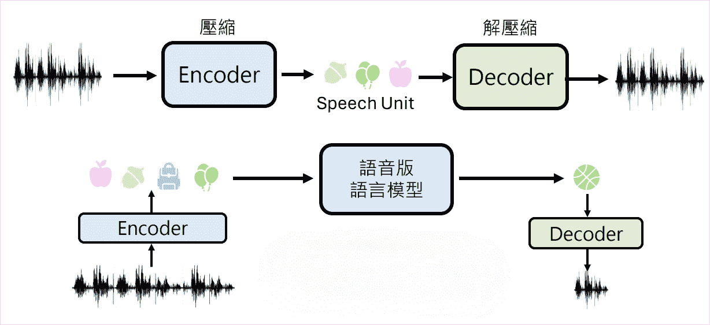

> 将**语音信号**编码成**离散的数字向量**后就可以输入到**Transformer**中了，其它的和大语言模型基本就一样了。

下图是基于神经编解码模型的大语言模型，也就是说GPT-4o很可能就是这个样子的。神经编解码模型是和语言模型一起训练的，而在老版本中，语言模型和三个独立模块都是单独训练的。

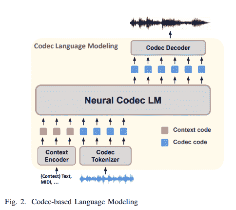

+   和基于文本的大模型一样，基于语音的大模型也需要经过预训练和微调过程。

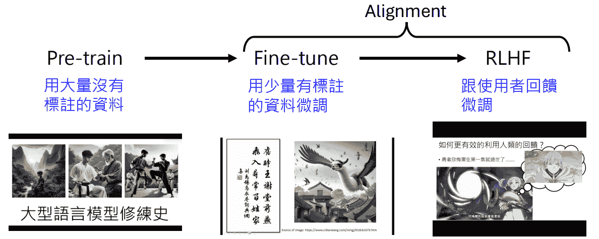

+   但鉴于文本资料要比语音资料丰富，所以可能会用文本语言模型的参数去初始化语音版语言模型。

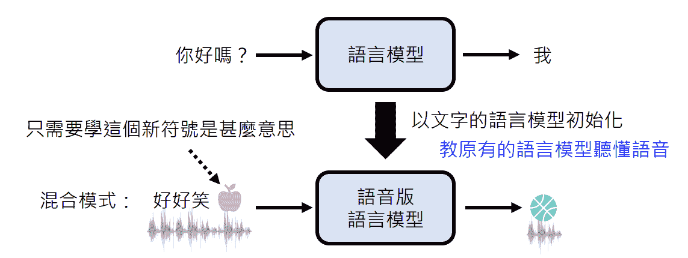