# 什么是A/B 实验

> 来源：[https://v11enp9ok1h.feishu.cn/docx/VI9TdlFbjoFjzjxoQJWclipxnsd](https://v11enp9ok1h.feishu.cn/docx/VI9TdlFbjoFjzjxoQJWclipxnsd)

# 一.什么是A/B实验

## A/B实验的基本思想

A/B实验的基本思想**就是：

**我们在线上流量中取**出一****小部分（****较低风**险**），完**全**随机地分**给原策略A和新策略B（排除干扰），再结合一定的统计方法，得到对于两种策略相对效果的准确估计（量化结果）。

这一套基于小样本的实验方法同时满足了低风险，抗干扰和量化结果的要求，因此不论在互联网产品研发还是科学研究中，都被广泛使用。

## A/B实验的应用一

> I**nstead of **saying 'I ha**ve a**n idea', what if you said '**I have a**** new hy**pothesis , let's go test it, see if it's valid, ask how quickly can we validate it.' And if it's not valid, move on to the next one. —— Satya Nadella CEO, Microsoft

微软CEO Satya Nadella 在business insider采访中，关于**假设检验的这一段**回答简练地描述了微软基于实验-分析-决策的数据驱动文化。

事实上，微软也是世界上最早采用A/B实验评估每一个重大feature的科技公司之一，从bing的搜索排序到MSN的交互设计，数据驱动的决策无处不在，每年为微软规避大量风险并创造可观回报。

下图，从bing这一侧面展示了微软实验平台同时运行的实验数量十年以来的井喷式发展。

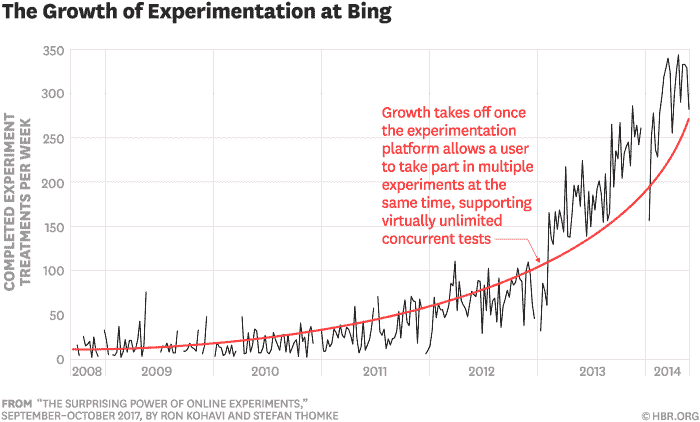

## A/B实验的应用二

**另外值得一**提的是，这一套基于假**设**检验的实验方法并非科技公司首创，其影响远比我们想象得深远，可靠性也已经得到了长足的验证。

比如，在医学界，每一种新型药物研发都会伴随着一系列动物实验和临床测试，这些实验的效果都会以类似但更为严格的假设检验方法进行评估，最终被认定安全有效的药品才会进入市场，造福患者。

下图所示就节选自某种放射性疗法在乳腺癌治疗中的有效性报告，红框中的95%CI（95%置信区间）和p（p-value）就是假设检验中常用的统计术语。

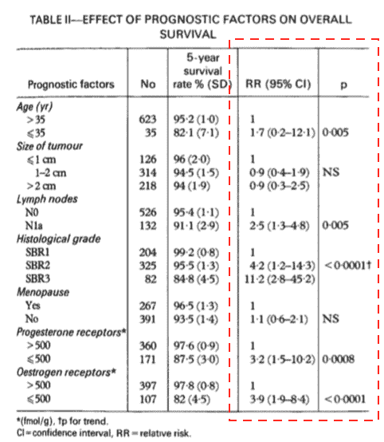

# 二. 为什么要开启AB实验？

如今，大多数互联网产品野蛮生长的时代已经过去，人口红利到顶，产品策略需要从快糙猛的跑马圈地方式转向深耕细作的精细化运营方式，要精细化运营，就需要采用数据来驱动。

何为数据驱动？试想以下几种场景：

1.  小A凭着丰富的经验直接修改了产品的线上策略，一周后发现效果不升反降，遂下线。

1.  小B和小C同时上线了两个产品功能，一周后产品数据有下降，都认为是对方的问题，谁也不肯接锅。

1.  小D上线了一个新策略，随后进入十一黄金周，用户交互有所下降，小D觉得一定是假期埋没了自己的辛苦贡献，但也辩不明白，无处申冤。

1.  小E辛苦工作一整年，开发了365个不同的功能上线，年终写总结时却写不出到底在哪些方面究竟贡献了多少。

想必不论是研发还是产品运营，都不希望自己辛苦工作过后落入上述的几种尴尬的境地中，因此数据驱动业务增长就显得很有必要。

那么数据变化和产品动作之间到底存在什么样的因果关系呢？

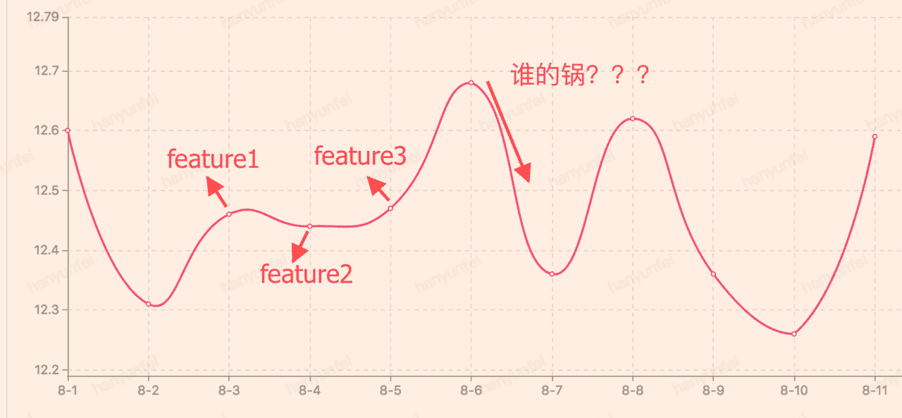

假设，某互联网公司承载了上百万规模**的DAU，每天大量**新特性等待上线，一方**面业务人员**无法承担其中任何一个错误特性直接**影响用户体验**的**严重****后果，另一方面**业务人员又希望能够**分离并量化每**个特性的影响。

因此，我们需要设计并坚持使用一套数据驱动的方法，使得业务人员可以以较小的风险对新feature进行评估，积极试错积累经验；并且我们设计的该方法有能力排除其他因素（比如同时开发的其他feature以及时间因素等）的干扰；最后，除了“好”或者“不好”，我们希望这个方法最好也能够给出定量的结果。

为了解决上述问题，普遍使用的方法论是小流量随机实验，也就是我们常说的A/B实验。

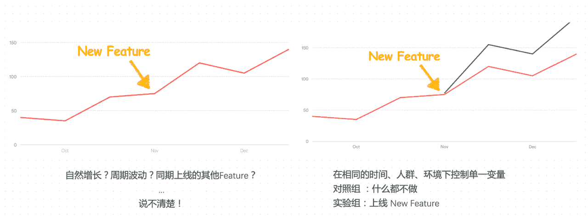

# 如何设计实验

# 一、A/B实验流程

---

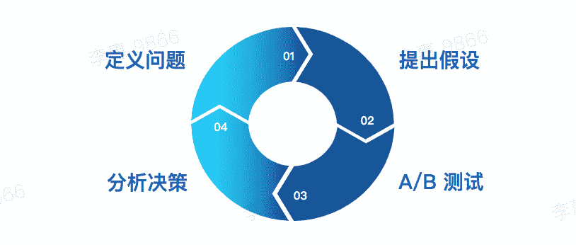

# 二、A/B实验设计举例

---

以下通过一个场景示例为大家展示**如何分析、拆解一个业务问题，设定优化方向、评价**指标并设计一个A/B实验来进行效果验证。

## **【业务背景】**

> 说明

> 实验的来源：通过分析当前业务问题、提出潜在的解决方案，形成一个「实验idea」

**背景**：该产品是一个汽车类App产品，发现App登录率偏低，通过转化漏斗定位问题为触发登录率过低，影响个性化服务的机会。

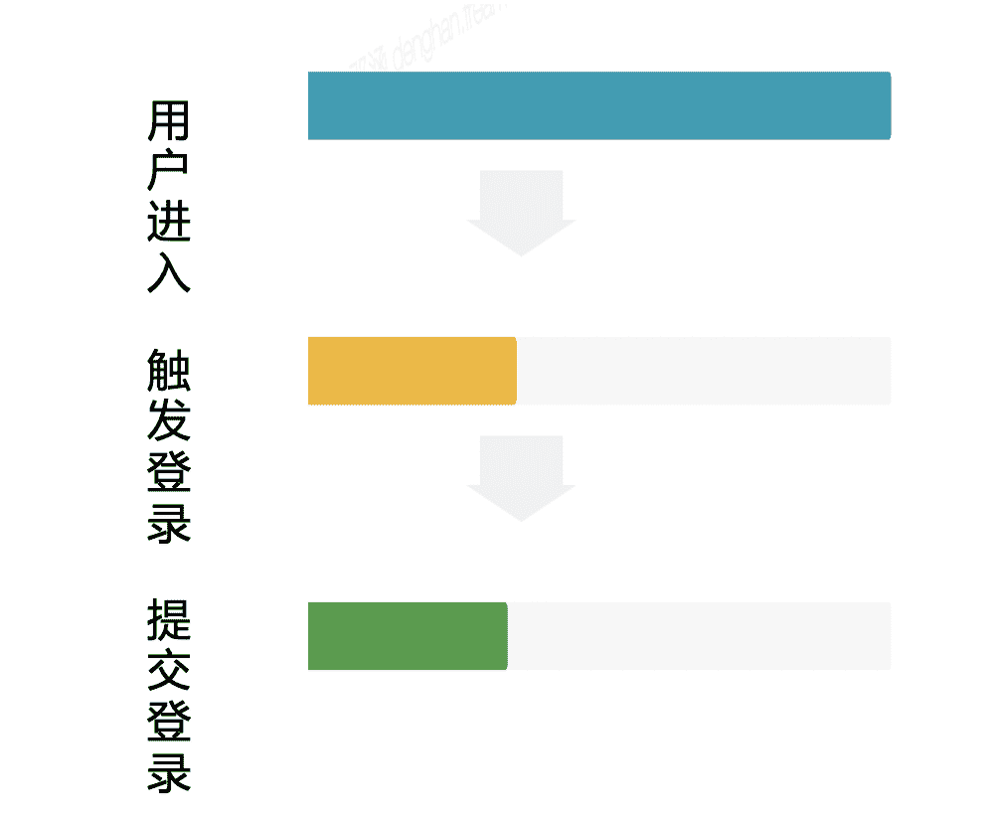

根据上面的分析，一个比较自然的想法，就是去提升触发登录率，也就是给未登录用户增加更多的登录入口。那么就面临两个问题：

+   在哪里加入口？

+   以什么形式加入口？

针对第一个问题，需要定位目前未登录用户的主要流量去向，在这些主要的流量场加入登录入口，效果是最好的。现有未登录可使用的功能，包括但不限于：关注、点赞、进入直播间、保存发布草稿、查看浏览历史等。通过用户路径对未登录用户的行为路径进行分析发现关注、点赞、查看历史等场景流量较多，可以尝试在这些环节加入登录引导。

## 【实验目标】

> 说明

> **目标****：明确「**实验idea」最终想达**成的业务目标**是什么，根据目标来制定衡量指标

> 衡量指标：用于评价目标是否达成的成功标准。且需要论证是因为施加了实验策略而达成的，因此指标和策略要有明确的业务因果性

> 至此，就形成了完整的 「实验假设」：预期通过xxx改进，可对指标A提升n%，从而为产品/用户带来xxxx价值。

**目标****：在不影****响未登录用**户使用体验的前提下，提升登录率，更好地为服务用户

衡量指标：登录率

实验假设： 通过在每个入口尝试不同的引导方式，可对指标「登录率」提升n%，从而好的服务用户。

## 【实验设计】

当下主流的登录引导由弱到强有：非阻断式弹窗/蒙层引导、半屏/全屏面板引导、全屏面板强制登录。针对不同入口，可以实验不同的登录引导方式。

| 实验模式 | 客户端编程实验 |
| --- | --- |
| 实验受众 | 全体用户，不做任何过滤 |
| 流量大小 | 根据样本量计算器计算可得，不同产品、业务形态差异巨大，保险起见在单组数量级过万 |
| 实验时长 | 14天及以上 |
| 实验版本 | 对照组：线上样式  全屏面板强制登录 |
| 监控指标 | 核心指标：登录率 |
|  | 关注指标：登录触发、登录提交、登录成功三个环节的转化率 |
| 评估思路 | +   「登录率」是成功指标 |

+   显著上涨则说明方案有效果，可以直接上线

+   显著下降则说明方案有负向影响，需要进一步拆解数据来分析原因

+   无显著变化则说明没有明显作用，可以通过拆解用户分层、商品品类的数据来分析是什么原因导致的，如果发现有显著变化的敏感人群或敏感品类可以进一步施加策略做实验

# A/B实验怎么开

在熟悉了什么是A/B实验之后，一起来看看A/B实验应该怎么开吧！

## 制定目标

### 明确北极星目标

对于任何一家 公司来说（不管是互联网公司还是传统公司），都有一个最重要的业务发展指标——“北极星指标“（North Star Metric），也称“唯一重要指标”（OMTM，One Metric That Matters）。

通常北极星指标需要包含四大特点：

+   能够反映产品为用户提供的 核心*价值；

+   能够衡量用户的 活跃*程度；

+   易于被团队理解；

+   能够反应企业整体上是否成功。

对于一些成熟行业，北极星指标已经相对固定，比如：

| 核心 价值 | 北极星指标 |
| --- | --- |
| 为用户提供物有所值的商品和互动式购物体验 | GMV（商品交易总额） |
| 让用户高效地获得值得信赖的答案 | 问题回答数 |
| 为用户提供高 品质 居住产品与生活服务 | 订单数 |

显然，北极星指标的制定是 企业 更为战略层面的工作，然而A/B测试不能绕开这一环。在北极星目标明确的前提下， 企业 才能通过系统化的A/B实验实现快速迭代和增长。

### 细化指标

确定了北极星目标，各个业务团队需要分领属于自己的任务，这里便涉及到将北极星指标拆解为可执行的具体指标。拿电商平台做个例子，假如我设定2019年的GMV是300万美元，那么我们可以将这个北极星目标逐步拆解，例如：

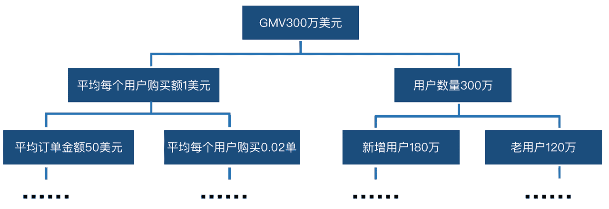

在北极星指标被细化后，各个部门便可以围绕细化后的具体指标，开展有针对性的实验。

## 建立假设

在明确目标之后，增长团队应该着手分析早期数据，并从数据中找到增长**的可能。这**一过程需要产品经理、运营经理和技术研发共同探**讨完成。

分**析结束后，团队需要提出假设，如：将购买页面主色调从蓝色改为红色能够将用户购买率提升3%。值得注意的是，我们所做出的假设必须包含两方面：第一是 提出新策略 ，“购买页面主色调从蓝色改为红色”，这决定了实验中我们要如何配置实验参数；第二是 确切的提升值 ，如“用户购买率提升3%”，这决定了应该有多少用户进入实验。

在A/B实验中，用指标的“预期值提升值”倒推实验流量，需要运用到复杂的统计学知识。然而，即使你并不了解这些知识，使用成熟的A/B实验工具——火山引擎A/B测试的“实验流量建议工具”这一功能，就可以轻松确定应进入实验的流量。

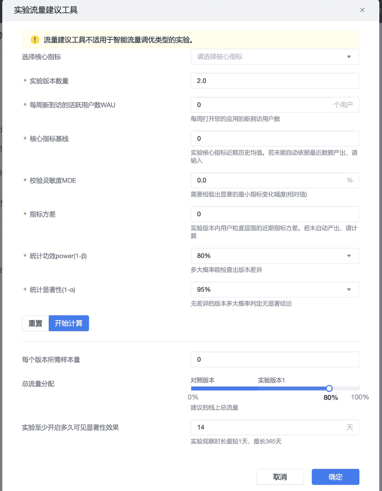

## 配置实验

明确了上述内容之后，接下来就该设置实验啦。以A/B测试为例，想要完整地设置好一个实验，我们需要关注以下几个方面：

### Where 实验开在哪儿

这里所说的“开在哪儿”，指的是如何选择正确的实验层。

何谓“实验层”呢？“实验层”技术是为了让多个实验能够并行不相互干扰，且都获得足够的流量而研发的流量分层技术。

设想一下，假如我现在有4个实验要进行，每一个实验要取用30%的流量才能够得出可信的实验结果。此时为了同时运行这4个实验就需要4*30%=120%的流量，这意味着 100% 的流量不够同时分配给这4个实验。那么此时我只能选择给实验排序，让几个实验先后完成。但这会造成实验效率低下。试想一下，许多大型互联网公司每年有上万个实验要进行，如果只能排队挨号，实验恐怕可以排到9012年。

那**么有**没有办法可以解决这个问题呢？

有，就是使用实验层技术，把总体流量“复制”无数遍，形成无数个流量层，让总体流量可以被无数次复用，从而提高实验效率。各层之间的流量是 正交 的，你可以简单理解为：在流量层选择正确的前提下，流量经过科学的分配，可以保证各实验的结果不会受到其他层实验的干扰。

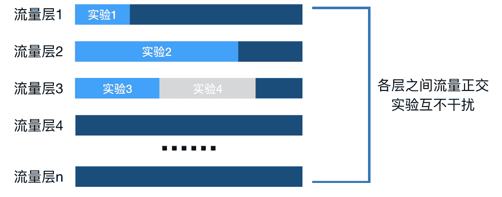

**在选择实**验层的时候，我们要**遵循的规**则是：业务冲突，在系统层面体现为参数冲突。进行实验时需要规避业务冲突。

> 说明

> 如何鉴定一个实验A是否与其他实验冲突？一般由业务含义来判定。

例如，点赞按钮，实验A设计为红色，实验B设计为蜡烛；实验A与实验B涉及到对同一个「物理对象」的修改（操作），同时修改会引起冲突或者问题，即对一个具体用户的按钮，它到底是什么颜色。

规避的方法主要为，将冲突的实验选择在同一个流量层进行实验。

这类实验在推全时，也需要考虑冲突的问题；不能单独推全。

如果不存在业务冲突，那么一般建议直接独立进行实验即可，不用考虑其他实验的运行。在 DataTester 上，直接新建实验将被单独分配一个新的流量层，这个流量层与其他实验正交。

### When 实验开多久

基于一些统计学原理，实验开设得过长或过短都不利于实验结果的可信度。通常实验时长要与产品的“数据特征周期”一致。如何理解呢？比如某 直播 类app产品，用户在周一到周五的 活跃 度较低，在周末 活跃 度较高，以一个自然周为周期，不断循环。那么这一 直播 产品在做A/B实验时，通常应该将时长设置为一周。

### Who 谁进入实验

实验中，我们要对进入实验的流量大小做出设置。通常在实验的初始阶段，我们倾向于先分配较少的流量（如1%）进入实验。如果初期实验结果一切正常，那么可以进一步加大流量；假如实验数据出现巨大的异常，那么可以随时将实验终止。小流量可以最低程度减少实验异常对用户体验的影响。

除了对流量大小进行设置之外，我们还可以添加限制条件，对进入实验的用户进行过滤，比如只看“安卓用户”、只看“北京地区用户”等等。这部分过滤条件通常需要由实验发起者和分析师共同确认。

### Metric 关注的指标

确定**哪些指标**是我们所关注的。再来看看前文中我们做出的假设：将购买页面主色调从蓝色改为红色能够将用户购买率提升3%。在这一实验中，“用户购买率”必定是我们的关注的指标，并且是我们的“ 目标指标 ”。除此之外，我们还应该关注一些产品常关注的重要数据指标，用以 观察 实验中的新策略是否会对其他重要指标产生负面影响。

### How 实验配置参数

配置参数实际上是一串代码，这串代码决定了进入实验的用户，其体验到的产品会有什么不同。仍旧用前文中的假设做例子，如果我假设“将购买页面主色调从蓝色改为红色能够提升用户购买率”，那么在实验中，我的下发的配置参数就应该让实验组用户的购买页面色调呈现为红色。这些参数的具体代码需要与产品的研发进行确认。

## 前期测试

在经过上述的步骤，我们的实验就已经基本设置好了。但在我们并不应急于开启实验，还应当对实验进行前期测试。

测试时，我们会将“测试用户”添加白名单之中，并在测试用户的手机/电脑上中 观察 实验配置是否能够正常生效（如购买页面的颜色改变是否可以正常显示）、客户端/网页是否会崩溃、实验数据能否正确上报等。

在实验正式开启之前，通常需要先选择几名用户进入测试阶段，观察实验是否能够正常获取想要收集的数据，或客户端是否有bug等。参与这一步的用户被称为“白名单用户”。

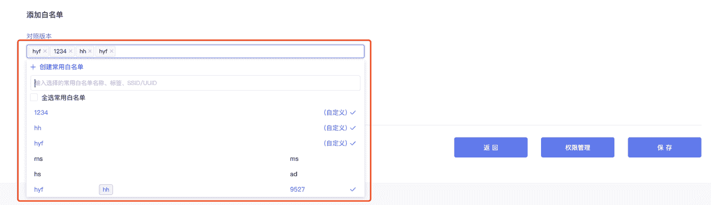

## 评估结果

实验结果需要从两方面评估：第一是数据结果的涨跌；第二是判断是否可以相信数据结果，即结果是否“显著”。

数据的涨跌自不必多言，如何理解数据是否显著呢？

我们知道，A/B实验是一种小流量实验，我们需要从总体流量中抽取一定量的样本来验证新策略是否有效。抽样过程中，样本并不能完全代表整体。样本分布不均导致实验结果可能出现一种情况——我采取的策略其实没用，但是实验结果显示策略有效。

统计学告诉我们，这种错误不可能完全避免，但是我们可以通过一些统计学方法，在得出实验数据结果的过程中，计算上述错误发生的概率。换句话说，我们可以判断我们的实验有百分之多少的概率是可信的。

根据业界的公认标准，在A/B实验中，如经统计学计算，实验数据结果有95%以上的概率可信，我们便称数据结果是显著的。这样的数据结果才能够用于判断实验假设是否成立。

在A/B测试平台中，我们用数据报告中的颜色来表示数据是否显著。

为了便于判断，「A/B 测试」在数据表格中直接使用颜色直观给出显著性。绿色指的是该指标相对于对照组为正向显著、红色为负向显著、黑色为不显著。

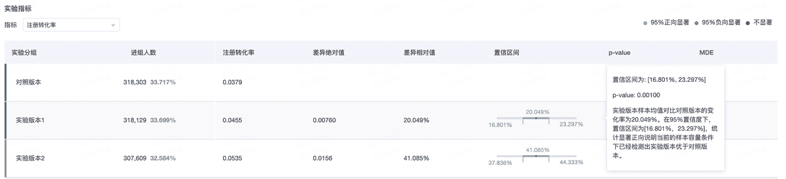

除**此外，火**山引擎A/B测试还提供了置信区间、P-value、MDE、概率分布势等丰富的统计指标，可以进行进一步的 定量分析。