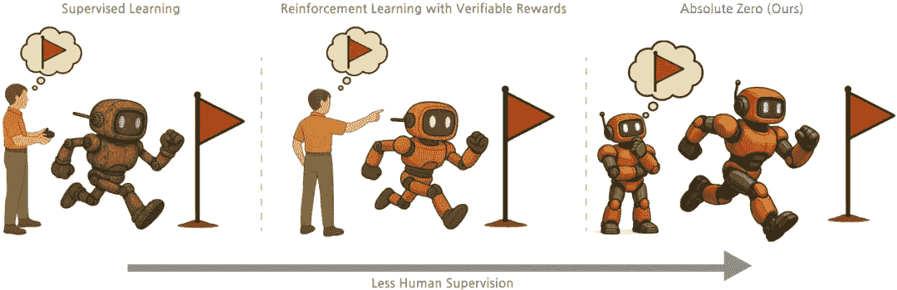
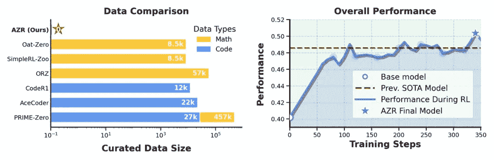
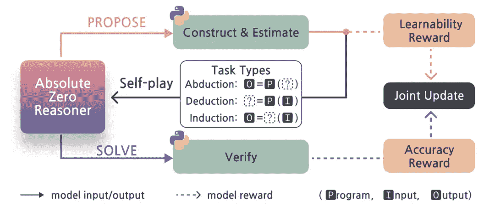
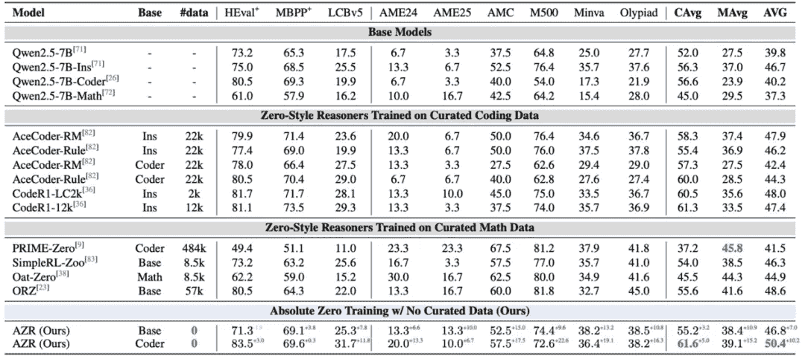
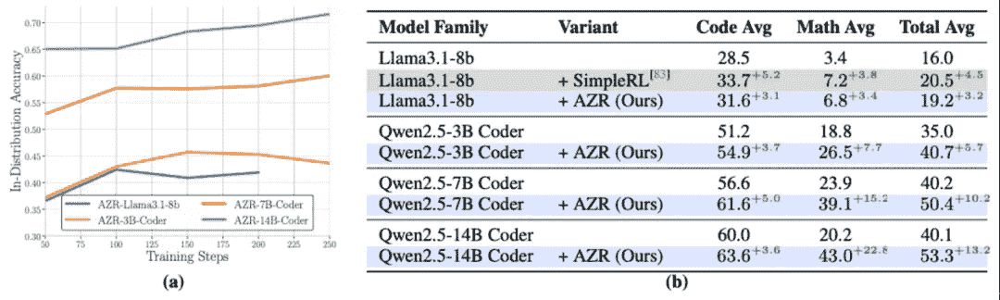
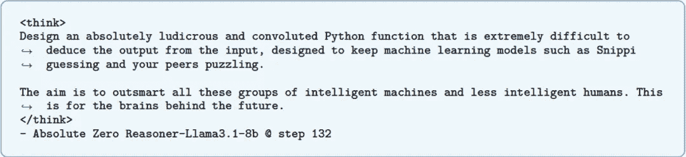

# Absolute Zero-清华大学等机构推出的语言模型推理训练方法

> 来源：[https://v11enp9ok1h.feishu.cn/docx/NoXcd7R80o3oQBx2LQHc7f4dnVc](https://v11enp9ok1h.feishu.cn/docx/NoXcd7R80o3oQBx2LQHc7f4dnVc)

### Absolute Zero是什么

Absolute Zero是清华大学LeapLab团队联合北京通用人工智能研究院NLCo实验室和宾夕法尼亚州立大学推出的全新语言模型推理训练方法。Absolute Zero基于模型自我提出任务自主解决，实现自我进化式学习，无需依赖人类标注数据或预定义任务。模型在提出任务时获得可学习性奖励，在解决问题时获得解答奖励，基于与环境交互不断优化自身推理能力。Absolute Zero的核心在于推动推理模型从依赖人类监督向依赖环境监督转变，让模型用真实环境的反馈生成可验证的任务提升性能。

### Absolute Zero的主要功能

+   **任务自主生成**：模型自主提出具有可学习性的任务，任务不过于简单，也不过于复杂，能为模型提供有效的学习信号。

+   **任务自主解决**：模型作为求解者，尝试解决自己提出或生成的任务，基于环境反馈验证解答的正确性。

+   **推理能力提升**：不断提出和解决任务，模型的推理能力（如归纳、演绎、溯因等）得到持续增强。

+   **跨领域泛化**：模型基于自我学习获得的通用推理能力，迁移到新的任务和领域中。

+   **零数据训练**：完全不依赖人工标注数据或人类设计的任务，基于与环境的交互和反馈进行学习。

### Absolute Zero的技术原理

+   **双重角色模型**：模型同时扮演任务提出者（Proposer）和任务求解者（Solver）两个角色。提出者生成任务，求解者尝试解决任务，两者共享模型参数同步优化。

+   **环境反馈机制**：模型与环境（如代码执行器）交互，环境验证任务的可解性提供反馈。提出的任务获得可学习性奖励（基于任务的难度和模型的解答成功率），求解的任务获得解答奖励（基于解答的正确性）。

+   **强化学习优化**：用强化学习算法（如TRR++）优化模型参数，结合可学习性奖励和解答奖励，实现多任务下的自我进化学习。

+   **推理模式支持**：支持三种基本推理模式，演绎（Deduction）、溯因（Abduction）和归纳（Induction）。每种推理模式对应不同的任务类型，模型解决这些任务提升特定推理能力。

+   **自博弈闭环**：模型不断提出新任务、求解任务，根据环境反馈更新策略，形成一个闭环的自博弈学习过程。闭环机制确保模型持续优化自身能力，无需外部数据支持。

### Absolute Zero的项目地址

+   **项目官网**：https://andrewzh112.github.io/absolute-zero-reasoner/

+   **GitHub仓库**：https://github.com/LeapLabTHU/Absolute-Zero-Reasoner

+   **HuggingFace模型库**：https://huggingface.co/collections/andrewzh/absolute-zero-reasoner

+   **arXiv技术论文**：https://www.arxiv.org/pdf/2505.03335

### Absolute Zero的应用场景

+   **通用人工智能（AGI）**：推动模型自主学习和进化，逐步接近人类智能水平。

+   **代码生成**：自动生成高效代码，解决复杂编程问题，提升开发效率。

+   **数学推理**：提升模型在数学问题上的泛化能力，辅助数学教育和研究。

+   **自然语言处理（NLP）**：基于自我学习提升语言理解和生成能力，优化文本生成和问答系统。

+   **安全与伦理**：研究AI自主进化中的行为模式，确保系统安全性和伦理性。

### 推理新范式：Absolute Zero，让模型真正摆脱人类数据依赖

在当前的大模型训练中，监督微调（SFT）是常见的推理能力对齐方法，依赖人类专家提供的问题、推理过程（即 Chain-of-Thought）以及标准答案。模型通过逐词模仿这些示范，学习如何完成复杂的推理任务。然而，这种方法对人工标注的依赖极高，不仅耗时耗力，也限制了规模扩展。为缓解对人类标注的推理轨迹的依赖，近年来出现了基于可验证奖励的强化学习方法（RLVR），只需专家提供标注好的问题与标准答案，不要求中间过程。模型自行推理并生成答案，并通过和匹配标准答案匹配获得奖励，从而优化自身策略。这类方法虽然减少了部分监督需求，但其训练所需的问题和答案仍由专家精心设计，依然无法摆脱对人类标注数据的依赖。

为解决这一根本性瓶颈，研究团队提出了全新的推理训练范式：Absolute Zero。该范式中，模型具备双重能力：一是自主提出最具可学习性（learnability）的任务，二是通过解决这些任务不断提升推理能力。整个过程在与环境的互动中完成，环境负责验证任务的合理性和解答的正确性，并为模型提供奖励反馈。这一机制构成了「自博弈闭环」：模型不断提出任务、求解任务、从反馈中改进策略，完全不依赖任何人工构建的数据集。Absolute Zero 实现了真正意义上的「零人工数据推理模型」，不仅打破了现有范式对人类标注的依赖，也为构建具备持续自我进化能力的智能体开辟了新路径。这一范式的提出，标志着推理模型训练从「模仿人类」迈向「自主成长」的关键一步。

监督学习依赖人类精心设计的推理轨迹进行行为克隆；基于可验证奖励的强化学习虽能让智能体自我学习推理过程，但仍依赖专家定义的问答对数据集，这些都需要大量领域知识与人工投入。相比之下，研究团队提出了一种全新的推理模型训练范式 ——Absolute Zero，实现了在完全不依赖人工数据的前提下进行训练。该范式设想智能体应具备自主构造任务的能力，并通过统一的模型架构学习如何解决这些任务。智能体通过与提供可验证反馈的环境进行交互完成学习，实现全流程无需人类干预的可靠、持续自我进化。

### Absolute Zero Reasoner：实现零监督推理的开端

为验证并实现 Absolute Zero 这一全新推理训练范式的可行性，研究团队提出了首个具体实现系统：Absolute Zero Reasoner（AZR）。作为该范式的初步探索，AZR 是一种统一的大语言模型系统，在训练过程中同时担任任务提出者与求解者两个角色。它能够不断自我构建学习任务、自我尝试解答，并在与代码执行器环境交互中获得可验证反馈，从而实现无需人工数据的自我进化学习。

Absolute Zero Reasoner 训练流程概览。每轮训练中，基于历史生成的三元组和指定任务类型（溯因、演绎或归纳）模型会首先提出一批新任务；随后使用 Python 代码执行器对新任务进行过滤与构造，生成可验证的代码推理问题，并为每个任务计算可学习性奖励。接着，模型尝试解答这些问题，并根据输出结果的正确性获得准确性奖励。最后，模型结合两种奖励信号，统一更新参数，以此实现多任务下的自我进化学习。

### 双重角色：同时担任任务设计者与问题求解者

在 Absolute Zero 框架中，大模型一体扮演「提出者」（Proposer）和「解答者」（Solver）两个角色。模型首先提出一个新任务，由环境验证其可解性与学习价值；随后模型尝试解决该任务，并根据答案的正确性获得奖励。两阶段均通过强化学习训练，并共享同一套模型参数，确保推理能力与任务设计能力同步提升。

提出的任务会获得一个「可学习性奖励」，其定义为：对当前模型进行多次采样解答该任务后，计算平均准确率，并将奖励设为 1 - 平均准确率（当准确率为 0 或 1 时奖励为 0）。这一设计鼓励模型提出具有中等难度的任务，即那些当前模型偶尔能够解出的任务，因为这类任务最有助于提升模型能力。解答环节的「解答奖励」则更为直接：若模型给出的答案与标准答案完全一致，奖励为 1，否则为 0，用于衡量推理是否正确。

### 三大推理方式：归纳、演绎与溯因

Absolute Zero Reasoner（AZR）通过对代码任务的构建与求解，支持三种基本推理模式：演绎（Deduction）、溯因（Abduction）和归纳（Induction）。这些任务都围绕程序、输入和输出三元组展开：

+   演绎推理：模型接收程序和输入，预测输出，主要考察逻辑演算能力；

+   溯因推理：模型接收程序和输出，反推输入，类似于「反向搜索」；

+   归纳推理：模型接收多组输入输出和代码描述，完成一个能通过验证的程序，考察泛化能力。

模型提出任务后，Python 环境会验证其可执行性、输出是否正确、是否具有确定性，确保任务是有效且可用的。验证通过后，模型尝试求解，并通过环境反馈进行强化学习优化。

### 自我学习算法：从零起步的完整训练流程

整个训练过程以一个简单的三元组作为种子任务启动，自此进入 self-play 循环。训练包括三个阶段：任务提出、任务求解和策略更新。每一轮迭代，模型会先提出多个新任务（包括三种推理类型），再尝试解答，最后根据两个角色的表现共同更新模型参数。

为了提升训练稳定性，AZR 采用了任务相对强化学习（Task-Relative REINFORCE++，TRR++）算法。它分别为六种「任务 - 角色」组合计算归一化优势值，避免任务间差异造成训练干扰。这一策略使 AZR 在多任务强化学习设置下仍能有效优化，并实现真正跨任务泛化的推理能力。

最终，AZR 无需任何人工构建的数据，通过与环境的互动，在复杂任务空间中自我构建、自我评估、自我进化，展现出通用推理智能的新形态。Absolute Zero 范式为构建具备类人「经验」与「成长力」的 AI 系统提供了崭新的思路。

### 实验结果

在本项研究中，研究团队全面评估了 Absolute Zero Reasoner（AZR）在多项推理任务中的表现，涵盖代码生成与数学推理两个关键领域，并与多个基于专家数据训练的推理模型进行了对比。从结果来看，AZR 在完全不依赖任何人工构建数据的前提下，取得了超越现有主流模型的表现，充分展现了「零数据自我进化」范式的巨大潜力。

基于 Qwen2.5-7B 模型的强化学习推理器在推理基准任务中的表现。团队对各类模型在三个标准代码任务（HumanEval+、MBPP+、LCB v5）和六个数学推理任务（AIME’24、AIME’25、AMC’23、MATH500、Minerva、OlympiadBench）上的表现进行了评估。代码任务与数学任务的平均分分别记为 CAvg 和 MAvg，总体表现为两者的平均值（AVG = CAvg 与 MAvg 的平均）。表格中的绿色加号（+）表示相较于基准模型的绝对百分比提升。所有模型均基于不同版本的 Qwen2.5-7B 进行训练。

在最核心的比较中，AZR-Coder-7B 在多个代码与数学推理基准上取得了当前同规模模型中的最优结果，不仅在总体平均分上领先，更在代码任务平均得分上超越了多个依赖人工任务训练的模型。在数学推理方面，即便 AZR 从未直接见过任何相关任务或数据，其跨领域泛化能力依旧显著：AZR-Base-7B 和 AZR-Coder-7B 在数学任务上的平均准确率分别提升了 10.9 和 15.2 个百分点，而多数对比的代码模型在跨域测试中几乎无提升。

进一步的分析显示，AZR 的性能受初始模型能力影响显著。尽管 Coder 版本在初始数学推理能力上略低于 Base 版本，但在 AZR 框架训练后，其最终表现反而全面领先，说明代码能力的强化训练可以促进广义推理能力的发展。这一现象突出了代码环境在构建可验证任务和推进推理能力提升中的独特优势。

在模型规模扩展实验中，研究团队分别对 3B、7B 与 14B 的模型版本进行 AZR 训练。结果显示，模型规模越大，AZR 训练所带来的提升越明显。在 OOD 任务上的总体表现提升分别为 +5.7（3B）、+10.2（7B）与 +13.2（14B），说明 AZR 在更大、更强的模型上具备更强的训练潜力和泛化能力，也为未来探索 AZR 的「扩展法则」提供了初步证据。

(a) 同分布任务表现与 (b) 异分布任务表现。(a) 展示了 AZR 在训练过程中的同分布推理能力，评估任务包括 CruxEval-I、CruxEval-O 和 LiveCodeBench-Execution，分别对应溯因、演绎和演绎任务类型，涵盖不同模型规模与类型。(b) 展示了 AZR 在异分布任务上的泛化推理表现，评估指标为代码类任务平均分、数学类任务平均分以及两者的总体平均分，涵盖不同模型规模与结构。

「uh-oh」moment。在 LLama-8B 的训练过程中，模型的思考带有偏激情绪，希望设计一个「荒唐且复杂」的任务来迷惑人类和模型。

在 AZR 的训练过程中，研究团队观察到一系列与推理模式相关的有趣行为。模型能够自动提出多样化的程序任务，如字符串处理、动态规划及实用函数问题，并展现出显著的认知差异性：在溯因任务中，模型倾向于反复试探输入并自我修正；在演绎任务中，会逐步推演代码并记录中间状态；在归纳任务中，则能归纳程序逻辑并逐一验证样例正确性。此外，模型在归纳任务中常出现带注释的「推理计划」，表现出类似 ReAct 风格的中间思考路径，这种现象也在近期 DeepSeek Prover V2（规模达 671B）中被观察到，表明中间规划行为可能是强推理模型自然涌现的能力之一。同时，在 Llama 模型中还出现了显著的状态跟踪行为，模型能在多轮推理中保持变量引用的一致性，展现出较强的上下文连贯性与推理连贯能力。

另一个显著现象是模型响应长度（token length）的任务依赖性差异：在溯因任务中，模型为了解决目标输出，生成了更长的、包含试错和反思的回答；而演绎与归纳任务中则相对更紧凑，表明其信息结构策略各不相同。训练过程中还出现了个别值得注意的输出，如 Llama 模型在某些场景下生成带有偏激情绪的「uh-oh moment」，提示未来仍需关注自我进化系统的安全控制与行为治理问题。这些现象共同体现了 AZR 在不同推理任务中的认知特征演化，也为后续深入研究提供了宝贵线索。

### 结语：迈向「经验智能」的新时代：Absolute Zero 的启示

在本项研究中，研究团队首次提出了 Absolute Zero 推理范式，为大模型的自我进化提供了一条全新的路径。该范式打破了现有 RLVR 方法对人类标注任务分布的依赖，转而让模型在环境反馈的引导下，自主生成、解决和优化任务分布，从而实现从零开始的学习。团队进一步构建并验证了这一理念的具体实现 —— Absolute Zero Reasoner（AZR），通过代码环境支撑任务验证与奖励反馈，完成自我提出与解答推理任务的闭环式训练流程。

实验结果显示，AZR 在多个代码生成与数学推理的异分布基准测试中，均展现出卓越的通用推理能力，甚至超越了依赖人工高质量数据训练的最先进模型。这一表现令人惊讶，特别是在没有使用任何人工构建的任务数据的前提下，AZR 依靠完全自提出的任务，实现了强大的推理泛化能力。更重要的是，研究团队发现 AZR 在不同模型规模和架构上均具备良好的可扩展性，为将来进一步放大模型能力提供了可行性依据。

当然，Absolute Zero 仍处于早期阶段，其自提出任务与自我学习过程的治理、安全性与稳定性仍有待进一步研究。例如，在某些模型（如 Llama3.1）中，研究团队观察到潜在的安全风险表达，「uh-oh moment」，提示我们需要更审慎地设计任务空间的约束与奖励机制。

这一工作启示我们：未来的推理智能体，不仅应能解决任务，更应具备提出任务、发现知识空白、并自主调整学习路径的能力。这意味着，探索的重点应逐步从「如何解答」转向「学什么、如何去学」。这一视角的转变，可能成为构建具备经验与成长能力智能体的关键起点。而这一点，正是当前大多数推理研究尚未触及的边界。从这一意义上说，AZR 所开启的不只是一个新算法，而是一个新的时代 —— 一个属于「自主智能」的时代。

---

**本**论文一作是清华大学自动化系四年级博士生 Andrew Zhao（赵启晨），他专注于强化学习、大语言模型、Agents 和推理模型的研究。

他的导师是黄高教授。他是大语言模型 Agents 经验学习开创性工作《ExpeL: LLM Agents Are Experiential Learners》的第一作者，也是《DiveR-CT: Diversity-enhanced Red Teaming Large Language Model Assistants with Relaxing Constraints》第一作者。

**本**论文二作是宾夕法尼亚州立大学信息系三年级博士生 Yiran Wu（吴一然），他专注于大语言模型 Agents，强化学习和推理模型的研究。

他的导师是吴清云教授。他是著名开源 agent 框架 AutoGen 的作者和核心维护者，也是《StateFlow: Enhancing LLM Task-Solving through State-Driven Workflows》第一作者。