# 端云混合部署，联想天禧个人超级智能体逐步迈入L3级智能水平

> 来源：[https://v11enp9ok1h.feishu.cn/docx/JZiWdkSOConAwDx8pojcy8f2n5b](https://v11enp9ok1h.feishu.cn/docx/JZiWdkSOConAwDx8pojcy8f2n5b)

5 月 8 日，以 “热 AI 自发光” 为主题的联想天禧 AI 生态春季新品超能之夜在上海璀璨启幕。发布会以一场充满科技感与年轻活力的 “热 AI 时尚秀”，演绎了 AI 热力和青春活力的双向奔赴。联想重磅发布了天禧和想帮帮两款智能体，面向年轻客户发布全场景 AI 终端，更为大学生群体发布了量身定制的 “青春有 AI” 教育特惠计划。

联想集团高级副总裁、中国消费业务群总经理张华表示：“从 AI 大语言模型的推出，到今天 AI 智能体的蓬勃发展，碳基 + 硅基相融合的场景，开始走出电影画面，向现实徐徐而来。” 联想正式宣布天禧个人超级智能体又一次的重大升级，向全面 L3 迈进，同时发布了全行业首款专注于为个人智能设备提供 AI 服务的领域智能体 “想帮帮”。多款革命性新品同步亮相：颜值合拍神器 moto AI 手机、性能与美学兼具的拯救者系列 PC、平板等家族 AI 生态新品，以及全球首款端侧布署 DeepSeek 的原生 AI 大平板 YOGA Pad Pro 14.5AI 元启版，包括 AI 眼镜在内的多款产品也同步亮相，从而完成了 AI PC、AI 手机、AI 平板和 AIoT 的 AI 终端全景拼图。发布会尾声，联想宣布面向大学生群体的 “青春有 AI” 教育特惠计划，教育特惠 + 国补优惠价格至高可享 4000 元购机优惠，助力高校学子拥抱 AI，开启智能未来新篇章。

#### 天禧个人超级智能体升级亮相

#### “AI 全家桶” 全线登场

本次发布会，全新升级的天禧个人超级智能体首发亮相，作为终端设备的 AI 大脑，其核心能力覆盖包含语音、文本、视觉等在内的多种交互能力、全时空记忆，以及自主规划执行能力。通过 “AI 随心窗”“AI 玲珑台”“AI 如影框” 三大伴随式 AUI 交互界面，智能体实现 “一人千面” 的个性化体验，打造 “大象无形” 的自然交互感受。

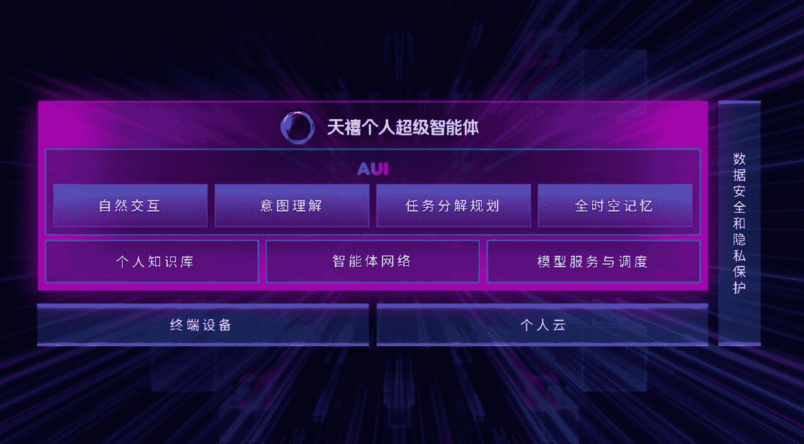

为实现更高性能与隐私保障，天禧个人超级智能体采用端云混合部署架构，可以无缝的运行在多种设备操作系统之上，为联想 AI 终端设备提供超强性能支持。除此之外更实现了跨终端深度协同，无论是设备调度、算力调度，还是知识调度均可无缝衔接。这一能力使得联想诸多设备组成的 “AI 全家桶” 不再是孤立设备，而是形成有机整体，让智能生活变得更加得心应手。

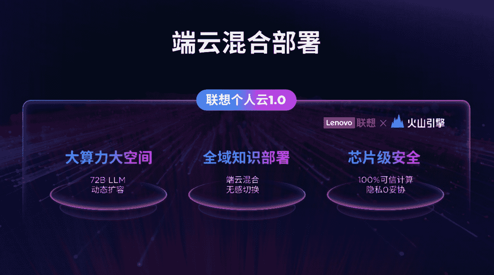

发布会上首发联想个人云 1.0，这是联想与火山引擎共建的可信私密云方案，为每次 AI 执行，提供强大的数据安全和隐私保护。联想个人云搭载 720 亿参数大语言模型，为联想各类 AI 设备打破端侧 AI 算力的束缚。其为用户提供 100GB 起的专属记忆空间，结合 RAG 技术形成可扩展的知识库。天禧个人超级智能体将硬件芯片级加密安全能力延伸至云端，通过 TEE 加密、可信传输和计算容器等核心技术构建起安全壁垒，确保用户数据在使用过程中始终处于严密保护之下。深度融合端云混合架构的天禧个人超级智能体，以 "中国首创、全球第一" 的突破性技术，助力联想 AI 设备开启人机交互的全新想象空间。

天禧个人超级智能体以五大黄金功能重新定义智能体验，已经部分达到了 L3 级别的智能水平，能够深度思考、自主规划编排、并最终完成复杂任务。其中，AI 操控拥有高频使用场景下的超过 300 个技能，还能实现跨端操控；AI 搜索突破传统检索局限，支持模糊搜索、自然搜索和全域搜索；AI 翻译实现了全屏、全场景的 7 种语言实时互译；AI 笔记支持全功能的记录能力、主动整理记录要点和逻辑关系，并协作完成个人知识再创作；AI 服务则依托 “想帮帮” 智能体，提供设备全生命周期管理。

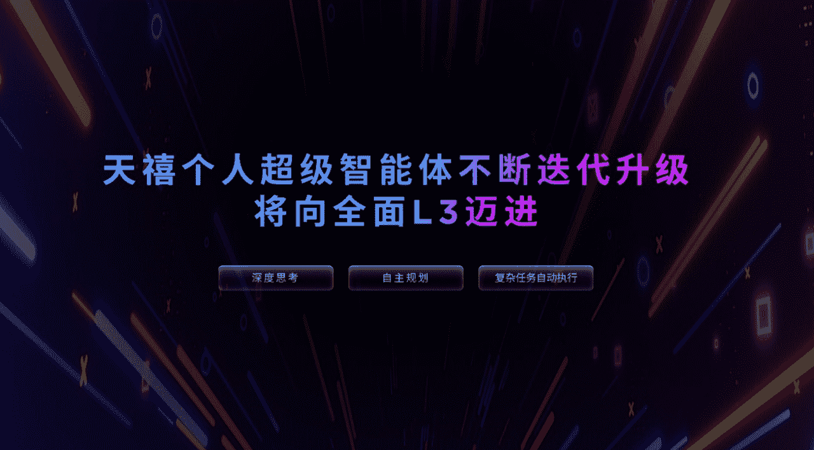

“想帮帮” 是全行业首款专注于为个人智能设备提供 AI 服务的领域智能体，其凭借主动预判故障、跨端协同修复与个性化服务路径规划能力，整合联想 30 年服务经验与擎天智能 IT 引擎 4.0，覆盖设备 “买、用、养、修、换” 全周期，重新定义技术维护的高效无感体验。

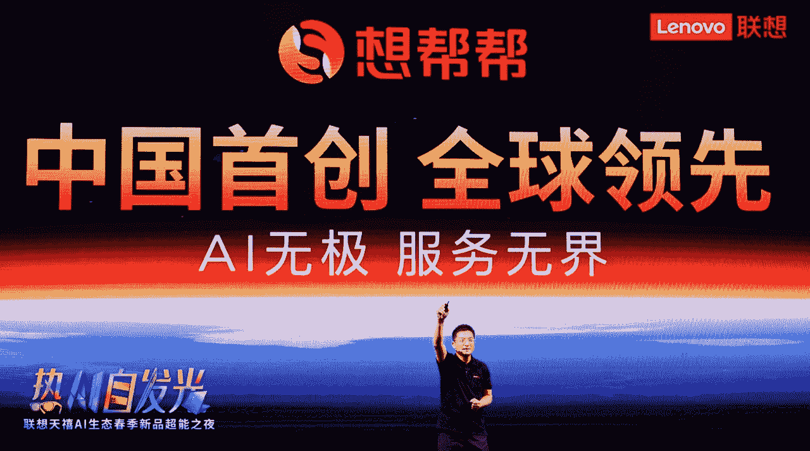

#### 最多色彩、最丰富产品形态

#### 联想 moto razr 60 系列 & edge 60 系列

联想中国消费业务群手机事业部总经理黄智信表示，“我们发明折叠屏，是为了释放空间，我们进化到 L3，是为了折叠时间。” 联想 moto razr 60 系列与联想 moto edge 60 系列均全系搭载全新的联想天禧个人超级智能体，全局伴随态，只需一个眼神、一句需求，AI 即刻响应。

联想 moto razr 60 系列采用全系 Pantone 独家定制流行色设计，结合 Alcantara 奢感材质、天然椴木和柔肤纳米皮等丰富材质，共带来联想 moto razr 60 Ultra AI 元启版、联想 moto razr 60 Pro AI 元启版和联想 moto razr 60 三款机型、十款 Pantone 潮流高定配色，完美契合年轻人街拍 OOTD 需求。

联想 moto razr 60 Ultra AI 元启版搭载了小折叠最强的 5000 万像素三摄影像系统，5000 万像素超广角微距镜头，以更宽的画面和构图视角，重新定义合拍体验。全新的 AI 合影功能，可智能识别画面中的人物状态，避免出现闭眼、表情不佳等尴尬情况，让每一次合拍，都成为可以永远珍藏的瞬间；Live Photo 动态照片则轻松记录每个灵感瞬间，让每一帧的生动都能持久留存，是超合拍的小折叠手机。联想 moto razr 60 Ultra AI 元启版作为首发搭载高通骁龙 8 至尊版移动平台的小折叠手机，为 L3 系统级 AI 带来全方位的充足算力支持。

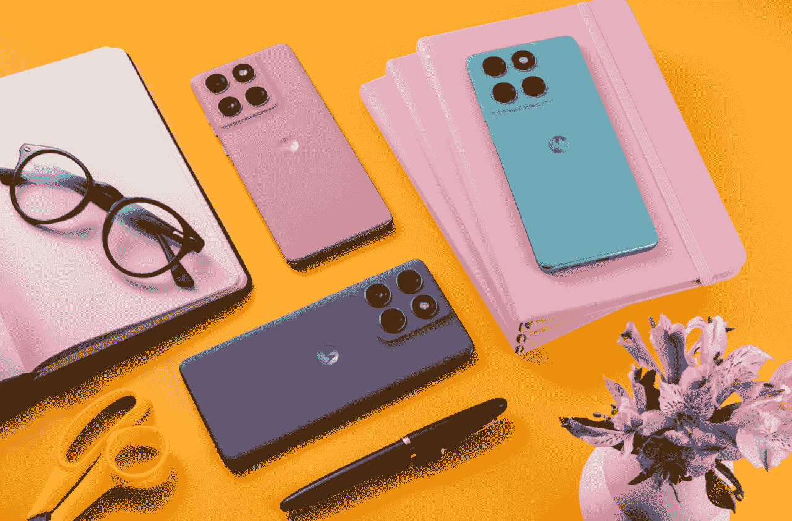

联想 moto edge 60 Pro Al 元启版兼顾性能与美学，联想 moto edge 60 平衡设计与实用。三款新品共计拥有七种 Pantone 时尚高定配色，柔肤纳米皮材质机身搭配极窄边框和一体无缝悬浮机身设计，带来绝佳手感回馈的同时，又兼顾握持的贴合度和操控的精准度。

联想 moto edge 60 系列搭载 1.5K 旗舰级屏幕，强光弱光，始终清晰鲜明，不失细节。续航方面，联想 moto edge 60 Pro AI 元启版配备 6000mAh 大容量电池，支持 90W 有线快充与 15W 无线充电，DxOMark 电池排行榜第一，充电 5 分钟，续航 8 小时。不止轻盈好看，联想 moto edge 60 系列支持国标 GJB150 军规认证以及 IP68 & IP69 双重防护等级，无惧跌落摔砸和灰尘水溅。联想 moto edge 60 系列全系搭载 5000 万像素索尼 LYT-700C 主摄，带来高质量优秀成像表现，是你的私人摄影师。

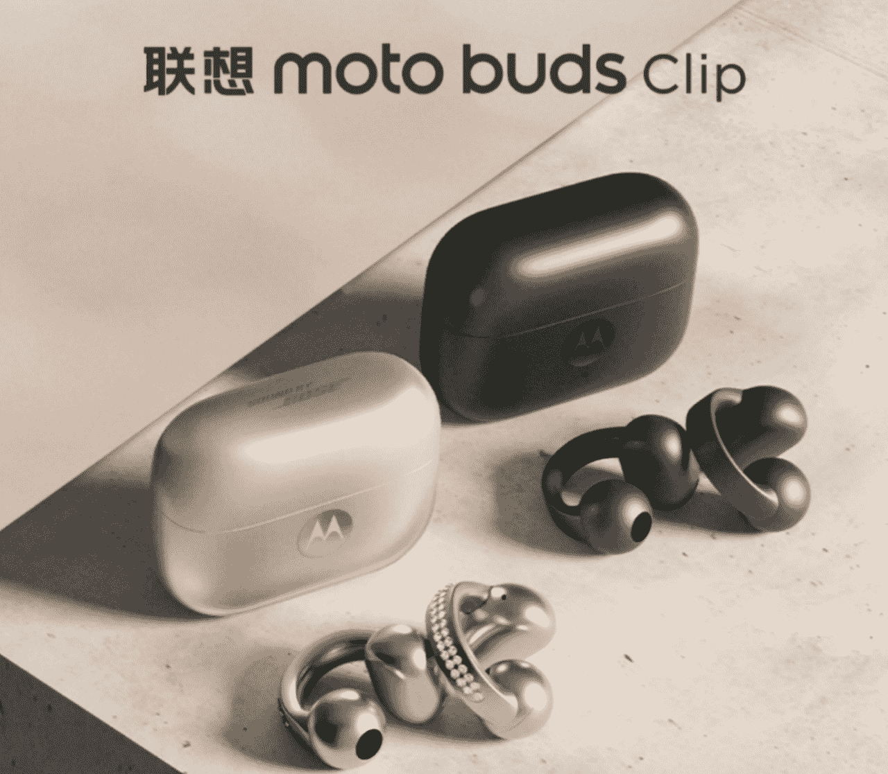

全新发布的联想 moto buds Clip AI 耳机采用开放式耳夹设计，并联合施华洛世奇打造了独特的晶钻限量版，同时与 BOSE 进行联合调音，带来好看、好听、好用 AI 的智能新体验。另外，联想 moto 还与全球知名潮牌 CASETiFY，打造了专属联名版手机壳，提供更多潮流搭配选择。

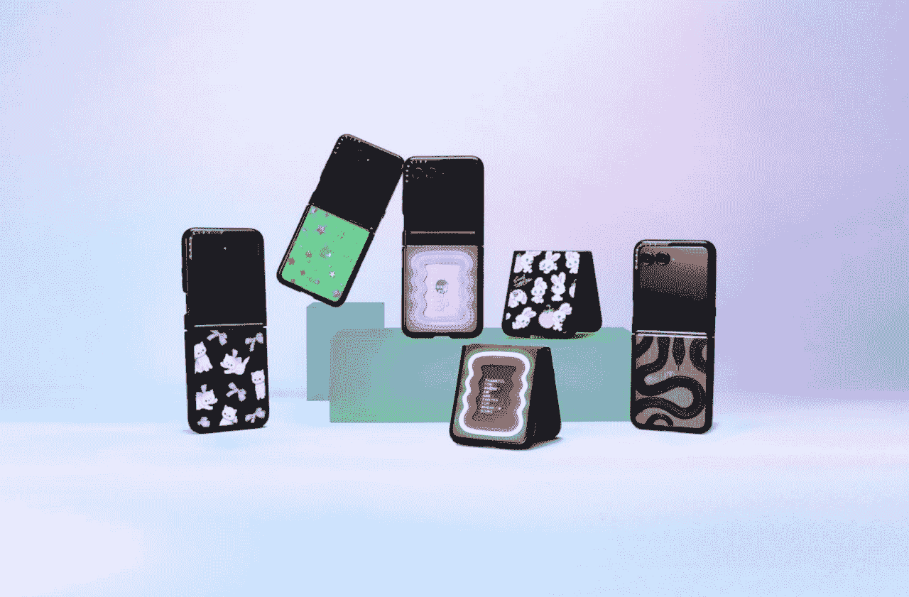

价格方面，联想 moto razr 60 Ultra AI 元启版，优惠后价格仅 5499 元起；联想 moto razr 60 小折叠，优惠后价格仅 2999 元起。联想 moto edge 60 Pro AI 元启版，优惠后价格仅 2295 元起；联想 moto edge 60s 优惠后价格仅 1445 元起。

联想 moto buds Clip AI 耳机，国补后价格仅 425 元；CASETIFY 联名版手机壳，联想 moto razr 60 系列版本的价格是 399 元，联想 moto edge 60 系列版本的价格是 359 元。

#### 联想拯救者多款硬核新品登场

#### 重塑极致性能体验

联想拯救者品牌以十年技术积淀再度颠覆性能边界，携多款新品强势登场。全新拯救者 Y9000P 2025 以 “六边形战士” 之姿，搭载革命性乾坤散热架构，至尊版性能释放跃升至 275W。其搭载的 16 英寸 OLED 专业超竞屏斩获业界首个 HDR 1000 TrueBlack 认证，配合移动端顶级 CPU/GPU、PCIe5.0 固态及 Wi-Fi7 网络，打造出联想最强 AI PC 视觉与性能体验。

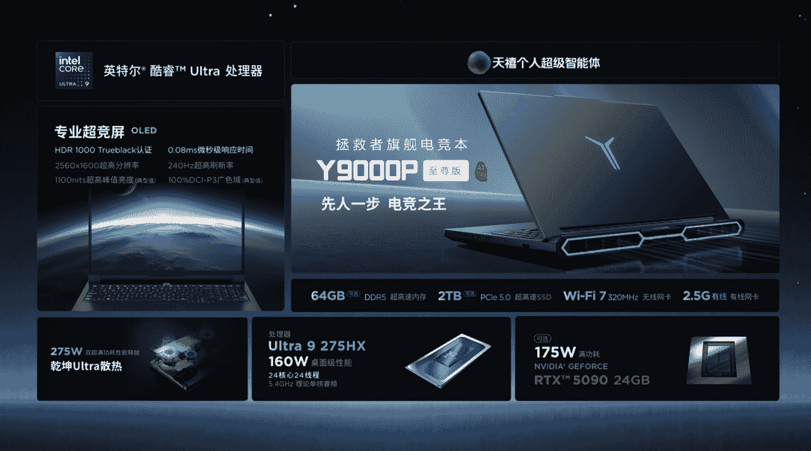

联想拯救者 Y9000X 以 “银翼天使” 之姿重塑轻薄性能美学，冰魄白柔肤纳米皮外壳将重量压缩至 1.98kg、厚度收窄至 15.9mm，却在纤薄机身内蕴藏 115W 满血版 RTX 5070 显卡，实现 170W 狂暴性能释放。16 英寸 OLED 专业超竞屏搭配深度接入的天禧个人超级智能体，颜值与实力兼得。

联想拯救者 Y700 四代专为手游场景深度进化，性能较前代跃升 45%，搭配 3K 165Hz 超清 LCD 护眼屏与升级版乾坤散热架构，辅以 7600mAh 大电池与满血 68W 超级快充，更有 AI 声纹猎手与像素狙神两大 AI 功能革新操控体验，搭配 G9 一体式手柄八指联动操控，彻底释放 “掌机天花板” 的狂暴战力，堪称联想最强性能 AI 手游平板。

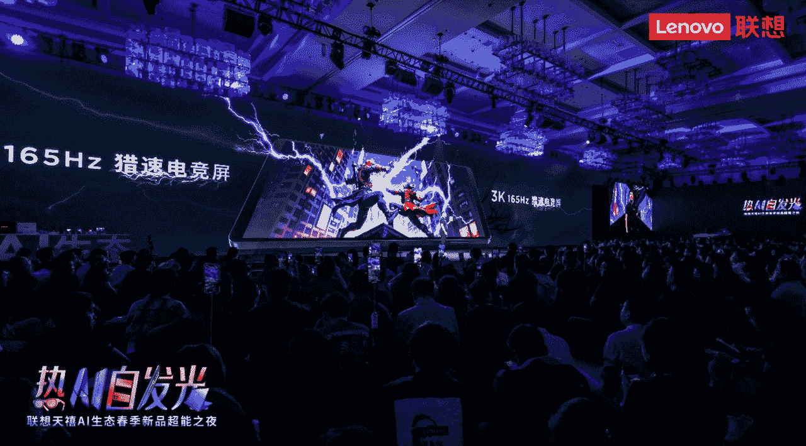

全新 AI 个人移动工作站拯救者创世 AI 元启以革新姿态重磅亮相，凭借双烤 300W 的极致性能释放，重新定义了移动设备的性能边界。该设备还内置天禧端侧 32B 大模型，实现端侧运算即可获得媲美云端大模型的智能体验。尤为瞩目的是，拯救者创世标配 18 英寸裸眼 3D 巨幕屏，成为全球首款支持裸眼 3D 技术的高性能笔记本，为用户带来突破维度的沉浸式视觉革命。

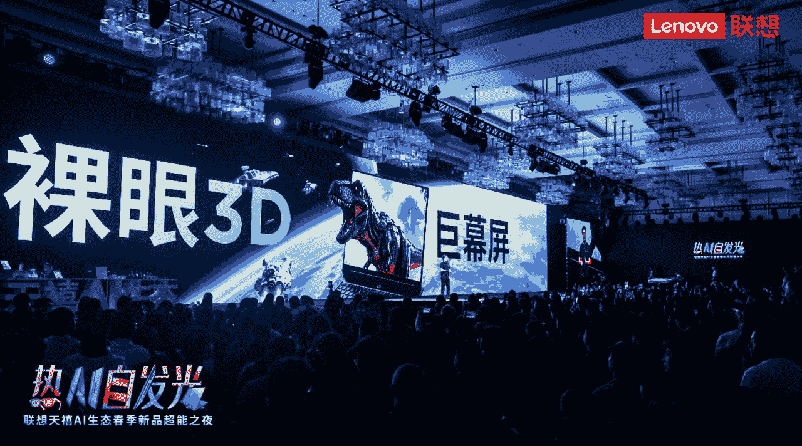

此外，发布会同步推出全自动变速电助力自行车 X7000e、碳纤维公路车 T7000 Carbon 等跨界生态产品，将硬核基因注入多元场景。即日起，用户可登录联想官网定制专属装备，以 “独一无二” 开启下一个硬核十年。联想集团副总裁、中国区消费终端事业部总经理李伟昌表示：“今天不仅是拯救者对过去的致敬，更是面向未来的冲锋！”

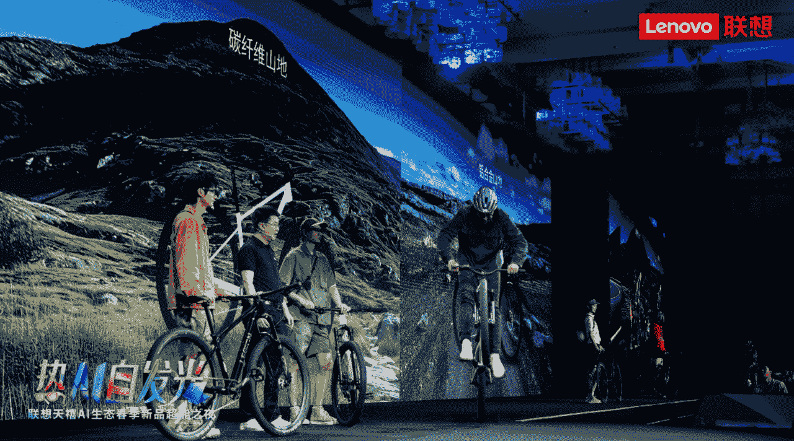

除了拯救者系列，联想还推出了全球首款原生 AI 大平板 YOGA Pad Pro 14.5 AI 元启版。它通过芯片级算力优化重构系统级 AI 体验。其将复杂 AI 模型精简化部署至本地，实现完全离线运行，在保障数据隐私安全的同时，任务响应速度快至 “瞬时完成”。交互层面，首创 “AI 神键” 与 “AI 妙笔” 等功能，全面革新人机交互体验。即日起，通过 YOGA 官方社交平台进入 YOGA 官方新品社群，可领 YOGA Pad Pro 14.5 社群独家限量联想官网 500 元大额优惠券，首发即用。

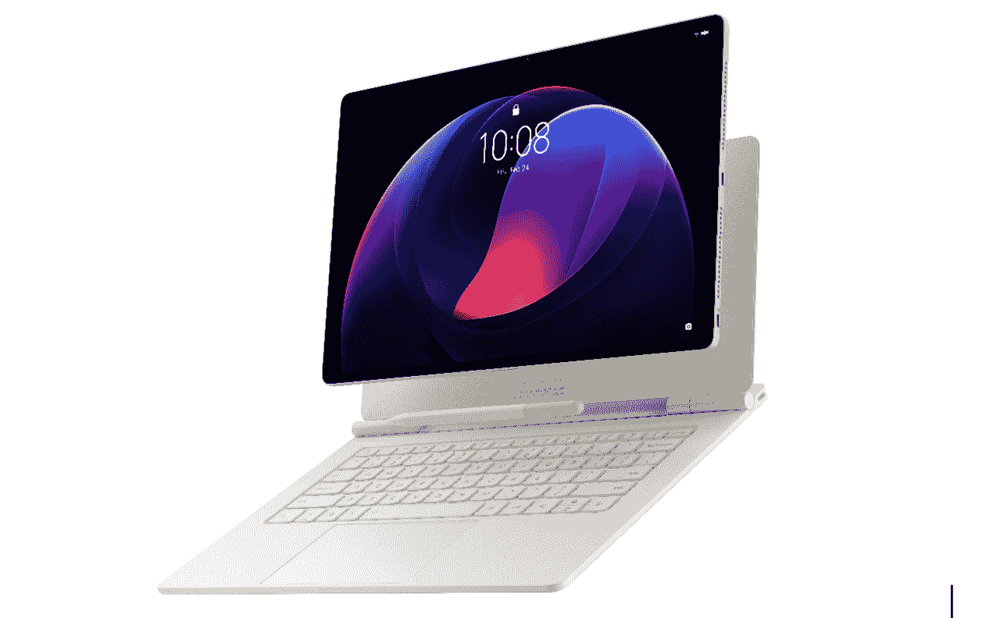

#### “青春有 AI” 教育特惠计划启动

#### 叠加国补最高优惠 4000 元

为赋能青年学子拥抱智能时代，发布会上，联想宣布正式推出 “青春有 AI” 教育特惠计划，面向全国高校在校生及应届高考生，以三大核心权益构建成长支持体系。通过联想官方渠道完成学生认证，即可享全系产品专属低至 9 折优惠，叠加国家补贴后，最高优惠达 4000 元。其中旗舰机型联想拯救者 Y9000P 至尊版叠加教育优惠和国补后仅 25499 元；拯救者 Y9000X AI 元启版享受大学生专属教育特惠和国补后直降 3000 元，仅需 11999 元。联想 moto razr 60 Ultra AI 元启版至高直降 650 元；联想 YOGA Pad Pro 14.5 顶配版直降 1000 元。针对设备迭代需求，联想特别推出保值焕新服务，设备保值，换新无忧。除此以外，还有针对大学生的成长权益，5 月 12 日 “青春有 AI” 大学生公众号将正式开放，参与活动，大学生有机会获得联想实习，甚至工作机会。

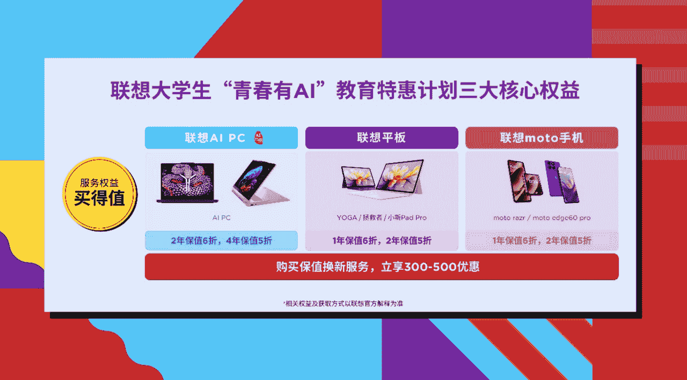

随着天禧个人超级智能体再次进化，联想已构建起 AI PC、AI 手机、AI 平板和 AIoT 的完整 AI 生态。当跨设备协作如水般自然流动，当多模态交互激发出思维火花，AI 正从工具进化为青春的创造力伙伴。联想让设备成为年轻人释放智慧的载体 —— 在 AI 普惠的土壤里，让每个创意破土生长，每份青春热血都将照亮 AI 时代的无限可能。

青春是科技的执火者，而科技让青春更闪亮。当青春遇见 AI，热 AI 就会自发光！